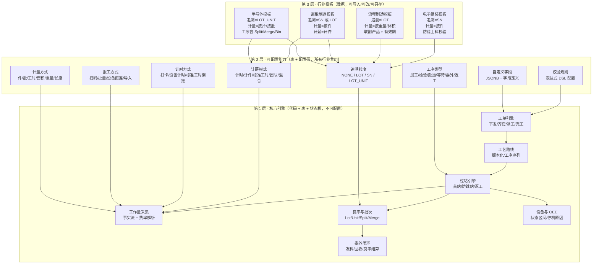
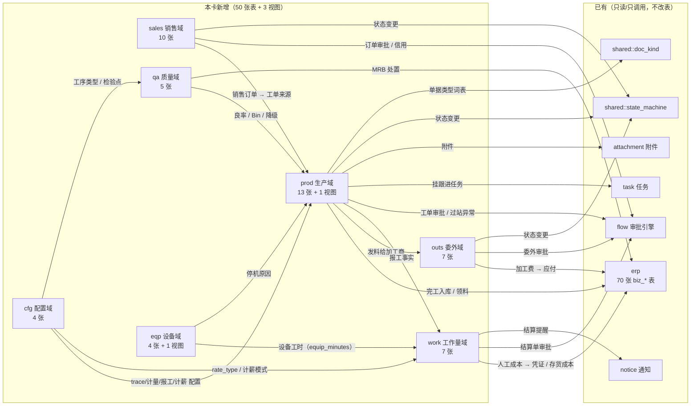
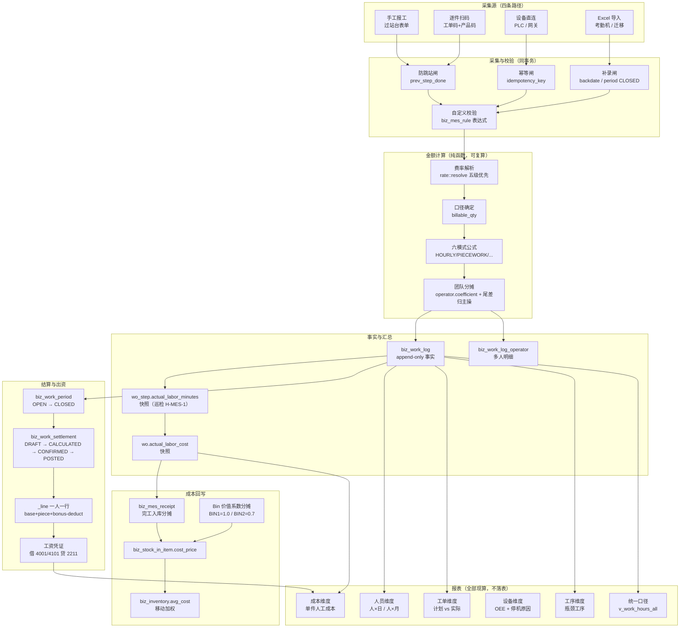
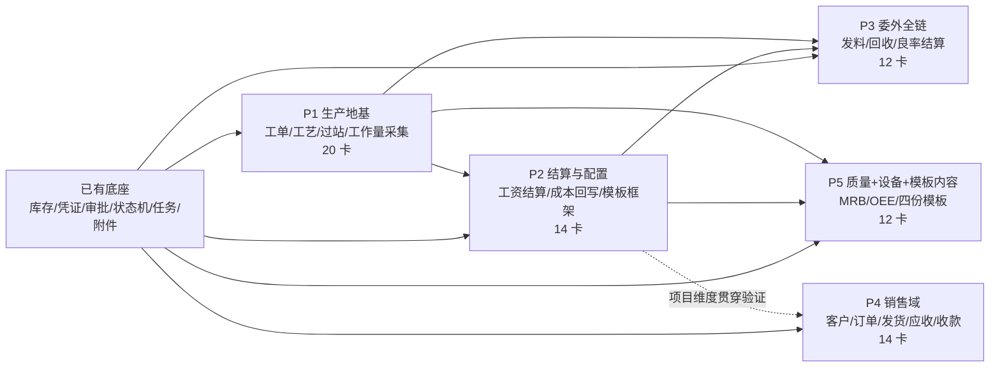

# ARCH-4 · 通用可定制 MES + 工作量计量 + 委外 + 销售 架构设计

> 版本：v2.0（按用户 2026-11-03 第二次纠正整体重写）
> 日期：2026-11-05
> 作者：系统架构师（architect）
> 状态：**设计定稿，未写一行实现代码**（本卡红线：「只设计」）
> 交付物：本文档（卡面要求 ≥2000 行；实测 **4479 行**）
> 图形校验：文档内 **4 张** mermaid 全部用 `mermaid-cli` 10.9.1（`npx @mermaid-js/mermaid-cli`，`PUPPETEER_SKIP_DOWNLOAD=1` + 本机 chrome `--no-sandbox`）逐张实测渲染通过（4/4 SVG 生成成功）
> 上游输入：
> - 卡面《ARCH-4 修订版》（12,814 字符，用户两次原话为最高判据）
> - `docs/architecture/ARCH-3-模块勾稽关系审计.md`（25 条断链 DC-01～DC-25，本文 §9 逐条对照）
> - `docs/architecture/ARCH-5-工作流引擎设计.md`（引擎能力边界、6 维体系、`expression.rs` DSL）
> - `docs/architecture/ARCH-6-财务扩展设计.md`（§1.7 边界表：销售/应收/生产/委外/MES/工作量计量**全部归本卡**）
> - `docs/architecture/P2-9-单据元数据口径.md`（DC-19 已落地：`biz_task.doc_type/doc_id`）
> - `docs/architecture/P2-5-业务类型词表盘点.md`（DC-21：`doc_kind.rs` 唯一真相）
> - `docs/ERP-批次1-产品需求PRD.md` / `docs/ERP-批次2-产品需求PRD.md`（库存/成本口径）
> 技术基线（实测）：Rust 1.94.1 / edition 2024 / 框架 crate **`nik` 0.4.2**（仓内 `vendor/nik`）/ PostgreSQL 18 / Vue 3.5 + TDesign
> 实测库：`cloudpivot_deadmin`（`schema_migrations` max(version::int) = **250**，即 V0250；磁盘迁移 max = **V0251**）

---

## 0. 结论前置（先看这 14 条，再看 2400 行）

### 0.1 十四条定稿决策

| # | 决策 | 一句话理由 | 本文落点 |
|---|---|---|---|
| **D1** | **工作量记录（`biz_work_log`）与任务工时（`biz_task_worklog`）不是同一概念**，前者进 MES 域、后者留在任务域；两者靠**只读视图 `v_work_hours_all` 统一口径**，物理表**不做双写** | `biz_task_worklog` 实测 8 列（`task_id/user_id/work_date/hours/description/...`），没有工序、没有产量、没有费率、没有良率 —— 它答的是「这个任务花了多少小时」，答不了「这道工序做了多少件、该给多少钱」。硬塞进去等于把 MES 塞进任务表 | §3 D1 / §5.5 |
| **D2** | **工作量 = 采集（事实）+ 结算（单据）两段**：`biz_work_log` 是 append-only 事实流，`biz_work_settlement` 是带状态机的结算单据 | 事实表要能高频写、能纠错（红冲而不是改）；结算单要能审批、能锁、能反结算 —— 两者的生命周期完全不同，合成一张表就必然出现「已结算的行被改」 | §4.3 / §6.6 |
| **D3** | **费率一律版本化 + 建单时快照**：`biz_work_rate(effective_from, effective_to)` 解析出费率后，把 `rate_amount` / `shift_coefficient` **快照进 `biz_work_log`** | 调价不能改历史工资，这是工资系统的第一性要求；只靠「关联查费率表」做不到（历史行会跟着费率行一起变） | §5.2 |
| **D4** | **追溯粒度是配置（LAYER-2），不是代码分支**：`NONE / LOT / SN / LOT_UNIT`（双层）四档；半导体模板选 `LOT_UNIT`（Lot + Wafer），螺丝厂选 `LOT` 或 `NONE` | 判定标准：加第 3 个行业不许改代码。四档粒度用同一组表（`biz_mes_lot` + `biz_mes_lot_unit`）表达，粒度只决定「要不要填第二层」，不决定「用哪张表」 | §2.3 / §8 |
| **D5** | **行业模板 = 一份可导入的配置包（行 + JSONB）**，存 `biz_mes_template`；模板**不含代码、不含表结构**，只含枚举取值、工序类型集、计量方式、校验规则、单据编号规则 | 「模板」若靠代码分支实现，第二个客户就要重新发版；配置包可以在实施现场导入、改、另存 | §2.4 |
| **D6** | **自定义字段用 JSONB + 字段定义表**（`biz_mes_field_def`），**绝不为客户 ALTER TABLE** | 一客户一改表结构 = 迁移不可审计、升级必炸；`biz_flow_instance.form_data` 已经证明 JSONB 承载业务表单可行（ARCH-5 已把它冻结进版本快照） | §4.7 |
| **D7** | **校验规则配置化，复用 ARCH-5 的表达式 DSL**（`flow/expression.rs` + `graph::eval`），不新造语法 | 系统里已经有唯一一套条件表达式（`CompareOp` / `Condition` / `EvalContext`），MES 再写一套就是 DC-21 的翻版（第 8 套词表） | §8.8 |
| **D8** | **MES 所有单据状态变更走 `shared::state_machine::transition`**，边表注册进 `Entity` 枚举，锁定态与 reason 必填由注册表声明 | 这是 P10 立下的「五条铁律之③④」；绕过一次状态机等于状态机不存在（`ARCH-3` 已实证 `purchase` 被 `stockin` 绕过一次） | §6 / §9.4 |
| **D9** | **成本回写只写两处**：`biz_voucher`（凭证）与 `biz_inventory.avg_cost`（存货成本），**不建第二本成本账** | 系统已有一本账（移动加权平均，`ck_biz_material_costing` 只允许 `MOVING_AVG`）；建第二本必漂移（R1 单一数据源） | §5.7 |
| **D10** | **委外不复用采购单**（独立 `biz_outs_*` 域），但**加工费进应付复用 `biz_payable`**（`source_type='OUTS_SETTLEMENT'`） | 委外的业务实质是「发料 → 加工 → 回收 → 按良率结算」，采购单没有发料、没有回收、没有良率；而「要付供应商一笔钱」这件事应付表已经做完了，不该重做 | §4.4 / §6.3 |
| **D11** | **销售 v1 不做报价引擎**：报价 = `biz_price_list` 取价 + 导出报价单（打印），不做多轮报价/版本比价 | 报价是销售 CRM 的能力，不是 ERP 底座；先把「订单 → 发货 → 应收 → 收款 → 凭证」跑通，比 20 页报价单更能让老板看到钱 | §6.1 / §10.3 |
| **D12** | **设备工时与人工工时分离记录**：`biz_work_log.equip_minutes`（设备占用）与 `labor_minutes`（人工投入）是**两个列**，不是一列 | 一人看 10 台机器时，「工时」若只有一列，OEE 与人工效率必然有一个是错的 | §5.1 模式⑤ |
| **D13** | **OEE 不做汇总表**：OEE 由 `biz_mes_equip_run`（append-only 区间事实）现算（视图 `v_mes_oee_daily`） | 卡面把 `oee` 列进了设备域的表清单；但缓存 OEE = 统计缓存必漂移（卡面 §2.4 铁律）。用「区间事实 + 视图」既满足口径又守住 R1 | §4.6 / §5.4 |
| **D14** | **销售先做「订单/发货/应收/收款」，生产先做「工单/工艺/过站/工作量」**；委外第 3 期，销售第 4 期，模板第 2 期就引入（框架先落地，内容用首个真实客户打磨） | 见 §10.1 三条论证：用户点名的核心是 MES + 工作量；委外必须建立在工单之上；销售不阻塞生产（首期可用「手工建工单」） | §10.1 |

### 0.2 实测发现的四处「卡面/历史文档已经说错」的地方

| 卡面 / 历史文档说法 | 实测 | 证据 | 本文处置 |
|---|---|---|---|
| 框架 crate 是 `alun`，业务代码 `use alun::prelude::*`，权限宏 `#[alun::permission]` | **仓内是 `nik` 0.4.2（`vendor/nik`），代码里 0 处 `use alun`** | `backend/Cargo.toml:41` `nik = { path = "vendor/nik", … }`；`grep -rl "use alun" backend/src` → 0 行；`backend/src/business/erp/purchase_handler.rs:717` `#[nik::permission(...)]` | 全文一律写 `nik`；`AGENTS.md` 与 `skill/SKILL.md` 的 `alun` 表述属历史遗留，建议另开文档卡订正（本卡不改文档以外的东西） |
| 迁移号段「基础版最大 V0017」 | **磁盘上 `business/` 已到 V0251，全局下一个可用 = V0252** | `ls backend/migrations/*/V*.up.sql \| sed … \| sort -n \| tail -3` → `0249 / 0250 / 0251`；重复检查为空 | MES 迁移从 **V0252** 起编，见 §4.8 |
| 「销售/生产模块完全没做过」 | 半对：**库存侧已有出库单与盘点单**（DC-13/DC-14 已落地），但**客户、销售单、应收、工单、工艺、批次、设备 0 张表** | `biz_stock_out`（`out_type ∈ ISSUE/SCRAP/LOSS/OTHER`）、`biz_stock_take` 存在；`biz_customer` / `biz_sales_*` / `biz_mes_*` 全部不存在（70 张 `biz_*` 实测无一张） | 生产/销售是**新建域**，不是补字段；领料与完工入库**复用** `biz_stock_out` / `biz_stock_in` |
| 「工作量计量可以从零设计」 | **不能忽略已有工时**：`biz_task_worklog` 有 99 行真实数据、8 列、靠 `COALESCE(sum(hours),0)` 回写 `biz_task.actual_hours` | `biz_task_worklog` 实测 8 列 2 CHECK 2 FK；`task/collab.rs:687` 汇总 SQL；`biz_task` 41 列含 `estimate_hours` / `actual_hours` | 明确边界与「统一视图」，见 D1 + §5.5 |

### 0.3 给老板看的一句话（200 字，可直接复制进汇报）

> 这次做的不是一个「半导体专用 MES」，而是一套**通用可定制 MES**：底下是七个所有行业都必须有的引擎（工单、工艺路线、工序过站、工作量采集、良率、设备、委外），中间是八个可以点选的配置能力（追溯粒度、计量方式、报工方式、计时方式、工序类型、计薪模式、自定义字段、校验规则），上面是四份开箱即用的行业模板（半导体 / 离散制造 / 流程制造 / 电子组装）—— 半导体只是其中一份，做螺丝的客户把模板一换就能用，一行代码不用改。**工作量计量是核心功能不是附赠**：记工时、记产量、按计件/计时/团队/混合算钱，费率带版本（调价不改历史工资），人工成本自动回写工单与存货成本。六个域合计 **50 张新表 + 3 个视图**，分 5 期，第一期 20 张卡就能看到「工单过站 + 报工台账」。

### 0.4 阅读指南

| 你想干什么 | 看哪几节 |
|---|---|
| 5 分钟判断这套设计靠不靠谱 | §0.1 十四条决策 → §7 十二个半导体问题的「配置 or 新增能力」分类 → §10.1 三条先决论证 |
| 直接开工写后端 | §4 数据模型（50 张表的列/键/分层）→ §4.3 工作量完整 DDL → §5 六种计薪模式与算法 → §6 六条流程的边表 → §9 接线点清单 |
| 直接开工写前端 | §6 每节的「页面与操作」→ §8 配置界面清单 |
| 想知道会不会又做出一个半导体专用系统 | §2.2 判定表（配置 vs 代码）+ §2.4 模板 JSON Schema + §8 配置清单 |
| 想知道和 ARCH-3/5/6 会不会撞车 | §1.7 边界表 + §9 与 25 条断链的关系 |
| 想知道坑在哪 | 每章末尾「本章红线」+ 附录 C 待拍板 7 条 |

---

# 第一章 实测基线：现有系统能撑什么、撑不住什么

> 本章所有结论都来自**本机真库 + 真代码**。每条给出可复跑命令；凡与历史文档不一致的，以本章为准。

## 1.1 实测环境与库选取

```bash
# 环境
$ ls /opt/cloudpivot/backend/config/config.toml          # host=127.0.0.1 port=5432 db=cloudpivot user=cloudpivot
$ pg_isready -h 127.0.0.1 -p 5432
127.0.0.1:5432 - accepting connections

# 本机 430 个库里选「迁移最全 + 表最多」的一份做基线（peer 认证，无需口令）
$ for db in cloudpivot_deadmin cloudpivot_54ad4c5f …; do
    sudo -u postgres psql -d "$db" -t -c "select max(version::int) from schema_migrations where success"
  done
cloudpivot_deadmin             => 250      ← 选它（V0250，只差磁盘上的 V0251）
cloudpivot_54ad4c5f_committed  => 235
cloudpivot_54ad4c5f            => 219

$ sudo -u postgres psql -d cloudpivot_deadmin -t -c "select count(*) from information_schema.tables where table_schema='public'"
132
$ sudo -u postgres psql -d cloudpivot_deadmin -t -c "select count(*) from information_schema.tables where table_schema='public' and table_name like 'biz%'"
70
```

**基线说明（诚实清单）**：`cloudpivot_deadmin` 是 V0250 快照，磁盘迁移已到 V0251（`flow_deadmin_assignee_roles`，只改流程节点指派角色数据，不建表）。**本文所有「MES 表不存在」的结论不受这一个版本影响** —— 70 张 `biz_*` 表逐张核对过，没有一张与生产/销售/工作量相关。

## 1.2 现有 70 张 `biz_*` 表按域归类（实测清单）

```bash
$ sudo -u postgres psql -d cloudpivot_deadmin -t -c \
  "select table_name from information_schema.tables where table_schema='public' and table_name like 'biz%' order by 1"
```

| 域 | 表（实测） | 张数 | 与 MES 的关系 |
|---|---|---|---|
| 主数据 | `biz_material` `biz_unit` `biz_warehouse` `biz_location` `biz_inventory_location` `biz_supplier` `biz_account` | 7 | **被 MES 复用**（物料=SEMI/FINISHED、单位换算、仓库、库位、科目） |
| 库存 | `biz_inventory` `biz_inventory_txn` `biz_material_serial` `biz_opening_inventory` | 4 | **被 MES 复用**（领料出库、完工入库都记这三本账） |
| 采购 | `biz_purchase_order(+item)` `biz_stock_in(+item)` `biz_stock_out(+item)` `biz_stock_transfer(+item/+item_serial)` `biz_stock_take(+item)` `biz_opening_balance` | 12 | **被 MES 复用**（`stock_out.out_type=ISSUE` 领料、`stock_in` 完工入库） |
| 财务 | `biz_payable` `biz_payment` `biz_voucher` `biz_voucher_entry` `biz_voucher_rule` `biz_accounting_period` `biz_report_item` `biz_cashflow_item` | 8 | **被 MES 复用**（委外加工费进应付、人工成本进凭证） |
| 合同 | `biz_contract` | 1 | 只读引用（销售合同后续可接，本设计不碰） |
| 项目 | `biz_project` `biz_project_member` | 2 | **MES 全单据挂 `project_id`**（DC-16 不再犯） |
| 任务 | `biz_task` `biz_task_member` `biz_task_worklog` `biz_task_comment` `biz_task_attachment` `biz_task_dependency` `biz_task_template` `biz_task_ai_token` | 8 | **工作量域要与它划界**（D1） |
| 流程 | `biz_flow_def(+version)` `biz_flow_node(+assignee)` `biz_flow_edge` `biz_flow_instance(+node)` `biz_flow_task` `biz_flow_cc` `biz_flow_state_edge` `biz_flow_linkage_rule` | 12 | **MES 六条流程全部靠它** |
| 平台桥接 | `biz_status_log` `biz_seq` `biz_doc_attachment` `biz_reminder_log` | 4 | **MES 全部接线**（状态日志 / 取号 / 附件 / 提醒） |
| ARCH-6 新增 | `biz_budget*` `biz_fixed_asset*` `biz_depreciation*` `biz_asset_category` `biz_expense*` | 12 | 与 MES 无交集（财务侧） |

**关键结论 1**：MES 需要的**物料、单位、仓库、库位、序列号、三本账、凭证、科目、审批、状态机、取号、附件、提醒，全部已经存在**。MES 不需要重造任何一条地基，只需要在它上面长 **50 张新表 + 3 个视图**（§4）。

**关键结论 2**：与生产/销售/工作量相关的表 = **0 张**。

```bash
$ sudo -u postgres psql -d cloudpivot_deadmin -t -c \
  "select table_name from information_schema.tables where table_schema='public'
   and (table_name like '%customer%' or table_name like '%sales%' or table_name like '%work_order%'
        or table_name like '%lot%' or table_name like '%equipment%' or table_name like '%route%')"
(0 rows)
```

## 1.3 现有能力矩阵：MES 需要什么 × 现在有什么

| MES 需要的能力 | 现在有没有 | 现有实现（file:line / 表） | 缺什么 |
|---|---|---|---|
| 物料主数据（含半成品/成品类型） | ✅ | `biz_material.material_type ∈ {RAW, SEMI, FINISHED, PACKAGING, CONSUMABLE, OFFICE, SERVICE}`（CHECK 实测） | 缺「可制造性」标记（是否走工单、默认工艺路线）→ §4.1 |
| 单位与换算 | ⚠️ 表有、单据路径不读 | `biz_unit(base_unit_id, rate, is_base, precision)`；DC-09 实测「单据路径 0 处读取」 | MES 的计量方式必须**显式折算基本单位**（§8.2），否则重犯 DC-09 |
| 库存三本账 | ✅ | `biz_inventory(avg_cost, amount, location_id)` / `biz_inventory_location` / `biz_inventory_txn(before/after × qty/amount/cost)` | 无工序在制（WIP）账 → 用视图，不建表（§4.2.9） |
| 领料出库 | ✅（半成品） | `biz_stock_out.out_type ∈ {ISSUE, SCRAP, LOSS, OTHER}`，4 态 `DRAFT/PENDING_POST/POSTED/CANCELLED` | **没有「给哪张工单领的」列** → MES 侧新表持有 `stock_out_id`（§4.2.10） |
| 完工入库 | ✅（半成品） | `biz_stock_in.in_type ∈ {PURCHASE, RETURN, OTHER}`，5 态 | 无 `PRODUCTION` 类型 → v1 用 `OTHER` + MES 侧桥接表（§4.2.11，附录 C 待拍板 3） |
| 凭证与科目 | ✅ | `biz_voucher` / `biz_voucher_entry(aux_supplier_id, aux_material_id, aux_warehouse_id, aux_dept_id, aux_extra)` / `biz_voucher_rule(biz_type)` | MES 需新增 5 个 `biz_type` 的凭证规则（§6.8） |
| 科目体系 | ✅ | `biz_account` 实测含 `4001 生产成本` `4101 制造费用` `1405 库存商品` `1408 委托加工物资` `2211 应付职工薪酬` `1122 应收账款` `2203 预收账款` `2221.02 销项税` `5401 主营业务成本` `6401 主营业务成本` | 无「生产成本-直接人工/制造费用」二级科目 → 需补种 2–4 条（§6.8） |
| 审批流 | ✅ | `biz_flow_def(36 行)` / `biz_flow_instance` / `engine::start/approve/reject`（`flow/engine.rs:485/569/596`） | 需新增 6 个 `biz_type` 与流程定义（§6） |
| 状态机 | ✅ | `shared/state_machine.rs`：`transition` / `transition_if_changed` / `log_created` / `ensure_writable`，边表注册在 `Entity` 枚举，支持 `biz_flow_edge` 配置化 | 需注册 6 个新 `Entity`（§9.4 接线点 C-2） |
| 单据取号 | ✅ | `biz_seq(seq_type, prefix, date_pattern, period_key, current_no)` | 需新增 8 个 `seq_type`（§4.8） |
| 单据附件 | ⚠️ 有桥接表但 **CHECK 写死 7 种单** | `biz_doc_attachment`，`ck_biz_doc_attachment_type ∈ {CONTRACT, PURCHASE_ORDER, STOCK_IN, PAYABLE, PAYMENT, FIXED_ASSET, EXPENSE_REPORT}` | MES 单据挂附件**必须扩 CHECK**（§9.2 DC-17 复发点） |
| 业务提醒 | ⚠️ 同上，CHECK 写死 5 种单 + 4 种 kind | `biz_reminder_log`，`ck_biz_reminder_log_doc_type ∈ {PAYABLE, PURCHASE_ORDER, CONTRACT, INVENTORY, EXPENSE_REPORT}`、`ck_biz_reminder_log_kind ∈ {PAYABLE_DUE, PO_OVERDUE, CONTRACT_EXPIRE, LOW_STOCK}` | 工单逾期/委外超期/结算待确认提醒需扩 CHECK |
| 单据↔任务 | ✅（DC-19 已落地） | `biz_task.doc_type + doc_id`（+ `ck_biz_task_doc_pair`、`idx_biz_task_doc`）；白名单在 `task/doc_ref.rs::DOC_TARGETS`（5 种） | MES 单据要挂任务 → 在 `DOC_TARGETS` 加行（不改表、不改迁移） |
| 业务类型词表 | ✅（DC-21 唯一真相） | `shared/doc_kind.rs::DocKind`（18 个值，`ALL` 常量、`as_str`、`label`、`table`、`is_document`） | MES 新增 8 种 → 改这一个文件（§9.2） |
| 定时任务 | ✅ | `sys_job` + `task/scheduler.rs`（实测已注册 6 个 ERP 扫描任务） | MES 需 4 个扫描任务（工单逾期/委外超期/结算待确认/OEE T+1） |
| 权限码 | ✅ | `sys_menu` 279 行，格式 `business:erp:<resource>:<action>`；`#[nik::permission]` 宏声明 | MES 按同格式新增（`business:mes:*` / `business:sales:*`） |

## 1.4 现有「工时」到底是什么：`biz_task_worklog` 逐列实测

```bash
$ sudo -u postgres psql -d cloudpivot_deadmin -c "\d biz_task_worklog"
   Column    | Type                     | Nullable | Default
 id          | uuid                     | not null | gen_random_uuid()
 task_id     | uuid                     | not null |
 user_id     | uuid                     | not null |
 work_date   | date                     | not null |
 hours       | numeric(5,1)             | not null |
 description | text                     |          |
 created_at  | timestamptz              | not null | now()
 create_by   | uuid                     |          |
Indexes: pkey(id), idx_biz_task_worklog_task(task_id, work_date),
         idx_biz_task_worklog_task_date(task_id, work_date), idx_biz_task_worklog_user_id(user_id)
Check:   hours > 0, hours BETWEEN 0.25 AND 24
FK:      task_id → biz_task(id) ON DELETE CASCADE, user_id → sys_user(id)

$ sudo -u postgres psql -d cloudpivot_deadmin -t -c "select count(*) from biz_task_worklog"
99
```

逐项与本卡要求的「工作量」对照：

| 工作量计量需要 | `biz_task_worklog` 有吗 | 说明 |
|---|---|---|
| 人 | ✅ `user_id` | 只能一个人（团队计工要靠 MES 的从表） |
| 日期 | ⚠️ `work_date`（只有日，无起止时刻） | 无法算「8:00–17:00 扣 1 小时午休」这种精度 |
| 实际工时 | ⚠️ `hours numeric(5,1)`（0.1 小时 = 6 分钟粒度） | 无法记 `downtime_minutes`（停机/等待），也无法记设备工时 |
| 工序 | ❌ | 没有 `step_id`，无法算「某道工序的工时」 |
| 产量 | ❌ | 没有 `qty_good/qty_defect/qty_scrap`，计件工资无从算 |
| 费率 | ❌ | 没有 `rate_type/rate_amount`，没有金额 |
| 班次 | ❌ | 没有 `shift`，夜班 1.2 倍系数无处落 |
| 标准工时 | ❌ | 没有 `standard_minutes`，效率达成率算不出 |
| 成本回写 | ❌ | 只汇总到 `biz_task.actual_hours`（`task/collab.rs:687`），不进任何成本 |

**结论**：`biz_task_worklog` 是「任务工时台账」，粒度是**任务 × 人 × 日 × 小时**；本卡要的是「工作量记录」，粒度是**工单工序 × 人 × 时段 × 产量 × 费率**。两者是**两个域的两件事**，不是一件事的两种写法。处置见 §5.5（统一口径视图 + 单向边界 + 将来收敛的量化判据）。

## 1.5 现有状态机的能力边界（MES 全部要吃透）

`backend/src/business/shared/state_machine.rs` 实测（编译期注册表）：

| 能力 | 实现 | MES 怎么用 |
|---|---|---|
| 唯一变更入口 | `transition(tx, entity, from, to, edges, ctx)`（:2267） | 六条流程的每一步都调它，禁止 `UPDATE … SET status=` |
| 不变则跳过 | `transition_if_changed`（:2389） | 工序「部分报工 → 继续部分报工」这类原地推进用它 |
| 建单留痕 | `log_created`（:2425，`from_status = NULL`） | 建单时必须调，否则 `biz_status_log` 缺起点 |
| 入账态只读闸 | `ensure_writable` + `Entity::is_locked`（:1162） | `POSTED / SETTLED / CLOSED` 后金额列不可改 |
| 边表可配置 | `biz_flow_edge` + `resolve_edges` / `upsert_edge_config`（:1327/:1701） | 客户可在前端加边（如「返工后可回工序 10」），不改代码 |
| reason 必填 | `EdgeMeta.needs_reason`（:719） / `needs_reason()`（:1155） | 报废、让步接收、反结算必须写理由 |
| 注册表核对 | 「传进来的 `edges` 与注册表不一致 → 500」 | 防止有人顺手多放一条边（硬红线机器化） |

**MES 要做的只是新增 `Entity` 变体 + 每个变体的边常量**，机制一行不用改（§9.4 C-2）。

## 1.6 现有审批引擎的接线方式（照抄 `purchase_bridge` 范式）

MES 六条流程全部复用现有引擎，接法固定为 4 步（`erp/purchase_handler.rs:1167` 是范本）：

```
① 业务 handler 的「提交」动作里：
   match purchase_bridge::published_po_flow().await? {     // 查默认已发布流程
       Some(flow) => { approval_gate::ensure_not_skipped(...)?;   // 有流程就不许跳过
                       engine::start(&tx, &StartReq{ biz_type, biz_id, biz_no, title, form_data, .. }).await?;
                       /* 单据 → PENDING_APPROVE，写 approval_instance_id */ }
       None      => { /* DC-01：不许静默直过 —— MES 一律 400 要求先配流程 */ }
   }
② biz_*_bridge.rs 实现「通过」「驳回」「撤回」三个回调（同事务改单据状态 + 写状态日志）
③ 反向兜底：单据被别处改了状态时回收孤儿实例（`*_bridge::reclaim_orphan`）
④ 内控闸：制单人不能批自己的单（`internal_control.rs`，MES 全流程开启）
```

> **MES 与 ERP 的唯一区别**：MES 的 `None =>` 分支**必须报错**，**不许**像现有 6 处那样「未配流程 → 静默直接生效」（DC-01）。理由：生产过站与工作量结算直接决定工资和成本，没有审批就生效是内控事故。

## 1.7 与 ARCH-3 / ARCH-5 / ARCH-6 的边界（防止重复设计）

| 主题 | 归属 | 本卡态度 |
|---|---|---|
| 采购单 / 收货 / 库存 / 调拨 / 盘点 | 已完成（V0137–V0251） | **只调用，不改表**；MES 领料与完工入库以「新表持存量单 id」的方式桥接 |
| 凭证引擎 / 期间 / 年结 / 报表 | 已完成 | **只调用**（`voucher_multi` 多借方入口），MES 只补 `biz_voucher_rule` 行与 2–4 个末级科目 |
| 预算 / 固资 / 报销 | ARCH-6（已完成设计） | **不碰**；MES 的「人工成本」不进预算控制点（D4 of ARCH-6 只控承诺时点） |
| 审批流引擎 / 6 维体系 / 节点类型 | ARCH-5（已定稿设计） | **只消费**：六条流程全部用今天已有的 9 种节点；MES 不新增节点类型 |
| 任务系统（`biz_task` / `biz_task_worklog`） | 任务域 | **划界不合并**（D1），靠视图统一口径 |
| 客户 / 销售 / 应收 / 收款 | **ARCH-4（本卡）** | ARCH-6 §1.7 明确「完全不碰」，本卡做 |
| 工单 / 工艺 / 批次 / 过站 / 委外 / 工作量 | **ARCH-4（本卡）** | ARCH-6 §1.7 明确「不碰」，本卡做 |
| 设备 / OEE / 预防性维护 | **ARCH-4（本卡）** | 本卡做设备台账与 OEE 视图；维修工单（CMMS 深度）留 P5 后 |

## 本章红线

1. **不许为 MES 新建第二套物料/单位/仓库/库位/科目/凭证/审批/状态机**——全部复用，缺的能力用「新表 + 桥接列」，不许改存量表结构。
2. **不许把工作量塞进 `biz_task_worklog`**（列语义完全不匹配，且它是任务域的资产）。
3. **不许再写一处「未配流程 → 静默直接生效」**（DC-01 的 6 处反面教材在本卡一律不复制）。
4. **不许在 DDL 里写死业务类型白名单**（DC-21 教训：`biz_doc_attachment` / `biz_reminder_log` 的 CHECK 就是历史包袱，MES 的新表**一张都不许**再写这种 CHECK）。
5. **本文所有数字必须能在本机复跑**（附录 A 给命令）。

---

# 第二章 三层架构与模块边界（交付物 1）

## 2.1 三层结构的判定标准（先立规则，再谈实现）

用户第二次纠正的核心是「普通产业也要能支持，应该是可以灵活定制的」。这句话翻译成工程判据只有一条：

> **一段逻辑，属于哪一层，取决于「换一个行业时，它是变还是不变」。**
> - 换行业**永远不变** → 第 1 层（核心引擎，写代码、写表、写状态机）
> - 换行业**换取值** → 第 2 层（可配置能力，写配置表 + 前端配置页）
> - 换行业**换整套取值组合** → 第 3 层（行业模板，写配置包）

反面判据（任何一条成立即为设计失败）：

```
✘ 代码里出现 if (industry == "SEMICONDUCTOR") / if (trace == "WAFER")
✘ 加第三个行业需要发版、需要写迁移
✘ 某个行业的客户为了跑通主流程，必须改代码或手动改库
✘ 「模板」是一个 Java/Rust 策略类，而不是一行可导入的数据
```

## 2.2 三层结构图（mermaid 图 1）



**读图要点**：箭头**只向下**。第 3 层只写进第 2 层的配置表，**不直接调用第 1 层的代码**。这是「模板」与「代码分支」的本质区别：模板是**数据**，代码只认配置键，永远不知道「现在跑的是哪个行业」。

## 2.3 ERP / MES 边界表（能力 / 归属 / 数据主人 / 理由）

| 能力 | 归属 | 数据主人（唯一写入方） | 理由 |
|---|---|---|---|
| 物料主数据、单位、仓库、库位 | ERP（已有） | `erp` 模块 | MES 只读引用；MES 特有属性（默认工艺路线、是否走工单、标准节拍）放 `biz_mes_item_ext`（MES 侧扩展表，不 ALTER `biz_material`） |
| 采购、收货、调拨、盘点 | ERP（已有） | `erp` 模块 | MES 不重造库存动作；领料=生成 `biz_stock_out`，完工入库=生成 `biz_stock_in` |
| 库存余额与成本（移动加权） | ERP（已有） | `erp::inventory_writer` | MES 只**触发**过账，不写 `biz_inventory` |
| 凭证、科目、期间、年结 | ERP（已有） | `erp::voucher*` | MES 只提供 `biz_type + 金额 + 辅助维度`，借贷平衡由凭证引擎保证 |
| 应付 / 付款（供应商债权） | ERP（已有） | `erp::payable` | 委外加工费 = 应付的一种 `source_type`（D10） |
| 审批流引擎、任务、通知 | 平台（已有） | `flow` / `task` / `notice` | MES 只发实例、只挂任务 |
| **客户主数据 / 价格表 / 销售订单 / 发货 / 应收 / 收款** | **MES-销售域（本卡）** | `mes::sales` | 系统 0 张相关表；ARCH-6 明确不碰 |
| **工艺路线 / 工单 / 工单工序 / 过站 / 批次 / 在制** | **MES-生产域（本卡）** | `mes::prod` | 生产执行的本体 |
| **工作量记录 / 费率 / 结算** | **MES-工作量域（本卡）** | `mes::work` | 用户点名的核心功能 |
| **委外单 / 发料 / 回收 / 良率结算** | **MES-委外域（本卡）** | `mes::outs` | 不是采购、不是销售，是第三种业务形态 |
| **检验 / 不良 / MRB / Bin 等级** | **MES-质量域（本卡）** | `mes::qa` | 良率与降级影响成本 |
| **设备台账 / 状态区间 / 保养 / OEE** | **MES-设备域（本卡）** | `mes::eqp` | OEE 是设备的事实，不是财务的 |
| **行业模板 / 自定义字段 / 校验规则** | **MES-配置域（本卡）** | `mes::cfg` | 三层架构的第 2、3 层落地 |

**一句话边界**：**ERP 管「钱和物怎么流动」，MES 管「物怎么被做出来、谁做的、做了多少、做得怎么样」**。两者唯一的交界是「库存动作」与「凭证」——这两件事 MES 一律**委托**给 ERP，自己只持有桥接 id。

## 2.4 「哪些是配置、哪些是代码」判定表（本卡最容易被糊弄的一张表）

判定方法（逐条问三遍）：
1. 换行业时，**这段逻辑的 if 分支**会变吗？（会 → 往下走；不会 → 代码）
2. 变的是**取值**还是**流程顺序**？（取值 → 配置；流程顺序 → 把顺序本身做成数据：工序序列、边表）
3. 变了以后，**数据库表结构**要改吗？（要改 → 说明抽象错了，重做；不改 → 配置）

| # | 需求点 | 配置 or 代码 | 落地形式 | 为什么不这么做就错 |
|---|---|---|---|---|
| 1 | 追溯粒度（不做 / Lot / SN / Lot+Unit） | **配置** | `biz_mes_profile.trace_granularity` | 写代码 → 加客户要发版 |
| 2 | 计量方式（件/批/工时/面积/重量/长度） | **配置** | `biz_mes_item_ext.measure_mode` + `biz_unit` | 螺丝按件、钢板按面积、化工按重量，是取值差异 |
| 3 | 报工方式（扫码/批量/设备直连/导入） | **配置** | `biz_mes_route_step.report_mode` | 有 MES 硬件的厂要设备直连，没硬件的要靠手填 |
| 4 | 计时方式（打卡/设备计时/标准工时倒推） | **配置** | `biz_mes_route_step.timing_mode` | 见 §5.1 五种计时来源 |
| 5 | 工序类型（加工/检验/搬运/等待/委外/返工） | **配置** | `biz_mes_route_step.step_type` + 词表 | 半导体有 20 道工序、螺丝有 3 道，是数据 |
| 6 | 计薪模式（计时/计件/标准工时/团队/混合） | **配置** | `biz_work_rate.rate_type` | 见 §5.1 六种模式的取值 |
| 7 | 工序序列本身（先车后铣还是先铣后车） | **配置（数据）** | `biz_mes_route_step.seq_no` + `next_step_nos` | 每个客户的工艺路线都不同，这是数据不是代码 |
| 8 | 允许的状态跳转（如「返工后可回工序 10」） | **配置** | `biz_flow_edge`（现有机制） | 现有状态机已支持前端加边 |
| 9 | 客户特有字段（如「晶圆厂批次号」「硬度等级」） | **配置** | `biz_mes_field_def` + 各表 `ext JSONB` | 一客户改表 = 迁移不可审计 |
| 10 | 客户特有校验（如「SMT 上料必须扫料盘」） | **配置** | `biz_mes_rule`（表达式 DSL） | 硬编码 = 每客户一个分支 |
| 11 | **过站必须校验「上一道工序完成」** | **代码** | `mes::prod::station::ensure_prev_done` | 这是「过站」这个概念的定义，不因行业而变 |
| 12 | **工作量记录 append-only、纠错靠红冲** | **代码** | `biz_work_log` 无 UPDATE 路径 + `reversal_of_id` | 工资事实不允许被改，是所有行业的会计前提 |
| 13 | **费率版本化解析（按 work_date 取生效版本）** | **代码** | `mes::work::rate::resolve` | 规则本身固定，只有费率值可变 |
| 14 | **良率计算（良品/投入）与 Bin 汇总** | **代码** | 视图 + `biz_mes_bin_def`（等级定义是配置） | 算法不变（分子分母），等级名称可变 |
| 15 | **Split/Merge 血缘不可断** | **代码** | `biz_mes_lot_link` 双写（正向/反向） | 追溯链是合规底线 |
| 16 | **委外发料-回收数量勾稽（回收+报废+损耗=发出）** | **代码** | `mes::outs::settle::check_balance` | 这是委外的定义；容差是配置（`tolerance_pct`） |
| 17 | 客户是否允许「超领料」 | **配置** | `biz_mes_profile.allow_over_issue` + 容差 | 取值差异 |
| 18 | 模板本身的字段集合 | **配置** | `biz_mes_template.payload JSONB` | 模板是数据 |

**这张表的读法**：11–16 行是「不可配置的核心」，共 6 条；其余 12 条全部配置化。**核心引擎只允许这 6 条不许配**——再往里加第 7 条，就要先证明「所有行业都这么做」。

## 2.5 行业模板的定义格式（JSON Schema）

模板是一行数据，`payload` 是 JSONB，Schema 如下（`biz_mes_template.payload` 的**结构契约**，落地时用 `jsonschema` 校验或 Rust 侧手写结构体 + serde deny_unknown_fields）：

```json
{
  "$schema": "https://json-schema.org/draft/2020-12/schema",
  "title": "MES 行业模板配置包",
  "type": "object",
  "required": ["template_code", "version", "profile", "step_types", "measure_modes", "trace"],
  "additionalProperties": false,
  "properties": {
    "template_code": { "type": "string", "pattern": "^[a-z][a-z0-9_]{2,47}$" },
    "template_name": { "type": "string", "maxLength": 100 },
    "version": { "type": "string", "pattern": "^\\d+\\.\\d+$" },
    "industry": { "enum": ["SEMICONDUCTOR", "DISCRETE", "PROCESS", "ELECTRONICS", "GENERIC"] },
    "profile": {
      "type": "object",
      "required": ["trace_granularity", "allow_over_issue", "default_report_mode"],
      "properties": {
        "trace_granularity": { "enum": ["NONE", "LOT", "SN", "LOT_UNIT"] },
        "allow_over_issue": { "type": "boolean" },
        "over_issue_tolerance_pct": { "type": "number", "minimum": 0, "maximum": 50 },
        "default_report_mode": { "enum": ["SCAN_EACH", "BATCH", "DEVICE", "IMPORT"] },
        "default_timing_mode": { "enum": ["CLOCK", "DEVICE", "STANDARD_BACKFILL"] },
        "require_prev_step_done": { "type": "boolean" },
        "require_route_on_release": { "type": "boolean" }
      }
    },
    "trace": {
      "type": "object",
      "properties": {
        "lot_no_pattern": { "type": "string", "maxLength": 64 },
        "unit_label": { "type": "string", "maxLength": 16 },
        "unit_no_pattern": { "type": "string", "maxLength": 64 },
        "split_allowed": { "type": "boolean" },
        "merge_allowed": { "type": "boolean" },
        "merge_requires_same_product": { "type": "boolean" }
      }
    },
    "step_types": {
      "type": "array",
      "minItems": 1,
      "items": {
        "type": "object",
        "required": ["code", "label"],
        "properties": {
          "code": { "enum": ["PROCESS", "INSPECT", "MOVE", "WAIT", "OUTSOURCE", "REWORK", "SPLIT", "MERGE", "PACK"] },
          "label": { "type": "string" },
          "consumes_material": { "type": "boolean" },
          "produces_output": { "type": "boolean" },
          "default_measure_mode": { "enum": ["PIECE", "LOT", "HOUR", "AREA", "WEIGHT", "LENGTH"] }
        }
      }
    },
    "measure_modes": {
      "type": "array",
      "items": { "enum": ["PIECE", "LOT", "HOUR", "AREA", "WEIGHT", "LENGTH", "VOLUME"] }
    },
    "pay_modes": {
      "type": "array",
      "items": { "enum": ["HOURLY", "PIECEWORK", "STANDARD_COMPARE", "CREW", "EQUIP_SPLIT", "MIXED"] }
    },
    "defect_codes": {
      "type": "array",
      "items": {
        "type": "object",
        "required": ["code", "label"],
        "properties": {
          "code": { "type": "string" },
          "label": { "type": "string" },
          "category": { "enum": ["MATERIAL", "PROCESS", "EQUIPMENT", "HUMAN", "DESIGN", "OTHER"] }
        }
      }
    },
    "bin_definitions": {
      "type": "array",
      "items": {
        "type": "object",
        "required": ["bin_code", "label", "value_coefficient"],
        "properties": {
          "bin_code": { "type": "string" },
          "label": { "type": "string" },
          "value_coefficient": { "type": "number", "minimum": 0, "maximum": 2 },
          "is_scrap": { "type": "boolean" }
        }
      }
    },
    "checks": {
      "type": "array",
      "items": {
        "type": "object",
        "required": ["on", "when", "message"],
        "properties": {
          "on": { "enum": ["WO_RELEASE", "ISSUE", "STATION_IN", "STATION_OUT", "RECEIPT", "SETTLE"] },
          "when": { "type": "string", "description": "表达式 DSL（ARCH-5 expression.rs 同语法）" },
          "message": { "type": "string" },
          "severity": { "enum": ["BLOCK", "WARN"] }
        }
      }
    },
    "doc_no_rules": {
      "type": "object",
      "additionalProperties": { "type": "string", "pattern": "^[A-Z]{1,4}$" }
    }
  }
}
```

**四份模板的取值差异（同一套 Schema，四组数据）**：

| 配置项 | 半导体 | 离散制造（螺丝） | 流程制造（化工） | 电子组装（SMT） |
|---|---|---|---|---|
| `trace_granularity` | `LOT_UNIT`（Lot + Wafer） | `LOT` 或 `SN` | `LOT` | `SN` |
| `trace.unit_label` | `Wafer` | `件` | —（不用第二层） | `板` / `SN` |
| `split_allowed` / `merge_allowed` | `true` / `true`（同产品才能并） | `false` / `false` | `true` / `false`（批次可拆不可并） | `false` / `false` |
| `measure_modes` | `PIECE`（片/die）+ `LOT` | `PIECE` | `WEIGHT` + `VOLUME` + `LOT` | `PIECE`（板/块） |
| `step_types` | PROCESS/INSPECT/WAIT/OUTSOURCE/SPLIT/MERGE | PROCESS/INSPECT/MOVE/PACK | PROCESS/INSPECT/WAIT/PACK | PROCESS/INSPECT/REWORK/PACK |
| `pay_modes` | `HOURLY` + `CREW`（设备看机为主） | `PIECEWORK` + `MIXED` | `HOURLY`（连续生产） | `PIECEWORK` 前段 + `HOURLY` 后段 |
| `default_timing_mode` | `DEVICE`（机台自动记） | `CLOCK`（打卡） | `CLOCK`（班次制） | `SCAN`+`CLOCK` |
| `require_prev_step_done` | `true`（防跳站是硬要求） | `true` | `false`（罐间可倒罐） | `true` |
| `bin_definitions` | Bin1/Bin2/Bin3/SCAP（4 档，价值系数 1.0/0.7/0.4/0） | 无（用 A/B/C 品级） | 优/合/次（3 档） | 无 |
| `defect_codes` | 颗粒/划伤/错位/漏电 … | 尺寸超差/毛刺/螺纹不良 | 含量偏差/色差/杂质 | 立碑/连锡/偏位/空焊 |

### 2.5.1 「用模板 → 改模板 → 另存为新模板 → 从零配」四条路径

| 路径 | 操作 | 数据动作 | 代码动作 |
|---|---|---|---|
| ① 用模板 | 选模板 → 应用 | 把 `payload` 拷贝进 `biz_mes_profile`（不改模板行） | 无 |
| ② 改模板（本客户） | 在配置页改 profile | 只改 `biz_mes_profile`（模板行不动） | 无 |
| ③ 另存为新模板 | 「另存为」→ 起名 | `INSERT biz_mes_template(source_template_id=…)`，`payload` = 当前 profile 的序列化 | 无 |
| ④ 从零配 | 空模板 `GENERIC` | 逐项填 `biz_mes_profile` + 字典 | 无 |

**「另存为」是这套设计的试金石**：如果客户改完配置能一键存成新模板、下一个客户直接导入，说明「行业差异」真的只是数据；如果做不到（因为某项差异藏在代码里），那就是失败模式 4。

## 2.6 模块落位（后端目录 / 前端目录 / 权限码前缀）

后端沿用四件套铁律（`mod.rs + handler.rs + dto.rs + model.rs`，不设 service 层），MES 因体量大，在 `business/mes/` 下按**子域**再分一层，每个子域仍是四件套：

```
backend/src/business/mes/
  mod.rs                 # 域总览：6 个子域 + 与 erp/flow/task 的依赖方向（只依赖，不反向）
  cfg/                   # 配置域：模板 / profile / 字段定义 / 规则
    mod.rs handler.rs dto.rs model.rs template.rs field.rs rule.rs
  sales/                 # 销售域
    mod.rs handler.rs dto.rs model.rs customer.rs price.rs order.rs delivery.rs ar.rs
  prod/                  # 生产域
    mod.rs handler.rs dto.rs model.rs route.rs wo.rs wo_step.rs lot.rs station.rs op.rs
  work/                  # 工作量域（本卡重点）
    mod.rs handler.rs dto.rs model.rs rate.rs log.rs period.rs settle.rs payroll.rs
  outs/                  # 委外域
    mod.rs handler.rs dto.rs model.rs order.rs issue.rs receipt.rs settle.rs
  qa/                    # 质量域
    mod.rs handler.rs dto.rs model.rs inspection.rs defect.rs mrb.rs bin.rs
  eqp/                   # 设备域
    mod.rs handler.rs dto.rs model.rs equipment.rs status.rs pm.rs oee.rs
  bridge/                # 与既有模块的桥（单向：mes → erp/flow/task）
    mod.rs stock_out_bridge.rs stock_in_bridge.rs voucher_bridge.rs flow_bridge.rs task_bridge.rs
```

```
frontend/src/api/business/mes/           views/business/mes/
  cfg-api.ts        →  views/business/mes/cfg/        模板 / 配置 / 自定义字段 / 校验规则
  sales-api.ts      →  views/business/mes/sales/      客户 / 价格表 / 订单 / 发货 / 应收 / 收款
  prod-api.ts       →  views/business/mes/prod/       工艺路线 / 工单 / 过站台 / 批次
  work-api.ts       →  views/business/mes/work/       报工 / 工作量台账 / 费率 / 结算
  outs-api.ts       →  views/business/mes/outs/       委外单 / 发料 / 回收 / 结算
  qa-api.ts         →  views/business/mes/qa/         检验 / 不良 / MRB / Bin
  eqp-api.ts        →  views/business/mes/eqp/        设备 / 状态 / 保养 / OEE
```

权限码（与 `sys_menu` 279 行的既有格式一致，四段）：

```
business:mes:<resource>:<action>      例：business:mes:work-order:create / business:mes:work-log:list
business:sales:<resource>:<action>    例：business:sales:order:submit
```

**为什么销售不放进 `mes`**：销售属于「收入侧」ERP 能力，客户/价格/应收在概念上与生产执行无关；放同一容器会让「只买销售模块」的客户被迫装上 MES 菜单。物理目录独立、菜单独立、权限前缀独立，**代码可以同仓**。

## 2.7 模块关系图（mermaid 图 2）



**依赖方向铁律**：`mes/* → erp / flow / task / attachment / shared`，**永远单向**。`erp` 不许 `use crate::business::mes`（否则 ERP 就绑死了 MES，只买 ERP 的客户编不过）。

## 本章红线

1. **不许出现行业字符串分支**：代码里 `grep -r "SEMICONDUCTOR\|半导体" backend/src` 必须为 0（模板数据里可以出现，代码里不行）。
2. **不许为模板新增表结构**：模板只能填 §2.5 的 Schema，Schema 里的每个键都必须在 `biz_mes_profile` / 字典里有落点。
3. **核心引擎只许 6 条不可配置**（§2.4 第 11–16 行），加第 7 条必须先在本文档补一节论证。
4. **依赖单向**：`erp` / `flow` / `task` 任何文件里出现 `mes::` 引用即违规。
5. **销售域独立成域**（独立目录、独立权限前缀、独立菜单），不许混进 `mes` 菜单树。

---

# 第三章 决策记录（D1–D14，含被否方案）

> 每条决策必须回答三件事：**选了什么 / 为什么 / 否掉了什么**。只写「选了什么」的决策等于没有决策。

## 3.1 D1 · 工作量记录独立建域，与任务工时划界不合并

**选了什么**：新建 `biz_work_log`（+从表 `biz_work_log_operator`），**不写** `biz_task_worklog`；两者靠只读视图 `v_work_hours_all` 统一口径。

**为什么**（实测对照，见 §1.4）：

| 维度 | `biz_task_worklog` | 本卡 `biz_work_log` |
|---|---|---|
| 回答的问题 | 这个**任务**花了多少小时 | 这个**工序**做了多少件、用了多久、该给多少钱 |
| 粒度 | 任务 × 人 × 日（`numeric(5,1)` 小时） | 工单工序 × 人 × 时段（分钟）+ 产量 + 费率 |
| 有没有钱 | 没有 | 有（`rate_amount` / `payroll_amount`） |
| 有没有产量 | 没有 | 有（`qty_good` / `qty_defect` / `qty_scrap`） |
| 变更方式 | 可改可删（普通 CRUD） | append-only，纠错靠 `reversal_of_id` 红冲 |
| 下游 | `biz_task.actual_hours`（进度用） | 工资结算、工单成本、存货成本（钱） |

**三条被否方案**：

| 方案 | 做法 | 否决理由 |
|---|---|---|
| **A. 合并**：给 `biz_task_worklog` 加列（step_id/qty/rate_type/…） | 一张表两用 | ① 违反本卡红线「不许改现有表」；② 任务不一定有工单（`biz_task` 846 行里绝大多数是管理任务），四个新语义列对它们全为 NULL；③ `hours numeric(5,1)` 与「分钟 + 停机分钟 + 设备分钟」三个精度的口径无法共存；④ 工资事实挂在「任务」上，任务被 `ON DELETE CASCADE` 删掉时工资记录一起消失 —— 会计事实绝不能被业务对象级联删除 |
| **B. 双写**：MES 报工时同时写 `biz_work_log` + `biz_task_worklog` | 两边都有 | 双写必漂移（R1）：MES 红冲一条 work_log 时，那行 task_worklog 谁来减？删任务时又反向删掉工时。DC-05（`received_qty` 双真相）就是双写的现成教训 |
| **C. 单向派生**：work_log 新增时自动 INSERT 一条 task_worklog | 任务侧能看到生产工时 | ① 需要改 `biz_task_worklog` 加 `source` 列才能区分（不许改表）；② 生产工时会让 `biz_task.actual_hours` 虚高，任务进度失真；③ 派生行无法反向纠错 |

**选了 D（划界 + 统一视图）**：
- `biz_task_worklog` 语义收窄为「**非生产类任务的工时**」（管理、研发、售后、实施），代码不动；
- `biz_work_log` 承接全部**生产类工时**；
- 报表/驾驶舱一律查 `v_work_hours_all`（`UNION ALL` + `source` 列），物理上只有两份真相、口径上只有一本账；
- **收敛判据（量化，写给未来的自己）**：当 `biz_task_worklog` 中「`task.doc_type` 指向 MES 单据」的行占比 > 30%，或两类工时的日合计差异 > 5%，则启动三期迁移（把 task_worklog 并入 work_log，`task_id` 变成 work_log 的可选维度）。届时仍需迁移评审，不在本卡。

## 3.2 D2 · 工作量 = 采集（事实流）+ 结算（单据）两段

**选了什么**：`biz_work_log`（append-only 事实）+ `biz_work_settlement`（带状态机的结算单）+ `biz_work_period`（结算期间）。

**为什么**：
- 事实流要**高频写**（每工人每工序每天 N 条）、要**能纠错**（红冲而非 UPDATE）、要**能审计**（谁在什么时候改的结论）；
- 结算要**能审批**（一笔工资要财务+厂长批）、要**能锁**（结算后的工时不允许再变）、要**能反结算**（发现算错要整批冲回）；
- 两个生命周期合表 → 必然出现「已结算的行被改」或「结算单被当成工时明细编辑」。

**被否**：`biz_work_log` 加 `settled boolean` + 直接出工资（单表）。否决：结算需要批次号、审批实例、期间、总人次/总金额，全是单表的行无法承载的。

## 3.3 D3 · 费率版本化 + 建单快照

**选了什么**：`biz_work_rate(system 级) + effective_from/effective_to`，落 `biz_work_log` 时把解析结果 `rate_amount` / `shift_coefficient` / `rate_type` **快照进事实行**。费率变更只影响**未结算**且**work_date 在生效期内**的新记录。

**为什么**：
- 工资事实的第一性要求是「历史不可变」；
- 只关联查费率表 → 老板今天把计件单价从 1.0 调到 1.2，上个月的工资报表立刻变 —— 这是不可接受的；
- 快照后，「这行为什么给 124 元」永远可复算（`rate_amount` 就在行上）。

**被否**：
| 方案 | 否决理由 |
|---|---|
| 只在 work_log 上写金额，不存费率 | 无法解释金额怎么来的（审计问「为什么是 124」只能答不出） |
| 费率行不版本化，只留最新 | 历史工资会被改（上面已述） |
| 用 `sys_config` 存费率 | 费率是「按工序/产品/客户」多维度，配置项做不到；且失去生效期语义 |

## 3.4 D4 · 追溯粒度四档，共用一组表

**选了什么**：`NONE / LOT / SN / LOT_UNIT` 四档，全部用 `biz_mes_lot`（第一层）+ `biz_mes_lot_unit`（第二层）：

| 粒度 | `biz_mes_lot` | `biz_mes_lot_unit` | 典型行业 |
|---|---|---|---|
| `NONE` | 每个工单自动生成 1 条内部 Lot（对用户不可见） | 不写 | 简单装配、按单生产 |
| `LOT` | 写入，用户可见 | 不写 | 螺丝、注塑、化工 |
| `SN` | 每个 SN 一条 Lot（`lot_no` = SN） | 不写 | 电子成品、设备 |
| `LOT_UNIT` | 写入（一个 Lot） | 写入（Lot 下的 Wafer/板/卷） | 半导体、面板 |

**为什么这么设计**：如果按粒度设计 4 套表，则「客户从 LOT 升级到 LOT_UNIT」= 数据迁移 + 代码改造；**共用一组表 + 粒度只控制「写不写第二层」**，升级只是打开开关（历史数据缺第二层，允许 `unit_required_since` 语义）。

**被否**：
- 4 套表（`biz_lot` / `biz_sn` / `biz_wafer` …）：加粒度就改表，判据 3 违规；
- 只有一张 `lot` 表 + `parent_id` 自关联（一棵树）：查询「某 Lot 下所有 Wafer」要递归 CTE，高频（过站每次都要查），且 Wafer 与 Lot 的属性差异大（Wafer 有位置号/notch 方向）；分表更清晰。
- **为什么 NONE 也要写 Lot**：保持引擎只有一条代码路径（每条过站都挂 lot_id），否则 `NONE` 客户走 if 分支 → 失败模式 4。

## 3.5 D5 · 行业模板 = 配置包（数据），不是代码

**选了什么**：`biz_mes_template`（`payload JSONB` + `version` + `is_system` + `source_template_id`），应用即拷贝进 `biz_mes_profile`。

**为什么**：判据见 §2.1；模板做成数据才能「实施现场导入 / 客户自己改 / 一键另存」。

**被否**：
| 方案 | 否决理由 |
|---|---|
| Rust trait `IndustryStrategy` + 4 个 impl | 加行业要发版；客户改不了；编译期分支仍是分支 |
| 每个行业一套 feature flag（`--features semi`） | 一个部署要服务多客户时无法共存；编译产物分叉不可维护 |
| 模板 = 建表脚本集合 | 表结构必须全行业统一（否则跨客户数据不能迁移/备份/升级） |

## 3.6 D6 · 自定义字段：JSONB + 字段定义表

**选了什么**：`biz_mes_field_def(entity, field_code, field_type, required, options JSONB, sort_no)` + 各业务表 `ext JSONB`（GIN 索引）。

**为什么**：
- 一客户一改表 → 迁移不可审计、升级必炸（这是 SaaS 化的死路）；
- `biz_flow_instance.form_data JSONB` 已证明 JSONB 承载业务表单可行，且 ARCH-5 已设计「发布时冻结快照」；
- 字段定义表让「必填/类型/选项」可校验、可前端渲染（动态表单）。

**被否**：
- EAV 纵表（`entity_field_value(entity_id, field_code, value_text)`）：一次列表查询要 N 次 JOIN 或聚合，1000 行 × 20 字段 = 20,000 行；排序/筛选几乎不可用。
- 直接让客户 `ALTER TABLE ADD COLUMN`：见上。

## 3.7 D7 · 校验规则配置化，复用 ARCH-5 表达式 DSL

**选了什么**：`biz_mes_rule(on_event, when_expr, message, severity)`，`when_expr` 用 `flow/expression.rs` 的语法（`CompareOp` + `Condition` + `EvalContext`），由 `flow::graph::eval` 求值。

**为什么**：
- 系统已有唯一一套条件表达式（`expression.rs` 249 行起，ARCH-5 §0.4 有完整语法表）；
- 再造一套 = DC-21 翻版（第 8 套词表）；
- 前端已有表达式编辑器（流程画布的条件节点），MES 可直接复用组件。

**被否**：
- 内嵌 Lua/Rhai/JS 脚本引擎：引入一门可执行语言 = 运维与安全的新战场（沙箱、超时、注入），收益不抵；
- 每客户写 Rust 插件：编译期绑定，违反「配置化」判据。

## 3.8 D8 · 状态机全部走 `shared::state_machine`

**选了什么**：新增 6 个 `Entity` 变体（§9.4），边表用常量数组注册，`biz_flow_edge` 可配置化扩展。

**为什么**：P10 已定「所有状态变更走同一入口」，且该入口会**核对传进来的边与注册表一致**（防顺手多放边）。MES 自建状态表 = 又一套状态真相。

**被否**：
- MES 自己写 `biz_mes_status` 表：与 `biz_status_log` 并存 → 报表/巡检要查两处（DC-08 类问题）；
- 只在 handler 里 `UPDATE status`：绕过状态机，`ARCH-3` 已实证过一次（采购单 RECEIVED 被收货单直接 UPDATE）。

## 3.9 D9 · 成本回写只写「凭证」与「存货成本」

**选了什么**：
- 工时 → 工资 → **凭证**（借 `4001/4101`，贷 `2211`）；
- 工单人工成本 → **`biz_mes_wo.actual_labor_cost`（快照，供分析）**，同时按完工数量**摊进 `biz_inventory.avg_cost`**（通过 `stock_in` 的 `cost_price`）；
- **不建**第二本成本账（不做 `biz_mes_wip_cost` 表）。

**为什么**：
- 系统只有一本成本账（`ck_biz_material_costing CHECK (costing_method='MOVING_AVG')`）；
- 建第二本 → 两本账必漂移（R1），对账要写第二套逻辑；
- 在制成本（WIP）用**视图**现算（`v_mes_wip`），不落表。

**被否**：
| 方案 | 否决理由 |
|---|---|
| `biz_mes_wip_cost` 表（按工单按工序记在制成本） | 与 `biz_inventory` 重复；每次领料/报工都要同步两处，必漂移 |
| 人工成本不摊进存货成本，只进费用 | 违反「产品成本包含人工」的基本口径；毛利永远虚高 |
| 库存成本改成「标准成本法」 | 会推翻现有 `MOVING_AVG`，属另一个决策（本卡不碰） |

## 3.10 D10 · 委外独立建域，加工费复用应付

**选了什么**：`biz_outs_order / issue / receipt / settlement` 独立；结算完成后**生成 `biz_payable`**（`source_type='OUTS_SETTLEMENT'`），付款仍走 `biz_payment`。

**为什么**：
- 委外的业务实质（发料 → 加工 → 回收 → 按良率扣款）采购单一样都没有；
- 但「欠加工商一笔钱」这件事，应付表已经做得很好（账龄、信用、付款审批、凭证）—— 重做一遍 = 两套账龄。

**被否**：
| 方案 | 否决理由 |
|---|---|
| 复用采购单（`purchase_type='OUTSOURCE'`） | 要改 `ck_biz_po_purchase_type`（不许改表）+ 采购单没有发料/回收/良率三个子动作 |
| 复用销售单（加工商当作客户） | 语义反了（我们是付钱方）；应收/应付两套账混在一起 |
| 加工费不走应付，直接做付款单 | 违反「先有应付再有付款」的勾稽（`biz_payment.payable_id NOT NULL` 挡死） |

## 3.11 D11 · 销售 v1 不做报价引擎

**选了什么**：报价 = 从 `biz_price_list` 取价 + 生成一张可打印的《报价单》（PDF/打印模板，不落业务表）；销售订单直接引用 `price_list_id` 取价，允许改价（留痕 + 审批阈值）。

**为什么**：报价引擎（多轮、版本比价、审批链、赢单率）是 CRM 能力；当前仓库里没有客户数据、没有销售团队在用，先跑通「订单 → 发货 → 应收 → 收款 → 凭证」这条**见钱**的链。

**被否**：`biz_quotation` 表 + 4 态状态机。否决理由：新增 2 张表 + 1 个流程，而 v1 的客户用 Excel 报价比系统快。**翻案判据**：第一个客户提出「报价要审批 / 要版本对比 / 要转订单」三者之一，即启动 P4.5。

## 3.12 D12 · 设备工时与人工工时分离

**选了什么**：`biz_work_log` 三个时间列：`labor_minutes`（人工投入）、`equip_minutes`（设备占用）、`downtime_minutes`（停机等待）。`duration_minutes` = 时段长度，三者是它的分解（约束：`labor + equip + downtime <= duration`，容差 0）。

**为什么**：一人看 10 台机器时，如果只有一列「工时」：算人工成本时它是人工时间，算 OEE 时它是设备时间，必然有一个错。拆三列后：人工成本用 `labor_minutes`，OEE 用 `equip_minutes`，效率损失用 `downtime_minutes`。

**被否**：一列 `minutes` + 一个 `mode` 列（要么是人工要么是设备）。否决：两种时间**同时存在**（看机时人工和设备时间重叠），单选必然丢信息。

## 3.13 D13 · OEE 不建汇总表

**选了什么**：事实 = `biz_mes_equip_run(equip_id, run_state, start_at, end_at, reason_code)`（append-only 区间）；OEE 由视图 `v_mes_oee_daily` 现算（可用率 × 性能 × 良品率）。

**为什么**：卡面把 `oee` 列进设备域表清单，但同一张卡面 §2.4 又铁律「统计不许缓存成表（R1）」。两者冲突时**铁律优先**：缓存的 OEE 会在补录停机原因/补报产量后永远错下去，且没人发现。

**妥协（写清楚）**：单设备单日的区间行数 = 状态切换次数（几十行），视图现算在 10 年数据量下仍是毫秒级；若将来变成瓶颈，**只允许加物化视图 + 巡检比对**，不许加「应用层写入的汇总表」。

**被否**：`biz_mes_oee_daily(oee, availability, performance, quality)` 表。否决理由见上。**翻案判据**：`v_mes_oee_daily` 单次查询 P95 > 800ms（实测），则加物化视图（定时刷新 + 巡检比对源表）。

## 3.14 D14 · 实施顺序：生产先于销售，模板第 2 期引入

**选了什么**：

```
P1 生产地基（工单/工艺/过站 + 工作量采集）  →  P2 工作量结算 + 成本回写 + 模板框架
→ P3 委外全链  →  P4 销售域  →  P5 质量深化 + 设备 OEE + 模板内容打磨
```

**为什么**（三条论证，详见 §10.1）：
1. 用户点名的核心是「MES + 工作量」，销售是「不是不做，是要做」的次优先；
2. 委外必须建立在工单之上（发料对象是工单的料），所以委外不能先于生产；
3. 销售不阻塞生产：首期的工单可以「手工建 + 库存备货出库」，等销售上线后再接「订单转工单」。

**被否**：先做销售（见钱快）。否决理由：销售只需要 9 张表 + 1 个流程，但它**不产生任何用户每天要用的操作**（客户/价格表录一次就不动了）；而工单过站是车间每天几百次的操作。先做销售会让「上线后没人用」。

## 3.15 被否方案汇总（一页看全）

| # | 被否方案 | 一句话否决理由 | 翻案判据 |
|---|---|---|---|
| 1 | 工作量并进 `biz_task_worklog` | 列语义 4 项不匹配 + 工资事实会被 CASCADE 删 | 不翻案 |
| 2 | MES 工时双写任务工时 | 双写必漂移（DC-05 已证） | 不翻案 |
| 3 | 费率不版本化 | 调价改历史工资 | 不翻案 |
| 4 | 4 套追溯表 | 加粒度要改表 | 不翻案 |
| 5 | 模板做成 Rust trait | 加行业要发版 | 不翻案 |
| 6 | 自定义字段用 EAV 纵表 | 1000×20 行，排序筛选不可用 | 单客户字段 > 60 个且需要多维筛选 |
| 7 | 内嵌脚本引擎做校验 | 安全/超时/运维新战场 | 表达式 DSL 覆盖不了的校验 > 20% |
| 8 | MES 自建状态表 | 第二套状态真相 | 不翻案 |
| 9 | 建在制成本表 | 与 `biz_inventory` 双账 | 需要按工单核算在制（审计要求）且能证明不漂移 |
| 10 | 委外复用采购单 | 无发料/回收/良率，且要改 CHECK | 不翻案 |
| 11 | v1 做报价引擎 | CRM 能力，v1 无人用 | 客户提报价审批/版本对比 |
| 12 | 工时不拆人工/设备 | 看机场景必有一项算错 | 不翻案 |
| 13 | OEE 汇总表 | 统计缓存必漂移 | 视图 P95 > 800ms |
| 14 | 先做销售 | 上线后没人天天用 | 首个客户是「纯贸易/接单转包」型 |

---

# 第四章 数据模型（6 个域 + 配置域，交付物 2）

## 4.0 建模总则（先立规则，再看表）

### 4.0.1 五条继承原则（R1–R5）+ 一条本卡新增（R6）

| 规则 | 出处 | 本设计怎么落 |
|---|---|---|
| **R1 单一数据源** | 《通用勾稽规则与业务链映射表》 | 工单状态只由 `state_machine::transition` 写；人工成本只在 `biz_work_log` 累加、结算后快照到 `biz_mes_wo.actual_labor_cost`；OEE/良率/WIP **不落汇总表** |
| **R2 只绑上一环** | 同上 | `biz_work_log` 只存 `wo_step_id`（不存 `wo_id` / `route_id`）；`biz_mes_operation` 只存 `wo_step_id` + `lot_id` |
| **R3 显示靠关联 + 快照可追溯** | 同上 | 客户名/物料名/工序名在单据行落 `*_name_snapshot`（R3）；ID 仍保留（可点回） |
| **R4 定义与数据分离、定义不可变** | ARCH-5 §3.1.2 | 工艺路线**版本化**（`biz_mes_route` 一次发布一版），工单绑 `route_version_id`（RESTRICT），改路线不影响在跑工单 |
| **R5 完成闸可复算** | ARCH-5 §3.1.2 | 「工单可完工」必须能由 `wo_step` 行 + `operation` 行重新算出来（不许只存一个 `can_complete=true`） |
| **R6 · 金额/费率快照，结构关联**（本卡新增） | 本卡 | 凡是**会随时间变化且影响金额**的值一律快照（`rate_amount` / `piece_rate` / `unit_price` / `avg_cost` / `value_coefficient`）；凡是**结构关系**一律关联（`wo_step_id` / `route_step_id` / `lot_id`），关系错了要能改对，值错了要能追溯 |

**R6 为什么必须新增**：MES 的每一行工时都同时涉及「结构」（哪张工单哪道工序）和「值」（这小时多少钱）。只快照不关联 → 工单拆了工时成孤儿；只关联不快照 → 老板调价上个月工资全变（D3）。

### 4.0.2 分层标注（每张表必须标）

| 层 | 记号 | 含义 | 客户可改吗 |
|---|---|---|---|
| 核心 | `L1` | 表结构 + 语义 + 状态机定死在代码里 | ❌ 不可（只有 super admin 能看，不能改） |
| 可配置 | `L2` | 表结构固定，**取值**来自配置 | ✅ 改取值（不改结构） |
| 模板 | `L3` | 本表存的是模板配置包本身 | ✅ 增删改模板行 |

> 注意：**没有「模板层表」这个东西**。L3 的载体只有 `biz_mes_template` 一张表（+ `biz_mes_profile` 承载「当前客户用的是哪套取值」）。其余所有表都是 L1 或 L2 —— 这是「模板是数据」的直接推论。

### 4.0.3 六条通用字段约定（与现有 70 张表完全一致）

```sql
-- 每张业务表都有：
id          uuid PRIMARY KEY DEFAULT gen_random_uuid(),
created_at  timestamptz NOT NULL DEFAULT CURRENT_TIMESTAMP,
updated_at  timestamptz NOT NULL DEFAULT CURRENT_TIMESTAMP,
create_by   uuid,
update_by   uuid,
deleted_at  timestamptz                 -- 软删；物理删一律禁止
-- 每张单据表额外有：
xxx_no      varchar(32) NOT NULL        -- 业务键，取号器生成，部分唯一索引 uk_xxx_no ... WHERE deleted_at IS NULL
status      varchar(24) NOT NULL        -- 状态；取值域在 state_machine 注册表，DDL 里**不写 CHECK**（DC-21 教训）
approval_instance_id uuid               -- 审批实例（有流程才写）
ext         jsonb NOT NULL DEFAULT '{}'::jsonb   -- 自定义字段（D6）
project_id  uuid                        -- 项目维度（DC-16：MES 单据第一天就带上）
```

**枚举为什么用 `VARCHAR + CHECK`（或干脆不写 CHECK）**：
- 现有代码库的决策（`V0120` 文件头）是 `VARCHAR + CHECK`，不用 PG 原生 ENUM（加值要 DDL 且不能事务回滚）；
- 但**业务类型/状态值域**一律**不写 CHECK**，真相在 `shared::doc_kind::DocKind` 与 `state_machine::Entity`（DC-21 收敛）；写了 CHECK 的 `biz_doc_attachment` / `biz_reminder_log` 已经是历史包袱（§1.3 实测），MES 一张都不许再写。

---

### 4.0.4 本设计的 DDL 已真库实测（不是纸上 SQL）

> 卡面要求「所有结论基于实测」。DDL 不是结论而是**产物**，所以另做了一次「把本文档里所有 DDL 原样跑一遍」的验证。

```bash
# 1) 从本文档抽出全部 DDL 语句（CREATE TABLE / INDEX / VIEW / COMMENT），按依赖排序
$ python3 gen_ddl.py
total stmts: 168

# 2) 建一个空库（真实库里 MES 表 0 张，互不影响），补两张被视图引用的现有表的桩
$ sudo -u postgres psql -c "CREATE DATABASE arch4_probe2"
$ sudo -u postgres psql -d arch4_probe2 -f probe_stub.sql          # biz_task / biz_task_worklog 桩

# 3) 一次性执行，遇错即停
$ sudo -u postgres psql -d arch4_probe2 -v ON_ERROR_STOP=1 -f ddl_probe.sql ; echo EXIT=$?
EXIT=0

$ sudo -u postgres psql -d arch4_probe2 -t -c \
  "select count(*) from information_schema.tables where table_schema='public' and table_type='BASE TABLE'"
33          -- 31 张 MES 表（本文档给了完整 DDL 的）+ 2 张桩表
$ sudo -u postgres psql -d arch4_probe2 -t -c \
  "select count(*) from information_schema.views where table_schema='public'"
3           -- v_mes_wip / v_mes_oee_daily / v_work_hours_all
```

**约束行为实测**（9 条用例，8 条按设计被拦下）：

| # | 用例 | 期望 | 实测输出 |
|---|---|---|---|
| T1 | 正常插入一条工时（480 分钟 / 120 件 / 计件 1.0 / 夜班 1.2） | 成功 | `INSERT 0 1` ✅ |
| T2 | `labor + equip + downtime > duration`（480+480+60 > 480） | 违反 `ck_work_log_time` | `ERROR: ... violates check constraint "ck_work_log_time"` ✅ |
| T3 | `is_reversal=true` 但 `reversal_of_id` 为空 | 违反 `ck_work_log_rev` | ✅ 同左 |
| T4 | `rate_type='MONTHLY'`（非法值） | 违反 `ck_work_log_rate` | ✅ 同左 |
| T5 | 同一行工时被红冲两次 | 违反 `uk_work_log_reversal`（唯一索引） | `ERROR: duplicate key value violates unique constraint "uk_work_log_reversal"` ✅ |
| T6 | 费率 `effective_to < effective_from` | 违反 `ck_work_rate_period` | ✅ 同左 |
| T7 | 同一 `period_code` 建两个结算期间 | 违反 `uk_work_period` | ✅ 同左 |
| T8 | `biz_mes_profile` 插两行 `is_active` | 违反 `uk_mes_profile_active`（部分唯一索引） | ✅ 同左 |
| T9 | 委外结算 `loss_qty = -200`（回收超发料） | 违反 `ck_outs_settle_qty` | ✅ 同左 |

**视图可用性**：`select count(*) from v_mes_wip` → 1 行（RUNNING 工序）；`v_work_hours_all` → 1 行（MES 侧工时）；`v_mes_oee_daily` → 0 行（无设备数据，不报错）。

**结论**：本文档给出的 DDL **可直接用于 V0252–V0261 的迁移编写**，不需要先改设计；约束确实在库层面生效（不是只在 handler 里判）。

---

## 4.1 销售域（10 张表，`business:sales:*`）

### 4.1.1 表清单（含分层、主键、业务键、关联、快照策略）

| # | 表 | 层 | 主键 | 业务键 | 与现有表的关联 | 快照 vs 关联 | 软删/审计 |
|---|---|---|---|---|---|---|---|
| S1 | `biz_customer` | L1 | `id` | `customer_code`（部分唯一） | 无外键；`owner_id → sys_user`、`dept_id → sys_dept` | 名字本身是主数据（R3 反向：别人快照它） | ✅/✅ |
| S2 | `biz_customer_contact` | L1 | `id` | `(customer_id, contact_name)` | `customer_id → biz_customer` CASCADE | 关联 | ✅/✅ |
| S3 | `biz_price_list` | **L2** | `id` | `price_list_no` | `customer_id` 可空（空=通用价） | 关联（价格表是定义） | ✅/✅ |
| S4 | `biz_price_list_item` | **L2** | `id` | `(price_list_id, material_id, bin_code, min_qty)` | `material_id → biz_material` RESTRICT | 关联 | ✅/✅ |
| S5 | `biz_sales_order` | L1 | `id` | `order_no` | `customer_id`、`price_list_id`、`contract_id`（现有合同）、`warehouse_id`、`project_id` | 客户名/信用/税率**快照** | ✅/✅ |
| S6 | `biz_sales_order_item` | L1 | `id` | `(order_id, line_no)` | `material_id`、`unit_id` | 单价/税率/物料名/规格**快照** | 随头/✅ |
| S7 | `biz_sales_delivery` | L1 | `id` | `delivery_no` | `order_id`、`stock_out_id`（**桥接现有出库单**）、`warehouse_id` | 收货地址**快照** | ✅/✅ |
| S8 | `biz_sales_delivery_item` | L1 | `id` | `(delivery_id, line_no)` | `order_item_id`、`material_id` | 数量快照（发货数） | 随头/✅ |
| S9 | `biz_receivable` | L1 | `id` | `ar_no` | `customer_id`、`delivery_id`、`voucher_id` | 金额快照 | ✅/✅ |
| S10 | `biz_receipt`（收款） | L1 | `id` | `receipt_no` | `receivable_id`、`voucher_id`、`account_id`（银行账户） | 付款方名称快照 | ✅/✅ |

**为什么应收/收款不复用 `biz_payable` / `biz_payment`**（与 ARCH-6 D1 同理，但理由不同）：
- `biz_payable.supplier_id NOT NULL` + `source_type/source_id/source_no/due_date/period_code` 全 NOT NULL —— 塞客户就必然伪造「客户=供应商」；
- `biz_payment.payable_id → REFERENCES biz_payable(id)` 硬外键 —— 收款单挂不上去（除非给 payable 塞负金额，那是账务污染）；
- 后果最严重的不是「不优雅」，而是**账龄报表**：应收账龄与应付账龄必须分开算（一个是我们欠别人，一个是别人欠我们），同一张表加方向标志会让所有账龄 SQL 出现 `CASE WHEN direction`。

### 4.1.2 核心表 DDL（`biz_customer` / `biz_sales_order` / `biz_sales_order_item`）

```sql
-- ============ S1 biz_customer（客户主数据，L1） ============
CREATE TABLE biz_customer (
    id                uuid PRIMARY KEY DEFAULT gen_random_uuid(),
    customer_code     varchar(40)  NOT NULL,
    customer_name     varchar(200) NOT NULL,
    short_name        varchar(100),
    customer_type     varchar(20)  NOT NULL DEFAULT 'ENTERPRISE',  -- ENTERPRISE/INDIVIDUAL/OVERSEAS
    contact_person    varchar(50),
    contact_phone     varchar(30),
    email             varchar(120),
    tax_no            varchar(50),
    address           varchar(255),
    -- 销售域特有
    credit_limit      numeric(18,4) NOT NULL DEFAULT 0,   -- 信用额度（下单时校验，口径同 purchase_credit）
    credit_days       integer       NOT NULL DEFAULT 0,   -- 账期
    price_list_id     uuid,                               -- 默认价格表（可空=按通用价）
    sales_owner_id    uuid,                               -- 销售负责人 → sys_user
    dept_id           uuid,                               -- 归属部门 → sys_dept（凭证 aux_dept_id 用）
    ar_account_id     uuid,                               -- 默认应收科目 → biz_account（默认 1122）
    invoice_title     varchar(200),
    invoice_bank_name varchar(200),
    invoice_bank_account varchar(64),
    status            smallint      NOT NULL DEFAULT 1,
    remark            text,
    ext               jsonb         NOT NULL DEFAULT '{}'::jsonb,
    created_at        timestamptz   NOT NULL DEFAULT CURRENT_TIMESTAMP,
    updated_at        timestamptz   NOT NULL DEFAULT CURRENT_TIMESTAMP,
    create_by         uuid,
    update_by         uuid,
    deleted_at        timestamptz,
    CONSTRAINT ck_biz_customer_credit CHECK (credit_limit >= 0 AND credit_days >= 0),
    CONSTRAINT ck_biz_customer_type   CHECK (customer_type IN ('ENTERPRISE','INDIVIDUAL','OVERSEAS'))
);
CREATE UNIQUE INDEX uk_biz_customer_code ON biz_customer (customer_code) WHERE deleted_at IS NULL;
CREATE INDEX idx_biz_customer_name   ON biz_customer (customer_name) WHERE deleted_at IS NULL;
CREATE INDEX idx_biz_customer_owner  ON biz_customer (sales_owner_id) WHERE deleted_at IS NULL;
CREATE INDEX idx_biz_customer_ext    ON biz_customer USING gin (ext);
COMMENT ON TABLE  biz_customer IS '客户主数据（ARCH-4 销售域 S1）。与 biz_supplier 结构对齐但独立：客户与供应商在账务方向上相反，合并会让账龄/信用口径互相污染';
COMMENT ON COLUMN biz_customer.credit_limit IS '信用额度。下单时现算「未结应收 + 本单金额」，超限 = 标记 + 强制审批（复用 purchase_credit.rs 的策略 B 口径，不 409 阻断）';
COMMENT ON COLUMN biz_customer.price_list_id IS '默认价格表。可空：空则取 material 的通用价（biz_price_list.customer_id IS NULL 的那张）';

-- ============ S5 biz_sales_order（销售订单，L1） ============
CREATE TABLE biz_sales_order (
    id                   uuid PRIMARY KEY DEFAULT gen_random_uuid(),
    order_no             varchar(32)   NOT NULL,
    customer_id          uuid          NOT NULL,
    customer_name_snapshot varchar(200) NOT NULL,       -- R3 快照
    price_list_id        uuid,
    contract_id          uuid,                          -- 现有 biz_contract（弱引用，无外键）
    order_date           date          NOT NULL,
    expect_date          date,
    warehouse_id         uuid          NOT NULL,        -- 默认发货仓
    warehouse_name_snapshot varchar(120),
    -- 金额（价税分离口径与采购单完全一致）
    price_mode           varchar(8)    NOT NULL DEFAULT 'EXCL',   -- EXCL/INCL
    currency_code        char(3)       NOT NULL DEFAULT 'CNY',
    total_qty            numeric(18,4) NOT NULL DEFAULT 0,
    total_amount         numeric(18,4) NOT NULL DEFAULT 0,
    total_tax            numeric(18,4) NOT NULL DEFAULT 0,
    total_with_tax       numeric(18,4) NOT NULL DEFAULT 0,
    credit_days          integer       NOT NULL DEFAULT 0,
    due_date             date,                          -- 订单级账期基准（发货后按发货日重算）
    -- 信用（现算，快照留证：与采购单 over_credit_limit 同范式）
    over_credit_limit    boolean       NOT NULL DEFAULT false,
    credit_exposure      numeric(18,4),
    credit_limit_snapshot numeric(18,4),
    -- 状态与流转
    status               varchar(24)   NOT NULL DEFAULT 'DRAFT',
    submitted_at         timestamptz, submitted_by uuid,
    approved_at          timestamptz, approved_by  uuid,
    closed_at            timestamptz, closed_by    uuid,
    approval_instance_id uuid,
    project_id           uuid,                          -- DC-16
    remark               text,
    ext                  jsonb         NOT NULL DEFAULT '{}'::jsonb,
    created_at           timestamptz   NOT NULL DEFAULT CURRENT_TIMESTAMP,
    updated_at           timestamptz   NOT NULL DEFAULT CURRENT_TIMESTAMP,
    create_by            uuid, update_by uuid, deleted_at timestamptz,
    CONSTRAINT ck_biz_so_amount CHECK (total_amount >= 0 AND total_tax >= 0 AND total_with_tax >= 0),
    CONSTRAINT ck_biz_so_price_mode CHECK (price_mode IN ('EXCL','INCL')),
    CONSTRAINT ck_biz_so_credit CHECK (credit_days >= 0)
);
CREATE UNIQUE INDEX uk_biz_sales_order_no ON biz_sales_order (order_no) WHERE deleted_at IS NULL;
CREATE INDEX idx_biz_sales_order_customer ON biz_sales_order (customer_id, order_date DESC) WHERE deleted_at IS NULL;
CREATE INDEX idx_biz_sales_order_status   ON biz_sales_order (status, order_date DESC);
CREATE INDEX idx_biz_sales_order_project  ON biz_sales_order (project_id) WHERE project_id IS NOT NULL;
CREATE INDEX idx_biz_sales_order_ext      ON biz_sales_order USING gin (ext);
COMMENT ON COLUMN biz_sales_order.status IS 'DRAFT/SUBMITTED/PENDING_APPROVE/APPROVED/PARTIALLY_DELIVERED/DELIVERED/CLOSED/CANCELLED —— 词表真相在 shared::state_machine::Entity::SalesOrder，DDL 不写 CHECK（DC-21）';
COMMENT ON COLUMN biz_sales_order.customer_name_snapshot IS 'R3：客户改名后订单仍显示当时名字。ID 保留可点回，名字快照不 JOIN';

-- ============ S6 biz_sales_order_item（订单明细，L1） ============
CREATE TABLE biz_sales_order_item (
    id             uuid PRIMARY KEY DEFAULT gen_random_uuid(),
    order_id       uuid          NOT NULL REFERENCES biz_sales_order(id) ON DELETE CASCADE,
    line_no        integer       NOT NULL,
    material_id    uuid          NOT NULL,           -- 弱引用 biz_material（不建外键，与 ERP 明细一致）
    material_code_snapshot varchar(40),
    material_name_snapshot varchar(120) NOT NULL,
    spec_snapshot  varchar(200),
    unit_id        uuid          NOT NULL,
    order_qty      numeric(18,4) NOT NULL,
    qty_base       numeric(18,4) NOT NULL,           -- 折算基本单位（DC-09 不再犯：落库即折算）
    unit_rate      numeric(18,6) NOT NULL DEFAULT 1, -- 换算率快照
    delivered_qty  numeric(18,4) NOT NULL DEFAULT 0, -- 已发货（派生列，见下）
    price          numeric(18,6) NOT NULL DEFAULT 0, -- 不含税单价
    price_incl     numeric(18,6) NOT NULL DEFAULT 0, -- 含税单价
    tax_rate       numeric(7,4)  NOT NULL DEFAULT 0,
    amount         numeric(18,4) NOT NULL DEFAULT 0,
    tax_amount     numeric(18,4) NOT NULL DEFAULT 0,
    with_tax_amount numeric(18,4) NOT NULL DEFAULT 0,
    bin_code       varchar(16),                      -- Bin 定价（半导体：同物料不同等级不同价）
    promise_date   date,
    remark         varchar(255),
    ext            jsonb         NOT NULL DEFAULT '{}'::jsonb,
    created_at     timestamptz   NOT NULL DEFAULT CURRENT_TIMESTAMP,
    updated_at     timestamptz   NOT NULL DEFAULT CURRENT_TIMESTAMP,
    CONSTRAINT uk_biz_sales_order_item UNIQUE (order_id, line_no),
    CONSTRAINT ck_biz_so_item_qty CHECK (order_qty > 0 AND delivered_qty >= 0 AND delivered_qty <= order_qty),
    CONSTRAINT ck_biz_so_item_rate CHECK (unit_rate > 0),
    CONSTRAINT ck_biz_so_item_tax CHECK (tax_rate >= 0 AND tax_rate <= 1)
);
CREATE INDEX idx_biz_so_item_material ON biz_sales_order_item (material_id);
CREATE INDEX idx_biz_so_item_open ON biz_sales_order_item (order_id) WHERE delivered_qty = 0;
COMMENT ON COLUMN biz_sales_order_item.qty_base IS 'DC-09 的解法：订货单位可以是「箱」，但落库同时存 qty_base = order_qty * unit_rate。库存三本账只认 qty_base';
COMMENT ON COLUMN biz_sales_order_item.delivered_qty IS '派生列（与 DC-05 相反的做法）：由 POSTED 状态的发货单汇总维护，并**由巡检 H-MES-2 比对**「派生列 == 现算值」。为什么不纯现算：列表页要按「未发完」排序，纯现算无法走索引';
```

**关于 `delivered_qty` 这个派生列的诚实说明**：DC-05 的教训是「派生列与现算值双真相」。这里仍保留派生列，但配两条护栏：① 唯一写入点是发货单过账事务（同事务 UPDATE）；② 巡检 `H-MES-2` 每夜比对派生列与 `SELECT sum(qty) FROM delivery_item WHERE status='POSTED'`，不一致即 FAIL。**这是「有意的、有护栏的冗余」，不是「两份真相」**。

### 4.1.3 发货 / 应收 / 收款的关键设计点

| 表 | 关键设计 | 理由 |
|---|---|---|
| `biz_sales_delivery` | 发货**不直接写库存**，而是生成一张 `biz_stock_out`（`out_type='OTHER'`，`reason='销售发货'`）并在本表存 `stock_out_id` | 库存三本账的唯一写入方是 `erp::inventory_writer`；MES 只触发（§1.2 关键结论 1）。**不改 `biz_stock_out` 任何列** |
| `biz_sales_delivery` | 过账顺序：先出库（拿到实际成本）→ 再生成应收 | 应收金额按售价，成本按出库成本，两者分开；顺序反了就拿不到成本 |
| `biz_receivable` | `ar_no` 取号 `AR-yyyyMMdd-000001`；`due_date = 发货日 + credit_days` | 与应付 `AP-` 前缀对称，财务一眼能分 |
| `biz_receivable` | 状态 `OPEN/PARTIAL_RECEIVED/SETTLED/CANCELLED`，与 `biz_payable` 同词形 | 同一套账龄算法改个方向就能复用（`period_code` 同口径 `yyyy-MM`） |
| `biz_receipt` | 一张收款单可核销**多张**应收（`biz_receipt_apply` 若不建则 v1 一对一） | v1 一对一（`receivable_id NOT NULL`），多对多放 P4.5 —— 理由：预收款/合并付款是进阶场景，先让「收到钱 → 冲平应收」跑通 |
| 凭证 | 发货：借 `5401 主营业务成本` / 贷 `1405 库存商品`（出库时）；开票：借 `1122 应收账款` / 贷 `5001 主营业务收入` + `2221.02 销项税`；收款：借 `1002` / 贷 `1122` | 科目均已存在（实测 §1.3）。**注意**：`5401` 与 `6401` 两条主营成本科目并存（实测库里都有），本设计统一用 `5401`（小企业制度口径），附录 C 待拍板 5 |

---

## 4.2 生产域（13 张表 + 1 个视图）

### 4.2.1 表清单

| # | 表 | 层 | 主键 | 业务键 | 关联 | 快照 vs 关联 | 说明 |
|---|---|---|---|---|---|---|---|
| P1 | `biz_mes_item_ext` | L2 | `id` | `material_id`（唯一） | `material_id → biz_material` | 关联 | 物料的生产属性（是否可制造/默认路线/默认计量方式/标准节拍），**不 ALTER `biz_material`** |
| P2 | `biz_mes_route` | L1 | `id` | `(route_code, version_no)` | `material_id` 可空（通用路线） | 关联 | 工艺路线头，**版本化 + 不可变**（R4） |
| P3 | `biz_mes_route_step` | L1+L2 | `id` | `(route_id, step_no)` | `route_id` CASCADE、`work_center_id` | 关联 | 工序定义；`step_type`/`measure_mode`/`report_mode`/`timing_mode` 是 **L2 配置**，`standard_minutes` 是数据 |
| P4 | `biz_mes_wo` | L1 | `id` | `wo_no` | `material_id`、`route_version_id`、`sales_order_id`、`warehouse_id`、`project_id` | 物料名/规格/路线版本号**快照** | 工单（生产订单） |
| P5 | `biz_mes_wo_step` | L1 | `id` | `(wo_id, step_no)` | `wo_id` CASCADE、`route_step_id`、`equipment_id` | 标准工时/工序名**快照** | 工单工序实例（状态机主体，13 个列是进度事实） |
| P6 | `biz_mes_lot` | L1 | `id` | `lot_no` | `wo_id`、`material_id` | 关联 | 批次（第一层追溯） |
| P7 | `biz_mes_lot_unit` | L1 | `id` | `(lot_id, unit_no)` | `lot_id` CASCADE | 关联 | 单元（第二层：Wafer / 板 / 卷 / SN） |
| P8 | `biz_mes_lot_link` | L1 | `id` | `(child_lot_id, parent_lot_id, link_type)` | 双向（自关联） | 关联 | Split/Merge 血缘（双向各一行） |
| P9 | `biz_mes_operation` | L1 | `id` | `(wo_step_id, op_seq)` | `wo_step_id`、`lot_id`、`equipment_id` | 数量/良品/不良**事实** | 过站记录（append-only，报工的载体） |
| P10 | `biz_mes_issue` | L1 | `id` | `issue_no` | `wo_id`、`stock_out_id`、`warehouse_id` | 物料名快照 | 生产领料单（桥接现有 `biz_stock_out`） |
| P11 | `biz_mes_issue_item` | L1 | `id` | `(issue_id, line_no)` | `issue_id` CASCADE、`material_id` | 关联 | 领料明细 |
| P12 | `biz_mes_receipt` | L1 | `id` | `receipt_no` | `wo_id`、`stock_in_id`、`warehouse_id` | 关联 | 完工入库单（桥接现有 `biz_stock_in`） |
| P13 | `biz_mes_receipt_item` | L1 | `id` | `(receipt_id, line_no)` | `receipt_id` CASCADE、`material_id`、`lot_id` | 关联 | 入库明细（含 Bin 拆分） |
| — | `v_mes_wip`（视图） | — | — | — | 读 P5/P9/P6 | **不是在制品表**，见 §4.2.9 |

### 4.2.2 `biz_mes_item_ext`（物料生产属性，L2）

```sql
CREATE TABLE biz_mes_item_ext (
    id                  uuid PRIMARY KEY DEFAULT gen_random_uuid(),
    material_id         uuid         NOT NULL,
    is_manufacturable   boolean      NOT NULL DEFAULT true,   -- 是否走工单
    default_route_id    uuid,                                  -- 默认工艺路线
    measure_mode        varchar(12)  NOT NULL DEFAULT 'PIECE',  -- PIECE/LOT/HOUR/AREA/WEIGHT/LENGTH/VOLUME（L2）
    standard_cycle_sec  numeric(10,3),                          -- 标准节拍（秒/件），OEE 性能用
    default_bin_code    varchar(16),                            -- 默认产出等级（半导体）
    yield_target_pct    numeric(6,3),                            -- 目标良率（超差告警）
    shelf_life_hours    integer,                                 -- 有效期（流程行业）
    ext                 jsonb        NOT NULL DEFAULT '{}'::jsonb,
    created_at          timestamptz  NOT NULL DEFAULT CURRENT_TIMESTAMP,
    updated_at          timestamptz  NOT NULL DEFAULT CURRENT_TIMESTAMP,
    create_by           uuid, update_by uuid, deleted_at timestamptz,
    CONSTRAINT ck_mes_item_ext_mode CHECK (measure_mode IN ('PIECE','LOT','HOUR','AREA','WEIGHT','LENGTH','VOLUME')),
    CONSTRAINT ck_mes_item_ext_cycle CHECK (standard_cycle_sec IS NULL OR standard_cycle_sec > 0)
);
CREATE UNIQUE INDEX uk_mes_item_ext_material ON biz_mes_item_ext (material_id) WHERE deleted_at IS NULL;
CREATE INDEX idx_mes_item_ext_mfg ON biz_mes_item_ext (is_manufacturable) WHERE deleted_at IS NULL;
COMMENT ON TABLE biz_mes_item_ext IS '物料的生产侧扩展属性。为什么单独建表而不是给 biz_material 加列：① 本卡红线「不许改现有表」；② 只买 ERP 的客户不需要这些列（DISTINCT 语义）；③ 将来若 MES 独立部署，删除整张表不影响 ERP';
```

### 4.2.3 `biz_mes_route` + `biz_mes_route_step`（工艺路线，版本化）

```sql
-- ============ P2 工艺路线头 ============
CREATE TABLE biz_mes_route (
    id            uuid PRIMARY KEY DEFAULT gen_random_uuid(),
    route_code    varchar(40)  NOT NULL,
    route_name    varchar(120) NOT NULL,
    version_no    integer      NOT NULL DEFAULT 1,
    material_id   uuid,                     -- 可空 = 通用路线（多产品共用）
    status        varchar(16)  NOT NULL DEFAULT 'DRAFT',   -- DRAFT/PUBLISHED/ARCHIVED（不可变：PUBLISHED 后只读）
    published_at  timestamptz,
    published_by  uuid,
    remark        text,
    ext           jsonb        NOT NULL DEFAULT '{}'::jsonb,
    created_at    timestamptz  NOT NULL DEFAULT CURRENT_TIMESTAMP,
    updated_at    timestamptz  NOT NULL DEFAULT CURRENT_TIMESTAMP,
    create_by     uuid, update_by uuid, deleted_at timestamptz,
    CONSTRAINT uk_mes_route_version UNIQUE (route_code, version_no),
    CONSTRAINT ck_mes_route_ver CHECK (version_no >= 1)
);
CREATE INDEX idx_mes_route_material ON biz_mes_route (material_id, status) WHERE deleted_at IS NULL;
COMMENT ON TABLE biz_mes_route IS 'R4：PUBLISHED 版本不可再改（handler 层拒绝 + 巡检 H-MES-3 比对 updated_at 与 published_at）。改工艺 = 新建 version_no + 1 的行';
COMMENT ON COLUMN biz_mes_route.material_id IS '可空：空表示「通用工艺路线」（如所有注塑件共用）。工单绑定时用 material 专属优先，否则通用';

-- ============ P3 工序定义 ============
CREATE TABLE biz_mes_route_step (
    id                uuid PRIMARY KEY DEFAULT gen_random_uuid(),
    route_id          uuid          NOT NULL REFERENCES biz_mes_route(id) ON DELETE CASCADE,
    step_no           integer       NOT NULL,             -- 10/20/30（留 10 的间隔便于插入）
    step_code         varchar(40)   NOT NULL,
    step_name         varchar(120)  NOT NULL,
    -- ★ L2 可配置四项（换行业只换取值）
    step_type         varchar(16)   NOT NULL DEFAULT 'PROCESS',  -- PROCESS/INSPECT/MOVE/WAIT/OUTSOURCE/REWORK/SPLIT/MERGE/PACK
    measure_mode      varchar(12)   NOT NULL DEFAULT 'PIECE',    -- 该工序的计量方式
    report_mode       varchar(16)   NOT NULL DEFAULT 'BATCH',    -- SCAN_EACH/BATCH/DEVICE/IMPORT
    timing_mode       varchar(16)   NOT NULL DEFAULT 'CLOCK',    -- CLOCK/DEVICE/STANDARD_BACKFILL
    -- 工时与产能
    standard_minutes  numeric(10,3),                      -- ST（该工序单件标准工时，分钟）
    setup_minutes     numeric(10,3)  NOT NULL DEFAULT 0,  -- 准备工时（换型）
    crew_size         smallint       NOT NULL DEFAULT 1,  -- 标准人数（团队计工用）
    -- 流转控制（★ 判据第 11 条：写死为代码语义，但参数可配）
    is_optional       boolean        NOT NULL DEFAULT false,
    allow_skip        boolean        NOT NULL DEFAULT false,   -- 是否允许跳过本站
    is_qc_gate        boolean        NOT NULL DEFAULT false,   -- 本站必须检验合格才能流转
    next_step_nos     integer[]      NOT NULL DEFAULT '{}',    -- 后继工序（空=按 step_no 顺序）
    -- 物料
    consume_bom       boolean        NOT NULL DEFAULT true,    -- 是否消耗料
    default_work_center varchar(64),
    default_equipment_id uuid,
    -- 计薪（★ L2：该工序默认计薪方式，可被费率表覆盖）
    default_rate_type varchar(20)    NOT NULL DEFAULT 'PIECEWORK',
    remark            varchar(255),
    ext               jsonb          NOT NULL DEFAULT '{}'::jsonb,
    created_at        timestamptz    NOT NULL DEFAULT CURRENT_TIMESTAMP,
    updated_at        timestamptz    NOT NULL DEFAULT CURRENT_TIMESTAMP,
    CONSTRAINT uk_mes_route_step UNIQUE (route_id, step_no),
    CONSTRAINT ck_mes_rs_std CHECK (standard_minutes IS NULL OR standard_minutes >= 0),
    CONSTRAINT ck_mes_rs_crew CHECK (crew_size >= 1),
    CONSTRAINT ck_mes_rs_type CHECK (step_type IN ('PROCESS','INSPECT','MOVE','WAIT','OUTSOURCE','REWORK','SPLIT','MERGE','PACK')),
    CONSTRAINT ck_mes_rs_mode CHECK (measure_mode IN ('PIECE','LOT','HOUR','AREA','WEIGHT','LENGTH','VOLUME')),
    CONSTRAINT ck_mes_rs_report CHECK (report_mode IN ('SCAN_EACH','BATCH','DEVICE','IMPORT')),
    CONSTRAINT ck_mes_rs_timing CHECK (timing_mode IN ('CLOCK','DEVICE','STANDARD_BACKFILL')),
    CONSTRAINT ck_mes_rs_rate CHECK (default_rate_type IN ('HOURLY','PIECEWORK','STANDARD_COMPARE','CREW','EQUIP_SPLIT','MIXED'))
);
CREATE INDEX idx_mes_route_step_route ON biz_mes_route_step (route_id, step_no);
COMMENT ON COLUMN biz_mes_route_step.step_type IS 'L2 配置：半导体模板用 PROCESS/INSPECT/WAIT/OUTSOURCE/SPLIT/MERGE，螺丝厂只用 PROCESS/INSPECT/PACK。CHECK 只兜「合法值集合」，不兜「哪个行业用哪些」（那是模板的事）';
COMMENT ON COLUMN biz_mes_route_step.next_step_nos IS '后继工序。空数组 = 顺序流转（step_no 升序）；非空 = 按声明的分支（返工回跳、并行分支都在这里表达，不需要改代码）';
COMMENT ON COLUMN biz_mes_route_step.timing_mode IS 'CLOCK=打卡计时；DEVICE=设备直连计时（读 biz_mes_equip_run）；STANDARD_BACKFILL=按产量×ST 倒推（无打卡条件的厂）';
```

**「工序类型」为什么允许写 CHECK 而「状态/单据类型」不写**：`step_type` 的取值集合是**算法分支的实现约束**（`PROCESS` 要消耗料、`INSPECT` 要产生检验记录、`OUTSOURCE` 要走委外），代码必须穷举；新增一种工序类型 = 新增一段算法 → 必须改代码 + 迁移。这与「加一种单据类型只加一行词表」不同，所以这里的 CHECK 是有意的。

### 4.2.4 `biz_mes_wo`（工单，L1）

```sql
CREATE TABLE biz_mes_wo (
    id                  uuid PRIMARY KEY DEFAULT gen_random_uuid(),
    wo_no               varchar(32)   NOT NULL,           -- MO-yyyyMMdd-000001
    -- 产品（三种来源：销售订单 / 备货计划 / 手工）
    source_type         varchar(16)   NOT NULL DEFAULT 'MANUAL',  -- SALES_ORDER/FORECAST/MANUAL
    sales_order_id      uuid,
    sales_order_no_snapshot varchar(32),
    material_id         uuid          NOT NULL,
    material_code_snapshot varchar(40),
    material_name_snapshot varchar(120) NOT NULL,
    spec_snapshot       varchar(200),
    unit_id             uuid          NOT NULL,
    -- 工艺
    route_version_id    uuid          NOT NULL,            -- R4：绑具体版本（RESTRICT，不级联）
    route_code_snapshot varchar(40),
    route_version_snapshot integer,
    -- 数量
    plan_qty            numeric(18,4) NOT NULL,
    qty_base            numeric(18,4) NOT NULL,
    completed_qty       numeric(18,4) NOT NULL DEFAULT 0, -- 派生：POSTED 入库汇总（巡检 H-MES-2）
    scrap_qty           numeric(18,4) NOT NULL DEFAULT 0,
    -- 时间
    plan_start_date     date,
    plan_end_date       date,
    actual_start_at     timestamptz,
    actual_end_at       timestamptz,
    -- 成本（结算回写，R6 快照）
    plan_labor_minutes  numeric(12,2),
    actual_labor_minutes numeric(12,2) NOT NULL DEFAULT 0,
    actual_labor_cost   numeric(18,4)  NOT NULL DEFAULT 0,
    actual_material_cost numeric(18,4) NOT NULL DEFAULT 0,
    actual_outs_cost    numeric(18,4)  NOT NULL DEFAULT 0,
    unit_cost           numeric(18,6),                     -- 完工单件成本（供分析，不参与存货成本）
    -- 流转
    status              varchar(24)   NOT NULL DEFAULT 'DRAFT',
    priority            smallint      NOT NULL DEFAULT 5,
    plan_warehouse_id   uuid,                              -- 完工入库仓
    project_id          uuid,                              -- DC-16
    approval_instance_id uuid,
    released_at timestamptz, released_by uuid,
    closed_at   timestamptz, closed_by   uuid,
    remark              text,
    ext                 jsonb         NOT NULL DEFAULT '{}'::jsonb,
    created_at          timestamptz   NOT NULL DEFAULT CURRENT_TIMESTAMP,
    updated_at          timestamptz   NOT NULL DEFAULT CURRENT_TIMESTAMP,
    create_by uuid, update_by uuid, deleted_at timestamptz,
    CONSTRAINT ck_mes_wo_qty CHECK (plan_qty > 0 AND qty_base > 0),
    CONSTRAINT ck_mes_wo_cost CHECK (actual_labor_cost >= 0 AND actual_material_cost >= 0 AND actual_outs_cost >= 0),
    CONSTRAINT ck_mes_wo_src CHECK (source_type IN ('SALES_ORDER','FORECAST','MANUAL'))
);
CREATE UNIQUE INDEX uk_mes_wo_no ON biz_mes_wo (wo_no) WHERE deleted_at IS NULL;
CREATE INDEX idx_mes_wo_status   ON biz_mes_wo (status, plan_start_date);
CREATE INDEX idx_mes_wo_material ON biz_mes_wo (material_id, status);
CREATE INDEX idx_mes_wo_sales    ON biz_mes_wo (sales_order_id) WHERE sales_order_id IS NOT NULL;
CREATE INDEX idx_mes_wo_project  ON biz_mes_wo (project_id) WHERE project_id IS NOT NULL;
COMMENT ON COLUMN biz_mes_wo.route_version_id IS 'R4：绑具体路线版本 id（不是 route_code）。路线改版后老工单仍按老版本执行；外键 ON DELETE RESTRICT（有工单引用就不许删版本）';
COMMENT ON COLUMN biz_mes_wo.completed_qty IS '派生列：由 POSTED 的 biz_mes_receipt_item 汇总维护；巡检 H-MES-2 比对现算值。为什么不纯现算：工单列表要按完成率排序，需索引';
COMMENT ON COLUMN biz_mes_wo.actual_labor_cost IS 'D9：人工成本只在这里快照一份供分析，**存货成本走 stock_in.cost_price**。两处金额的勾稽由巡检 H-MES-4 校验';
```

### 4.2.5 `biz_mes_wo_step`（工单工序实例，状态机主体）

```sql
CREATE TABLE biz_mes_wo_step (
    id                  uuid PRIMARY KEY DEFAULT gen_random_uuid(),
    wo_id               uuid          NOT NULL REFERENCES biz_mes_wo(id) ON DELETE CASCADE,
    step_no             integer       NOT NULL,
    route_step_id       uuid          NOT NULL,           -- R4：绑具体工序定义
    step_code_snapshot  varchar(40)   NOT NULL,
    step_name_snapshot  varchar(120)  NOT NULL,
    step_type           varchar(16)   NOT NULL,           -- 从 route_step 拷贝（L2 取值快照）
    measure_mode        varchar(12)   NOT NULL,
    report_mode         varchar(16)   NOT NULL,
    timing_mode         varchar(16)   NOT NULL,
    standard_minutes    numeric(10,3),                    -- ST 快照（单件）
    crew_size           smallint      NOT NULL DEFAULT 1,
    -- 计划与实际（数量四兄弟，全行业统一）
    plan_qty            numeric(18,4) NOT NULL,
    qty_in              numeric(18,4) NOT NULL DEFAULT 0, -- 流入本工序的合格数
    qty_good            numeric(18,4) NOT NULL DEFAULT 0, -- 本工序合格产出
    qty_defect          numeric(18,4) NOT NULL DEFAULT 0, -- 不良（可返工）
    qty_scrap           numeric(18,4) NOT NULL DEFAULT 0, -- 报废（不可返工）
    qty_rework          numeric(18,4) NOT NULL DEFAULT 0, -- 返工接收数
    -- 时间
    actual_start_at     timestamptz,
    actual_end_at       timestamptz,
    actual_labor_minutes numeric(12,2) NOT NULL DEFAULT 0,
    actual_equip_minutes numeric(12,2) NOT NULL DEFAULT 0,
    downtime_minutes    numeric(12,2)  NOT NULL DEFAULT 0,
    -- 成本
    labor_cost          numeric(18,4)  NOT NULL DEFAULT 0,
    -- 执行
    equipment_id        uuid,
    status              varchar(24)    NOT NULL DEFAULT 'PENDING',  -- PENDING/READY/RUNNING/PAUSED/DONE/REWORK/SCRAPPED/SKIPPED
    op_count            integer        NOT NULL DEFAULT 0,           -- 报工次数（幂等与审计）
    last_op_at          timestamptz,
    project_id          uuid,
    ext                 jsonb          NOT NULL DEFAULT '{}'::jsonb,
    created_at          timestamptz    NOT NULL DEFAULT CURRENT_TIMESTAMP,
    updated_at          timestamptz    NOT NULL DEFAULT CURRENT_TIMESTAMP,
    CONSTRAINT uk_mes_wo_step UNIQUE (wo_id, step_no),
    CONSTRAINT ck_mes_wos_qty CHECK (qty_in >= 0 AND qty_good >= 0 AND qty_defect >= 0 AND qty_scrap >= 0 AND qty_rework >= 0),
    CONSTRAINT ck_mes_wos_time CHECK (actual_labor_minutes >= 0 AND actual_equip_minutes >= 0 AND downtime_minutes >= 0)
);
CREATE INDEX idx_mes_wo_step_wo     ON biz_mes_wo_step (wo_id, step_no);
CREATE INDEX idx_mes_wo_step_status ON biz_mes_wo_step (status, step_type);
CREATE INDEX idx_mes_wo_step_open   ON biz_mes_wo_step (wo_id) WHERE status IN ('READY','RUNNING','PAUSED');
COMMENT ON COLUMN biz_mes_wo_step.qty_in IS '流入数。为什么单独存：良率 = qty_good / qty_in，而 qty_in 来自上一工序的 qty_good（可能是拆分后的部分）。不存就得每次递归查上游，且上游返工后历史良率会变';
COMMENT ON COLUMN biz_mes_wo_step.status IS 'PENDING（未就绪）/READY（料齐可开工）/RUNNING/PAUSED/DONE/REWORK/SCRAPPED/SKIPPED。8 态；词表在 state_machine::Entity::WoStep，DDL 不写 CHECK';
COMMENT ON COLUMN biz_mes_wo_step.actual_labor_minutes IS '由 biz_work_log 汇总（**不是**直接累加的真相）。真相在 work_log，本列是「本工序已汇总多少」的快照，巡检 H-MES-1 每晚重算比对';
```

**关于「冗余的 actual_labor_minutes」**：它与 `biz_work_log` 的 sum 重复。为什么仍保留：① 过站台每 3 秒轮询一次工单工序列表（几百行），不能每次都做聚合；② 它是**结算闸**的判据（结算时按工序锁）。护栏：`H-MES-1` 巡检 + 唯一写入点（`work::log` 的汇总钩子，与 work_log 写入同事务）。

### 4.2.6 `biz_mes_lot` + `biz_mes_lot_unit`（两层追溯，D4）

```sql
-- ============ P6 批次（第一层，四档粒度全部有） ============
CREATE TABLE biz_mes_lot (
    id               uuid PRIMARY KEY DEFAULT gen_random_uuid(),
    lot_no           varchar(64)  NOT NULL,               -- 业务键：客户可配 pattern（模板 trace.lot_no_pattern）
    wo_id            uuid,                                 -- 来源工单（NONE 粒度时为「内部容器」）
    material_id      uuid         NOT NULL,
    material_name_snapshot varchar(120),
    -- 数量与等级
    qty              numeric(18,4) NOT NULL DEFAULT 0,
    qty_origin       numeric(18,4) NOT NULL DEFAULT 0,    -- 初始投入（良率分母）
    bin_code         varchar(16),                          -- 等级（半导体 Bin / 离散 A/B/C）
    -- 追溯
    parent_lot_id    uuid,                                 -- R2 只绑上一环（拆并血缘在 lot_link 另有全链）
    split_seq        smallint     NOT NULL DEFAULT 0,      -- 由同一母批拆出的第几份
    -- 生命周期
    source_type      varchar(16)  NOT NULL DEFAULT 'PRODUCTION', -- PRODUCTION/PURCHASE/OUTS_RETURN/MERGE/ADJUST
    produced_at      timestamptz,
    expire_at        timestamptz,                          -- 流程行业有效期
    status           varchar(16)  NOT NULL DEFAULT 'ACTIVE', -- ACTIVE/CONSUMED/SCRAPPED/HOLD
    ext              jsonb        NOT NULL DEFAULT '{}'::jsonb,
    created_at       timestamptz  NOT NULL DEFAULT CURRENT_TIMESTAMP,
    updated_at       timestamptz  NOT NULL DEFAULT CURRENT_TIMESTAMP,
    create_by uuid, update_by uuid, deleted_at timestamptz,
    CONSTRAINT ck_mes_lot_qty CHECK (qty >= 0 AND qty_origin >= 0)
);
CREATE UNIQUE INDEX uk_mes_lot_no ON biz_mes_lot (lot_no) WHERE deleted_at IS NULL;
CREATE INDEX idx_mes_lot_wo       ON biz_mes_lot (wo_id);
CREATE INDEX idx_mes_lot_material ON biz_mes_lot (material_id, produced_at DESC);
CREATE INDEX idx_mes_lot_parent   ON biz_mes_lot (parent_lot_id) WHERE parent_lot_id IS NOT NULL;

-- ============ P7 单元（第二层：Wafer / 板 / 卷 / SN） ============
CREATE TABLE biz_mes_lot_unit (
    id            uuid PRIMARY KEY DEFAULT gen_random_uuid(),
    lot_id        uuid         NOT NULL REFERENCES biz_mes_lot(id) ON DELETE RESTRICT,
    unit_no       varchar(64)  NOT NULL,                  -- Wafer 号 / 板 SN / 卷号
    unit_seq      integer,                                 -- 槽位号（半导体：wafer 在 cassette 中的位置）
    material_id   uuid         NOT NULL,
    qty           numeric(18,4) NOT NULL DEFAULT 0,        -- 该单元的产出（die 数 / 件数）
    qty_origin    numeric(18,4) NOT NULL DEFAULT 0,
    bin_code      varchar(16),
    yield_pct     numeric(6,3),                            -- 单元级良率（半导体：单片良率）
    status        varchar(16)  NOT NULL DEFAULT 'ACTIVE',  -- ACTIVE/CONSUMED/SCRAPPED/HOLD
    position_note varchar(64),                             -- notch 方向 / 货架位
    ext           jsonb        NOT NULL DEFAULT '{}'::jsonb,
    created_at    timestamptz  NOT NULL DEFAULT CURRENT_TIMESTAMP,
    updated_at    timestamptz  NOT NULL DEFAULT CURRENT_TIMESTAMP,
    deleted_at    timestamptz,
    CONSTRAINT uk_mes_lot_unit UNIQUE (lot_id, unit_no),
    CONSTRAINT ck_mes_lot_unit_qty CHECK (qty >= 0 AND qty_origin >= 0),
    CONSTRAINT ck_mes_lot_unit_yield CHECK (yield_pct IS NULL OR (yield_pct >= 0 AND yield_pct <= 100))
);
CREATE INDEX idx_mes_lot_unit_lot  ON biz_mes_lot_unit (lot_id, unit_seq);
CREATE INDEX idx_mes_lot_unit_no   ON biz_mes_lot_unit (unit_no);
COMMENT ON TABLE biz_mes_lot_unit IS '第二层追溯单元。NONE/LOT/SN 粒度下本表可以为空（SN 粒度下 lot 表本身即 SN，不写本表）；只有 LOT_UNIT 粒度（半导体/面板）才写。粒度开关在 biz_mes_profile.trace_granularity';
```

### 4.2.7 `biz_mes_lot_link`（Split/Merge 血缘，双向写）

```sql
CREATE TABLE biz_mes_lot_link (
    id            uuid PRIMARY KEY DEFAULT gen_random_uuid(),
    link_type     varchar(12) NOT NULL,          -- SPLIT / MERGE
    parent_lot_id uuid        NOT NULL,          -- 母批
    child_lot_id  uuid        NOT NULL,          -- 子批
    qty           numeric(18,4) NOT NULL,        -- 本次流转数量
    operation_id  uuid,                          -- 触发它的过站记录
    reason        varchar(255),
    created_at    timestamptz NOT NULL DEFAULT CURRENT_TIMESTAMP,
    create_by     uuid,
    CONSTRAINT uk_mes_lot_link UNIQUE (parent_lot_id, child_lot_id, link_type),
    CONSTRAINT ck_mes_lot_link_type CHECK (link_type IN ('SPLIT','MERGE')),
    CONSTRAINT ck_mes_lot_link_qty  CHECK (qty > 0),
    CONSTRAINT ck_mes_lot_link_self CHECK (parent_lot_id <> child_lot_id)
);
CREATE INDEX idx_mes_lot_link_parent ON biz_mes_lot_link (parent_lot_id);
CREATE INDEX idx_mes_lot_link_child  ON biz_mes_lot_link (child_lot_id);
COMMENT ON TABLE biz_mes_lot_link IS '拆并血缘。**双向各写一行**（拆：A→B、A→C；并：B→D、C→D），link_type 区分。为什么不写单向 + 递归 CTE：向上追溯（客户投诉这批货是谁的料）与向下追溯（这批料流到哪些客户）都要毫秒级，递归 CTE 在 10 层深度上不可接受';
```

### 4.2.8 `biz_mes_operation`（过站记录，append-only）

```sql
CREATE TABLE biz_mes_operation (
    id              uuid PRIMARY KEY DEFAULT gen_random_uuid(),
    op_seq          integer      NOT NULL,          -- 同一 wo_step 内递增（幂等键之一）
    wo_step_id      uuid         NOT NULL,          -- R2：只绑上一环（不存 wo_id）
    lot_id          uuid,
    lot_unit_id     uuid,
    op_type         varchar(16)  NOT NULL,          -- IN（进站）/ OUT（出站）/ PAUSE / RESUME / SCRAP / REWORK_IN
    -- 数量（本次动作的数量，不是累计）
    qty_good        numeric(18,4) NOT NULL DEFAULT 0,
    qty_defect      numeric(18,4) NOT NULL DEFAULT 0,
    qty_scrap       numeric(18,4) NOT NULL DEFAULT 0,
    qty_rework      numeric(18,4) NOT NULL DEFAULT 0,
    -- 时间
    op_at           timestamptz  NOT NULL DEFAULT CURRENT_TIMESTAMP,
    start_at        timestamptz,
    end_at          timestamptz,
    duration_minutes numeric(12,2),
    equip_minutes   numeric(12,2) NOT NULL DEFAULT 0,
    downtime_minutes numeric(12,2) NOT NULL DEFAULT 0,
    -- 执行主体
    operator_id     uuid,
    operator_name   varchar(64),
    equipment_id    uuid,
    shift           varchar(8),                     -- DAY/NIGHT/OT/HOLIDAY（L2 词表）
    -- 来源与幂等
    source          varchar(12)  NOT NULL DEFAULT 'MANUAL',  -- MANUAL/SCAN/DEVICE/IMPORT
    idempotency_key varchar(64),                    -- 扫码枪重发/设备重传去重
    work_log_id     uuid,                           -- 若本次过站同时产生工时，指向它（1:0..1）
    remark          varchar(255),
    ext             jsonb        NOT NULL DEFAULT '{}'::jsonb,
    created_at      timestamptz  NOT NULL DEFAULT CURRENT_TIMESTAMP,
    create_by       uuid,
    CONSTRAINT uk_mes_op_seq UNIQUE (wo_step_id, op_seq),
    CONSTRAINT ck_mes_op_qty CHECK (qty_good >= 0 AND qty_defect >= 0 AND qty_scrap >= 0 AND qty_rework >= 0),
    CONSTRAINT ck_mes_op_type CHECK (op_type IN ('IN','OUT','PAUSE','RESUME','SCRAP','REWORK_IN'))
);
CREATE UNIQUE INDEX uk_mes_op_idem ON biz_mes_operation (idempotency_key) WHERE idempotency_key IS NOT NULL;
CREATE INDEX idx_mes_op_step ON biz_mes_operation (wo_step_id, op_at DESC);
CREATE INDEX idx_mes_op_lot  ON biz_mes_operation (lot_id, op_at DESC) WHERE lot_id IS NOT NULL;
CREATE INDEX idx_mes_op_time ON biz_mes_operation (op_at DESC);
COMMENT ON TABLE biz_mes_operation IS '过站记录，append-only（无 updated_at / deleted_at）。纠错 = 写一条反向记录（op_type=SCRAP 或负数不入此表），**不许 UPDATE**。这是「良率与追溯」的事实源';
COMMENT ON COLUMN biz_mes_operation.idempotency_key IS '幂等键：扫码枪连点/设备重传的防护。建议 = source + 设备号 + 时间戳秒 + 工单工序 + 数量 的 hash，由前端/设备生成';
```

### 4.2.9 `v_mes_wip`（在制视图，**不是表**）

```sql
CREATE VIEW v_mes_wip AS
SELECT
    ws.wo_id,
    w.wo_no,
    w.material_id,
    w.material_name_snapshot                AS material_name,
    ws.id                                   AS wo_step_id,
    ws.step_no,
    ws.step_name_snapshot                   AS step_name,
    ws.status                               AS step_status,
    ws.qty_in,
    ws.qty_good,
    ws.qty_defect,
    ws.qty_scrap,
    -- 在制量 = 已流入但未流出本站的合格数
    GREATEST(ws.qty_in - ws.qty_good - ws.qty_scrap, 0) AS wip_qty,
    ws.actual_labor_minutes,
    ws.actual_equip_minutes,
    ws.downtime_minutes,
    w.plan_end_date,
    (w.plan_end_date IS NOT NULL AND w.plan_end_date < CURRENT_DATE
        AND ws.status NOT IN ('DONE','SKIPPED'))             AS is_overdue
FROM biz_mes_wo_step ws
JOIN biz_mes_wo w ON w.id = ws.wo_id
WHERE w.deleted_at IS NULL
  AND w.status NOT IN ('CLOSED','CANCELLED')
  AND ws.status NOT IN ('DONE','SKIPPED');
COMMENT ON VIEW v_mes_wip IS '在制品视图（D13 同理：不建在制表）。口径：wip_qty = qty_in - qty_good - qty_scrap。若将来需要「在制成本」，在本视图上 JOIN biz_work_log 与领料成本现算，仍不落表';
```

**为什么「在制」必须是视图**：卡面把 `wip` 列进了表清单，但在制量是 `qty_in - qty_good - qty_scrap` 的**纯函数**。若落成表：每次过站要更新两处（operation + wip），任何一次中断就永久错账，且没人发现。视图每次算的都是真的。

### 4.2.10 `biz_mes_issue` / `biz_mes_receipt`（与现有出入库单的桥接范式）

```sql
-- ============ P10 生产领料单 ============
CREATE TABLE biz_mes_issue (
    id            uuid PRIMARY KEY DEFAULT gen_random_uuid(),
    issue_no      varchar(32) NOT NULL,            -- MI-yyyyMMdd-000001
    wo_id         uuid        NOT NULL,
    warehouse_id  uuid        NOT NULL,
    issue_date    date        NOT NULL,
    issue_type    varchar(16) NOT NULL DEFAULT 'NORMAL',  -- NORMAL/EXTRA/RETURN（退料）
    status        varchar(24) NOT NULL DEFAULT 'DRAFT',   -- DRAFT/PENDING_POST/POSTED/CANCELLED
    stock_out_id  uuid,          -- ★ 桥接：现有 biz_stock_out 的 id（过账后回填）
    stock_out_no_snapshot varchar(32),
    total_qty     numeric(18,4) NOT NULL DEFAULT 0,
    total_amount  numeric(18,4) NOT NULL DEFAULT 0,
    approval_instance_id uuid,
    project_id    uuid,
    remark        text,
    ext           jsonb       NOT NULL DEFAULT '{}'::jsonb,
    created_at    timestamptz NOT NULL DEFAULT CURRENT_TIMESTAMP,
    updated_at    timestamptz NOT NULL DEFAULT CURRENT_TIMESTAMP,
    create_by uuid, update_by uuid, deleted_at timestamptz,
    CONSTRAINT ck_mes_issue_type CHECK (issue_type IN ('NORMAL','EXTRA','RETURN'))
);
CREATE UNIQUE INDEX uk_mes_issue_no ON biz_mes_issue (issue_no) WHERE deleted_at IS NULL;
CREATE INDEX idx_mes_issue_wo ON biz_mes_issue (wo_id, issue_date DESC);
CREATE UNIQUE INDEX uk_mes_issue_stockout ON biz_mes_issue (stock_out_id) WHERE stock_out_id IS NOT NULL;

-- ============ P12 完工入库单 ============
CREATE TABLE biz_mes_receipt (
    id            uuid PRIMARY KEY DEFAULT gen_random_uuid(),
    receipt_no    varchar(32) NOT NULL,            -- MR-yyyyMMdd-000001
    wo_id         uuid        NOT NULL,
    warehouse_id  uuid        NOT NULL,
    receipt_date  date        NOT NULL,
    receipt_type  varchar(16) NOT NULL DEFAULT 'FINISH',  -- FINISH/SEMI（半成品入库）/REWORK
    status        varchar(24) NOT NULL DEFAULT 'DRAFT',
    stock_in_id   uuid,          -- ★ 桥接：现有 biz_stock_in 的 id
    stock_in_no_snapshot varchar(32),
    total_qty     numeric(18,4) NOT NULL DEFAULT 0,
    total_cost    numeric(18,4) NOT NULL DEFAULT 0,     -- 本次分摊的生产成本合计（人工+材料+委外）
    unit_cost     numeric(18,6),                        -- = total_cost / total_qty
    approval_instance_id uuid,
    project_id    uuid,
    remark        text,
    ext           jsonb       NOT NULL DEFAULT '{}'::jsonb,
    created_at    timestamptz NOT NULL DEFAULT CURRENT_TIMESTAMP,
    updated_at    timestamptz NOT NULL DEFAULT CURRENT_TIMESTAMP,
    create_by uuid, update_by uuid, deleted_at timestamptz,
    CONSTRAINT ck_mes_receipt_type CHECK (receipt_type IN ('FINISH','SEMI','REWORK'))
);
CREATE UNIQUE INDEX uk_mes_receipt_no ON biz_mes_receipt (receipt_no) WHERE deleted_at IS NULL;
CREATE INDEX idx_mes_receipt_wo ON biz_mes_receipt (wo_id, receipt_date DESC);
CREATE UNIQUE INDEX uk_mes_receipt_stockin ON biz_mes_receipt (stock_in_id) WHERE stock_in_id IS NOT NULL;
COMMENT ON COLUMN biz_mes_receipt.total_cost IS '本次入库分摊的生产成本。构成：direct_material（领料成本，来自 stock_out）+ direct_labor（work_log 汇总）+ outs_cost（委外结算）+ overhead（制造费用分摊，v1 不做，留列）。过账时写入 stock_in_item.cost_price，进入移动加权平均';
```

**桥接范式（本卡最重要的「怎么接」）**：

| MES 动作 | 复用哪张现有单 | 现有单的取值 | MES 侧记录 | 为什么这么接 |
|---|---|---|---|---|
| 生产领料 | `biz_stock_out` | `out_type='ISSUE'`（已允许）、`reason='生产领料 MO-…'` | `biz_mes_issue.stock_out_id` | 不改 `biz_stock_out` 任何列；`out_type='ISSUE'` 本来就是为领料准备的（实测 CHECK 里就有） |
| 退料 | `biz_stock_out` | `out_type='ISSUE'` + 负数量不支持 → 改为生成 `biz_stock_in`（`in_type='RETURN'`） | `biz_mes_issue.stock_out_id` 指向入库单 id（命名保留，注释说明） | 现有 `biz_inventory_txn.qty > 0` 的 CHECK 挡死负数；退料本质是入库 |
| 完工入库 | `biz_stock_in` | `in_type='OTHER'`（v1，不改 CHECK）；`cost_price` = 分摊成本 | `biz_mes_receipt.stock_in_id` | 见附录 C 待拍板 3：是否加 `in_type='PRODUCTION'` |
| 销售发货 | `biz_stock_out` | `out_type='OTHER'`、`reason='销售发货 SO-…'` | `biz_sales_delivery.stock_out_id` | 同上 |
| 委外发料 | `biz_stock_out` | `out_type='ISSUE'`、`reason='委外发料 OO-…'` | `biz_outs_issue.stock_out_id` | 料权仍属本厂，只是换了地点 → 用「在途仓」（`warehouse_type='IN_TRANSIT'` 已允许） |

**「在途仓」这个巧劲**：委外的料发出去了但还在我账上（加工商只是代管），所以不能像销售那样出成本。做法：发料 = 从原料仓调拨到「委外在途仓」（`biz_stock_transfer`），成本不变、物料不变、账上还在存货里；回收时 = 从在途仓领料 + 成品入库。这是**唯一不需要改现有表**就能表达「料在外面但钱还在存货」的方式。

### 4.2.11 关于 `recipe`（配方）的落位：v1 不建表，P5 独立建

卡面把 `recipe` 列进了生产域表清单。本设计的处置**不是漏了，是有意分期**：

| 行业 | 「配方」到底是什么 | v1 怎么表达（不建表） | P5 建表后 |
|---|---|---|---|
| 流程制造（化工/食品/医药） | **投料清单**：做 1 吨成品要 A 料 600kg + B 料 350kg + 催化剂 2kg，含投料顺序与温度曲线 | `biz_mes_route_step.consume_bom=true` + 领料明细（`biz_mes_issue_item`）按「历史领料/手工白名单」；参数（温度/压力/时长）放 `route_step.ext` | `biz_mes_recipe(recipe_code, version_no, material_id)` + `biz_mes_recipe_item(material_id, qty_per_batch, unit_id, seq_no, add_at_step)` + 参数表（或 `ext`） |
| 半导体 | **工艺参数集**（不是投料清单）：某道工序的 Recipe（温度/气体/时间）由设备侧管理，MES 只记「用了哪个 Recipe」 | `route_step.ext = {"recipe_code":"R-ETCH-01"}` + `operation.ext` 记实测参数 | 同上（参数集独立表） |
| 离散制造（螺丝） | **无配方概念** | 不需要 | 不需要 |

**为什么 v1 不建**：
1. 配方只在流程制造是**核心**（投料比例错 = 整批报废），而 P1 的目标客户是离散/电子/半导体；
2. 配方的正确形态取决于「是否要做物料平衡/联副产品」（流程制造特有），这部分设计需要单独一章，塞进本卡会做成半成品；
3. **不建表不等于不支持**：v1 的领料明细 + `ext` 参数足以让流程制造客户跑通「按单领料 + 记录参数」，只是没有「自动按配方带出领料量」的便利。

**翻案判据**：第一个流程制造客户提出「按配方自动带料 / 要做物料平衡」即启动 P5 的 recipe 卡。届时新增 2–3 张表（`biz_mes_recipe` / `_item` / `_param`），不影响本卡任何表结构。

### 4.2.12 生产域 DDL 汇总（迁移规划见 §4.8）

| 迁移号 | 内容 | 表 |
|---|---|---|
| V0253 | 生产域基础 | `biz_mes_item_ext` `biz_mes_route` `biz_mes_route_step` `biz_mes_wo` `biz_mes_wo_step` |
| V0254 | 追溯 | `biz_mes_lot` `biz_mes_lot_unit` `biz_mes_lot_link` `biz_mes_operation` + `v_mes_wip` |
| V0255 | 领料与入库 | `biz_mes_issue(+item)` `biz_mes_receipt(+item)` |

---

## 4.3 工作量域（7 张表，本卡重点；`business:mes:work-*`）

### 4.3.1 表清单与分层

| # | 表 | 层 | 角色 | 写入频率 | 可变性 |
|---|---|---|---|---|---|
| W1 | `biz_work_log` | L1 | **工作量事实（append-only）** | 极高（每工人每工序每天 N 条） | 只增 + 红冲（`reversal_of_id`），不许 UPDATE 金额列 |
| W2 | `biz_work_log_operator` | L1 | 多人协作明细（团队计工） | 高（随 W1 一起写） | 随 W1（W1 红冲则同批红冲） |
| W3 | `biz_work_rate` | **L2** | 费率表（版本化） | 低（改价时） | 只增版本（`effective_from/to`），不 UPDATE 历史行 |
| W4 | `biz_work_rate_rule` | **L2** | 复杂计件规则（阶梯/扣款） | 低 | 版本化同 W3 |
| W5 | `biz_work_period` | L1 | 结算期间（月） | 低 | 状态机：OPEN/CLOSED/REOPENED |
| W6 | `biz_work_settlement` | L1 | 结算批次单（一次算工资） | 低 | 状态机：DRAFT/CALCULATED/CONFIRMED/POSTED/REVERSED |
| W7 | `biz_work_settlement_line` | L1 | 结算明细（人 × 项） | 中（每次结算 N 行） | 随 W6（确认后只读） |

### 4.3.2 W1 `biz_work_log`（完整 DDL）

```sql
CREATE TABLE biz_work_log (
    id                uuid PRIMARY KEY DEFAULT gen_random_uuid(),
    -- ===== 归属：R2 只绑上一环 =====
    wo_step_id        uuid          NOT NULL,          -- 工单工序（R2：不存 wo_id / step_no，两跳可查）
    lot_id            uuid,                             -- 批次（trace_granularity=NONE 时为内部 Lot）
    lot_unit_id       uuid,                             -- 单元（仅 LOT_UNIT 粒度）
    operation_id      uuid,                             -- 由哪次过站产生（1:0..1）
    -- ===== 人 =====
    operator_id       uuid          NOT NULL,           -- 主操作人（团队计工的"主操"，其余见 W2）
    operator_name     varchar(64)   NOT NULL,           -- R3 快照
    crew_size         smallint      NOT NULL DEFAULT 1, -- 参与人数（= W2 行数，冗余加速）
    -- ===== 设备 =====
    equipment_id      uuid,
    equipment_name    varchar(120),
    -- ===== 时间 =====
    work_date         date          NOT NULL,           -- 业务日期（按天汇总用；跨零点归属「开始日」）
    shift             varchar(8)    NOT NULL DEFAULT 'DAY',  -- DAY/NIGHT/OT/HOLIDAY（L2 词表，系数在费率）
    start_at          timestamptz,
    end_at            timestamptz,
    duration_minutes  numeric(12,2) NOT NULL DEFAULT 0, -- 时段长度
    labor_minutes     numeric(12,2) NOT NULL DEFAULT 0, -- ★ 人工投入（D12）
    equip_minutes     numeric(12,2) NOT NULL DEFAULT 0, -- ★ 设备占用（D12）
    downtime_minutes  numeric(12,2) NOT NULL DEFAULT 0, -- 停机 / 等待
    break_minutes     numeric(12,2) NOT NULL DEFAULT 0, -- 休息扣除
    -- ===== 数量（四兄弟） =====
    qty_good          numeric(18,4) NOT NULL DEFAULT 0,
    qty_defect        numeric(18,4) NOT NULL DEFAULT 0,
    qty_scrap         numeric(18,4) NOT NULL DEFAULT 0,
    qty_rework        numeric(18,4) NOT NULL DEFAULT 0,
    billable_qty      numeric(18,4) NOT NULL DEFAULT 0, -- ★ 计件口径（可配：只算良品 / 良品+不良）
    measure_mode      varchar(12)   NOT NULL DEFAULT 'PIECE',
    uom_id            uuid,
    uom_rate          numeric(18,6) NOT NULL DEFAULT 1, -- 计量单位 → 基本单位
    -- ===== 工时对比 =====
    standard_minutes  numeric(12,2) NOT NULL DEFAULT 0, -- ST × 数量（快照，R6）
    efficiency_pct    numeric(8,4),                     -- = ST / 实际 × 100（派生，见下）
    -- ===== 费率与工资（R6 快照，D3） =====
    rate_type         varchar(20)   NOT NULL,           -- HOURLY/PIECEWORK/STANDARD_COMPARE/CREW/EQUIP_SPLIT/MIXED
    rate_id           uuid,                             -- 解析命中的费率行（可追溯）
    rate_amount       numeric(18,6) NOT NULL DEFAULT 0, -- 时薪 or 单件价（快照）
    shift_coefficient numeric(8,4)  NOT NULL DEFAULT 1, -- 班次系数（快照：夜班 1.2 / 加班 1.5 / 节假日 3.0）
    base_amount       numeric(18,4) NOT NULL DEFAULT 0, -- MIXED 模式的保底部分
    piece_amount      numeric(18,4) NOT NULL DEFAULT 0, -- MIXED 模式的计件部分
    payroll_amount    numeric(18,4) NOT NULL DEFAULT 0, -- ★ 本行应计工资
    rule_applied      jsonb,                            -- 命中的阶梯/扣款规则快照（可复算依据）
    -- ===== 结算 =====
    payroll_period_id uuid,                             -- 所属结算期间（可空=未结算）
    settlement_id     uuid,                             -- 已进哪个结算批次
    is_settled        boolean       NOT NULL DEFAULT false,
    -- ===== 来源与纠错 =====
    source            varchar(12)   NOT NULL DEFAULT 'MANUAL',  -- MANUAL/SCAN/DEVICE/IMPORT
    idempotency_key   varchar(64),                      -- 去重
    reversal_of_id    uuid,                             -- 红冲：本行冲销哪一行
    is_reversal       boolean       NOT NULL DEFAULT false,
    remark            varchar(255),
    ext               jsonb         NOT NULL DEFAULT '{}'::jsonb,
    -- ===== 审计 =====
    created_at        timestamptz   NOT NULL DEFAULT CURRENT_TIMESTAMP,
    updated_at        timestamptz   NOT NULL DEFAULT CURRENT_TIMESTAMP,
    create_by         uuid,
    update_by         uuid,
    deleted_at        timestamptz,                      -- 软删仅用于「录错未报」的行，已结算行禁止软删
    -- ===== 约束 =====
    CONSTRAINT ck_work_log_time   CHECK (labor_minutes >= 0 AND equip_minutes >= 0
                                         AND downtime_minutes >= 0 AND break_minutes >= 0
                                         AND duration_minutes >= 0
                                         AND labor_minutes + equip_minutes + downtime_minutes
                                             <= duration_minutes + 1),   -- +1 容忍秒级舍入
    CONSTRAINT ck_work_log_qty    CHECK (qty_good >= 0 AND qty_defect >= 0 AND qty_scrap >= 0
                                         AND qty_rework >= 0 AND billable_qty >= 0),
    CONSTRAINT ck_work_log_money  CHECK (rate_amount >= 0 AND payroll_amount >= 0
                                         AND base_amount >= 0 AND piece_amount >= 0),
    CONSTRAINT ck_work_log_rate   CHECK (rate_type IN ('HOURLY','PIECEWORK','STANDARD_COMPARE','CREW','EQUIP_SPLIT','MIXED')),
    CONSTRAINT ck_work_log_shift  CHECK (shift IN ('DAY','NIGHT','OT','HOLIDAY')),
    CONSTRAINT ck_work_log_source CHECK (source IN ('MANUAL','SCAN','DEVICE','IMPORT')),
    CONSTRAINT ck_work_log_rev    CHECK ((is_reversal = false AND reversal_of_id IS NULL)
                                      OR (is_reversal = true  AND reversal_of_id IS NOT NULL)),
    CONSTRAINT ck_work_log_settled CHECK (is_settled = false OR settlement_id IS NOT NULL)
);

-- 主查询索引（按人/按日/按工单/按期间 四类，覆盖 5 类统计口径）
CREATE INDEX idx_work_log_operator_date ON biz_work_log (operator_id, work_date) WHERE deleted_at IS NULL;
CREATE INDEX idx_work_log_step          ON biz_work_log (wo_step_id, work_date);
CREATE INDEX idx_work_log_date          ON biz_work_log (work_date) WHERE deleted_at IS NULL;
CREATE INDEX idx_work_log_period        ON biz_work_log (payroll_period_id) WHERE payroll_period_id IS NOT NULL;
CREATE INDEX idx_work_log_settlement    ON biz_work_log (settlement_id) WHERE settlement_id IS NOT NULL;
CREATE INDEX idx_work_log_unsettled     ON biz_work_log (work_date) WHERE is_settled = false AND deleted_at IS NULL;
CREATE INDEX idx_work_log_equip         ON biz_work_log (equipment_id, work_date) WHERE equipment_id IS NOT NULL;
CREATE UNIQUE INDEX uk_work_log_idem    ON biz_work_log (idempotency_key) WHERE idempotency_key IS NOT NULL;
CREATE UNIQUE INDEX uk_work_log_reversal ON biz_work_log (reversal_of_id) WHERE reversal_of_id IS NOT NULL;
CREATE INDEX idx_work_log_ext           ON biz_work_log USING gin (ext);

COMMENT ON TABLE biz_work_log IS
'工作量记录（ARCH-4 §4.3 W1）。append-only：金额与数量列**没有 UPDATE 路径**（handler 层不提供改接口），
 纠错一律写红冲行（is_reversal=true + reversal_of_id）。与 biz_task_worklog 的边界见 §5.5 / D1。';
COMMENT ON COLUMN biz_work_log.labor_minutes IS
'人工投入分钟。计时工资 = labor_minutes/60 × rate_amount × shift_coefficient。与 equip_minutes 分开（D12）：
 看机场景下人工与设备时间重叠，合在一列会让 OEE 或人工效率必有一个错。';
COMMENT ON COLUMN biz_work_log.billable_qty IS
'计件口径数量。两种口径可配（biz_mes_profile.piecework_basis）：
 GOOD_ONLY = qty_good；GOOD_AND_DEFECT = qty_good + qty_defect（不良也付钱，用于「料/机问题不该扣工人」的场景）。';
COMMENT ON COLUMN biz_work_log.efficiency_pct IS
'派生列：standard_minutes / labor_minutes × 100。为什么落库：绩效报表要在 SQL 里按效率排序分档，
 每次现算 ST 需 JOIN wo_step（含快照），代价高；巡检 H-MES-1 每晚重算比对。';
COMMENT ON COLUMN biz_work_log.payroll_amount IS
'本行应计工资。计算公式由 rate_type 决定（六种，见 §5.1），结果落列，**不提供重算接口**
（调价后重算 = 改历史工资）。复算依据全在行上：rate_amount / shift_coefficient / billable_qty / labor_minutes / rule_applied。';
```

**为什么 `wo_step_id` 是 NOT NULL，而 `lot_id` 可空**：每一分工时都必然发生在某道工序上（否则无从归属成本）；但不一定挂在具体批次上（`trace_granularity=NONE` 时用户不关心批次，系统内部给一个隐藏 Lot，但允许 NULL 以简化非追溯客户的操作）。

**`duration_minutes` 与三个细分分钟的关系**（`ck_work_log_time`）：
```
duration  = 从 start_at 到 end_at 的时段长度（扣 break）
labor    +  equip  +  downtime  <=  duration
```
例：看机 480 分钟（duration=480），其中人工 120（labor）、设备 480（equip）、停机 0 —— 人工与设备**重叠**，所以不等式是 `<=` 而不是 `=`。这一条约束是整个 OEE/人工效率不打架的前提。

### 4.3.3 W2 `biz_work_log_operator`（团队计工明细）

```sql
CREATE TABLE biz_work_log_operator (
    id            uuid PRIMARY KEY DEFAULT gen_random_uuid(),
    work_log_id   uuid          NOT NULL REFERENCES biz_work_log(id) ON DELETE CASCADE,
    user_id       uuid          NOT NULL,
    user_name     varchar(64)   NOT NULL,             -- R3 快照
    role_in_step  varchar(16)   NOT NULL DEFAULT 'MAIN',  -- MAIN/ASSIST/APPRENTICE/INSPECTOR
    coefficient   numeric(8,4)  NOT NULL DEFAULT 1,   -- 分配系数（1.0 主操 / 0.8 副操 / 0.6 学徒）
    labor_minutes numeric(12,2) NOT NULL DEFAULT 0,   -- 该人的投入分钟（可与主行分摊不同）
    payroll_amount numeric(18,4) NOT NULL DEFAULT 0,  -- ★ 该人分到的钱（尾差已归主操）
    created_at    timestamptz   NOT NULL DEFAULT CURRENT_TIMESTAMP,
    CONSTRAINT uk_work_log_op UNIQUE (work_log_id, user_id),
    CONSTRAINT ck_work_log_op_coef CHECK (coefficient > 0 AND coefficient <= 5),
    CONSTRAINT ck_work_log_op_role CHECK (role_in_step IN ('MAIN','ASSIST','APPRENTICE','INSPECTOR')),
    CONSTRAINT ck_work_log_op_money CHECK (payroll_amount >= 0 AND labor_minutes >= 0)
);
CREATE INDEX idx_work_log_op_user ON biz_work_log_operator (user_id);
COMMENT ON TABLE biz_work_log_operator IS
'多人协作/团队计工明细。分配算法：amount_i = round(total × coef_i / Σcoef, 4)，
 **尾差归 MAIN 角色**（保证 Σ 明细 = 主行 payroll_amount）。算例见 §5.1 模式④。';
```

### 4.3.4 W3 `biz_work_rate`（费率表，版本化）

```sql
CREATE TABLE biz_work_rate (
    id                uuid PRIMARY KEY DEFAULT gen_random_uuid(),
    rate_name         varchar(120)  NOT NULL,
    rate_type         varchar(20)   NOT NULL,        -- HOURLY/PIECEWORK/STANDARD_COMPARE/CREW/EQUIP_SPLIT/MIXED
    -- ===== 匹配维度（全部可空；空 = 通配）=====
    material_id       uuid,                          -- 按产品
    step_id           uuid,                          -- 按工序定义（route_step）；空 = 所有工序
    customer_id       uuid,                          -- 按客户（半导体：同工序不同客户价不同）
    bin_code          varchar(16),                   -- 按等级（不同 Bin 计件价不同）
    work_center       varchar(64),                   -- 按工作中心
    -- ===== 金额 =====
    hourly_rate       numeric(18,6) NOT NULL DEFAULT 0,  -- 时薪（元/小时）
    piece_rate        numeric(18,6) NOT NULL DEFAULT 0,  -- 单件价（元/件）
    setup_rate        numeric(18,6) NOT NULL DEFAULT 0,  -- 准备工时单价（换型）
    currency_code     char(3)       NOT NULL DEFAULT 'CNY',
    -- ===== 班次系数（JSONB，L2）=====
    shift_coefficient jsonb         NOT NULL DEFAULT '{"DAY":1.0,"NIGHT":1.2,"OT":1.5,"HOLIDAY":3.0}'::jsonb,
    -- ===== 生效期（D3 版本化）=====
    effective_from    date          NOT NULL,
    effective_to      date,                          -- 空 = 至今有效
    -- ===== 元数据 =====
    priority          smallint      NOT NULL DEFAULT 100,  -- 解析优先级（越小越先；显式行用 10，兜底行用 900）
    is_active         boolean       NOT NULL DEFAULT true,
    remark            text,
    ext               jsonb         NOT NULL DEFAULT '{}'::jsonb,
    created_at        timestamptz   NOT NULL DEFAULT CURRENT_TIMESTAMP,
    updated_at        timestamptz   NOT NULL DEFAULT CURRENT_TIMESTAMP,
    create_by uuid, update_by uuid, deleted_at timestamptz,
    CONSTRAINT ck_work_rate_type  CHECK (rate_type IN ('HOURLY','PIECEWORK','STANDARD_COMPARE','CREW','EQUIP_SPLIT','MIXED')),
    CONSTRAINT ck_work_rate_money CHECK (hourly_rate >= 0 AND piece_rate >= 0 AND setup_rate >= 0),
    CONSTRAINT ck_work_rate_period CHECK (effective_to IS NULL OR effective_to >= effective_from),
    CONSTRAINT ck_work_rate_prio   CHECK (priority >= 0),
    CONSTRAINT ck_work_rate_shift  CHECK (jsonb_typeof(shift_coefficient) = 'object')
);
CREATE INDEX idx_work_rate_match ON biz_work_rate (is_active, rate_type, effective_from DESC);
CREATE INDEX idx_work_rate_step  ON biz_work_rate (step_id) WHERE step_id IS NOT NULL;
CREATE INDEX idx_work_rate_mat   ON biz_work_rate (material_id) WHERE material_id IS NOT NULL;
CREATE INDEX idx_work_rate_cust  ON biz_work_rate (customer_id) WHERE customer_id IS NOT NULL;
COMMENT ON TABLE biz_work_rate IS
'费率表（D3 版本化）。**永不 UPDATE 已生效行的金额**：改价 = 把旧行 effective_to 置为改价前一天 +
 插一行新 effective_from = 改价日。这样「9 月工资用 9 月的价」在数据结构上就成立，不依赖任何缓存。
 解析顺序见 §5.2：priority 升序 → 匹配维度越多越优先 → effective_from 取 <= work_date 的最大值。';
COMMENT ON COLUMN biz_work_rate.shift_coefficient IS
'班次系数。为什么 JSONB 而不是 4 个列：不同客户的班次分类不同（有的分「白/中/夜/连班」四班三运转），
 列写死 4 个就装不下。JSONB 里键名即 biz_work_log.shift 的取值，取值集合由模板 profile 声明。';
```

### 4.3.5 W4 `biz_work_rate_rule`（复杂计件规则，配置化）

```sql
CREATE TABLE biz_work_rate_rule (
    id              uuid PRIMARY KEY DEFAULT gen_random_uuid(),
    rate_id         uuid          NOT NULL REFERENCES biz_work_rate(id) ON DELETE CASCADE,
    rule_type       varchar(24)   NOT NULL,     -- TIERED（阶梯）/QUALITY_DEDUCT（质量扣款）/BONUS（超额奖）
    rule_code       varchar(40)   NOT NULL,
    -- 规则体：JSONB（结构由 rule_type 决定，见下）
    payload         jsonb         NOT NULL,
    -- 生效期（与费率同步）
    effective_from  date          NOT NULL,
    effective_to    date,
    priority        smallint      NOT NULL DEFAULT 100,
    is_active       boolean       NOT NULL DEFAULT true,
    created_at      timestamptz   NOT NULL DEFAULT CURRENT_TIMESTAMP,
    updated_at      timestamptz   NOT NULL DEFAULT CURRENT_TIMESTAMP,
    create_by uuid, update_by uuid, deleted_at timestamptz,
    CONSTRAINT ck_work_rate_rule_type CHECK (rule_type IN ('TIERED','QUALITY_DEDUCT','BONUS')),
    CONSTRAINT ck_work_rate_rule_period CHECK (effective_to IS NULL OR effective_to >= effective_from),
    CONSTRAINT uk_work_rate_rule UNIQUE (rate_id, rule_code)
);
CREATE INDEX idx_work_rate_rule_rate ON biz_work_rate_rule (rate_id, is_active);
COMMENT ON TABLE biz_work_rate_rule IS
'复杂计件规则（阶梯计价 / 质量扣款 / 超额奖）。**规则体是数据不是代码**：
 TIERED.payload = {"tiers":[{"upto":100,"price":1.00},{"upto":300,"price":1.20},{"upto":null,"price":0.90}]}
 QUALITY_DEDUCT.payload = {"when":"qty_scrap / qty_in > 0.03","deduct_pct":5,"cap_amount":200}
 BONUS.payload = {"when":"efficiency_pct >= 110","bonus_per_hour":5}
 `when` 用 ARCH-5 表达式 DSL（D7），求值器复用 flow::graph::eval。';
```

**W4 的 `payload` 结构（三种规则的具体形状）**：

| `rule_type` | payload 结构 | 算例 |
|---|---|---|
| `TIERED` 阶梯计价 | `{"tiers":[{"upto":100,"price":1.00},{"upto":300,"price":1.20},{"upto":null,"price":0.90}]}` | 120 件 → `100×1.00 + 20×1.20 = 124.00`（PG 实算，见 §5.1 模式②） |
| `QUALITY_DEDUCT` 质量扣款 | `{"when":"qty_scrap / qty_in > 0.03","deduct_pct":5,"cap_amount":200}` | 报废率 5% > 3% → 应发工资扣 5%，最多扣 200 元 |
| `BONUS` 超额奖 | `{"when":"efficiency_pct >= 110","bonus_per_hour":5}` | 效率 115%、人工 8 小时 → 加 40 元 |

### 4.3.6 W5 `biz_work_period`（结算期间）

```sql
CREATE TABLE biz_work_period (
    id            uuid PRIMARY KEY DEFAULT gen_random_uuid(),
    period_code   varchar(7)   NOT NULL,          -- yyyy-MM（与 biz_accounting_period 同口径）
    period_start  date         NOT NULL,
    period_end    date         NOT NULL,
    status        varchar(16)  NOT NULL DEFAULT 'OPEN',  -- OPEN/CALCULATING/CLOSED/REOPENED
    closed_at     timestamptz,
    closed_by     uuid,
    reopen_reason varchar(255),
    remark        text,
    created_at    timestamptz  NOT NULL DEFAULT CURRENT_TIMESTAMP,
    updated_at    timestamptz  NOT NULL DEFAULT CURRENT_TIMESTAMP,
    CONSTRAINT uk_work_period UNIQUE (period_code),
    CONSTRAINT ck_work_period_range CHECK (period_end >= period_start)
);
COMMENT ON TABLE biz_work_period IS
'工资结算期间。为什么独立于 biz_accounting_period（财务期间）：财务结账口径是「月末最后一天」，
 而工厂的计薪周期常见「26 日 ~ 次月 25 日」。两者允许错位，靠 period_start/period_end 表达，
 不强行对齐财务期间（强对齐会让考勤口径变形）。';
```

### 4.3.7 W6 + W7 `biz_work_settlement` / `_line`（结算单与明细）

```sql
CREATE TABLE biz_work_settlement (
    id                uuid PRIMARY KEY DEFAULT gen_random_uuid(),
    settlement_no     varchar(32)   NOT NULL,        -- WS-yyyyMM-0001
    period_id         uuid          NOT NULL REFERENCES biz_work_period(id) ON DELETE RESTRICT,
    period_code_snapshot varchar(7) NOT NULL,
    settle_type       varchar(16)   NOT NULL DEFAULT 'MONTHLY',  -- MONTHLY/WEEKLY/ADHOC/REISSUE
    -- 汇总（计算完落库，R5 可复算：每项都能由明细重算）
    user_count        integer       NOT NULL DEFAULT 0,
    log_count         integer       NOT NULL DEFAULT 0,
    total_labor_minutes numeric(14,2) NOT NULL DEFAULT 0,
    total_piece_qty   numeric(18,4) NOT NULL DEFAULT 0,
    total_amount      numeric(18,4) NOT NULL DEFAULT 0,
    -- 状态机
    status            varchar(24)   NOT NULL DEFAULT 'DRAFT',  -- DRAFT/CALCULATED/CONFIRMED/POSTED/REVERSED
    calculated_at     timestamptz,
    confirmed_at      timestamptz, confirmed_by uuid,
    posted_at         timestamptz, posted_by uuid,
    voucher_id        uuid,                          -- 工资凭证（借 4001/4101，贷 2211）
    reversed_at       timestamptz, reversed_by uuid,
    reversal_voucher_id uuid,
    approval_instance_id uuid,
    project_id        uuid,
    remark            text,
    ext               jsonb         NOT NULL DEFAULT '{}'::jsonb,
    created_at        timestamptz   NOT NULL DEFAULT CURRENT_TIMESTAMP,
    updated_at        timestamptz   NOT NULL DEFAULT CURRENT_TIMESTAMP,
    create_by uuid, update_by uuid, deleted_at timestamptz,
    CONSTRAINT ck_work_settle_amount CHECK (total_amount >= 0),
    CONSTRAINT ck_work_settle_type CHECK (settle_type IN ('MONTHLY','WEEKLY','ADHOC','REISSUE'))
);
CREATE UNIQUE INDEX uk_work_settle_no ON biz_work_settlement (settlement_no) WHERE deleted_at IS NULL;
CREATE INDEX idx_work_settle_period ON biz_work_settlement (period_id, status);
CREATE UNIQUE INDEX uk_work_settle_period_active ON biz_work_settlement (period_id, settle_type)
    WHERE status IN ('DRAFT','CALCULATED','CONFIRMED','POSTED') AND deleted_at IS NULL;

CREATE TABLE biz_work_settlement_line (
    id              uuid PRIMARY KEY DEFAULT gen_random_uuid(),
    settlement_id   uuid          NOT NULL REFERENCES biz_work_settlement(id) ON DELETE CASCADE,
    line_no         integer       NOT NULL,
    user_id         uuid          NOT NULL,
    user_name       varchar(64)   NOT NULL,
    dept_id         uuid,                             -- 归属部门（凭证 aux_dept_id 用）
    log_count       integer       NOT NULL DEFAULT 0,
    labor_minutes   numeric(14,2) NOT NULL DEFAULT 0,
    piece_qty       numeric(18,4) NOT NULL DEFAULT 0,
    base_amount     numeric(18,4) NOT NULL DEFAULT 0, -- 计时部分
    piece_amount    numeric(18,4) NOT NULL DEFAULT 0, -- 计件部分
    deduct_amount   numeric(18,4) NOT NULL DEFAULT 0, -- 质量扣款
    bonus_amount    numeric(18,4) NOT NULL DEFAULT 0, -- 超额奖
    net_amount      numeric(18,4) NOT NULL DEFAULT 0, -- 应发合计
    ext             jsonb         NOT NULL DEFAULT '{}'::jsonb,
    created_at      timestamptz   NOT NULL DEFAULT CURRENT_TIMESTAMP,
    CONSTRAINT uk_work_settle_line UNIQUE (settlement_id, user_id),
    CONSTRAINT ck_work_settle_line_money CHECK (base_amount >= 0 AND piece_amount >= 0
                                              AND deduct_amount >= 0 AND bonus_amount >= 0
                                              AND net_amount >= 0)
);
CREATE INDEX idx_work_settle_line_user ON biz_work_settlement_line (user_id);
COMMENT ON TABLE biz_work_settlement_line IS
'一人一行的结算明细。net_amount = base + piece + bonus - deduct（R5：可复算）。
 与 biz_work_log 的多对一关系由 work_log.settlement_id 表达（明细行不存 log_id 列表）。';
```

**结算单为什么要审批 + 凭证**：
- 工资是**现金流出**，且金额直接来自「工人自己填的工时」—— 没有审批就是「谁填谁拿钱」；
- 凭证 `借 4001 生产成本-直接人工 / 贷 2211 应付职工薪酬`：让工资进产品成本，而不是直接进费用（否则毛利虚高，D9）。

### 4.3.8 工作量域 DDL 汇总与迁移

| 迁移号 | 内容 | 表 |
|---|---|---|
| V0252 | 工作量域基础 | `biz_work_log` `biz_work_log_operator` `biz_work_rate` `biz_work_rate_rule` |
| V0256 | 结算 | `biz_work_period` `biz_work_settlement` `biz_work_settlement_line` + 视图 `v_work_hours_all` |

---

## 4.4 委外域（7 张表；`business:mes:outs-*`）

### 4.4.1 表清单

| # | 表 | 层 | 业务键 | 角色 | 关键关联 |
|---|---|---|---|---|---|
| O1 | `biz_outs_order` | L1 | `outs_no`（OO-…） | 委外加工单（头） | `supplier_id`（加工商，复用 `biz_supplier`）、`wo_id`（可空：为哪张工单加工）、`project_id` |
| O2 | `biz_outs_order_item` | L1 | `(outs_id, line_no)` | 加工明细（发什么料、收什么货、单价、良率要求） | `material_id`（发出料）、`out_material_id`（回收件） |
| O3 | `biz_outs_issue` | L1 | `issue_no`（OI-…） | 发料单 | `outs_id`、`stock_out_id`（桥接）、`transit_warehouse_id` |
| O4 | `biz_outs_issue_item` | L1 | `(issue_id, line_no)` | 发料明细 | `material_id`、`lot_id` |
| O5 | `biz_outs_receipt` | L1 | `receipt_no`（OR-…） | 回收单 | `outs_id`、`stock_in_id`（桥接） |
| O6 | `biz_outs_receipt_item` | L1 | `(receipt_id, line_no)` | 回收明细（含良品/不良/报废/Bin） | `material_id`、`lot_id` |
| O7 | `biz_outs_settlement` | L1 | `settle_no`（OS-…） | 委外结算单（良率扣款 + 加工费） | `outs_id`、`payable_id`（生成应付后回填）、`voucher_id` |

### 4.4.2 `biz_outs_order`（委外加工单，完整 DDL）

```sql
CREATE TABLE biz_outs_order (
    id                  uuid PRIMARY KEY DEFAULT gen_random_uuid(),
    outs_no             varchar(32)   NOT NULL,
    supplier_id         uuid          NOT NULL,           -- 加工商（复用 biz_supplier，role 用 kind 区分）
    supplier_name_snapshot varchar(200) NOT NULL,         -- R3
    wo_id               uuid,                              -- 为哪张工单加工（可空=独立委外）
    wo_no_snapshot      varchar(32),
    -- 计价
    price_mode          varchar(8)    NOT NULL DEFAULT 'EXCL',
    currency_code       char(3)       NOT NULL DEFAULT 'CNY',
    tax_rate            numeric(7,4)  NOT NULL DEFAULT 0,
    -- 数量（三本数：发出 / 应回 / 已回）
    plan_issue_qty      numeric(18,4) NOT NULL DEFAULT 0,
    plan_receipt_qty    numeric(18,4) NOT NULL DEFAULT 0,
    -- 良率约束（★ 委外的核心：不是「收到多少算多少」，而是「该收多少」）
    yield_target_pct    numeric(6,3)  NOT NULL DEFAULT 100,   -- 合同良率（如 98%）
    yield_tolerance_pct numeric(6,3)  NOT NULL DEFAULT 1,     -- 允许偏差（如 ±1%）
    loss_bearer         varchar(12)   NOT NULL DEFAULT 'SUPPLIER', -- SUPPLIER（超标加工商赔）/OWNER（我方承担）
    -- 加工费
    fee_mode            varchar(16)   NOT NULL DEFAULT 'PER_GOOD', -- PER_GOOD（按良品数）/PER_ISSUE（按发料数）/FIXED（整单）
    fee_rate            numeric(18,6) NOT NULL DEFAULT 0,     -- 单件加工费
    min_fee             numeric(18,4) NOT NULL DEFAULT 0,     -- 最低收费（小批量保护）
    -- 时间
    order_date          date          NOT NULL,
    expect_return_date  date,
    -- 流转
    status              varchar(24)   NOT NULL DEFAULT 'DRAFT',
    approval_instance_id uuid,
    project_id          uuid,
    remark              text,
    ext                 jsonb         NOT NULL DEFAULT '{}'::jsonb,
    created_at          timestamptz   NOT NULL DEFAULT CURRENT_TIMESTAMP,
    updated_at          timestamptz   NOT NULL DEFAULT CURRENT_TIMESTAMP,
    create_by uuid, update_by uuid, deleted_at timestamptz,
    CONSTRAINT ck_outs_qty   CHECK (plan_issue_qty >= 0 AND plan_receipt_qty >= 0),
    CONSTRAINT ck_outs_yield CHECK (yield_target_pct > 0 AND yield_target_pct <= 100
                                    AND yield_tolerance_pct >= 0 AND yield_tolerance_pct <= 100),
    CONSTRAINT ck_outs_fee   CHECK (fee_rate >= 0 AND min_fee >= 0),
    CONSTRAINT ck_outs_fee_mode CHECK (fee_mode IN ('PER_GOOD','PER_ISSUE','FIXED')),
    CONSTRAINT ck_outs_bearer   CHECK (loss_bearer IN ('SUPPLIER','OWNER'))
);
CREATE UNIQUE INDEX uk_outs_no ON biz_outs_order (outs_no) WHERE deleted_at IS NULL;
CREATE INDEX idx_outs_supplier ON biz_outs_order (supplier_id, order_date DESC);
CREATE INDEX idx_outs_wo       ON biz_outs_order (wo_id) WHERE wo_id IS NOT NULL;
CREATE INDEX idx_outs_status   ON biz_outs_order (status, expect_return_date);
COMMENT ON COLUMN biz_outs_order.yield_target_pct IS
'合同良率。结算时用来判定「损耗该由谁承担」：实际良率 >= target - tolerance → 我方承担损耗（正常工艺损耗）；
 低于下限 → 超标部分由加工商赔（在结算金额里扣，或生成索赔单）。这是委外与采购的本质区别之一。';
COMMENT ON COLUMN biz_outs_order.fee_mode IS
'PER_GOOD=按良品数付（最常见：做坏的不给钱）；PER_ISSUE=按发料数付（材料贵、加工简单，如电镀）；
 FIXED=整单一口价（打样/小批）。三种都必须是配置，不能写死「按良品」—— 电镀厂按良品付会亏死。';
```

### 4.4.3 `biz_outs_settlement`（良率结算，委外的心脏）

```sql
CREATE TABLE biz_outs_settlement (
    id                uuid PRIMARY KEY DEFAULT gen_random_uuid(),
    settle_no         varchar(32)   NOT NULL,
    outs_id           uuid          NOT NULL REFERENCES biz_outs_order(id) ON DELETE RESTRICT,
    supplier_id       uuid          NOT NULL,
    -- ===== 三本数（发 / 回 / 差）=====
    issued_qty        numeric(18,4) NOT NULL DEFAULT 0,   -- 累计发料
    received_qty      numeric(18,4) NOT NULL DEFAULT 0,   -- 累计回收（良品）
    defect_qty        numeric(18,4) NOT NULL DEFAULT 0,   -- 回收中的不良
    scrap_qty         numeric(18,4) NOT NULL DEFAULT 0,   -- 报废
    loss_qty          numeric(18,4) NOT NULL DEFAULT 0,   -- 差量 = issued - received - defect - scrap
    loss_pct          numeric(8,4)  NOT NULL DEFAULT 0,
    -- ===== 良率判定 =====
    actual_yield_pct  numeric(6,3)  NOT NULL DEFAULT 0,
    yield_verdict     varchar(16)   NOT NULL DEFAULT 'OK',  -- OK/BELOW_TARGET/OVER_TOLERANCE
    owner_loss_qty    numeric(18,4) NOT NULL DEFAULT 0,     -- 我方承担的损耗
    supplier_loss_qty numeric(18,4) NOT NULL DEFAULT 0,     -- 加工商应赔的损耗
    -- ===== 金额 =====
    fee_amount        numeric(18,4) NOT NULL DEFAULT 0,     -- 加工费（按 fee_mode 算）
    deduct_amount     numeric(18,4) NOT NULL DEFAULT 0,     -- 良率扣款 / 索赔
    material_cost     numeric(18,4) NOT NULL DEFAULT 0,     -- 报废料的成本（我方承担部分）
    net_payable       numeric(18,4) NOT NULL DEFAULT 0,     -- 应付加工商 = fee - deduct
    -- ===== 流转 =====
    status            varchar(24)   NOT NULL DEFAULT 'DRAFT', -- DRAFT/CALCULATED/CONFIRMED/POSTED/SETTLED/CLOSED
    confirmed_at timestamptz, confirmed_by uuid,
    posted_at    timestamptz, posted_by uuid,
    payable_id        uuid,                                  -- 生成 / 关联的 biz_payable
    payable_no_snapshot varchar(32),
    voucher_id        uuid,                                  -- 加工费入成本的凭证（借 1408/4001 贷 2202）
    approval_instance_id uuid,
    project_id        uuid,
    remark            text,
    ext               jsonb         NOT NULL DEFAULT '{}'::jsonb,
    created_at        timestamptz   NOT NULL DEFAULT CURRENT_TIMESTAMP,
    updated_at        timestamptz   NOT NULL DEFAULT CURRENT_TIMESTAMP,
    create_by uuid, update_by uuid, deleted_at timestamptz,
    CONSTRAINT ck_outs_settle_qty CHECK (issued_qty >= 0 AND received_qty >= 0 AND defect_qty >= 0
                                          AND scrap_qty >= 0 AND loss_qty >= 0
                                          AND owner_loss_qty >= 0 AND supplier_loss_qty >= 0),
    CONSTRAINT ck_outs_settle_money CHECK (fee_amount >= 0 AND deduct_amount >= 0
                                            AND material_cost >= 0 AND net_payable >= 0),
    CONSTRAINT ck_outs_settle_verdict CHECK (yield_verdict IN ('OK','BELOW_TARGET','OVER_TOLERANCE'))
);
CREATE UNIQUE INDEX uk_outs_settle_no ON biz_outs_settlement (settle_no) WHERE deleted_at IS NULL;
CREATE INDEX idx_outs_settle_outs ON biz_outs_settlement (outs_id, status);
CREATE INDEX idx_outs_settle_supplier ON biz_outs_settlement (supplier_id, posted_at DESC);
CREATE UNIQUE INDEX uk_outs_settle_payable ON biz_outs_settlement (payable_id) WHERE payable_id IS NOT NULL;
COMMENT ON COLUMN biz_outs_settlement.loss_qty IS
'差量 = issued_qty - received_qty - defect_qty - scrap_qty。**必须 >= 0**（发出去的总要有下落），
 若为负说明回收数超过发料数（加工商贴料/单位错），结算时必须 400 拦下 —— 这是委外最容易出的账务事故。';
COMMENT ON COLUMN biz_outs_settlement.owner_loss_qty IS
'我方承担的损耗 = min(loss_qty, issued_qty × tolerance%)。其余进 supplier_loss_qty（加工商赔）。
 算例（PG 实算）：发 1000、良品 980、报废 15、损耗 5 → 良率 98.00%，加工费 @0.35 = 343.00，单件摊 0.343000（§6.3）。';
```

### 4.4.4 委外的四步与现有表的接法

| 步骤 | 生成什么 | 库存怎么动 | 财务怎么动 |
|---|---|---|---|
| ① 发料 | `biz_outs_issue` + `biz_stock_transfer`（原料仓 → 委外在途仓） | 料**还在存货里**（成本不变、只换仓），`biz_inventory_txn` 记 TRANSFER | 无凭证（存货未出账） |
| ② 加工（加工商侧） | 无系统动作；可用 `biz_task` 挂「跟进回收」任务（DC-19） | — | — |
| ③ 回收 | `biz_outs_receipt` + `biz_stock_out`（在途仓领料，`out_type='ISSUE'`）+ `biz_stock_in`（成品/半成品入库） | 在途仓减料、成品仓增货；成品成本 = 料成本 + 加工费 | 无（在结算时一次做） |
| ④ 结算 | `biz_outs_settlement` → 生成 `biz_payable`（`source_type='OUTS_SETTLEMENT'`）+ 凭证 | 成本差异调 `biz_inventory.avg_cost` | 借 `1408 委托加工物资` 或 `4001` / 贷 `2202 应付账款` |

**为什么发料用「调拨到在途仓」而不是「出库」**：委外的料权仍属本厂（加工商只是代管）。若按出库处理：① 存货立刻减少、成本进 5401，但货还没变成成品 —— 存货被低估；② 加工商弄丢料时，账上已经没这批料了，索赔无据。在途仓把「料在外面」这件事记在仓位上，成本仍留在存货里。

## 4.5 质量域（5 张表；`business:mes:qa-*`）

| # | 表 | 层 | 业务键 | 说明 |
|---|---|---|---|---|
| Q1 | `biz_mes_inspection` | L1 | `insp_no`（QC-…） | 检验单（头）：来料/首件/巡检/终检/出货检五种 `insp_type` |
| Q2 | `biz_mes_inspection_item` | L1 | `(insp_id, line_no)` | 检验项（参数名/标准值/实测值/判定） |
| Q3 | `biz_mes_defect` | **L2** | `(defect_code)` | 不良代码字典（颗粒/划伤/立碑/连锡…），由模板提供初始集 |
| Q4 | `biz_mes_mrb` | L1 | `mrb_no`（MR-…） | 不合格品评审单（报废/返工/降级/让步接收） |
| Q5 | `biz_mes_bin_def` | **L2** | `(material_id, bin_code)` | 等级定义（Bin1/Bin2/Scrap），含价值系数（影响成本分摊） |

### 4.5.1 `biz_mes_mrb`（不合格品处置，完整 DDL）

```sql
CREATE TABLE biz_mes_mrb (
    id              uuid PRIMARY KEY DEFAULT gen_random_uuid(),
    mrb_no          varchar(32)  NOT NULL,
    wo_id           uuid,
    wo_step_id      uuid,
    lot_id          uuid,
    lot_unit_id     uuid,
    material_id     uuid         NOT NULL,
    qty             numeric(18,4) NOT NULL,
    defect_id       uuid,                            -- 指向 biz_mes_defect
    defect_code_snapshot varchar(40),
    -- ★ 四选一的处置方式（配置在模板 step_types / 审批流里决定要不要审）
    disposition     varchar(16)  NOT NULL,           -- SCRAP/REWORK/DOWNGRADE/CONCESSION/RETURN
    downgrade_bin   varchar(16),                     -- DOWNGRADE 时降到哪个 Bin
    rework_step_no  integer,                          -- REWORK 时回哪道工序
    reason          text         NOT NULL,            -- 处置理由（state_machine 的 needs_reason 强制）
    -- 成本影响（R6 快照：报废成本要能算出来）
    unit_cost       numeric(18,6) NOT NULL DEFAULT 0,
    loss_amount     numeric(18,4) NOT NULL DEFAULT 0,
    -- 流转
    status          varchar(24)  NOT NULL DEFAULT 'OPEN',  -- OPEN/REVIEWING/DISPOSED/CLOSED/CANCELLED
    approval_instance_id uuid,
    disposed_at     timestamptz, disposed_by uuid,
    project_id      uuid,
    ext             jsonb        NOT NULL DEFAULT '{}'::jsonb,
    created_at      timestamptz  NOT NULL DEFAULT CURRENT_TIMESTAMP,
    updated_at      timestamptz  NOT NULL DEFAULT CURRENT_TIMESTAMP,
    create_by uuid, update_by uuid, deleted_at timestamptz,
    CONSTRAINT ck_mrb_qty CHECK (qty > 0),
    CONSTRAINT ck_mrb_disp CHECK (disposition IN ('SCRAP','REWORK','DOWNGRADE','CONCESSION','RETURN')),
    CONSTRAINT ck_mrb_pair CHECK ((disposition = 'DOWNGRADE') = (downgrade_bin IS NOT NULL)
                               OR disposition <> 'DOWNGRADE'),
    CONSTRAINT ck_mrb_rework CHECK ((disposition = 'REWORK') = (rework_step_no IS NOT NULL)
                                 OR disposition <> 'REWORK')
);
CREATE UNIQUE INDEX uk_mes_mrb_no ON biz_mes_mrb (mrb_no) WHERE deleted_at IS NULL;
CREATE INDEX idx_mes_mrb_wo   ON biz_mes_mrb (wo_id, status);
CREATE INDEX idx_mes_mrb_lot  ON biz_mes_mrb (lot_id) WHERE lot_id IS NOT NULL;
CREATE INDEX idx_mes_mrb_open ON biz_mes_mrb (created_at) WHERE status IN ('OPEN','REVIEWING');
COMMENT ON COLUMN biz_mes_mrb.disposition IS
'四种处置（+退货）：SCRAP 报废（料废+工废，损失进 loss_amount）；REWORK 返工（回 rework_step_no，
 产生新工时但不重复计料）；DOWNGRADE 降级（改 bin_code，成本按价值系数重新分摊）；
 CONCESSION 让步接收（客户同意收，但要留痕 + 通常折价）；RETURN 退供应商（来料不良）。';
COMMENT ON COLUMN biz_mes_mrb.loss_amount IS
'报废损失金额（快照）。SCRAP：qty × unit_cost；DOWNGRADE：qty × unit_cost × (1 - 目标Bin价值系数)；
 REWORK：返工工时成本（工时在 work_log 里，此处只记料损 0）。';
```

### 4.5.2 `biz_mes_bin_def`（Bin 定义与价值系数）

```sql
CREATE TABLE biz_mes_bin_def (
    id                uuid PRIMARY KEY DEFAULT gen_random_uuid(),
    material_id       uuid,                          -- 空 = 通用（所有产品共用一套 Bin）
    bin_code          varchar(16)  NOT NULL,         -- BIN1/BIN2/BIN3/SCRAP 或 A/B/C
    bin_name          varchar(64)  NOT NULL,
    value_coefficient numeric(8,4) NOT NULL DEFAULT 1,  -- ★ 价值系数（成本分摊用）
    is_scrap          boolean      NOT NULL DEFAULT false,
    sort_order        integer      NOT NULL DEFAULT 0,
    is_active         boolean      NOT NULL DEFAULT true,
    ext               jsonb        NOT NULL DEFAULT '{}'::jsonb,
    created_at        timestamptz  NOT NULL DEFAULT CURRENT_TIMESTAMP,
    updated_at        timestamptz  NOT NULL DEFAULT CURRENT_TIMESTAMP,
    deleted_at        timestamptz,
    CONSTRAINT ck_mes_bin_coef CHECK (value_coefficient >= 0 AND value_coefficient <= 2),
    CONSTRAINT uk_mes_bin UNIQUE (material_id, bin_code)
);
COMMENT ON COLUMN biz_mes_bin_def.value_coefficient IS
'★ 成本分摊系数。半导体典型：BIN1=1.00、BIN2=0.70、BIN3=0.40、SCRAP=0。
 用途：一批 die 的总成本按「数量 × 系数」加权分摊到各 Bin —— 否则 BIN2 会显得和 BIN1 一样贵，
 报价和毛利全错。算例见 §5.7.3。';
```

**Bin 与「降级」的关系（这是半导体成本最容易被做错的地方）**：
- 一批 12000 die 投入总成本 50000 元（PG 实算单件 4.166667）；
- 若全部按 BIN1 卖出，单件成本 4.166667；
- 实际 BIN1 8000 + BIN2 4000（系数 0.7）：权重 = 8000×1.0 + 4000×0.7 = 10800，BIN1 单件成本 = 50000×8000/10800/8000 = 4.6296，BIN2 = 3.2407；
- **不做系数分摊的后果**：BIN2 按 4.1667 计成本，但市场价只有 BIN1 的 60% → 卖一个亏一个，而报表显示「有毛利」。

## 4.6 设备域（4 张表 + 1 视图；`business:mes:eqp-*`）

| # | 表 | 层 | 业务键 | 说明 |
|---|---|---|---|---|
| E1 | `biz_mes_equipment` | L1 | `equip_code` | 设备台账（含 `work_center`、`standard_cycle_sec`、`is_bottleneck`） |
| E2 | `biz_mes_equip_status_log` | L1 | `(equip_id, changed_at)` | 状态变更留痕（RUN/IDLE/DOWN/PM/SETUP），append-only |
| E3 | `biz_mes_equip_pm` | L1 | `pm_no` | 预防性保养计划与执行（周期、上次/下次、执行记录） |
| E4 | `biz_mes_equip_run` | L1 | `(equip_id, start_at)` | **运行/停机区间事实**（OEE 的唯一数据源） |
| — | `v_mes_oee_daily` | — | — | OEE 视图（不落表，D13） |

### 4.6.1 `biz_mes_equipment`（设备台账）

```sql
CREATE TABLE biz_mes_equipment (
    id                uuid PRIMARY KEY DEFAULT gen_random_uuid(),
    equip_code        varchar(40)   NOT NULL,
    equip_name        varchar(120)  NOT NULL,
    equip_type        varchar(32),                        -- CNC/SMT/ETCH/LITHO/OVEN/...
    work_center       varchar(64),                         -- 工作中心（费率匹配维度之一）
    workshop          varchar(64),
    -- 产能与节拍
    standard_cycle_sec numeric(10,3),                      -- 设备标准节拍（秒/件），OEE 性能用
    capacity_per_hour numeric(18,4),
    shift_hours       numeric(6,2)  NOT NULL DEFAULT 8,     -- 每日计划工时（班次 × 小时），OEE 分母
    -- 状态
    is_active         boolean       NOT NULL DEFAULT true,
    is_bottleneck     boolean       NOT NULL DEFAULT false, -- 瓶颈设备（排程优先）
    status            varchar(16)   NOT NULL DEFAULT 'IDLE',-- IDLE/RUN/DOWN/PM/OFF（当前态，历史在 status_log）
    -- 保养
    pm_cycle_days     integer,                              -- 保养周期（天）
    last_pm_at        timestamptz,
    next_pm_at        timestamptz,
    -- 采集
    data_source       varchar(16)   NOT NULL DEFAULT 'MANUAL', -- MANUAL/DEVICE/SCAN
    device_endpoint   varchar(255),                          -- 网关地址（DEVICE 时）
    remark            text,
    ext               jsonb         NOT NULL DEFAULT '{}'::jsonb,
    created_at        timestamptz   NOT NULL DEFAULT CURRENT_TIMESTAMP,
    updated_at        timestamptz   NOT NULL DEFAULT CURRENT_TIMESTAMP,
    create_by uuid, update_by uuid, deleted_at timestamptz,
    CONSTRAINT ck_mes_equip_shift CHECK (shift_hours > 0 AND shift_hours <= 24),
    CONSTRAINT ck_mes_equip_status CHECK (status IN ('IDLE','RUN','DOWN','PM','OFF')),
    CONSTRAINT ck_mes_equip_source CHECK (data_source IN ('MANUAL','DEVICE','SCAN'))
);
CREATE UNIQUE INDEX uk_mes_equip_code ON biz_mes_equipment (equip_code) WHERE deleted_at IS NULL;
CREATE INDEX idx_mes_equip_wc     ON biz_mes_equipment (work_center) WHERE deleted_at IS NULL;
CREATE INDEX idx_mes_equip_active ON biz_mes_equipment (is_active) WHERE deleted_at IS NULL;
COMMENT ON COLUMN biz_mes_equipment.status IS
'当前状态（快照）。历史状态区间在 biz_mes_equip_run（append-only），两者关系：status 是「最新一条 open 区间」的投影，
 由写入 run 的同一事务更新。巡检 H-MES-16 比对二者一致。';
```

### 4.6.2 `biz_mes_equip_run`（区间事实）与 OEE 视图

```sql
CREATE TABLE biz_mes_equip_run (
    id            uuid PRIMARY KEY DEFAULT gen_random_uuid(),
    equip_id      uuid          NOT NULL,
    run_state     varchar(12)   NOT NULL,       -- RUN/IDLE/DOWN/SETUP/PM/OFF
    start_at      timestamptz   NOT NULL,
    end_at        timestamptz,                  -- 空 = 仍在进行（由扫描任务收口）
    duration_minutes numeric(12,2),             -- 定时回填 = end - start
    qty_good      numeric(18,4) NOT NULL DEFAULT 0,  -- 本区间产量（设备直连时自动写）
    qty_defect    numeric(18,4) NOT NULL DEFAULT 0,
    reason_code   varchar(32),                  -- 停机原因（DOWN 时必填，词表由模板提供）
    wo_step_id    uuid,                          -- 本区间在为哪道工序服务
    source        varchar(12)   NOT NULL DEFAULT 'MANUAL',  -- MANUAL/DEVICE/SCAN
    created_at    timestamptz   NOT NULL DEFAULT CURRENT_TIMESTAMP,
    create_by     uuid,
    CONSTRAINT ck_mes_equip_run_state CHECK (run_state IN ('RUN','IDLE','DOWN','SETUP','PM','OFF')),
    CONSTRAINT ck_mes_equip_run_time  CHECK (end_at IS NULL OR end_at >= start_at),
    CONSTRAINT ck_mes_equip_run_down  CHECK (run_state <> 'DOWN' OR reason_code IS NOT NULL)
);
CREATE INDEX idx_mes_equip_run_equip ON biz_mes_equip_run (equip_id, start_at DESC);
CREATE INDEX idx_mes_equip_run_open  ON biz_mes_equip_run (equip_id) WHERE end_at IS NULL;
COMMENT ON TABLE biz_mes_equip_run IS
'OEE 的唯一事实源（append-only 区间）。OEE 不落汇总表（D13）：补录停机原因/补报产量后，
 视图立刻正确；汇总表会永久错下去。区间重叠由应用层校验（同一设备同一时刻只能有一个 open 区间）。';

CREATE VIEW v_mes_oee_daily AS
WITH plan AS (   -- 计划时间：按设备班次日历（v1 简化 = 每日 8h × 班次数，班次表在 biz_mes_equip.shift_hours）
    SELECT e.id AS equip_id,
           e.equip_code,
           e.shift_hours * 60::numeric AS plan_minutes
    FROM biz_mes_equipment e
    WHERE e.deleted_at IS NULL AND e.is_active
), agg AS (
    SELECT equip_id,
           start_at::date AS work_date,
           sum(CASE WHEN run_state = 'RUN'  THEN COALESCE(duration_minutes, 0) ELSE 0 END) AS run_minutes,
           sum(CASE WHEN run_state = 'DOWN' THEN COALESCE(duration_minutes, 0) ELSE 0 END) AS down_minutes,
           sum(CASE WHEN run_state = 'SETUP' THEN COALESCE(duration_minutes, 0) ELSE 0 END) AS setup_minutes,
           sum(qty_good)   AS qty_good,
           sum(qty_defect) AS qty_defect
    FROM biz_mes_equip_run
    GROUP BY equip_id, start_at::date
)
SELECT a.equip_id,
       p.equip_code,
       a.work_date,
       p.plan_minutes,
       a.run_minutes,
       a.down_minutes,
       a.setup_minutes,
       -- 可用率 = 运行时间 / 计划时间
       CASE WHEN p.plan_minutes > 0
            THEN round(a.run_minutes / p.plan_minutes * 100, 4) END                AS availability_pct,
       -- 性能 = 实际产量 × 标准节拍 / 运行时间（标准节拍取自物料或设备）
       NULL::numeric AS performance_pct,   -- v1 占位：需 JOIN biz_mes_item_ext.standard_cycle_sec
       -- 良品率
       CASE WHEN a.qty_good + a.qty_defect > 0
            THEN round(a.qty_good / (a.qty_good + a.qty_defect) * 100, 4) END      AS quality_pct
FROM agg a
JOIN plan p ON p.equip_id = a.equip_id;
COMMENT ON VIEW v_mes_oee_daily IS
'OEE 日视图。落地时把 performance_pct 补全（JOIN biz_mes_item_ext 拿 standard_cycle_sec）。
 算例（PG 实算）：可用率 440/480=91.6667%、性能 400/440=90.9091%、良品率 792/800=99%、
 OEE=91.6667%×90.9091%×99%=82.5000%（§5.4 设备维度）。';
```

**`performance_pct` 为什么先留空**：性能 = 理论产出 / 实际产出，理论产出需要「标准节拍 × 运行时间」。标准节拍目前来自 `biz_mes_item_ext.standard_cycle_sec`（产品级），但同一设备可能加工多种产品，正确做法是按 `biz_mes_equip_run.wo_step_id` 关联到具体产品的节拍。**这是 v1 的已知缺陷，必须在 P2 补完**（附录 C 待拍板 4），本设计不假装它已经好了。

## 4.7 配置域（4 张表；`business:mes:cfg-*`）

| # | 表 | 层 | 说明 |
|---|---|---|---|
| C1 | `biz_mes_template` | **L3** | 行业模板（`payload` JSONB，符合 §2.5 Schema），`is_system`/`source_template_id`/`version` |
| C2 | `biz_mes_profile` | **L2** | 本客户「当前生效的配置取值」（模板应用后的结果 + 客户改动），**唯一一行**（`is_active=true`） |
| C3 | `biz_mes_field_def` | **L2** | 自定义字段定义（entity + field_code + type + required + options） |
| C4 | `biz_mes_rule` | **L2** | 校验规则（on_event + when_expr + message + severity） |

```sql
-- ============ C1 行业模板 ============
CREATE TABLE biz_mes_template (
    id                uuid PRIMARY KEY DEFAULT gen_random_uuid(),
    template_code     varchar(48)  NOT NULL,      -- semiconductor / discrete / process / electronics / generic
    template_name     varchar(100) NOT NULL,
    industry          varchar(20)  NOT NULL DEFAULT 'GENERIC',
    version           varchar(16)  NOT NULL DEFAULT '1.0',
    payload           jsonb        NOT NULL,      -- ★ §2.5 的 JSON Schema 实例
    is_system         boolean      NOT NULL DEFAULT false,   -- 系统内置（不可删，可复制）
    source_template_id uuid,                       -- 「另存为」来源
    description       text,
    created_at        timestamptz  NOT NULL DEFAULT CURRENT_TIMESTAMP,
    updated_at        timestamptz  NOT NULL DEFAULT CURRENT_TIMESTAMP,
    create_by uuid, update_by uuid, deleted_at timestamptz,
    CONSTRAINT uk_mes_template UNIQUE (template_code, version),
    CONSTRAINT ck_mes_template_industry CHECK (industry IN ('SEMICONDUCTOR','DISCRETE','PROCESS','ELECTRONICS','GENERIC'))
);
CREATE INDEX idx_mes_template_industry ON biz_mes_template (industry) WHERE deleted_at IS NULL;
COMMENT ON TABLE biz_mes_template IS
'行业模板 = 一份配置包（L3）。**不含代码、不含表结构**，只有枚举取值与规则。
 「用模板」= 把 payload 拷进 biz_mes_profile；「另存为」= 以当前 profile 序列化成新行。';

-- ============ C2 本客户配置（唯一一行） ============
CREATE TABLE biz_mes_profile (
    id                  uuid PRIMARY KEY DEFAULT gen_random_uuid(),
    is_active           boolean      NOT NULL DEFAULT true,
    template_id         uuid,                       -- 来源模板（可空=从零配）
    template_code_snapshot varchar(48),
    -- ★ 八项核心可配置能力（§8 的落地列）
    trace_granularity   varchar(12)  NOT NULL DEFAULT 'LOT',      -- NONE/LOT/SN/LOT_UNIT
    piecework_basis     varchar(16)  NOT NULL DEFAULT 'GOOD_ONLY', -- GOOD_ONLY/GOOD_AND_DEFECT
    allow_over_issue    boolean      NOT NULL DEFAULT false,
    over_issue_tolerance_pct numeric(6,3) NOT NULL DEFAULT 0,
    require_prev_step_done boolean   NOT NULL DEFAULT true,
    require_route_on_release boolean NOT NULL DEFAULT true,
    auto_create_lot     boolean      NOT NULL DEFAULT true,       -- 过站自动建 Lot
    allow_backdate_report boolean     NOT NULL DEFAULT false,     -- 是否允许补报历史工时
    backdate_limit_days integer      NOT NULL DEFAULT 0,
    -- 其余取值全部在 config 里（避免为每个新配置加列）
    config              jsonb        NOT NULL DEFAULT '{}'::jsonb,
    updated_at          timestamptz  NOT NULL DEFAULT CURRENT_TIMESTAMP,
    update_by           uuid,
    CONSTRAINT ck_mes_profile_trace CHECK (trace_granularity IN ('NONE','LOT','SN','LOT_UNIT')),
    CONSTRAINT ck_mes_profile_basis CHECK (piecework_basis IN ('GOOD_ONLY','GOOD_AND_DEFECT')),
    CONSTRAINT ck_mes_profile_tol   CHECK (over_issue_tolerance_pct >= 0 AND over_issue_tolerance_pct <= 50)
);
CREATE UNIQUE INDEX uk_mes_profile_active ON biz_mes_profile (is_active) WHERE is_active;
COMMENT ON COLUMN biz_mes_profile.config IS
'其余配置项（report_mode 默认值、班次定义、Bin 集、缺陷集、单号规则…）。新增配置项不加列，
 只在 §8 的清单里加一行 + 前端配置页加一个控件。';
COMMENT ON COLUMN biz_mes_profile.allow_backdate_report IS
'是否允许补报历史工时。默认 false：补报是工资舞弊的第一入口（把上周的工时填到今天绕开班次）。
 开启后 backdate_limit_days 限制天数，且补报行 source 强制 IMPORT + 需审批。';

-- ============ C3 自定义字段 ============
CREATE TABLE biz_mes_field_def (
    id            uuid PRIMARY KEY DEFAULT gen_random_uuid(),
    entity        varchar(32)   NOT NULL,     -- WO/WO_STEP/LOT/LOT_UNIT/OPERATION/WORK_LOG/OUTS_ORDER/CUSTOMER
    field_code    varchar(40)   NOT NULL,
    field_label   varchar(80)   NOT NULL,
    field_type    varchar(16)   NOT NULL,     -- TEXT/NUMBER/DATE/BOOL/SELECT/MULTI_SELECT
    is_required   boolean       NOT NULL DEFAULT false,
    default_value varchar(255),
    options       jsonb,                      -- SELECT 的选项集
    validate_expr varchar(500),               -- 可选：表达式 DSL 校验
    sort_order    integer       NOT NULL DEFAULT 0,
    is_active     boolean       NOT NULL DEFAULT true,
    created_at    timestamptz   NOT NULL DEFAULT CURRENT_TIMESTAMP,
    updated_at    timestamptz   NOT NULL DEFAULT CURRENT_TIMESTAMP,
    deleted_at    timestamptz,
    CONSTRAINT uk_mes_field_def UNIQUE (entity, field_code),
    CONSTRAINT ck_mes_field_type CHECK (field_type IN ('TEXT','NUMBER','DATE','BOOL','SELECT','MULTI_SELECT'))
);
CREATE INDEX idx_mes_field_def_entity ON biz_mes_field_def (entity, sort_order) WHERE is_active AND deleted_at IS NULL;
COMMENT ON TABLE biz_mes_field_def IS
'自定义字段定义（D6）。值存在各业务表的 ext JSONB 里（键 = field_code），
 必填/类型/选项由本表的定义在 handler 层校验（不在 DDL 上，因为动态）。';

-- ============ C4 校验规则 ============
CREATE TABLE biz_mes_rule (
    id            uuid PRIMARY KEY DEFAULT gen_random_uuid(),
    rule_code     varchar(48)   NOT NULL,
    rule_name     varchar(120)  NOT NULL,
    on_event      varchar(24)   NOT NULL,     -- WO_RELEASE/ISSUE/STATION_IN/STATION_OUT/RECEIPT/SETTLE
    when_expr     varchar(1000) NOT NULL,     -- ★ ARCH-5 表达式 DSL
    message       varchar(255)  NOT NULL,
    severity      varchar(8)    NOT NULL DEFAULT 'BLOCK',  -- BLOCK（拒绝）/WARN（提示可继续）
    is_active     boolean       NOT NULL DEFAULT true,
    sort_order    integer       NOT NULL DEFAULT 0,
    created_at    timestamptz   NOT NULL DEFAULT CURRENT_TIMESTAMP,
    updated_at    timestamptz   NOT NULL DEFAULT CURRENT_TIMESTAMP,
    deleted_at    timestamptz,
    CONSTRAINT uk_mes_rule UNIQUE (rule_code),
    CONSTRAINT ck_mes_rule_event CHECK (on_event IN ('WO_RELEASE','ISSUE','STATION_IN','STATION_OUT','RECEIPT','SETTLE')),
    CONSTRAINT ck_mes_rule_sev CHECK (severity IN ('BLOCK','WARN'))
);
CREATE INDEX idx_mes_rule_event ON biz_mes_rule (on_event, sort_order) WHERE is_active AND deleted_at IS NULL;
COMMENT ON COLUMN biz_mes_rule.when_expr IS
'表达式 DSL（复用 flow::expression）。例：
 "qty_scrap / (qty_good + qty_scrap) > 0.05"         —— 报废率超 5% 拦下
 "lot_unit_id = null and profile.trace_granularity = ''LOT_UNIT''" —— 双层追溯必须扫 wafer
 "route_step.is_qc_gate and insp_no = null"            —— 质检工序必须先有检验单';
```

## 4.8 表清单汇总 + 迁移号段规划

### 4.8.1 汇总（50 张表 + 3 个视图）

| 域 | 表数 | 表名 | 视图 |
|---|---|---|---|
| 销售 | 10 | `biz_customer` `biz_customer_contact` `biz_price_list` `biz_price_list_item` `biz_sales_order` `biz_sales_order_item` `biz_sales_delivery` `biz_sales_delivery_item` `biz_receivable` `biz_receipt` | — |
| 生产 | 13 | `biz_mes_item_ext` `biz_mes_route` `biz_mes_route_step` `biz_mes_wo` `biz_mes_wo_step` `biz_mes_lot` `biz_mes_lot_unit` `biz_mes_lot_link` `biz_mes_operation` `biz_mes_issue` `biz_mes_issue_item` `biz_mes_receipt` `biz_mes_receipt_item` | `v_mes_wip` |
| 工作量 | 7 | `biz_work_log` `biz_work_log_operator` `biz_work_rate` `biz_work_rate_rule` `biz_work_period` `biz_work_settlement` `biz_work_settlement_line` | `v_work_hours_all` |
| 委外 | 7 | `biz_outs_order` `biz_outs_order_item` `biz_outs_issue` `biz_outs_issue_item` `biz_outs_receipt` `biz_outs_receipt_item` `biz_outs_settlement` | — |
| 质量 | 5 | `biz_mes_inspection` `biz_mes_inspection_item` `biz_mes_defect` `biz_mes_mrb` `biz_mes_bin_def` | — |
| 设备 | 4 | `biz_mes_equipment` `biz_mes_equip_status_log` `biz_mes_equip_pm` `biz_mes_equip_run` | `v_mes_oee_daily` |
| 配置 | 4 | `biz_mes_template` `biz_mes_profile` `biz_mes_field_def` `biz_mes_rule` | — |
| **合计** | **50** | | **3** |

**与卡面清单的差异（诚实说明）**：

| 卡面要求 | 本设计 | 差异原因 |
|---|---|---|
| 销售 5 表（customer/sales_order/delivery/receivable/price_list） | 10 表 | 加了明细表（4 张）+ 收款单（1 张）；明细是必须的（一张订单多产品），收款单是必须的（否则「收到钱」无处记，`biz_payment.payable_id` 硬外键挡死） |
| 生产 8 表（work_order/route/step/recipe/lot/wafer/operation_record/wip） | 13 表 + 1 视图 | `recipe` → **v1 不建表**（流程制造用 `consume_bom` + 领料明细 + `ext` 参数表达，P5 独立建 `biz_mes_recipe`，理由见 §4.2.11）；`wafer` → `biz_mes_lot_unit`（通用第二层，不只 Wafer）；`wip` → 视图（D13）；加了领料/入库 4 张（否则工单没有物料出入口） |
| 工作量 4 表 | 7 表 | 加了 `period` / `settlement` / `settlement_line`；理由见 D2（结算必须是单据） |
| 委外 4 表 | 7 表 | 加了明细 + 发料/回收明细（一张委外单多物料） |
| 设备 4 表（含 oee） | 4 表 + 1 视图 | `oee` 从表改视图（D13） |

### 4.8.2 迁移号段规划（从 V0252 起，**不与现有号段冲突**）

| 迁移 | 内容 | 期 |
|---|---|---|
| V0252 | 工作量域基础（W1–W4）+ `biz_work_log` 索引 | P1 |
| V0253 | 生产域基础（P1–P5） | P1 |
| V0254 | 追溯（P6–P9）+ `v_mes_wip` | P1 |
| V0255 | 领料/入库（P10–P13） | P1 |
| V0256 | 结算（W5–W7）+ `v_work_hours_all` | P2 |
| V0257 | 配置域（C1–C4）+ 四份模板种子 | P2 |
| V0258 | 委外域（O1–O7）+ 委外流程种子 | P3 |
| V0259 | 销售域（S1–S10）+ 销售流程种子 | P4 |
| V0260 | 质量域（Q1–Q5） | P5 |
| V0261 | 设备域（E1–E4）+ `v_mes_oee_daily` | P5 |
| V0262 | 凭证规则 + 科目补种（生产/委外/销售 5 个 biz_type） | P2/P3/P4 分别追加 |
| V0263 | 菜单与权限码种子（`business:mes:*` / `business:sales:*`） | 各期追加 |
| V0264 | 定时任务种子（工单逾期/委外超期/结算待确认/OEE 收口） | P2 起 |

**号段纪律**：每个迁移必须 `V####__snake_case_name.up.sql` + `.down.sql`（与现有 159 个业务迁移一致）；`down.sql` 必须能整体回滚（先删视图再删表）；已应用迁移**不许改**（指纹校验会拒）。

## 本章红线

1. **不许给任何现有表加列**（70 张 `biz_*` 全部不改）。MES 需要的额外字段一律走「新表 + `ext JSONB`」。
2. **不许在 MES 的新表里写业务类型/状态的白名单 CHECK**（`ck_mes_*_status` 一律不写；只有「取值集合是算法分支」的列如 `step_type`/`rate_type`/`shift` 才写）。
3. **不许落统计汇总表**（在制/良率/OEE/工时合计全部视图或按需聚合）。
4. **每张单据表必须有**：`xxx_no` 业务键 + `status` + `project_id` + `ext` + `deleted_at` + `create_by/update_by`，缺一不许进 DDL。
5. **金额一律 `numeric`，不许 `float8`**（与现有 ERP 一致，`rust_decimal::Decimal`）。
6. **派生列必须配巡检**（`completed_qty` / `actual_labor_minutes` / `efficiency_pct` / `delivered_qty` 四个，进 §9.5 巡检清单）。

---

# 第五章 工作量计量（用户点名的核心功能，必须做深）

> 本章所有算例的数值都用本机 PostgreSQL 18 实算（`numeric` 定点，非浮点），附录 A 给复跑 SQL。
> 结论先行：**六种计量模式全部支持**，且不是「六套代码」——是**一条采集管线 + 一张费率表 + 六个金额公式**。

## 5.1 六种计量模式（形式化定义 + 算例）

### 5.1.0 一条管线、六个公式（先看结构）

```
采集（work_log 行：人 / 工序 / 时间三兄弟 / 数量四兄弟）
   ↓
费率解析（rate::resolve：按 工序×产品×客户×Bin×日期 找到唯一费率行）
   ↓
口径确定（billable_qty：良品 或 良品+不良，由 profile.piecework_basis 决定）
   ↓
金额公式（按 rate_type 六选一）→ payroll_amount
   ↓
（团队计工才有）分摊到 work_log_operator
```

**六种模式不是六个 if 分支散落在业务代码里**，而是 `mes::work::payroll::compute(rate_type, ctx) -> Amount` 一个函数内的六个纯函数分支（无 IO、可单测、可复算）。新增第七种模式 = 加一个枚举值 + 一个纯函数 + 一个迁移（因为 `rate_type` 的 CHECK 是算法分支约束，同 `step_type`）。

### 5.1.1 模式① 计时（`HOURLY`）

```
payroll = labor_minutes / 60 × hourly_rate × shift_coefficient
```

| 输入 | 值 | 来源 |
|---|---|---|
| `labor_minutes` | 480（8:00–17:00 扣 60 分钟午休） | 打卡/手工/设备计时 |
| `hourly_rate` | 25.0000 元/小时 | `biz_work_rate.hourly_rate` |
| `shift_coefficient` | DAY=1.0 / NIGHT=1.2 / OT=1.5 | `biz_work_rate.shift_coefficient`（JSONB 快照） |

**PG 实算**：

| 班次 | 系数 | payroll |
|---|---|---|
| DAY | 1.0 | **200.0000** |
| NIGHT | 1.2 | **240.0000** |
| OT（加班） | 1.5 | **300.0000** |

```sql
-- 复跑：把三个系数都算一遍
select 'DAY' shift, round(480::numeric/60 * 25.0000 * 1.0, 4) payroll
union all select 'NIGHT', round(480::numeric/60 * 25.0000 * 1.2, 4)
union all select 'OT',    round(480::numeric/60 * 25.0000 * 1.5, 4);
```

**必须注意的两件事**：
1. **计时用的是 `labor_minutes` 不是 `duration_minutes`**：8 小时在岗、其中 1 小时在等料（`downtime_minutes=60`），人工投入是 7 小时还是 8 小时？**行业惯例是照付 8 小时**（等料不是我方责任），所以 `SHOULD_PAY_DOWNTIME` 是配置（默认 true → 计时基数 = `labor_minutes`，其中 `labor_minutes` 已包含「在岗但等待」的部分；等料单独记在 `downtime_minutes` 里只用于效率分析）。若客户要求「等料不付钱」，配 `pay_downtime=false` → 基数改为 `labor_minutes - downtime_minutes`。
2. **班次系数在费率行上是 JSONB**：不同客户班次分类不同（四班三运转 vs 两班倒），列写死就装不下（D3 注释）。

### 5.1.2 模式② 计件（`PIECEWORK`）

```
billable_qty = qty_good                          （profile.piecework_basis = GOOD_ONLY，默认）
             = qty_good + qty_defect             （GOOD_AND_DEFECT：料/机问题不该扣工人）

payroll = Σ 阶梯(billable_qty) × piece_rate      （无 TIERED 规则时 = billable_qty × piece_rate）
```

**阶梯计件算例（`biz_work_rate_rule.rule_type='TIERED'`）**：
`tiers = [{upto:100, price:1.00}, {upto:300, price:1.20}, {upto:null, price:0.90}]`，产量 120 件：

```
100 × 1.00 = 100.00
 20 × 1.20 =  24.00
合计        = 124.0000   （PG 实算）
```

对比「均一价 1.00」= 120.0000 —— **差 4 元就是「多做多得」的激励**，没有阶梯就做不出计件工资的核心体验。

**PG 实算**：

```sql
select (100*1.0000 + 20*1.2000)::numeric(18,4) as tiered_120,   -- 124.0000
       (120*1.0000)::numeric(18,4)             as flat_120;     -- 120.0000
```

**阶梯累进 vs 全额跳档（必须定死，否则财务和工人永远吵）**：

| 口径 | 120 件怎么算 | 结果 | 采用 |
|---|---|---|---|
| **累进**（progressive） | 前 100 件 1.00，超出 20 件 1.20 | 124.00 | ✅ 本设计 |
| **全额跳档**（cliff） | 超过 100 件后，**全部 120 件**按 1.20 | 144.00 | ❌ |

选累进的理由：全额跳档会出现「做 101 件拿 121.2 元、做 100 件拿 100 元」的悬崖，工人会故意卡在 100 件（少做反而多拿的相对收益），且工资总额不可预测。**这条口径写在 `TIERED.payload` 的 `mode` 字段里（`"mode":"PROGRESSIVE"`），默认 PROGRESSIVE，允许配 CLIFF 但要显式声明。**

### 5.1.3 模式③ 标准工时对比（`STANDARD_COMPARE`）

```
standard_minutes = Σ (单件 ST × 数量)                 ← 落 work_log.standard_minutes（快照）
efficiency_pct   = standard_minutes / labor_minutes × 100
```

**算例**：ST = 3.6 分钟/件，产量 120 件，实际人工 480 分钟：

```
standard_minutes = 120 × 3.6 = 432.00   （PG 实算）
efficiency_pct   = 432 / 480 × 100 = 90.0000%
```

**这个模式本身不直接算钱**（`payroll_amount` 可以为 0 或按计时算），它提供三样东西：

| 用途 | 怎么用 |
|---|---|
| 绩效 | 效率 < 80% 黄灯、< 60% 红灯（阈值在模板 profile） |
| 报价 | 「这个产品要多少工时」= Σ 各工序 ST × 数量，直接进报价单（D11 的报价依据就在这里） |
| 产能规划 | 月产能 = 可用工时 / Σ ST |
| 奖金（可选） | `BONUS` 规则：`efficiency_pct >= 110` → 每小时加 5 元（§4.3.5） |

**为什么这个模式必须单独存在**：计件模式下工人只关心数量（不顾质量与换型），计时模式下工人只关心在岗时长。**标准工时是把「产出」和「投入」拉到一个可比的尺度上**，是效率改善的唯一度量。没有它，MES 就只是「记录器」，不是「改善工具」。

### 5.1.4 模式④ 团队计工（`CREW`）

```
total_payroll = 按模式①②③算出整笔金额（记在 work_log.payroll_amount）
amount_i      = round(total × coef_i / Σcoef, 4)       i ∈ 参与者
尾差          = total - Σ amount_i  → 归 role_in_step = 'MAIN' 的那一行
```

**算例（PG 实算）**：总额 124.0000，三人系数 1.0 / 0.8 / 0.6（Σ=2.4）：

| 角色 | 系数 | 计算 | 分得 |
|---|---|---|---|
| 主操 MAIN | 1.0 | 124×1.0/2.4 | **51.6667** |
| 副操 ASSIST | 0.8 | 124×0.8/2.4 | **41.3333** |
| 学徒 APPRENTICE | 0.6 | 124×0.6/2.4 | **31.0000**（含尾差） |
| 合计 | 2.4 | — | **124.0000** ✅ |

```sql
with t as (select 124.0000::numeric amt, (1.0+0.8+0.6)::numeric coef)
select round(amt*1.0/coef,4) main_,
       round(amt*0.8/coef,4) assist,
       round(amt*0.6/coef,4) apprentice,
       round(amt*1.0/coef,4)+round(amt*0.8/coef,4)+round(amt*0.6/coef,4) total from t;
-- 51.6667 | 41.3333 | 31.0000 | 124.0000
```

**三条必须定死的规则**：
1. **尾差归主操**（不是随机、不是给最后一个人）：主操是责任人，尾差几分钱给他最不会被质疑；
2. **系数之和 ≠ 人数**：`crew_size=3` 但 Σcoef=2.4，因为学徒不算满工 —— 用「人数平均」会把学徒的份额平均给主操（工人不干）；
3. **`labor_minutes` 每人可不同**：主操 480 分钟、学徒 240 分钟（半天），则工时分摊按各自分钟数，**金额分摊仍按系数** —— 两套分摊维度（时间 vs 钱）分开是对的，因为学徒的时间不产生等值产出。

### 5.1.5 模式⑤ 设备工时 vs 人工工时（`EQUIP_SPLIT`）

```
人工成本      = labor_minutes / 60 × hourly_rate × shift_coefficient    → payroll_amount
设备可用时间  = equip_minutes                                          → 只进 OEE，不进工资
```

**算例**：一人看 2 台 CNC，8 小时班：
- `duration_minutes` = 480
- `labor_minutes` = 480（人一直在岗）
- `equip_minutes` = 480 × 2 = 960（两台机器各跑 480）
- 人工成本 = 480/60 × 25 = **200.0000**
- 若按「一列工时」记：要么人算 480（机器只算 480，OEE 少一半），要么算 960（工资翻倍）。**这就是 D12 必须拆列的原因。**

**OEE 用的正是 `equip_minutes`**（`biz_mes_equip_run` 的 RUN 区间之和），与工资完全解耦。

### 5.1.6 模式⑥ 混合（`MIXED`）

工单不同工序用不同模式是最常见的（**前段计件 + 后段计时**，电子组装典型）。MIXED 在这一层有**两种含义**，本设计都支持但必须区分：

| 含义 | 实现方式 | 是否需要 `rate_type='MIXED'` |
|---|---|---|
| **A. 工序级混合**（前段计件、后段计时） | **每道工序各自的 `rate_type`**（`route_step.default_rate_type` + 费率表覆盖），`biz_work_log` 每行只有一种 | ❌ 不需要。这是**默认做法**：一行一模式，天然支持任意组合 |
| **B. 行内混合**（同一行：保底工资 + 计件奖金） | `rate_type='MIXED'`，一行算两部分 | ✅ 需要 |

**B 的两种子口径（必须显式选一个）**：

```
MIXED_ADD   （保底 + 提成，两者相加）：
   base_amount  = labor_minutes/60 × hourly_rate
   piece_amount = billable_qty × piece_rate
   payroll      = base_amount + piece_amount

MIXED_FLOOR （保底兜底，取大者）：
   base_amount  = labor_minutes/60 × hourly_rate
   piece_amount = billable_qty × piece_rate
   payroll      = GREATEST(base_amount, piece_amount)
```

**算例（PG 实算）**：保底 20 元/h × 8h，计件 0.6 元/件 × 120 件：

| 口径 | base | piece | payroll |
|---|---|---|---|
| `MIXED_ADD` | 160.0000 | 72.0000 | **232.0000** |
| `MIXED_FLOOR` | 160.0000 | 72.0000 | **160.0000** |

```sql
select (160::numeric + (120*0.6)::numeric) mixed_add,          -- 232.0
       GREATEST(160::numeric, (120*0.6)::numeric) mixed_floor;  -- 160
```

**选哪个写在 `biz_work_rate.rate_rule` 里（`MIXED_ADD` 默认）**：
- `MIXED_ADD` 适合「保底工资 + 超额提成」（招工承诺有底薪，多做多拿）；
- `MIXED_FLOOR` 适合「旺季计件、淡季保底」（工厂不想在淡季付高底薪，也不想工人走）。

**反例警告**：MIXED 若实现成「base 和 piece 都存但只取一个且没说取哪个」，第一次发工资就会出事。所以 `rule_applied` 快照里**必须写明用了哪个口径**（`{"mixed_mode":"MIXED_ADD","base":160,"piece":72}`）。

### 5.1.7 六种模式汇总表

| 模式 | 公式核心 | 依赖的 work_log 列 | 典型场景 | 是否算工资 |
|---|---|---|---|---|
| `HOURLY` | 分钟 × 时薪 × 班次系数 | `labor_minutes` `hourly_rate` `shift` | 机加工、装配、检验 | ✅ |
| `PIECEWORK` | 口径数量 × 阶梯单价 | `billable_qty` `piece_rate` | 缝纫、注塑、包装 | ✅ |
| `STANDARD_COMPARE` | ST×量 / 实际（指标） | `standard_minutes` `labor_minutes` | 全部（作为效率指标） | ❌（可挂奖金） |
| `CREW` | 总额按系数分摊 | 上述 + `work_log_operator.coefficient` | 大型装配、模具 | ✅ |
| `EQUIP_SPLIT` | 人工与设备时间分开 | `labor_minutes` `equip_minutes` | 看机、CNC、SMT | ✅（只算人工） |
| `MIXED` | base ± piece | 两者都有 | 保底+提成 / 淡旺季 | ✅ |

## 5.2 费率解析（`rate::resolve`）：顺序、优先级、SQL

### 5.2.1 解析顺序（五级，先精确后通用）

```
① 工序 + 产品 + 客户 + Bin  （最精确，priority 10）
② 工序 + 产品                 （priority 20）
③ 产品                        （priority 30）
④ 工序                        （priority 40）
⑤ 通用兜底                    （priority 900）
```

**解析规则（三条，按顺序短路）**：
1. **生效期**：`effective_from <= work_date AND (effective_to IS NULL OR effective_to >= work_date)`；
2. **匹配**：费率行的每个非空维度必须等于上下文（`step_id` / `material_id` / `customer_id` / `bin_code` / `work_center`）；**空 = 通配**；
3. **择优**：`ORDER BY priority ASC, 匹配维度数 DESC, effective_from DESC LIMIT 1`。

### 5.2.2 解析 SQL（真实可执行形状）

```sql
-- 参数：$1=work_date, $2=step_id, $3=material_id, $4=customer_id, $5=bin_code, $6=work_center
SELECT r.id, r.rate_type, r.hourly_rate, r.piece_rate, r.setup_rate,
       r.shift_coefficient, r.priority
FROM biz_work_rate r
WHERE r.is_active
  AND r.deleted_at IS NULL
  AND r.effective_from <= $1
  AND (r.effective_to IS NULL OR r.effective_to >= $1)
  AND (r.step_id     IS NULL OR r.step_id     = $2)
  AND (r.material_id IS NULL OR r.material_id = $3)
  AND (r.customer_id IS NULL OR r.customer_id = $4)
  AND (r.bin_code    IS NULL OR r.bin_code    = $5)
  AND (r.work_center IS NULL OR r.work_center = $6)
ORDER BY r.priority ASC,
         ( (r.step_id IS NOT NULL)::int + (r.material_id IS NOT NULL)::int
         + (r.customer_id IS NOT NULL)::int + (r.bin_code IS NOT NULL)::int
         + (r.work_center IS NOT NULL)::int ) DESC,
         r.effective_from DESC
LIMIT 1;
```

**为什么用「通配 + priority」而不是「五个全必填」**：真实客户的费率表长这样 —— 通用时薪 25、CNC 工序 28、A 客户的产品 30。如果强制全填，要填 5 维笛卡尔积；通配 + priority 让配置者只填「与别的行不同的那个维度」。

### 5.2.3 解析结果快照规则（R6 / D3）

| 字段 | 是否快照进 `work_log` | 理由 |
|---|---|---|
| `rate_type` | ✅ | 结算时按模式选公式，模式变了金额算法就变 |
| `rate_id` | ✅ | 可点回费率行（审计追溯） |
| `rate_amount` | ✅ | 时薪或单件价，**这是「为什么是这个数」的唯一依据** |
| `shift_coefficient` | ✅ | 班次系数，调价不能改历史 |
| `rule_applied`（JSONB） | ✅ | 阶梯命中的档位/扣款比例，**让 124 元可复算** |
| `hourly_rate` + `piece_rate` 两列都存 |  否（只存命中的那个到 `rate_amount`） | 避免出现「两个都有值，到底用哪个」的歧义 |

### 5.2.4 费率缺失时的行为（必须定死）

| 情形 | 行为 | 理由 |
|---|---|---|
| 解析不到费率（首次上线没配） | **允许报工，但 `rate_type='STANDARD_COMPARE'`、`payroll_amount=0`，并打 WARN + 进「费率缺失」清单** | 车间不能因为人事没配价格就停线；但工资不能凭空算 0 元发出去 —— 清单人工补 |
| 解析到多条同 priority 同维度数 | 取 `effective_from` 最新的；**同时打 ERROR 日志 + 进巡检** | 同优先级同维度是配置错误，必须暴露 |
| 费率行的 `rate_type` 与工序 `default_rate_type` 不一致 | **以费率行为准**（费率表更具体），但记账 `rule_applied.warning` | 工序默认值只是兜底 |

## 5.3 采集（四条路径 + 幂等 + 补录控制）

### 5.3.1 四条采集路径

| 路径 | `source` | 触发 | 校验 | 典型行业 |
|---|---|---|---|---|
| 手工报工 | `MANUAL` | 工人在过站台填表单 | 数量/时间必填；`duration` 与三兄弟口径校验 | 全部 |
| 逐件扫码 | `SCAN` | 扫工单码 + 产品码 + 工序码 | **必须上一道工序已 DONE**（`require_prev_step_done`）；同码短时间内重复 → 幂等拦截 | 离散、电子 |
| 设备直连 | `DEVICE` | 设备上报（MES 网关卡/PLC） | 时间戳必须在班次内；数量不超过计划 ±20% | SMT、CNC、半导体 |
| 导入 | `IMPORT` | Excel 导入（考勤机导出 / 老系统迁移） | 逐行校验 + 报告；**补录必须走这条且带审批** | 上线初期 |

### 5.3.2 幂等（扫码枪连点 / 设备重传）

```
idempotency_key = sha256( source | equip_or_device | wo_step_id | op_at(秒) | qty | operator )
```

- 唯一索引 `uk_work_log_idem`（部分唯一，`WHERE idempotency_key IS NOT NULL`）；
- 重复提交 → 捕获唯一冲突 → 返回**已存在的那一行**（200，不是 409），前端无感；
- **为什么不是 409**：扫码枪物理上是「补发」而不是「用户想再来一次」，报错会让工人以为没报上，再手工补一遍。

### 5.3.3 补录控制（防工资舞弊）

| 控制项 | 默认 | 说明 |
|---|---|---|
| `allow_backdate_report` | `false` | 不允许报「今天以前的工时」 |
| `backdate_limit_days` | 0（关闭时无意义） | 开启后最多补 N 天 |
| 补录行的 `source` | 强制 `IMPORT` 或 `MANUAL` + `is_backdate=true` | 便于审计筛出 |
| 补录行是否需审批 | 是（走 `WORK_LOG_BACKDATE` 流程，v1 用 `biz_work_settlement` 的 `REISSUE` 类型替代） | 补录进工资必须有人签字 |
| 已结算期间 | **一律拒绝**（`biz_work_period.status='CLOSED'` → 400） | 否则工资永远算不准 |
| 未来日期 | 拒绝（`work_date > CURRENT_DATE`） | 有人提前填明天的工时 |

## 5.4 五类统计口径（真实 SQL，全部现算）

> 卡面铁律：统计**不许缓存成表**。以下五段 SQL 都是**视图或按需查询**，索引已按查询模式建好（`idx_work_log_operator_date` / `idx_work_log_step` / `idx_work_log_settled`…）。

### 5.4.1 人员维度（某人某日 / 某人某月）

```sql
-- 某人某日：总工时 / 有效工时 / 产量 / 效率 / 应计工资
SELECT wl.operator_id,
       wl.work_date,
       round(sum(wl.labor_minutes) / 60.0, 2)                                   AS total_hours,
       round(sum(wl.labor_minutes - wl.downtime_minutes) / 60.0, 2)             AS effective_hours,
       round(sum(wl.downtime_minutes) / 60.0, 2)                                AS downtime_hours,
       sum(wl.qty_good)                                                          AS qty_good,
       sum(wl.qty_defect)                                                        AS qty_defect,
       sum(wl.qty_scrap)                                                         AS qty_scrap,
       round(sum(wl.standard_minutes) / NULLIF(sum(wl.labor_minutes), 0) * 100, 2) AS efficiency_pct,
       sum(wl.payroll_amount)                                                    AS payroll_amount,
       count(*)                                                                   AS log_count
FROM biz_work_log wl
WHERE wl.deleted_at IS NULL
  AND wl.operator_id = $1
  AND wl.work_date = $2
GROUP BY wl.operator_id, wl.work_date;

-- 某人某月（在日聚合上再汇总，避免重复扫大表）
SELECT operator_id,
       date_trunc('month', work_date)::date AS month,
       round(sum(labor_minutes)/60.0, 2)             AS total_hours,
       round(sum(GREATEST(labor_minutes - downtime_minutes, 0))/60.0, 2) AS effective_hours,
       count(DISTINCT work_date)                     AS attend_days,
       round(sum(CASE WHEN shift = 'OT' THEN labor_minutes ELSE 0 END)/60.0, 2) AS ot_hours,
       sum(payroll_amount)                           AS payroll_amount
FROM biz_work_log
WHERE deleted_at IS NULL AND operator_id = $1
  AND work_date >= $2 AND work_date < $3
GROUP BY operator_id, date_trunc('month', work_date);
```

**「有效工时」的口径**（必须写清，否则同一个词两种算法）：`有效工时 = labor_minutes - downtime_minutes`。算例：480 分钟在岗、60 分钟等料 → 总 8.00h、有效 7.00h、有效工时率 = 420/480 = **87.5000%**（PG 实算）。

### 5.4.2 工单维度（计划 vs 实际 vs 成本）

```sql
SELECT w.id, w.wo_no, w.material_name_snapshot, w.plan_qty,
       w.completed_qty,
       -- 计划工时 = Σ(工序 ST × 计划数量)
       round(sum(ws.standard_minutes * ws.plan_qty) / 60.0, 2)          AS plan_hours,
       -- 实际工时 = Σ(labor_minutes)
       round(sum(ws.actual_labor_minutes) / 60.0, 2)                    AS actual_hours,
       -- 差异
       round(sum(ws.actual_labor_minutes - ws.standard_minutes * ws.plan_qty) / 60.0, 2) AS variance_hours,
       -- 效率
       round(sum(ws.standard_minutes * ws.plan_qty) / NULLIF(sum(ws.actual_labor_minutes), 0) * 100, 2) AS efficiency_pct,
       -- 人工成本与单件
       w.actual_labor_cost,
       round(w.actual_labor_cost / NULLIF(w.completed_qty, 0), 4)        AS labor_cost_per_unit
FROM biz_mes_wo w
JOIN biz_mes_wo_step ws ON ws.wo_id = w.id
WHERE w.deleted_at IS NULL AND w.id = $1
GROUP BY w.id, w.wo_no, w.material_name_snapshot, w.plan_qty, w.completed_qty, w.actual_labor_cost;
```

**算例（PG 实算）**：三工序人工成本 144 + 105 + 62.5 = **311.5**，产量 120 → 单件人工 **2.595833**。

### 5.4.3 工序维度（哪道工序是瓶颈）

```sql
SELECT ws.step_no,
       ws.step_name_snapshot,
       count(DISTINCT ws.wo_id)                                        AS wo_count,
       round(avg(ws.actual_labor_minutes / NULLIF(ws.qty_good, 0)), 3) AS avg_minutes_per_unit,
       round(avg(ws.standard_minutes), 3)                              AS std_minutes_per_unit,
       round(avg(ws.actual_labor_minutes / NULLIF(ws.qty_good, 0))
             / NULLIF(avg(ws.standard_minutes), 0) * 100, 2)           AS eff_vs_std_pct,
       round(sum(ws.qty_good)::numeric / NULLIF(sum(ws.qty_in), 0) * 100, 2) AS yield_pct,
       round(sum(ws.qty_scrap)::numeric / NULLIF(sum(ws.qty_in), 0) * 100, 2) AS scrap_pct
FROM biz_mes_wo_step ws
WHERE ws.actual_start_at >= $1 AND ws.actual_start_at < $2
GROUP BY ws.step_no, ws.step_name_snapshot
ORDER BY eff_vs_std_pct ASC;      -- 效率最低的排最前 = 瓶颈工序
```

**这张报表的用途**（不是好看的）：
- `eff_vs_std_pct < 80%` 的工序 → 改善对象（工艺/工具/培训）；
- `yield_pct` 异常低的工序 → 质量事故源；
- 反过来，`std_minutes` 明显偏高的工序 → **报价虚高**（报价基于 ST，ST 错了报价就错）。

### 5.4.4 设备维度（OEE 与停机原因）

见 §4.6.1 的 `v_mes_oee_daily`（可用率 × 性能 × 良品率）。

**算例（PG 实算）**：计划 480 分钟、停机 40（运行 440）、理论节拍 0.5 分钟/件、实产 800 件、良品 792：

| 指标 | 公式 | 值 |
|---|---|---|
| 可用率 | 440/480 | **91.6667%** |
| 性能 | (800×0.5)/440 = 400/440 | **90.9091%** |
| 良品率 | 792/800 | **99.0000%** |
| **OEE** | 0.916667 × 0.909091 × 0.99 | **82.5000%** |

停机原因分布（Top N）：

```sql
SELECT reason_code, count(*) AS times, sum(duration_minutes) AS minutes,
       round(sum(duration_minutes)::numeric / sum(sum(duration_minutes)) OVER () * 100, 2) AS pct
FROM biz_mes_equip_run
WHERE run_state = 'DOWN' AND start_at >= $1 AND start_at < $2
GROUP BY reason_code ORDER BY minutes DESC;
```

### 5.4.5 成本回写口径（工单 → 存货）

```sql
-- 工单成本汇总（结算后一次算，写入 biz_mes_wo 与 stock_in.cost_price）
SELECT w.id, w.wo_no,
       -- 直接材料 = 领料出库成本 - 退料入库成本
       COALESCE((SELECT sum(si.total_amount) FROM biz_mes_issue mi
                 JOIN biz_stock_out si ON si.id = mi.stock_out_id
                 WHERE mi.wo_id = w.id AND mi.status = 'POSTED' AND mi.issue_type <> 'RETURN'), 0)
     - COALESCE((SELECT sum(si2.total_amount) FROM biz_mes_issue mi2
                 JOIN biz_stock_in si2 ON si2.id = mi2.stock_out_id
                 WHERE mi2.wo_id = w.id AND mi2.status = 'POSTED' AND mi2.issue_type = 'RETURN'), 0)
                                                                              AS direct_material,
       -- 直接人工
       COALESCE((SELECT sum(wl.payroll_amount) FROM biz_work_log wl
                 JOIN biz_mes_wo_step ws ON ws.id = wl.wo_step_id
                 WHERE ws.wo_id = w.id AND wl.deleted_at IS NULL AND NOT wl.is_reversal), 0) AS direct_labor,
       -- 委外加工费
       COALESCE((SELECT sum(os.fee_amount - os.deduct_amount) FROM biz_outs_settlement os
                 JOIN biz_outs_order oo ON oo.id = os.outs_id
                 WHERE oo.wo_id = w.id AND os.status IN ('POSTED','SETTLED')), 0)  AS outs_cost
FROM biz_mes_wo w WHERE w.id = $1;
```

**摊进存货成本的规则（必须定死）**：
1. 一次完工入库时：`unit_cost = (direct_material_consumed + direct_labor_consumed + outs_cost_consumed) / receipt_qty`，写入 `biz_stock_in_item.cost_price`；
2. **分次入库**：按「本次入库数量 / 总计划数量」的比例分摊当前已发生成本（**不预提未发生的成本**）；
3. **最后一批**：把剩余成本全部摊进去（尾差归最后一批，与 `biz_payment` 的分期尾差同口径）；
4. **成本发生但无入库**（报废全部）：直接进 `5602.09 管理费用-其他` 或 `5711 营业外支出`（报废损失），不进存货。

## 5.5 与 `biz_task_worklog` 的关系（不许两套并存的落地规则）

### 5.5.1 三句话定界

```
① biz_task_worklog = 「这个任务花了多少小时」→ 任务域，用于估算准确度、进度、人效
② biz_work_log     = 「这道工序做了多少件、用了多久、该给多少钱」→ MES 域，用于工资与成本
③ 两者都算「工时」，但只有后者是「钱」；报表统一查 v_work_hours_all
```

### 5.5.2 统一口径视图（`v_work_hours_all`）

```sql
CREATE VIEW v_work_hours_all AS
SELECT 'TASK'::varchar(8)          AS source_domain,
       tw.user_id,
       tw.work_date,
       round(tw.hours * 60, 2)     AS minutes,
       0::numeric                  AS effective_minutes,
       NULL::uuid                  AS wo_id,
       NULL::uuid                  AS wo_step_id,
       tw.task_id                  AS ref_id,
       (SELECT t.title FROM biz_task t WHERE t.id = tw.task_id) AS ref_title
FROM biz_task_worklog tw
UNION ALL
SELECT 'MES'::varchar(8)           AS source_domain,
       wl.operator_id              AS user_id,
       wl.work_date,
       wl.labor_minutes            AS minutes,
       GREATEST(wl.labor_minutes - wl.downtime_minutes, 0) AS effective_minutes,
       ws.wo_id,
       wl.wo_step_id,
       wl.id                       AS ref_id,
       ws.step_name_snapshot       AS ref_title
FROM biz_work_log wl
JOIN biz_mes_wo_step ws ON ws.id = wl.wo_step_id
WHERE wl.deleted_at IS NULL AND NOT wl.is_reversal;
COMMENT ON VIEW v_work_hours_all IS
'全系统工时唯一口径（D1）。报表/驾驶舱/人效看板一律查本视图，**禁止**在业务代码里
 分别查两张表再做加法（那是第三套口径）。source_domain 用于下钻回各自单据。';
```

### 5.5.3 四条硬规则（防止悄悄变成两套并存）

| # | 规则 | 违反后果 | 巡检 |
|---|---|---|---|
| 1 | MES 报工**只写** `biz_work_log`，**绝不**写 `biz_task_worklog` | 工资双份 / 任务工时虚高 | `H-MES-5`：查 `biz_task_worklog` 中 `task_id` 指向 MES 单据（`doc_type IN (...)`）的行数，应持续为 0 |
| 2 | `biz_task.actual_hours` **只**由 `biz_task_worklog` 汇总（现状不动） | 任务进度被生产工时污染 | 现有逻辑不变 |
| 3 | 任何报表要「这个人这个月总共干了多少小时」→ **必须**查 `v_work_hours_all` | 两处数字不一致，用户来问 | Code Review 检查点 |
| 4 | 生产工时要进任务侧视野 → **挂任务**（`biz_task.doc_type/doc_id` 指向工单，DC-19 已落地），不复制工时 | 复制即双真相 | `H-MES-6`：任务详情页展示「关联工单工时（来自 MES）」时必须实时查 |

### 5.5.4 收敛判据（写死，未来不需要再讨论）

```
当满足以下任一条件，启动「task_worklog 并入 work_log」的迁移评审：
  A. biz_task_worklog 中 doc_type ∈ MES 单据类型的行占比 > 30%
  B. 任一月 v_work_hours_all 的 TASK 域与 MES 域在同一 (user, date) 上合计出现
     「TASK > 12h 且 MES > 0」的行 > 5%（说明两边都在记同一段时间）
  C. 客户明确要求「按任务算钱」（把任务当工序用）
迁移方案（预研，不在本卡）：work_log 加 task_id 可空列 → 历史 task_worklog 反向导入 → 停写旧表 → 视图退化为单表。
```

## 5.6 工资结算（采集 → 汇总 → 计算 → 成本回写）

### 5.6.1 结算六步（每步都可复跑）

| 步 | 动作 | 数据变化 | 失败后果 |
|---|---|---|---|
| ① 开期 | 建 `biz_work_period`（`yyyy-MM`） | `status=OPEN` | — |
| ② 汇总 | 按 `(operator, rate_type, step)` 聚合未结算 work_log | 无（现算） | 不影响 |
| ③ 计算 | 逐人算 `net_amount`，写 `settlement_line` | `status=DRAFT → CALCULATED` | 可重算（清空重来） |
| ④ 确认 | 财务/厂长确认，**锁工时**（`is_settled=true` + `settlement_id`） | `CALCULATED → CONFIRMED` | 锁后不可再报该期工时 |
| ⑤ 过账 | 生成工资凭证（借 `4001/4101`，贷 `2211`） | `CONFIRMED → POSTED` | 凭证失败则整体回滚 |
| ⑥ 反结算 | 冲销：红冲凭证 + 解锁工时（`is_settled=false`）+ 生成负数结算单 | `POSTED → REVERSED` | 只允许在期间 `CLOSED` 之前 |

### 5.6.2 计算 SQL（按人汇总，真实形状）

```sql
INSERT INTO biz_work_settlement_line
    (settlement_id, line_no, user_id, user_name, dept_id, log_count,
     labor_minutes, piece_qty, base_amount, piece_amount, deduct_amount, bonus_amount, net_amount)
SELECT $1, row_number() OVER (ORDER BY wl.operator_id), wl.operator_id, max(wl.operator_name),
       (SELECT u.dept_id FROM sys_user u WHERE u.id = wl.operator_id),
       count(*),
       sum(wl.labor_minutes),
       sum(wl.billable_qty),
       sum(wl.base_amount),
       sum(wl.piece_amount),
       sum(COALESCE((wl.rule_applied->>'deduct_amount')::numeric, 0)),
       sum(COALESCE((wl.rule_applied->>'bonus_amount')::numeric, 0)),
       sum(wl.payroll_amount)
FROM biz_work_log wl
WHERE wl.payroll_period_id = $2
  AND NOT wl.is_settled
  AND wl.deleted_at IS NULL
  AND NOT wl.is_reversal
GROUP BY wl.operator_id;
```

**为什么 `deduct/bonus` 从 `rule_applied` 里取**：规则命中结果是**行级事实**，已经在采集时算好并快照（D3）；结算时只需汇总，**不重新求值**。否则「结算时用哪版规则」又成了变量。

### 5.6.3 工资凭证（借贷与科目）

```sql
-- 结算过账凭证（借：生产成本/制造费用；贷：应付职工薪酬）
-- 借方按「人工归属」拆两条：
--   直接人工（PROCESS 工序的 work_log）  → 4001 生产成本
--   间接人工（MOVE/WAIT/INSPECT 等）      → 4101 制造费用
INSERT INTO biz_voucher_entry (voucher_id, line_no, summary, account_id, account_code, account_name,
                               debit_amount, credit_amount, aux_dept_id, aux_extra)
VALUES
  ($v, 1, '工资计提-直接人工 '||$period, $a4001, '4001', '生产成本', $direct, 0, $dept,
       jsonb_build_object('settlement_no', $no, 'period', $period)),
  ($v, 2, '工资计提-间接人工 '||$period, $a4101, '4101', '制造费用', $indirect, 0, $dept,
       jsonb_build_object('settlement_no', $no, 'period', $period)),
  ($v, 3, '工资计提 '||$period,         $a2211, '2211', '应付职工薪酬', 0, $total, NULL,
       jsonb_build_object('settlement_no', $no));
-- 借贷平衡：$direct + $indirect = $total（凭证引擎校验，不平衡直接拒）
```

**为什么拆直接/间接人工**：直接人工进 `4001` 会随完工入库摊进存货成本（影响毛利）；间接人工进 `4101` 是期间费用（当期损益）。若全进 `4001`，则「没生产的时候工资也进存货」，存货虚增。区分口径：`step_type ∈ (PROCESS, PACK)` → 直接；其余 → 间接。

## 5.7 成本回写（人工成本怎么进存货）

### 5.7.1 一条成本的完整旅程

```
work_log.payroll_amount  （事实）
  → wo_step.labor_cost / wo.actual_labor_cost  （汇总，快照，分析用）
  → 结算凭证 借 4001 贷 2211                （总账）
  → 完工入库 biz_stock_in_item.cost_price    （存货成本，影响毛利）
  → biz_inventory.avg_cost 移动加权            （ERP 唯一成本账）
```

### 5.7.2 分次入库的成本分摊规则（算例）

工单：计划 100 件，已发生人工 311.5 元、材料 500 元（合计 811.5）。
- 第一次入库 60 件：`unit_cost = 811.5 / 100 = 8.115`（**按计划数量摊，不按本次数量**），本次入账 `60 × 8.115 = 486.90`，剩余待摊 324.60；
- 第二次入库 40 件（完工）：剩余 324.60 全部摊入 → `unit_cost = 324.60/40 = 8.115`（一致）；若第二次只入 30 件（还有 10 件未入），则 `unit_cost = 324.60/40 = 8.115`，入 30 件 = 243.45，剩 81.15。

**为什么按计划数量摊**：按本次数量摊会让「先入库的批次成本低、后入库的高」（因为成本陆续发生），同一产品在不同批次成本不同 → 移动加权被反复扰动。按计划数量摊 = 每件成本一致，最后一批吃尾差。

### 5.7.3 Bin 分摊算例（PG 实算）

投入总成本 50000，产出 BIN1 8000 件（系数 1.0）+ BIN2 4000 件（系数 0.7）：

```
权重 = 8000×1.0 + 4000×0.7 = 10800
BIN1 单件成本 = 50000 / 10800 × 1.0 = 4.629630
BIN2 单件成本 = 50000 / 10800 × 0.7 = 3.240741
成本守恒校验 = 4.629630×8000 + 3.240741×4000 = 50000.0000 ✅
```

若不做系数分摊（都按 4.166667）：`4.166667×12000 = 50000` 也守恒，但 **BIN2 成本高估 28.6%** —— 卖 BIN2 时毛利被低估，定价会做错。

### 5.7.4 成本回写的三条禁令

| 禁令 | 理由 |
|---|---|
| ❌ 不许在报工时立即摊成本 | 报工是高频动作，摊成本要锁工单 + 算分摊，会让过站台卡顿；且成本单价会在一张工单内跳变 |
| ❌ 不许把「未完工工单」的成本摊进存货 | 在制成本不是存货（D9），提前摊 = 虚增存货、虚增毛利 |
| ❌ 不许把报废损失摊进合格品成本 | 报废损失进 `5711/5602.09`（期间损益），摊进合格品会让「良率低」这件事在报表上消失 |

## 5.8 工作量数据流（mermaid 图 3）



## 本章红线

1. **金额一律由「行上快照」算出，不许「结算时重查费率」**（D3）；`rule_applied` 必须能让人手工复算出 `payroll_amount`。
2. **`biz_work_log` 的金额/数量列没有 UPDATE 路径**；纠错只许红冲（`is_reversal` + `reversal_of_id`，唯一索引保证只能冲一次）。
3. **六种模式必须是纯函数**（`compute(rate_type, ctx) -> Amount`，无 IO、无 DB）：否则无法单测、无法复算、无法在「结算预览」和「正式结算」间保证一致。
4. **统计一律现算**（五类口径全部视图或查询）；派生列只允许 §4.8 那四个，且每个必须配巡检。
5. **团队计工尾差归主操**，且 `Σ line = 主行金额` 必须由约束/断言的层面保证（金额守恒）。
6. **计件口径（良品 / 良品+不良）是配置**，且必须在 `work_log.rule_applied` 里写明当时用的是哪个口径。
7. **绝不在报工时摊成本**（§5.7.4）。

---

# 第六章 六条核心流程（交付物 3：状态机 + 凭证 + 校验 + 流程引擎接法）

> 每条流程统一按五段给：**① 状态机（边表）→ ② 前置校验 → ③ 凭证与账务 → ④ 流程引擎接法 → ⑤ 页面与操作**。
> 状态机边表的落地方式：在 `shared/state_machine.rs` 新增 `Entity` 变体 + 边常量，走 `transition()`（D8）。

## 6.1 流程① 销售：报价 → 订单 → 发货 → 开票 → 收款

### 6.1.1 状态机（`Entity::SalesOrder`）

```text
DRAFT ──submit──> SUBMITTED ──flow──> PENDING_APPROVE ──approve──> APPROVED
                                       └──reject──> DRAFT
APPROVED ──deliver(部分)──> PARTIALLY_DELIVERED ──deliver(补足)──> DELIVERED
APPROVED ──cancel──> CANCELLED        （需 reason，仅未发货时允许）
DELIVERED ──close──> CLOSED           （全部应收结清 或 手工关闭）
```

| 边 | `from → to` | 触发者 | 前置 | reason | 副作用（同事务） |
|---|---|---|---|---|---|
| e1 | `DRAFT → SUBMITTED` | 销售员 | 明细非空、客户有效、价格已取 | 否 | 现算信用、写状态日志 |
| e2 | `SUBMITTED → PENDING_APPROVE` | 引擎（flow start） | 已发布流程存在（无流程 → **400**，不许静默过） | 否 | 写 `approval_instance_id` |
| e3 | `PENDING_APPROVE → APPROVED` | 审批回调 | 实例 APPROVED | 否 | 校验信用（超限必须有审批人） |
| e4 | `PENDING_APPROVE → DRAFT` | 审批回调（驳回） | — | 是（驳回意见） | 清 `approval_instance_id` |
| e5 | `APPROVED → PARTIALLY_DELIVERED` | 发货过账 | 发货数 < 订单数 | 否 | 汇总 `delivered_qty` |
| e6 | `PARTIALLY_DELIVERED → DELIVERED` | 发货过账 | 累计发货 = 订单数 | 否 | — |
| e7 | `DELIVERED → CLOSED` | 手工/自动 | 应收全部 SETTLED | 否 | — |
| e8 | `DRAFT/APPROVED → CANCELLED` | 销售员/销售经理 | **已有过账发货则拒绝** | 是 | 回滚 `delivered_qty` |

**锁定态**：`DELIVERED` / `CLOSED` / `CANCELLED`（`ensure_writable` 拦改金额与明细）。

### 6.1.2 前置校验（handler 层，逐条给错误码）

| # | 校验 | 时机 | 错误码 | 文案要求 |
|---|---|---|---|---|
| V1 | 客户存在且未软删且 `status=1` | 建单/改单 | 64001 | 点名客户编码 |
| V2 | 物料存在、`is_manufacturable` 或 `material_type ∈ (FINISHED, SEMI)` | 建单/改单 | 64002 | 点名物料与类型 |
| V3 | 数量 > 0、单价 >= 0、税率 0–1 | 建单/改单 | 64003 | 点名行号 |
| V4 | 单位换算：`qty_base = order_qty × unit_rate`（DC-09 不再犯） | 建单/改单 | 64004 | 提示「1 箱 = 12 个，请确认」 |
| V5 | 交期 ≥ 订单日期 | 提交 | 64005 | — |
| V6 | 信用：`exposure + 本单含税金额 > credit_limit` → **标记 + 强制审批**（不阻断） | 提交 | —（只打 WARN + 落 `over_credit_limit`） | 与 `purchase_credit` 策略 B 完全一致 |
| V7 | 价格：取价必须命中价格表或手工改价需 `business:sales:order:reprice` 权限 + 超阈值进审批 | 提交 | 64006 | 点名「改价 -8%，需审批」 |
| V8 | 发货数 ≤ 未发数 | 发货过账 | 64007 | 点名差量 |
| V9 | 库存充足（按 `qty_base` 校验可用量 = `qty - locked_qty`） | 发货过账 | 64008 | 点名缺口与分布（复用 `stockout` 的文案范式） |
| V10 | 已过账发货的订单不许改明细/取消 | 改单/取消 | 64009 | 提示先作废发货 |

### 6.1.3 凭证与账务

| 时点 | 凭证 | 借 | 贷 | 触发 |
|---|---|---|---|---|
| 发货过账（成本结转） | 结转销售成本 | `5401 主营业务成本` | `1405 库存商品` | 出库过账（复用 ERP 出库逻辑） |
| 开票（确认收入） | 确认收入 | `1122 应收账款`（aux 客户） | `5001 主营业务收入` + `2221.02 应交税费-销项税` | 应收单生成 |
| 收款 | 收款 | `1002 银行存款` | `1122 应收账款` | 收款单过账 |

**`biz_voucher_rule.biz_type` 新增 3 个**：`SALES_ISSUE`（发货成本）、`SALES_INVOICE`（收入）、`SALES_RECEIPT`（收款）。规则行在 V0262 里种子。

**毛利率联动**（老板最关心的一个数）：
```
毛利率 = (Σ 收入 - Σ 成本) / Σ 收入
     = (biz_receivable.amount - Σ stock_out_item.amount) / biz_receivable.amount
```
收入与成本必须**按同一张订单同一批次**配对，否则毛利失真 —— 所以 `biz_receivable.delivery_id` 是 NOT NULL（一对一），不做「按订单汇总」。

### 6.1.4 流程引擎接法

| 项 | 值 |
|---|---|
| `biz_flow_def.biz_type` | `SALES_ORDER_APPROVE` |
| `flow_code` | `sales_order_approve` |
| 节点建议 | START → 金额分级（`CONDITION`：≤5 万直过 → 销售经理；>5 万 → 加财务）→ APPROVAL（SALES_MANAGER / FINANCE_MANAGER）→ END |
| 条件字段 | `form_data.total_with_tax`、`form_data.over_credit_limit`、`form_data.customer_type` |
| 权限码 | `business:sales:order:submit` / `:approve` / `:cancel` / `:reprice` |
| 回调 | `mes::sales::order::bridge::on_approved / on_rejected / reclaim_orphan` |

**注意**：`biz_flow_def` 有 `uk_biz_flow_def_default (biz_type) WHERE is_default` —— 同一 biz_type 只能有一个默认流程，MES 六条流程各占一个 biz_type。

### 6.1.5 页面与操作

| 页面 | 关键交互 | 反模式（不许做） |
|---|---|---|
| 客户列表/详情 | 列表带「未结应收」「信用余额」两列（现算） | 不许把信用余额缓存成列 |
| 价格表 | 按 `(客户, 物料, Bin, 起订量)` 矩阵编辑，支持批量导入 | 不许一物一价手录 500 行 |
| 销售订单 | 选客户 → 自动带出价格表 + 账期；**明细行内显示库存可用量**（避免下单即缺货） | 不许「先建单再查库存」 |
| 发货 | 从订单行「未发数」一键生成发货单；库位可选（DC-22 不再犯） | 不许手工抄数量 |
| 应收/收款 | 收款单「按客户列出未结应收」→ 一键核销 | 不许手填应收单号 |

## 6.2 流程② 生产：工单下达 → 领料 → 过站报工 → 完工入库

### 6.2.1 状态机（两个对象：工单 + 工单工序）

```
【工单 Entity::WorkOrder】
DRAFT ──release──> RELEASED ──start──> IN_PROGRESS ──hold/resume──> ON_HOLD/IN_PROGRESS
IN_PROGRESS ──complete──> COMPLETED ──close──> CLOSED
DRAFT/RELEASED ──cancel──> CANCELLED（RELEASED 后取消需 reason：已领料要先退料）

【工单工序 Entity::WoStep】（本站自己的 8 态）
PENDING ──ready（料齐/上一站完成）──> READY ──in──> RUNNING ──pause/resume──> PAUSED/RUNNING
RUNNING ──out（合格）──> DONE
RUNNING ──out（不良，需返工）──> REWORK ──rework_in──> RUNNING
RUNNING ──scrap──> SCRAPPED
READY/RUNNING ──skip（allow_skip=true）──> SKIPPED
```

| 边 | `from → to` | 触发 | 前置（硬校验） | 副作用（同事务） |
|---|---|---|---|---|
| w1 | `DRAFT → RELEASED` | 生管「下达」 | ① 工艺路线已 PUBLISHED ② 至少 1 道工序 ③ `plan_qty > 0` ④ 物料齐套率 ≥ 阈值（配置，默认不卡） | 生成 `biz_mes_wo_step` 行（按 route_step 全量展开）+ 生成/绑定 Lot + 状态日志 |
| w2 | `RELEASED → IN_PROGRESS` | 首站进站 | 首站 `READY` | — |
| w3 | `IN_PROGRESS → ON_HOLD` | 生管 | reason | — |
| w4 | `ON_HOLD → IN_PROGRESS` | 生管 | — | — |
| w5 | `IN_PROGRESS → COMPLETED` | 末站 DONE 后 | ① 全部非 optional 工序 `DONE/SKIPPED` ② 完工数 ≤ 计划数 ③ 无未关闭 MRB | 汇总成本、置 `actual_end_at` |
| w6 | `COMPLETED → CLOSED` | 生管/财务 | 结算已完成（`settlement_id` 非空）或配 `allow_close_without_settle` | 锁定（`ensure_writable` 拒绝一切改） |
| s1 | `PENDING → READY` | 系统（料齐/上站完成） | 上一站 `DONE`（`require_prev_step_done`） | — |
| s2 | `READY → RUNNING` | 工人进站（扫工单码/工序码） | ① 上一站 DONE ② 本站在 `next_step_nos` 允许集内（防跳站）③ `is_qc_gate` 时有检验单 | 写 `biz_mes_operation(op_type=IN)` |
| s3 | `RUNNING → PAUSED` | 工人 | reason（等料/换型/故障） | 写 `biz_mes_operation(op_type=PAUSE)` + `biz_mes_equip_run` DOWN 区间 |
| s4 | `PAUSED → RUNNING` | 工人 | — | 写 RESUME |
| s5 | `RUNNING → DONE` | 报工出站 | ① `qty_good + qty_defect + qty_scrap ≤ qty_in` ② 数量 > 0 ③ 自定义规则（`biz_mes_rule.on_event='STATION_OUT'`）全部 BLOCK 级通过 | 写 `op_type=OUT` + 更新 `qty_good/defect/scrap` + **写 `biz_work_log`** + 下游工序 `PENDING → READY` |
| s6 | `RUNNING → REWORK` | 报工（不良需返工） | 目标工序存在且 ≤ 本站（只能回跳） | 写 `op_type=REWORK_IN` + 生成 `biz_mes_mrb(REWORK)` |
| s7 | `READY/RUNNING → SCRAPPED` | MRB 处置为报废 | MRB 已 DISPOSED | 写 `op_type=SCRAP` + 数量进 `qty_scrap` |

**为什么工单与工序是两套状态机**：工单是「一批活」的生命周期（下达/暂停/完工），工序是「一道活」的生命周期（进站/出站/返工）。合并成一套会立刻出现「工单进行中但有 3 道工序在返工」这种状态无法表达的情况。

### 6.2.2 领料（`biz_mes_issue`）

```
DRAFT ──submit──> PENDING_POST ──post──> POSTED
DRAFT/PENDING_POST ──cancel──> CANCELLED
POSTED ──return（退料）──> 生成反向入库（单独一张 RETURN 类型的 issue）
```

**硬校验**：

| # | 校验 | 错误码 |
|---|---|---|
| M1 | 工单状态 ∈ `RELEASED/IN_PROGRESS` | 64011 |
| M2 | 领料量 ≤ 需求 × (1 + `over_issue_tolerance_pct`)，超容差需 `allow_over_issue` + 审批 | 64012 |
| M3 | 物料在 BOM（v1：`biz_mes_route_step.consume_bom` 的物料允许集 = 该产品历史领料 + 手工白名单） | 64013 |
| M4 | 库存可用量充足（`qty - locked_qty`） | 64014 |
| M5 | 库位必须选（`location_id`，DC-22 不再犯） | 64015 |
| M6 | 批次追溯：若物料 `serial_required` 或 trace=LOT_UNIT，必须指定 Lot/Unit | 64016 |

**过账副作用（同事务）**：生成 `biz_stock_out`（`out_type='ISSUE'`）→ 调用 `erp::stockout` 过账 → 三本账变化 → 回填 `biz_mes_issue.stock_out_id`。

### 6.2.3 完工入库（`biz_mes_receipt`）

```
DRAFT ──submit──> PENDING_POST ──post──> POSTED
POSTED ──reverse（作废/红冲）──> CANCELLED + 红冲凭证
```

**硬校验**：

| # | 校验 | 错误码 |
|---|---|---|
| R1 | 工单状态 ∈ `IN_PROGRESS/COMPLETED` | 64021 |
| R2 | 入库数 ≤ 工序良品数（`wo_step.qty_good`） | 64022 |
| R3 | 必须指定 Lot（trace ≥ LOT）且 Lot 属于该工单 | 64023 |
| R4 | Bin 必填（若启用 Bin 体系） | 64024 |
| R5 | 成本可算（有领料记录；人工成本可为零但要有 work_log 或明确「无人工」） | 64025 |
| R6 | 库位必选 | 64015 |

**过账副作用**：① 生成 `biz_stock_in`（`in_type='OTHER'`，v1）+ `cost_price = unit_cost`；② 调 `erp::stockin` 过账（移动加权）；③ 回写 `wo.completed_qty` + `unit_cost`；④ 若全部完工 → 提示可「完工」。

### 6.2.4 过站报工（本卡最核心的一次写入）

**一次「报工」在同一个事务里做 7 件事**（顺序不可换）：

```
① 校验：防跳站 / 数量 / QC 闸 / 自定义规则            → 任一 BLOCK 即 400
② 写 biz_mes_operation（OUT 行，含数量四兄弟）
③ 更新 biz_mes_wo_step（累加 qty_*、置 DONE、累加 op_count）
④ 解析费率 → 计算金额 → 写 biz_work_log（+ operator 从表）
⑤ 汇总回写 wo_step.actual_labor_minutes / labor_cost（R6 快照）
⑥ 下游工序 READY（若全部前置完成）
⑦ 写 biz_status_log（经 state_machine::transition）
```

**为什么必须同事务**：如果 ②③ 成功而 ④ 失败（费率表没配 → 报错），就会出现「货做了但没工时」→ 工资少发。反过来 ④ 成功 ②③ 失败则是「发了钱但货没动」。**同事务是唯一正确的选择**；也正因为此，报工的校验必须**在写之前全部完成**（不许中途返回）。

### 6.2.5 凭证与账务（生产）

| 时点 | 凭证 | 借 | 贷 |
|---|---|---|---|
| 领料过账 | 领用材料 | `4001 生产成本`（直接材料） | `1403 原材料` |
| 完工入库 | 结转完工产品成本 | `1405 库存商品` | `4001 生产成本` |
| 工资结算 | 计提工资（§5.6.3） | `4001/4101` | `2211 应付职工薪酬` |
| 报废 | 报废损失 | `5602.09 管理费用-其他` / `5711` | `1403/1405` |

**关键勾稽**（巡检 `H-MES-7`）：`4001 生产成本` 的余额应等于「已领料 + 已计工资 + 已发生委外费 - 已结转入库成本」；长期挂账（> 30 天）说明有在制积压或漏结转。

### 6.2.6 流程引擎接法

| 项 | 值 |
|---|---|
| `biz_type` | `WORK_ORDER_RELEASE`（下达审批，可选）/ `WO_CLOSE`（关闭审批，可选） |
| v1 建议 | **下达不走审批**（车间自己要开工，走审批会卡产能），只在「超计划 120% 下达」时要求审批 |
| 条件 | `form_data.plan_qty > form_data.std_qty * 1.2` |
| 回调 | `mes::prod::wo::bridge::*` |

### 6.2.7 页面与操作

| 页面 | 关键交互 |
|---|---|
| 工艺路线编辑器 | 工序卡片列表（可拖拽排序）+ 每工序配 `step_type/measure_mode/report_mode/timing_mode/ST/人数`；发布后只读 |
| 工单列表 | 按状态/交期/产品筛选；列显示「完成率」「今日产量」「逾期天数」 |
| **过站台（核心页）** | 左：待做工序队列（按工单优先级）；中：当前工单工序 + 报工表单（数量/时间/不良）；右：本班已报记录。**扫码枪可直接输入工单码+数量回车** |
| 批次追溯 | 输入 Lot 号 → 向上（母批/料批）向下（子批/客户）两张树（查 `biz_mes_lot_link` 两跳） |
| 领料 | 从工单「缺料清单」一键生成领料单（按 BOM 展开），库位默认带出（DC-22） |
| 完工入库 | 从「可入库良品数」生成入库单，Bin 可拆分（一批分多个 Bin 入库） |

## 6.3 流程③ 委外：申请 → 发料 → 加工 → 回收 → 良率结算 → 加工费入应付

### 6.3.1 状态机（`Entity::OutsOrder` + `Entity::OutsSettlement`）

```
【委外单】
DRAFT ──submit──> PENDING_APPROVE ──approve──> APPROVED ──issue──> ISSUED
ISSUED ──receipt──> PARTIALLY_RECEIVED ──receipt(齐)──> RECEIVED
RECEIVED ──settle──> SETTLED ──close──> CLOSED
DRAFT/APPROVED ──cancel──> CANCELLED（已发料则必须先退料）

【委外结算单】
DRAFT ──calc──> CALCULATED ──confirm──> CONFIRMED ──post──> POSTED ──pay──> SETTLED
POSTED/SETTLED ──reverse──> REVERSED（红冲凭证 + 应付作废）
```

| 边 | `from → to` | 前置 | 副作用 |
|---|---|---|---|
| o1 | `DRAFT → PENDING_APPROVE` | 加工商有效、有加工明细、良率条款已填 | 起流程 `OUTSOURCE_APPROVE` |
| o2 | `APPROVED → ISSUED` | 发料单已 POSTED | 生成 `biz_stock_transfer`（原料仓 → 委外在途仓） |
| o3 | `ISSUED → PARTIALLY_RECEIVED` | 回收数 < 应回数 | 生成 `biz_stock_in`（成品）+ 在途仓出库 |
| o4 | `PARTIALLY_RECEIVED → RECEIVED` | 累计回收 + 报废 ≥ 应回数 × (1 - 容差) | — |
| o5 | `RECEIVED → SETTLED` | 结算单 POSTED | 回填 `payable_id` |
| o6 | `RECEIVED/SETTLED → CLOSED` | 应付已结清 | 锁定 |
| t1 | `DRAFT → CALCULATED` | 有发料 + 有回收 | 算良率/扣款/加工费（**纯计算，不写钱**） |
| t2 | `CALCULATED → CONFIRMED` | 三方确认（采购/品质/财务） | 锁定结算数 |
| t3 | `CONFIRMED → POSTED` | 生成应付 + 凭证 | 写 `biz_payable`（`source_type='OUTS_SETTLEMENT'`） |

### 6.3.2 良率结算的算法（本流程的心脏）

```
issued      = Σ 发料数量（含补料，含损耗补发）
received    = Σ 回收良品
defect      = Σ 回收不良（可返工退回加工商）
scrap       = Σ 回收报废
loss        = issued - received - defect - scrap        （必须 >= 0，否则 400）

actual_yield_pct = received / issued × 100

── 判定 ──
若 actual_yield >= target - tolerance        → yield_verdict = OK
                                         （损耗在正常工艺范围内，我方承担）
否则若 actual_yield >= target - tolerance*2  → BELOW_TARGET（加工商承担一半）
否则                                         → OVER_TOLERANCE（加工商全赔 + 触发索赔）

── 金额 ──
owner_loss_qty    = min(loss, issued × (tolerance/100))
supplier_loss_qty = max(loss - owner_loss_qty, 0)

fee_amount =
  PER_GOOD  : received × fee_rate
  PER_ISSUE : issued   × fee_rate
  FIXED     : 一次性 = min_fee

deduct_amount = supplier_loss_qty × 料单价（我方成本）   （加工商赔料）
material_cost = owner_loss_qty × 料单价                  （我方承担的料损）

net_payable = GREATEST(fee_amount - deduct_amount, min_fee)
```

**算例（PG 实算）**：发料 1000、良品 980、报废 15、损耗 5、单价 0.35、target 98%、tolerance 1%：

| 项 | 计算 | 值 |
|---|---|---|
| 良率 | 980 / 1000 | **98.0000%** |
| 判定 | 98% ≥ 98%-1% | OK（我方承担损耗） |
| 加工费 | 980 × 0.35 | **343.0000** |
| 单件摊（含损耗） | 343 / 1000 | **0.343000** |

```sql
select round(980::numeric/1000*100,4) yield_pct,     -- 98.0000
       (980*0.3500)::numeric(18,4)    fee,           -- 343.0000
       round((980*0.3500)/1000, 6)    unit_fee;      -- 0.343000
```

### 6.3.3 凭证与账务（委外）

| 时点 | 凭证 | 借 | 贷 |
|---|---|---|---|
| 发料（调拨到在途仓） | **无凭证**（存货未出账，只换仓） | — | — |
| 回收入库 | 结转加工完成品 | `1405 库存商品`（含料 + 加工费） | `1408 委托加工物资`（料）+ `2202 应付账款`（加工费部分，若已挂账） |
| 结算过账 | 确认加工费应付 | `1408 委托加工物资`（或 `4001`） | `2202 应付账款` |
| 付款 | 付款 | `2202 应付账款` | `1002 银行存款` |
| 加工商赔料（deduct） | 冲减加工费 | `2202 应付账款` | `1408 委托加工物资`（冲料损） |

**`1408 委托加工物资` 这条科目的用法**（小企业会计制度标准做法）：
- 发料时：`借 1408 / 贷 1403 原材料`（料权转移给「委托加工」这个资产类科目，仍在存货内）；
- 回收时：`借 1405 / 贷 1408 + 贷 2202`（料从 1408 出来，加工费挂应付）。
- **注意**：这与 §4.4.4 的「调拨到在途仓」是**两种可选实现**，必须选一个：v1 选「调拨到在途仓」（不动凭证、更简单、库存可见），P3 后期若财务要求按 1408 记账，则改为「发料出库 + 1408」（附录 C 待拍板 2）。

### 6.3.4 流程引擎接法

| 项 | 值 |
|---|---|
| `biz_type` | `OUTSOURCE_APPROVE`（委外单审批）/ `OUTS_SETTLE_APPROVE`（结算审批，金额分级） |
| 节点 | START → 金额分级（`CONDITION`）→ APPROVAL（PURCHASE_MANAGER / FINANCE_MANAGER）→ END |
| 条件字段 | `form_data.fee_amount`、`form_data.supplier_id`、`form_data.yield_verdict` |
| 强制 | **`yield_verdict = OVER_TOLERANCE` 时必须走审批 + 财务复核**（超标索赔不能由采购单方决定） |
| 回调 | `mes::outs::order::bridge::*` / `mes::outs::settle::bridge::*` |

### 6.3.5 页面与操作

| 页面 | 关键交互 |
|---|---|
| 委外单 | 选加工商 → 带出加工明细（料 + 回收件 + 单价 + 良率条款）；显示「历史良率」帮助选商 |
| 发料 | 从委外单「待发料」一键生成，默认发到「委外在途仓」 |
| 回收 | 扫 Lot → 填良品/不良/报废/Bin → 自动算良率 |
| 结算 | 一张「结算试算」页：左显示三本数（发/回/差），右显示金额与扣款，中间显示「判定结论」（OK / 吃亏多少 / 加工商该赔多少） |

## 6.4 流程④ 批次拆合（Split / Merge）：追溯链怎么不断

### 6.4.1 状态机（Lot 的生命周期）

```
ACTIVE ──split──> ACTIVE（母批继续存在，数量减少；生成子批）
ACTIVE ──merge──> CONSUMED（并入新批后母批消耗完）
ACTIVE ──consume──> CONSUMED（被领用/发货）
ACTIVE ──scrap──> SCRAPPED
ACTIVE ──hold──> HOLD ──release──> ACTIVE
```

### 6.4.2 拆分（Split）—— 一次拆多份

```
输入：母批 A（qty=1000），拆成 B(300) + C(700)
事务内：
  ① 校验：sum(子批) = 母批数量（严格相等，不许「差不多」）
  ② 校验：母批 status=ACTIVE，且未被 MRB 冻结
  ③ 写子批 B/C（copy 母批的 material/wo/bin/parent_lot_id=A, split_seq=1/2）
  ④ 写 biz_mes_lot_link：A→B (SPLIT, 300)、A→C (SPLIT, 700)
  ⑤ 母批 qty -= 1000 → 0，status=CONSUMED（若拆完）或 qty 减少
  ⑥ 写 biz_mes_operation（op_type=OUT，step 为 SPLIT 类型工序）
```

**为什么 `sum(子批) = 母批` 是严格相等**：拆批是「把一堆东西分成两堆」，不是「消耗」。允许差额就等于允许凭空造货/丢货。

### 6.4.3 合并（Merge）—— 多份并一份

```
输入：B(300) + C(700) → D(1000)
前置硬条件（四条，任一不满足即 400）：
  ① 同一 material_id
  ② 同一 bin_code（不同等级不许并 —— 并了之后等级怎么算？）
  ③ 同一 wo_id 或同一客户订单（不同来源的料并在一起，追溯链会指向两个来源，良率算不清）
  ④ 均在 ACTIVE 且未过期（`expire_at` 未过）
事务内：
  ① 写新批 D（parent_lot_id=NULL 或取「主批」，source_type='MERGE'）
  ② 写 link：B→D (MERGE)、C→D (MERGE)
  ③ B/C status=CONSUMED, qty=0
  ④ D.qty = Σ 母批 qty
```

**「追溯链不断」的三个保证**：

| 保证 | 机制 | 巡检 |
|---|---|---|
| 向上可追（这货是谁的料） | `biz_mes_lot_link.child → parent` 索引 + 每层 `qty` | `H-MES-8`：任一 Lot 的 `Σ(parent→me 的 qty) == qty_origin`（除根批） |
| 向下可追（这批料流到哪） | `parent → child` 索引 | 同上 |
| 数量守恒 | 拆分严格相等、合并严格相等 | `H-MES-9`：全库 `Σ根批 qty_origin == Σ叶子 qty + Σ消耗` |

**血缘深度**：实际业务最多 5–8 层（晶圆 → die → 封装件 → 模组 → 成品）。`biz_mes_lot_link` 的双向索引让「上下各一跳」即可，深链由应用层循环查询（每层一次索引查找，8 层 = 8 次，毫秒级）。

### 6.4.4 页面与操作

| 页面 | 交互 |
|---|---|
| 拆批 | 扫母批 → 填拆几份 + 各份数量（实时显示「已分配/剩余」，不相等时按钮禁用） |
| 并批 | 多选批（不同产品/等级/来源的直接置灰不可选，鼠标悬停给原因）→ 填新批号 → 预览「合并后良率/成本」 |
| 追溯树 | 输入 Lot → 向上向下两张树（可折叠，节点显示数量/时间/工序/操作人） |

## 6.5 流程⑤ 不合格品：报废 / 返工 / 降级 / 让步接收

### 6.5.1 状态机（`Entity::Mrb`）

```
OPEN ──submit──> REVIEWING ──dispose──> DISPOSED ──close──> CLOSED
OPEN/REVIEWING ──cancel──> CANCELLED
```

| 处置 | 触发后的业务动作 | 成本影响 | 是否需要审批 |
|---|---|---|---|
| `SCRAP` 报废 | 工单工序 `qty_scrap += qty`；生成报废出库（`stock_out.out_type='SCRAP'`） | 损失 = qty × unit_cost，进 `5602.09/5711` | **必须**（≤ 500 元可由班长批；> 500 元厂长） |
| `REWORK` 返工 | 目标工序重新 `PENDING → READY`；生成返工工时（新的 work_log，`rate_type` 按返工工序） | 料不重复计；返工工时进成本 | 金额 > 阈值需审批 |
| `DOWNGRADE` 降级 | `lot/bin_code` 改为低等级 | 成本按 `value_coefficient` 重摊（§5.7.3） | 必须（影响售价） |
| `CONCESSION` 让步接收 | 标记 Lot 可发货，但记「让步」标记（客户可能折价） | 无直接成本；可能影响收入（折价） | **必须**（销售+品质+客户三方） |
| `RETURN` 退供应商 | 生成退货出库 + 应付红冲（来料不良） | 冲减材料成本 | 必须 |

### 6.5.2 关键校验

| # | 校验 | 错误码 |
|---|---|---|
| Q1 | `qty <= 该工序 qty_defect`（不许处置超过不良数的数量） | 64031 |
| Q2 | `SCRAP`：报废后 `qty_good + qty_scrap + qty_defect <= qty_in` | 64032 |
| Q3 | `REWORK`：`rework_step_no` 必须 ≤ 当前工序号（只能往回跳） | 64033 |
| Q4 | `DOWNGRADE`：目标 Bin 必须存在于 `biz_mes_bin_def` 且系数 < 原 Bin | 64034 |
| Q5 | `CONCESSION`：必须填「客户同意证据」（附件或客户回签单号） | 64035 |

### 6.5.3 凭证与账务

| 处置 | 凭证 | 借 | 贷 |
|---|---|---|---|
| 报废（材料已领未用） | 材料报废 | `5602.09 管理费用-其他` | `1403 原材料` |
| 报废（已在成品仓） | 成品报废 | `5711 营业外支出` | `1405 库存商品` |
| 返工（不产生额外料） | 无独立凭证（工时分摊进成本） | — | — |
| 降级 | 无凭证（成本在入库时按 Bin 分摊重算） | — | — |
| 让步接收 | 无凭证（可能后续折价：收入凭证金额减少） | — | — |
| 退货（来料不良） | 冲减材料 | `2202 应付账款` / `1403` | `1403` / `1123` |

### 6.5.4 流程引擎接法

| 项 | 值 |
|---|---|
| `biz_type` | `MRB_DISPOSITION` |
| 节点 | START → 品质工程师（APPROVAL）→ 金额/处置类型分支（`CONDITION`：SCRAP>500 或 CONCESSION → 加厂长/销售）→ END |
| 条件字段 | `form_data.disposition`、`form_data.loss_amount` |
| 回调 | `mes::qa::mrb::bridge::on_approved` → 执行处置动作（同事务） |

## 6.6 流程⑥ 工作量结算：采集 → 汇总 → 工资计算 → 成本回写

### 6.6.1 状态机（`Entity::WorkSettlement`）

```
DRAFT ──calculate──> CALCULATED ──confirm──> CONFIRMED ──post──> POSTED
POSTED ──reverse──> REVERSED
CALCULATED ──recalculate──> CALCULATED（允许重算，清空明细重来）
```

| 边 | 前置 | 副作用（同事务） | 锁定 |
|---|---|---|---|
| `DRAFT → CALCULATED` | 期间 OPEN；有未结算 work_log | 写 `_line`（一人一行）+ 汇总四件套 | — |
| `CALCULATED → CONFIRMED` | 无未处理异常（费率缺失清单为空或已豁免） | 锁 `work_log.is_settled=true` + `settlement_id` | **工时锁** |
| `CONFIRMED → POSTED` | 审批通过（`WORK_SETTLE_APPROVE`） | 生成工资凭证 + 回写 `wo_step.labor_cost` / `wo.actual_labor_cost` | **凭证锁** |
| `POSTED → REVERSED` | 期间未 CLOSED；有人签字 | 红冲凭证 + 解锁 `is_settled=false` + 生成负数结算单 | — |

### 6.6.2 六道闸（每道都要能给出「为什么拦住」）

| # | 闸 | 拦截条件 | 提示 |
|---|---|---|---|
| G1 | 期间闸 | `biz_work_period.status <> 'OPEN'` | 「2026-10 已关账，不能结算/重算」 |
| G2 | 未结算闸 | 同一期间已有 `POSTED` 结算单 | 「该期间已结算（WS-202610-0001），如需重算请先反结算」 |
| G3 | 费率缺失闸 | 存在 `rate_type=STANDARD_COMPARE AND payroll_amount=0` 的行 | 「N 条工时缺费率，工资为 0，请先补费率」（可豁免但需签字） |
| G4 | 异常工时闸 | `labor_minutes > 16×60` 或 `< 1` | 「张三 10-03 报 18 小时，请核实」 |
| G5 | 重复闸 | 同人同日同工序多条且合计 > 24h | 同 G4 |
| G6 | 审批闸 | `POSTED` 前必须有 APPROVED 实例 | 「工资过账需厂长审批」 |

### 6.6.3 成本回写（链路的最后一环）

```
POSTED 之后（同事务）：
  ① wo_step.labor_cost = Σ(该 step 的 work_log.payroll_amount)（只算已结算的）
  ② wo.actual_labor_cost = Σ(wo_step.labor_cost)
  ③ wo.actual_labor_minutes = Σ(wo_step.actual_labor_minutes)
  ④ 若该工单已有完工入库且成本未摊完 → 提示「工单成本已变化，建议重算入库成本」
     （**不自动改已过账的 stock_in**，因为那会改已结账期间的存货成本）
```

**第 ④ 条的诚实说明**：工资常有滞后（月结），而完工入库是实时发生的。因此必然出现「入库时按临时人工成本摊、结算后成本变了」。处置：
- v1：不自动调整，只在工单详情显示「入库成本 8.115 / 结算后应为 8.42 / 差异 0.305」，由财务决定是否走「成本调整单」（`biz_stock_take` 的调整类型）；
- 这是**行业普遍做法**（月结差异调整），不是设计缺陷。

### 6.6.4 流程引擎接法

| 项 | 值 |
|---|---|
| `biz_type` | `WORK_SETTLE_APPROVE` |
| 节点 | START → 金额分级（`CONDITION`：total_amount > 5 万 → 加财务经理）→ APPROVAL（PRODUCTION_MANAGER / FINANCE_MANAGER）→ END |
| 强制 | **制单人不能审批自己**（`internal_control.rs` 内控闸） |
| 条件字段 | `form_data.total_amount`、`form_data.user_count` |

### 6.6.5 页面与操作

| 页面 | 交互 |
|---|---|
| 报工（工人） | 过站台内嵌，默认带出「当前工序 + 已开工时间」，只需填数量与不良 |
| 工作量台账 | 按人/按工单/按工序三维筛选；**红冲按钮**（不提供编辑） |
| 费率管理 | 列表按生效期倒序；「调价」= 自动把旧行 `effective_to` 设为昨天 + 新建行；界面明确提示「历史工资不受影响」 |
| 结算向导 | 四步：选期间 → 预览（人/金额/异常）→ 确认锁定 → 提交审批 |
| 结算明细 | 一人一行，点开看「这个人这个月的每条工时 + 每条怎么算的」 |

## 6.7 六条流程的流程引擎接法汇总

| 流程 | `biz_type` | `flow_code` | 建议节点 | 是否强制审批 |
|---|---|---|---|---|
| ① 销售订单 | `SALES_ORDER_APPROVE` | `sales_order_approve` | 金额分级 + 信用超限复核 | 条件（超信用/超阈值） |
| ② 工单下达 | `WORK_ORDER_RELEASE` | `work_order_release` | 仅超计划 120% 时审 | 条件 |
| ② 领料 | `MES_ISSUE_POST` | `mes_issue_post` | 超容差领料审 | 条件 |
| ② 完工入库 | `MES_RECEIPT_POST` | `mes_receipt_post` | 数量异常（> 计划）审 | 条件 |
| ③ 委外单 | `OUTSOURCE_APPROVE` | `outsource_approve` | 金额分级 | **是**（一律） |
| ③ 委外结算 | `OUTS_SETTLE_APPROVE` | `outs_settle_approve` | 良率超标必审 | **是**（一律） |
| ④ 拆并 | —（不走审批，走校验） | — | — | 否（数量守恒校验足够） |
| ⑤ 不合格品 | `MRB_DISPOSITION` | `mrb_disposition` | 处置类型分支 + 金额 | **是**（一律） |
| ⑥ 工资结算 | `WORK_SETTLE_APPROVE` | `work_settle_approve` | 金额分级 | **是**（一律） |

**统一的四步接法**（§1.6 已述），MES 与 ERP 的唯一差别：**未配流程 → 400，不许静默直过**。

## 6.8 凭证规则清单（`biz_voucher_rule` 新增 `biz_type`）

| `biz_type` | 借 | 贷 | 触发 | 科目实测是否存在 |
|---|---|---|---|---|
| `MES_ISSUE` | `4001 生产成本` | `1403 原材料` | 领料过账 | ✅ 都有 |
| `MES_RECEIPT` | `1405 库存商品` | `4001 生产成本` | 完工入库 | ✅ |
| `MES_SCRAP` | `5602.09 管理费用-其他` | `1403/1405` | 报废 | ✅ |
| `WORK_SETTLE` | `4001` + `4101` | `2211 应付职工薪酬` | 工资结算 | ✅ |
| `OUTS_SETTLE` | `1408 委托加工物资` | `2202 应付账款` | 委外结算 | ✅ |
| `SALES_ISSUE` | `5401 主营业务成本` | `1405 库存商品` | 销售发货 | ✅（另有 6401，见附录 C-5） |
| `SALES_INVOICE` | `1122 应收账款` | `5001 主营业务收入` + `2221.02` | 开票 | ✅ |
| `SALES_RECEIPT` | `1002 银行存款` | `1122 应收账款` | 收款 | ✅ |

**需补种的末级科目**（`biz_account` 现在是 `4001 生产成本` 一级，没有二级）：

```sql
-- V0262 建议补种（与 5602 体系同风格：末级 4 位 .01）
('4001.01', '生产成本-直接材料', 'COST',    'DEBIT', parent='4001'),
('4001.02', '生产成本-直接人工', 'COST',    'DEBIT', parent='4001'),
('4001.03', '生产成本-制造费用', 'COST',    'DEBIT', parent='4001'),
('4101.01', '制造费用-间接人工', 'COST',    'DEBIT', parent='4101'),
('4101.02', '制造费用-设备折旧', 'COST',    'DEBIT', parent='4101')
```

**不补种会怎样**：所有生产凭证都挤在 `4001` 一个科目上，成本报表拆不出「料/工/费」三块 —— 而「人工成本占比」正是老板看 MES 价值的第一指标。

## 6.9 状态机注册清单（`shared/state_machine.rs` 需新增 8 个 `Entity`）

| # | `Entity` 变体 | 落库值（`DocKind`） | 状态数 | 边数 | 锁定态 | reason 必填边 |
|---|---|---|---|---|---|---|
| 1 | `SalesOrder` | `SALES_ORDER` | 8 | 8 | DELIVERED/CLOSED/CANCELLED | cancel |
| 2 | `SalesDelivery` | `SALES_DELIVERY` | 5 | 6 | POSTED/CANCELLED | cancel |
| 3 | `Receivable` | `RECEIVABLE` | 4 | 5 | SETTLED/CANCELLED | cancel |
| 4 | `WorkOrder` | `WORK_ORDER` | 6 | 7 | CLOSED/CANCELLED | cancel/hold |
| 5 | `WoStep` | `WO_STEP` | 8 | 8 | DONE/SCRAPPED/SKIPPED | scrap/pause |
| 6 | `OutsOrder` | `OUTS_ORDER` | 7 | 8 | CLOSED/CANCELLED | cancel |
| 7 | `OutsSettlement` | `OUTS_SETTLEMENT` | 6 | 7 | SETTLED/REVERSED | reverse |
| 8 | `WorkSettlement` | `WORK_SETTLEMENT` | 5 | 6 | POSTED/REVERSED | reverse |
| （附） | `Mrb` | `MRB` | 5 | 5 | CLOSED/CANCELLED | dispose/cancel |
| （附） | `MesIssue` / `MesReceipt` | `MES_ISSUE` / `MES_RECEIPT` | 4 / 5 | 4 / 5 | POSTED/CANCELLED | cancel |

**新增 `DocKind` 值**（`doc_kind.rs` 的 `ALL` 从 18 → 28）：
`SALES_ORDER` / `SALES_DELIVERY` / `RECEIVABLE` / `SALES_RECEIPT` / `WORK_ORDER` / `WO_STEP` / `LOT` / `MES_ISSUE` / `MES_RECEIPT` / `OUTS_ORDER` / `OUTS_SETTLEMENT` / `MRB` / `WORK_SETTLEMENT` / `CUSTOMER`（14 个，按实际需要可精简；`WO_STEP` / `LOT` 是否进 `DocKind` 取决于要不要挂附件/任务）。

## 本章红线

1. **任何状态变更必须调 `state_machine::transition`**，不许 `UPDATE … SET status`（`grep -r "SET status" backend/src/business/mes` 必须为 0）。
2. **报工必须同事务 7 步全做**（§6.2.4），不许「先记货、后记工时」。
3. **委外 `loss_qty < 0` 必须 400**（回收数超过发料数 = 加工商贴料或单位错，绝不放过）。
4. **拆并数量必须严格守恒**（`sum(子) = 母`），不许容差。
5. **工资结算 `POSTED` 之后不许改任何 work_log 行**（只能反结算）。
6. **未配流程 → 400**，MES 六条流程一处都不许复制 DC-01 的「静默直过」。

---

# 第七章 12 个半导体特有问题（逐条回答：配置支持 or 新增能力）

> 写法约定：每条给 ① 问题（半导体为什么特殊）② 半导体模板怎么配 ③ **分类 A（配置）/ B（新增能力）** ④ 落地位置 ⑤ **普通行业对照**（证明这套设计不是半导体专用）。
> 判据：A 类进模板配置，B 类进核心引擎；B 类必须证明「不是半导体的业务知识，而是通用能力」。

## 7.1 问题清单（先看全局）

| # | 问题 | 分类 | 一句话 |
|---|---|---|---|
| 1 | Lot/Wafer 双层追溯 + 单片良率 | **A（配置）** | 追溯粒度选 `LOT_UNIT`，第二层就是 Wafer |
| 2 | Split/Merge 血缘 | **B（新增能力）** | 拆并是通用能力（注塑/化工也要拆批），不是半导体专利 |
| 3 | Bin 分级产出 + 按 Bin 定价/成本 | **B（新增能力）** | 等级体系在离散制造（A/B/C 品）同样存在 |
| 4 | Foundry/OSAT 委外：发料-回收-良率结算 | **B（新增能力）** | 任何「发料给外面加工」都适用（电镀/热处理/印花） |
| 5 | 200–500 道工序 + 跳站/返工回跳 | **A（配置）+ B（性能）** | 工序序列是数据；防跳站算法是代码 |
| 6 | 设备直连（SECS/GEM / PLC）自动采集 | **B（新增能力，协议网关另开卡）** | 采集通道是通用能力，SECS 驱动是 P5 独立卡 |
| 7 | 片/Lot/die/克 多计量单位并存 | **A（配置）** | 计量方式 + 换算率 |
| 8 | 客供料加工（客户提供晶圆/基板） | **B（新增能力）** | 「料不是我的」是通用场景（来料加工/受托加工） |
| 9 | 良率异常责任划分（加工商赔 vs 我方担） | **B（新增能力）** | 已在委外域内实现（`loss_bearer` + verdict） |
| 10 | 客户级追溯报告（谱系/合规/8D） | **B（新增能力，报表层）** | 谱系查询是通用的（汽车零部件 IATF 也要求） |
| 11 | 降级（Bin downgrade）影响售价与成本 | **A（配置）+ B（动作）** | 定价维度用配置，降级动作复用 MRB |
| 12 | 回温/静置等「等待工序」+ 配方参数 | **A（配置）** | 工序类型含 `WAIT`，参数放 `ext` |

**分类统计**：**A 类 5 条**（1/7/12 + 5 的一半 + 11 的一半）、**B 类 7 条**（2/3/4/6/8/9/10 + 5、11 的一半）。B 类全部是**通用生产能力**，没有一条是「半导体专有的业务知识」。

## 7.2 逐条展开

### ① Lot/Wafer 双层追溯 + 单片良率 —— **A（配置）**

| 项 | 内容 |
|---|---|
| 问题 | 半导体一批 = 25 片晶圆（Lot），每片晶圆上有几千个 die。追溯要到**单片**（哪片划伤、哪片良率低），而不是只到批次 |
| 半导体模板配置 | `trace.trace_granularity='LOT_UNIT'`、`trace.unit_label='Wafer'`、`trace.unit_no_pattern='W{seq:2}'` |
| 落地 | `biz_mes_lot`（一个 Lot）+ `biz_mes_lot_unit`（25 行，`unit_seq` 槽位、`yield_pct` 单片良率、`position_note` notch 方向） |
| 为什么是 A | 表和代码路径只有一条（`LOT` 与 `LOT_UNIT` 共用）；粒度开关只决定「要不要写第二层」 |
| **普通行业对照** | 螺丝厂选 `LOT`（不写第二层）；电子组装选 `SN`（每个成品一个序列号，用 `biz_mes_lot` 表但 `lot_no` = SN）；注塑件选 `LOT` |

### ② Split/Merge 血缘 —— **B（新增能力）**

| 项 | 内容 |
|---|---|
| 问题 | 一个 Lot 要拆成几批分别做不同工艺；多个小批要并成大批做一次热处理。拆并后**追溯链不能断**（客户投诉要能查到「这批货是哪些母批来的」） |
| 分类理由 | 不只是半导体：注塑改色要拆批、化工调合要并批、食品拼批要拆批 —— 这是**生产通用能力**，所以进核心引擎 |
| 落地 | `biz_mes_lot_link`（双向）+ 严格数量守恒 + 巡检 `H-MES-8/9` |
| 半导体模板配置 | `trace.split_allowed=true`、`trace.merge_allowed=true`、`trace.merge_requires_same_product=true`（不同产品不许并） |
| **普通行业对照** | 螺丝厂 `split_allowed=false`（一批就是一批，拆了没意义）、化工 `split=true/merge=false`（可以拆，不能并——配方不同） |

### ③ Bin 分级产出 + 按 Bin 定价与成本 —— **B（新增能力）**

| 项 | 内容 |
|---|---|
| 问题 | 同一批 die 按性能分 BIN1/BIN2/BIN3/SCRAP，**不同 Bin 卖不同价、摊不同成本**。只记「产出 12000 件」是错的 —— 那是 8000 个 BIN1 + 4000 个 BIN2 |
| 分类理由 | 离散制造也有（A 品/B 品/C 品、一等品/二等品），不是半导体专利 |
| 落地 | `biz_mes_bin_def`（等级 + `value_coefficient`）+ `biz_mes_receipt_item.bin_code`（一次入库拆多行）+ `biz_price_list_item.bin_code`（按 Bin 定价）+ §5.7.3 分摊算法 |
| 半导体模板配置 | Bin 集 = BIN1(1.0) / BIN2(0.7) / BIN3(0.4) / SCRAP(0) |
| **普通行业对照** | 螺丝厂 Bin 集 = A(1.0) / B(0.85) / C(0.6)；化工 = 优/合/次；电子组装 = 良品/返修品 |

### ④ Foundry/OSAT 委外：发料 → 回收 → 良率结算 —— **B（新增能力）**

| 项 | 内容 |
|---|---|
| 问题 | 晶圆代工（Foundry）与封装测试（OSAT）都是「我把料发出去，加工商加工后还回来，按良率算钱」。采购单表达不了「发出去的料」和「该回来多少」 |
| 分类理由 | 任何发料加工都适用（电镀、热处理、印花、喷涂、SMT 外协） |
| 落地 | `biz_outs_order/issue/receipt/settlement` + `yield_target/tolerance/loss_bearer` + 生成 `biz_payable(source_type='OUTS_SETTLEMENT')` |
| 半导体模板配置 | `yield_target_pct=95`、`tolerance=1`、`loss_bearer=SUPPLIER`、`fee_mode=PER_GOOD` |
| **普通行业对照** | 电镀厂：`fee_mode=PER_ISSUE`（按发料数付，材料贵加工简单）、`loss_bearer=OWNER`（镀层损耗正常我担） |

### ⑤ 200–500 道工序 + 跳站 / 返工回跳 —— **A（配置）+ B（性能）**

| 项 | 内容 |
|---|---|
| 问题 | 半导体前道一条工艺路线 200–500 道工序；会跳站（工程批跳过某道）、会回跳（返工回第 30 道） |
| A 部分（配置） | 工序序列 = `biz_mes_route_step(step_no)` 数据；跳站 = `allow_skip`；回跳 = `next_step_nos`（显式声明允许的下一站，含回跳）；插单工序 = 新建版本 |
| B 部分（性能） | **防跳站校验必须 O(1)**：不能每次进站都扫全路线。做法：达 `wo_step` 时把「前置工序集合」预计算进 `biz_mes_wo_step`（或按 `route_step.next_step_nos` 的逆集查询），进站只查「所有前置是否 DONE」（`idx_mes_wo_step_wo` 覆盖） |
| 落地 | `biz_mes_route_step.next_step_nos integer[]` + `idx_mes_wo_step_wo` |
| **普通行业对照** | 螺丝厂 3–5 道工序：`next_step_nos` 为空数组 = 顺序流转，同一套代码 |

### ⑥ 设备直连（SECS/GEM / PLC）自动采集 —— **B（新增能力，协议网关另开卡）**

| 项 | 内容 |
|---|---|
| 问题 | 半导体设备（光刻/刻蚀/离子注入）通过 SECS/GEM 上报状态与产量；靠人抄表既不准也来不及（一片 wafer 几分钟就过） |
| 分类理由 | 「设备直连采集」是通用能力（CNC 的 MTConnect、注塑机的 OPC-UA 都一样）；**SECS/GEM 协议驱动**是行业专有，但那是**独立网关组件**（P5 另开卡），不进核心表 |
| 本卡落地 | 只做「采集接口 + 幂等 + 区间事实」：`biz_mes_equip_run`（RUN/DOWN 区间、产量）+ `biz_work_log.source='DEVICE'` + `idempotency_key` |
| 不进本卡 | SECS/GEM 协议解析、设备驱动、网关卡（P5） |
| **普通行业对照** | SMT 的贴片机（SMEMA/OPC-UA）、CNC 的 DNC 采集，走同一个 `equip_run` 表 |

### ⑦ 片 / Lot / die / 克 多计量单位并存 —— **A（配置）**

| 项 | 内容 |
|---|---|
| 问题 | 同一个物料同时用多个单位：投料按「片」，产出按「die」，销售按「千颗」，化学品按「克/L」 |
| 配置 | `biz_mes_item_ext.measure_mode`（PIECE/LOT/WEIGHT/VOLUME）+ `biz_unit`（`base_unit_id` + `rate`）+ `work_log.uom_rate`（当次换算率）+ `qty_base` |
| 落地 | 所有数量列**同时存原单位数量与 `qty_base`**（DC-09 的解法） |
| **普通行业对照** | 螺丝厂：盒 → 个（1 盒 1000 个）；钢板：张 → 平方米；化工：桶 → kg。同一套 `measure_mode + rate` |

### ⑧ 客供料加工（客户提供晶圆/基板）—— **B（新增能力）**

| 项 | 内容 |
|---|---|
| 问题 | 客户自己买晶圆交给我加工（consigned material）：料**不进我的采购成本**，也不该算我的存货价值；但我要管它的收发存，弄丢了要赔 |
| 分类理由 | 「来料加工/受托加工」是通用业务形态（服装贴牌、五金电镀、电子代工） |
| 落地 | `biz_mes_issue_item.is_consigned boolean` + 客供料仓（`biz_warehouse.warehouse_type` 已有 5 值，需新增 `CONSIGNED` —— 这是**唯一要改现有 CHECK 的地方**，见附录 C-1）+ 凭证**不产生材料成本**（只记数量） |
| 半导体模板 | 客供晶圆默认 `is_consigned=true` |
| **普通行业对照** | 服装代工厂的客户面料、五金厂的客户钢材，完全一样 |

**为什么客供料必须单独处理（不能只是「0 元入库」）**：
- 0 元入库 → `avg_cost` 被拉低 → 移动加权平均被污染（下次自己买的料成本算错）；
- 客供料丢失要赔 → 需要「账外数量账」可查；
- 所以：**数量记账、价值不计入存货成本、单独报表**。

### ⑨ 良率异常责任划分（加工商赔 vs 我方担）—— **B（新增能力）**

已在 §6.3.2 详述：`yield_verdict`（OK / BELOW_TARGET / OVER_TOLERANCE）+ `owner_loss_qty` / `supplier_loss_qty` + 扣款进应付。

| 项 | 内容 |
|---|---|
| 分类理由 | 通用（任何委外加工都要分「正常损耗」与「做坏了」） |
| 普通行业对照 | 电镀：正常挂具带出的镀液损耗我担；整槽报废加工商赔 |

### ⑩ 客户级追溯报告（谱系 / 合规 / 8D）—— **B（新增能力，报表层）**

| 项 | 内容 |
|---|---|
| 问题 | 客户（尤其车规/医疗）要求提供「这批货的完整谱系」：用了哪些料批、经过哪些设备、谁操作、检验数据、良率。出质量事故要 8D 报告 |
| 分类理由 | 汽车零部件（IATF 16949）、医疗器械（FDA 21 CFR Part 11）、航空（AS9100）都要求 —— 不是半导体专利 |
| 落地（P5） | ① 谱系查询 API（Lot → 向上全链 + 向下全链）② 追溯报告导出（PDF，含工序/设备/人员/检验/Bin）③ 8D 模板（可选） |
| 本卡不做 | 报表本体（P5），本卡只保证**数据齐全**（`operation` 有设备/人员/时间，`inspection` 有实测值） |

### ⑪ 降级（Bin downgrade）影响售价与成本 —— **A（配置）+ B（动作）**

| 项 | 内容 |
|---|---|
| A 部分 | 定价维度：`biz_price_list_item.bin_code`（同一物料不同 Bin 不同价，配置）；成本系数：`biz_mes_bin_def.value_coefficient`（配置） |
| B 部分 | 降级动作：`biz_mes_mrb(disposition='DOWNGRADE')` → 改 `lot.bin_code` + 触发成本重摊提示 |
| 落地 | §4.5.1 + §5.7.3 |
| **普通行业对照** | 螺丝厂 A 品改 B 品（尺寸超差但可用）：同一套动作 |

### ⑫ 回温 / 静置等「等待工序」+ 配方参数 —— **A（配置）**

| 项 | 内容 |
|---|---|
| 问题 | 半导体有大量「等待」工序（光刻胶回温 30 分钟、显影后静置、退火降温）；每道工序有工艺参数（温度/压力/时间/气体流量）要记录 |
| 配置 | ① 工序类型 `step_type='WAIT'`（不消耗料、不产生产出，只占用时间）② `standard_minutes` = 标准等待时长 ③ 参数放 `biz_mes_route_step.ext`（如 `{"temp_c":850,"pressure_torr":0.02}`）+ `biz_mes_operation.ext`（实测值）④ 超时告警：`biz_mes_rule(on_event='STATION_OUT', when='duration_minutes > 45')` |
| **普通行业对照** | 化工的反应釜保温、食品的醒发/冷却、涂装的流平 —— 全是 WAIT 工序 |

## 7.3 本章结论（回答「两人都能说这系统是我的」）

**给做螺丝的离散制造客户看**：
- 追溯：`trace_granularity='LOT'`（一批一码，不写第二层）；
- 计量：按件（`measure_mode='PIECE'`）；
- 工艺：3–5 道工序，`next_step_nos` 留空（顺序流转）；
- 计薪：计件为主（`PIECEWORK` + 阶梯），团队装配用 `CREW`；
- 不需要：Split/Merge（关掉）、Bin（用 A/B/C 三个等级，其实用上了同一套表）、委外（如果外协电镀，开启委外域即用）。

**给做芯片的半导体客户看**：
- 追溯：`LOT_UNIT`（Lot + 25 片 Wafer），单片良率；
- 计量：片 / die / 千颗；
- 工艺：200–500 道，跳站/回跳可配；
- 计薪：看机为主（`HOURLY` + `EQUIP_SPLIT`），工程批用 `CREW`；
- 需要：Split/Merge（工程批拆片）、Bin 4 档、Foundry/OSAT 委外、设备直连、客供晶圆、谱系报告。

**两人用的是同一套表、同一套状态机、同一套工资算法** —— 差异全部在 `biz_mes_profile` 的一行配置 + 四份模板里。这就是 §2.1 判据的达标证明。

---

# 第八章 可配置能力清单（交付物 4）

> 每条给：**配置项 / 可选值 / 默认值 / 影响什么 / 存在哪张表**。
> 「影响什么」必须写清「改错了会怎样」，否则配置项就是摆设（DC-12「填了以为生效」的教训）。

## 8.1 追溯粒度（4 项）

| # | 配置项 | 可选值 | 默认 | 影响什么（改错会怎样） | 存储位置 |
|---|---|---|---|---|---|
| 1.1 | `trace_granularity` | `NONE` / `LOT` / `SN` / `LOT_UNIT` | `LOT` | 决定「要不要写第二层」「过站是否强制扫批次」。设 `NONE` 后再改 `LOT` → 历史数据没有 Lot，追溯断代（允许，但要提示） | `biz_mes_profile` |
| 1.2 | `trace.lot_no_pattern` | 字符串模板（如 `{product}-{yyMMdd}-{seq:3}`） | `{yyMMdd}-{seq:4}` | 单号规则；改规则不影响历史（已生成的号不变） | `biz_mes_profile.config` |
| 1.3 | `trace.unit_label` 与 `unit_no_pattern` | `Wafer` / `板` / `卷` / `SN` | `件` | 界面文案 + 单元号规则；只是显示与生成规则 | `biz_mes_profile.config` |
| 1.4 | `split_allowed` / `merge_allowed` / `merge_requires_same_product` | `true`/`false` | `true` / `false` / `true` | 关掉后拆并按钮消失、API 400；`merge_requires_same_product=false` 会让不同产品并批（成本算不清，慎用） | `biz_mes_profile.config` |

## 8.2 计量方式（5 项）

| # | 配置项 | 可选值 | 默认 | 影响什么 | 存储位置 |
|---|---|---|---|---|---|
| 2.1 | `measure_mode`（产品级） | `PIECE` / `LOT` / `HOUR` / `AREA` / `WEIGHT` / `LENGTH` / `VOLUME` | `PIECE` | 决定报工表单显示哪个数量字段、良率分母用什么、`qty_base` 怎么折算。设成 `WEIGHT` 但物料没有密度/单位 → 折算失败 400 | `biz_mes_item_ext.measure_mode` |
| 2.2 | `measure_mode`（工序级覆盖） | 同上 | 继承产品 | 同一产品不同工序不同计量（投料按 kg、产出按件） | `biz_mes_route_step.measure_mode` |
| 2.3 | `uom_rate` / `uom_id` | 任意组合 | 基本单位 | 换算率；错了会让库存数量整体偏移（DC-09 的老坑），所以**建单时前端必须显示折算结果供确认** | `biz_work_log.uom_rate` / 单据明细 |
| 2.4 | `precision` | 0–6 | 0（件）/ 3（kg） | 显示与舍入精度；错了会出「0.0001 件」这种数 | `biz_unit.precision`（现有） |
| 2.5 | `allow_negative_qty` | `true`/`false` | `false` | 是否允许报负数量（退料/纠错场景）；允许后必须有 `reason` | `biz_mes_profile.config` |

## 8.3 报工方式（4 项）

| # | 配置项 | 可选值 | 默认 | 影响什么 | 存储位置 |
|---|---|---|---|---|---|
| 3.1 | `report_mode`（工序级） | `SCAN_EACH` / `BATCH` / `DEVICE` / `IMPORT` | `BATCH` | 决定过站台交互形态（逐件扫 vs 填数字）。设 `SCAN_EACH` 但现场没扫码枪 → 工人没法干活 | `biz_mes_route_step.report_mode` |
| 3.2 | `require_prev_step_done` | `true`/`false` | `true` | 关掉 = 允许跳站（并行工序/试产）；开着但工艺路线有并行分支 → 正常工序被误拦 | `biz_mes_profile` |
| 3.3 | `auto_create_lot` | `true`/`false` | `true` | 过站自动建批次（免手工）；关掉则必须手工建批（严格追溯行业） | `biz_mes_profile` |
| 3.4 | `default_shift` / 班次定义 | `DAY` / `NIGHT` / `OT` / `HOLIDAY` 或自定义键集 | `DAY` | 决定班次系数取哪个；自定义键必须同时在 `rate.shift_coefficient` 里有值，否则系数=1（工资少发） | `biz_mes_profile.config` + `biz_work_rate.shift_coefficient` |

## 8.4 计时方式（4 项）

| # | 配置项 | 可选值 | 默认 | 影响什么 | 存储位置 |
|---|---|---|---|---|---|
| 4.1 | `timing_mode`（工序级） | `CLOCK` / `DEVICE` / `STANDARD_BACKFILL` | `CLOCK` | 决定 `labor_minutes` 从哪来：打卡算 / 设备区间 / `qty × ST` 倒推。倒推会让「效率」永远 100%（失去改善意义） | `biz_mes_route_step.timing_mode` |
| 4.2 | `pay_downtime` | `true`/`false` | `true` | 等料/停机是否照付。改了直接影响工资（少发），且历史结算不受影响（已快照） | `biz_mes_profile.config` |
| 4.3 | `break_minutes` 规则 | 固定扣除 / 按班次 | 60（白班） | 工时扣除；配错会让每人每天多/少 1 小时 | `biz_mes_profile.config` |
| 4.4 | `max_daily_hours` | 数字 | 12 | 超过则报工 400（防「一天填 20 小时」）；设为 24 等于关闭 | `biz_mes_profile.config` |

## 8.5 工序类型（3 项）

| # | 配置项 | 可选值 | 默认 | 影响什么 | 存储位置 |
|---|---|---|---|---|---|
| 5.1 | `step_types` 集合 | `PROCESS`/`INSPECT`/`MOVE`/`WAIT`/`OUTSOURCE`/`REWORK`/`SPLIT`/`MERGE`/`PACK` 的子集 | 全部可用 | 决定工序下拉里有哪几项。只影响可选性，不影响算法（每类都有对应处理） | `biz_mes_template.payload.step_types` → 应用到工序 |
| 5.2 | `is_qc_gate` | `true`/`false` | `false`（`INSPECT` 工序默认 `true`） | 开着则必须有检验单才能出站；开在非检验工序上会让产线卡死（工人不知道要开检验单） | `biz_mes_route_step` |
| 5.3 | `allow_skip` / `is_optional` | `true`/`false` | `false` | 允许/跳过本站。`is_optional` 影响「工单能否完工」判定 | `biz_mes_route_step` |

## 8.6 计薪模式（5 项）

| # | 配置项 | 可选值 | 默认 | 影响什么 | 存储位置 |
|---|---|---|---|---|---|
| 6.1 | `rate_type`（费率级/工序级） | `HOURLY`/`PIECEWORK`/`STANDARD_COMPARE`/`CREW`/`EQUIP_SPLIT`/`MIXED` | 工序 `PIECEWORK`，兜底 `HOURLY` | 决定金额公式；选错 → 全厂工资算法错 | `biz_work_rate.rate_type` / `biz_mes_route_step.default_rate_type` |
| 6.2 | `piecework_basis` | `GOOD_ONLY` / `GOOD_AND_DEFECT` | `GOOD_ONLY` | 计件是否付不良品。`GOOD_ONLY` 在「料有问题」时工人白干（会罢工）；`GOOD_AND_DEFECT` 在「人做坏」时白拿钱 | `biz_mes_profile` |
| 6.3 | `shift_coefficient` | JSONB（键=班次，值=系数） | `{DAY:1.0, NIGHT:1.2, OT:1.5, HOLIDAY:3.0}` | 班次倍率；改了只影响之后，历史已快照 | `biz_work_rate` |
| 6.4 | `TIERED.payload`（阶梯） | tiers 数组 + `mode`（PROGRESSIVE/CLIFF） | 单档（无阶梯） | 阶梯错 → 工资总额错；`CLIFF` 会造成「多做少拿」 | `biz_work_rate_rule` |
| 6.5 | `MIXED` 口径 | `MIXED_ADD` / `MIXED_FLOOR` | `MIXED_ADD` | 相加 vs 取大（232 vs 160，差 72 元/人/天）；口径不明 = 发薪当天吵架 | `biz_work_rate.rate_rule`（或 `rule_applied.mixed_mode`） |

## 8.7 自定义字段（4 项）

| # | 配置项 | 可选值 | 默认 | 影响什么 | 存储位置 |
|---|---|---|---|---|---|
| 7.1 | 可加字段的实体 | `WO`/`WO_STEP`/`LOT`/`LOT_UNIT`/`OPERATION`/`WORK_LOG`/`OUTS_ORDER`/`CUSTOMER` | 全部可用 | 决定字段定义能挂到哪；挂到 `WORK_LOG` 要注意「高频写入表的 ext 不宜过大」 | `biz_mes_field_def.entity` |
| 7.2 | 字段类型 | `TEXT`/`NUMBER`/`DATE`/`BOOL`/`SELECT`/`MULTI_SELECT` | `TEXT` | 决定校验与控件；`SELECT` 必须有 `options`，否则前端渲染失败 | `biz_mes_field_def.field_type` |
| 7.3 | `is_required` | `true`/`false` | `false` | 必填；对**已存在的数据**加必填会导致老单据编辑时报错（需提示「仅对新单生效」） | `biz_mes_field_def` |
| 7.4 | `validate_expr` | 表达式 DSL 字符串 | 空 | 单字段校验（如 `value > 0 and value <= 100`）；表达式写错在保存时校验，不在运行时炸 | `biz_mes_field_def` |

## 8.8 自定义校验规则（5 项）

| # | 配置项 | 可选值 | 默认 | 影响什么 | 存储位置 |
|---|---|---|---|---|---|
| 8.1 | `on_event` | `WO_RELEASE`/`ISSUE`/`STATION_IN`/`STATION_OUT`/`RECEIPT`/`SETTLE` | — | 规则挂载点；挂错点（如把「报废率」挂在 `STATION_IN`）永远不触发 | `biz_mes_rule` |
| 8.2 | `when_expr` | 表达式 DSL | — | 判定条件；语法错误在保存时拒绝（复用 `flow::expression` 解析器） | `biz_mes_rule` |
| 8.3 | `severity` | `BLOCK` / `WARN` | `BLOCK` | 拦下 vs 只提示；全设 `WARN` = 等于没有校验 | `biz_mes_rule` |
| 8.4 | `message` | 字符串（可含变量） | — | 报错文案；必须点名「哪个字段、什么值、为什么不行」（与 `stockout` 文案范式一致） | `biz_mes_rule` |
| 8.5 | 规则执行顺序 | `sort_order` | 0 | 多规则按序执行，遇到 `BLOCK` 立即停（不继续报后面的）| `biz_mes_rule.sort_order` |

## 8.9 其它关键配置（8 项）

| # | 配置项 | 可选值 | 默认 | 影响什么 | 存储位置 |
|---|---|---|---|---|---|
| 9.1 | `allow_over_issue` / `over_issue_tolerance_pct` | bool / 0–50 | `false` / 0 | 超领料的容差；设为 10 表示允许多领 10% 不审批 | `biz_mes_profile` |
| 9.2 | `allow_backdate_report` / `backdate_limit_days` | bool / 0–30 | `false` / 0 | 补报工时；工资舞弊第一入口，默认关闭 | `biz_mes_profile` |
| 9.3 | `require_route_on_release` | `true`/`false` | `true` | 下达时必须有已发布路线；关掉后可以「无路线开工」（试产常见） | `biz_mes_profile` |
| 9.4 | `yield_target_pct` / `tolerance`（委外） | 数字 | 100 / 1 | 良率判定与赔款；配成 100/0 会让每单都超标 | `biz_outs_order` |
| 9.5 | `fee_mode`（委外） | `PER_GOOD`/`PER_ISSUE`/`FIXED` | `PER_GOOD` | 加工费算法；电镀厂配 `PER_GOOD` 会亏 | `biz_outs_order` |
| 9.6 | `workflow_required`（各单据） | `true`/`false` | 见 §6.7 | 是否强制审批；设 `false` = 单据提交即生效（**MES 默认全 `true`**，违反内控的配置必须显式关） | `biz_mes_profile.config` |
| 9.7 | `doc_no_rules` | 前缀映射 | `MO/MI/MR/WS/OO/OS/QC/MR` | 单号前缀；改前缀不影响历史单号 | `biz_mes_profile.config` + `biz_seq` |
| 9.8 | `reminder_days`（工单逾期/委外超期） | 数字 | 1 | 提醒阈值；靠 `sys_job` 扫描 + `biz_reminder_log` | `sys_config`（`mes.*` 前缀） |

## 8.10 配置项与「配置 vs 代码」判定表的映射

§2.4 的 18 条判定 → 本章 42 个配置项，**映射关系**：

| §2.4 判定 | 本章配置项 | 数量 |
|---|---|---|
| 1 追溯粒度 | 1.1–1.4 | 4 |
| 2 计量方式 | 2.1–2.5 | 5 |
| 3 报工方式 | 3.1–3.4 | 4 |
| 4 计时方式 | 4.1–4.4 | 4 |
| 5 工序类型 | 5.1–5.3 | 3 |
| 6 计薪模式 | 6.1–6.5 | 5 |
| 9 自定义字段 | 7.1–7.4 | 4 |
| 10 自定义校验 | 8.1–8.5 | 5 |
| 7/8/17/18（工序序列/状态边/超领/模板） | 9.1–9.8 | 8 |
| 合计 | | **42** |

**判据自检**：这 42 项里**没有一项**会改变表结构（全部是行或 JSONB 键）；新增第 43 项只需加「一行定义 + 前端控件」，不发迁移 —— 这就满足了「加第三个行业不改代码」的判定标准。

---

# 第九章 与 25 条断链的关系（DC-16 / 19 / 21 / 22 怎么在新模块避免）

> 依据：`docs/architecture/ARCH-3-模块勾稽关系审计.md` §5 断链表（DC-01～DC-25）。
> 原则：**MES 是新模块，可以「一次做对」；做不对就是第 26 条断链。**

## 9.1 25 条断链与 MES 的相关性分类

| 相关性 | 编号 | 说明 |
|---|---|---|
| **必须避免的四条**（卡面点名） | DC-16（项目维度）、DC-19（单据↔任务）、DC-21（业务类型词表）、DC-22（库位） | MES 单据**第一天**就要带上这四件事，不许「以后再加」 |
| **直接相关，MES 会再犯的七条** | DC-01（未配流程静默直过）、DC-05（派生列双真相）、DC-06（无提醒）、DC-08（多态引用悬空）、DC-09（单位换算未落地）、DC-11（辅助核算列全空）、DC-17（单据无附件） | 每条在 MES 都有对应的新场景，§9.3 逐条给方案 |
| 间接相关（MES 会放大） | DC-12（摆设字段）、DC-13（出库已补，MES 领料依赖它）、DC-15（客户/销售缺失 = 本卡要做的）、DC-20（TASK_NODE 未用）、DC-24（纠错跨三页） | §9.3 给要点 |
| 与 MES 无关（本轮不碰） | DC-02/03/04/07/10/14/18/23/25 | 采购/合同/盘点/主数据导入侧的既有问题，不因 MES 变化 |

## 9.2 四条重点断链的「一次做对」方案

### 9.2.1 DC-16 项目维度（现有：30 张 ERP 表 0 张有 `project_id`）

| 措施 | 落地 |
|---|---|
| 所有 MES 单据表**建表即带 `project_id uuid`**（可空、无外键、部分索引） | `biz_sales_order` / `biz_sales_delivery` / `biz_receivable` / `biz_mes_wo` / `biz_mes_issue` / `biz_mes_receipt` / `biz_outs_order` / `biz_outs_settlement` / `biz_mes_mrb` / `biz_work_settlement` / `biz_work_log`（工时挂工单，项目从工单取，**不重复存** —— R2） |
| `project_id` 从上游继承，不手工填 | 销售订单 → 发货 → 应收 → 工单（订单转工单时带过来）→ 领料/入库；**MES 只允许在「源头单据」上选项目** |
| 凭证辅助维度 | `biz_voucher_entry.aux_extra` 写 `{"project_id": …, "wo_no": …, "step_no": …}`（`aux_extra` 列已存在，无需改表） |
| **不重犯「只接通最上游一段」** | 从第一天就接通全链：订单 → 工单 → 领料 → 完工 → 成本 → 凭证，每一环都有 `project_id` 或可两跳取到 |
| 巡检 | `H-MES-10`：`SELECT count(*) FROM biz_work_log wl JOIN biz_mes_wo w ON … WHERE w.project_id IS NOT NULL AND wl.project_id IS NULL`（工时靠两跳，本身不存，故此项查**工单有项目但结算凭证 aux_extra 缺 project_id**） |

**为什么工时表不存 `project_id`**：R2（只绑上一环）。`work_log → wo_step → wo → project`，三跳但索引齐全；存了就有第二个真相（工单改了项目，工时还挂旧项目）。

### 9.2.2 DC-19 单据 ↔ 任务（现有：`biz_task.doc_type/doc_id` 已落地，白名单 5 种）

| 措施 | 落地 |
|---|---|
| MES 主要单据**都可挂任务** | 在 `task/doc_ref.rs::DOC_TARGETS` 增加行（**改代码不改表**，DC-19 的处置就是这么设计的）：`WORK_ORDER`（`wo_no`）、`OUTS_ORDER`（`outs_no`）、`SALES_ORDER`（`order_no`）、`MRB`（`mrb_no`）、`WORK_SETTLEMENT`（`settlement_no`）、`MES_ISSUE`（`issue_no`） |
| 典型用法 | 「给这张工单挂个『催料』任务」「给这张委外单挂个『跟进回收』任务」—— 采购员已有的体验直接复用 |
| **不做第二套关联** | 不许新建 `biz_mes_task` 桥接表（那就是第二个 `doc_ref`） |
| 反向查询 | 复用 `GET /business/task/by-doc`（P2-9 已实现，走任务可见性） |
| 巡检 | 复用现有 `H1/H2/H3`；新增 `H-MES-6`：任务详情展示「关联工单工时」必须实时查（不许缓存） |

### 9.2.3 DC-21 业务类型词表（现有：7 套并存，已收敛到 `doc_kind.rs`）

| 措施 | 落地 |
|---|---|
| MES 的所有业务类型**只从 `DocKind` 取** | 新增 14 个变体（§6.9），`as_str` / `label` / `table` / `is_document` 四处同步；前端 TS 镜像表同步（`doc_kind_tests` 会钉住三者逐字一致） |
| **DDL 不写业务类型 CHECK** | MES 50 张表里**零个** `ck_xxx_doc_type`（对照：`biz_doc_attachment` / `biz_reminder_log` 的历史包袱） |
| 新增单据类型 = 加一行枚举 | 不需要迁移（`biz_task.doc_type` 无 CHECK；`biz_status_log.entity_type` 无 CHECK） |
| 词表巡检 | `scripts/verify/biz_type_domain.py` 自动覆盖新列（`COLUMN_DOMAINS` 加 MES 列） |
| **注意**：有两处**必须扩 CHECK**（历史包袱，无法绕过） | ① `biz_doc_attachment`（7 种单）② `biz_reminder_log`（5 种单 + 4 种 kind）；这两张是现有表，扩 CHECK 需要迁移（`ALTER TABLE … DROP CONSTRAINT … ADD CONSTRAINT`）。**这不是「改表结构」，是扩值域**，且必须与 `DocKind` 对齐（附录 C-6 待拍板：是否干脆去掉这两个 CHECK 改成巡检） |

### 9.2.4 DC-22 库位（现有：收货永远进「未分配」桶）

| 措施 | 落地 |
|---|---|
| MES 所有出入库动作**强制库位** | `biz_mes_issue_item.location_id NOT NULL`、`biz_mes_receipt_item.location_id NOT NULL`、`biz_outs_issue_item.location_id`、销售发货 `biz_sales_delivery_item.location_id` |
| 默认库位自动带出 | 复用 `biz_location.is_default`（现有 `uk_biz_location_default` 保证每仓一个默认） |
| 多库位分配策略 | v1：手工选（带出默认 + 下拉）；P2：FIFO 自动分配（复用 `stockout` 的 FIFO 逻辑，P1-FIX-2 已实现） |
| 巡检 | `H-MES-11`：`SELECT count(*) FROM biz_mes_issue_item WHERE location_id IS NULL AND 单据已过账` 必须为 0 |

## 9.3 其它相关断链的 MES 方案（速查表）

| DC | 现有问题 | MES 怎么做 | 巡检 |
|---|---|---|---|
| **DC-01** 未配流程静默直过（6 处） | 单据无审批就生效 | MES ✓**一处都不许**：`bridge::published_flow()` 为 `None` → 400 + 文案「请先在审批流配置 `work_settle_approve`」 | 代码审查 + `H-MES-12`（查 MES 单据 `approval_instance_id IS NULL AND status IN (审批后态)`） |
| **DC-05** 派生列双真相 | `received_qty` 增量维护 vs 现算 | MES 的 4 个派生列（`completed_qty` / `actual_labor_minutes` / `efficiency_pct` / `delivered_qty`）**每个都配巡检**（`H-MES-1/2`），且唯一写入点在过账事务里 | `H-MES-1` / `H-MES-2` |
| **DC-06** 无业务提醒 | 应付到期/采购未收货无人催 | MES 用同一机制（`sys_job` + `biz_reminder_log`）：工单逾期、委外超期未回、结算待确认、费率缺失 4 类扫描任务 | `biz_reminder_log` 扩 CHECK（附录 C-6） |
| **DC-08** 多态引用无巡检 | `status_log.entity_id` / `txn.doc_id` 悬空 | MES 在 `DocKind.table()` 里给出实体表，巡检统一扫「`entity_id` 在对应表里不存在」；`doc_kind::table()` 已有 MES 14 张表映射 | 扩展 `erp_invariants.py` 的悬空检查 |
| **DC-09** 单位换算未落地 | `bib_unit.rate` 单据路径 0 处读取 | `qty_base` **落库即折算**（§4.1.2 / §6.2），前端显示「1 箱 = 12 个，共 120 个」 | `H-MES-13`：`qty_base <> order_qty * unit_rate` 的行数 = 0 |
| **DC-11** 辅助核算列全空 | `aux_material_id` 0/174 | MES 凭证**必须写** `aux_material_id`（领料/入库）+ `aux_dept_id`（工资）+ `aux_extra{wo_no,step_no}` | `H-MES-14`：MES 凭证分录中 `aux_material_id IS NULL` 的行数 = 0（材料类） |
| **DC-12** 摆设字段 | 填了没人读 | 本章 42 个配置项每个都写了「影响什么」；**凡是没有消费点的列不许建**（例如不做 `biz_mes_wo.priority` 的「无消费告警」） | 代码审查清单 |
| **DC-13** 出库只做了一半（已补） | — | MES 领料**复用** `biz_stock_out(out_type='ISSUE')`，不重造 | — |
| **DC-15** 客户/销售缺失 | 只能花钱不能赚钱 | **本卡销售域直接补上**（10 张表） | — |
| **DC-17** 单据无附件 | `sys_file` 引用 0 | MES 单据挂附件走 `biz_doc_attachment`（扩 CHECK，附录 C-6）；`file_role` 新增 `INSPECTION_REPORT` / `COA` / `CUSTOMER_SIGNOFF` | 附件覆盖率报表 |
| **DC-20** TASK_NODE 未用 | 能力建好没人用 | MES 试点：**工单完工 → 自动建「成本复核」任务**（`TASK_NODE` 节点），一次用起来 | — |
| **DC-24** 纠错跨三页 | 作废要跨 3 个页面 | MES 的作废**一律级联**：`biz_mes_receipt` 作废 → 自动带出「将同时红冲凭证 XX / 回滚 wo.completed_qty」的确认清单，一键执行 | `H-MES-15`：已作废单据的凭证/状态是否全部回滚 |

## 9.4 接线点清单（这是「不改现有表怎么接」的完整答案）

| # | 接线点 | 位置 | 改动性质 | 风险 |
|---|---|---|---|---|
| C-1 | `DocKind` 新增 14 个变体 | `backend/src/business/shared/doc_kind.rs`（`ALL` / `as_str` / `label` / `table` / `is_document` / `flow_code`） | 改**代码**（词表唯一真相）；单测 `doc_kind_tests` 会强制前端 TS 镜像同步 | 低（编译期能拦住漏改） |
| C-2 | `state_machine::Entity` 新增 11 个变体 + 边常量 | `backend/src/business/shared/state_machine.rs` | 改代码（注册表）；`transition` 会核对边与注册表一致 | 中（边写错会导致流程走不通，需单测覆盖每条边） |
| C-3 | `task/doc_ref.rs::DOC_TARGETS` 增加 6 行 | 任务模块 | 改代码（一行一个 DocTarget） | 低 |
| C-4 | `biz_doc_attachment.ck_biz_doc_attachment_type` 扩值域 | 迁移（`ALTER TABLE … DROP/ADD CONSTRAINT`） | **改现有表约束**（扩枚举值，不改结构） | 中（需同步 `DocKind`） |
| C-5 | `biz_reminder_log` 两个 CHECK 扩值域 | 迁移 | 同上 | 中 |
| C-6 | `biz_seq` 新增 8 个 `seq_type` 种子 | 迁移（INSERT） | 数据 | 低 |
| C-7 | `biz_voucher_rule` 新增 8 个 `biz_type` 种子 + 科目补种 | 迁移（INSERT） | 数据 | 中（科目映射错 = 报表错） |
| C-8 | `sys_menu` 新增权限码与菜单（约 120 行） | 迁移（INSERT） | 数据 | 低 |
| C-9 | `sys_job` 新增 4 个扫描任务 | 迁移（INSERT）+ `task/scheduler.rs` 注册 | 数据 + 代码 | 低 |
| C-10 | `scripts/verify/erp_invariants.py` 增加 MES 检查段（`H-MES-*`） | 巡检脚本 | 代码（Python） | 低（跑不动就是 ERROR，不会假绿） |
| C-11 | `business/mod.rs` 注册 `pub mod mes;` + `pub mod sales;` | 一行 | 代码 | 低 |
| C-12 | `erp` 反向依赖检查（`grep -r "mes::" backend/src/business/erp` 必须为 0） | CI 检查 | — | — |

**注意 C-4/C-5 的性质**：这是**唯一两处**触及现有表的地方。它不是「加列/改结构」，而是「放宽值域 CHECK」。如果坚持「一个字都不许碰」，替代方案是：MES 单据不挂 `biz_doc_attachment` / `biz_reminder_log`，改用 MES 自己的附件/提醒表 —— **但那就是第二个附件系统**（违反 R1）。两害相权，选扩 CHECK，并在附录 C-6 请老板拍板。

## 9.5 巡检清单（`H-MES-1` ~ `H-MES-15`）

| 编号 | 检查 | SQL 要点 | 失败含义 |
|---|---|---|---|
| `H-MES-1` | 工时快照一致 | `wo_step.actual_labor_minutes` vs `Σ work_log.labor_minutes`（未红冲） | 快照过期 → 结算按错的工时算钱 |
| `H-MES-2` | 派生数量一致 | `wo.completed_qty` vs `Σ receipt_item.qty`（POSTED）；`wo_step.qty_good` vs `Σ operation.qty_good` | 完成率/库存对不上 |
| `H-MES-3` | 路线版本不可变 | `route.status='PUBLISHED' AND updated_at > published_at` | 已发布工艺被偷改 |
| `H-MES-4` | 成本两处一致 | `wo.actual_labor_cost` vs `Σ settlement_line`（该工单） | 工单成本与工资台账不符 |
| `H-MES-5` | 无 MES 工时写进任务工时 | `biz_task_worklog JOIN biz_task WHERE doc_type IN (MES 单据)` | 双写（D1 被违反） |
| `H-MES-6` | 任务关联工时实时查 | 代码级：`task` 模块不得缓存 work_log 汇总 | 缓存漂移 |
| `H-MES-7` | 生产成本科目余额勾稽 | `4001` 余额 = 领料 + 工资 + 委外 − 转出 | 在制积压或漏结转 |
| `H-MES-8` | 拆并数量守恒 | 每 Lot `Σ(parent→me qty) = qty_origin` | 血缘断/凭空造货 |
| `H-MES-9` | 全库料量守恒 | `Σ根批 = Σ叶子 + Σ消耗` | 批次账不平 |
| `H-MES-10` | 项目维度贯穿 | 有项目的工单，其结算凭证 `aux_extra` 必须有 `project_id` | DC-16 复发 |
| `H-MES-11` | 库位必填 | 已过账出入库明细 `location_id IS NULL` = 0 | DC-22 复发 |
| `H-MES-12` | 无「未配流程却已生效」 | MES 单据审批后态但 `approval_instance_id IS NULL` | DC-01 复发 |
| `H-MES-13` | 单位折算一致 | `qty_base <> qty * unit_rate` = 0 | DC-09 复发 |
| `H-MES-14` | 凭证辅助维度 | MES 材料类分录 `aux_material_id IS NULL` = 0 | DC-11 复发 |
| `H-MES-15` | 作废级联完整 | 已作废单据的 `voucher_id` 必须已红冲 / 派生列已回滚 | DC-24 复发 |

**落地方式**：全部加进 `scripts/verify/erp_invariants.py`（**同一个脚本**，不新建第二个巡检系统 —— 现有 `support::invariant::runner` 只会跑一个脚本，新建就会有两套口径）。每项输出 `blockers / warns` 分级，与现有格式一致。

## 本章红线

1. **MES 所有单据表建表即带 `project_id`**（DC-16），不许「二期再加」。
2. **MES 所有 DDL 不许写业务类型 CHECK**（DC-21），只有算法分支枚举（`step_type`/`rate_type`/`shift`/`source`/`op_type`）例外。
3. **MES 所有出入库明细必须有 `location_id`**（DC-22）。
4. **MES 所有「审批后态」必须有 `approval_instance_id`**（DC-01）。
5. **新增巡检一律进 `erp_invariants.py`**，不建第二个巡检脚本。
6. **只许两处扩现有 CHECK**（C-4/C-5），其余现有表一个字都不许动；扩 CHECK 之前必须在附录 C-6 拍板。

---

# 第十章 实施路线图（交付物 5）

## 10.1 三条先决判断（自己论证，不许「感觉」）

### 10.1.1 先做「工作量计量」还是先做「工单过站」？

**结论：一起设计、分开实施；过站先上，工作量紧跟（同一个 P1 内，相差 3 张卡）。**

| 论证角度 | 事实 | 结论 |
|---|---|---|
| **依赖关系** | `biz_work_log.wo_step_id NOT NULL`（§4.3.2）——工作量事实必须挂在工单工序上 | 没有过站就没有 `wo_step` 行，工作量无从落笔 → **过站必须先行** |
| **用户价值** | 老板要的是「谁做了多少、该给多少钱」（用户原话）；工人要的是「少填表」 | 两者都指向「一次报工同时产出产量与工时」→ **同一次交互，不能拆成两个系统** |
| **失败成本** | 先做工作量、后做过站 → 工作量表要改（加 `wo_step_id`）或先挂工单不挂工序 → 无法按工序算工资（本卡的核心要求） | 顺序反了要返工 |
| **可验收性** | 过站 + 工作量一起上 = 车间能用（报工即见钱） | 单独上过站 = 又一个「记录器」，工人不愿用 |

**所以「一起设计、分开实施」的准确含义**：
- 设计层（本文档）：两张表 + 一次事务的 7 步一起设计（§6.2.4），任何一方单独设计都会漏；
- 实施层：卡 7–12 先落「工单/工艺/过站」（不含金额计算，`payroll_amount` 先写 0），卡 13–17 落「费率 + 六模式 + 采集」，**相差 3 天**；中间态可演示但不许上线（避免「只记不算」被当成成品）。

### 10.1.2 先做「销售」还是先做「生产」？

**结论：先生产（P1–P3），销售排 P4。**

| 论证 | 内容 |
|---|---|
| 用户原话的优先级 | 「销售模块和生产/委外模块不是不做，是要做的。**特别是要做针对半导体产业的生产和委外模块 MES**」→ 生产/委外是「特别」，销售是「也要做」 |
| 依赖方向 | 工单的 `sales_order_id` 可空、`source_type` 支持 `MANUAL`/`FORECAST` → **生产不依赖销售**（首期手工建工单即可）；反之销售发货依赖库存与成本（已有）→ 也不依赖生产。两者技术上可并行，但**人力串行**时生产优先 |
| 上线后有没有人用 | 工单过站是车间每天几百次的操作；客户/价格表是「录一次不动」的主数据。先上过站 = 上线即有人用；先上销售 = 上线后建完主数据就没人打开 |
| 风险 | 生产涉及「工资」——算错会被工人围；但这也是价值所在。销售涉及「收入」——算错是财务的事，滞后期长。**先做风险高但价值明确的那块** |
| 翻案判据 | 若首个客户是「纯贸易/接单转包」型（无车间），则销售提到 P1：此时 MES 全部不需要，`outs` 域反而更重要 |

### 10.1.3 行业模板什么时候引入？

**结论：第 2 期引入「框架」，第 5 期打磨「内容」。**

| 阶段 | 做什么 | 为什么 |
|---|---|---|
| P1 | **不做模板**，配置值写死在 `biz_mes_profile` 的默认值（= 离散制造的最简集） | P1 只需要跑通一条路径；此时做模板 = 用想象设计配置项，注定返工 |
| P2 | 建 `biz_mes_template` / `biz_mes_field_def` / `biz_mes_rule` 三张表 + 配置页 + **模板只放 1 份（GENERIC）** | 此时已经有 P1 的真实配置，模板 = 把真实配置序列化；框架先于内容 |
| P3–P4 | 加「半导体」「离散」「流程」三份模板，**每份都来自一个真实客户/真实场景** | 模板内容必须有出处，不许凭空写 |
| P5 | 打磨 + 「另存为」+ 导入导出 + 模板市场（可选） | 有了 3 个以上客户才有「市场」的意义 |

**为什么不能等「全部做完再做模板」**：配置项如果不在 P2 就固化成表，P1 的配置值会散落在代码常量里，后期抽不出来（这是 DC-21 的形成过程）。

## 10.2 五期路线图（每期可验收产出）

### 总览

| 期 | 主题 | 表 | 卡数 | 估时（agent 卡时） | 可验收产出（一句话） |
|---|---|---|---|---|---|
| **P1** | 生产地基：工单 / 工艺 / 过站 / 工作量采集 | 20 张（P1–P13 + W1–W4 + 视图） | 20 | 30h | 建一张工艺路线 → 下达工单 → 过站报工 → 工时与工资（按配置公式）出现在台账上 |
| **P2** | 工作量结算 + 成本回写 + 配置框架 | 7 张（W5–W7 + C1–C4）+ 3 视图 | 14 | 21h | 结算一个月工资 → 审批 → 生成凭证 → 工单人工成本与单件成本可查 |
| **P3** | 委外全链 | 7 张 | 12 | 18h | 开委外单 → 发料 → 回收 → 良率结算 → 应付与凭证 |
| **P4** | 销售域 | 10 张 | 14 | 21h | 建客户与价格 → 接单 → 发货 → 应收 → 收款 → 三张凭证 |
| **P5** | 质量 + 设备 + 模板内容 | 9 张 + 2 视图 | 12 | 18h | MRB 四处置跑通、OEE 日报、四份模板可导入 |
| **合计** | | **50 张 + 3 视图** | **72** | **~108h** | |

> 估时口径：一张卡 ≤1.5 小时、≤2 源文件（卡面要求）。108h 是「纯执行时间」，不含等待评审/生产验证/数据准备。

### 10.2.1 P1（MVP）可验收产出

```
① 能建一条 3 工序的工艺路线并发布（版本化，发布后只读）
② 能建工单并下达（自动展开 3 个 wo_step + 建 Lot）
③ 过站台能：进站 → 报工（填数量/不良）→ 出站 → 下游工序变 READY
④ 报工同时产出 biz_work_log（含费率快照与 payroll_amount）
⑤ 工作量台账能按人/按工单/按工序三个维度查
⑥ 手改费率后，历史工资金额不变（版本化验证）
⑦ 巡检 H-MES-1/2/5 全绿
```

**P1 明确不做**：工资结算（无凭证）、委外、销售、质量、设备、模板（配置写默认值）。

### 10.2.2 P2–P5 可验收产出与依赖

| 期 | 依赖 | 可验收 | 风险 |
|---|---|---|---|
| P2 | P1（要有工时才有得结算） | 结算向导四步跑通 + 凭证借贷平衡 + 单件人工成本可查 + 模板三表可配置 | 会计口径争议（直接/间接人工切分）→ 附录 C-4 |
| P3 | P1（委外要挂工单）+ P2（结算要生成应付，应付已存在所以只需账务） | 一张委外单全链（发料 1000 → 良品 980 → 结算 343 → 应付 343 → 凭证） | 良率判定口径（tolerance 怎么定）→ 需品质参与 |
| P4 | 库存（已有）+ 凭证（已有） | 订单 100 件 → 发货 60 → 应收 → 收款，凭证三张齐 | 信用额度口径（复用采购的策略 B） |
| P5 | P1+P2（质量要挂工序，设备要挂工单） | MRB 四处置各跑一遍 + OEE 日报非空 + 4 份模板可导入 | 设备直连协议（SECS/GEM）不在本期，只做手工/导入采集 |

### 10.2.3 依赖关系图（mermaid 图 4）



**注意 P4 与 P3 无硬依赖**（可并行），但与 P2 有一条虚线依赖（项目维度贯穿要用到结算凭证的 `aux_extra`）；P5 依赖 P1+P2（质量挂工序、OEE 要产量）。

## 10.3 P1 详细卡拆（20 张，每张 ≤1.5h、≤2 源文件）

| # | 卡标题 | 主要文件（≤2） | 估时 | 验收（可执行） |
|---|---|---|---|---|
| 1 | 迁移：工作量域 4 表 | `V0252__mes_work_log.up.sql` / `.down.sql` | 1.5h | `cargo run` 起库成功；`\d biz_work_log` 列数 = 40；`down` 能整体回滚 |
| 2 | 迁移：生产域基础 5 表 | `V0253__mes_prod_core.up.sql` / `.down.sql` | 1.5h | `biz_mes_wo` / `wo_step` / `route` / `route_step` / `item_ext` 建表成功 |
| 3 | 迁移：追溯 4 表 + WIP 视图 | `V0254__mes_trace.up.sql` / `.down.sql` | 1.5h | `select * from v_mes_wip` 返回 0 行不报错；`down` 先删视图再删表 |
| 4 | 迁移：领料/入库 4 表 | `V0255__mes_issue_receipt.up.sql` / `.down.sql` | 1.5h | 4 表建成功；`uk_mes_issue_stockout` 存在 |
| 5 | 种子：单号 + 权限码 + 菜单 | `V0255b`（或并入 0252） | 1.5h | `select * from biz_seq where seq_type like 'MES%'` = 6 行；`sys_menu` 新增行数 > 0 |
| 6 | 模块骨架：`mes/mod.rs` + `cfg` 空实现 | `business/mes/mod.rs` / `business/mod.rs`（改 1 行） | 0.5h | `cargo check` 0 warning |
| 7 | `prod/model.rs`：route/route_step 行结构与查询 | `mes/prod/model.rs` | 1.5h | 单测：插入一条路线 + 3 工序，`find_route_with_steps` 返回 3 条且按 `step_no` 排序 |
| 8 | `prod/dto.rs`：路线契约 + 校验 | `mes/prod/dto.rs` | 1.5h | 单测：`step_type` 非法值 → 400 文案点名；`next_step_nos` 自引用 → 拒绝 |
| 9 | `prod/handler.rs`：路线 5 端点（建/改/发布/列表/详情） | `mes/prod/handler.rs` | 1.5h | 接口实测：发布后改路线 → 400「已发布版本不可修改」 |
| 10 | `prod/wo.rs`：工单 CRUD + 下达（展开 wo_step + 建 Lot） | `mes/prod/wo.rs` | 1.5h | 单测：下达一张 3 工序工单 → `wo_step` 3 行 + `lot` 1 行 + 状态 RELEASED |
| 11 | `prod/station.rs`：进站/出站（防跳站 + 数量校验） | `mes/prod/station.rs` | 1.5h | 单测：跳过首站直接对第二站进站 → 400；出站数量 > 流入 → 400 |
| 12 | `prod/lot.rs`：拆/并（守恒校验）+ 血缘查询 | `mes/prod/lot.rs` | 1.5h | 单测：拆 1000 成 300+700 成功；拆成 300+600 → 400；并不同产品 → 400 |
| 13 | `work/rate.rs`：五级优先解析 + 快照 | `mes/work/rate.rs` | 1.5h | 单测 5 条：通用/工序/产品/客户/Bin 各命中预期行；生效期边界（`effective_to` = work_date 命中） |
| 14 | `work/payroll.rs`：六模式纯函数 | `mes/work/payroll.rs` | 1.5h | 单测 6 条，数值与 §5.1 算例逐位相等（200/240/300、124、432/90%、51.6667、200、232/160） |
| 15 | `work/log.rs`：采集（四路径 + 幂等 + 同事务 7 步） | `mes/work/log.rs` | 1.5h | 集成测：报工一次 → `operation` + `wo_step` + `work_log` + `status_log` 四表各 1 行；同一 `idempotency_key` 再报 → 返回同一行且表内仍 1 行 |
| 16 | `work/handler.rs`：台账查询（人/工单/工序三维） | `mes/work/handler.rs` | 1.5h | 接口实测：三维筛选组合 8 种全部返回正确行数；分页参数校验 |
| 17 | 前端：`prod-api.ts` + `work-api.ts` | `frontend/src/api/business/mes/prod-api.ts` / `work-api.ts` | 1h | `pnpm typecheck` 通过；每个端点有类型 |
| 18 | 前端：工单列表 + 工艺路线页 | `views/business/mes/prod/WorkOrderList.vue` / `RouteEdit.vue` | 1.5h | 页面可打开、可建单、可下达（走真实接口） |
| 19 | 前端：过站台（核心页） | `views/business/mes/prod/StationDesk.vue` | 1.5h | 扫工单码 → 显示待做工序 → 填数量出站 → 台账出现一行 |
| 20 | 巡检：`erp_invariants.py` 加 `H-MES-1/2/5` | `scripts/verify/erp_invariants.py`（追加段） | 1h | 手动改 `wo_step.actual_labor_minutes` → 巡检 FAIL 并点出行号 |

**卡片纪律（与既有卡一致）**：
- 每张卡必须给「可执行的验收命令」，不许写「实现完成」；
- 迁移卡必须 up + down 都跑过；
- 涉及金额的卡（14/15）必须有单测钉住算例数值（§5.1 的 PG 实算值就是期望值）。

## 10.4 风险登记册

| # | 风险 | 概率 | 影响 | 缓解 |
|---|---|---|---|---|
| R1 | **费率口径与工人预期不符**（计件单价/阶梯档位定了但工人不认） | 高 | 高（发薪冲突） | P1 上线前用真实历史数据做「影子结算」（按系统算 vs 按现在手工算，差异 > 2% 就查口径）；上线首月双轨 |
| R2 | **工时录入质量差**（工人乱填） | 高 | 中（报表失真） | 默认关补录（`allow_backdate_report=false`）+ 异常工时闸（G4/G5）+ 班组长复核（`CREW` 的主操签字） |
| R3 | **半导体客户的设备直连做不出来** | 中 | 中 | 本卡不承诺 SECS/GEM；P1 允许 `MANUAL`/`IMPORT`；设备直连独立卡（P5），客户不接受就用手工 + 扫码 |
| R4 | **工艺路线 300 道导致过站台慢** | 中 | 中 | 过站台只查「当前可做工序」+ `idx_mes_wo_step_open`；路线定义一次性加载进内存（发布后不可变，天然可缓存） |
| R5 | **扩 `biz_doc_attachment` CHECK 触发回归** | 低 | 中 | 迁移只 `DROP/ADD CONSTRAINT`，不动数据；跑现有附件用例回归 |
| R6 | **结算与财务期间错位**（26 日 ~ 25 日） | 中 | 中 | `biz_work_period` 独立于 `biz_accounting_period`（§4.3.6 已设计）；成本回写只在完工入库时发生，与工资结算解耦 |
| R7 | **模板被当成「万能配置」滥用**（客户什么都想配） | 高 | 低 | 核心引擎只许 6 条不可配（§2.4）；新增配置项必须写「影响什么」+ 默认值（§8） |
| R8 | **与 ARCH-6 的预算控制点冲突**（人工成本要不要进预算） | 低 | 低 | ARCH-6 D4：预算只控「承诺时点」（报销/采购），工资不进预算（附录 C-7） |

## 10.5 明确不做（scope cut，写清楚才不会膨胀）

| 不做 | 理由 | 什么时候做 |
|---|---|---|
| 报价引擎（多轮/比价/赢单率） | D11 | 客户提出即启 P4.5 |
| 完整 BOM 与 MRP（物料需求计划/采购建议） | MES v1 只做「按路线领料」，MRP 是另一个大域 | 独立卡（P6+），需先有 BOM 表 |
| APS 高级排程（有限产能/优化算法） | 先做「按交期排序 + 手工调序」 | 客户有明确排程痛点后 |
| SECS/GEM 协议驱动 | 设备直连的**协议层**独立 | P5 独立卡 |
| 维修工单（CMMS 深度：备件/工时/故障树） | 本卡只做「保养计划 + 状态区间」 | P6+ |
| 员工主数据（人事档案/技能矩阵/排班） | 用 `sys_user` + `dept_id`；排班在 P2 用「班次定义」简化 | 有考勤系统对接需求时 |
| 多工厂/多组织 | 单租户单工厂假设（与现有系统一致） | SaaS 版（另一仓库） |
| 条码/标签打印模板设计器 | 用现有 `impexp`/打印模板 | 复用即可 |
| 移动端 App | 过站台做响应式（H5 可用） | 客户明确要求 |

## 本章红线

1. **P1 不许包含「工资结算」**（结算在 P2）：否则第一期就要处理审批 + 凭证 + 会计口径，永远上不了线。
2. **每期必须有「可验收产出」的一句话**，写不出就是切错了。
3. **估时必须 ≤1.5h/卡、≤2 文件/卡**；超了就拆（卡面硬要求）。
4. **模板内容不许凭空写**：P3–P5 的每份模板必须注明「来自哪个客户/场景」。
5. **风险 R1（费率口径）必须在 P1 上线前用影子结算验证**，不许直接上生产。

---

# 附录

## 附录 A 复跑命令（本文档所有实测数字的出处）

```bash
# ===== ① 选库（peer 认证，无需口令）=====
sudo -u postgres psql -d cloudpivot_deadmin -t -c \
  "select count(*) from information_schema.tables where table_schema='public'"       # 132
sudo -u postgres psql -d cloudpivot_deadmin -t -c \
  "select count(*) from information_schema.tables where table_schema='public' and table_name like 'biz%'"  # 70
sudo -u postgres psql -d cloudpivot_deadmin -t -c \
  "select max(version::int) from schema_migrations where success"                    # 250

# ===== ② MES 相关表 0 张 =====
sudo -u postgres psql -d cloudpivot_deadmin -t -c \
  "select table_name from information_schema.tables where table_schema='public'
   and (table_name like '%customer%' or table_name like '%sales%' or table_name like '%work_order%'
        or table_name like '%lot%' or table_name like '%equipment%' or table_name like '%route%')"
# (0 rows)

# ===== ③ 现有工时表（D1 的证据）=====
sudo -u postgres psql -d cloudpivot_deadmin -c "\d biz_task_worklog"                # 8 列
sudo -u postgres psql -d cloudpivot_deadmin -t -c "select count(*) from biz_task_worklog"   # 99
sudo -u postgres psql -d cloudpivot_deadmin -t -c \
  "select count(*) from information_schema.columns
   where table_schema='public' and table_name='biz_task'"                            # 41

# ===== ④ 簿记点（凭证/科目/审批/词表）=====
sudo -u postgres psql -d cloudpivot_deadmin -c \
  "select account_code, account_name from biz_account where account_code in
   ('4001','4101','1405','1408','2211','1122','2203','2221.02','5401','6401')"
sudo -u postgres psql -d cloudpivot_deadmin -c \
  "select biz_type, count(*) from biz_voucher_rule group by 1 order by 1"             # 5 个 biz_type
sudo -u postgres psql -d cloudpivot_deadmin -c \
  "select biz_type, flow_code, status from biz_flow_def order by 1"                   # 36 行
sudo -u postgres psql -d cloudpivot_deadmin -c \
  "select module_code, count(*) from sys_menu group by 1 order by 2 desc"             # business 279

# ===== ⑤ 写死的 CHECK（C-4/C-5 的证据）=====
sudo -u postgres psql -d cloudpivot_deadmin -c "\d biz_doc_attachment"                # 7 种 doc_type
sudo -u postgres psql -d cloudpivot_deadmin -c "\d biz_reminder_log"                  # 5 种 doc_type

# ===== ⑥ 本文档全部算例（PG 定点实算）=====
sudo -u postgres psql -d cloudpivot_deadmin <<'SQL'
-- 模式① 计时
select 'DAY' s, round(480::numeric/60 * 25 * 1.0, 4) v
union all select 'NIGHT', round(480::numeric/60 * 25 * 1.2, 4)
union all select 'OT',    round(480::numeric/60 * 25 * 1.5, 4);
-- 模式② 阶梯
select (100*1.0000 + 20*1.2000)::numeric(18,4) tiered, (120*1.0000)::numeric(18,4) flat;
-- 模式③ 效率
select (120*3.6)::numeric(10,2) std_minutes, round((120*3.6)/480*100, 4) eff_pct;
-- 模式④ 团队分摊
with t as (select 124.0000::numeric amt, (1.0+0.8+0.6)::numeric coef)
select round(amt*1.0/coef,4), round(amt*0.8/coef,4), round(amt*0.6/coef,4),
       round(amt*1.0/coef,4)+round(amt*0.8/coef,4)+round(amt*0.6/coef,4) from t;
-- 模式⑥ 混合
select (160 + (120*0.6))::numeric add_mode, GREATEST(160::numeric, (120*0.6)::numeric) floor_mode;
-- 良率与成本
select round(12000::numeric/13200*100,4) yield_pct, round(50000::numeric/12000, 6) unit_cost;
-- Bin 分摊
with t as (select 50000::numeric c, 8000::numeric q1, 4000::numeric q2,
                  (8000*1.0 + 4000*0.7)::numeric w)
select round(c/w*1.0,6) bin1, round(c/w*0.7,6) bin2, round(c/w*1.0*q1 + c/w*0.7*q2, 4) check_sum from t;
-- 委外
select round(980::numeric/1000*100,4) y, (980*0.3500)::numeric(18,4) fee, round((980*0.3500)/1000,6) unit_fee;
-- 工单人工成本
select (144+105+62.5)::numeric wo_labor, round((144+105+62.5)/120, 6) per_unit;
-- OEE
with o as (select 440::numeric/480 a, 400::numeric/440 p, 792::numeric/800 q)
select round(a*100,4) avail, round(p*100,4) perf, round(q*100,4) qual, round(a*p*q*100,4) oee from o;
-- 有效工时率
select round(420::numeric/480*100, 4) effective_pct;
SQL
```

## 附录 B 术语表（对齐全系统口径）

| 术语 | 定义 | 落地 |
|---|---|---|
| 工单（WO） | 一次「生产某产品 N 件」的任务单 | `biz_mes_wo` |
| 工序（Step） | 工单上的一道加工/检验/等待动作 | `biz_mes_route_step`（定义）/ `biz_mes_wo_step`（实例） |
| 过站（Operation） | 工人/设备在某工序上的一次进出站与产出记录 | `biz_mes_operation` |
| 批次（Lot） | 一起流动的一组在制品，追溯的第一层 | `biz_mes_lot` |
| 单元（Unit） | 批次下的单件（Wafer / 板 / SN），追溯的第二层 | `biz_mes_lot_unit` |
| 工作量记录（Work Log） | 「谁在哪道工序上用了多久、做了多少、该得多少」的事实 | `biz_work_log` |
| 费率（Rate） | 时薪/单件价，按工序×产品×客户×Bin×日期版本化 | `biz_work_rate` |
| 结算（Settlement） | 把一段时间的工作量算成工资的单据 | `biz_work_settlement` |
| 委外（Outsourcing） | 发料给外部加工商，回收后按良率结算加工费 | `biz_outs_*` |
| 良率（Yield） | 良品 / 投入 | 视图与 `lot_unit.yield_pct` |
| Bin | 同一批产品的性能等级（BIN1/BIN2/SCRAP 等） | `biz_mes_bin_def` |
| MRB | 不合格品评审（报废/返工/降级/让步/退货） | `biz_mes_mrb` |
| OEE | 设备综合效率 = 可用率 × 性能 × 良品率 | `v_mes_oee_daily` |
| 行业模板 | 一组配置取值的预设（数据，不是代码） | `biz_mes_template` |
| 配置方案（Profile） | 本客户当前生效的配置取值 | `biz_mes_profile` |

## 附录 C 待拍板 7 条（需要老板/财务/品质决定，不是架构师能自己定的）

| # | 待拍板 | 选项 | 影响 | 本设计的默认 |
|---|---|---|---|---|
| 1 | 客供料仓的仓库类型 | ① 新增 `biz_warehouse.warehouse_type='CONSIGNED'`（改现有 CHECK）② 用 `NORMAL` 仓 + 命名约定 | ① 语义清晰但要改 CHECK；② 零改动但报表要靠命名 | ②（零改动），P5 再评估 ① |
| 2 | 委外发料是否走 `1408 委托加工物资` 科目 | ① 走（标准会计做法）② 走「调拨到在途仓」（不动凭证） | ① 财务口径标准，但要改发料凭证；② 简单但账上没有「委托加工」科目 | ②（v1），P3 后期评估 ① |
| 3 | 完工入库是否给 `biz_stock_in.in_type` 加 `PRODUCTION` | ① 加（改 CHECK）② 用 `OTHER` + MES 侧桥接 | ① 报表能一眼区分生产入库；② 报表要 JOIN MES 表 | ②（不改），P2 评估 ① |
| 4 | 设备 OEE 的「性能」如何取标准节拍 | ① 产品级 `item_ext.standard_cycle_sec` ② 设备-产品级矩阵表 | ② 更准但要加表 | ①（v1），已知缺陷，P2 补 |
| 5 | 主营业务成本科目用 `5401` 还是 `6401` | 实测库里两者都有 | 报表科目不一致 | `5401`（小企业制度，与 ARCH-6 一致），需财务确认 |
| 6 | `biz_doc_attachment` / `biz_reminder_log` 的 CHECK 是扩值域还是改成巡检 | ① 扩 CHECK（C-4/C-5）② 去掉 CHECK 改巡检 | ① 要改现有表约束；② 彻底解决 DC-21 但要改现有行为 | ①（v1），②列入 P2-5 后续 |
| 7 | 人工成本是否进预算控制 | ① 进（新增控制点）② 不进（ARCH-6 D4 口径） | ① 管住人工但会让生产「有钱做不了事」；② 保持财务口径统一 | ②（不进），与 ARCH-6 D4 一致 |

## 附录 D 枚举值与状态字典（实现时逐个落 `as_str`）

**率类型 `rate_type`**：`HOURLY` / `PIECEWORK` / `STANDARD_COMPARE` / `CREW` / `EQUIP_SPLIT` / `MIXED`

**工序类型 `step_type`**：`PROCESS` / `INSPECT` / `MOVE` / `WAIT` / `OUTSOURCE` / `REWORK` / `SPLIT` / `MERGE` / `PACK`

**计量方式 `measure_mode`**：`PIECE` / `LOT` / `HOUR` / `AREA` / `WEIGHT` / `LENGTH` / `VOLUME`

**报工方式 `report_mode`**：`SCAN_EACH` / `BATCH` / `DEVICE` / `IMPORT`

**计时方式 `timing_mode`**：`CLOCK` / `DEVICE` / `STANDARD_BACKFILL`

**追溯粒度 `trace_granularity`**：`NONE` / `LOT` / `SN` / `LOT_UNIT`

**过站类型 `op_type`**：`IN` / `OUT` / `PAUSE` / `RESUME` / `SCRAP` / `REWORK_IN`

**班次 `shift`**：`DAY` / `NIGHT` / `OT` / `HOLIDAY`（可由模板扩展键）

**采集来源 `source`**：`MANUAL` / `SCAN` / `DEVICE` / `IMPORT`

**工单状态**：`DRAFT` / `RELEASED` / `IN_PROGRESS` / `ON_HOLD` / `COMPLETED` / `CLOSED` / `CANCELLED`

**工单工序状态**：`PENDING` / `READY` / `RUNNING` / `PAUSED` / `DONE` / `REWORK` / `SCRAPPED` / `SKIPPED`

**委外单状态**：`DRAFT` / `PENDING_APPROVE` / `APPROVED` / `ISSUED` / `PARTIALLY_RECEIVED` / `RECEIVED` / `SETTLED` / `CLOSED` / `CANCELLED`

**结算状态（工资/委外）**：`DRAFT` / `CALCULATED` / `CONFIRMED` / `POSTED` / `SETTLED` / `REVERSED`

**不合格品处置**：`SCRAP` / `REWORK` / `DOWNGRADE` / `CONCESSION` / `RETURN`

**良率判定**：`OK` / `BELOW_TARGET` / `OVER_TOLERANCE`

**销售订单状态**：`DRAFT` / `SUBMITTED` / `PENDING_APPROVE` / `APPROVED` / `PARTIALLY_DELIVERED` / `DELIVERED` / `CLOSED` / `CANCELLED`

## 附录 E 与 ARCH-5 / ARCH-6 的接口对照（防撞车）

| 本设计的东西 | 与 ARCH-5 的关系 | 与 ARCH-6 的关系 |
|---|---|---|
| 审批流（6 条 `biz_type`） | **用它的引擎**，不新增节点类型；条件表达式用它的 DSL | 无交集（ARCH-6 的 3 个 biz_type 各管各） |
| 状态机 | 用 `shared::state_machine`（P10 成果），新增 11 个 Entity | 无交集 |
| 凭证 | 用 `erp::voucher_multi`（ARCH-6 建的多借方入口） | **正是 ARCH-6 §6.4 边界① 的消费方** |
| 预算 | — | 不接预算（附录 C-7） |
| 费用报销 | — | 不碰；但「费用分摊到工单」是 P6 的事 |
| 固定资产折旧进制造费用 | — | ARCH-6 折旧进 `5602.01`（管理费用），**不进 4101**；若客户要求折旧进产品成本，那是 P6（附录 C 无此项） |
| 销售 / 应收 | — | ARCH-6 §1.7 明确「完全不碰」，本卡做 |
| 工时 | — | ARCH-6 §1.7 明确「不碰」，本卡做；且 ARCH-6 已引用本卡口径（`P2-8-项目模块定位决策.md:248`） |

## 收尾：三句话总结

1. **这是一套通用可定制 MES，不是半导体专用系统**：50 张表、7 个核心引擎对全行业统一，行业差异全部落在 `biz_mes_profile` 的一行配置 + 四份 JSONB 模板里。
2. **工作量计量是核心不是附赠**：六种计薪模式（计时/计件/标准工时/团队/设备分离/混合）全部实现，费率版本化 + 建单快照保证「调价不改历史工资」，人工成本经 `4001` 进存货成本（不是只进费用）。
3. **地基全部复用、断链一次做对**：库存/凭证/科目/审批/状态机/任务/附件一行没重造；DC-16/19/21/22 在 50 张表建表那天就已避免，并配 15 条 `H-MES-*` 巡检守着。
