# ARCH-5 · 工作流引擎完整设计
## 一套引擎 × 六维组合 × 三种作业形态 × 节点即任务

> 版本：v1.0（设计定稿）
> 日期：2026-11-04
> 作者：系统架构师（architect）
> 状态：**设计已完成，未写一行实现代码**（本卡红线）
> 交付物：本文档（≥2000 行）+ `docs/evidence/20261104-arch5/`（可复跑 DDL POC + 21 条负向测试）
> 上游输入：`docs/architecture/流程全配置化-设计.md`（4353 行，现有引擎能力边界）、`工作流分类维度与设计决策-v1.0.md`（5 维体系与 15 类场景）、`docs/architecture/ARCH-3-模块勾稽关系审计.md`（25 条断链）
> 技术基线：Rust 1.94.1 / edition 2024 / 框架 crate `nik`（仓内 `alun` 的门面）/ PostgreSQL 18.6 / Vue 3.5 + TDesign

---

## 0. 结论前置（先看这 8 条，再看 2000 行）

### 0.1 八条定稿决策

| # | 决策 | 依据 | 本文落点 |
|---|---|---|---|
| **D1** | **不新建「工作流模块」**，在 `business/flow/` 上加 `flow_type` 维度（`APPROVAL` / `WORKFLOW` / `AUTOMATION`） | 现有引擎已有定义/版本/画布/实例/待办/会签/条件/超时/抄送/模板，重写一遍等于把 43 万行 Rust 里最密的 4.3 万行作废 | §1.2 / §3.1 |
| **D2** | **节点必须生成 `biz_task`**（用户点名要求） | `V0177` 已经把 `flow_instance_id` / `flow_node_key` / `flow_round` + `source='FLOW'` 加进 `biz_task`，任务侧的负责人/看板/甘特/工时/附件/派 AI **全部现成** | §7 |
| **D3** | **`FORM` / `CHECKLIST` / `EVIDENCE` 是节点类型，但共用同一段引擎实现**（作业节点族 `is_work()`） | 三者都要「生成任务 + 阻塞等完成 + 完成前校验」；写成三份任务生成逻辑必然腐化。用 `node_type` 表达语义（画布上一眼能看出是检查节点），用 `work_gate` 表达差异（完成闸不同） | §3.2 决策 D-ARCH5-03 |
| **D4** | **表单设计器必须做，字段级可配**（JSON Schema 定义 + JSONB 数据） | 用户原话「不能每次都去写代码」。现有 `biz_flow_instance.form_data` 已是 JSONB，但**发起页是硬编码的 title+content+附件**（实测 `flow/start/index.vue`） | §6.1 / §12.2 |
| **D5** | **分类不靠枚举，靠 6 个维度的组合**（原 5 维 + 新增「参与边界」） | 15 类场景是组合的结果不是原因；按类型做会变成 15 个模块 | §2 |
| **D6** | **检查项是一等公民**，不是任务备注 | 有标准文档/必做开关/输入类型/合格范围/跳过权限/权重/防漏唯一键 | §6.2 |
| **D7** | **EVIDENCE 的审计价值 = 强制 + 归档包**，不是「能传附件」 | 强制靠完成闸 + 库级 `evidence_req`；归档包落 `biz_flow_archive_pack`（manifest + sha256 + 留存期） | §6.3 / §11 |
| **D8** | **`biz_task` 一列都不加**（实测结论，见 §7.1） | V0177 三列 + `approval_instance_id` + `source='FLOW'` 已能回答全部 9 个融合问题；再加列只会让任务表变成流程表的附庸 | §7.1 |

### 0.2 实测结论：现有引擎比卡面说的**多做了两件事**

卡面「要新做的」清单里有两项，实测**已经交付**，本文按「复用」处理而不是「新建」：

| 卡面以为要做 | 实测状态 | 证据 |
|---|---|---|
| **并行分支** | ✅ **已实现**：`PARALLEL` 节点 + `fork_mode(AND/OR)` + 汇聚闸（`engine.rs::step` 的入度 ≥2 判定） | `graph.rs:78` `NodeType::Parallel`；`V0120` 建表即含 `PARALLEL`；`engine.rs:2257` 分叉臂 + `engine.rs:2157` 汇聚等人齐 |
| **`biz_task` 加 flow 关联字段** | ✅ **已实现**：`V0177` 加了 3 列 + `source` 扩 `FLOW` + `uk_biz_task_flow_node` 幂等索引 | `V0177__task_node_biz_task_link.up.sql` 全文 109 行；`task_node.rs` 已按 6 条纪律写入口 |

**这两项如果按「新建」再做一遍，就是本卡「失败模式 1」的翻版。** 后文 §1.1 的对照表把它们标为「已有·直接复用」。

### 0.3 给老板看的一句话（300 字，可直接复制进汇报）

> 我们没有把工作流做成 15 个功能模块，而是做成**一套引擎 + 六个维度的配置组合**。任何一个流程，只要回答六个问题就能配出来：谁触发、这一步怎么算干完、几个人怎么配合、有没有时限、怎么算真结束、谁在系统外参与。引擎底层沿用已有的审批流骨架（画布、版本快照、会签、条件分支、超时、抄送都是现成的），新增的只有三样东西：**表单设计器**（拖字段、配校验、配联动，不用再写代码）、**检查项清单**（有标准、有必做、有合格范围、跳不过去）、**证据留痕 + 归档包**（材料必须齐、齐了能一键打包成审计可交付的一包）。最关键的一条：**流程的每一个节点都会生成一条真实的任务**，直接复用现有任务的负责人、看板、甘特图、工时、附件、子任务和派给 AI 员工的能力——所以流程不是另一套待办，它就是任务系统在按图推进。能力分三层（L1 最小闭环 / L2 实用 / L3 完整），每层能支撑什么场景、还差什么，本文第 14 章写清楚了，从哪层开始由您按第一个真实场景定。

---

## 阅读指南

| 你想干什么 | 看哪几节 |
|---|---|
| 判断「我这个流程现在能不能配」 | §1.1 能力对照表 → §17.1 十五类场景判决表 |
| 决定从哪层开始做 | §0.3 → §14 能力分层 |
| 直接开工写后端 | §3 数据模型（含可跑 DDL）→ §4 节点手册 → §7 任务融合 |
| 直接开工写前端 | §12 界面规格（表单设计器最详细）→ §6.1 字段类型与校验清单 |
| 想知道坑在哪 | 每章末尾的「本章红线」+ §19 失败模式自查表 |

**本文的写法约定**：
- 「实测」= 我读过代码或跑过 SQL，标了文件行号 / 表名 / 命令；
- 「设计」= 我拍的板，给了被否的替代方案和否的理由；
- 「假设」= 需要产品确认的口径，明确标出，不混进「设计」里冒充结论。

---

# 第一章 实测基线：现有引擎能做什么、不能做什么

> 本章全部结论来自**当天实测**：读 `backend/src/business/flow/` 下 28 个 Rust 文件（41,408 行）、
> 读 `backend/migrations/business/` 里 24 个 `*flow*` 迁移（up.sql）、连 PostgreSQL 18.6 查
> `information_schema` 与 `\d+` 看真实表结构、跑一次 DDL 落到 102 张表的库副本上。
> 每条结论后面括号里是取证方式，不是印象。

## 1.1 能力对照表（本卡的第一交付物）

列的含义：**现状** = 实测到的事实；**判决** = 本设计怎么处理它（复用 / 扩展 / 新建 / 不改）。

### A. 流程定义侧

| 能力 | 现状（实测） | 判决 | 落入 |
|---|---|---|---|
| 流程定义主表 | `biz_flow_def`（`flow_code` 软删唯一、`biz_type`、`status` DRAFT/PUBLISHED/DISABLED、`category`、`is_default`、`allow_auto_approve`、`owner_dept_id`） | **扩展** | 加 `flow_type` / `closure_mode` / `archive_policy`；`category` 复用为发起中心 tab |
| 版本与快照 | `biz_flow_def_version`：`version_no`+`is_current`+`graph_hash`+`graph_snapshot`；PUBLISHED 冻结、`uk_..._current` 保证每 def 至多一个当前版本；CHECK 强制「PUBLISHED ⇒ hash+snapshot+published_at 三者俱全」 | **直接复用** | 不改。实例绑 `version_id`，引擎只读快照（`V0122` 注释 D2） |
| 节点行 | `biz_flow_node`：26 列（扩展后 34 列），含 `approval_mode` / `approve_ratio` / `reject_veto` / `fork_mode` / `join_mode` / `timeout_hours` / `timeout_action` / `remind_before_hours` / `max_remind_times` / `position_x,y` / `config JSONB` | **扩展** | 加 8 列（`sign_mode` / `co_assignee` / `claim_mode` / `escalate_levels` / `closure_role` / `form_def_id` / `checklist_def_id` / `subprocess_def_id`） |
| 节点类型枚举 | **9 值**：`START / APPROVAL / COUNTERSIGN / CONDITION / PARALLEL / CC / END / TASK_NODE / NOTIFY_NODE`（`V0120` 建 7 值，`V0178` 补 2 值并带自检） | **扩展** | 扩到 15 值：加 `FORM / CHECKLIST / EVIDENCE / WAIT / SUBPROCESS / ACTION` |
| 审批人引用 | `biz_flow_node_assignee` 独立表（`USER`/`ROLE`/`DEPT_LEADER`），**刻意不塞 config JSONB**（三个理由：无外键、无法反查影响面、驱动不支持数组绑定） | **直接复用** | 有序多签复用其 `sort_order` 作签序，不新增列 |
| 指派来源 | `assignee_type` **11 值**：`USER / ROLE / INITIATOR / INITIATOR_SUPERIOR / DEPT_LEADER / TASK_OWNER / TASK_CREATOR / TASK_ASSIGNER / FORM_VAR / ADMIN / EXPRESSION` | **直接复用** | 本文所有协作模式的「找谁」全部落在这 11 值里，不造第二套 |
| 连线与条件 | `biz_flow_edge`（`condition_expr JSONB` + `is_default` + CHECK「default 边不许带条件」+ 禁自环） | **直接复用** | 不改 |
| 条件 DSL | `expression.rs`（1687 行）：`op = and/or/not/cmp`，字段白名单，深度 ≤ 8、节点 ≤ 64 | **直接复用** | 触发器与检查判定复用它，**不引入第二种表达式语言** |
| 发布校验 | `FlowGraph::validate_with` 已实现 **R1–R21**（可达性、无环、禁止混流汇聚、会签阈值、条件 DSL、规模上限、`task.*` 变量白名单…） | **扩展** | 补 R22–R28（见 §4 每节点「后置约束」） |
| 环检测 | 应用层纯 Rust DFS（实测递归 CTE 在 200 节点 300 秒不结束，内存遍历 0.250ms） | **直接复用** | 新增节点类型不得引入 SQL 递归 |
| 配置管理面 + 走审批 | D1 状态机边（`V0204`）、D2 跨单据联动白名单（`V0205`）、D3 配置管理面（`V0206`） | **直接复用** | 表单/清单/证据的要求变更走同一条审批通道 |
| 模板库 | `GET /business/flow/templates` + `POST /def/{id}/duplicate` | **扩展** | 模板新增 `flow_type` / `category` 分组（发起中心模板墙的数据源）。**P2-6 决策 A（2026-11-04）：不建模板表** —— 端点名前缀 `templates` 保留作 legacy 别名，数据源就是 `biz_flow_def` + `biz_flow_def_version`；新增 `flow_type` / `category` 即给 `biz_flow_def` 加列 |
| 抄送 | `biz_flow_cc` 独立表（**刻意不进 `biz_flow_task`**，否则抄送人占用待办唯一槽位） | **直接复用** | 不改 |

### B. 实例运行侧

| 能力 | 现状（实测） | 判决 | 落入 |
|---|---|---|---|
| 实例 | `biz_flow_instance`：绑 `version_id`（RESTRICT）、冗余 `flow_code/flow_name/version_no`（防版本漂移）、`instance_no` 全表唯一、`form_data JSONB`、`round_total`、`revision`（CAS）、`uk_biz_flow_instance_biz_active`（同单据同时只能一个在跑） | **扩展** | 实例语义扩到「一次作业」；`form_data` 语义**收窄为「发起数据」**（见 D-ARCH5-05） |
| 实例节点 | `biz_flow_instance_node`：懒创建、`round` 退回轮次、6 态、`approver_count/approved_count/rejected_count`（展示冗余，权威值 COUNT 现算）、`is_auto_passed` | **直接复用** | 作业节点落 ACTIVE 等任务完成，与审批节点同款 |
| 审批待办 | `biz_flow_task`：`assignee_source` 8 值冻结、`is_added_sign`、`is_self_approval`、`is_auto`、`transferred_from`、`due_at`、`remind_count`、`uk_..._pending`（三层去重第 2 层，23505 当幂等成功） | **扩展** | 加 `task_role`（PRIMARY/CO）+ `seq_no`（有序多签），共 2 列 |
| 会签 / 或签 | `approval_mode = ALL / RATIO / ANY` + `reject_veto` 正交两维 | **直接复用** | 有序多签是**第三维** `sign_mode`，不加进 `approval_mode`（正交） |
| 并行分支 | `PARALLEL` 节点 + `fork_mode(AND/OR)` + 入度≥2 汇聚闸（`AND` 等人齐、`OR` 谁先到谁走） | **直接复用** | 卡面以为要新做，实测已交付 |
| 层级子流程 | **无**。`SUBPROCESS` 节点不存在，`biz_flow_instance.prev_instance_id` 只表达「退回重发」不表达「父子」 | **新建** | 加 `SUBPROCESS` 节点 + `parent_instance_id` 语义（§4.11） |
| 等待外部事件 | **无**。只有 `NOTIFY_NODE` 的 `when=ON_TIMEOUT` 会「等」 | **新建** | `WAIT` 节点 + `biz_flow_wait_token`（§4.9） |
| 超时 | `timeout.rs`（755 行）+ 内置 job `flow_timeout_scan`（`0 */10 * * * *`）；4 种 `timeout_action`：`REMIND / AUTO_APPROVE / AUTO_REJECT / ESCALATE`；`AUTO_APPROVE` 受流程级 `allow_auto_approve` 总闸约束 | **扩展** | `ESCALATE` 实测只是「提醒 + 抄送主管」（`timeout.rs:11` 原文），升级加签属 P1；本文给出真正的逐级升级设计（§9） |
| 图快照自检 | 内置 job `flow_graph_selfcheck`（`0 30 3 * * *`，`maintain.rs`） | **直接复用** | 新增节点类型的快照也要过同一条自检 |
| 统计 | `stats/overview`、`stats/efficiency`、`stats/node-bottleneck` | **直接复用** | 瓶颈分析天然覆盖作业节点 |

### C. 任务侧（`biz_task` 及周边）

| 能力 | 现状（实测） | 判决 | 落入 |
|---|---|---|---|
| 流程关联列 | `flow_instance_id / flow_node_key / flow_round` + `source='FLOW'` + `ck_biz_task_flow_triplet`（三列要么全空要么全非空）+ `ck_biz_task_source_flow`（双向绑定）+ `uk_biz_task_flow_node`（同实例同节点同轮至多一张，软删过滤） | **直接复用** | 本设计**不加任何列**（见 §7.1） |
| 任务 → 流程 | `task_bridge.rs`（3205 行）：`DOING→REVIEW` 时发起 `TASK_ACCEPT` 审批单并回写 `approval_instance_id`；`flow_gate_blocked` 门闸拦人工流转 | **直接复用** | 作业节点完成也走同一个 `FlowCallback` 身份 |
| 流程 → 任务 | `task_bridge::on_instance_settled`（`APPROVED`/`REJECTED` 推任务） | **直接复用** | 不改 |
| 子任务 8 层 | `MAX_TASK_DEPTH = 8`（`task_model_hierarchy.rs` 递归 CTE 带上限） | **直接复用** | 流程任务的子任务照常；流程本身**不用** `parent_id` 表达层级（`V0177` 已论证） |
| 协办 / 关注 | `biz_task_member`（`COLLABORATOR` / `FOLLOWER`），协作人「看得见但推不动」 | **直接复用** | TASK_NODE 多人解析已按「1 个 owner + 其余 member」落地 |
| 评论 / 附件 / 工时 | `biz_task_comment`（含 `mentions`）、`biz_task_attachment`→`sys_file`、`biz_task_worklog`（服务端汇总 `actual_hours`） | **直接复用** | 三种作业形态**不各建一套**，全部挂在任务上 |
| 派给 AI 员工 | `POST /business/task/{id}/dispatch-ai`（`hermes_sync.rs` 1437 行）：建任务级令牌 → `hermes kanban create` → 30s 轮询 → done 三层回传 → `REVIEW` | **直接复用** | 作业节点任务天然可派 AI（`exec_mode=AI` + `ai_result` 已存在） |
| 看板 / 甘特 | 任务列表 / 看板按 `status`，甘特按 `start_date`/`due_date` | **直接复用** | 流程任务的 `due_date` 由 `config.task.due` 解析，天然进甘特 |
| 周期任务 | `biz_task_template` + `recurring.rs`（任务侧周期） | **参考** | 流程侧定时触发**不复用**它（引擎不同），但复用它的「错过补做」口径（§5.3） |

### D. 其它相关模块

| 能力 | 现状（实测） | 判决 |
|---|---|---|
| 通知 | `notice::dispatch(NoticeDraft)`：模板优先、通道掩码、偏好分级、幂等、投递记录；`force` 由调用方给 | **直接复用** |
| 文件 | `sys_file`（`file_key` 软删唯一、`file_hash` 去重、`storage_code` 多存储、`is_shared`）+ `business/storage` | **直接复用** |
| 定时任务 | 两套：① 代码内 `scheduler.register_cron`（`flow_timeout_scan`、`flow_graph_selfcheck`）；② 库表 `sys_job`（`cron_expr` / `invoke_target` / `status` / `next_run_at`，实测 4 条 ERP 扫描） | **双轨复用**（见 §5.3 的取舍） |
| 状态机 | `shared/state_machine.rs`（BASE_EDGES 白名单 + `biz_flow_state_edge` 加严） | **直接复用** |
| 变更留痕 | `changelog::record`（`ChangeCtx` / `ChangeTarget` / `DiffInput`，白名单字段） | **直接复用** |
| 业务单据桥 | `purchase_bridge` / `stockin_bridge` / `payable_bridge` / `voucher_bridge` / `contract_bridge` / `transfer_handler`，全部在**审批事务提交之后**回调 | **直接复用**（作业节点回写单据复用同一套 `on_*_settled` 形态） |
| 跨单据联动 | `biz_flow_linkage_rule`（11 个 action code 白名单 + `ck_flow_linkage_no_sql_key` 禁 SQL） | **复用 + 扩展** | 作为 `ACTION` 节点的动作来源（§4.13） |

## 1.2 缺口清单：真正要新做的 10 件（按「是不是一件新东西」排）

| # | 缺口 | 为什么现有能力装不下 | 本设计的解法 | 新增表 |
|---|---|---|---|---|
| G1 | **流程大类型** | `biz_type` 表达「哪类单据」，表达不了「这是审批还是干活还是自动跑」 | `flow_type` 三值 | 0 |
| G2 | **表单设计器 + 表单数据** | 发起页硬编码 `title/content/attachments`；`instance.form_data` 只有一份，装不下「每个节点各自填各自的表」 | 表单定义版本化 + 每节点每轮一份数据 | 2 |
| G3 | **检查项清单** | 没有「项」这个概念，只能塞进任务备注 | 定义/项/结果三表 + 防漏唯一键 | 3 |
| G4 | **强制证据 + 归档包** | `biz_task_attachment` 只是「能传」，没有「必须传几个、谁签、齐了才能交」 | 证据要求表 + 证据行 + 归档包 | 3 |
| G5 | **有序多签** | `approval_mode` 只有 ALL/RATIO/ANY，全部是并行的 | `sign_mode=SEQUENTIAL` + 复用 `sort_order` | 0 |
| G6 | **主责 + 协办** | `biz_task` 的「1 owner + N member」已经表达了**任务**的主责协办，但**审批节点**没有 | `biz_flow_task.task_role` | 0 |
| G7 | **角色认领** | 派给角色 = 扇出给角色里所有人（会签语义），不是「谁先接谁做」 | `claim_mode=ROLE_CLAIM` + 认领接口 | 0 |
| G8 | **子流程** | 没有节点能「跑另一张图」 | `SUBPROCESS` 节点 + 父子实例关系 | 0 |
| G9 | **定时 / 事件 / 条件触发** | 现有发起只有「人工点」和「单据提交」 | 触发器表 + 触发台账（幂等） | 2 |
| G10 | **闭环验证与归档策略** | 只有「走完就结束」 | `closure_mode` + `closure_role` + 归档包 | 0 |

**合计新增 11 张表**（卡面列 9 张，我补了 2 张并说明理由）：
- `biz_flow_trigger_fire`（触发台账）：**没有它就无法保证「同一事件不触发两次」**。`uk(trigger_id, dedupe_key)` 是幂等的唯一库级依据，靠应用层「查一下有没有」在并发下必然出现双触发。
- `biz_flow_def_initiator`（谁能发起）：按「独立表 + 可外键 + 可反查影响面」处理，理由与 `biz_flow_node_assignee` 完全相同（`V0120` 文件头 ② 三条）。塞进 `biz_flow_def.config` JSONB 会让「改角色前查影响面」变成全表 `jsonb_path_query`。

## 1.3 架构可扩展性评估（卡面「停下来问」的第一条）

**问题**：现有 flow 引擎的架构是否支持扩展？节点类型是不是写死在枚举里到处 if-else？

**实测答案：支持扩展，改造成本可控。** 证据如下：

| 检查项 | 实测 | 结论 |
|---|---|---|
| 节点类型定义 | `graph.rs:68` `enum NodeType`（9 变体）+ `as_str()` + `parse()` | 加变体 = 3 处改动（enum、`as_str`、`parse`），局部 |
| 节点类型使用点 | `grep -c "NodeType::"` 全仓 **151 处**，分布：`graph.rs` 128、`engine.rs` 11、`handler.rs` 4、`dto.rs` 3、`notify_node.rs` 2、`task_node.rs` 1、`model.rs` 1、`payable_bridge.rs` 1 | **没有「到处 if-else」**：128 处在校验器里（按规则编号组织，新增节点只需在相关规则里加一个 `matches!`），真正分派只有 `engine.rs::step` 的**一个 match** |
| 引擎分派 | `engine.rs:2231` `match node_type { ... }` 单点分派；每个臂返回 `Step::{Next, Idle, Fail}` | 新增节点类型 = 新增一个臂，**不影响存量臂** |
| 库级枚举 | `biz_flow_node.node_type` 是 `VARCHAR + CHECK`（不是 PG 原生 ENUM），`V0178` 已有「DROP CONSTRAINT + ADD + 自检」的成熟改法 | 加值不需要 DDL 事务外的特殊处理 |
| 新增节点类型的**真实成本** | 每个新类型要动：① `NodeType` 3 处 ② `graph.rs` 输出度规则（R5/R6/R7/R17 各加一个 `matches!`）③ `engine.rs` 一个臂 ④ `dto.rs` 枚举字面量 ⑤ 前端 `flow-api.ts` 的 `FlowNodeType` 联合类型 + `flow-node-caps.ts` 的节点面板 ⑥ 发布校验新增 R 规则 | 每类型约 **6 个文件、150–300 行**。6 个新类型合计约 1000–1800 行，**不是架构级改造** |
| 一个真实风险点 | `ck_biz_flow_node_config_partition`（CHECK：`TASK_NODE` 才许有 `config.task`、`NOTIFY_NODE` 才许有 `config.notify`）—— 新增作业节点若要写 `config.work`，**必须同步扩这个 CHECK**，否则插入直接失败 | 已在 §3.2 的 DDL 里扩好，列为迁移必做项 |

**结论**：不需要「停下来问」级别的架构重构。但有两个**必须同步做**的配套：
1. `ck_biz_flow_node_config_partition` 要扩（否则新节点写 config 会被库拦死）；
2. 前端 `FlowNodeType` 联合类型、`flow-node-caps.ts`、`NodeProps.vue` 三处硬编码的节点清单要同步（否则画布上画不出来）。

## 本章红线

1. **不许因为「卡面说要新做并行分支」就把 `PARALLEL` 重写一遍** —— 实测已交付，重写 = 制造两套分叉语义。
2. **不许给 `biz_task` 加列来表达流程语义** —— V0177 已经论证过「不拿 `parent_id` 装流程实例」的三个理由，同样的坑不要再踩。
3. **新增节点类型的 config 键必须同步扩 `ck_biz_flow_node_config_partition`** —— 这是「加了代码但迁移没跟上」→ 生产 500 的典型路径。

---

# 第二章 分类维度体系（原 5 维 → 定稿 6 维）

## 2.1 为什么必须用维度而不是类型清单

用户说了三类（表单类 / 标准化作业类 / 工作留痕类），助手补了 10 类，看起来像 13 种。但**任何枚举都会在下一次客户会议上失效**：

| 做法 | 客户说「我这个流程比较特殊」时 | 半年后 |
|---|---|---|
| **按类型做**（15 个模块） | 开发排期 → 卖不动 | 15 个模块里 6 个只被用过一次，维护成本线性涨 |
| **按维度做**（6 个维度的组合） | 当场配置 → 演示 | 引擎不变，配置项变多，维护成本对数涨 |

这张表不是标语，它有具体后果：维度化之后，**新增一种业务场景 = 新增一份配置，代码零改动**。本文第 17 章的 15 类场景判决表就是这句话的证据 —— 其中 4 类用现有能力就能配、8 类到 L2 能配、3 类要到 L3。

## 2.2 六维体系（定稿）

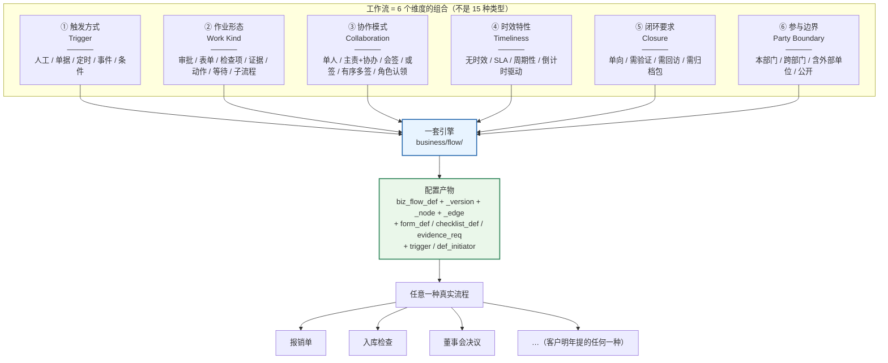

> 图 1：六维体系。**六个维度是可独立组合的正交轴，不是六个并列的功能模块。**

### 维度 ① 触发方式（流程怎么开始）

| 取值 | 含义 | 现状 | 实现落点 |
|---|---|---|---|
| `MANUAL` 人工发起 | 人在发起中心点「发起」 | ⚠ 有页面（`flow/start/index.vue`），但只支持硬编码三字段 | §5.1 |
| `DOC` 单据驱动 | 某张业务单据提交时自动发起 | ✅ 已交付（`biz_type` 匹配默认流程 + 5 个 bridge） | §5.2，不改 |
| `CRON` 定时触发 | 到点自动实例化 | ❌ 无 | §5.3（新表 `biz_flow_trigger`） |
| `EVENT` 事件触发 | 业务事件发生（质检不合格 / 库存低于安全线 / 应收逾期） | ⚠ 半个：ERP 有 4 个扫描 job 只发通知，不发起流程 | §5.4 |
| `CONDITION` 条件触发 | 数据满足条件持续成立（应收逾期 ≥ 30 天） | ❌ 无 | §5.5（同一张 trigger 表，`where_expr` 靠 DSL 求值） |

### 维度 ② 作业形态（这一步怎么算做完）

**这是全设计的核心洞察：作业形态是「节点级」的，不是「流程级」的。**
一条流程里，第 2 步可能是填表单、第 3 步是逐项检查、第 4 步是传证据。**按流程分类型必然错，按节点配形态才对。**

| 取值 | 「做完」的判据 | 现状 | 节点类型 |
|---|---|---|---|
| `APPROVAL` 批准/驳回 | 表决通过 | ✅ 已交付 | `APPROVAL` / `COUNTERSIGN` |
| `FORM` 表单填完 | schema 校验全过 + 提交 | ❌ 无表单定义 | `FORM`（新） |
| `CHECKLIST` 检查项全勾 | 必做项全 PASS 或 有权限地 SKIP | ❌ 无检查项模型 | `CHECKLIST`（新） |
| `EVIDENCE` 证据齐 | 每条 `evidence_req` 的 `min_count` 达标 + 该签的签了 | ❌ 只有「能传附件」 | `EVIDENCE`（新） |
| `ACTION` 系统自动执行 | 白名单动作执行成功 | ⚠ 有雏形（`biz_flow_linkage_rule` 11 个 action） | `ACTION`（新） |
| `WAIT` 等外部事件 | 事件令牌到达 | ❌ 无 | `WAIT`（新） |
| `SUBPROCESS` 子流程走完 | 子实例落终态且结论为通过 | ❌ 无 | `SUBPROCESS`（新） |
| `TASK` 纯任务 | 任务 `DONE` | ✅ 已交付（`TASK_NODE`） | `TASK_NODE`（复用） |

### 维度 ③ 协作模式（一个节点谁来干）

| 取值 | 含义 | 现状 | 数据表达 |
|---|---|---|---|
| `SINGLE` 单人负责 | 指定一个人 | ✅ TASK_NODE / APPROVAL 都支持 | 1 条 owner / 1 条 `biz_flow_task` |
| `PRIMARY_CO` 主责+协办 | 一人负责，N 人协助，**主责确认完成** | ❌ 审批节点缺（任务节点已有 1 owner + N member） | `task_role=PRIMARY/CO` |
| `ALL` 会签 | 全部同意才通过 | ✅ 已交付 | `approval_mode=ALL` |
| `RATIO` 比例签 | 过 N% 且无人否决 | ✅ 已交付 | `approval_mode=RATIO` + `reject_veto` |
| `ANY` 或签 | 任一人同意即通过 | ✅ 已交付 | `approval_mode=ANY` |
| `SEQUENTIAL` 有序多签 | 甲签完才轮到乙 | ❌ 无（现有会签全是并行） | `sign_mode=SEQUENTIAL` + `node_assignee.sort_order` |
| `CLAIM` 角色认领 | 派给一个角色，谁先接谁做 | ❌ 无 | `claim_mode=ROLE_CLAIM` |
| `EXTERNAL` 外部参与 | 供应商 / 客户 / 外部检测机构 | ❌ 无（需要外部账号体系） | 维度 ⑥ 承载 |

### 维度 ④ 时效特性

| 取值 | 含义 | 现状 |
|---|---|---|
| `NONE` 无时效 | 慢慢做 | ✅ `timeout_hours = NULL` |
| `SLA` 有时效 | N 小时内完成，超时提醒/升级 | ⚠ 有超时与提醒，`ESCALATE` 实测只到「提醒 + 抄送主管」 |
| `RECURRING` 周期性 | 定期重复实例化 | ❌ 流程侧无（任务侧 `recurring.rs` 有，不复用） |
| `COUNTDOWN` 倒计时驱动 | 距截止日 N 天开始催 | ✅ `remind_before_hours` + `max_remind_times` |

### 维度 ⑤ 闭环要求

| 取值 | 含义 | 现状 |
|---|---|---|
| `ONE_WAY` 单向走完 | 走完就结束（报销、请假） | ✅ 现有行为 |
| `VERIFY` 需验证 | **提问题的人要确认改好了**才关闭（整改、8D、CAPA） | ❌ 无三方模型 |
| `REVISIT` 需回访 | 结束后 N 天回访（客诉、售后） | ❌ 无 |
| `ARCHIVE` 需归档包 | 走完自动生成完整材料包（董事会、项目验收） | ❌ 无 |

### 维度 ⑥ 参与边界（**本卡新增的唯一维度**）

| 取值 | 含义 | 现状 | 为什么前 5 维表达不了 |
|---|---|---|---|
| `INTERNAL` 内部 | 参与人全在 `sys_user` 里 | ✅ | — |
| `CROSS_DEPT` 跨部门 | 参与人跨部门，需要「跨部门可见」而非「本部门」 | ⚠ 靠 `assignee_type=DEPT_LEADER` 部分支持 | 前 5 维只说「谁来干」，不说「这个人在哪个组织边界内」，而组织边界决定**可见性谓词与审计口径** |
| `EXTERNAL` 含外部单位 | 供应商 / 客户 / 第三方检测机构参与（提交材料、签署、评价） | ❌ | 「协作模式」里的 `外部参与` 其实不是一种「协作」，它是一种**身份域**：外部人没有 `sys_user` 行、不能走 `#[nik::permission]`、不能用 JWT 会话。把它塞进协作模式会让「6 种协作模式」里混进一个「根本不是同一层」的东西 |
| `PUBLIC` 公开 | 匿名可提交（投诉、举报） | ❌ | 同上，且需要限流 + 防刷 + 人机校验，是完全不同的安全模型 |

## 2.3 补漏的严谨性：我查了 4 个候选维度，只留下 1 个

用户要求「还有什么维度是这 5 个表达不了的？想了再说，别硬凑」。我把 4 个候选逐个判了：

| 候选维度 | 判定 | 理由 |
|---|---|---|
| **⑥ 参与边界**（内部 / 跨部门 / 外部 / 公开） | ✅ **采纳为第 6 维** | 它不是「谁来干」而是「这个人在不在身份域内」。外部参与需要的不是一个新的协作模式，而是**另一套鉴权 + 另一套可见性 + 可能另一套账号**。前 5 维没有任何一维能承载「外部人没有 `sys_user` 行」这个事实。证据：`assignee::resolve` 的 11 种来源全部返回 `sys_user.id`，外部人根本落不进去 |
| 存证强度（普通留存 / 法定留存 / 需第三方存证） | ❌ 不采纳 | 可分解：`closure_mode=ARCHIVE` + `biz_flow_archive_pack.retention_until` + `evidence_req.require_sign` 三个字段已经表达。单独立一维会让「归档包」在两处出现两个真相 |
| 发起后可变性（不可改 / 可撤回重发 / 可补充材料） | ❌ 不采纳 | 可分解：`withdraw_instance`（已有）+ `closure_mode` + 表单 `DRAFT` 状态已覆盖。且它不改变引擎的图执行语义，只改变按钮可见性 —— 属于「节点配置」不属于「维度」 |
| 数据权威性（单一数据源 / 需与外部系统对账） | ❌ 不采纳，但**降级为一种组合** | 「对账类」确实特殊（两边数必须平），但它 = `CRON` 触发 + `FORM`（录外部数）+ `CHECKLIST`（逐项核对差异）+ `VERIFY` 闭环。四维组合已经能表达，不需要第五个轴。见 §2.4 场景 14 的维度卡 |

**结论：6 维。** 这个数字的来源是「逐个候选跑过一遍判定」，不是「凑个吉利数」。

## 2.4 十五类场景的维度卡（用户 3 类 + 助手 10 类 + 我补 2 类）

> 每张卡 6 行：触发 / 形态 / 协作 / 时效 / 闭环 / 边界。
> 「形态」按节点顺序列出，这就是画布上从左到右的节点序列。

### ① 表单类 · 报销申请（用户原话第一类）

| 维度 | 取值 |
|---|---|
| 触发 | `MANUAL`（发起中心选「费用报销」模板） |
| 形态 | `FORM`（报销明细，含子表）→ `APPROVAL`（部门主管）→ `APPROVAL`（财务，会签 ALL）→ `ACTION`（回写应付/凭证） |
| 协作 | `SINGLE` + `ALL` |
| 时效 | `SLA` 财务节点 48h，超时 `ESCALATE` 到财务主管 |
| 闭环 | `ONE_WAY` |
| 边界 | `INTERNAL` |
| **要点** | 无业务单据表（实测 ERP 无报销表）→ **纯表单 + 会计动作**，是表单设计器的头号样板 |

### ② 表单类 · 入职 / 离职（用户原话第一类）

| 维度 | 取值 |
|---|---|
| 触发 | `MANUAL`（HR 发起） |
| 形态 | `FORM`（人员信息）→ `PARALLEL`（IT 开账号 ‖ 行政备工位 ‖ 财务定薪）→ `SUBPROCESS`（离职时挂「资产归还」子流程）→ `END` |
| 协作 | `SINGLE` / 各分支 `SINGLE` |
| 时效 | `COUNTDOWN`（到岗日 D-3 提醒） |
| 闭环 | `ONE_WAY`（入职）/ `VERIFY`（离职：资产必须清） |
| 边界 | `CROSS_DEPT` |
| **要点** | 并行分支已交付（`PARALLEL` + `join_mode=AND`），本场景**现在就能配**（除表单渲染外） |

### ③ 标准化作业 · SOP 执行（用户原话第二类）

| 维度 | 取值 |
|---|---|
| 触发 | `MANUAL` 或 `CRON`（每班次） |
| 形态 | `CHECKLIST`（工序检查项：温度/压力/扭矩/目视）→ `EVIDENCE`（首件照片）→ `APPROVAL`（班组长确认） |
| 协作 | `SINGLE`（作业员）+ `ANY`（班组长） |
| 时效 | `SLA`（班次内） |
| 闭环 | `VERIFY`（有不合格 ⇒ 走返工 ⇒ 质检复验） |
| 边界 | `INTERNAL` |
| **要点** | 检查项必须有「合格范围」，数值超范围自动判 `FAIL` 并触发返工分支 |

### ④ 标准化作业 · 入库检查（用户原话第二类，场景走查见 §16.2）

| 维度 | 取值 |
|---|---|
| 触发 | `DOC`（`biz_stock_in` 提交后由 `stockin_bridge` 发起） |
| 形态 | `CHECKLIST`（到货核对项）→ `EVIDENCE`（破损照片 / 质检报告）→ `APPROVAL`（仓库主管）→ `ACTION`（过账，现有能力） |
| 协作 | `SINGLE` + `SINGLE` |
| 时效 | `SLA` 4h |
| 闭环 | `VERIFY`（不合格 ⇒ 退货子流程） |
| 边界 | `INTERNAL`（将来 `EXTERNAL`：供应商回签） |

### ⑤ 工作留痕 · 会务 / 董事会（用户原话第三类，场景走查见 §16.3）

| 维度 | 取值 |
|---|---|
| 触发 | `MANUAL`（董秘发起） |
| 形态 | `FORM`（议题+材料清单）→ `EVIDENCE`（议案材料、法律意见书、签到表、录音）→ `APPROVAL`（有序多签：董事长→董事→监事）→ `ACTION`（生成归档包） |
| 协作 | `SEQUENTIAL` 有序多签 |
| 时效 | `SLA` 强约束（会议前 3 日材料必须齐） |
| 闭环 | `ARCHIVE`（走完必须出包，留存 ≥ 10 年） |
| 边界 | `INTERNAL` |

### ⑥ 周期性例行（助手补 A）

| 维度 | 取值 |
|---|---|
| 触发 | `CRON`（月度结账 / 设备保养 / 5S 巡检） |
| 形态 | `CHECKLIST` 或 `FORM` |
| 协作 | `SINGLE` + `ANY`（抽检复核） |
| 时效 | `SLA` + `RECURRING` |
| 闭环 | `ONE_WAY`，但**必须留历史可对比** |
| 边界 | `INTERNAL` |
| **要点** | 错过要补做（`misfire_policy=CATCH_UP`）；`dedupe_key = 期间`（2026-11 只能有一次月结实例） |

### ⑦ 异常应急响应（助手补 B）

| 维度 | 取值 |
|---|---|
| 触发 | `EVENT`（质检不合格 / 设备故障 / 安全事故） |
| 形态 | `FORM`（事件记录）→ `ACTION`（冻结批次 / 停线）→ `EVIDENCE`（现场取证）→ `APPROVAL`（升级审批）→ `CHECKLIST`（8D 整改） |
| 协作 | `SINGLE`（值班）+ `PRIMARY_CO`（8D 小组） |
| 时效 | `SLA` **2 小时响应**，超时 `ESCALATE` 三级 |
| 闭环 | `VERIFY` |
| 边界 | `INTERNAL` |
| **要点** | 时效极强 → 升级链必须真升级（不能只是发个通知） |

### ⑧ 整改闭环（助手补 C）

| 维度 | 取值 |
|---|---|
| 触发 | `EVENT`（检查发现问题 / 审计发现 / 客诉） |
| 形态 | `FORM`（问题描述，提出人填）→ `TASK_NODE`（整改，`closure_role=RECTIFY`）→ `EVIDENCE`（整改证据）→ `APPROVAL`（验证，`closure_role=VERIFIER`，指派来源 = 提出人） |
| 协作 | `SINGLE` 三方（提出 / 整改 / 验证） |
| 时效 | `SLA`（整改期限） |
| 闭环 | `VERIFY`（**验证不通过 → round+1 退回整改节点**） |
| 边界 | `INTERNAL` |
| **要点** | 这一类的本质是「**提问题的人有否决权**」，不是「走完就完」 |

### ⑨ 多方有序签署（助手补 D）

| 维度 | 取值 |
|---|---|
| 触发 | `MANUAL` |
| 形态 | `EVIDENCE`（`evidence_type=SIGN`，三方签署件）→ `ACTION`（回写合同状态） |
| 协作 | `SEQUENTIAL`（甲 → 乙 → 见证方，任一方拒签终止） |
| 时效 | `SLA` |
| 闭环 | `ARCHIVE` |
| 边界 | `EXTERNAL`（乙方是外部单位） |
| **要点** | 现有会签是并行的，**这个场景现在做不了**（要等 `sign_mode=SEQUENTIAL` + 外部账号） |

### ⑩ 配额 / 额度管控（助手补 E）

| 维度 | 取值 |
|---|---|
| 触发 | `MANUAL` |
| 形态 | `FORM`（申请额度）→ `ACTION`（校验并占用额度）→ `APPROVAL` → `ACTION`（确认扣减 / 驳回释放） |
| 协作 | `SINGLE` + `ALL` |
| 时效 | `NONE` |
| 闭环 | `ONE_WAY` |
| 边界 | `INTERNAL` |
| **要点** | `ACTION` 节点必须支持「失败即整笔回滚」（不能占了额度但审批单没建） |

### ⑪ 项目管理型（助手补 F）

| 维度 | 取值 |
|---|---|
| 触发 | `MANUAL` |
| 形态 | `SUBPROCESS`（每个里程碑挂一个子流程）→ `EVIDENCE`（交付物）→ `APPROVAL`（阶段门评审） |
| 协作 | `PRIMARY_CO` |
| 时效 | `COUNTDOWN`（周/月级） |
| 闭环 | `VERIFY` + `ARCHIVE` |
| 边界 | `CROSS_DEPT` |
| **要点** | 现有 `project` 模块承载项目本体，流程只负责「阶段门」 |

### ⑫ 客户服务型 SLA（助手补 G）

| 维度 | 取值 |
|---|---|
| 触发 | `EVENT`（工单创建） |
| 形态 | `FORM` → `CHECKLIST` → `EVIDENCE`（维修照片）→ `APPROVAL`（客户确认）→ `WAIT`（等客户评价） |
| 协作 | `SINGLE` + `EXTERNAL` |
| 时效 | `SLA` 双计时（响应 / 解决） |
| 闭环 | `REVISIT`（满意度回访） |
| 边界 | `EXTERNAL` |
| **要点** | `WAIT` 节点是这一类的地基；外部参与要等 L3 |

### ⑬ 培训取证（助手补 H）

| 维度 | 取值 |
|---|---|
| 触发 | `MANUAL` / `CRON`（证书到期前 60 天） |
| 形态 | `FORM`（报名）→ `CHECKLIST`（学习任务）→ `EVIDENCE`（考试成绩单/证书）→ 判定（不过重来） |
| 协作 | `SINGLE` |
| 时效 | `COUNTDOWN` |
| 闭环 | `VERIFY`（考核不过 → 退回学习节点） |
| 边界 | `INTERNAL` |

### ⑭ 纯审批链（助手补 I）

| 维度 | 取值 |
|---|---|
| 触发 | `MANUAL`（无单据的审批：用章、请假、加班、出差） |
| 形态 | `APPROVAL` 串行 → `END` |
| 协作 | `SINGLE` / `ALL` |
| 时效 | `SLA` |
| 闭环 | `ONE_WAY` |
| 边界 | `INTERNAL` |
| **要点** | 这就是现有审批流，**唯一缺的是「无单据也能发起」** —— 而 `create_instance` 的 `biz_id` 本来就可空（`V0122`：`biz_id uuid` 可空），所以**现在就能配**，只差发起中心把无单据流程摆出来 |

### ⑮ 委外 / 跨组织协作（助手补 J）

| 维度 | 取值 |
|---|---|
| 触发 | `MANUAL` |
| 形态 | `FORM`（委外单）→ `EVIDENCE`（发料凭证 / 加工方检测报告）→ `WAIT`（等加工方回传） |
| 协作 | `PRIMARY_CO` + `EXTERNAL` |
| 时效 | `SLA` + `COUNTDOWN` |
| 闭环 | `VERIFY` |
| 边界 | `EXTERNAL` |

### ⑯ 盘点 / 对账核对（**我补的第 14 类**，验证「数据权威性不该成为维度」）

| 维度 | 取值 |
|---|---|
| 触发 | `CRON`（月末）+ `CONDITION`（账实差异 ≠ 0 才发起） |
| 形态 | `FORM`（录入实盘数）→ `CHECKLIST`（逐项核对，差异项必填说明）→ `APPROVAL`（财务复核）→ `ACTION`（生成调整单） |
| 协作 | `PRIMARY_CO`（盘点人 + 财务） |
| 时效 | `SLA` 3 日 |
| 闭环 | `VERIFY`（差异必须清零或被批准挂账） |
| 边界 | `CROSS_DEPT` |
| **要点** | 「两边数要平」不是新维度，是 `FORM` 录入 + `CHECKLIST` 判定 + `ACTION` 调整的三段组合 |

### ⑰ 外部回签 / 第三方检测（**我补的第 15 类**，验证维度 ⑥ 的存在必要）

| 维度 | 取值 |
|---|---|
| 触发 | `MANUAL`（我方发起）+ `WAIT`（等外部回签） |
| 形态 | `EVIDENCE`（我方材料）→ `WAIT`（外部回签事件）→ `EVIDENCE`（外部回签件）→ `APPROVAL`（我方确认） |
| 协作 | `SINGLE` + `EXTERNAL` |
| 时效 | `SLA` + 超时催办外部 |
| 闭环 | `ARCHIVE` |
| 边界 | `EXTERNAL` |
| **要点** | 证明维度 ⑥ 有用：这条流程里的「外部单位」既不是协作模式、也不是时效/闭环，它是**身份域** |

## 2.5 维度与数据模型的映射（证明 6 维都能落到字段）

| 维度 | 落在哪 | 具体字段 |
|---|---|---|
| ① 触发 | `biz_flow_trigger.trigger_kind` + `biz_flow_def.biz_type` | `MANUAL/DOC/CRON/EVENT/CONDITION` |
| ② 形态 | `biz_flow_node.node_type` + `form_def_id` / `checklist_def_id` / `subprocess_def_id` | 15 值节点头 + 3 个绑定列 |
| ③ 协作 | `biz_flow_node.approval_mode` + `sign_mode` + `claim_mode` + `co_assignee` + `biz_flow_node_assignee` + `biz_flow_task.task_role` | 6 个字段 + 1 张关联表 |
| ④ 时效 | `biz_flow_node.timeout_hours / timeout_action / remind_before_hours / max_remind_times / escalate_levels` + `biz_flow_trigger.cron_expr / misfire_policy` | 8 个字段 |
| ⑤ 闭环 | `biz_flow_def.closure_mode / archive_policy` + `biz_flow_node.closure_role` | 3 个字段 |
| ⑥ 边界 | `biz_flow_def.party_scope`（**本文新增**）+ `biz_flow_def_initiator` | 见 §3.2 决策 D-ARCH5-07 |

> ⚠ 上表里 `party_scope` 是我在写 §3 时补的字段（`varchar(16)` 默认 `'INTERNAL'`，取值 `INTERNAL/CROSS_DEPT/EXTERNAL/PUBLIC`）。它是维度 ⑥ 的落点；
> L1/L2 阶段恒为 `INTERNAL`（`EXTERNAL` 只做校验拦截，不做实现），L3 才真正放开。这样维度 ⑥ 从第一天就在模型里，不用等到 L3 再改表。

## 本章红线

1. **不许把维度做成枚举类型字段**（`flow_type` 只有 3 值，是「引擎用法」不是「流程分类」）。分类靠 §2.5 的六组字段组合。
2. **作业形态必须是节点级**：任何「这个流程是检查类流程」的设计都是错的。
3. **新增维度必须给出「前 5 维为什么表达不了」的证据**（§2.3 是范本），否则就是硬凑。

---

# 第三章 数据模型（完整 DDL）

> 本章的 DDL **全部实跑过**。POC 库 `arch5_poc_b` = `cloudpivot_p16md`（102 张表的真实库，含 12 个流程定义、52 个节点、4 个实例）的副本，
> 跑完 `arch5_ddl_poc.sql` 退出码 0，自检打印「11 张新表 + node 8 列 + def/instance/task 9 列 + 6 条关键索引」；
> 再跑 `arch5_negative_tests.sql`，21 个用例里 21 条约束逐条被拦（输出见 §3.8）。
> **存量 12 个流程定义 / 52 个节点 / 4 个实例在新约束下全部通过** —— `ADD CONSTRAINT` 本身就是在存量数据上做的校验。

## 3.1 五条建模原则

### 3.1.1 继承 ARCH-3 的 R1 / R2 / R3

本设计不重新发明勾稽规则，直接沿用《通用勾稽规则与业务链映射表》：

| 规则 | 原文要求 | 本设计的落法 |
|---|---|---|
| **R1 单一数据源** | 同一事实只有一个写入点 | 表单数据只在 `biz_flow_form_data` 写；`biz_flow_instance.form_data` **只写一次**（发起时冻结），之后是**只读快照**，绝不反向同步 —— 否则「哪份是准的」答不出来 |
| **R2 只绑上一环** | 存指针只存紧邻上一环 | `biz_flow_form_data.instance_node_id`（上一层是实例节点），**不存** `def_id` / `version_id` / `biz_id`。要拿这些走 `instance_node → instance`，两跳 |
| **R3 显示靠关联 + 快照可追溯** | 名字不 JOIN 主数据表，靠快照；真相可追溯 | 表单/清单/证据的**定义版本**在实例侧以 `*_def_id` 硬绑（RESTRICT），**内容**在实例侧以 `schema_hash` 指纹核对；流程实例早已按此做（`flow_code`/`flow_name`/`version_no` 冗余） |

### 3.1.2 本设计新增的两条（R4 / R5），并说明为什么必须新增

| 新规则 | 内容 | 不这样会怎样 |
|---|---|---|
| **R4 · 定义与数据分离且定义不可变** | 表单/清单/证据要求的**已发布版本不可更新**；改 = 新增版本行 + 切 `is_current`。在跑实例绑的是具体版本行 id（RESTRICT） | 「改表单不影响在跑实例」是用户明确要求。若原地改，昨天的报销单会突然多出一个必填字段，且审计无法解释「当时填的是什么」 |
| **R5 · 完成闸可复算** | 任何「完成」判定（表单提交 / 清单达标 / 证据齐）必须能由**库里的行**重新算出来，不能只存一个 `passed=true` | 审计问「凭什么说这项合格」时，必须能给出「12 个必做项 12 条 PASS 记录」。只存一个布尔值 = 无法自证 |

### 3.1.3 枚举一律 `VARCHAR + CHECK`（不是 PG 原生 ENUM）

沿用 `V0120` 文件头 ① 的既有决策：原生 ENUM 加值要 DDL 且不能在事务里回滚。
本设计有 **7 个新枚举字段**（`flow_type`/`closure_mode`/`archive_policy`/`party_scope`/`sign_mode`/`claim_mode`/`closure_role`/`trigger_kind`/`status` 等），全部走 `VARCHAR + CHECK`。

### 3.1.4 「独立表」与「config JSONB」的判据

`V0120` 文件头 ② 给了三条判据（无外键约束 / 无法反查影响面 / 驱动不支持数组绑定）。本设计据此逐个判定：

| 内容 | 放哪 | 判据 |
|---|---|---|
| 审批人 / 发起人白名单 | **独立表** | 需要反查「这个角色被哪些流程引用」→ JSONB 要全表扫 |
| 检查项 | **独立表** | 需要按 `item_id` 统计合格率、需要外键约束到 `standard_file_id` |
| 证据要求 | **独立表** | 需要外键到 `sys_file`（标准模板文件），且运行时要逐条比对 `min_count` |
| 表单字段 | **JSONB** | 字段是表单内部的、只按整表单读写、没有跨表单反查需求 |
| 字段级权限 | **JSONB**（在 schema 内） | 随表单版本走，不独立反查 |
| 节点扩展配置（`config.work`） | **JSONB** | 与 `config.task` / `config.notify` 同款；但要扩 `ck_biz_flow_node_config_partition` |

## 3.2 六条建模决策（含被否方案）

### D-ARCH5-01 · `flow_type` 放 `biz_flow_def`，而不是新表或新字段组合

```sql
-- 定稿
ALTER TABLE biz_flow_def ADD COLUMN flow_type varchar(16) NOT NULL DEFAULT 'APPROVAL'
    CHECK (flow_type IN ('APPROVAL','WORKFLOW','AUTOMATION'));
```

| 方案 | 内容 | 判决 |
|---|---|---|
| A | 新建 `biz_workflow_def` 平行表 | ❌ 否。等于把 `biz_flow_def` 的 5 张定义侧表、画布、发布校验、版本快照全部复制一份 = 两套引擎（失败模式 6） |
| B | 复用现有 `biz_type` 表达 | ❌ 否。`biz_type` 语义是「哪类单据能发起」（`PURCHASE_ORDER`/`STOCK_IN`/`TASK_ACCEPT`…），是**业务维度**；`flow_type` 是**引擎用法维度**。混在一起会让「同一单据既能走审批也能走作业」无法表达 |
| C | **加一列 `flow_type`** | ✅ 采纳。默认 `APPROVAL` ⇒ 存量 12 个定义零改动（POC 实测：`select flow_type,count(*) from biz_flow_def group by 1` → `APPROVAL|12`） |

**语义边界**：

| flow_type | 发起靠什么 | 节点典型构成 | 界面文案 |
|---|---|---|---|
| `APPROVAL` | 单据提交 / 无单据人工 | `APPROVAL` / `COUNTERSIGN` / `CC` | 「审批单」「待我审批」 |
| `WORKFLOW` | 发起中心 / 定时 / 事件 | `FORM` / `CHECKLIST` / `EVIDENCE` / `TASK_NODE` | 「作业」「我的流程」 |
| `AUTOMATION` | 定时 / 事件 / 条件 | `ACTION` / `NOTIFY_NODE` / `SUBPROCESS` | 「自动任务」（无人节点，不生成待办） |

> **`AUTOMATION` 的存在意义**：现有引擎的 `START → ACTION → END` 也能跑，但会生成一堆「已自动通过」的实例噪音，污染「我的流程」。
> `automation` 类型让这类实例默认不进个人视图（`my_instances` 过滤掉），只在「自动化运行记录」里看。

### D-ARCH5-02 · 表单定义「一行 = 一个不可变版本」，不建 def + version 两张表

| 方案 | 内容 | 判决 |
|---|---|---|
| A | `biz_flow_form_def`（身份）+ `biz_flow_form_version`（版本） | ❌ 否。表单没有「流程定义」那种**跨版本的稳定身份需求**（没有人会说「我要看这个表单的历史所有版本并比较」）。多一张表换来一次 JOIN，不值 |
| B | **一张表，`(form_code, version_no)` 唯一，`is_current` 部分唯一索引标当前版** | ✅ 采纳。改表单 = 插入新行；实例绑 `form_def_id`（具体版本行）⇒ 「改表单不影响在跑实例」自动成立，不需要任何额外代码 |

**被否的第三种**：在 `config JSONB` 里存表单 schema（不建表）。否的原因：表单要被 `FORM` 节点的 `form_def_id` 外键引用（RESTRICT 保护），JSONB 无法外键。

### D-ARCH5-03 · `FORM`/`CHECKLIST`/`EVIDENCE` 是三个 `node_type`，但引擎只有一个 `Work` 分支

这是本设计**最容易被做错的一处**，单独说明。

```rust
// 设计（不是实现）：节点类型 → 作业形态的映射
impl NodeType {
    /// 是否属于「作业节点族」（生成任务 + 阻塞等完成）
    pub fn is_work(self) -> bool {
        matches!(self, NodeType::Task | NodeType::Form | NodeType::Checklist | NodeType::Evidence)
    }
    /// 作业形态（决定完成闸用哪个校验器；Task = None）
    pub fn work_kind(self) -> Option<WorkKind> {
        match self {
            NodeType::Form      => Some(WorkKind::Form),
            NodeType::Checklist => Some(WorkKind::Checklist),
            NodeType::Evidence  => Some(WorkKind::Evidence),
            _ => None,
        }
    }
}
```

引擎 `step()` 里**只有两个新臂**：

| 臂 | 覆盖的 node_type | 逻辑 |
|---|---|---|
| `NodeType::n if n.is_work()` | `TASK_NODE` / `FORM` / `CHECKLIST` / `EVIDENCE` | 复用现有 `task_node::spawn()` 生成任务 → 节点 ACTIVE → 等任务完成。**四个类型共用一段代码** |
| `n if n.work_kind().is_some()` 的完成闸 | 同上 | 任务完成回调时先过 `work_gate::check()`：`Form` 校验 schema、`Checklist` 数项、`Evidence` 数材料；`Task` 直接放行 |

| 方案 | 内容 | 判决 |
|---|---|---|
| A | 只做 `TASK_NODE`，作业内容全塞 `config.work`（不新增 node_type） | ⚠ 半否。技术上最省，但**画布上看不出这是检查节点**（用户要在流程图上看出「这一步是逐项检查」），且 15 值→9 值违背卡面的节点清单要求 |
| B | 三个独立 node_type，各自一套生成任务 + 各自一套完成判定 | ❌ 否。三份任务生成代码 = 三倍的幂等/取号/协作人/模板渲染 bug 面。这正是「失败模式 1」的变种 |
| C | **三个 node_type（语义）+ 一个引擎分支（实现）+ 三个校验器（差异）** | ✅ 采纳。语义清晰度给用户，实现收敛给维护者 |

**顺带回答「`TASK_NODE` 还要不要」**：要。`TASK_NODE` = 「纯干活，没有作业内容表单」（例如「去现场拍一段视频回来交」—— 但那是 EVIDENCE；真正的纯任务是「把这个需求写清楚」）。
**判据**：这一节点的完成需要「填写结构化数据」→ FORM/CHECKLIST/EVIDENCE；只需要「任务标记完成 + 评论」→ TASK_NODE。

### D-ARCH5-04 · `EVIDENCE` 节点的证据要求挂 `biz_flow_node`，不挂 `biz_flow_node.config`

理由已在 §3.1.4 给过（外键 + 反查 + 逐条比对）。补充一条**实测**理由：
现有 `ck_biz_flow_node_config_partition` 的形状是
```
(node_type='TASK_NODE' OR NOT config ? 'task') AND (node_type='NOTIFY_NODE' OR NOT config ? 'notify')
```
如果证据要求也进 config，这个 CHECK 会变成三连，且**无法表达「至少一条 req」**（`jsonb_array_length` 能做，但「每条 req 的 min_count 都要被运行时比对」只能是应用层）。
独立表让「保底一条 req」变成库级约束的候选（见 §3.6 的 R22 发布校验）。

### D-ARCH5-05 · `biz_flow_instance.form_data` 语义收窄为「发起数据」，不承载节点数据

实测：`biz_flow_instance.form_data JSONB NOT NULL DEFAULT '{}'`，被三处使用：
1. `assignee::resolve` 的 `FORM_VAR` 取值作用域（`assignee.rs:463` `pub form_data: Json`）；
2. 条件 DSL 的求值上下文；
3. 前端实例详情的「表单快照」展示（`dto.rs:1493`）。

**如果让节点表单也写进 `form_data`**，会同时破坏三件事：
- `FORM_VAR` 会读到「别人填的、我这一轮还不该看到」的值 → 越权；
- 条件求值的作用域随节点推进而变化 → 同一张单子在两次求值里得到不同结果；
- 实例详情页的「发起内容」与「后补内容」混成一坨 → 审计不能回答「谁在什么时候填了什么」。

**定稿**：
| 表 | 装什么 | 写入时机 | 可变性 |
|---|---|---|---|
| `biz_flow_instance.form_data` | **发起时的参数**（发起中心填的、或单据带过来的） | 发起事务内，写一次 | 冻结（只读） |
| `biz_flow_form_data` | **每个作业节点每一轮的填写** | 提交时 | `DRAFT` 可改，`SUBMITTED` 冻结 |
| **变量回写** | 作业节点中 `expose_as_var=true` 的字段，**只追加到条件求值上下文的只读快照里**，不写回 `instance.form_data` | 每次求值时重建 | 派生态，不落库 |

> 这条设计的价值：**「改表单不影响在跑实例」和「FORM_VAR 不被后填数据污染」两个要求同时成立**，且不违背 R1（`form_data` 仍只有一个写入点）。

### D-ARCH5-06 · 触发器不落 `sys_job`，落 `biz_flow_trigger`

| 方案 | 内容 | 判决 |
|---|---|---|
| A | 一个流程触发器 = 一条 `sys_job` 行，`invoke_target='flow_trigger:<id>'` | ❌ 否。`sys_job` 是**运维视角**的作业表（`job_name` 唯一、`params` JSONB、`invoke_target` 是代码标识）。把业务配置塞进去会让「运维改 cron」和「业务改触发规则」两个人和两种权限撞在一张表上。且 `sys_job` 没有 `project_id`/`def_id` 的外键，反查「这个流程有几个触发器」要字符串匹配 |
| B | `biz_flow_trigger` 独立表 + 一条**内置 scheduler job** 统一扫（`flow_trigger_scan`，每分钟） | ✅ 采纳。触发器配置是业务数据（谁配的、谁改的、影响哪个流程），扫描器是运维机制。两者分开，且扫描器可以像 `flow_timeout_scan` 一样 `register_builtin` |
| C | 每个触发器注册一个 `scheduler.register_cron` | ❌ 否。触发器是**运行时可变**的（业务随时增删），而 `register_builtin` 是编译期注册。做不到 |

## 3.3 扩展现有表（只加列 / 只换约束，不删列不改语义）

### 3.3.1 `biz_flow_def`：+5 列 +4 约束

```sql
ALTER TABLE biz_flow_def
    ADD COLUMN flow_type      varchar(16)  NOT NULL DEFAULT 'APPROVAL',
    ADD COLUMN closure_mode   varchar(16)  NOT NULL DEFAULT 'ONE_WAY',
    ADD COLUMN archive_policy varchar(16)  NOT NULL DEFAULT 'NONE',
    ADD COLUMN party_scope    varchar(16)  NOT NULL DEFAULT 'INTERNAL',
    ADD COLUMN purpose        varchar(500);
```

| 列 | 用途 | 取值 | 默认值的意义 |
|---|---|---|---|
| `flow_type` | 引擎用法 | `APPROVAL` / `WORKFLOW` / `AUTOMATION` | `APPROVAL` ⇒ 存量 12 个定义零改动 |
| `closure_mode` | 闭环要求 | `ONE_WAY` / `VERIFY` / `REVISIT` / `ARCHIVE` | `ONE_WAY` ⇒ 存量行为不变 |
| `archive_policy` | 归档策略 | `NONE` / `ON_FINISH` / `MANUAL` | `NONE` ⇒ 存量不打包 |
| `party_scope` | 参与边界（维度 ⑥） | `INTERNAL` / `CROSS_DEPT` / `EXTERNAL` / `PUBLIC` | `INTERNAL` ⇒ 存量不涉及外部 |
| `purpose` | 一句话说明「这个流程解决什么问题」（发起中心卡片副标题） | 自由文本 ≤500 | 空 |

四条新 CHECK（POC 全部实测生效）：

```sql
CONSTRAINT ck_biz_flow_def_flow_type     CHECK (flow_type IN ('APPROVAL','WORKFLOW','AUTOMATION'))
CONSTRAINT ck_biz_flow_def_closure_mode  CHECK (closure_mode IN ('ONE_WAY','VERIFY','REVISIT','ARCHIVE'))
CONSTRAINT ck_biz_flow_def_archive_policy CHECK (archive_policy IN ('NONE','ON_FINISH','MANUAL'))
CONSTRAINT ck_biz_flow_def_party_scope   CHECK (party_scope IN ('INTERNAL','CROSS_DEPT','EXTERNAL','PUBLIC'))
-- 联动：闭环 = 归档 却不打归档包，是自相矛盾的配置（负向测试 CASE 21 实测被拦）
CONSTRAINT ck_biz_flow_def_closure_archive CHECK (closure_mode <> 'ARCHIVE' OR archive_policy <> 'NONE')
```

**复用而非新增**：`category`（已存在，`varchar(32)`）—— 它是发起中心的 tab 分组（人事/财务/生产/行政）。本设计**不改它**，只是开始真正用它。

### 3.3.2 `biz_flow_node`：node_type 扩到 15 值 + 8 列 + 4 约束

```sql
ALTER TABLE biz_flow_node DROP CONSTRAINT biz_flow_node_node_type_check;
ALTER TABLE biz_flow_node ADD CONSTRAINT biz_flow_node_node_type_check CHECK (
    node_type IN ('START','APPROVAL','COUNTERSIGN','CONDITION','PARALLEL','CC','END',
                  'TASK_NODE','NOTIFY_NODE',
                  'FORM','CHECKLIST','EVIDENCE','WAIT','SUBPROCESS','ACTION'));
```

| 新列 | 类型 | 用途 | 为什么上列不上 config |
|---|---|---|---|
| `sign_mode` | `varchar(16)` default `PARALLEL` | 会签签序（并行 / 串行） | 引擎每次激活节点都要读；且要参与发布校验 R9'，不能埋 JSONB |
| `co_assignee` | `boolean` default false | 是否允许协办人（`task_role=CO`） | 同上 |
| `claim_mode` | `varchar(16)` default `NONE` | `NONE` / `ROLE_CLAIM` | 决定是否生成「认领池」而非「待办」，是**分派路径分叉**，必须可查 |
| `escalate_levels` | `smallint` default 0 | 升级级数（1–10） | 与 `timeout_action=ESCALATE` 联动 CHECK |
| `closure_role` | `varchar(16)` default `NONE` | `NONE` / `RECTIFY` / `VERIFIER` | 需要 `uk_biz_flow_node_verifier` 部分唯一索引（每版本至多一个验证节点） |
| `form_def_id` | `uuid` | FORM 节点绑表单版本 | 需要外键 RESTRICT |
| `checklist_def_id` | `uuid` | CHECKLIST 节点绑清单版本 | 同上 |
| `subprocess_def_id` | `uuid` | SUBPROCESS 节点绑子流程定义 | 同上 |

四条新 CHECK：

```sql
-- ① 签序
CONSTRAINT ck_biz_flow_node_sign_mode  CHECK (sign_mode IN ('PARALLEL','SEQUENTIAL'))
-- ② 认领
CONSTRAINT ck_biz_flow_node_claim_mode CHECK (claim_mode IN ('NONE','ROLE_CLAIM'))
-- ③ 闭环角色
CONSTRAINT ck_biz_flow_node_closure_role CHECK (closure_role IN ('NONE','RECTIFY','VERIFIER'))
-- ④ 升级：说了要升级就必须说升几级（负向测试 CASE 08 实测被拦）
CONSTRAINT ck_biz_flow_node_escalate CHECK (
    escalate_levels BETWEEN 0 AND 10 AND (timeout_action <> 'ESCALATE' OR escalate_levels >= 1))
-- ⑤ 作业形态绑定：类型 ⇔ 绑定列，双向（负向测试 CASE 05/06 实测被拦）
CONSTRAINT ck_biz_flow_node_work_binding CHECK (
      (node_type <> 'FORM'       OR form_def_id       IS NOT NULL)
  AND (node_type <> 'CHECKLIST'  OR checklist_def_id  IS NOT NULL)
  AND (node_type <> 'SUBPROCESS' OR subprocess_def_id IS NOT NULL)
  AND (node_type =  'FORM'       OR form_def_id       IS NULL)
  AND (node_type =  'CHECKLIST'  OR checklist_def_id  IS NULL)
  AND (node_type =  'SUBPROCESS' OR subprocess_def_id IS NULL))
```

**必须同步扩的存量 CHECK（漏了就是生产 500）**：

```sql
-- 存量原形（V0178）：只认 TASK_NODE / NOTIFY_NODE 两个 config 键
-- 定稿：加 work 键（FORM/CHECKLIST/EVIDENCE 三个作业节点的作业配置都在这里）
ALTER TABLE biz_flow_node DROP CONSTRAINT ck_biz_flow_node_config_partition;
ALTER TABLE biz_flow_node ADD CONSTRAINT ck_biz_flow_node_config_partition CHECK (
      (node_type <> 'TASK_NODE'                                  OR config ? 'task')
  AND (node_type <> 'NOTIFY_NODE'                                OR config ? 'notify')
  AND (node_type NOT IN ('FORM','CHECKLIST','EVIDENCE')          OR config ? 'work')
  AND (node_type  =  'TASK_NODE'                                 OR NOT config ? 'task')
  AND (node_type  =  'NOTIFY_NODE'                               OR NOT config ? 'notify')
  AND (node_type NOT IN ('FORM','CHECKLIST','EVIDENCE')          OR NOT config ? 'task' AND NOT config ? 'notify')
);
```

### 3.3.3 `biz_flow_task`：+2 列（主责协办 / 有序多签）

```sql
ALTER TABLE biz_flow_task
    ADD COLUMN task_role varchar(16) NOT NULL DEFAULT 'PRIMARY',
    ADD COLUMN seq_no    smallint;
ALTER TABLE biz_flow_task ADD CONSTRAINT ck_biz_flow_task_role CHECK (task_role IN ('PRIMARY','CO'));
```

**刻意不建唯一索引**（这是我在 POC 里改了两次才定下来的，记在这里避免后人再踩）：

| 想建的索引 | 为什么不能建 |
|---|---|
| `UNIQUE(instance_node_id, assignee_id)` | 会撞既有 `uk_biz_flow_task_pending`（只覆盖 PENDING），而历史行必须允许多条：加签（`is_added_sign`）、转办（旧行留 `TRANSFERRED`） |
| `UNIQUE(instance_node_id, task_role) WHERE task_role='PRIMARY' AND status='PENDING'` | **会签语义上是错的**：`approval_mode=ALL` 下每个签名人都是 PRIMARY，一个节点合法地有多条 PENDING PRIMARY |

⇒ `task_role` 只作「是否计入表决」的标记，唯一性交回应用层。**约束加错比不加更难拆。**

### 3.3.4 `biz_task`：**零新增列**（实测结论）

见 §7.1 的九问逐条论证。此处只给结论与证据：

```
V0177 已加：flow_instance_id / flow_node_key / flow_round + source 扩 'FLOW'
已有：approval_instance_id（任务→流程）、parent_id（8 层子任务）、
      biz_task_member（协办/关注）、assigner_id、dept_id、
      exec_mode/hermes_*（派 AI）、estimate_hours/actual_hours（工时）
⇒ 「节点任务」需要的一切都能表达
```

---

## 3.4 十一张新表（逐表：用途 / 键 / 关联 / R 规则 / 软删审计 / 索引 / DDL）

### 3.4.1 `biz_flow_form_def` — 表单定义

| 项 | 内容 |
|---|---|
| **用途一句话** | 存「这张表单长什么样」的版本化 JSON Schema，让新增一种表单变成一次配置而不是一次发版 |
| **主键** | `id uuid` |
| **业务键** | `(form_code, version_no)` 唯一；`form_code` 软删唯一且 `is_current` 部分唯一（每个 code 至多一个当前版） |
| **与现有表关联** | ← `biz_flow_node.form_def_id`（RESTRICT：被节点引用的表单版本不许删）；← `biz_flow_form_data.form_def_id`（RESTRICT） |
| **R1** | 表单 schema 的**唯一写入点**是本表的 `schema` 列。前端设计器只发整份 schema，不允许「补丁式改字段」 |
| **R2** | 不绑任何上游（表单是自足的），只被下游引用 |
| **R3** | 实例侧显示的「字段标签」必须来自**绑定的这一版** schema，不许 JOIN 当前版 → 这是「改表单不影响在跑实例」的实现点 |
| **软删** | `deleted_at`（软删过滤进 `uk_..._current`；被引用的行物理删不掉，因为有 RESTRICT） |
| **审计** | `created_at/updated_at/create_by/update_by` + `published_at/published_by` |
| **索引与查询场景** | ① `uk(form_code, version_no)`：设计器保存时判重；② `uk_..._current`：发起中心/节点绑定取当前版；③ `idx(category, status, updated_at DESC) WHERE deleted_at IS NULL`：表单库列表按分类倒序 |

```sql
CREATE TABLE biz_flow_form_def (
    id           uuid PRIMARY KEY DEFAULT gen_random_uuid(),
    form_code    varchar(64)  NOT NULL,
    form_name    varchar(100) NOT NULL,
    version_no   integer      NOT NULL DEFAULT 1,
    status       varchar(16)  NOT NULL DEFAULT 'DRAFT',
    is_current   boolean      NOT NULL DEFAULT false,
    layout       varchar(16)  NOT NULL DEFAULT 'TWO_COL',
    category     varchar(32),
    schema       jsonb        NOT NULL,
    schema_hash  char(64),
    field_count  integer      NOT NULL DEFAULT 0,
    remark       varchar(500),
    published_at timestamptz,
    published_by uuid,
    created_at   timestamptz  NOT NULL DEFAULT now(),
    updated_at   timestamptz  NOT NULL DEFAULT now(),
    create_by    uuid,
    update_by    uuid,
    deleted_at   timestamptz,
    CONSTRAINT ck_biz_flow_form_def_code   CHECK (form_code ~ '^[a-z][a-z0-9_]{1,63}$'),
    CONSTRAINT ck_biz_flow_form_def_ver    CHECK (version_no >= 1),
    CONSTRAINT ck_biz_flow_form_def_status CHECK (status IN ('DRAFT','PUBLISHED','ARCHIVED')),
    CONSTRAINT ck_biz_flow_form_def_layout CHECK (layout IN ('SINGLE','TWO_COL','GRID')),
    CONSTRAINT ck_biz_flow_form_def_schema CHECK (
        jsonb_typeof(schema) = 'object'
        AND jsonb_typeof(schema -> 'fields') = 'array'
        AND jsonb_array_length(schema -> 'fields') BETWEEN 1 AND 200),
    CONSTRAINT ck_biz_flow_form_def_published CHECK (
        status <> 'PUBLISHED' OR (schema_hash IS NOT NULL AND published_at IS NOT NULL)),
    CONSTRAINT ck_biz_flow_form_def_current CHECK (NOT is_current OR status = 'PUBLISHED'),
    CONSTRAINT uk_biz_flow_form_def_ver UNIQUE (form_code, version_no)
);
CREATE UNIQUE INDEX uk_biz_flow_form_def_current
    ON biz_flow_form_def (form_code) WHERE is_current AND deleted_at IS NULL;
CREATE INDEX idx_biz_flow_form_def_list
    ON biz_flow_form_def (category, status, updated_at DESC) WHERE deleted_at IS NULL;
```

**`schema` 的形状**（设计定稿，完整规格见 §6.1）：

```json
{
  "version": 1,
  "layout": "TWO_COL",
  "fields": [
    { "key": "amount", "type": "MONEY", "label": "报销金额", "required": true,
      "rules": [{ "kind": "RANGE", "min": 0.01, "max": 200000 }],
      "expose_var": true, "perm": { "edit": ["ROLE:EMPLOYEE"], "view": ["*"] } },
    { "key": "items", "type": "TABLE", "label": "费用明细",
      "columns": [ { "key": "fee_type", "type": "SELECT", "options": ["交通","住宿","餐饮"] },
                   { "key": "amount", "type": "MONEY" } ],
      "min_rows": 1, "max_rows": 50 }
  ],
  "links": [ { "when": { "field": "amount", "op": "gt", "value": 5000 },
               "then": { "show": ["dept_leader_note"], "require": ["dept_leader_note"] } } ]
}
```

### 3.4.2 `biz_flow_form_data` — 表单实例数据

| 项 | 内容 |
|---|---|
| **用途一句话** | 存「这一次这个节点这个人填了什么」，一行 = 某实例某节点某轮的一份填写（含草稿） |
| **主键** | `id uuid` |
| **业务键** | **`UNIQUE(instance_node_id, round)`** —— 一个节点一轮只有一份表单数据（防「同一节点两份互相矛盾的填写」） |
| **与现有表关联** | `instance_id → biz_flow_instance`（CASCADE）、`instance_node_id → biz_flow_instance_node`（CASCADE）、`form_def_id → biz_flow_form_def`（**RESTRICT**，绑版本） |
| **R1** | 节点表单数据的**唯一写入点**。`biz_flow_instance.form_data` 不被它回写（见 D-ARCH5-05） |
| **R2** | 只绑上一环 `instance_node_id`；**不存** `def_id / version_id / biz_id`（要走 `instance_node → instance` 两跳） |
| **R3** | `schema_hash` 是提交时的定义指纹。展示时用**绑定版本的 schema** 渲染；`schema_hash` 用于事后核对「这份数据是不是按这一版 schema 填的」（防「有人偷偷改了已发布 schema 再回填」） |
| **软删** | **不软删**。表单数据是审计材料，只能 `SUBMITTED` 后不可改；作废走「实例撤销」而非「删数据」 |
| **审计** | `submitted_by/submitted_at` + `revision`（乐观锁 CAS） |
| **索引与查询场景** | ① `uk(instance_node_id, round)`：写入口幂等；② `idx(instance_id, node_key)`：实例详情页「材料」区；③ `idx(form_def_id)`：反查「哪张表单被用了几次」；④ **`GIN(data jsonb_path_ops)`**：报表按表单字段过滤/统计（见 §3.9 冲突评估） |

```sql
CREATE TABLE biz_flow_form_data (
    id               uuid PRIMARY KEY DEFAULT gen_random_uuid(),
    instance_id      uuid NOT NULL REFERENCES biz_flow_instance(id) ON DELETE CASCADE,
    instance_node_id uuid NOT NULL REFERENCES biz_flow_instance_node(id) ON DELETE CASCADE,
    node_key         varchar(64) NOT NULL,
    round            integer     NOT NULL DEFAULT 1,
    form_def_id      uuid        NOT NULL REFERENCES biz_flow_form_def(id) ON DELETE RESTRICT,
    schema_hash      char(64)    NOT NULL,
    data             jsonb       NOT NULL DEFAULT '{}'::jsonb,
    field_errors     jsonb       NOT NULL DEFAULT '[]'::jsonb,
    status           varchar(16) NOT NULL DEFAULT 'DRAFT',
    submitted_by     uuid,
    submitted_at     timestamptz,
    revision         integer     NOT NULL DEFAULT 0,
    created_at       timestamptz NOT NULL DEFAULT now(),
    updated_at       timestamptz NOT NULL DEFAULT now(),
    CONSTRAINT ck_biz_flow_form_data_round CHECK (round >= 1),
    CONSTRAINT ck_biz_flow_form_data_status CHECK (status IN ('DRAFT','SUBMITTED')),
    CONSTRAINT ck_biz_flow_form_data_submitted
        CHECK ((status = 'DRAFT') OR (submitted_by IS NOT NULL AND submitted_at IS NOT NULL)),
    CONSTRAINT uk_biz_flow_form_data UNIQUE (instance_node_id, round)
);
CREATE INDEX idx_biz_flow_form_data_inst ON biz_flow_form_data (instance_id, node_key);
CREATE INDEX idx_biz_flow_form_data_def  ON biz_flow_form_data (form_def_id);
CREATE INDEX idx_biz_flow_form_data_gin  ON biz_flow_form_data USING gin (data jsonb_path_ops);
```

### 3.4.3 `biz_flow_checklist_def` — 检查清单定义

| 项 | 内容 |
|---|---|
| **用途一句话** | 存「这一套检查要查哪些项」的版本化定义，让 SOP / 库管 / 质检的检查表变成配置 |
| **主键** | `id uuid` |
| **业务键** | `(checklist_code, version_no)` 唯一；`is_current` 部分唯一 |
| **与现有表关联** | ← `biz_flow_node.checklist_def_id`（RESTRICT）；← `biz_flow_checklist_item.checklist_def_id`（CASCADE）；← `biz_flow_checklist_result.checklist_def_id`（RESTRICT） |
| **R1** | 清单的「有哪些项」只在 `biz_flow_checklist_item` 写；本表只存清单级属性 + `item_count`（冗余计数，展示用） |
| **R2** | 自足，无上游指针 |
| **R3** | 结果侧快照 `item_key` / `seq` / `is_required`（见 3.4.5），所以清单改名不影响历史结果的展示 |
| **软删** | `deleted_at` |
| **审计** | 同表单定义 |
| **索引** | 同表单定义 |

```sql
CREATE TABLE biz_flow_checklist_def (
    id              uuid PRIMARY KEY DEFAULT gen_random_uuid(),
    checklist_code  varchar(64)  NOT NULL,
    checklist_name  varchar(100) NOT NULL,
    version_no      integer      NOT NULL DEFAULT 1,
    status          varchar(16)  NOT NULL DEFAULT 'DRAFT',
    is_current      boolean      NOT NULL DEFAULT false,
    category        varchar(32),
    fail_action     varchar(16)  NOT NULL DEFAULT 'STAY',
    item_count      integer      NOT NULL DEFAULT 0,
    remark          varchar(500),
    published_at    timestamptz,
    published_by    uuid,
    created_at      timestamptz  NOT NULL DEFAULT now(),
    updated_at      timestamptz  NOT NULL DEFAULT now(),
    create_by       uuid,
    update_by       uuid,
    deleted_at      timestamptz,
    CONSTRAINT ck_biz_flow_checklist_def_code   CHECK (checklist_code ~ '^[a-z][a-z0-9_]{1,63}$'),
    CONSTRAINT ck_biz_flow_checklist_def_ver    CHECK (version_no >= 1),
    CONSTRAINT ck_biz_flow_checklist_def_status CHECK (status IN ('DRAFT','PUBLISHED','ARCHIVED')),
    CONSTRAINT ck_biz_flow_checklist_def_fail   CHECK (fail_action IN ('STAY','TO_RECTIFY','TO_APPROVAL','REJECT')),
    CONSTRAINT ck_biz_flow_checklist_def_published CHECK (status <> 'PUBLISHED' OR published_at IS NOT NULL),
    CONSTRAINT uk_biz_flow_checklist_def_ver UNIQUE (checklist_code, version_no)
);
CREATE UNIQUE INDEX uk_biz_flow_checklist_def_current
    ON biz_flow_checklist_def (checklist_code) WHERE is_current AND deleted_at IS NULL;
CREATE INDEX idx_biz_flow_checklist_def_list
    ON biz_flow_checklist_def (category, status, updated_at DESC) WHERE deleted_at IS NULL;
```

**`fail_action` 是「判定与分支」的配置入口**（`§6.2` 详解）：

| 值 | 有不合格项时流程往哪走 |
|---|---|
| `STAY` | 留在本节点，等人处理（默认，最保守） |
| `TO_RECTIFY` | 自动跳到 `closure_role=RECTIFY` 的整改节点 |
| `TO_APPROVAL` | 跳到下一审批节点，由人决定放不放 |
| `REJECT` | 整单驳回（退回发起人） |

### 3.4.4 `biz_flow_checklist_item` — 检查项（一等公民）

| 项 | 内容 |
|---|---|
| **用途一句话** | 存「这一项查什么、怎么算合格、能不能跳过、跳过要谁的权限」 |
| **主键** | `id uuid` |
| **业务键** | `(checklist_def_id, item_key)` 唯一 |
| **与现有表关联** | `checklist_def_id → biz_flow_checklist_def`（CASCADE）、`standard_file_id → sys_file`（SET NULL，标准文档可以是上传的作业指导书 PDF）；← `biz_flow_checklist_result.item_id`（RESTRICT） |
| **R1** | 检查项定义唯一写入点 |
| **R2** | 只绑上一环（清单版本） |
| **R3** | 结果行会快照 `item_key / seq / is_required`，历史结果不随定义变化 |
| **软删** | **不软删**（`checklist_def_id` 已 CASCADE，定义版本删了项跟着没；单项废弃 = 新版本里不列它） |
| **审计** | `created_at`（DRAFT 版本可改，发布后只读） |
| **索引** | `idx(checklist_def_id, seq)`：执行页按序渲染 |

```sql
CREATE TABLE biz_flow_checklist_item (
    id                  uuid PRIMARY KEY DEFAULT gen_random_uuid(),
    checklist_def_id    uuid NOT NULL REFERENCES biz_flow_checklist_def(id) ON DELETE CASCADE,
    item_key            varchar(64)  NOT NULL,
    seq                 integer      NOT NULL DEFAULT 0,
    item_text           varchar(500) NOT NULL,
    group_name          varchar(64),
    standard_text       text,
    standard_file_id    uuid REFERENCES sys_file(id) ON DELETE SET NULL,
    is_required         boolean      NOT NULL DEFAULT true,
    input_type          varchar(16)  NOT NULL DEFAULT 'BOOLEAN',
    options             jsonb        NOT NULL DEFAULT '[]'::jsonb,
    unit                varchar(16),
    min_value           numeric(20,6),
    max_value           numeric(20,6),
    pass_rule           varchar(16)  NOT NULL DEFAULT 'NONE',
    pass_regex          varchar(200),
    evidence_min_photos smallint     NOT NULL DEFAULT 0,
    allow_skip          boolean      NOT NULL DEFAULT false,
    skip_auth_code      varchar(64),
    weight              numeric(6,3) NOT NULL DEFAULT 1,
    created_at          timestamptz  NOT NULL DEFAULT now(),
    CONSTRAINT ck_biz_flow_checklist_item_key   CHECK (item_key ~ '^[A-Za-z][A-Za-z0-9_]{0,63}$'),
    CONSTRAINT ck_biz_flow_checklist_item_text  CHECK (length(btrim(item_text)) > 0),
    CONSTRAINT ck_biz_flow_checklist_item_input CHECK (input_type IN ('BOOLEAN','TEXT','NUMBER','ENUM','DATE','PHOTO')),
    CONSTRAINT ck_biz_flow_checklist_item_rule  CHECK (pass_rule IN ('NONE','RANGE','EQ','IN_SET','REGEX')),
    CONSTRAINT ck_biz_flow_checklist_item_range CHECK (min_value IS NULL OR max_value IS NULL OR min_value <= max_value),
    CONSTRAINT ck_biz_flow_checklist_item_judgeable CHECK (
        (pass_rule <> 'RANGE'  OR min_value IS NOT NULL OR max_value IS NOT NULL)
        AND (pass_rule <> 'REGEX' OR pass_regex IS NOT NULL)
        AND (pass_rule <> 'IN_SET' OR jsonb_array_length(options) >= 1)),
    CONSTRAINT ck_biz_flow_checklist_item_skip CHECK (NOT allow_skip OR skip_auth_code IS NOT NULL),
    CONSTRAINT ck_biz_flow_checklist_item_photos CHECK (evidence_min_photos BETWEEN 0 AND 20),
    CONSTRAINT uk_biz_flow_checklist_item UNIQUE (checklist_def_id, item_key)
);
CREATE INDEX idx_biz_flow_checklist_item_def ON biz_flow_checklist_item (checklist_def_id, seq);
```

**六个字段就是「一等公民」的全部含义**，逐一对应卡面要求：

| 卡面要求 | 字段 | 说明 |
|---|---|---|
| 检查项文本 | `item_text` | ≤500，非空校验 |
| 标准文档 | `standard_text` + `standard_file_id` | 文字标准 + 上传的指导书/图纸；执行时并排显示「要求 vs 实填」 |
| 必做 | `is_required` | true 时没 PASS 就不许完成 |
| 输入类型 | `input_type` | `BOOLEAN`（勾选）/ `TEXT` / `NUMBER` / `ENUM` / `DATE` / `PHOTO` |
| 合格范围 | `min_value/max_value/pass_rule/pass_regex/options` | 五选一的判定器 |
| 防漏 | `allow_skip` + `skip_auth_code` | 允许跳过**且**必须持有权限码（负向测试 CASE 11） |

### 3.4.5 `biz_flow_checklist_result` — 检查执行结果

| 项 | 内容 |
|---|---|
| **用途一句话** | 存「这一项这一次查的结果是什么」，一行 = 一项一轮的判定 |
| **主键** | `id uuid` |
| **业务键** | **`UNIQUE(instance_node_id, round, item_id)`** —— 防漏的库级第一拦点：同一项一轮不许两条结果 |
| **与现有表关联** | `instance_id`（CASCADE）、`instance_node_id`（CASCADE）、`checklist_def_id`（RESTRICT）、`item_id → biz_flow_checklist_item`（RESTRICT） |
| **R1** | 结果唯一写入点 |
| **R2** | 只绑 `instance_node_id` + `item_id`（上一环） |
| **R3** | **快照**：`item_key` / `seq` / `is_required` 落行 → 清单改版后历史结果照样能展示「当时查的是哪一条、是不是必做」 |
| **软删** | **不软删**（审计材料） |
| **审计** | `checked_by / checked_at` + `updated_at`（草稿期可改，完成后冻结） |
| **索引** | ① `uk(instance_node_id, round, item_id)`；② `idx(instance_id, node_key, round)`：详情页；③ `idx(item_id, result) WHERE result='FAIL'`：**「这一项历史上失败过多少次」= 质量趋势分析的唯一入口** |

```sql
CREATE TABLE biz_flow_checklist_result (
    id               uuid PRIMARY KEY DEFAULT gen_random_uuid(),
    instance_id      uuid NOT NULL REFERENCES biz_flow_instance(id) ON DELETE CASCADE,
    instance_node_id uuid NOT NULL REFERENCES biz_flow_instance_node(id) ON DELETE CASCADE,
    node_key         varchar(64) NOT NULL,
    round            integer     NOT NULL DEFAULT 1,
    checklist_def_id uuid        NOT NULL REFERENCES biz_flow_checklist_def(id) ON DELETE RESTRICT,
    item_id          uuid        NOT NULL REFERENCES biz_flow_checklist_item(id) ON DELETE RESTRICT,
    item_key         varchar(64) NOT NULL,
    seq              integer     NOT NULL DEFAULT 0,
    is_required      boolean     NOT NULL DEFAULT true,
    result           varchar(16) NOT NULL,
    input_value      jsonb,
    in_range         boolean,
    note             varchar(500),
    skipped_reason   varchar(500),
    photo_count      smallint    NOT NULL DEFAULT 0,
    checked_by       uuid,
    checked_at       timestamptz,
    created_at       timestamptz NOT NULL DEFAULT now(),
    updated_at       timestamptz NOT NULL DEFAULT now(),
    CONSTRAINT ck_biz_flow_checklist_result_round CHECK (round >= 1),
    CONSTRAINT ck_biz_flow_checklist_result_value CHECK (result IN ('PASS','FAIL','SKIPPED','NA')),
    CONSTRAINT ck_biz_flow_checklist_result_skip
        CHECK (result <> 'SKIPPED' OR (skipped_reason IS NOT NULL AND length(btrim(skipped_reason)) > 0)),
    CONSTRAINT uk_biz_flow_checklist_result UNIQUE (instance_node_id, round, item_id)
);
CREATE INDEX idx_biz_flow_checklist_result_inst ON biz_flow_checklist_result (instance_id, node_key, round);
CREATE INDEX idx_biz_flow_checklist_result_fail ON biz_flow_checklist_result (item_id, result) WHERE result = 'FAIL';
```

**`result` 四值的语义**（不许多造第五个）：

| 值 | 含义 | 是否计入「达标」 |
|---|---|---|
| `PASS` | 查了，合格 | 是 |
| `FAIL` | 查了，不合格 | 否（触发 `fail_action` 分支） |
| `SKIPPED` | 跳过了，**写了原因**，且有权限 | 是（按「已处置」计，但不是 PASS，报表要分开统计） |
| `NA` | 本批不适用（例如「非食品类不查保质期」） | 是（不适用 ≠ 跳过，不需要权限，但需要清单上标 `allow_skip` 之外的 `NA` 支持 —— **L2 只开放给 `is_required=false` 的项**） |

---

### 3.4.6 `biz_flow_evidence_req` — 节点证据要求（定义侧）

| 项 | 内容 |
|---|---|
| **用途一句话** | 存「这个节点必须交几份什么材料、谁要签字」，是 EVIDENCE 强制性的**唯一依据** |
| **主键** | `id uuid` |
| **业务键** | `(node_id, req_key)` 唯一 |
| **与现有表关联** | `node_id → biz_flow_node`（CASCADE）。**注意**：它绑的是**编辑期节点**（`biz_flow_node`），不是实例节点；实例侧靠「实例节点 → 版本快照 → 节点」拿到要求（快照里也带一份，见 §6.3） |
| **R1** | 证据要求唯一写入点 |
| **R2** | 只绑上一环（节点） |
| **R3** | 发布时整份要求进 `graph_snapshot`（节点级 `config.work.evidence_reqs`），运行时读快照不读表 → **改要求不影响在跑实例** |
| **软删** | **不软删**（随节点 CASCADE；节点随版本 CASCADE） |
| **审计** | `created_at`（DRAFT 可改，发布冻结） |
| **索引** | `idx(node_id, sort_order)`：发布时按序序列化进快照 |

```sql
CREATE TABLE biz_flow_evidence_req (
    id             uuid PRIMARY KEY DEFAULT gen_random_uuid(),
    node_id        uuid NOT NULL REFERENCES biz_flow_node(id) ON DELETE CASCADE,
    req_key        varchar(64)  NOT NULL,
    req_name       varchar(100) NOT NULL,
    evidence_type  varchar(16)  NOT NULL DEFAULT 'FILE',
    min_count      smallint     NOT NULL DEFAULT 1,
    max_count      smallint     NOT NULL DEFAULT 10,
    mime_allow     varchar(200),
    max_size_mb    integer      NOT NULL DEFAULT 20,
    require_sign   boolean      NOT NULL DEFAULT false,
    signer_rule    varchar(24)  NOT NULL DEFAULT 'SAME_AS_ASSIGNEE',
    signer_refs    jsonb        NOT NULL DEFAULT '[]'::jsonb,
    capture_geo    boolean      NOT NULL DEFAULT false,
    is_required    boolean      NOT NULL DEFAULT true,
    sort_order     integer      NOT NULL DEFAULT 0,
    created_at     timestamptz  NOT NULL DEFAULT now(),
    CONSTRAINT ck_biz_flow_evidence_req_key CHECK (req_key ~ '^[A-Za-z][A-Za-z0-9_]{0,63}$'),
    CONSTRAINT ck_biz_flow_evidence_req_type
        CHECK (evidence_type IN ('FILE','PHOTO','VIDEO','AUDIO','SCAN','SIGN')),
    CONSTRAINT ck_biz_flow_evidence_req_count
        CHECK (min_count >= 1 AND max_count >= min_count AND max_count <= 50),
    CONSTRAINT ck_biz_flow_evidence_req_signer
        CHECK (signer_rule IN ('SAME_AS_ASSIGNEE','INITIATOR','INITIATOR_SUPERIOR','USER_LIST','ANY')),
    CONSTRAINT ck_biz_flow_evidence_req_sign CHECK (evidence_type <> 'SIGN' OR require_sign),
    CONSTRAINT ck_biz_flow_evidence_req_signer_list
        CHECK (NOT require_sign OR signer_rule <> 'USER_LIST' OR jsonb_array_length(signer_refs) >= 1),
    CONSTRAINT uk_biz_flow_evidence_req UNIQUE (node_id, req_key)
);
CREATE INDEX idx_biz_flow_evidence_req_node ON biz_flow_evidence_req (node_id, sort_order);
```

| 字段 | 关键语义 |
|---|---|
| `evidence_type` | `FILE` 任意文件 / `PHOTO` 照片（可强制带现场拍摄时间与定位）/ `VIDEO` / `AUDIO`（会议录音）/ `SCAN` 扫描件 / `SIGN` 电子签署（无文件，只有签署记录） |
| `min_count` / `max_count` | **完成闸的算据**：`COUNT(valid evidence WHERE req_id=?) >= min_count`。上限存在是为了防「传 500 张糊图」 |
| `mime_allow` | 逗号分隔的 mime 前缀白名单（`image/`, `application/pdf`），空 = 不限 |
| `require_sign` + `signer_rule` | 「谁必须签」：与作业人同人 / 发起人 / 发起人上级 / 指定用户列表 / 任何人。**否决了「签名字段直接存一串姓名文本」**（无法验证） |
| `capture_geo` | 是否要求拍摄时带经纬度（现场取证类用，如设备巡检、事故现场） |

### 3.4.7 `biz_flow_evidence` — 证据记录（运行侧）

| 项 | 内容 |
|---|---|
| **用途一句话** | 存「这一个人在这一步交了哪一份材料」，一行 = 一份材料（或一次签署） |
| **主键** | `id uuid` |
| **业务键** | `UNIQUE(instance_node_id, round, file_id) WHERE file_id IS NOT NULL AND deleted_at IS NULL`（同一文件不许在同一节点同一轮挂两次） |
| **与现有表关联** | `instance_id` / `instance_node_id`（CASCADE）、`req_id → biz_flow_evidence_req`（**SET NULL**：要求被删了历史证据要留下）、`file_id → sys_file`（**RESTRICT**：被引用的文件删不掉） |
| **R1** | 证据唯一写入点。**否决了「证据直接塞进 `biz_task_attachment`」**：任务附件里混着「随手发的截图」和「法定必须上传的检验报告」，审计时无法区分哪份算数 |
| **R2** | 只绑 `instance_node_id` + `req_id` |
| **R3** | `req_key` 快照 + `file_hash` 快照（`sys_file.file_hash` 的副本）。归档包生成时按 `file_hash` 复核「文件没被换过」 |
| **软删** | `deleted_at`（**软删但审计可见**：撤回一份错传的证据是合法操作，但「撤回过什么」必须查得到） |
| **审计** | `uploaded_by` / `created_at` / `signed_by` / `signed_at` / `status` / `revoked_reason` |
| **索引** | ① `uk(instance_node_id, round, file_id)`；② `idx(instance_id, node_key, round) WHERE deleted_at IS NULL`：详情页材料区；③ `idx(req_id)`：完成闸逐条计数 |

```sql
CREATE TABLE biz_flow_evidence (
    id               uuid PRIMARY KEY DEFAULT gen_random_uuid(),
    instance_id      uuid NOT NULL REFERENCES biz_flow_instance(id) ON DELETE CASCADE,
    instance_node_id uuid NOT NULL REFERENCES biz_flow_instance_node(id) ON DELETE CASCADE,
    node_key         varchar(64) NOT NULL,
    round            integer     NOT NULL DEFAULT 1,
    req_id           uuid REFERENCES biz_flow_evidence_req(id) ON DELETE SET NULL,
    req_key          varchar(64),
    evidence_type    varchar(16) NOT NULL DEFAULT 'FILE',
    file_id          uuid REFERENCES sys_file(id) ON DELETE RESTRICT,
    file_hash        char(64),
    caption          varchar(200),
    captured_at      timestamptz,
    captured_geo     varchar(64),
    signed_by        uuid,
    signed_at        timestamptz,
    signature_data   jsonb,
    status           varchar(16) NOT NULL DEFAULT 'VALID',
    revoked_reason   varchar(500),
    uploaded_by      uuid,
    created_at       timestamptz NOT NULL DEFAULT now(),
    deleted_at       timestamptz,
    CONSTRAINT ck_biz_flow_evidence_round CHECK (round >= 1),
    CONSTRAINT ck_biz_flow_evidence_type  CHECK (evidence_type IN ('FILE','PHOTO','VIDEO','AUDIO','SCAN','SIGN')),
    CONSTRAINT ck_biz_flow_evidence_status CHECK (status IN ('VALID','REVOKED')),
    CONSTRAINT ck_biz_flow_evidence_file  CHECK (evidence_type = 'SIGN' OR file_id IS NOT NULL),
    CONSTRAINT ck_biz_flow_evidence_revoked CHECK (status <> 'REVOKED' OR revoked_reason IS NOT NULL)
);
CREATE INDEX idx_biz_flow_evidence_inst ON biz_flow_evidence (instance_id, node_key, round) WHERE deleted_at IS NULL;
CREATE INDEX idx_biz_flow_evidence_req  ON biz_flow_evidence (req_id) WHERE deleted_at IS NULL;
CREATE UNIQUE INDEX uk_biz_flow_evidence_file
    ON biz_flow_evidence (instance_node_id, round, file_id)
    WHERE file_id IS NOT NULL AND deleted_at IS NULL;
```

### 3.4.8 `biz_flow_archive_pack` — 归档包

| 项 | 内容 |
|---|---|
| **用途一句话** | 存「这一次打包任务打出了什么」，一行 = 一次打包（可能多次重打） |
| **主键** | `id uuid` |
| **业务键** | `pack_no` 全表唯一（形如 `PKG-20261104-XXXXXXXX`，与 `instance_no` 同款生成口径） |
| **与现有表关联** | `instance_id → biz_flow_instance`（CASCADE）、`zip_file_id / pdf_file_id → sys_file`（SET NULL） |
| **R1** | 归档包唯一写入点。**否决了「不建表，把 zip 挂到 `biz_task_attachment`」**：归档包不是任务附件，它是实例级产物，且要记 manifest / sha256 / 留存期 |
| **R2** | 只绑 `instance_id`（上一环） |
| **R3** | `manifest JSONB` 是**打进去了什么的清单**（材料 file_id + 时间线 + 签署记录），事后可对账；`sha256` 是整包的指纹 |
| **软删** | **不软删**（归档包是审计产物，只有 `EXPIRED` 状态） |
| **审计** | `created_by` / `created_at` / `built_at` / `build_ms` / `download_count` / `error_msg` |
| **索引** | `idx(instance_id, created_at DESC)`：实例详情页「归档包」区 |

```sql
CREATE TABLE biz_flow_archive_pack (
    id             uuid PRIMARY KEY DEFAULT gen_random_uuid(),
    instance_id    uuid NOT NULL REFERENCES biz_flow_instance(id) ON DELETE CASCADE,
    pack_no        varchar(32) NOT NULL,
    status         varchar(16) NOT NULL DEFAULT 'PENDING',
    format         varchar(16) NOT NULL DEFAULT 'ZIP',
    manifest       jsonb       NOT NULL DEFAULT '{}'::jsonb,
    zip_file_id    uuid REFERENCES sys_file(id) ON DELETE SET NULL,
    pdf_file_id    uuid REFERENCES sys_file(id) ON DELETE SET NULL,
    item_count     integer     NOT NULL DEFAULT 0,
    total_bytes    bigint      NOT NULL DEFAULT 0,
    sha256         char(64),
    retention_until date,
    download_count integer     NOT NULL DEFAULT 0,
    built_at       timestamptz,
    build_ms       integer,
    error_msg      varchar(1000),
    created_at     timestamptz NOT NULL DEFAULT now(),
    updated_at     timestamptz NOT NULL DEFAULT now(),
    created_by     uuid,
    CONSTRAINT ck_biz_flow_archive_pack_status
        CHECK (status IN ('PENDING','BUILDING','READY','FAILED','EXPIRED')),
    CONSTRAINT ck_biz_flow_archive_pack_format CHECK (format IN ('ZIP','PDF','BOTH')),
    CONSTRAINT ck_biz_flow_archive_pack_ready CHECK (
        status <> 'READY'
        OR ((format <> 'PDF' AND zip_file_id IS NOT NULL)
            AND (format <> 'ZIP' AND pdf_file_id IS NOT NULL)
            AND sha256 IS NOT NULL AND built_at IS NOT NULL)),
    CONSTRAINT uk_biz_flow_archive_pack_no UNIQUE (pack_no)
);
CREATE INDEX idx_biz_flow_archive_pack_inst ON biz_flow_archive_pack (instance_id, created_at DESC);
```

**`ck_biz_flow_archive_pack_ready` 是这张表最重要的一行**（负向测试 CASE 17 实测被拦）：
「状态 READY 但没有产物」= 用户点下载得到一个空包，是**最坏的审计事故**（比打包失败更坏，因为失败至少还知道失败）。

**`manifest` 的结构**（§11 详解）：

```json
{
  "instance_no": "FLW-20261104-A1B2C3D4",
  "flow_name": "2026 年度第 3 次董事会",
  "generated_at": "2026-11-04T10:00:00+08:00",
  "sections": [
    { "kind": "FORM_DATA",   "node": "n_proposal", "form": "board_proposal", "file": "02-议案/表单.json" },
    { "kind": "CHECKLIST",   "node": "n_check",    "file": "02-议案/检查结果.csv" },
    { "kind": "EVIDENCE",    "node": "n_material", "file": "03-材料/议案附件-1.pdf", "file_id": "...", "sha256": "..." },
    { "kind": "SIGN_LOG",    "node": "n_sign",     "file": "04-签署/签署记录.pdf" },
    { "kind": "TIMELINE",    "file": "05-时间线.csv" }
  ],
  "zip_sha256": "...",
  "item_count": 27
}
```

### 3.4.9 `biz_flow_trigger` — 触发器

| 项 | 内容 |
|---|---|
| **用途一句话** | 存「什么时候自动发起哪条流程」，一行 = 一条触发规则 |
| **主键** | `id uuid` |
| **业务键** | `UNIQUE(def_id, trigger_kind, coalesce(event_code,''), coalesce(cron_expr,'')) WHERE deleted_at IS NULL` |
| **与现有表关联** | `def_id → biz_flow_def`（CASCADE）、`initiator_ref`（`ROLE`/`USER` 时的 id，**无外键**，理由同 `node_assignee.ref_id`）、← `biz_flow_trigger_fire.trigger_id` |
| **R1** | 触发规则唯一写入点 |
| **R2** | 只绑 `def_id` |
| **R3** | 触发产生的实例会快照 `flow_code/flow_name/version_no` → 触发器后来被改/删，历史实例仍可读 |
| **软删** | `deleted_at` |
| **审计** | `create_by/update_by` + `fire_count` / `fail_count` / `last_error` / `last_fire_at` / `next_fire_at` |
| **索引** | ① `uk(...)`：防重复配置；② `idx(next_fire_at) WHERE enabled AND deleted_at IS NULL`：**扫描器的主查询**（走部分索引，不受停用行干扰）；③ `idx(entity, event_code) WHERE enabled`：事件分发的反查 |

```sql
CREATE TABLE biz_flow_trigger (
    id                 uuid PRIMARY KEY DEFAULT gen_random_uuid(),
    def_id             uuid NOT NULL REFERENCES biz_flow_def(id) ON DELETE CASCADE,
    trigger_name       varchar(100) NOT NULL,
    trigger_kind       varchar(16)  NOT NULL,
    enabled            boolean      NOT NULL DEFAULT true,
    priority           integer      NOT NULL DEFAULT 0,
    dedupe_strategy    varchar(16)  NOT NULL DEFAULT 'NONE',
    dedupe_expr        varchar(300),
    idem_window_sec    integer,
    cron_expr          varchar(100),
    cron_timezone      varchar(64) DEFAULT 'Asia/Shanghai',
    misfire_policy     varchar(16)  NOT NULL DEFAULT 'SKIP',
    catch_up_limit     smallint     NOT NULL DEFAULT 1,
    event_code         varchar(64),
    entity             varchar(32),
    match_expr         jsonb,
    where_expr         jsonb,
    scan_cron          varchar(100),
    title_template     varchar(200) NOT NULL DEFAULT '{{def.flow_name}}',
    param_mapping      jsonb        NOT NULL DEFAULT '{}'::jsonb,
    initiator_strategy varchar(16)  NOT NULL DEFAULT 'ROLE',
    initiator_ref      uuid,
    last_fire_at       timestamptz,
    next_fire_at       timestamptz,
    fire_count         integer      NOT NULL DEFAULT 0,
    fail_count         integer      NOT NULL DEFAULT 0,
    last_error         varchar(1000),
    created_at         timestamptz  NOT NULL DEFAULT now(),
    updated_at         timestamptz  NOT NULL DEFAULT now(),
    create_by          uuid,
    update_by          uuid,
    deleted_at         timestamptz,
    CONSTRAINT ck_biz_flow_trigger_kind
        CHECK (trigger_kind IN ('MANUAL','DOC','CRON','EVENT','CONDITION')),
    CONSTRAINT ck_biz_flow_trigger_dedupe
        CHECK (dedupe_strategy IN ('NONE','NATURAL_KEY','EXPR','WINDOW')),
    CONSTRAINT ck_biz_flow_trigger_misfire
        CHECK (misfire_policy IN ('SKIP','CATCH_UP','ONCE')),
    CONSTRAINT ck_biz_flow_trigger_initiator
        CHECK (initiator_strategy IN ('ROLE','USER','SYSTEM','EVENT_OWNER')),
    CONSTRAINT ck_biz_flow_trigger_shape CHECK (
        (trigger_kind <> 'CRON'      OR cron_expr IS NOT NULL)
        AND (trigger_kind <> 'EVENT' OR event_code IS NOT NULL)
        AND (trigger_kind <> 'CONDITION' OR (where_expr IS NOT NULL AND entity IS NOT NULL))
        AND (trigger_kind <> 'DOC'   OR (entity IS NOT NULL AND event_code IS NOT NULL))),
    CONSTRAINT ck_biz_flow_trigger_dedupe_expr CHECK (
        (dedupe_strategy <> 'EXPR'   OR dedupe_expr IS NOT NULL)
        AND (dedupe_strategy <> 'WINDOW' OR (dedupe_expr IS NOT NULL AND idem_window_sec IS NOT NULL))),
    CONSTRAINT ck_biz_flow_trigger_no_sql CHECK (
        NOT (match_expr ?| ARRAY['sql','sql_text','statement','query','script','shell','cmd']
             OR where_expr ?| ARRAY['sql','sql_text','statement','query','script','shell','cmd']
             OR param_mapping ?| ARRAY['sql','sql_text','statement','query','script','shell','cmd']))
);
CREATE UNIQUE INDEX uk_biz_flow_trigger_code
    ON biz_flow_trigger (def_id, trigger_kind, coalesce(event_code,''), coalesce(cron_expr,''))
    WHERE deleted_at IS NULL;
CREATE INDEX idx_biz_flow_trigger_due
    ON biz_flow_trigger (next_fire_at) WHERE enabled AND deleted_at IS NULL;
CREATE INDEX idx_biz_flow_trigger_event
    ON biz_flow_trigger (entity, event_code) WHERE enabled AND deleted_at IS NULL;
```

**`ck_biz_flow_trigger_no_sql` 是抄 `biz_flow_linkage_rule.ck_flow_linkage_no_sql_key` 的**（实测那条 CHECK 的 11 个关键字列表就在库里）。
「配置即代码」是这个系统反复踩的坑，同一把锁要在每张配置表上装一次。

### 3.4.10 `biz_flow_trigger_fire` — 触发台账（幂等第二层）

| 项 | 内容 |
|---|---|
| **用途一句话** | 存「这条规则在什么时候因为哪个键触发过」，`UNIQUE(trigger_id, dedupe_key)` 是**「同一事件不触发两次」的库级唯一依据** |
| **主键** | `id uuid` |
| **业务键** | **`UNIQUE(trigger_id, dedupe_key)`** —— 并发下的 23505 一律当「幂等成功」（与 `engine.rs::is_pending_duplicate` 同款处理） |
| **与现有表关联** | `trigger_id → biz_flow_trigger`（CASCADE）、`instance_id → biz_flow_instance`（SET NULL） |
| **R1** | 触发记录唯一写入点 |
| **R2** | 只绑 `trigger_id` |
| **R3** | `dedupe_key` 是**纯文本快照**（不 JOIN 业务表求值），所以业务表改名不影响历史台账 |
| **软删** | **不软删**（台账只增不改；过期清理走 `EXPIRED` + 定期归档，不在 L1–L3 范围） |
| **审计** | `fired_at` / `status` / `error_msg` |
| **索引** | ① `uk(trigger_id, dedupe_key)`；② `idx(trigger_id, fired_at DESC)`：排障「这个规则今天为什么没触发」 |

```sql
CREATE TABLE biz_flow_trigger_fire (
    id           uuid PRIMARY KEY DEFAULT gen_random_uuid(),
    trigger_id   uuid NOT NULL REFERENCES biz_flow_trigger(id) ON DELETE CASCADE,
    dedupe_key   varchar(200) NOT NULL,
    fired_at     timestamptz NOT NULL DEFAULT now(),
    instance_id  uuid REFERENCES biz_flow_instance(id) ON DELETE SET NULL,
    status       varchar(16) NOT NULL DEFAULT 'FIRED',
    error_msg    varchar(1000),
    CONSTRAINT ck_biz_flow_trigger_fire_status
        CHECK (status IN ('FIRED','SKIPPED_DUP','FAILED')),
    CONSTRAINT uk_biz_flow_trigger_fire UNIQUE (trigger_id, dedupe_key)
);
CREATE INDEX idx_biz_flow_trigger_fire_recent ON biz_flow_trigger_fire (trigger_id, fired_at DESC);
```

### 3.4.11 `biz_flow_def_initiator` — 谁能发起

| 项 | 内容 |
|---|---|
| **用途一句话** | 存「这个流程允许哪些角色/部门/用户发起」；**空集 = 所有持有 `business:flow:instance:create` 的人** |
| **主键** | `(def_id, party_type, ref_id)` 复合主键 |
| **业务键** | 同主键 |
| **与现有表关联** | `def_id → biz_flow_def`（CASCADE）；`ref_id`（按 `party_type` 指向 `sys_role.id` / `sys_dept.id` / `sys_user.id`，**无外键**，理由同 `node_assignee.ref_id`） |
| **R1** | 发起白名单唯一写入点 |
| **R2** | 只绑 `def_id` |
| **R3** | 无快照需求（发起时判定，实例落库后不再判定） |
| **软删** | 物理删（白名单行没有审计价值，改了谁发起谁看 `sys_change_log` 的定义变更记录） |
| **审计** | `created_at` |
| **索引** | ① 主键；② `idx(party_type, ref_id)`：**反查「这个角色能发起哪些流程」**（改角色前的影响面分析） |

```sql
CREATE TABLE biz_flow_def_initiator (
    def_id     uuid NOT NULL REFERENCES biz_flow_def(id) ON DELETE CASCADE,
    party_type varchar(16) NOT NULL,
    ref_id     uuid NOT NULL,
    created_at timestamptz NOT NULL DEFAULT now(),
    PRIMARY KEY (def_id, party_type, ref_id),
    CONSTRAINT ck_biz_flow_def_initiator_party CHECK (party_type IN ('ROLE','DEPT','USER'))
);
CREATE INDEX idx_biz_flow_def_initiator_ref ON biz_flow_def_initiator (party_type, ref_id);
```

## 3.5 数据模型 ER 图

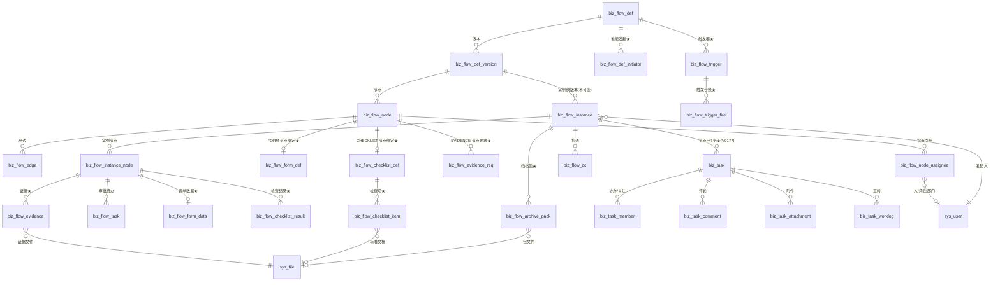

> 图 2：数据模型 ER。★ = 本设计新增的关系。
> **注意 ER 图的四条结构性事实**：
> 1. 实例 → 版本是**不可变绑定**（`ON DELETE RESTRICT`），这是「改流程不影响在跑实例」的唯一依据；
> 2. 作业定义（表单/清单/证据要求）挂在**编辑期节点**上，运行期通过**版本快照**取用 —— 所以图上「定义 → 实例」之间没有直达边；
> 3. `biz_task` 只有**一条**指向流程的边（`flow_instance_id`），不参与任何作业数据的存储 —— 作业数据与任务数据是**并列**关系不是**包含**关系；
> 4. 文件一律经 `sys_file`，不存物理路径（与 `biz_task_attachment`、`biz_doc_attachment` 同款）。

## 3.6 索引与查询场景对照（每条索引都要能说出「为哪条 SQL 建」）

| 索引 | 服务哪条查询 | 预估频度 |
|---|---|---|
| `uk_biz_flow_form_def_ver` | 设计器保存判重 | 低 |
| `uk_biz_flow_form_def_current` | 发起中心/节点绑定取当前表单 | 高 |
| `idx_biz_flow_form_def_list` | 表单库列表（分类+状态，倒序） | 中 |
| `uk_biz_flow_form_data` | 写入口幂等 + 详情页取某节点数据 | 高 |
| `idx_biz_flow_form_data_inst` | 实例详情「材料区」按节点列 | 高 |
| `idx_biz_flow_form_data_gin` | **报表按字段统计**（`data @> '{"dept":"生产"}'`） | 中（但缺了会全表扫） |
| `uk_biz_flow_checklist_result` | 防漏 + 结果 upsert | 高 |
| `idx_biz_flow_checklist_result_inst` | 检查执行页 | 高 |
| `idx_biz_flow_checklist_result_fail` | **「这一项历史失败率」质量趋势** | 低但重（全表扫会很痛） |
| `idx_biz_flow_checklist_item_def` | 执行页按 seq 渲染 | 高 |
| `idx_biz_flow_evidence_inst` | 详情页材料区 | 高 |
| `idx_biz_flow_evidence_req` | **完成闸逐条计数**（`COUNT(*) WHERE req_id=?`） | 高（每次点「完成」都跑） |
| `uk_biz_flow_evidence_file` | 重复上传拦截 | 中 |
| `idx_biz_flow_archive_pack_inst` | 详情页归档区 | 低 |
| `idx_biz_flow_trigger_due` | **扫描器主查询**（`WHERE next_fire_at <= now()`） | **极高（每分钟）** |
| `idx_biz_flow_trigger_event` | 事件分发反查 | 高（每个业务事件都查） |
| `uk_biz_flow_trigger_fire` | 幂等判重 | 极高 |
| `idx_biz_flow_trigger_fire_recent` | 排障 | 低 |
| `idx_biz_flow_def_initiator_ref` | 反查「这个角色能发起哪些流程」 | 低 |
| `uk_biz_flow_node_verifier` | 保证每版本至多一个验证节点 | 低（写入时） |

## 3.7 «停下问»第三条：JSONB 存储与现有查询/报表体系是否冲突

**卡面要求**：「发现表单 JSONB 存储与现有查询/报表体系冲突（比如报表要按表单字段统计）→ 报告」。

### 3.7.1 实测现状：现有报表体系长什么样

| 报表 | 实现 | 数据来源 |
|---|---|---|
| ERP 三表（资产负债表/利润表/现金流量表） | `erp/report.rs` + `biz_report_item` + `biz_voucher_entry` | **强结构表**（列是字段） |
| 库存/凭证/应收等业务查询 | `erp/model_*.rs` | 强结构表 + 索引 |
| 流程统计 | `flow/handler.rs` 的 `stats/*` | `biz_flow_instance` / `_instance_node` 强结构列 |
| 通用导出 | `business/impexp` | 按模块定义的字段清单 |

**结论：现有报表体系全部建立在「强结构表 + 明确索引」之上，没有任何一处依赖 JSONB 聚合。**

### 3.7.2 冲突评估

| 潜在冲突 | 是否成立 | 评估与对策 |
|---|---|---|
| **报表要按表单字段 GROUP BY** | ⚠ **部分成立** | 成立的部分：确实会有「按部门统计报销金额」这类需求。**不成立的部分**：这类需求的特点是「字段由业务临时指定」（今天按费用类型，明天按项目），**本来就不该进固定报表**。对策：① `GIN(data jsonb_path_ops)` 支持 `@>` 过滤（实测这类查询在百万行内可用）；② 需要「固定口径」的指标，走 **`biz_flow_form_data` → 物化视图**（`mv_flow_form_<code>`），由 L3 的「报表字段映射」配置生成；③ **明确不做**「把任意 JSONB 当数据仓库」 |
| **现有 SQL JOIN 拿不到表单字段名** | ❌ 不成立 | 表单字段没有「列名」概念，本来就不参与 JOIN。要 JOIN 的是 `instance_id` / `node_key`（强结构列，已索引） |
| **驱动不支持 `jsonb` 数组参数绑定** | ⚠ **成立，且是真实约束** | `V0120` 文件头 ② 实测过 `Value::Array → unsupported feature`。对策：所有 `@>` 过滤走**单参数 JSON 字符串**（`data @> $1::jsonb`，$1 是 `serde_json::Value` 序列化后的字符串），不绑定数组 |
| **JSONB 无 schema 演进保护** | ⚠ 成立 | 对策：`biz_flow_form_data.schema_hash` + 绑定版本的 schema 渲染。**读旧数据用旧 schema**，永不「按新 schema 解释旧数据」 |
| **JSONB 上做范围查询（金额 > 1000）慢** | ⚠ 成立 | 对策：`GIN(jsonb_path_ops)` 只加速包含查询；范围查询需要 **表达式索引**（`CREATE INDEX ... ((data->>'amount')::numeric)`）。**设计上不预先建**（字段由用户配，无法预先知道），而是在「报表配置」页面提供「为这个字段建表达式索引」的操作（L3） |
| **跨表统计（流程 + 业务单据 + 表单）** | ❌ 不成立 | 三者各在自己的表，用 `instance_id` / `biz_id` 关联（都是强结构列） |

### 3.7.3 结论（明确写进设计约束）

1. **JSONB 只用于「用户自定义字段的值」，不用于「引擎要判定/排序/聚合的系统字段」**。引擎需要的（`node_key` / `round` / `status` / `form_def_id`）全是强结构列。
2. **报表体系不与 JSONB 拼接**：固定口径报表走物化视图（L3），临时查询走 `@>` 过滤（L1 起可用）。
3. **`biz_flow_instance.form_data` 保持现状**（它是 JSONB，已有 3 处消费方），不改造、不迁移 —— 改造它等于动 `assignee::resolve` 的输入，风险远大于收益。

**不构成「停下来问」级别的冲突。** 但它是 L3 的一个明确待做项（§14.3 列出）。

## 3.8 POC 实测结果（可复跑）

**执行环境**：PostgreSQL 18.6，库 `arch5_poc_b` = `cloudpivot_p16md`（102 表）的 `CREATE DATABASE ... TEMPLATE` 副本。

**① DDL 执行（`arch5_ddl_poc.sql`，666 行）**

```
$ sudo -u postgres psql -d arch5_poc_b -v ON_ERROR_STOP=1 -f docs/evidence/20261104-arch5/arch5_ddl_poc.sql
...
COMMENT
psql:...:666: NOTICE:  ARCH-5 POC 自检通过：11 张新表 + node 8 列 + def/instance/task 9 列 + 6 条关键索引
DO
$ echo $?
0
```

**② 存量兼容性（ALTER 本身即在存量数据上校验）**

```
$ sudo -u postgres psql -d arch5_poc_b -c "select (select count(*) from biz_flow_def) defs,
     (select count(*) from biz_flow_node) nodes, (select count(*) from biz_flow_instance) insts,
     (select count(*) from biz_flow_task) ftasks, (select count(*) from biz_flow_def_version) vers"
 defs | nodes | insts | ftasks | vers
------+-------+-------+--------+------
   12 |    52 |     4 |      1 |   12
$ sudo -u postgres psql -d arch5_poc_b -c "select flow_type, count(*) from biz_flow_def group by 1"
 flow_type | count
-----------+-------
 APPROVAL  |    12
```

> **12 个流程定义 / 52 个节点 / 4 个实例 / 12 个版本全部在新约束下存活。** 这就是「不改现有表语义」的实测证明。

**③ 21 条负向测试全通过（`arch5_negative_tests.sql`）**

```
CASE 01 ok  空 fields 数组被 ck_biz_flow_form_def_schema 拦住
CASE 02 ok  PUBLISHED 缺指纹被 ck_biz_flow_form_def_published 拦住
CASE 03 ok  DRAFT 挂 is_current 被 ck_biz_flow_form_def_current 拦住
CASE 04 ok  第二个 is_current 被 uk_biz_flow_form_def_current 拦住
CASE 05 ok  FORM 节点缺 form_def_id 被 ck_biz_flow_node_work_binding 拦住
CASE 06 ok  作业形态绑定错配被 ck_biz_flow_node_work_binding 拦住
CASE 07 ok  第二个验证节点被 uk_biz_flow_node_verifier 拦住
CASE 08 ok  ESCALATE 缺升级级数被 ck_biz_flow_node_escalate 拦住
CASE 09 ok  未知 node_type 被 biz_flow_node_node_type_check 拦住
CASE 10 ok  RANGE 无边界被 ck_biz_flow_checklist_item_judgeable 拦住
CASE 11 ok  跳过无权限码被 ck_biz_flow_checklist_item_skip 拦住
CASE 12 ok  倒挂区间被 ck_biz_flow_checklist_item_range 拦住
CASE 13 ok  跳过无原因被 ck_biz_flow_checklist_result_skip 拦住
CASE 14 ok  重复结果被 uk_biz_flow_checklist_result 拦住
CASE 15 ok  证据数量倒挂被 ck_biz_flow_evidence_req_count 拦住
CASE 16 ok  SIGN 不签被 ck_biz_flow_evidence_req_sign 拦住
CASE 17 ok  READY 空包被 ck_biz_flow_archive_pack_ready 拦住
CASE 18 ok  空 cron 被 ck_biz_flow_trigger_shape 拦住
CASE 19 ok  夹带 SQL 被 ck_biz_flow_trigger_no_sql 拦住
CASE 20 ok  重复触发被 uk_biz_flow_trigger_fire 拦住
CASE 21 ok  闭环无归档被 ck_biz_flow_def_closure_archive 拦住
ARCH-5 负向测试完成：21 个用例，18 条约束逐条实测被拦
```

**复跑方法**（任何人可重放）：

```bash
sudo -u postgres psql -c "CREATE DATABASE arch5_poc_x TEMPLATE cloudpivot_p16md OWNER postgres"
sudo -u postgres psql -d arch5_poc_x -v ON_ERROR_STOP=1 -f docs/evidence/20261104-arch5/arch5_ddl_poc.sql
sudo -u postgres psql -d arch5_poc_x -v ON_ERROR_STOP=1 -f docs/evidence/20261104-arch5/arch5_negative_tests.sql
```

## 3.9 迁移号段规划

实测仓内最大号 **V0215**（`V0215__erp_p2_2_stub_fields`，P2-2 未合并）。本设计建议取 **V0220 起**，留 4 个空号（0216–0219）给并行卡：

| 迁移 | 内容 | 依赖 |
|---|---|---|
| `V0220__flow_type_and_closure` | `biz_flow_def` +5 列 +5 CHECK | 无 |
| `V0221__flow_node_work_types` | `biz_flow_node` node_type 扩 15 值 + 8 列 + 4 CHECK + **扩 `ck_biz_flow_node_config_partition`** | V0220（无硬依赖，但同批） |
| `V0222__flow_form_def` | `biz_flow_form_def` + `biz_flow_form_data` | V0221（`form_def_id` 先有列后加 FK，或同文件内建表后 ADD CONSTRAINT） |
| `V0223__flow_checklist` | `biz_flow_checklist_def` / `_item` / `_result` | V0221 |
| `V0224__flow_evidence_archive` | `biz_flow_evidence_req` / `biz_flow_evidence` / `biz_flow_archive_pack` | V0221 |
| `V0225__flow_trigger` | `biz_flow_trigger` / `biz_flow_trigger_fire` | V0220 |
| `V0226__flow_def_initiator` | `biz_flow_def_initiator` | V0220 |
| `V0227__flow_task_role` | `biz_flow_task` +2 列 +1 CHECK | 无 |
| `V0228__flow_work_permissions` | 权限码 + 菜单种子（§13） | V0220–V0227 |
| `V0229__flow_work_indexes` | 实例可见性三跳索引 + `biz_flow_task.escalated_level` + `biz_flow_def.sla_hours` | V0221 / V0227 |

**每个迁移文件的硬要求**（沿用 `V0120` / `V0177` 的成熟形态）：
1. `CREATE TABLE IF NOT EXISTS` / `CREATE INDEX IF NOT EXISTS`（幂等）；
2. 末尾 `DO $$` 结构自检，缺表/缺索引/缺约束/约束内容不对 → **`RAISE EXCEPTION` = 迁移失败 = 启动失败**；
3. 配套 `.down.sql` 逆序 DROP + 零残留断言；
4. 文件头写清「依据哪条设计决策 + 卡面哪一条」，回滚顺序写清。

## 本章红线

1. **不许把已发布的表单/清单定义原地 UPDATE**。改 = 新增版本行。违反则「改表单不影响在跑实例」当场失效。
2. **不许给 `biz_flow_instance.form_data` 补写节点数据**（D-ARCH5-05 的三条破坏）。
3. **不许省略 `ck_biz_flow_node_config_partition` 的扩展**（新节点写 `config.work` 会被库直接拦死）。
4. **不许在触发器/检查项里放 SQL**（`ck_..._no_sql` 已在库层上锁，绕过它就是绕过红线）。
5. **不许为了「方便查」给 `biz_flow_evidence` 加 `owner_id` 之类的冗余列** —— R1：负责人从 `instance.initiator` / 节点任务 `owner_id` 取，两处存就是两处能改。

---

# 第四章 节点类型手册（15 种）

> 每种节点给六项：**用途 / 可配项 / 生成什么 / 完成条件 / 前置后置约束 / 引擎代码落点**。
> 「可配项」一律标注来源：**表列**（`biz_flow_node.xxx`）、**独立表**（`biz_flow_node_assignee` / `biz_flow_evidence_req`）、**config 键**（`config.work` 等）。

## 4.0 十五种节点总览

| # | node_type | 族 | 阻塞? | 生成物 | 出度 | 存量/新增 |
|---|---|---|---|---|---|---|
| 1 | `START` | 结构 | 否 | 无 | =1 | 存量 |
| 2 | `END` | 结构 | 否 | 无 | =0 | 存量 |
| 3 | `APPROVAL` | 审批 | **是** | `biz_flow_task`（1 条或 N 条） | =1 | 存量 |
| 4 | `COUNTERSIGN` | 审批 | **是** | `biz_flow_task`（N 条） | =1 | 存量 |
| 5 | `CONDITION` | 结构 | 否 | 无（求值选边） | ≥2 | 存量 |
| 6 | `PARALLEL` | 结构 | 否 | 无（扇出/汇聚） | ≥2 | 存量 |
| 7 | `CC` | 通知 | 否 | `biz_flow_cc` | =1 | 存量 |
| 8 | `NOTIFY_NODE` | 通知 | 否 | `sys_notice` | =1 | 存量 |
| 9 | `TASK_NODE` | 作业 | **是** | `biz_task` | =1 | 存量 |
| 10 | `FORM` | 作业 | **是** | `biz_task` + `biz_flow_form_data` | =1 | **新增** |
| 11 | `CHECKLIST` | 作业 | **是** | `biz_task` + `biz_flow_checklist_result` | =1 | **新增** |
| 12 | `EVIDENCE` | 作业 | **是** | `biz_task` + `biz_flow_evidence` | =1 | **新增** |
| 13 | `WAIT` | 等待 | **是** | `biz_task`（提醒用）+ 等待令牌 | =1 | **新增** |
| 14 | `SUBPROCESS` | 结构 | **是** | 子实例 + 父 `biz_task`（可选） | =1 | **新增** |
| 15 | `ACTION` | 自动 | 否 | 业务副作用（单据/通知/凭证…） | =1 | **新增** |

**「阻塞」的定义**：节点进入 `ACTIVE` 并**停在那里**，直到外部条件满足才 `APPROVED` 并驱动下游。
非阻塞节点进入即 `APPROVED`（或 `SKIPPED`）并立即驱动下游 —— 这是现有引擎的既有语义，新增节点必须遵守。

## 4.1 `START` 开始

| 项 | 内容 |
|---|---|
| **用途** | 图的唯一起点；发起时从它开始 |
| **可配项** | 仅 `node_name` / 坐标。**不许**配指派、表单、超时（库里也不给这些列赋值） |
| **生成什么** | 无 |
| **完成条件** | 引擎进入即 `APPROVED`，无人工交互 |
| **前置/后置约束** | R1：恰好 1 个；R4：入度 = 0；R5：出度 = 1 |
| **引擎落点** | `engine.rs:2238` `NodeType::Start` 臂（存量，不改） |

**发起参数落在哪**：`START` 节点本身不存数据。发起时填的表单/参数写 `biz_flow_instance.form_data`（D-ARCH5-05）。
如果流程需要「发起时就填一张正式表单」，做法是 `START → FORM`，`FORM` 节点绑 `form_def_id` 且 `config.work.at_start=true`（表示「这一步就是发起单」）——
**否决了「START 节点绑表单」**：`START` 是结构节点，给它加业务载荷会让「结构校验」和「配置校验」搅在一起。

## 4.2 `END` 结束

| 项 | 内容 |
|---|---|
| **用途** | 图的终点；到达即实例落终态 |
| **可配项** | `node_name`；`config.end.outcome`（`APPROVED` / `REJECTED`，默认 `APPROVED`）—— 支持「多个 END 表达不同结局」 |
| **生成什么** | 无。**唯一的副作用**：若 `biz_flow_def.archive_policy IN ('ON_FINISH')` → 投递归档包生成任务 |
| **完成条件** | 引擎进入即 `APPROVED`，然后 `maybe_finish()` 判实例终态 |
| **前置/后置约束** | R2：≥1 个；R4：出度 = 0；R20：`closure_mode=VERIFY` 时必须有 `closure_role=VERIFIER` 节点在到达 END 之前被走过 |
| **引擎落点** | `engine.rs:2232` `NodeType::End` 臂（存量）+ 归档触发钩子（新增 6 行） |

## 4.3 `APPROVAL` 单签审批

| 项 | 内容 |
|---|---|
| **用途** | 一个人签字决定（同意/驳回） |
| **可配项** | 表列：`assignee_type`（11 值之一）+ `superior_levels` / `form_var_key` / `self_approval` / `empty_assignee` / `allow_robot` / `timeout_*` / `remind_before_hours` / `max_remind_times` / `cc_on_approved` / `reject_veto`；独立表：`biz_flow_node_assignee`（`USER`/`ROLE`/`DEPT_LEADER`）；**新增表列**：`co_assignee`（是否允许协办）、`escalate_levels` |
| **生成什么** | `biz_flow_task`（`task_kind='APPROVAL'`）。若 `co_assignee=true`，协办人落 `task_role='CO'`（不参与表决） |
| **完成条件** | **谁点**：`task_role='PRIMARY'` 且 `status='PENDING'` 的审批人。**点什么**：同意 / 驳回（可附意见与附件）。**系统校验**：① 审批人不是发起人（`self_approval` 策略）；② 实例仍 `PENDING`；③ 无并发冲突（`revision` CAS）；④ 业务回调 `guard_self_approval`（ERP 单据内控） |
| **前置/后置约束** | R14：必须配指派来源；R6：出度 = 1；R17：`co_assignee=true` 时至少一个 PRIMARY |
| **引擎落点** | `engine.rs` 审批臂（存量）；`task_role` 只影响计票 SQL 的 `WHERE`（新增 1 处） |

## 4.4 `COUNTERSIGN` 会签 / 或签

| 项 | 内容 |
|---|---|
| **用途** | 多人表决：全同意 / 过比例 / 任一人同意 |
| **可配项** | 在 `APPROVAL` 全部可配项之上加：`approval_mode`（`ALL`/`RATIO`/`ANY`）+ `approve_ratio`（RATIO 必填）+ `reject_veto`（一票否决）+ **新增 `sign_mode`**（`PARALLEL`/`SEQUENTIAL`） |
| **生成什么** | `biz_flow_task` × N（N = 解析出的审批人数）；`sign_mode=SEQUENTIAL` 时**只生成第一签**，其余等前一签完成再生成 |
| **完成条件** | 按 `approval_mode` 计票：`ALL` ⇒ `approved_count = approver_count`；`RATIO` ⇒ `approved/总 ≥ approve_ratio` **且**未被否决；`ANY` ⇒ `approved_count ≥ 1`。**有序多签额外条件**：所有签序更小的人都已 APPROVED |
| **前置/后置约束** | R9：`approval_mode=RATIO` ⇒ `approve_ratio` 非空且 ∈(0,1]；R6：出度 = 1；**R9'（新增）**：`sign_mode=SEQUENTIAL` ⇒ `node_assignee` 里至少 2 行且 `sort_order` 无重复 |
| **引擎落点** | 存量会签计票 + 新增「签序闸」：`AND NOT EXISTS (SELECT 1 FROM biz_flow_task WHERE instance_node_id=? AND seq_no < ? AND status='PENDING')` |

> **`sign_mode` 与 `approval_mode` 是正交两维**（与 `reject_veto` 和 `approval_mode` 正交同理）：
> 「串行签署 + 全同意」（甲→乙→丙都签）与「并行签署 + 过 2/3」可以同时是配置，不是互斥枚举。

## 4.5 `CONDITION` 条件分支

| 项 | 内容 |
|---|---|
| **用途** | 按数据求值选一条出边 |
| **可配项** | 出边上的 `condition_expr`（JSON DSL）+ `is_default` + `priority`；见 `biz_flow_edge` |
| **生成什么** | 无 |
| **完成条件** | 引擎进入即求值（`pick_condition_edge`），取第一条为真的边；全假则走 `is_default=true` 的边；都没有 ⇒ `Step::Fail`（`65014`） |
| **前置/后置约束** | R7：出度 ≥2；R13：恰一条 default；R10：表达式合法（深度 ≤8、节点 ≤64、字段白名单） |
| **引擎落点** | `engine.rs:2243`（存量，不改） |
| **作业形态的可引用字段（新增）** | 条件 DSL 的求值上下文**新增** `work.*` 命名空间：`work.<node_key>.<field>` 可引用**已完成节点**的表单字段/检查结论/证据数量。这是「检查不合格走返工分支」的实现基础（§6.2.5） |

## 4.6 `PARALLEL` 并行网关

| 项 | 内容 |
|---|---|
| **用途** | 扇出（一分多）与汇聚（多合一） |
| **可配项** | `fork_mode`（`AND` 全开 / `OR` 任一）、`join_mode`（`AND` 等人齐 / `OR` 谁先到谁走） |
| **生成什么** | 无 |
| **完成条件** | 汇聚点：入度 ≥2 时，`join_mode=AND` ⇒ 所有入边来源节点都已到达本轮；`OR` ⇒ 任一到达即可 |
| **前置/后置约束** | R7：出度 ≥2；R8：禁止混流汇聚（`AND` 汇聚不许有 `CONDITION` 来源） |
| **引擎落点** | `engine.rs:2257` 分叉 + `engine.rs:2157` 汇聚（**存量，卡面以为要新做，实测已交付**） |

## 4.7 `CC` 抄送

| 项 | 内容 |
|---|---|
| **用途** | 知会，不阻塞 |
| **可配项** | 与审批节点同款指派配置（`assignee_type` + `node_assignee`） |
| **生成什么** | `biz_flow_cc` 行 + `sys_notice` |
| **完成条件** | 引擎进入即 `SKIPPED` 并驱动下游（**抄送不是待办**，`V0122` 注释 D22 明确不进 `biz_flow_task`） |
| **前置/后置约束** | R6：出度 = 1 |
| **引擎落点** | `engine.rs:2265`（存量） |

## 4.8 `NOTIFY_NODE` 通知

| 项 | 内容 |
|---|---|
| **用途** | 发一条通知（可定时） |
| **可配项** | `config.notify`：`targets[]`（1–5 个）、`when`（`ON_ENTER` / `ON_LEAVE` / `ON_TIMEOUT`）、`template_code` 或 `inline`、`timeout_hours` |
| **生成什么** | `sys_notice`（经 `notice::dispatch`） |
| **完成条件** | `ON_ENTER`/`ON_LEAVE` 进入即 `APPROVED`；`ON_TIMEOUT` 保持 `ACTIVE`，到点由 `timeout::fire_notify_node` 发送后放行 |
| **前置/后置约束** | R19：`config.notify` 形状合法；R17：出度 = 1。**投递失败只 WARN，流程继续**（红线：渲染失败=400 回滚，投递失败=运行时故障不阻塞） |
| **引擎落点** | `engine.rs` 通知臂 + `notify_node.rs`（1890 行，存量） |

## 4.9 `TASK_NODE` 纯任务（存量）

| 项 | 内容 |
|---|---|
| **用途** | 「去把这件事办了」，完成 = 任务 `DONE`；不需要结构化数据 |
| **可配项** | `config.task`：`title_template`（必填，≤200）、`description_template`（≤8000）、`priority`（P0–P3）、`due`（`FIXED`/`RELATIVE` + 值 + 单位）、`need_review`、`on_complete`（`DIRECT`/`VERIFY`/`APPROVE`）、`approve_biz_type`、`on_reject`、`on_cancel`、`form_mapping`（3 个键：`priority`/`due_date`/`estimate_hours`）、`attach_biz`、`allow_skip_when_no_assignee`；表列：指派/超时全部适用 |
| **生成什么** | `biz_task`（1 条）+ `biz_task_member`（其余解析出的人） |
| **完成条件** | 任务进 `DONE`（或 `need_review=true` 时进 `REVIEW` 再由人验收）。引擎侧校验：`flow_instance_id/flow_node_key/flow_round` 匹配 + 节点仍 `ACTIVE` |
| **前置/后置约束** | R18：`need_review` × `on_complete` 组合合法（`VERIFY` 必须 `need_review=true`；`APPROVE` 必须给 `approve_biz_type`）；R20：`empty_assignee=SKIP` 需 `allow_skip_when_no_assignee=true`；R17：出度 = 1 |
| **引擎落点** | `engine.rs` `NodeType::Task` 臂 + `task_node::spawn`（存量，卡面「节点生成任务」已在 V0177 落地） |

## 4.10 `FORM` 表单作业（新增）

| 项 | 内容 |
|---|---|
| **用途** | 「填一张有结构的表单」，完成 = 表单校验通过并提交 |
| **可配项** | 表列：`form_def_id`（必填，FK RESTRICT）、全部指派/超时列、`co_assignee`；`config.work`：`at_start`（bool，是否发起单）、`expose_as_var`（字段→流程变量映射）、`readonly_fields`（只读字段清单）、`allow_save_draft`（默认 true）、`submit_button_text` |
| **生成什么** | `biz_task`（同 `TASK_NODE`）+ 提交时写 `biz_flow_form_data`（`UPDATE ... SET data, status='SUBMITTED'`） |
| **完成条件** | **谁点**：任务负责人（`owner_id`）或持有 `business:flow:work:submit` 且有该节点指派的人。**点什么**：「提交」。**系统校验**：① `biz_flow_form_data.status='SUBMITTED'`；② 按**绑定版本的 schema** 重跑全部校验（后端必须重算，不信前端）；③ `schema_hash` 与实例节点快照一致 |
| **前置/后置约束** | R22（新增）：`FORM` 节点必须有 `form_def_id`，且该表单 `status='PUBLISHED'`；R23（新增）：`expose_as_var` 的字段必须在 schema 里存在 |
| **引擎落点** | 复用 `task_node::spawn`；新增 `work_gate::check_form()` |

## 4.11 `CHECKLIST` 检查作业（新增）

| 项 | 内容 |
|---|---|
| **用途** | 「逐项检查」，完成 = 必做项全 PASS（或有权限地 SKIPPED） |
| **可配项** | 表列：`checklist_def_id`（必填）+ 指派/超时；`config.work`：`require_photo_per_item`（bool）、`allow_na`（bool）、`min_pass_weight`（numeric，加权达标线，空 = 全 PASS） |
| **生成什么** | `biz_task` + N 条 `biz_flow_checklist_result`（**懒创建**：点一项写一行，未点的项无行） |
| **完成条件** | **谁点**：任务负责人。**点什么**：「完成检查」。**系统校验**（逐条，§6.2.4）：① 必做项数 = `COUNT(result IN ('PASS','SKIPPED','NA'))`；② 每个 `SKIPPED` 有原因且操作人有 `skip_auth_code`；③ 每个数值项 `in_range` 与 `pass_rule` 一致（后端按记录重算，不改信 `result` 字段）。任一不满足 ⇒ `400 + 65070`，**不生成待办、不推进流程** |
| **前置/后置约束** | R24（新增）：`CHECKLIST` 节点必须有 `checklist_def_id` 且 PUBLISHED；R25（新增）：清单 `fail_action IN ('TO_RECTIFY','TO_APPROVAL')` ⇒ 流程里必须存在 `closure_role='RECTIFY'` 或下游审批节点 |
| **引擎落点** | 复用 `task_node::spawn`；新增 `work_gate::check_checklist()` |

## 4.12 `EVIDENCE` 证据作业（新增）

| 项 | 内容 |
|---|---|
| **用途** | 「把材料备齐并签署」，完成 = 每条要求都达标 |
| **可配项** | 独立表 `biz_flow_evidence_req`（1–10 条）+ 指派/超时；`config.work`：`allow_extra`（是否允许传要求之外的材料，默认 true）、`require_all_signed`（默认 false） |
| **生成什么** | `biz_task` + `biz_flow_evidence` 行（上传即写） |
| **完成条件** | **谁点**：任务负责人 + 该签的人。**点什么**：「提交材料」。**系统校验**：对每条 `is_required=true` 的 req，`COUNT(evidence WHERE req_id=? AND status='VALID' AND deleted_at IS NULL) BETWEEN min_count AND max_count`；`require_sign=true` ⇒ 每条都 `signed_by IS NOT NULL`；`signer_rule` 解析出的人必须是实际签署人。**不达标不许完成** |
| **前置/后置约束** | **R22'（新增，卡面明写）**：`EVIDENCE` 节点**必须有至少一条** `biz_flow_evidence_req`（发布时校验），否则「留痕节点没有留痕要求」= 自相矛盾 |
| **引擎落点** | 复用 `task_node::spawn`；新增 `work_gate::check_evidence()` |

## 4.13 `WAIT` 等待外部事件（新增）

| 项 | 内容 |
|---|---|
| **用途** | 「等一件事发生」：等客户回传签字件、等外部检测报告、等银行到账 |
| **可配项** | `config.wait`：`event_code`（必填，如 `CUSTOMER_RETURN_SIGNED`）、`match_key`（从实例取哪个字段作为事件匹配键，如 `instance_no` 或表单字段）、`timeout_hours` + `timeout_action`（**WAIT 特有**：`TIMEOUT_PASS` / `TIMEOUT_REJECT` / `TIMEOUT_REMIND`）、`holder_assignee`（谁负责催，默认发起人） |
| **生成什么** | `biz_task`（给 `holder` 的催办任务）+ **等待令牌**（`biz_flow_instance_node.status='ACTIVE'` 本身即令牌，不另建表） |
| **完成条件** | **两种方式**：① 外部事件到达 → `POST /business/flow/instance/{id}/signal`（`event_code` + `match_key` 匹配 instance_node）→ 节点 `APPROVED`；② 超时按 `timeout_action` 处置。**系统校验**：`event_code` 与节点配置一致 + `match_key` 与实例匹配 |
| **前置/后置约束** | R26（新增）：`WAIT` 必须配 `event_code`；出度 = 1；`timeout_hours` 建议必填（否则可能永远等下去）—— **设计上：`timeout_hours` 为空时发布校验给 WARNING 不给 ERROR**（有些流程真的要无限等） |
| **引擎落点** | 新臂 `NodeType::Wait`：进入即 `activate_node_row` + 生成 holder 任务 + 返回 `Step::Idle`；`signal` 接口是新的 HTTP handler |

## 4.14 `SUBPROCESS` 子流程（新增）

| 项 | 内容 |
|---|---|
| **用途** | 一个节点里跑另一张完整的图（里程碑挂子流程、离职挂资产归还、异常挂 8D） |
| **可配项** | 表列：`subprocess_def_id`（必填，FK RESTRICT）；`config.sub`：`version_policy`（`PIN_CURRENT` 发起时钉当前版 / `FOLLOW_LATEST` 跟随）、`param_mapping`（父实例 → 子实例的表单参数映射）、`result_mapping`（子实例结论 → 父实例变量）、`fail_action`（`ABORT` 父流程终止 / `CONTINUE` 继续 / `TO_RECTIFY` 跳整改） |
| **生成什么** | 一条**子实例**（`biz_flow_instance` + `parent_instance_id` + `parent_node_key` —— **新增 2 列**，见下）+ 可选一条父侧 `biz_task`（`config.sub.spawn_task=true` 时，用于在父流程里体现「子流程在跑」） |
| **完成条件** | 子实例落 `APPROVED` ⇒ 本节点 `APPROVED`；子实例 `REJECTED`/`CANCELLED` ⇒ 按 `fail_action` 处置 |
| **前置/后置约束** | R27（新增）：`subprocess_def_id` 不得指向自己（防自递归）；层级深度 ≤ 3（与任务 8 层取不同值：流程嵌套 3 层已经很多）；出度 = 1 |
| **引擎落点** | 新臂 `NodeType::Subprocess`：事务内建子实例 → 父节点 `ACTIVE` → 子实例结算时回调父 `signal` |
| **对 `biz_flow_instance` 的扩展** | 需要 2 列：`parent_instance_id uuid REFERENCES biz_flow_instance(id)`、`parent_node_key varchar(64)`；`CREATE INDEX ON biz_flow_instance(parent_instance_id) WHERE parent_instance_id IS NOT NULL`。**这条加进 §3.9 的 V0221** |

## 4.15 `ACTION` 自动动作（新增）

| 项 | 内容 |
|---|---|
| **用途** | 系统执行一件有副作用的事：生成单据、过账、发通知、调账、冻结批次、扣减额度 |
| **可配项** | `config.action`：`action_code`（**必须来自白名单**）、`action_params`（JSONB）、`on_error`（`ABORT` 整笔回滚 / `SKIP` 跳过继续）、`idem_key`（幂等键表达式） |
| **动作白名单（11 个，实测来自 `biz_flow_linkage_rule.ck_flow_linkage_action_code`）** | `WRITE_INVENTORY` / `WRITE_INVENTORY_TXN` / `UPDATE_COST` / `GENERATE_VOUCHER` / `REVERSE_VOUCHER` / `UPDATE_DOC_STATUS` / `UPDATE_RECEIVED_QTY` / `UPDATE_PAYABLE_BALANCE` / `CREATE_TASK` / `SEND_NOTICE` / `LOCK_DOCUMENT` |
| **生成什么** | 业务副作用本身（不是待办）。`CREATE_TASK` 例外：生成 `biz_task` |
| **完成条件** | 动作执行成功即 `APPROVED`。**`on_error=ABORT` 时失败 = `Step::Fail` = 整笔回滚**（与 `task_node` 的「生成任务不是副作用是业务事实」同一立场） |
| **前置/后置约束** | R28（新增）：`action_code` 必须在白名单内；`action_params` 不许含 SQL 关键字（复用 `ck_flow_linkage_no_sql_key` 的 11 个词）；`AUTOMATION` 类型的流程只许由 `ACTION` / `NOTIFY_NODE` / `SUBPROCESS` 构成（不许有人工节点） |
| **引擎落点** | 新臂 `NodeType::Action`：调 `linkage::actions::execute(action_code, params, ctx)`（**复用现有 667 行的动作执行器**），不新写一套 |

## 4.16 引擎分派的最终形态（一张图说清）

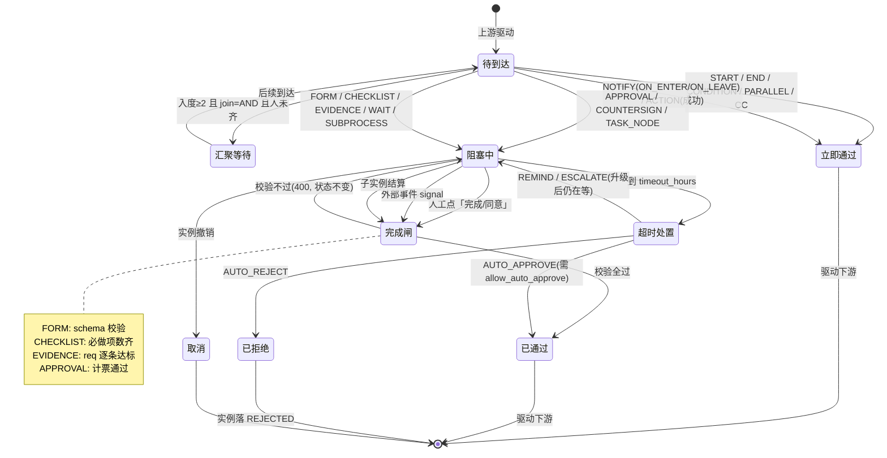

> 图 3：节点生命周期。**三个关键不变式**：
> ① 「校验不过」不会让节点离开 `ACTIVE`（不是「失败」而是「还不算完成」）；
> ② 超时不是独立状态，它是**触发一次完成闸的另一种入口**；
> ③ 所有「已完成」的节点都能被 `work_gate` 从库里的行重算一遍（R5）。

## 本章红线

1. **新增节点必须遵守「非阻塞节点进入即通过」**，否则 `Step::Next` 的下游驱动会漏。
2. **`EVIDENCE` 节点没有 `evidence_req` 不许发布**（R22'）—— 这是卡面点名的失败模式 5。
3. **`ACTION` 的动作码不许自定义**（只能用 11 个白名单），否则「配置即代码」的口子就开了。
4. **`SUBPROCESS` 不许自递归**（R27），嵌套 ≤3 层。

---

# 第五章 触发机制（五种触发怎么实现）

> 五种触发共用**一个实例化入口** `flow::create_instance`（现有函数，`handler.rs:1314`）。
> 触发器只负责**准备好参数**，不负责跑图 —— 这条边界决定了「五种触发」不会变成五套引擎。

## 5.1 统一入口：`create_instance(def_id, version_id, form_data, initiator, biz_ref)`

| 入参 | 来源（按触发方式） | 说明 |
|---|---|---|
| `def_id` | 人工：模板墙选择 / 单据：`biz_type` 匹配默认流程 / 自动：触发器 `def_id` | 必须有 `status='PUBLISHED'` |
| `version_id` | 一律由 `biz_flow_def.current_version_id` 解析（`SUBPROCESS` 的 `PIN_CURRENT` 除外） | 实例绑版本（D2 不变） |
| `form_data` | 人工：发起表单 / 单据：单据字段快照 / 定时：`param_mapping` 渲染 / 事件：事件载荷映射 | 写 `biz_flow_instance.form_data`（只写一次） |
| `initiator_id` | 人工：当前用户 / 单据：单据制单人 / 定时：`initiator_strategy` 解析 / 事件：`EVENT_OWNER` | 必须有 `sys_user` 行（**外部参与不走这里**，见维度 ⑥） |
| `biz_ref` | 单据：`(biz_type, biz_id, biz_no)` / 其它：`NULL` | `uk_biz_flow_instance_biz_active` 保证同单据同时只有一个在跑实例 |

**幂等口径统一**：`create_instance` 内部已有 `uk_biz_flow_instance_biz_active` 兜底（同单据重复提交 → 23505 → 幂等成功）。
无单据的流程（`biz_id IS NULL`）不受这条约束，所以**自动触发必须自己带幂等键**（见 §5.3/§5.4 的 `biz_flow_trigger_fire`）。

## 5.2 触发方式一：人工发起（`MANUAL`）

| 项 | 内容 |
|---|---|
| **配置在哪** | 不落 `biz_flow_trigger`。配置在 `biz_flow_def`（`category` 分组、`party_scope`、`status`）+ `biz_flow_def_initiator`（谁能发起） |
| **怎么匹配** | 发起中心查 `status='PUBLISHED'` 且 `flow_type IN ('APPROVAL','WORKFLOW')` 且（`biz_flow_def_initiator` 为空 或 命中当前用户的角色/部门） |
| **幂等** | 无（人工可以重复发起，这是合法业务 —— 同一天报两次销是允许的） |
| **失败处理** | 直接返回业务错误给用户（`65000` 定义非法 / `65018` 解析不出人 / `65039` 模板缺变量） |
| **现状** | ⚠ 页面已有（`flow/start/index.vue`），但只支持硬编码 `title + content + attachments`。**要做的是把它换成「用表单渲染器渲染 `biz_flow_form_def`」** |

**发起中心的参数填写流程（设计）**：

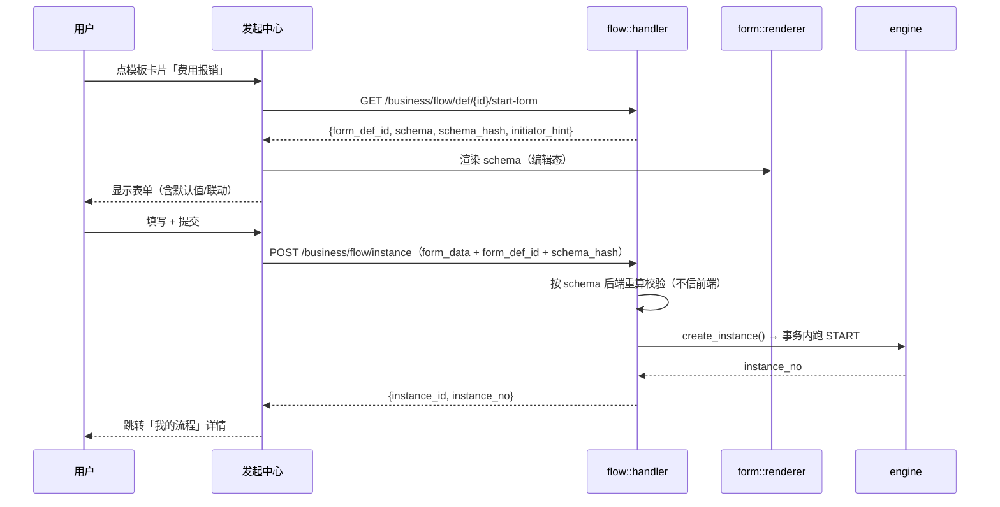

## 5.3 触发方式二：定时触发（`CRON`）

### 5.3.1 配置在哪

`biz_flow_trigger` 一行，`trigger_kind='CRON'`：

| 字段 | 必填 | 说明 |
|---|---|---|
| `cron_expr` | ✅ | 6 段式（与 `sys_job` 同款：`秒 分 时 日 月 周`）。实测现有 job 形如 `0 30 7 * * *` |
| `cron_timezone` | 默认 `Asia/Shanghai` | **显式时区**（不依赖服务器 TZ） |
| `misfire_policy` | ✅ | `SKIP` 错过就跳过 / `CATCH_UP` 补做（最多 `catch_up_limit` 次）/ `ONCE` 只补一次 |
| `dedupe_strategy` | ✅ | `NATURAL_KEY` 用自然键 / `EXPR` 用表达式 / `NONE` |
| `dedupe_expr` | 条件必填 | 例如 `period={{now.format:YYYY-MM}}` → 2026-11 只触发一次 |
| `param_mapping` | | 参数映射，支持内置变量：`{{now.date}}` / `{{now.period}}` / `{{prev.period}}`（上期，补做时有意义） |
| `initiator_strategy` + `initiator_ref` | ✅ | `ROLE` 取该角色第一个人 / `USER` 指定人 / `SYSTEM` 用系统账号（超管） |

### 5.3.2 扫描器怎么工作（一条内置 job，不是每个触发器一个 job）

```
内置 cron job `flow_trigger_scan`，每分钟（* * * * * *）—— 与 flow_timeout_scan 同款 register_builtin
  ↓
SELECT * FROM biz_flow_trigger
 WHERE enabled AND deleted_at IS NULL
   AND trigger_kind = 'CRON'
   AND next_fire_at <= now()
 ORDER BY priority DESC, next_fire_at
 LIMIT 50                                  -- 一批最多 50，防雪崩
（走 idx_biz_flow_trigger_due 部分索引）
  ↓ 逐条（每条一个独立事务，互不影响）
 ① 算 dedupe_key（NATURAL_KEY / EXPR / NONE）
 ② INSERT INTO biz_flow_trigger_fire(trigger_id, dedupe_key, status='FIRED')
    ON CONFLICT (trigger_id, dedupe_key) DO NOTHING RETURNING id
    → 没返回行 = 已触发过 = SKIPPED_DUP，跳过
 ③ 渲染 param_mapping + title_template → create_instance()
 ④ 更新 last_fire_at / fire_count / next_fire_at = 下次 cron 时刻
 ⑤ 失败 → fail_count++ / last_error，并按 misfire_policy 决定 next_fire_at
```

### 5.3.3 三个必须处理的问题（卡面点名）

| 问题 | 设计 |
|---|---|
| **错过补做** | `misfire_policy`：`SKIP`（默认，适合「日报」）/ `CATCH_UP`（适合「月度结账」，最多补 `catch_up_limit` 期）/ `ONCE`（只补最近一次）。**补做时 `param_mapping` 里的 `{{now.period}}` 要换成被补的期间** —— 用 `{{target.period}}`（扫描器算出「本该跑的期间」并注入），这是最容易做错的一处 |
| **时区** | `cron_timezone` 显式存（默认 CST）。扫描器把 `next_fire_at` 一律存 UTC `timestamptz`，cron 求值在指定时区里做。**否决了「用服务器本地时区」**：容器换时区会静默改变所有定时流程的触发时刻 |
| **重复触发** | 三层：① `biz_flow_trigger_fire` 的 `uk(trigger_id, dedupe_key)`（库级唯一，并发 23505 当幂等成功）；② 扫描器 `LIMIT 50` + 逐条独立事务（一条卡住不拖死整批）；③ `next_fire_at` 在同一事务里推进（不会重复扫到同一时刻） |

### 5.3.4 失败处理

| 失败类型 | 处理 |
|---|---|
| 渲染失败（模板缺变量） | `fail_count++` + `last_error`，**不重试**（配置错了重试一万次还是错），`next_fire_at` 照常推进 |
| `create_instance` 业务拒绝（如解析不出负责人） | 同上，且写一条 `biz_flow_trigger_fire(status='FAILED')` 留痕 |
| 数据库异常 | 整条事务回滚 → `next_fire_at` 不推进 → 下一分钟重试（**天然重试**，不需要额外机制） |
| `fail_count >= 5` 连续失败 | 自动 `enabled=false` + 通知 `create_by`（「你这个定时流程连续 5 次没跑起来，已自动停用」）。**这条是防「静默失效」的关键** |

## 5.4 触发方式三：事件触发（`EVENT`）

### 5.4.1 配置在哪

`biz_flow_trigger` 一行，`trigger_kind='EVENT'`：`event_code`（必填）+ `entity` + `match_expr`（JSON DSL 过滤）+ `param_mapping` + `dedupe_strategy`。

### 5.4.2 事件从哪来（三种生产者）

| 生产者 | 事件码示例 | 产生方式 |
|---|---|---|
| **业务代码显式发事件** | `STOCK_IN_POSTED` / `QC_FAILED` / `PAYABLE_OVERDUE` / `CONTRACT_EXPIRED` | 在各 bridge / handler 的**事务提交之后**调 `flow::trigger::emit(event_code, entity, payload)` |
| **状态机边** | `DOC_STATUS_CHANGED` | `shared/state_machine.rs` 的边执行成功后发（`biz_status_log` 已有记录，事件只是多一个出口） |
| **定时扫描派生** | `PAYABLE_OVERDUE` / `STOCK_BELOW_SAFETY` | 现有 4 个 ERP 扫描 job（`erp_low_stock_scan` 等）**从「只发通知」升级为「发通知 + 发事件」** |

**关键实测**：`erp_low_stock_scan` / `erp_payable_due_scan` / `erp_po_overdue_scan` / `erp_contract_expire_scan` 这 4 个 job **已经在跑**（`sys_job` 实测 4 行），
它们现在只调 `notice::dispatch`。**事件触发不需要新建扫描器，只需要在这 4 个 job 的末尾加一次 `emit`** —— 这是「库存低于安全线 → 补货流程」的最小实现路径。

### 5.4.3 怎么匹配

```json
// match_expr 示例：质检不合格且严重度为「致命」才发起 8D
{ "op": "and",
  "items": [
    { "op": "cmp", "field": "entity",   "cmp": "eq", "value": "biz_stock_in" },
    { "op": "cmp", "field": "payload.qc_result", "cmp": "eq", "value": "FAIL" },
    { "op": "cmp", "field": "payload.severity",  "cmp": "in", "value": ["CRITICAL","MAJOR"] }
  ] }
```

- **复用现有条件 DSL**（`expression.rs`），不引入第二种表达式语言；
- 白名单字段 = 事件载荷的顶层键 + `entity` + `event_code`（**不允许 `payload.*.*.*` 无限深**，深度 ≤3）；
- 求值在内存里做（事件载荷本来就在进程内），不进库。

### 5.4.4 幂等怎么保证

| 策略 | `dedupe_expr` 示例 | 适用 |
|---|---|---|
| `NATURAL_KEY`（推荐） | `{{payload.doc_id}}:{{payload.qc_round}}` | 同一张单的同一次质检只能发起一次 8D |
| `EXPR` | `{{entity}}:{{payload.doc_no}}` | 单据级唯一 |
| `WINDOW` | `{{payload.machine_id}}` + `idem_window_sec=3600` | 同一台设备 1 小时内只发起一次故障响应（防抖动刷屏） |
| `NONE` | — | 明确允许重复（例如「每次点击都记一条」），**默认不许用，需显式确认** |

**实现**：渲染出 `dedupe_key` 字符串 → `INSERT ... ON CONFLICT DO NOTHING` → 没插进去就是重复事件，记 `SKIPPED_DUP` 后返回。

### 5.4.5 失败怎么处理

| 情形 | 处理 | 理由 |
|---|---|---|
| 事件匹配失败（表达式错） | 只 `WARN` 日志，**不影响业务** | 事件是业务提交之后的旁路，不能因为流程配错把业务回滚 |
| `create_instance` 业务拒绝 | 记 `biz_flow_trigger_fire(status='FAILED', error_msg)` + 通知流程 `owner` | 要有人知道「该发起的没发起」 |
| 数据库异常 | 记 `FAILED`，**不重试** | 事件是「一次性事实」，事后重放会产生时序错乱的实例。要补，走人工发起 |

> ⚠ **与定时触发的关键差异**：定时触发「库异常 → 不推进 → 下一分钟自然重试」；事件触发**不能这样**，因为事件本身不会再来一次。
> 所以事件触发的失败必须**通知到人**，这是它比定时触发更需要告警的原因。

## 5.5 触发方式四：条件触发（`CONDITION`）

| 项 | 内容 |
|---|---|
| **配置在哪** | `biz_flow_trigger`，`trigger_kind='CONDITION'`：`entity`（扫哪张表）+ `where_expr`（JSON DSL 条件）+ `scan_cron`（多久扫一次，默认 `0 0 * * * *` 每小时）+ `dedupe_expr` |
| **与 EVENT 的区别** | EVENT 是「某事发生了」（瞬时）；CONDITION 是「某状态持续成立」（稳态）。应收逾期 30 天是状态，不是事件 |
| **怎么匹配** | 扫描器按 `entity` 找到对应的**白名单取数函数**（`flow::trigger::scanners::<entity>`），SQL 取候选行 → 用 `where_expr` 在内存过滤（**WHERE 不允许用户写 SQL**，`ck_biz_flow_trigger_no_sql` 已上锁） |
| **幂等** | 天然幂等需求最强：`dedupe_expr = {{row.id}}:{{period}}`（同一行同一期间只发起一次）。**没有这个键的 CONDITION 触发器不许启用**（发布校验 R29） |
| **失败处理** | 同 EVENT（通知人，不重试） |

**已可复用的取数场景**（实测现有 ERP 扫描 job 全覆盖）：

| entity | 现有实现 | 可用条件 |
|---|---|---|
| `biz_payable` | `erp/reminder_payable.rs` | 未付余额 > 0 且 `due_date < now - N 天` |
| `biz_inventory` | `erp/reminder_stock.rs` | `qty < safety_qty` |
| `biz_purchase_order` | `erp/reminder_purchase.rs` | 交期已过且未入库 |
| `biz_contract` | `erp/reminder_contract.rs` | `end_date` 临近 |

## 5.6 触发方式五：单据驱动（`DOC`）—— 现有机制，不改

| 项 | 内容 |
|---|---|
| **现状** | ✅ 已交付。`biz_type` 匹配 `biz_flow_def`（`is_default=true`）+ 5 个 bridge 在单据提交后调 `create_instance` |
| **本设计要求** | ① `biz_flow_def` 加 `flow_type` 后，单据驱动只认 `flow_type='APPROVAL'`（防止有人把作业流程绑到单据上）；② `DOC` 类型**不进 `biz_flow_trigger` 表**（单据驱动没有「配置」可言，它是代码里的 `biz_type` 匹配）—— `biz_flow_trigger.trigger_kind` 里的 `DOC` 值是为**将来的「单据 → 作业流程」**预留（例如入库单提交后自动发起「入库质检作业流程」），L3 才用 |

## 5.7 五种触发的统一视图

| 触发 | 配置表 | 谁驱动 | 幂等依据 | 失败可见性 |
|---|---|---|---|---|
| `MANUAL` | `biz_flow_def` + `biz_flow_def_initiator` | 用户点击 | 无（允许重复） | 即时错误提示 |
| `DOC` | `biz_flow_def.biz_type` | 业务 handler | `uk_..._biz_active` | 业务提交失败即回滚 |
| `CRON` | `biz_flow_trigger` | 内置 job `flow_trigger_scan` | `uk(trigger_id, dedupe_key)` | 自动停用 + 通知创建人 |
| `EVENT` | `biz_flow_trigger` | 业务代码 `emit` + 4 个 ERP 扫描 job | 同上 | 台账 FAILED + 通知 owner |
| `CONDITION` | `biz_flow_trigger` | 内置扫描（按 `scan_cron`） | 同上（**强制要求**） | 同上 |

## 本章红线

1. **五种触发只允许一个实例化入口**（`create_instance`）。任何「定时触发专用建实例逻辑」都是分叉的开始。
2. **自动触发必须有幂等键**（`dedupe_key`），没有键的 `CONDITION` 触发器不许启用。
3. **事件/条件触发的失败必须通知到人**（它们不会自然重试）。
4. **`match_expr` / `where_expr` 不许出现 SQL**（库级 CHECK 已上锁）。

---

# 第六章 三种作业形态的详细设计

> 三种形态共用同一套骨架：**节点 → 任务 → 作业界面 → 完成闸 → 推进**。
> 差异只在「作业界面长什么样」和「完成闸校验什么」。这是 D-ARCH5-03 的具体化。
>
> ```
> 共用：task_node::spawn（生成任务） → 引擎等 ACTIVE → 任务完成回调 → work_gate → 推进
> 差异：work_gate 里调哪个校验器
>   FORM      → schema 校验器（§6.1.5）
>   CHECKLIST → 项数/范围/权限校验器（§6.2.4）
>   EVIDENCE  → 逐条 req 达标校验器（§6.3.4）
> ```

## 6.1 FORM · 表单（本卡最重的一块）

### 6.1.1 设计目标与非目标

| ✅ 目标 | ❌ 非目标（明确不做，防膨胀） |
|---|---|
| 任意字段可配（≥12 种类型），加一种表单**不需要写代码** | 不做通用低代码平台（不做页面排版自由拖拽、不做自定义组件） |
| 校验规则可配（≥8 种）+ 跨字段校验 | 不做图灵完备的公式引擎（表达式限定在 §6.1.6 的算子集内） |
| 联动能力（显隐 / 必填 / 赋值 / 选项） | 不做前端任意 JS 脚本注入（安全红线） |
| 版本快照，改表单不影响在跑实例 | 不做表单设计的「协作编辑」（同一表单同时只有一个人编辑） |
| 一份 schema 三态渲染（编辑 / 只读 / 打印） | 不做移动端专用设计器（渲染器自适应，设计器只 PC） |

### 6.1.2 字段类型清单（**21 种**，卡面要求 ≥12）

#### A. 基础输入（8 种）

| # | type | 中文 | 核心配置项 | JSONB 存什么 | 后端校验要点 |
|---|---|---|---|---|---|
| 1 | `TEXT` | 单行文本 | `maxlength`（默认 255）/ `placeholder` / `trim` | `string` | 长度、正则 |
| 2 | `TEXTAREA` | 多行文本 | `maxlength`（默认 2000）/ `rows` / `markdown` | `string` | 长度（**渲染前必须净化**，前端用 TDesign 的纯文本渲染，不注入 HTML） |
| 3 | `NUMBER` | 数字 | `precision`（小数位）/ `unit` / `min` / `max` | `number` | 精度、范围 |
| 4 | `MONEY` | 金额 | `currency`（默认 `CNY`）/ `min` / `max` / `precision`（默认 2） | `number`（**不用 string，避免千分位）** | 精度 2、非负（默认）、上限 |
| 5 | `PERCENT` | 百分比 | `precision`（默认 2） | `number`（存 0–100，**不存 0–1**） | 0–100 |
| 6 | `DATE` | 日期 | `min` / `max` / `default_expr`（如 `today`） | `"YYYY-MM-DD"` | 格式、范围 |
| 7 | `DATETIME` | 日期时间 | 同上 + `precision` | RFC3339 字符串（带时区） | 格式、范围 |
| 8 | `DATE_RANGE` | 日期区间 | `max_span_days` | `["YYYY-MM-DD","YYYY-MM-DD"]` | 起 ≤ 止、跨度 |

#### B. 选择类（5 种）

| # | type | 中文 | 核心配置项 | JSONB | 校验要点 |
|---|---|---|---|---|---|
| 9 | `SELECT` | 下拉单选 | `options`（静态数组 **或** `dict_code` 数据字典） | `string`（值） | 值必须在选项内 |
| 10 | `MULTI_SELECT` | 多选 | 同上 + `max_select` | `string[]` | 每值合法、数量上限 |
| 11 | `RADIO` | 单选按钮 | `options` / `inline` | `string` | 同 SELECT |
| 12 | `CHECKBOX` | 复选 | `options` / `max_select` | `string[]` | 同 MULTI_SELECT |
| 13 | `BOOLEAN` | 是/否 | `true_label` / `false_label` | `boolean` | 必填时不许 null |

#### C. 组织与业务引用（3 种）

| # | type | 中文 | 核心配置项 | JSONB | 校验要点 |
|---|---|---|---|---|---|
| 14 | `USER` | 选人 | `multiple` / `scope`（部门范围）/ `exclude_self` | `uuid` 或 `uuid[]` | 必须是未删未停的 `sys_user`；**这是 `FORM_VAR` 指派的取值来源**（`assignee::resolve` 已支持 uuid / uuid 数组，实测 `form_var_ids`） |
| 15 | `DEPT` | 选部门 | `multiple` | `uuid` 或 `uuid[]` | 必须是 `sys_dept` |
| 16 | `BIZ_REF` | 关联业务单据 | `biz_type`（白名单）+ `display_field` | `{"biz_type":"...","biz_id":"...","biz_no":"..."}` | **只读来源校验**：`biz_type` 必须在白名单（复用 `linkage` 的 entity 白名单）；值是 `biz_id`；**不写入对方业务表**（R1） |

#### D. 附件与富内容（3 种）

| # | type | 中文 | 核心配置项 | JSONB | 校验要点 |
|---|---|---|---|---|---|
| 17 | `FILE` | 附件 | `max_count` / `max_size_mb` / `mime_allow` / `category` | `{"file_id":"...","name":"...","size":123,"sha256":"..."}[]` | 数量、大小、mime；**文件必须先在 `sys_file` 落地**（前端先传后填） |
| 18 | `IMAGE` | 图片 | `max_count` / `max_size_mb` / `allow_camera` | 同 FILE（带 `width/height`） | 同上 + 可缩略图 |
| 19 | `SIGNATURE` | 手写签名 | `width` / `height` | `{"file_id":"...","signed_at":"...","signed_by":"..."}` | 必须有人签；**与 EVIDENCE 的 `SIGN` 区别**：表单里的签名是「这个字段的值」，EVIDENCE 的签名是「这份材料的签署」（见 §6.3 差异表） |

#### E. 结构化（2 种）

| # | type | 中文 | 核心配置项 | JSONB | 校验要点 |
|---|---|---|---|---|---|
| 20 | `TABLE` | 明细表（子表） | `columns[]`（列 = 除 TABLE 外的任意类型）/ `min_rows` / `max_rows` / `summary`（合计列） | `[{...},{...}]` | 行数、每行按列 schema 校验（**递归**）、合计与明细一致 |
| 21 | `DIVIDER` / `LABEL` | 分隔 / 说明 | `text` / `level` | 不存 | 纯展示，不参与校验 |

**为什么不把「计算公式」做成字段类型**：公式是**派生值**不是**输入值**（R1：一个事实只有一个写入点）。
公式放在 `computed` 数组里，字段本身 `type` 仍是 `NUMBER`/`MONEY` 且 `readonly=true`：

```json
{ "key": "total", "type": "MONEY", "label": "合计", "readonly": true,
  "computed": { "expr": "SUM(items.amount)", "depends_on": ["items"] } }
```

### 6.1.3 校验规则清单（**14 种**，卡面要求 ≥8）

| # | kind | 中文 | 参数 | 作用层级 | 前端 | 后端 |
|---|---|---|---|---|---|---|
| 1 | `REQUIRED` | 必填 | — | 字段 | ✅ | ✅ 必做 |
| 2 | `LENGTH` | 长度 | `min` / `max` | 文本类 | ✅ | ✅ |
| 3 | `RANGE` | 数值范围 | `min` / `max` / `inclusive` | NUMBER/MONEY/PERCENT | ✅ | ✅ |
| 4 | `REGEX` | 正则 | `pattern` / `message` | TEXT | ✅ | ✅ **必做**（前端正则可被绕过） |
| 5 | `DATE_RANGE` | 日期范围 | `min` / `max` | DATE/DATETIME | ✅ | ✅ |
| 6 | `CROSS_FIELD` | 跨字段比较 | `left` / `op`（`lt/le/gt/ge/eq/ne`）/ `right` | 任意 | ✅ | ✅ **典型用例：结束日期 > 开始日期、报销金额 ≤ 预算余额** |
| 7 | `REQUIRED_IF` | 条件必填 | `when`（条件表达式） | 任意 | ✅ | ✅ **典型：金额 > 5000 必须填部门经理意见** |
| 8 | `IN_OPTIONS` | 值在选项内 | 自动 | SELECT 系 | ✅ | ✅ **必做**（防篡改提交任意值） |
| 9 | `UNIQUE_IN_INSTANCE` | 实例内唯一 | `scope`（`instance` / `def`） | 文本/数字 | ⚠ 提示 | ✅ 典型：发票号不许在同一流程里重复 |
| 10 | `SUM_EQUALS` | 明细合计一致 | `rows` / `column` / `target` | TABLE + 字段 | ✅ | ✅ **典型：明细合计 = 表头总额** |
| 11 | `ROW_COUNT` | 明细行数 | `min` / `max` | TABLE | ✅ | ✅ |
| 12 | `ATTACH_COUNT` | 附件数量 | `min` / `max` | FILE/IMAGE | ✅ | ✅ |
| 13 | `FILE_SIZE` | 文件大小 | `max_mb` | FILE/IMAGE | ✅ | ✅ **必做**（前端校验可绕过） |
| 14 | `EXPR` | 自定义表达式 | `expr`（§6.1.6 算子集） | 任意 | ✅ | ✅ |

**「前端 ✅ / 后端 ✅」两列的意义**：**所有规则后端必须重算一遍**。
理由不是「不信任前端」这种空话，而是具体的：`flow::handler` 的提交接口是 HTTP，任何人都能构造 payload；且**自动触发/子流程会绕过前端直接写**（`SUBPROCESS` 的 `param_mapping`）。

**校验结果的形状**（`biz_flow_form_data.field_errors`）：

```json
[ { "field": "items[2].amount", "kind": "RANGE", "message": "第 3 行金额超出上限 200000.00" },
  { "field": "end_date",         "kind": "CROSS_FIELD", "message": "结束日期必须晚于开始日期" } ]
```
> 只存 `field_errors` 不存「是否通过」：R5 要求「完成闸可复算」，存 `passed` 就等于存了两份真相。

### 6.1.4 联动能力（4 类，卡面点名）

| 类 | 配置形状 | 语义 | 引擎侧实现 |
|---|---|---|---|
| **显隐** | `{"when": <cond>, "then": {"show": ["a"], "hide": ["b"]}}` | 满足条件才显示某些字段 | 纯前端（渲染时过滤）；**后端校验时对「已隐藏」字段跳过 REQUIRED**（否则用户看不到却过不了，这是低代码平台最常见的 bug） |
| **必填** | `{"when": <cond>, "then": {"require": ["c"]}}` | 满足条件时某字段变必填 | 前端 + 后端（后端要知道 `when` 的求值结果） |
| **赋值** | `{"when": <cond>, "then": {"set": {"d": "{{发起人.dept_name}}"}}}` | 触发时给字段赋默认值 | 前端（编辑态）+ 后端（`SUBPROCESS` 参数映射时也要算） |
| **选项联动** | `{"when": <cond>, "then": {"options": {"city": "{{province}}.cities"}}}` | 省选完，市的下拉选项变 | 前端（调字典接口） |
| **禁用** | `{"when": <cond>, "then": {"readonly": ["e"]}}` | 满足条件时只读 | 前端 + 后端（只读字段的提交值必须等于原值，否则 400） |

**条件表达式的形状**（与 `expression.rs` 的 DSL 同款，**不引入第二种语言**）：

```json
{ "op": "cmp", "field": "amount", "cmp": "gt", "value": 5000 }
{ "op": "and", "items": [ {"op":"cmp","field":"type","cmp":"eq","value":"OTHER"},
                          {"op":"cmp","field":"amount","cmp":"gt","value":1000} ] }
```

**联动求值顺序**（必须有确定顺序，否则「A 控制 B、B 控制 C」会抖）：

```
1. 按 fields 数组顺序，逐字段算 show
2. 逐字段算 readonly
3. 逐字段算 require（此时 show 已定，隐藏字段的 require 强制为 false）
4. 逐字段算 options
5. 逐字段算 set（赋值）—— 最后做，因为赋值可能依赖前三步的结果
6. 算 computed（派生字段）
7. 跑校验规则 1–14
```
> **只做一遍，不迭代到收敛**。理由：「迭代到不动点」在环状联动机（A 控制 B、B 控制 A）下会死循环；
> 发布校验 R23' 直接**禁止环状联动**（把联动图当有向图查环，复用 `graph.rs::find_cycle` 的思路）。

### 6.1.5 表单设计器的数据契约（前后端之间的唯一约定）

```jsonc
{
  "version": 1,                       // schema 格式版本（≠ form_def.version_no）
  "layout": "TWO_COL",                // SINGLE / TWO_COL / GRID
  "label_width": 120,
  "groups": [                          // 分组（可折叠）
    { "key": "g1", "title": "基本信息", "collapsed": false }
  ],
  "fields": [ /* 21 种字段之一，见 §6.1.2 */ ],
  "links":  [ /* 联动规则，见 §6.1.4 */ ],
  "computed": [ /* 派生字段，见 §6.1.2 末尾 */ ],
  "vars": [                            // 暴露给流程的变量（供条件分支/后续节点）
    { "key": "amount", "alias": "报销金额", "expose": true }
  ],
  "perms": [                           // 字段级权限（§13.4）
    { "field": "salary", "view": ["ROLE:HR","ROLE:FINANCE"], "edit": ["ROLE:HR"] }
  ],
  "print": { "page": "A4", "columns": 2, "show_label": true, "watermark": "报销单" }
}
```

**契约的三条铁律**：
1. **`form_def.schema` 是唯一真相**，前端设计器把整份 schema 一次性 PUT 上来（不做增量补丁）；
2. **`schema_hash` = 规范化 JSON 的 sha256**（canonical：键排序、无多余空白）—— 与 `biz_flow_def_version.graph_hash` 同款口径，同 schema 必得同 hash（可自检）；
3. **字段 `key` 一旦发布不可改名**（改 key = 新增字段 + 旧字段 `deprecated=true`），否则历史 `biz_flow_form_data.data` 里的键会对不上。

### 6.1.6 表达式算子集（`EXPR` 规则与 `computed` 共用）

| 类别 | 算子 | 说明 |
|---|---|---|
| 算术 | `+ - * / %` | `/` 除零 → 校验失败并给中文提示（不返回 `Infinity`） |
| 比较 | `< <= > >= == !=` | 类型不同 → 报错（不做隐式转换） |
| 逻辑 | `&& \|\| !` | 短路求值 |
| 聚合 | `SUM / COUNT / AVG / MIN / MAX` | 只对 TABLE 字段的行集合 |
| 字符串 | `LEN / CONCAT / SUBSTR / UPPER / LOWER` | 无 `REGEX` 算子（正则只在 `REGEX` 规则里） |
| 日期 | `DAYS_BETWEEN / TODAY / ADD_DAYS` | 时区一律 CST |
| 空值 | `IS_EMPTY / COALESCE` | 空值参与算术 → 结果为 null 且 `REQUIRED` 会报 |
| **禁止** | 函数调用白名单外的一切；`$` / `.` 以外的路径访问 | 解析器是白名单式，**不是 eval** |

**实现口径**：与 `flow/expression.rs` 同一套思路（AST 解析 → 白名单校验 → 求值），但**算子集不同**（那是审批条件 DSL，这是表单计算）。
**决定：新建 `form::expr`，不复用 `flow::expression`** —— 两者算子集、作用域、错误码都不同，硬复用会让审批条件 DSL 变成「什么都能算」的东西。

### 6.1.7 三态渲染器

| 态 | 用途 | 差异 |
|---|---|---|
| **编辑态**（`EDIT`） | 作业节点填写 | 全部可交互；跑联动；实时校验（失焦校验，提交时全量） |
| **只读态**（`READ`） | 实例详情 / 审批人查看 | 全部 disabled；**字段级权限生效**（无 `view` 权限的字段显示为 `***` 或「无权查看」）；联动仍要求值以正确显示显隐 |
| **打印态**（`PRINT`） | 归档/纸质留痕 | 用 `schema.print` 配置；无交互控件（下拉渲染成文本、勾选框渲染成 ☑/☐）；**必带水印与页码**；TABLE 自动分页 |

**三态共用同一个渲染组件**，靠 `mode` 属性切换 —— **否决了「三个组件」**：三份渲染逻辑必然分叉（编辑态加了新字段类型，打印态忘了加）。

### 6.1.8 版本的三个快照层（这是「改表单不影响在跑实例」的完整实现）

```
L0 表单定义版本   biz_flow_form_def 一行（PUBLISHED 后不可改）
        ↑ form_def_id
L1 流程版本快照   biz_flow_def_version.graph_snapshot 里 node.config.work.schema_hash
        ↑ version_id（实例绑死）
L2 实例节点数据   biz_flow_form_data（form_def_id + schema_hash + data）
```

| 场景 | 走哪层 | 结果 |
|---|---|---|
| 表单改了（新版本） | L0 新增行 + `is_current` 切换 | 在跑实例仍读旧行 → **无影响** |
| 流程重新发布了（新版本引用了新表单） | L1 新版本快照 | 在跑实例仍读旧 `version_id` → **无影响** |
| 有人直接改库里的 `schema` | L2 的 `schema_hash` 与 L0 的 `schema_hash` 不一致 | **提交时报 409**（`65072 表单定义已被改动`）→ 强制走「新版本」路径 |
| 打印 2026 年 3 月的单 | L2 的 `form_def_id` → L0 那一行（即便是 ARCHIVED） | 渲染出**当时**的字段与标签 |

> 第三行是本设计的一个「防内鬼」检查：**没有任何合法路径需要原地改 `schema`**，所以一旦 hash 不匹配，一定是有人绕过接口改了库。

### 6.1.9 表单在三种触发下的参数来源

| 触发 | `form_data` 怎么来 |
|---|---|
| `MANUAL` | 用户在发起中心填（渲染 `form_def`） |
| `DOC` | 单据字段**按 `form_mapping` 快照映射**（不渲染表单，`biz_type` 的 bridge 已实现该模式） |
| `CRON` | `param_mapping` 渲染（`{{now.period}}` 等内置变量）；**渲染结果必须过一遍 schema 校验**，否则定时流程会造出脏实例 |
| `EVENT` | 事件 `payload` 按 `param_mapping` 映射；同样必须过 schema 校验 |
| `SUBPROCESS` | 父实例数据按 `config.sub.param_mapping` 映射；同样必须过 schema 校验 |

**统一口径**：**不管哪种触发，进 `create_instance` 之前必须过 schema 校验**。这条是「自动触发造脏数据」的唯一拦点。

---

## 6.2 CHECKLIST · 检查项

### 6.2.1 为什么检查项必须是一等公民（对卡面失败模式 4 的正面回答）

如果检查项做成「任务描述里的一段 markdown 清单」，会丢四样东西：

| 丢什么 | 后果 | 本设计怎么保住 |
|---|---|---|
| **判据** | 「压力 0.8MPa」写在备注里，系统不知道 0.8 算不算合格 | `pass_rule` + `min_value/max_value`（库级 CHECK 保证「判合格必须有判据」，负向 CASE 10） |
| **必做性** | 10 项里跳过 3 项没人知道 | `is_required` + 完成闸数条数 |
| **可统计** | 「这一项历史上失败过多少次」 查不出来（是文本） | `biz_flow_checklist_result(item_id, result)` 索引 + `PASS/FAIL` 枚举 |
| **可追标准** | 「当时查的是哪一版作业指导书」答不出 | `standard_file_id` → `sys_file` + 结果行快照 `item_key/seq/is_required` |

### 6.2.2 检查项定义（列表视图的每一行长什么样）

配置界面（§12.3）里的一行 = `biz_flow_checklist_item` 一行：

| 界面列 | 字段 | 说明 |
|---|---|---|
| 序号 | `seq` | 拖拽排序 |
| 检查项 | `item_text` | ≤500 字，例如「机身铭牌与订单一致」「压力表读数在 0.5–1.5MPa」 |
| 分组 | `group_name` | 执行时按组折叠（「外观检查」「性能检查」） |
| 标准 | `standard_text` + `standard_file_id` | 文字标准 + 可下载的 PDF/图片 |
| 必做 | `is_required` | 关掉 = 可以不查（但会记录 `NA`） |
| 输入类型 | `input_type` | 6 选 1 |
| 合格范围 | `pass_rule` + 边界/正则/选项 | 5 种判据 |
| 需照片 | `evidence_min_photos` | 0–20，**与 EVIDENCE 形态的边界**：这里是「这一项要几张照片」，EVIDENCE 是「整个节点要交几份材料」 |
| 可跳过 | `allow_skip` + `skip_auth_code` | 跳过要权限（负向 CASE 11） |
| 权重 | `weight` | 加权达标线用（`config.work.min_pass_weight`） |

### 6.2.3 防漏机制的四个层次（不是一层）

| 层 | 机制 | 拦什么 |
|---|---|---|
| **① 界面层** | 未完成的必做项红色高亮；「完成检查」按钮置灰并显示「还有 3 项未检查」 | 无意的漏 |
| **② 接口层（核心）** | `POST /instance/{id}/node/{key}/complete` 前跑 `work_gate::check_checklist()`，逐条比对，任一不满足 → `400 + 65070` | 有意的漏 / 前端被绕过 |
| **③ 库层** | `UNIQUE(instance_node_id, round, item_id)`：同一项一轮不许两条结果（负向 CASE 14）；`SKIPPED` 必须有原因（负向 CASE 13） | 数据重复 / 静默跳过 |
| **④ 权限层** | 跳过必须持有 `skip_auth_code`（按项配置，如 `business:flow:checklist:skip-critical`） | 「嫌麻烦全跳过」 |

**「跳过」的完整语义**（这是防漏设计的核心，不是补丁）：

```
用户点「跳过」→ 前端弹窗要求填「跳过原因」（必填，≤500）
             → 后端校验：① item.allow_skip=true ② 当前用户有 item.skip_auth_code
                         ③ 原因非空
             → 写 biz_flow_checklist_result(result='SKIPPED', skipped_reason=..., checked_by=...)
             → 记 changelog（谁跳了哪一项、为什么）→ 通知 checklist 的 owner（可配）
```

**跳过不是删除**：`SKIPPED` 的行留在库里且计入「已处置」，报表里 `PASS` 与 `SKIPPED` **分开统计**（不能混成一个「完成率」）。

### 6.2.4 完成闸的判定算法（可复算，R5）

```
check_checklist(instance_node_id, round):
  1. 取 item 清单（从版本快照的 config.work 读，不读现表）
  2. 取已有结果：SELECT * FROM biz_flow_checklist_result
                 WHERE instance_node_id=? AND round=?
  3. 对每个 is_required=true 的项（快照里的）：
       a. 无结果行                           → 不通过：「未检查」
       b. result='FAIL'                      → 不通过：「不合格」
       c. result='SKIPPED' 且 skipped_reason 空 → 不通过（库层也拦，但这里先给中文）
       d. result='SKIPPED' 且操作人无 skip 权限 → 不通过（防「先写库再补权限」）
       e. result='PASS'/'SKIPPED'/'NA'        → 通过
  4. 数值项复算（不信 result 字段）：
       对每个 pass_rule IN ('RANGE','EQ','IN_SET','REGEX') 的项，
       用 input_value 重跑判定器，与 result 比对；
       不一致 → 500 + 65073（数据不一致，人工介入）★
  5. 加权达标（config.work.min_pass_weight 非空时）：
       SUM(weight WHERE result='PASS') / SUM(weight WHERE is_required) >= min_pass_weight
  6. 图片要求：COUNT(evidence WHERE instance_node_id=? AND round=? AND evidence_type='PHOTO')
                 >= SUM(item.evidence_min_photos)
  7. 全过 → 允许完成；否则 400 + 65070 + 未通过项清单（前端高亮）
```

★ **第 4 步是全设计里最容易被省略、但最重要的一步**：它让「`result` 字段」变成**可校验的副本**而不是**唯一真相**。
如果有人直接 UPDATE `result='PASS'` 而 `input_value` 是超范围的，这一步会当场发现。

### 6.2.5 判定与分支（`fail_action` 怎么落到流程上）

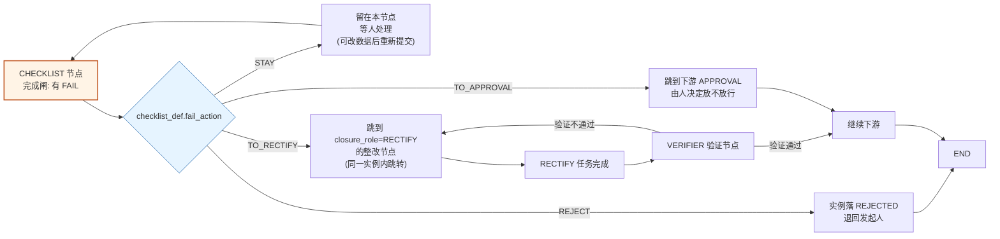

> 图 4：检查判定与分支。「跳转」的实现复用现有**条件边 + `engine::step` 的 `out_targets`**，
> 唯一新增的是「按 `fail_action` 选边」这一步（引擎里 5 行代码：`if has_fail { pick_edge_by(fail_action) }`）。
> **否决了「每项检查生成一个独立节点」**：10 个检查项 = 10 个节点，画布会炸，且改一项要改图。

### 6.2.6 MES 场景的三张检查表（证明这一块能支撑 SOP / 库管 / 质检）

| 场景 | 检查项数 | 关键能力用到 |
|---|---|---|
| **SOP 工序确认**（注塑机开机） | 12 项 | `BOOLEAN`（模具安装到位）+ `NUMBER`（料筒温度 180–200℃）+ `ENUM`（原料牌号）+ `PHOTO`（首件照片 ≥1） |
| **入库检查**（到货验收） | 8 项 | `NUMBER`（数量与送货单一致 ±0）+ `ENUM`（包装完好 / 破损 / 受潮）+ `TEXT`（批号）+ `PHOTO`（破损照片，**条件必填**：包装=破损时必须 ≥2 张） |
| **质检（IQC）** | 15 项 | `NUMBER` + `RANGE`（尺寸/硬度）+ `PHOTO`（不合格品特写）+ `allow_skip=false`（关键项不许跳）+ `fail_action=TO_RECTIFY` |

**「条件必填照片」怎么表达**：`pass_rule='IN_SET'` + `config.work.photo_when`：
```json
{ "photo_when": [ { "item_key": "packaging", "value": "DAMAGED", "min_photos": 2 } ] }
```
这条配置让「拍不拍照片」取决于另一个检查项的答案 —— **是检查项之间的联动**，比表单联动简单（只有「值 → 照片数」一种）。

## 6.3 EVIDENCE · 证据留痕

### 6.3.1 与「能传附件」的区别（卡面失败模式 5 的正面回答）

| 维度 | 「能传附件」 | 本设计 |
|---|---|---|
| 数量 | 随便传几个 | **每条 `evidence_req` 有 `min_count`/`max_count`**，不足不许完成 |
| 类型 | 什么都能传 | `evidence_type` 6 种 + `mime_allow` + `max_size_mb` |
| 签署 | 无 | `require_sign` + `signer_rule`（谁必须签） |
| 归类 | 一堆文件平铺 | 每条证据挂 `req_id`（「法律意见书」「签到表」「录音」各归各位） |
| 撤回 | 删了就没了 | `status=REVOKED` + `revoked_reason`，软删但审计可见 |
| 完整性 | 无法证明 | `file_hash` 快照 + 归档包 `sha256` |
| 交付 | 要人一个个下 | **归档包一键打成 ZIP/PDF**，带 manifest + 时间线 + 签署记录 |
| 法定留存 | 无 | `retention_until`（归档包级） |

**结论：审计价值的全部 = 「强制」（不齐就交不了） + 「归档包」（齐了能整包交付）。只做一个都等于没做。**

### 6.3.2 证据要求（`biz_flow_evidence_req`）在界面上的样子

段（EVIDENCE 节点）的配置面板 = 一个可增删的表格，每行：

| 列 | 字段 | 例子 |
|---|---|---|
| 要求名 | `req_name` | 「现场破损照片」 |
| 类型 | `evidence_type` | `PHOTO` |
| 最少/最多 | `min_count` / `max_count` | 2 / 10 |
| 允许格式 | `mime_allow` | `image/` |
| 单文件上限 | `max_size_mb` | 10 |
| 需签署 | `require_sign` | ✅ |
| 签署人 | `signer_rule` | `INITIATOR_SUPERIOR`（发起人的上级） |
| 现场定位 | `capture_geo` | ✅（巡检类） |
| 必交 | `is_required` | ✅ |

**发布校验 R22'**：EVIDENCE 节点必须有 ≥1 条 `is_required=true` 的要求，否则发布失败 ——「留痕节点没有留痕要求」是配置错误不是自由。

### 6.3.3 强制机制的三个入口

| 入口 | 机制 |
|---|---|
| **上传时** | 类型/格式/大小/数量上限逐个校验（超了 `400 + 65074`）；`capture_geo=true` 时缺经纬度 → 暂存但标 `INCOMPLETE`，不计入 `min_count` |
| **签署时** | `require_sign=true` 时，证据行必须落 `signed_by` + `signed_at` + `signature_data`；签署人必须是 `signer_rule` 解析出的人（解析复用 `assignee::resolve` 的同一套来源，不造第二套） |
| **完成时** | 逐条 req 数 `VALID` 证据；不足 → `400 + 65070`「还差 2 张现场照片」 |

**为什么「缺定位的照片」不给计入 `min_count`**：如果允许「先传后补」，就等于允许「传了再说」——
审计问「这张照片是不是现场拍的」时答不出来。**宁可让他传两次，也不能让标准打折。**

### 6.3.4 证据闸的判定算法（可复算，R5）

```
check_evidence(instance_node_id, round):
  1. 取 req 清单（从版本快照 config.work.evidence_reqs 读）
  2. 取已有证据：SELECT req_id, COUNT(*) FROM biz_flow_evidence
                WHERE instance_node_id=? AND round=? AND status='VALID' AND deleted_at IS NULL
                GROUP BY req_id
  3. 对每条 is_required=true 的 req：
       a. count < min_count                    → 不通过「还差 N 份」
       b. count > max_count                    → 不通过「超出上限」（理论上上传时已拦）
       c. require_sign 且 EXISTS(未签)          → 不通过「有 N 份未签署」
       d. signer_rule 校验：signed_by 必须在解析出的人里 → 否则不通过「签署人无权」
       e. capture_geo 且 EXISTS(无坐标)        → 不通过（这些行本身也不计入 count）
  4. require_all_signed=true 时：所有 req 的所有行都要签
  5. 全过 → 允许完成；否则 400 + 65070 + 缺口清单
```

### 6.3.5 归档包（一键打包的产物结构）

```
PKG-20261104-A1B2C3D4.zip
├── 00-封面/
│   ├── 流程信息.pdf            # 实例号、流程名、发起人、时间、结论
│   └── manifest.json           # 机器可读的完整清单（见 §3.4.8）
├── 01-表单/
│   ├── n_proposal.json         # 表单原始数据（JSONB 原样）
│   ├── n_proposal.pdf          # 表单打印态（含字段级权限过滤）
│   └── attachments/            # 表单里 FILE/IMAGE 字段引用的文件
├── 02-检查/
│   ├── n_check.csv             # 检查结果（项 / 标准 / 实填 / 判定 / 检查人 / 时间）
│   └── n_check.pdf             # 打印态
├── 03-证据/
│   ├── 现场破损照片-1.jpg
│   ├── 现场破损照片-2.jpg
│   └── 证据清单.csv            # 要求 / 文件 / sha256 / 签署人 / 签署时间
├── 04-签署/
│   └── 签署记录.pdf            # 每个签署人 / 时间 / 签署数据摘要
└── 05-时间线/
    └── timeline.csv            # 节点 / 状态 / 开始 / 结束 / 耗时 / 操作人
```

| 项 | 设计 |
|---|---|
| **生成格式** | `ZIP`（机器归档）/ `PDF`（纸质留痕，把各组 pdf 合并成一册）/ `BOTH` |
| **触发时机** | `archive_policy=ON_FINISH`（END 到达自动）或 `MANUAL`（有权限的人点「生成归档包」）；**允许多次重打**（每次一行 `biz_flow_archive_pack`，老的留 `EXPIRED`） |
| **异步** | 打包可能几十秒 → `status` 状态机 `PENDING → BUILDING → READY/FAILED`，接口立刻返回 `pack_no`，前端轮询 |
| **权限** | 下载需 `business:flow:archive:download` + 实例可见性（§13.3） |
| **留存** | `retention_until`（默认按流程配，如董事会 10 年）；到期 `EXPIRED` 但**不删文件**（删不删是运维策略不是本系统能决定的） |
| **与 storage 的接法** | 包文件写 `sys_file`（`category='flow-archive'`），`storage_code` 用当前默认存储；**大包走 `storage` 的多存储配置**（本地/S3/MinIO），本设计不关心物理位置 |

### 6.3.6 董事会级别的四个硬要求（证明这一块能撑住）

| 要求 | 本设计的落点 |
|---|---|
| **材料齐全** | `min_count` 逐条卡；缺一份不许提交 → 缺一份不许结会 |
| **签署可追** | `signed_by` + `signed_at` + `signature_data` + `signer_rule` 校验；签署记录进归档包 |
| **顺序正确** | `sign_mode=SEQUENTIAL`：董事长 → 董事 → 监事，签序错了后端拒绝 |
| **事后可交付** | 归档包 + `sha256` + `retention_until`；「这一包是什么时候打的、打了什么、有没有被换过」都能答 |
| 额外：**不能改** | 已 `SUBMITTED` 的表单数据、已 VALID 的证据：只能 REVOKE 不能 UPDATE；REVOKE 留原因 |

## 6.4 三种形态的能力对照（一页看全）

| 能力 | FORM | CHECKLIST | EVIDENCE |
|---|---|---|---|
| 生成 `biz_task` | ✅ | ✅ | ✅ |
| 数据表 | `biz_flow_form_data` | `biz_flow_checklist_result` | `biz_flow_evidence` |
| 定义版本化 | ✅ `biz_flow_form_def` | ✅ `biz_flow_checklist_def` | ⚠ 随流程版本（`evidence_req` 挂在 `biz_flow_node`） |
| 完成闸 | schema 校验 14 规则 | 项数 + 范围复算 + 权限 | 逐条 req 达标 + 签署 |
| 支持草稿 | ✅ `status='DRAFT'` | ✅（结果行可改） | ✅（可先传后齐） |
| 防漏 | 必填 + 条件必填 | **项数 + 唯一约束 + 权限** | **min_count + 签署** |
| 产出可打印 | ✅ 打印态 | ✅ 打印态 CSV/PDF | ✅ 证据清单 PDF |
| 进归档包 | ✅ | ✅ | ✅ |
| 门禁在哪 | `work_gate::check_form` | `work_gate::check_checklist` | `work_gate::check_evidence` |

## 本章红线

1. **表单所有校验后端必须重算**（`SUBPROCESS` / `CRON` / `EVENT` 会绕过前端）。
2. **联动不许迭代到收敛**（环状联动必须在发布校验时拦掉）。
3. **检查项的 `result` 是副本不是真相**（必须能用 `input_value` 复算）。
4. **EVIDENCE 节点没有证据要求不许发布**（R22'）。
5. **归档包 `READY` 必须有产物 + sha256**（库级 CHECK 已上锁）。
6. **三种形态都不许自己建「附件表」** —— 一律 `sys_file` + 各自的绑定行。

---

# 第七章 与任务模块的融合（用户点名要求）

> 用户原话：「**节点必须生成任务 —— 肯定要跟现有的任务模块结合使用**」。
> 这一章是本设计的**重心**：先给「任务字段从哪来」的完整映射表，再逐条回答 9 个问题，最后给「取景框」——哪些交互点是新增的。

## 7.0 九问速览（逐条结论，详情见对应节）

| # | 卡面的问题 | 结论一句话 | 节 |
|---|---|---|---|
| ① | 节点 → 任务的映射（字段怎么填） | **`biz_task` 零新增列**；33 个字段逐个有来源，幂等靠 `uk_biz_task_flow_node` | §7.1 |
| ② | 任务生命周期 = 节点生命周期？ | **一对一段映射，但不是同一个状态机**：节点只认「任务进 DONE」这一个完成信号；任务可在 TODO↔DOING 之间自由来回 | §7.2 |
| ③ | 任务被删了/被取消了，流程怎么办 | **流程任务禁止软删**（否则幂等索引失效）；取消按 `on_cancel` 三策略处置（默认 `TERMINATE`） | §7.3 |
| ④ | 流程任务能改什么、不能改什么 | 标题/描述/优先级/进度/工时/评论/附件/子任务**能改**；三列流程关联、`source`、`creator_id` **不能改**；负责人只能走转派；截止日只能提前 | §7.4 |
| ⑤ | 8 层子任务在流程里怎么表达 | **流程看不见这棵子树**：节点任务可长 8 层子任务，但**不用 `parent_id` 挂流程**（V0177 已论证三处误判） | §7.5 |
| ⑥ | 看板/甘特怎么看流程任务 | **零改造**：流程任务就是普通任务（靠 `source='FLOW'` 筛 + 角标） | §7.6 |
| ⑦ | 派给 AI 的链路 | **复用 `dispatch-ai` 零改造**；L1/L2 只做 `TASK_NODE`，AI 填结构化表单留 L3 | §7.7 |
| ⑧ | 「我的任务」和「我的流程」怎么关联 | 两个入口、一个数据源、互相跳转；「等我处理」按**一张单一行**聚合去重 | §7.8 |
| ⑨ | 工时/评论/附件与实例的关系 | 全挂任务上，实例**不存**；归档包只收「证据 + 表单附件」，**不收评论与随手附件** | §7.9 |

## 7.1 问题①：节点 → 任务的映射（`biz_task` 装得下吗 + 每个字段从哪来）

**结论：装得下，一列都不加。** 逐项论证（这张表就是「卡面第六条停下来问」的正面回答）：

| 节点任务的诉求 | `biz_task` 现有承载 | 判定 |
|---|---|---|
| 「这张任务从哪个流程的哪个节点第几轮来的」 | `flow_instance_id` / `flow_node_key` / `flow_round`（V0177）+ `source='FLOW'` | ✅ 已够 |
| 「这个任务属于哪个业务单据」 | 通过 `flow_instance_id → biz_flow_instance.biz_type/biz_id/biz_no` 取（**两跳，不冗余**，R2） | ✅ 已够 |
| 「谁负责」 | `owner_id` | ✅ |
| 「还有谁参与」 | `biz_task_member`（`COLLABORATOR` / `FOLLOWER`） | ✅ |
| 「什么时候到期」 | `due_date`（由 `config.task.due` 解析） | ✅ |
| 「优先级」 | `priority`（由 `config.task.priority` 或 `form_mapping` 取） | ✅ |
| 「预估工时」 | `estimate_hours`（`form_mapping` 可映射） | ✅ |
| 「实际工时」 | `actual_hours`（`biz_task_worklog` 汇总） | ✅ |
| 「附件」 | `biz_task_attachment` → `sys_file` | ✅ |
| 「评论 / @」 | `biz_task_comment`（含 `mentions`） | ✅ |
| 「子任务（8 层）」 | `parent_id` + `MAX_TASK_DEPTH=8` | ✅ |
| 「要不要验收」 | `need_review` + `REVIEW` 状态 | ✅ |
| 「派给 AI」 | `exec_mode`/`hermes_*`/`ai_summary`/`ai_result` + `dispatch-ai` 接口 | ✅ |
| 「任务 → 审批」 | `approval_instance_id`（`DOING→REVIEW` 自动发起 `TASK_ACCEPT`） | ✅ |
| 「作业内容（表单/检查/证据）」 | **不放在任务上**，放各自的作业表，用 `instance_node_id` 关联 | ✅ 有意如此（见下） |

**「作业内容为什么不上任务表」的三条理由**：

1. **一张任务可能没有任何作业内容**（`TASK_NODE`），给它加 `form_data` 列 = 永远存 NULL 的列；
2. **作业数据的查询维度是「实例 × 节点 × 轮」，不是「任务」**。报表要算「这项检查的历史失败率」，从任务表出发要 JOIN 任务才能回到实例节点 —— 方向反了；
3. **任务的可见性谓词已经很长**（`VISIBLE_OR_TAIL` = 数据范围 ∪ 参与 id 数组，实测有索引敏感性），再挂一层作业数据会让这条谓词更难优化。

**唯一新增的是 `biz_flow_task`（审批待办）的两列**（`task_role` / `seq_no`），那是**给审批人**用的，与工作任务无关。

### 7.1.1 节点 → 任务的字段映射（完整表，来自 `task_node.rs` 的实际 INSERT）

| `biz_task` 列 | 值从哪来 | 何时为空 |
|---|---|---|
| `id` | `Uuid::now_v7()`（应用侧生成） | 从不为空 |
| `task_no` | `task_model::next_task_no(month)` = `TSK-YYYYMM-NNNNNN`，按月 `pg_advisory_xact_lock` 串行取号，撞号重试一次 | 从不为空 |
| `title` | **渲染** `config.task.title_template`（`{{instance.title}}` / `{{node.name}}` / `{{form.amount}}` …），严格模式：缺变量 → `400 + 65039` 整笔回滚 | 从不为空（≤200 字符，超了报 65039） |
| `description` | 渲染 `config.task.description_template`（≤8000） | 未配置时为空 |
| `status` | 固定 `'TODO'` | — |
| `priority` | `form_mapping.priority` 映射值，否则 `config.task.priority`，否则 `'P2'` | 从不为空 |
| `progress` | `0` | — |
| `need_review` | `config.task.need_review` | — |
| `owner_id` | `assignee::resolve` 解析出的人里**按 `user_id` 排序取第一个**（保证「同一份配置、同一批人 → 结果可复现」） | 解析出 0 人 且 `empty_assignee=SKIP` 且 `allow_skip_when_no_assignee=true` ⇒ **不生成任务**（节点 SKIPPED）；否则 `400 + 65018` |
| `creator_id` | **流程发起人** `instance.initiator_id`（「谁发起谁验收」） | 从不为空 |
| `assigner_id` | 流程发起人（同上） | — |
| `dept_id` | `owner_id` 的当前部门（`owner_dept()` 现查） | 负责人无部门时为空 |
| `parent_id` | **永远 `NULL`**（见 §7.6 理由） | 从不为空（= NULL） |
| `project_id` | `NULL`（流程任务不自动挂项目；用户可手工挂） | — |
| `start_date` | `NULL`（可后填） | — |
| `due_date` | `config.task.due`（`FIXED` 绝对值 或 `RELATIVE` 相对发起日/D 日） | 未配时限时为空 |
| `done_at` | 进入 `DONE` 时由任务状态机写 | 未完成为空 |
| `estimate_hours` | `form_mapping.estimate_hours` 映射值 | 未配置为空 |
| `actual_hours` | 工时汇总（服务端算，不许手填） | 无工时为空 |
| `source` | 固定 `'FLOW'` | — |
| `cancel_reason` | 任务被取消时填（`on_cancel` 策略触发时由引擎写「流程终止」） | — |
| `approval_instance_id` | `DOING → REVIEW` 时由 `task_bridge` 写 | 未配 `TASK_ACCEPT` 流程时为空 |
| `exec_mode` | `'HUMAN'`（派 AI 后变 `'AI'`） | — |
| `flow_instance_id` | `instance.id` | 从不为空 |
| `flow_node_key` | `spec.key`（快照里的 node_key） | 从不为空 |
| `flow_round` | 节点当前 `round` | 从不为空 |
| `create_by` | 流程发起人（审计列） | — |

**幂等的库级依据**：`uk_biz_task_flow_node(flow_instance_id, flow_node_key, flow_round) WHERE deleted_at IS NULL`
⇒ 「同一实例同一节点同一轮最多一张任务」。23505 一律当**幂等成功**（与 `engine.rs::is_pending_duplicate` 同款）。

## 7.2 问题②：任务的生命周期 = 节点的生命周期吗？

**答案：是「一对一段映射」，但不是「同一个状态机」。**

| 节点状态（`biz_flow_instance_node.status`） | 任务状态（`biz_task.status`） | 谁驱动谁 |
|---|---|---|
| （未到达） | （无任务行） | — |
| `ACTIVE` | `TODO` 或 `DOING` | 节点激活 → 生成任务（`TODO`）；负责人开始干 → `DOING`（节点不变，仍 `ACTIVE`） |
| `ACTIVE` | `REVIEW`（`need_review=true` 时） | 任务提交验收 → 仍是 `ACTIVE`（**节点不等验收，只等完成**） |
| `ACTIVE` | `DONE` | 任务 `DONE` → **回调** `task_bridge::on_task_done` → 节点 `APPROVED` → 驱动下游 |
| `ACTIVE` | `CANCELLED` | 任务取消 → 按 `config.task.on_cancel` 处置（`BACK_TO_PREV` / `TERMINATE` / `STAY`） |
| `SKIPPED` | （无任务 / 任务 `CANCELLED`） | 节点因解析出 0 人跳过 → 不生成任务 |
| `APPROVED`（审批节点） | 无 `biz_task`，有 `biz_flow_task` | 两套待办，见 §7.2.1 |

**关键区别：节点的 `APPROVED` 只有一个入口 —— 任务进 `DONE`。** 不存在「任务还开着，节点先通过了」的路径。
反过来，任务可以在节点未完成时反复 `DOING ↔ TODO`（负责人自己来回改），**节点状态不受影响** —— 节点的 `ACTIVE` 只是「这个节点在等人」的意思。

### 7.2.1 两套待办为什么不能合并

| | `biz_flow_task`（审批待办） | `biz_task`（工作任务） |
|---|---|---|
| 语义 | 「请签字」 | 「请干活」 |
| 一次性 | ✅ 签完即终结，不可复用 | ❌ 可反复（进度/工时/子任务） |
| 有子结构 | ❌ | ✅ 8 层子任务 |
| 有工时 | ❌ | ✅ |
| 进哪个入口 | 「待我审批」 | 「我的任务」/看板/甘特 |
| 唯一的桥 | `biz_task.approval_instance_id`（任务提交验收 → 审批单） | 同左 |

**合并的后果**（这是 `V0122` 与 `task_node.rs` 都明确否决过的）：审批中心会混进一堆「有进度条、能挂子任务、能记工时」的怪东西；
任务列表会混进一堆「点一下就没了的签字」。**两个入口都得脏。**

## 7.3 问题③：任务被删了 / 被取消了，流程怎么办？

这是**最容易做错的一处**，因为任务的删除有多种路径。逐条给策略：

| 事件 | 现状（实测） | 流程侧处置（设计） |
|---|---|---|
| **任务软删**（`deleted_at` 非空） | `task::handler::delete` 只认负责人/创建人/超管 | **流程任务禁止软删**（新增校验：`source='FLOW'` ⇒ `403 + 65075`「流程任务不能删除，请走「取消」并说明原因」）。理由：软删会让 `uk_biz_task_flow_node` 失效（索引带 `deleted_at IS NULL`），再生成一张 = 同一节点两张任务 |
| **任务取消**（`status='CANCELLED'`） | 状态机允许，`cancel_reason` 必填 | 按 `config.task.on_cancel`：① `BACK_TO_PREV`（退回上一节点，`round+1`）② `TERMINATE`（实例终止，落 `CANCELLED`）③ `STAY`（节点保持 `ACTIVE`，等人重开任务）。**默认 `TERMINATE`**（更安全：不让人「取消一下」就绕过去） |
| **实例被撤销**（`withdraw`） | 已有接口 | 该实例下所有未完成任务级联 `CANCELLED`（`cancel_reason='流程已撤销'`）。**任务不物理删**（工时有价值） |
| **实例被驳回**（`REJECTED`） | 已有 | 同上，`cancel_reason='流程已驳回'` |
| **负责人离职/停用** | 任务侧无自动处理 | 节点 `timeout_action=ESCALATE` 时按升级链找人；否则由管理员通过「转交」接口处理（`biz_flow_task.transferred_from` 模式复用到 `biz_task` 的转派） |
| **任务被重新打开**（`DONE → DOING`） | 状态机允许（`reopen`） | **节点已 `APPROVED` 就不回退**（节点是一次性的）。任务重开只影响任务自身，流程继续往下走。**这条要写进界面提示**：「这张任务所在的流程节点已完成，重开本任务不会回退流程」 |

**「任务被物理删除」**：`biz_task` 没有物理删除接口（只有软删）。所以「任务不见了」只可能是软删或实例级联 —— 两者上表已覆盖。

## 7.4 问题④：流程生成的任务，能改什么、不能改什么？

这是「复用任务能力但不破坏流程语义」的边界表（用户原话：「任务 = 带锁的任务」）：

| 字段/操作 | 能不能改 | 理由 |
|---|---|---|
| **标题** | ✅ 能（负责人可改，写了 changelog） | 模板渲染的标题可能不够贴切（「处理节点 n2」→「整理 3 号楼空调报价」） |
| **描述** | ✅ 能 | 同上 |
| **优先级** | ✅ 能 | 业务判断 |
| **截止日 `due_date`** | ⚠ **只能往早改不能往晚改**（除非有 `business:task:due:extend` 权限） | 流程的 SLA 是流程作者定的，随手延后等于绕过 SLA |
| **进度 / 状态** | ✅ 能（状态机内） | 干活的人自己控制节奏 |
| **工时** | ✅ 能（登记工时） | — |
| **评论 / 附件** | ✅ 能 | — |
| **子任务** | ✅ 能（8 层内） | 一件活拆成几步是正常需求 |
| **负责人 `owner_id`** | ⚠ 只能走「转派」接口（`source='TRANSFERRED'` + 记 `assigner_id`） | 直接 UPDATE 会让「谁该干这活」失去痕迹 |
| **`flow_instance_id` / `flow_node_key` / `flow_round`** | ❌ **完全不能改**（无接口，且不在任何 UPDATE 白名单里） | 这是任务与流程的**唯一链接**，改了就是「任务跑到别的节点去了」 |
| **`source='FLOW'`** | ❌ 不能改 | 它与三列双向绑定（`ck_biz_task_source_flow`） |
| **删除** | ❌ 不能（§7.3） | — |
| **`creator_id`** | ❌ 不能 | 「谁发起谁验收」 |
| **`approval_instance_id`** | ❌ 不能手改（由 `task_bridge` 写） | — |

**实现口径**：这些限制**不是前端隐藏按钮**，而是在 `task::handler` 的 update 路径上按 `source='FLOW'` 分行校验（与 `flow` 模块「PUBLISHED 版本只读是后端 4xx 不是前端隐藏」同一立场）。

## 7.5 问题⑤：任务的 8 层子任务在流程里怎么表达？

**答案：不在流程里表达，而是「流程节点任务可以长出子任务树，但流程看不见这棵树」。**

理由（这是 `V0177` 已经踩过的坑，必须写清楚）：

| 想做的事 | 为什么不能做 |
|---|---|
| 用 `parent_id` 把节点任务挂在「流程根任务」下 | `parent_id` 是 `REFERENCES biz_task(id)` 的自引用外键，语义是「子任务」。挂上去会让任务系统三处逻辑立刻误判：`count_open_children`（父任务 DONE 前所有子任务必须完成）、`progress_locked`（有子任务时进度由子任务汇总）、`blocks_child_advance`（父任务取消 → 子任务不许推进） |
| 每条流程实例生成一个「根任务」 | 会产生一堆「只用来做父节点」的空任务，污染「我的任务」 |
| 流程节点任务之间用 `biz_task_dependency` 表达流程顺序 | 依赖是「FS 前后置」，流程顺序是「图执行」，两套语义会打架（任务侧还要做环检测，而流程已经有环检测） |

**定稿表达方式**：

```
流程实例（biz_flow_instance）
   ├─ 节点 A 的任务（biz_task, flow_node_key='a', flow_round=1）
   │     ├─ 子任务 1（parent_id → 节点 A 的任务）    ← 这棵子树流程看不见
   │     └─ 子任务 2 ── 子任务 2.1（第 3 层）
   ├─ 节点 B 的任务（biz_task, flow_node_key='b', flow_round=1）
   └─ 节点 C 的任务（round=1）→ 退回 → 节点 C 的任务（round=2）
```

| 规则 | 内容 |
|---|---|
| **子任务深度** | 从节点任务往下最多 8 层（`MAX_TASK_DEPTH=8`，与普通任务一致） |
| **子任务完成与节点推进** | 节点任务进 `DONE` 前，它的**直接子任务**必须全完成（沿用 `count_open_children`）—— 所以「拆子任务」会把节点的完成门槛抬高，这是**符合直觉**的 |
| **子任务能不能派给 AI** | ✅ 能（`dispatch-ai` 对任何任务都可用） |
| **退回重进** | `round+1` 生成**新任务**（`flow_round` 不同 ⇒ 唯一索引不冲突）；旧任务保留 `DONE`/`CANCELLED` 状态，`biz_task_member`/工时/评论都不丢 |
| **流程详情页怎么显示** | 按 `flow_node_key + flow_round` 列任务卡；点进去是任务详情（能看到它的子任务树） |

## 7.6 问题⑥：任务的看板 / 甘特图怎么看流程任务？

**答案：看板按 `status` 天然包含；甘特按 `due_date` 天然包含；额外只需要「一个筛选项 + 一个角标」。**

| 视图 | 现状 | 流程任务的表现 | 要新增什么 |
|---|---|---|---|
| **任务列表**（`page_visible`） | 按可见性谓词 | 自然出现 | 筛选项「来源」：`SELF`/`ASSIGNED`/`TRANSFERRED`/`RECURRING`/**`FLOW`**（`source` 列已存在，只需加枚举值） |
| **我的任务** | `my` 接口 | 自然出现 | 卡片角标「走流程中」+ 显示流程名（`flow_name`） |
| **看板**（按 status 分列） | TODO/DOING/REVIEW/DONE | 自然出现（流程任务也在 5 态里） | 卡片上加「流程」小标签 + 点击可直接跳实例详情 |
| **甘特图** | 按 `start_date`/`due_date` | 自然出现（`due_date` 由 `config.task.due` 给出） | 按 `project_id` 分组时：流程任务 `project_id=NULL` → 落在「未分组」区，可手工挂项目 |
| **子任务树** | 8 层树 | 节点任务的子树正常展开 | 无需新增 |
| **节点视角** | 无 | **新增**：实例详情页「任务」区按 `flow_node_key` 分组列出 | 新增接口 `GET /business/flow/instance/{id}/tasks`（实测**已存在**：`handler.rs:2866` `instance_tasks`） |

**关键结论：看板/甘特**零改造**，因为流程任务就是普通任务。** 这不是巧合，是 D2（节点生成 `biz_task`）的直接收益 ——
如果当初另建一套「流程待办」，这里就要重写两个视图。

## 7.7 问题⑦：任务派给 AI 员工的链路（复用 dispatch-ai）

**现状实测**：`POST /business/task/{id}/dispatch-ai`（`task/handler.rs:2901`）→ `hermes_sync::dispatch`：
建任务级令牌 → 拼 body → `hermes kanban create` → 回写 `hermes_board`/`hermes_task_id`/`hermes_status` → 30s 轮询 → AI done → 三层回传 → 任务进 `REVIEW`。

**流程节点任务能否派 AI？答案：能，零改造。** 链路：

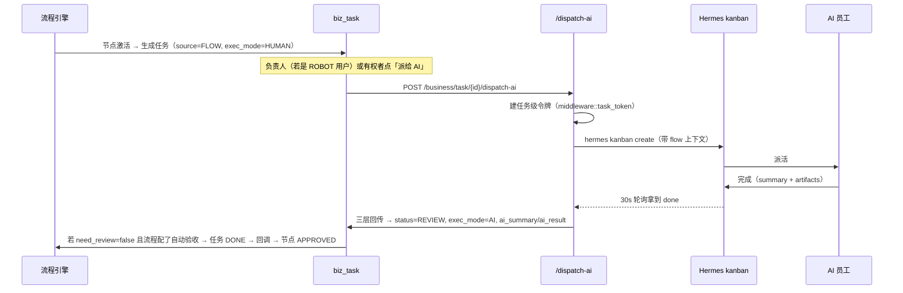

| 链路要点 | 设计 |
|---|---|
| **AI 员工能是节点负责人吗** | ✅ 能。`assignee_type='USER'` 指定一个 `user_type='ROBOT'` 的账号即可（`allow_robot` 控制隐式来源是否过滤 ROBOT；显式 `USER` 不受限，实测 `assignee.rs` 注释 D18） |
| **AI 完成任务后谁验收** | 由 `config.task.need_review` 决定：`false` ⇒ 直接 `DONE` 推流程；`true` ⇒ 进 `REVIEW`，`on_complete=VERIFY` 时由**人**验收后再推 |
| **AI 看不见流程上下文怎么办** | `dispatch-ai` 的 body 里拼 `flow_instance_id` / `flow_node_key` / 作业要求摘要（表单 schema 的字段说明 / 检查项文本 / 证据要求），让 AI 知道「这一步要交什么」 |
| **AI 能填表单/勾检查项吗** | **L3 才做**。L1/L2 的 AI 只做 `TASK_NODE`（纯任务）。理由：让 AI 填结构化表单需要「AI 输出 → 结构化数据」的可靠映射，现在没有，硬做会造脏数据 |
| **凭证类任务不许派 AI** | 有 `business:flow:work:ai-forbid` 标记的节点（配置项）拒绝 `dispatch-ai`（`403 + 65076`）。典型：会计凭证审核、董事会签署 |

## 7.8 问题⑧：「我的任务」和「我的流程」两个视角怎么关联？

**答案：两个入口、一个数据源、互相跳转，不做「合并成一个列表」。**

| | 「我的任务」（任务模块） | 「我的流程」（新增） |
|---|---|---|
| 回答的问题 | 「我要干什么活」 | 「我提的那件事走到哪了 / 有什么事等我处理」 |
| 数据源 | `biz_task`（`owner_id` / `creator_id` / `assigner_id` / `biz_task_member`） | `biz_flow_instance`（发起人）+ `biz_flow_task`（审批待办）+ `biz_task`（作业待办，经由 `flow_instance_id`） |
| 主视图 | 列表 / 看板 / 甘特 | 进度图 + 时间线 |
| 一条流程任务会同时出现在两处 | ✅ | ✅ |
| 关联方式 | 任务详情页显示「所属流程」卡片（`instance_no` + 进度 + 跳转） | 流程详情页显示「本实例的任务」列表（`instance_tasks` 接口，**已存在**） |

**「待我处理」怎么避免重复**（这是唯一需要设计的地方）：

```
「我的流程 / 等我处理」Tab 的数据 =
    biz_flow_task  WHERE assignee_id = me AND status='PENDING'      -- 审批待办
  ∪ biz_task       WHERE owner_id = me AND status IN ('TODO','DOING')
                     AND source='FLOW' AND flow_instance_id IS NOT NULL  -- 作业待办
  ∪ biz_flow_instance WHERE status='PENDING' AND 我是当前活跃节点的指派范围（角色认领池）
```

**去重规则**：按 `(biz_type, biz_id)` 或 `instance_id` 聚合成**一行一张单**，行内显示「3 个待办：2 个审批 + 1 个任务」。
**否决了「每条待办一行」**：一张单有 5 个会签人会看到 5 行，用户会以为有 5 件事。

**互相跳转的三个链接**：

| 从 | 到 | 参数 |
|---|---|---|
| 任务详情 | 流程实例详情 | `/business/flow/instance/{flow_instance_id}`（`flow_instance_id` 已在任务上） |
| 流程实例详情 | 任务详情 | `/business/task/detail/{task_id}`（`instance_tasks` 接口给出） |
| 审批待办 | 流程实例详情 | `/business/flow/instance/{instance_id}`（`biz_flow_task.instance_id`） |

## 7.9 问题⑨：任务的工时 / 评论 / 附件与流程实例的关系

**答案：全部挂在任务上，流程实例**不存**这些；归档时从任务侧**汇总取**。

| 数据 | 存哪 | 流程实例怎么用它 |
|---|---|---|
| **工时** | `biz_task_worklog`（`task_id`）→ 汇总到 `biz_task.actual_hours` | 归档包 `timeline.csv` 的「耗时」列取 **节点耗时**（`instance_node.duration_ms`），**不取工时** —— 这是两个概念：`duration_ms` 是「这段等了多久」，`actual_hours` 是「干了多久」。报表两个都要 |
| **评论** | `biz_task_comment`（`task_id`，含 `mentions`） | 归档包**不含**评论（评论是协作过程，不是交付物）。**否决了「把评论打进归档包」**：里面有内部讨论，董事会材料不该带「这个数是不是又错了」 |
| **附件** | `biz_task_attachment` → `sys_file` | 归档包**只含两类**：① `biz_flow_evidence` 指向的文件（正式证据）；② `biz_flow_form_data` 里 FILE/IMAGE 字段引用的文件（表单附件）。**普通任务附件不进包** —— 它们是过程材料 |
| **AI 结果** | `biz_task.ai_summary` / `ai_result` | 可选进归档包（`archive_policy` 配 `include_ai_result=true`），用于「AI 做了什么判断」的追溯 |

**「哪些附件算数」的判据表**（这是审计视角唯一能接受的答案）：

| 附件来源 | 算不算交付物 | 进归档包 |
|---|---|---|
| `biz_flow_evidence`（按 req 上传） | ✅ 是（有要求、有签署、有指纹） | ✅ |
| 表单 `FILE`/`IMAGE` 字段 | ✅ 是（是表单数据的一部分） | ✅ |
| 任务附件（随手传） | ❌ 不是 | ❌ |
| 审批意见附件（`biz_flow_task.attachments`） | ⚠ 看：`require_sign` 的算 | 仅签署类 |

## 7.10 融合的总装图

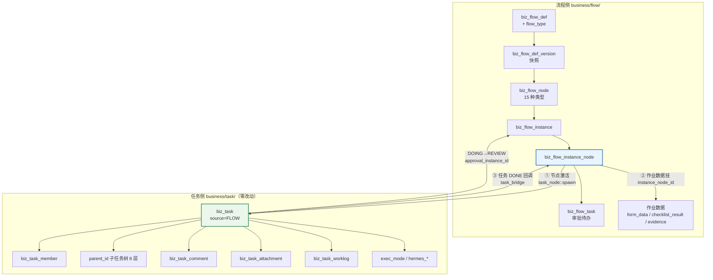

> 图 5：流程与任务的融合。**三条边就是全部耦合**：
> ① `task_node::spawn`（节点 → 任务）、② 作业数据挂 `instance_node_id`（不进任务表）、③ `task_bridge`（任务 → 节点）。
> 除此之外，`task` 模块与 `flow` 模块互不依赖（各自的 `mod.rs` 边界声明仍然成立）。

## 7.11 新增的交互点清单（后端 + 前端各一张）

| 类型 | 交互点 | 说明 |
|---|---|---|
| 新增接口 | `POST /business/flow/instance/{id}/signal` | WAIT 节点的事件令牌投递 |
| 新增接口 | `POST /business/flow/instance/{id}/node/{key}/claim` | 角色认领 |
| 新增接口 | `POST /business/flow/instance/{id}/node/{key}/submit-work` | 提交作业（表单/检查/证据的统一完成入口） |
| 新增接口 | `POST /business/flow/instance/{id}/archive` | 手动生成归档包 |
| 新增接口 | `GET  /business/flow/instance/{id}/archive/{pack_no}` | 查打包状态 |
| 扩展接口 | `POST /business/flow/instance/{id}/node/{key}/complete` | 完成闸接入 `work_gate`（现有接口 +1 层校验） |
| 扩展接口 | `GET  /business/task/page` | 加 `source` 筛选值 `FLOW` |
| 扩展接口 | `GET  /business/flow/instance/{id}/tasks` | **已存在**（`handler.rs:2866`），加作业数据摘要字段 |
| 扩展接口 | `POST /business/task/{id}/dispatch-ai` | body 加流程上下文（`flow_instance_id` / 作业要求摘要） |

## 本章红线

1. **不许给 `biz_task` 加流程语义列**（§7.1 的三条理由）。
2. **流程任务不许软删**（会让幂等索引失效）。
3. **不许把「节点通过」做成「任务还没完成就通过」**（双向都错）。
4. **不许把评论/普通附件打进归档包**（审计只认证据与表单附件）。
5. **AI 在 L1/L2 只做 `TASK_NODE`**，不填结构化表单。

---

# 第八章 协作模式（六种）

> 全部落在**已有的三张东西**上：`biz_flow_node.approval_mode` / `sign_mode` / `claim_mode` + `biz_flow_node_assignee`（含 `sort_order`）+ `biz_flow_task.task_role`。
> **不新建「协作」表**。理由：协作是「节点 + 人 + 顺序 + 计票方式」的四元组，其中「人」已经在 `node_assignee`，「计票」已经在 `approval_mode`，新增的只有「顺序」和「主协角色」两个标量。

## 8.0 六种模式一览

| # | 模式 | 怎么配 | 完成判定 | 转交/代理 |
|---|---|---|---|---|
| 1 | `SINGLE` 单人负责 | `assignee_type=USER` 或 `node_assignee` 1 行 | 那一个人点了就算 | `transfer_task`（已有） |
| 2 | `PRIMARY_CO` 主责+协办 | `co_assignee=true` + 多人解析 | **只有 PRIMARY 计票**；CO 只能加意见 | 主责可转交，协办不能 |
| 3 | `ALL` 会签 | `COUNTERSIGN` + `approval_mode=ALL` | 全部 APPROVED | 每人可转交，转交后 `transferred_from` 留痕 |
| 4 | `RATIO` 比例签 | `approval_mode=RATIO` + `approve_ratio` | `approved/总 ≥ ratio` 且无否决 | 同上 |
| 5 | `ANY` 或签 | `approval_mode=ANY` | 任一人 APPROVED，其余自动 `CANCELLED` | 同上 |
| 6 | `SEQUENTIAL` 有序多签 | `COUNTERSIGN` + `sign_mode=SEQUENTIAL` + `sort_order` | 全部签完**且**顺序正确 | 当前签的人可转交（转交给的人接替他的签位） |
| 7 | `CLAIM` 角色认领 | `claim_mode=ROLE_CLAIM` + `assignee_type=ROLE` | 认领者完成 | 认领后可转交；未认领任何人可认领 |

> 卡面写「5 种」，我给 7 行（把 `RATIO` 与 `ANY` 拆开、加 `CLAIM`）。实际是 6 类语义 + 会签的 3 种计票。

## 8.1 `SINGLE` 单人负责

| 项 | 内容 |
|---|---|
| **数据怎么存** | `assignee_type` 11 值之一（`USER`/`ROLE`（取第一个）/`INITIATOR`/`INITIATOR_SUPERIOR`/`DEPT_LEADER`/`TASK_OWNER`/`TASK_CREATOR`/`TASK_ASSIGNER`/`FORM_VAR`/`ADMIN`/`EXPRESSION`）+ `node_assignee` 行 |
| **完成判定** | 该人点「同意 / 完成」即通过。多解析出几个人（如 ROLE）时，**现有语义是全部生成待办**（变成会签）—— 想只要一个人就用 `CLAIM` 或指定 `USER` |
| **转交/代理** | `transfer_task`：旧行 `TRANSFERRED` + `transferred_from` 指向旧行 + 新行 `PENDING`。**代理** = 转交的一种特例（转交给代理人），不另做「代理设置」表 |
| **找人规则** | 见 §8.7 |

## 8.2 `PRIMARY_CO` 主责 + 协办（新增）

| 项 | 内容 |
|---|---|
| **数据怎么存** | `biz_flow_node.co_assignee = true`；解析出 N 个人后：**第一个（按 user_id 排序）落 `task_role='PRIMARY'`，其余落 `task_role='CO'`** |
| **完成判定** | ① 只有 `task_role='PRIMARY'` 的 APPROVED 计入计票（`WHERE task_role='PRIMARY'` 加进现有计票 SQL）；② **`ALL` 模式下 CO 全未处理不影响通过**；③ CO 可以 `comment` 但不能「驳回」（可以留「建议驳回」意见，由 PRIMARY 决定） |
| **转交/代理** | PRIMARY 可转交（转交后新行仍 PRIMARY）；CO 可转交（仍 CO） |
| **与任务的对应** | 任务侧早已是这个模型：`biz_task.owner_id` = 主责，`biz_task_member(COLLABORATOR)` = 协办（`task_node.rs` 决策 5）。**审批侧的 `task_role` 是把同一模型搬到审批待办上，不是新发明** |
| **找谁当主责** | 排序规则必须确定：`ORDER BY user_id`（与 `task_node.rs` 一致）。**否决了「按部门层级/按角色优先级」**：多一种排序就多一种「为什么是他」的争议 |

## 8.3 `ALL` / `RATIO` / `ANY` 会签三态（存量）

| 模式 | 计票 | 一票否决 `reject_veto` | 谁算「已表态」 |
|---|---|---|---|
| `ALL` | `COUNT(APPROVED) = COUNT(PRIMARY)` | `true` 时任一 REJECTED 立即整节点 REJECTED | APPROVED + REJECTED |
| `RATIO` | `APPROVED / COUNT(PRIMARY) >= approve_ratio` | 同上 | 同上 |
| `ANY` | `COUNT(APPROVED) >= 1` | `true` 时任一 REJECTED **不**立即否决（因为或有其他人能批）—— **这是 `reject_veto` 在 `ANY` 下的特殊语义**，须在界面提示 | 同上 |

**`reject_veto` × `approval_mode` 的正交性**（存量设计，不改）：四种组合都合法
「过 60% 且财务没否决」= `RATIO + veto`；「任一人同意即可且谁都能否决」= `ANY + veto`。

**空审批人策略**（存量，`empty_assignee`）：

| 值 | 行为 |
|---|---|
| `SKIP` | 节点自动 `SKIPPED` + `is_auto_passed=true`（审计可查「这单的 3 个节点是自动过的」） |
| `ERROR` | `400 + 65018`（配置错误，让流程作者发现） |
| `FALLBACK_ADMIN` | 回退给超管（至少有人能看到） |

## 8.4 `SEQUENTIAL` 有序多签（新增）

| 项 | 内容 |
|---|---|
| **数据怎么存** | `sign_mode='SEQUENTIAL'` + `biz_flow_node_assignee.sort_order`（**复用现有列**，它现在只是展示顺序，串行模式下变成签序） |
| **生成几条待办** | **只生成第一条**（`seq_no=1`）。第一签完成后，在同一事务内生成下一条（`seq_no=2`）。**否决了「一次生成 N 条，靠状态闸拦」**：N 条待办会全部出现在「待我审批」里，第 3 位签的人会以为该他了 |
| **完成判定** | 全部 `APPROVED` 且**签序无跳号**。引擎侧额外闸：`AND NOT EXISTS (SELECT 1 FROM biz_flow_task WHERE instance_node_id=? AND status='PENDING' AND seq_no < 当前)` |
| **任一方拒签** | 立即整节点 `REJECTED`（有序签署里拒签就是终止，不存在「后面还有人能救」） |
| **转交** | 当前签的人可转交；转交后新行继承 `seq_no`（签序不变，换人） |
| **与 `approval_mode` 的关系** | 正交：`SEQUENTIAL + ALL`（都签）、`SEQUENTIAL + ANY`（签到第一个同意就停）——**后者是「逐级上报，谁批都算」**，很实用 |
| **发布校验 R9'** | `SEQUENTIAL` ⇒ `node_assignee` 至少 2 行且 `sort_order` 无重复 |

## 8.5 `CLAIM` 角色认领（新增）

| 项 | 内容 |
|---|---|
| **数据怎么存** | `claim_mode='ROLE_CLAIM'` + `assignee_type='ROLE'`（或 `EXPRESSION` 解析出多人）。**不生成 `PENDING` 待办**，而是生成「认领池」视图 |
| **认领的实现** | `POST /instance/{id}/node/{key}/claim`：在事务内 `INSERT INTO biz_flow_task (status='PENDING', assignee_id=me)`，靠 `uk_..._pending` 保证唯一——若已有别人认领，23505 ⇒ `409 + 65077`「已被 XXX 认领」 |
| **完成判定** | 认领者完成即通过（后续同 `SINGLE`） |
| **超时无人认领** | `timeout_action` 生效：`REMIND`（催全体角色成员）/ `ESCALATE`（升级到上级或主管）/ **`AUTO_ASSIGN`（新增，按 `sort_order` 第一个可用的）** |
| **谁能认领** | 该角色的所有未删未停用户；`allow_robot=false` 时排除 ROBOT |
| **与「会签 ROLE」的区别** | 会签 ROLE = 角色里**所有人**都要签（扇出 N 条）；认领 ROLE = 角色里**一个人**签（先到先得）。这是同一个 `assignee_type=ROLE` 的两种 `claim_mode`，**不需要新的 assignee_type** |
| **可见性** | 认领池里的实例必须对角色成员**可见**（否则没法认领）→ 见 §13.3 的可见性谓词第 5 个分支 |

## 8.6 转交 / 代理的统一口径

| 场景 | 机制 | 留痕 |
|---|---|---|
| **转交**（我干不了，换人） | `transfer_task`：旧行 `TRANSFERRED`，新行 `transferred_from=旧行id` | `biz_flow_task` 两行 + changelog |
| **代理**（我休假，别人代我） | 没有「代理表」。做法：发起时/待办生成时，若负责人处于「代理期」，直接把待办落给代理人（`assignee_source` 仍记原来源，另记 `is_proxy=true`——**L2 加这一列，L1 不做**） | 同上 |
| **加签**（我签了还想让领导也签） | `add_sign_task`（已有）：新行 `is_added_sign=true` | 计票时**加签人不改变 `approver_count`** 的语义 —— 存量已如此 |
| **自动转交**（超时） | `timeout_action=AUTO_TRANSFER`（**新增值**，L2）：转给 `escalate_levels` 解析出的上级 | 新行 `is_auto=true` |

> **代理为什么不做成一张表**：代理是「人的状态」（谁在什么时间段代表谁），属于人事域不属于流程域。
> 做在流程里会出现「流程里的代理设置」和「人事系统里的休假」两个真相。**L2 的做法是从人事的休假数据取**（若没有人事模块，就从 `sys_user` 的一个简单字段取）。

## 8.7 找人规则（11 种来源，全部复用存量 `assignee::resolve`）

| `assignee_type` | 怎么找人 | 0 人时 | 实测注释 |
|---|---|---|---|
| `USER` | 指定用户（`node_assignee`） | `empty_assignee` 策略 | — |
| `ROLE` | `sys_user_role` 展开 ∩ 未删未停 | 同上 | `assignee.rs:706` |
| `INITIATOR` | 发起人 | 不可能空 | — |
| `INITIATOR_SUPERIOR` | 发起人部门沿 `dept_path` 上溯 `superior_levels` 级的 `leader_id` | 上级部门没设负责人 | `assignee.rs:21` |
| `DEPT_LEADER` | `node_assignee` 指定部门的 `leader_id` | 该部门没负责人 | `assignee.rs:729` |
| `TASK_OWNER` / `TASK_CREATOR` / `TASK_ASSIGNER` | 从触发任务的三个「人」列取 | 非任务触发时为空 | — |
| `FORM_VAR` | `form_data[form_var_key]`（uuid 或 uuid 数组） | 发起人没填/填错 | `assignee.rs:1073` `form_var_ids` |
| `ADMIN` | `role_code='SUPER_ADMIN'` 所有人 | 不可能空 | 兜底用 |
| `EXPRESSION` | `config.expression.rules`（1–16 条规则组合上述来源） | 全不命中 | `ck_biz_flow_node_expression` 校验形状 |

**新增的「外部单位」来源（L3）**：`EXTERNAL_PARTY`（按 `party_scope` 配的外部联系人）。
**L1/L2 不实现**，但 `assignee_type` 的 CHECK 里**先不预留**（预留了就会有人配，配了就空——比不支持更坏）。

## 本章红线

1. **不许新建「协作表」**（协作是三张现有东西的四元组）。
2. **有序多签只生成当前签的待办**（一次生成 N 条 = 待办列表炸）。
3. **`ANY + reject_veto` 的特殊语义必须在界面提示**（否则「我否决了为什么还通过」是必然的投诉）。
4. **主责的排序规则必须确定且可复现**（`ORDER BY user_id`）。

---

# 第九章 时效与升级

## 9.1 SLA 的两级定义

| 级 | 配在哪 | 字段 | 说明 |
|---|---|---|---|
| **节点级** | `biz_flow_node` | `timeout_hours`（1–8760）+ `timeout_action` + `remind_before_hours` + `max_remind_times` + `escalate_levels` | 到点后按 `timeout_action` 处置 |
| **流程级** | `biz_flow_instance.due_at`（已存在） | 由 `biz_flow_def` 的目标时长算出（L2 加 `biz_flow_def.sla_hours`） | 「整单必须在 N 小时内走完」——超了通知发起人与各级负责人，**不改变流程走向** |

**为什么流程级 SLA 不自动处置**：「整单超时」时该怪哪个节点是不确定的，自动通过或驳回都是错的。
流程级 SLA 只做「催 + 上报」，处置权在人。

## 9.2 超时动作（5 种，实测现有 4 种）

| `timeout_action` | 现状 | 行为 | 全局闸 |
|---|---|---|---|
| `REMIND` | ✅ 已实现 | 提醒当前待办人（`remind_before_hours` 提前提醒 + `max_remind_times` 次数上限） | 无 |
| `AUTO_APPROVE` | ✅ 已实现 | 系统代点通过（`is_auto=true`） | **必须** `biz_flow_def.allow_auto_approve=true` |
| `AUTO_REJECT` | ✅ 已实现 | 系统代点驳回 | 无 |
| `ESCALATE` | ⚠ **实测只到「提醒 + 抄送主管」**（`timeout.rs:11` 原文：「升级加签属 P1，本卡按提醒处理」） | 本设计补全：**逐级升级**（§9.3） | 无 |
| `AUTO_TRANSFER` | ❌ 无 | 自动转交给升级链第一级（L2） | 建议要求 `allow_auto_approve` 或单独的总闸 |

## 9.3 升级链路（真正的逐级升级）

```
timeout_hours 到达
  ↓
ESCALATE 第 1 级：escalate_levels=1 → 找「当前待办人的 +1 级上级」
  ↓ 超过 escalate_interval_hours（新增，默认 24h）仍无人处理
ESCALATE 第 2 级：  +2 级上级
  ↓
... 直到 escalate_levels 用完
  ↓
最后一级用完仍无人：记 WARN + 通知流程 owner + 实例标 overdue（不改状态）
```

**「谁是上级」从哪来**（这是升级能不能真正工作的关键）：

| 优先级 | 来源 | 实测可用性 |
|---|---|---|
| 1 | `sys_dept.parent_id` + `sys_dept.leader_id`（沿 `dept_path` 上溯） | ✅ 现有 `INITIATOR_SUPERIOR` 就是这么找的（`assignee.rs:21`） |
| 2 | 若「当前待办人」不是部门负责人，先找**他自己部门的 leader**，再往上 | ✅ 同一条链 |
| 3 | 兜底：`FALLBACK_ADMIN`（超管） | ✅ 现有 |

**新增查询**：「某个 user 的 N 级上级」需要一个函数（现在只有「发起人的 N 级上级」）。
设计：`assignee::superior_of(user_id, levels)` —— 从该用户的 `dept_id` 起沿 `dept_path` 上溯。
**这是一段新代码但不是一个新概念**（复用同一条 `dept_path` 链路）。

## 9.4 倒计时与提醒

| 概念 | 字段 | 语义 |
|---|---|---|
| 提前提醒 | `remind_before_hours` | 距 `due_at` 还有 N 小时时提醒**一次** |
| 周期催办 | `max_remind_times` + 扫描器 | `timeout_hours` 后每轮扫描催一次，最多 N 次（实测存量语义） |
| 界面倒计时 | — | 前端按 `due_at` 现算，**不存「剩余时间」**（存了就要有同步任务去刷） |
| 逾期标红 | `due_at < now()` | 列表查询时现算 |

## 9.5 扫描器与批量纪律（存量已实现，不改）

实测 `timeout.rs::run_once`：`0 */10 * * * *`（每 10 分钟），按 `due_at < now()` 全局取数（SCOPE-EXEMPT，后台任务无请求者身份），
逐条独立处理（一条卡住不拖死整批），投递失败只 WARN。

**本设计只加一件事**：`ESCALATE` 的处理从「提醒 + 抄送」扩为「按 `escalate_levels` 逐级找人 + 记录已升到第几级」。
记录位置：`biz_flow_task` 加一列 `escalated_level smallint DEFAULT 0`（L2 的 V0229）。

## 本章红线

1. **`AUTO_APPROVE` 必须受流程级总闸约束**（存量已实现，不许绕过）。
2. **升级不是「发个通知给主管」**（那是抄送）。升级 = **把待办挪给上一级**。
3. **流程级 SLA 不自动处置**（只催不判）。

---

# 第十章 闭环验证（整改类）

## 10.1 三方模型

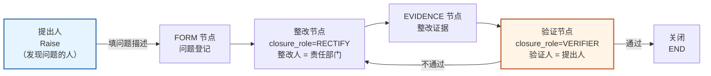

> 图 6：闭环三方。**关键点：验证人的指派来源是 `INITIATOR`（提出人自己），而不是「整改部门的上级」。**

| 角色 | 谁 | 配法 |
|---|---|---|
| **提出人** | 发现问题的人 = 流程发起人 | 隐式（`instance.initiator_id`） |
| **整改人** | 责任部门/责任人 | 整改节点 `closure_role='RECTIFY'` + `assignee_type`（`DEPT_LEADER` 最常用） |
| **验证人** | **提出人自己** | 验证节点 `closure_role='VERIFIER'` + `assignee_type='INITIATOR'` |

**为什么验证人必须是提出人**：整改类的本质是「**提问题的人有否决权**」。
如果验证人是整改人的上级，就会出现「自己人验自己人」——这正是 8D / CAPA / 安全隐患整改最常见的失效原因。

**允许例外的两种配法**：
- 提出人是外部客户/匿名举报 → 验证人 = `INITIATOR_SUPERIOR`（提出人的上级，即受理部门负责人）；
- 提出人已离职 → `FALLBACK_ADMIN` 兜底。

## 10.2 验证不通过怎么退回

**复用现有的退回机制**（`round+1`），不新建退回通道：

```
验证节点 REJECTED（附「不通过原因」，必填）
  ↓ 引擎按 config.work.on_verify_fail 处置：
  ├─ BACK_TO_RECTIFY（默认）：跳到 closure_role=RECTIFY 节点，round+1
  │     ⇒ 整改节点重新生成任务（新的 biz_task，flow_round+1）
  │     ⇒ 原整改证据保留（历史可查），但验证闸只认本轮
  └─ BACK_TO_PREV：退回上一节点（EVIDENCE）
  ↓ round_total++（实例级计数，打回率 = round_total - 1）
```

**「验证闸只认本轮」怎么实现**：`work_gate::check_evidence` 的查询带 `round = 当前节点 round`。
**这就是 `round` 字段存在的意义**（存量 `V0122` 注释「坑 4：判定必须带 round」）。

## 10.3 关闭权限（谁有资格说「这事结了」）

| 关闭方式 | 条件 | 留痕 |
|---|---|---|
| **验证人验证通过** | 验证节点 APPROVED | changelog + 归档包里的签署记录 |
| **提出人主动关闭** | `business:flow:closure:close` + 必须是发起人 | `form_data.close_reason` 必填 |
| **超时自动关闭** | 验证节点 `timeout_action=AUTO_CLOSE`（新增，L3）**且** `allow_auto_approve=true` | `is_auto=true` |
| **管理者强制关闭** | `business:flow:closure:force` + 必须是 `flow_def.owner_dept_id` 的负责人 | 必填原因 + 通知提出人 |

**明确不做：「整改人说完成了就算完」这条路不存在。** 这是闭环与单向流程的唯一本质区别。

## 10.4 与「单向走完」怎么区分（节点配置层面）

| | 单向流程 | 闭环流程 |
|---|---|---|
| `biz_flow_def.closure_mode` | `ONE_WAY` | `VERIFY` |
| `biz_flow_node.closure_role` | 全 `NONE` | 恰一个 `VERIFIER`（+ 通常一个 `RECTIFY`） |
| 库级约束 | — | `uk_biz_flow_node_verifier`（每版本至多一个验证节点，负向 CASE 07 实测被拦） |
| 发布校验 R20 | — | `closure_mode=VERIFY` ⇒ 必须有 `VERIFIER` 节点，且它在 END 之前可达 |
| 界面 | 进度图走到 END 即「已完成」 | 进度图显示「待验证」徽标；验证节点 REJECTED 时**进度图回退**显示 |

## 本章红线

1. **验证人的默认指派必须是 `INITIATOR`**（不是上级）。
2. **验证不通过走 `round+1`，不许「清空证据重来」**（历史要留）。
3. **「整改人自己关闭」这条路不许开**（哪怕配 `FALLBACK_ADMIN` 也要留原因）。

---

# 第十一章 归档与导出

## 11.1 归档包的内容（六段，与 §6.3.5 的目录一致）

| 段 | 内容 | 数据来源 | 格式 |
|---|---|---|---|
| 封面 | 实例号 / 流程名 / 发起人 / 起止时间 / 结论 / 打码水印 | `biz_flow_instance` | PDF |
| 表单 | 每节点表单（原样 JSON + 打印态 PDF + 表单附件） | `biz_flow_form_data` + `form_def.schema` | JSON + PDF |
| 检查 | 每节点检查结果（项 / 标准 / 实填 / 判定 / 人 / 时间） | `biz_flow_checklist_result` + `_item` | CSV + PDF |
| 证据 | 每份证据（文件 + 清单 CSV：要求 / sha256 / 签署人） | `biz_flow_evidence` | 原文件 + CSV |
| 签署 | 所有签署记录（谁 / 何时 / 签了什么） | `biz_flow_task` + `biz_flow_evidence.signed_*` | PDF |
| 时间线 | 节点 / 状态 / 开始 / 结束 / 耗时 / 操作人 | `biz_flow_instance_node` + `biz_changelog` | CSV |

**`manifest.json` 是唯一可信的「打了什么」**：里面每条都带 `file_id` + `sha256`。
下载者可以拿 manifest 校验包里每个文件没被换过。

## 11.2 生成格式与实现路径

| 格式 | 用途 | 实现路径 |
|---|---|---|
| `ZIP` | 机器归档、长期留存 | 服务端遍历六段 → 写临时 zip → 上传 `sys_file` |
| `PDF` | 纸质留痕、上会 | 表单/检查/签署/时间线各出 PDF → 合并成一册（带页码、目录、水印） |
| `BOTH` | 董事会级（默认建议） | 两份都出，`zip_file_id` + `pdf_file_id` 都非空 |

**PDF 用什么出**：**本设计不指定具体库**（属实现选型），只定约束：
① 必须能渲染 §6.1.7 的打印态（含中文、表格分页、水印）；② 必须是纯 Rust 或可静态链接（不引入系统级依赖）；
③ 生成必须能放进 `tokio::task::spawn_blocking`（不阻塞执行器）。

## 11.3 触发时机

| 时机 | 谁触发 | 幂等 |
|---|---|---|
| `archive_policy=ON_FINISH` | 实例落 `APPROVED` 时（END 到达后） | 同一实例的「自动包」用 `pack_no = PKG-{instance_no}-A` 固定，重跑覆盖同一行（不对，`pack_no` 唯一 ⇒ 第二次会冲突 ⇒ **改为 `ON CONFLICT (pack_no) DO UPDATE`** 重打同一行） |
| `MANUAL` | 有权限的人点「生成归档包」 | 每次一个新 `pack_no`（`-M1`、`-M2`…），老的 `EXPIRED` |
| **失败重试** | 状态 `FAILED` 后由人点「重打」 | 同上，新 `pack_no` |

## 11.4 权限

| 操作 | 权限码 | 附加条件 |
|---|---|---|
| 生成归档包 | `business:flow:archive:generate` | 实例可见（§13.3） |
| 下载 | `business:flow:archive:download` | 实例可见 + **字段级权限仍生效**（无 `view` 权的字段在 PDF 里显示为 `***`） |
| 删除 | 无（不许删） | `EXPIRED` 只是标记 |

**「字段级权限在归档包里也生效」是本设计的一个硬要求**：如果归档包把「薪资」字段打出来给所有人，
那字段级权限就形同虚设 —— 而归档包往往流转范围最广（董事会/审计/外部机构）。

## 11.5 与 storage 模块的接法

```
归档包生成 → 写临时文件 → business::storage::upload(bytes, category='flow-archive', name=pack_no+'.zip')
           → 返回 sys_file 行 → biz_flow_archive_pack.zip_file_id
下载        → business::storage::download(sys_file.id) → 流式返回
```

| 要点 | 说明 |
|---|---|
| **不多存储实现** | 用 `sys_file.storage_code` 决定物理位置（本地/S3/MinIO），本设计不关心 |
| **大包** | `max_size_mb` 上限（默认 500，可配）；超了 → `FAILED` + 提示「请分段导出」 |
| **去重** | `sys_file.uk_sys_file_hash` 会去重相同内容 —— **重打相同内容不会重复占空间**（实测这条唯一索引存在） |
| **生命周期** | 包文件随 `sys_file.deleted_at` 走；本设计**不自动删**（留存期到了只标 `EXPIRED`） |

## 本章红线

1. **归档包只含「交付物」**（证据 + 表单附件），不含评论与随手附件。
2. **字段级权限必须在 PDF 里生效**。
3. **`READY` 必须有产物 + sha256**（库级 CHECK）。
4. **不新建存储实现**（一律走 `sys_file` + `storage`）。

---

# 第十二章 界面规格（五个页面）

> 五个页面里**四个是新增或大改**，一个是扩展。表单设计器给到「能开工」的详细度（字段类型 × 配置项 × 交互 × 数据结构）。
> 技术栈按仓内既有：Vue 3.5 + TS + Vite 6 + TDesign Vue Next + Pinia；画布用已有的 Vue Flow + dagre（`FlowCanvas.vue`）。

## 12.0 五个页面总览

| # | 页面 | 路由（建议） | 新增/扩展 | 复杂度 |
|---|---|---|---|---|
| ① | 流程定义 | `/business/flow/def`（已有） | **扩展** | 中 |
| ② | **表单设计器** | `/business/flow/form/design/:id?` | **新增** | ★ 最高 |
| ③ | 检查项配置 | 嵌在节点配置面板里（不独立成页） | **新增** | 低 |
| ④ | **发起中心** | `/business/flow/start`（已有页面大改） | **重写** | 中高 |
| ⑤ | **我的流程** | `/business/flow/my` | **新增** | 中 |

## 12.1 页面① · 流程定义（扩展现有）

现状实测：`views/business/flow/def/index.vue`（列表）+ `def/edit.vue`（画布编辑器）+ `components/FlowCanvas.vue` + `components/NodeProps.vue` + `flow-node-caps.ts`（节点能力表）。

### 12.1.1 列表页要加的三件事

| 位置 | 加什么 | 数据 |
|---|---|---|
| 顶部筛选 | **`flow_type` 下拉**（审批 / 作业 / 自动化）+ `category` 下拉 + `closure_mode` 标签 | `GET /business/flow/def/page?flow_type=` |
| 表格列 | 「类型」列（彩色 tag：审批=蓝、作业=绿、自动化=灰）+「闭环」列（单向/需验证/需回访/需归档） | 同上响应新增字段 |
| 行操作 | 多加一个「复制为新表单流程」？**不加**。加「查看实例」（跳我的流程筛选该 def） | — |

### 12.1.2 画布要加的六种节点（`flow-node-caps.ts` 同步）

| 节点 | 面板分组 | 图标建议（TDesign 已有） | 默认出度 | 拖入后必填校验 |
|---|---|---|---|---|
| `FORM` | 作业 | `file-1` | 1 | 必须选表单（弹表单选择器） |
| `CHECKLIST` | 作业 | `check-rectangle` | 1 | 必须选清单（或「新建清单」） |
| `EVIDENCE` | 作业 | `camera` | 1 | 至少一条证据要求 |
| `WAIT` | 流程控制 | `time` | 1 | 必须填 `event_code` |
| `SUBPROCESS` | 流程控制 | `git-branch` | 1 | 必须选子流程 |
| `ACTION` | 自动化 | `play-circle` | 1 | 必须选动作（11 个白名单） |

> ⚠ **图标名要核对 TDesign 实际有哪个**（仓内踩过坑：`user-check`→`user-checked`、`speed`→`rocket`）。
> 实施时用 `FlowCanvas.vue` 现有的图标映射表逐个验证，**不存在的一律换存在的**（AGENTS.md 高频踩坑第 2 条）。

### 12.1.3 节点配置面板（`NodeProps.vue` 按 node_type 分区显示）

| 面板区 | 显示条件 | 内容 |
|---|---|---|
| 基本信息 | 全部 | `node_key`（只读，发布后不可改）、`node_name`、坐标 |
| 指派 | `APPROVAL`/`COUNTERSIGN`/`TASK_NODE`/`FORM`/`CHECKLIST`/`EVIDENCE`/`CC` | `assignee_type` 选择器 + 条件渲染（选了 USER/ROLE/DEPT_LEADER 显示人/角色/部门选择器；选了 INITIATOR_SUPERIOR 显示 `superior_levels`；选了 FORM_VAR 显示字段选择器） |
| 协作 | 同上 | `approval_mode`（仅 COUNTERSIGN）+ `approve_ratio` + `reject_veto` + **`sign_mode`（新）** + **`co_assignee`（新）** + **`claim_mode`（新）** |
| 作业内容 | `FORM` | 表单选择器（只列 PUBLISHED）+ 「预览表单」按钮 + `expose_as_var` 字段映射表 |
| 作业内容 | `CHECKLIST` | **检查项配置（页面③）**：行内表格编辑器 |
| 作业内容 | `EVIDENCE` | 证据要求表格（页内可增删行，见 §6.3.2） |
| 作业内容 | `ACTION` | 动作下拉（11 个）+ 参数 JSON 编辑器（带 schema 提示） |
| 作业内容 | `WAIT` | `event_code` + `match_key` + `holder` |
| 作业内容 | `SUBPROCESS` | 子流程选择 + `version_policy` + 参数映射表 |
| 时效 | 全部阻塞节点 | `timeout_hours` + `timeout_action` + **`escalate_levels`（ESCALATE 时必填）** + `remind_before_hours` + `max_remind_times` |
| 闭环 | 全部 | **`closure_role`（NONE/RECTIFY/VERIFIER）** |
| 任务模板 | `TASK_NODE`/`FORM`/`CHECKLIST`/`EVIDENCE` | 现有 `TaskNodeConfig.vue` 复用：标题模板（带变量选择器 `TemplateVarPicker.vue`）+ 描述 + 优先级 + 期限 + 验收 + 三条走向 |

**「不同节点类型显示不同配置项」的实现口径**：一张 `node_type → 区块清单` 的映射表（数据驱动），
**不要写成 `v-if` 堆叠**（现有 `NodeProps.vue` 已 800+ 行，再堆就成灾）。

## 12.2 页面② · 表单设计器 ★（最复杂，给到能开工）

### 12.2.1 布局（四区）

```
┌────────────────────────────────────────────────────────────────────────────┐
│ 顶栏：表单名 [报销单 v3]   │ 预览  保存草稿  发布  版本历史  字段JSON  返回  │
├──────────┬──────────────────────────────────────────┬──────────────────────┤
│ 左：字段库 │ 中：画布（所见即所得）                    │ 右：选中字段属性      │
│          │                                          │                      │
│ 基础输入  │ ┌──────────── 基本信息（分组）──────────┐ │ 标签  [报销金额]      │
│  文本    │ │ 报销人   [张三(只读)]                  │ │ 类型  MONEY (锁定)    │
│  多行文本 │ │ 报销金额 [        ] 元 *              │ │ 必填  [✓]            │
│  数字    │ │ 费用类型 [下拉▾] *                    │ │ 精度  [2]  币种 [CNY] │
│  金额    │ └────────────────────────────────────────┘ │ 校验  [+ 加规则]      │
│  百分比  │ ┌──────────── 费用明细（明细表）────────┐ │   √ RANGE 0.01~200000│
│  日期    │ │ 类型 | 金额 | 备注      [+ 加行]      │ │   √ REQUIRED_IF ...  │
│  日期区间 │ │ 交通 | 200  | ...                     │ │ 联动  [+ 加联动]      │
│ 选择类   │ │ 住宿 | 800  | ...                     │ │   √ 金额>5000 显示... │
│  下拉    │ │ 合计 | 1000 │                          │ │ 变量  [✓] 暴露为变量  │
│  多选    │ └────────────────────────────────────────┘ │ 权限  查看[HR,FIN]   │
│  单选    │ ┌──────────── 附件 ─────────────────────┐ │      编辑[HR]        │
│  复选    │ │ 发票 [上传]                            │ │ 高级  占位符/提示/只读│
│  是否    │ └────────────────────────────────────────┘ │                      │
│ 组织引用  │                                          │                      │
│  选人    │        （拖拽插入点显示为蓝色横线）        │                      │
│  选部门   │                                          │                      │
│  业务单据 │                                          │                      │
│ 附件富内容│                                          │                      │
│  附件    │                                          │                      │
│  图片    │                                          │                      │
│  签名    │                                          │                      │
│ 结构化    │                                          │                      │
│  明细表   │                                          │                      │
│  分隔/说明│                                          │                      │
└──────────┴──────────────────────────────────────────┴──────────────────────┘
```

### 12.2.2 左区：字段类型库（5 组 21 种，见 §6.1.2）

| 交互 | 规格 |
|---|---|
| 拖拽 | 从字段库拖到画布，插入点高亮（蓝色横线）；支持拖到「明细表」里变成列 |
| 双击 | 等价于拖到画布末尾 |
| 搜索 | 左区顶部有搜索框（按中文名/拼音首字母） |
| 最近使用 | 顶部固定 3 个（`localStorage`） |

### 12.2.3 中区：画布（所见即所得）

| 交互 | 规格 |
|---|---|
| 结构 | 分组（可折叠）→ 字段行；TABLE 字段内部是一个小表格编辑器 |
| 选中 | 单击选中（右侧属性面板切换）；Shift 多选（用于「批量改必填」） |
| 排序 | 拖拽字段行上下移动；跨分组拖拽 |
| 删除 | 选中后 Delete 或行尾 ×；TABLE 删除时二次确认 |
| 复制 | Ctrl+D 复制字段（`key` 自动加后缀 `_copy`，并提示改 key） |
| 撤销/重做 | Ctrl+Z / Ctrl+Shift+Z，栈深 50（**只栈内内存态，不落库**） |
| 实时预览 | 画布本身就是渲染器（用 §6.1.7 的编辑态组件），**保证「所见即所得」不是两张皮** |
| 校验提示 | 字段级校验错误在行下方红字显示（用当前 schema 跑一遍空值/示例值） |

**「画布 = 渲染器」是本设计的一个硬要求**：如果设计器自己画一套、渲染器再画一套，
加一种字段类型就要改两处，三个月后必然不同步。做法：设计器把 `schema` 传给渲染器组件，渲染器 `mode='EDIT'` + `signals` 事件回抛选中/删除。

### 12.2.4 右区：字段属性（按 type 动态显示）

| 属性区 | 显示条件 | 内容 |
|---|---|---|
| 基础 | 全部 | `label` / `key`（发布后只读，改了要二次确认「改 key 会让历史数据对不上」）/ `required` / `readonly` / `placeholder` / `tooltip` |
| 类型专属 | 按 type | 见 §6.1.2 的「核心配置项」列 |
| 校验 | 全部 | 规则列表（14 种），每条可配参数；「+ 加规则」打开规则选择器（只显示适用于本 type 的规则） |
| 联动 | 全部 | 联动列表（5 类：显隐/必填/赋值/选项/禁用）；条件编辑器复用 `ConditionTree.vue`（已有组件） |
| 变量 | 全部 | `expose` 开关 + `alias`（供流程条件引用） |
| 权限 | 全部 | `view` / `edit` 的角色/部门/用户选择器（§13.4） |
| 高级 | 全部 | `computed`（派生公式）/ `deprecated` / 默认值（静态值或 `{{发起人.dept}}` 表达式） |

**校验规则的「适用性矩阵」**（决定规则选择器显示哪些）：

| 规则 | TEXT | TEXTAREA | NUMBER | MONEY | DATE | SELECT | MULTI | BOOLEAN | USER | FILE | TABLE |
|---|---|---|---|---|---|---|---|---|---|---|---|
| REQUIRED | ✅ | ✅ | ✅ | ✅ | ✅ | ✅ | ✅ | ✅ | ✅ | ✅ | ✅ |
| LENGTH | ✅ | ✅ | — | — | — | — | — | — | — | — | — |
| RANGE | — | — | ✅ | ✅ | — | — | — | — | — | — | — |
| REGEX | ✅ | — | — | — | — | — | — | — | — | — | — |
| DATE_RANGE | — | — | — | — | ✅ | — | — | — | — | — | — |
| CROSS_FIELD | ✅ | — | ✅ | ✅ | ✅ | — | — | — | — | — | — |
| REQUIRED_IF | ✅ | ✅ | ✅ | ✅ | ✅ | ✅ | ✅ | ✅ | ✅ | ✅ | ✅ |
| IN_OPTIONS | — | — | — | — | — | ✅ | ✅ | — | — | — | — |
| UNIQUE_IN_INSTANCE | ✅ | — | ✅ | — | — | — | — | — | — | — | — |
| SUM_EQUALS | — | — | — | — | — | — | — | — | — | — | ✅ |
| ROW_COUNT | — | — | — | — | — | — | — | — | — | — | ✅ |
| ATTACH_COUNT | — | — | — | — | — | — | — | — | — | ✅ | — |
| FILE_SIZE | — | — | — | — | — | — | — | — | — | ✅ | — |
| EXPR | ✅ | ✅ | ✅ | ✅ | ✅ | ✅ | ✅ | ✅ | ✅ | ✅ | ✅ |

### 12.2.5 顶栏：五个动作

| 按钮 | 行为 | 后端接口 |
|---|---|---|
| 预览 | 弹窗显示只读态 + 打印态（切换 tab） | 无（纯前端渲染） |
| 保存草稿 | 存 `status='DRAFT'` 的新行或更新现有 DRAFT 行 | `PUT /business/flow/form/{id}`（DRAFT 可改） |
| 发布 | 校验（见下）→ `status='PUBLISHED'` + `schema_hash` + 切 `is_current` | `POST /business/flow/form/{id}/publish` |
| 版本历史 | 抽屉列出所有版本（`version_no` / 状态 / 发布人 / 时间 / 被多少节点引用） | `GET /business/flow/form/{code}/versions` |
| 字段 JSON | 抽屉显示高亮格式化的 schema（只读，供排障/复制） | 无 |
| **另存为新版本** | 从当前版本复制一份为新 DRAFT（`version_no+1`） | `POST /business/flow/form/{id}/fork` |

**发布校验（8 条，后端 + 前端双跑）**：

| # | 规则 | 错误文案 |
|---|---|---|
| 1 | `fields` 非空且 ≤200 | 「表单至少要有一个字段」 |
| 2 | `key` 唯一且符合 `^[A-Za-z][A-Za-z0-9_]{0,63}$` | 「字段标识重复/格式不合法」 |
| 3 | `key` 不与系统保留字冲突（`instance`/`node`/`round`/`form`） | 「字段标识不能叫 instance」 |
| 4 | `CROSS_FIELD` / `EXPR` 引用的字段存在 | 「规则引用了不存在的字段 xxx」 |
| 5 | 联动图无环 | 「联动存在循环：A→B→A」 |
| 6 | `TABLE` 的列里不许再套 `TABLE` | 「明细表不支持嵌套」 |
| 7 | `perm` 引用的角色/部门存在 | 「权限里引用的角色已删除」 |
| 8 | `vars.expose=true` 的字段在 `fields` 里存在 | 「暴露的变量 xxx 不存在」 |

### 12.2.6 表单库列表页（设计器的入口）

| 列 | 内容 |
|---|---|
| 表单名 | `form_name` + 当前 `version_no` 徽标 |
| 分类 | `category`（人事/财务/生产/行政…） |
| 字段数 | `field_count` |
| 状态 | `DRAFT` / `PUBLISHED` / `ARCHIVED` |
| 被引用 | 「被 3 个流程节点引用」（`SELECT COUNT(*) FROM biz_flow_node WHERE form_def_id=?`）← **删表单前的关键信息** |
| 操作 | 设计 / 预览 / 新版本 / 停用（`ARCHIVED`）/ 删除（**被引用的不许删**） |

## 12.3 页面③ · 检查项配置（嵌在节点配置面板）

**为什么不做独立页面**：检查项是「清单」的内容，清单是「节点」的作业内容。
独立成页会导致「先建清单、再回节点绑」两次跳转，而用户的心智是「我在配这个节点要检查什么」。

### 12.3.1 界面

```
检查清单  [选择已有 ▾ | 新建清单]                     [从模板导入]  [导出 CSV]
─────────────────────────────────────────────────────────────────────────────
序  检查项                              标准      必做 输入类型  合格范围    需照片 可跳过  操作
1   机身铭牌与订单一致                    [📄]     ☑   勾选      —          0    ☐     ⋮
2   压力表读数在 0.5–1.5MPa               [📄]     ☑   数字      0.5 ~ 1.5  1    ☐     ⋮
3   包装完好                              —        ☑   下拉      完好/破损/受潮 0  ☐     ⋮
4   批号记录                              —        ☐   文本      —          0    ☑(权限) ⋮
                                            [+ 添加检查项]  [批量粘贴导入]
─────────────────────────────────────────────────────────────────────────────
清单级：不合格时  [留在本节点 ▾]   加权达标线 [ ] (空=全通过)
```

| 交互 | 规格 |
|---|---|
| 行内编辑 | 所有列都可直接编辑（`t-input` / `t-select` / `t-switch`） |
| 拖拽排序 | 左侧序号线可拖 |
| 标准文档 | 点 `[📄]` 打开文件选择器（上传到 `sys_file`，`category='flow-standard'`） |
| 合格范围 | 按 `input_type` 变化：数字 → 两个输入框；下拉 → 选项编辑器；文本 → 正则输入框 |
| 可跳过 | 打开时强制选权限码（下拉列出 `business:flow:checklist:skip*` 系列），否则存不了（库级 CHECK 也会拦） |
| 批量粘贴 | 从 Excel 粘贴：一行一项，制表符分隔 → 自动填 `item_text` / `input_type` / `min` / `max` |
| 模板导入 | 从「清单库」选一个已发布的清单，复制其项（改 `checklist_code` 新建版本） |

### 12.3.2 数据契约

保存时提交的是**整份清单**（`POST /business/flow/checklist` + items 数组），后端一次事务写 `biz_flow_checklist_def` + N 条 `_item`。
**否决了「逐项增删改接口」**：检查项经常整批改（导入 SOP），逐项接口会产生 N 次往返和半成品状态。

## 12.4 页面④ · 发起中心（重写）

现状实测：`views/business/flow/start/index.vue` 是「下拉选流程 + 标题 + 内容 + 附件」的硬编码表单。
**要改成「模板墙 + 表单渲染」**。

### 12.4.1 布局

```
┌──────────────────────────────────────────────────────────────────────┐
│ 发起                        [搜索模板...]                    [我的发起]│
├──────────────────────────────────────────────────────────────────────┤
│ 全部分类 | 人事 | 财务 | 生产 | 行政 | 采购 | 质量                    │
├──────────────────────────────────────────────────────────────────────┤
│ ┌────────────┐ ┌────────────┐ ┌────────────┐ ┌────────────┐          │
│ │ 💰 费用报销 │ │ 🏖 请假申请 │ │ 📦 入库质检 │ │ 📋 8D 整改  │          │
│ │ 报销差旅、  │ │ 年假/调休/  │ │ 到货验收与  │ │ 不合格品    │          │
│ │ 招待费用    │ │ 病假        │ │ 破损取证    │ │ 原因分析    │          │
│ │ 3 步 · 2 天 │ │ 2 步 · 1 天 │ │ 4 步 · 4h   │ │ 6 步 · 7 天 │          │
│ │  [发起]     │ │  [发起]     │ │  [发起]     │ │  [发起]     │          │
│ └────────────┘ └────────────┘ └────────────┘ └────────────┘          │
│                                                                       │
│  （卡片数据：flow_name / purpose / 节点数 / 目标时长 / category）       │
└──────────────────────────────────────────────────────────────────────┘
```

### 12.4.2 点卡片之后

| 步骤 | 界面 | 接口 |
|---|---|---|
| 1 | 抽屉打开，标题「发起：费用报销」 | — |
| 2 | 用**表单渲染器**（编辑态）渲染 `start-form` 返回的 schema | `GET /business/flow/def/{id}/start-form` |
| 3 | 用户填写（含联动、实时校验） | — |
| 4 | 点「提交」→ 前端全量校验 → 通过则提交 | `POST /business/flow/instance` |
| 5 | 成功 → 提示 `instance_no` + 「查看进度」按钮 | — |
| 6 | 失败 → 把后端 `field_errors` 映射回表单字段（红字） | — |

**「我的发起记录」**：抽屉下半部列最近 10 条（`GET /business/flow/instance/my?initiator=me`，存量接口）。

### 12.4.3 卡片数据的来源与筛选

| 卡片字段 | 来源 |
|---|---|
| 名称 / 说明 | `flow_name` / `purpose` |
| 分类 tab | `category` |
| 「N 步」 | `biz_flow_def_version.node_count`（已存在） |
| 「M 天/小时」 | `biz_flow_def.sla_hours`（L2 加；L1 显示 `node_count` 代替） |
| 可见性 | `status='PUBLISHED'` + `flow_type IN ('APPROVAL','WORKFLOW')` + `biz_flow_def_initiator` 命中当前用户（空集 = 全部） |

**`AUTOMATION` 类型不出现在发起中心**（它是系统自动跑的，人工发起没有意义）。

> **数据源确认（P2-6 决策 A，2026-11-04）**：模板墙卡片**全部取自已存在的两张表** ——
> 骨架/分类/可见性取 `biz_flow_def`（`is_system` 即「标准流程」标记），步数与图结构取
> `biz_flow_def_version`（`node_count` / `graph_snapshot`）。**不新建模板表**
> （`biz_flow_template` 之类），也不新增 `business:flow:template:read` 权限码；
> 卡片墙是 `is_system=TRUE` 的展示投影，与「我的流程」共用 `business:flow:read`
> 和 `GET /business/flow/def/templates`。术语契约见 `docs/architecture/P2-6-模板实体-决策.md` §2.1。

## 12.5 页面⑤ · 我的流程（新增）

### 12.5.1 三个 Tab

| Tab | 内容 | 数据源 | 操作 |
|---|---|---|---|
| **我发起的** | 卡片列表（流程名 + 标题 + 状态 + 当前节点 + 时间） | `GET /business/flow/instance/my`（存量） | 催办 / 撤销 / 查看进度 |
| **等我处理** | 按「一张单一行」聚合（见 §7.8） | 三个来源 ∪（`biz_flow_task` ∪ `biz_task(FLOW)` ∪ 认领池） | 去审批 / 去干活 / 去认领 |
| **我参与的** | 历史（我审批过的 / 我在节点上干过活的 / 我抄送收到的） | 三个来源 ∪ | 查看 |

### 12.5.2 实例详情页（进度图 + 当前节点 + 材料 + 时间线）

```
┌────────────────────────────────────────────────────────────────────────┐
│ 费用报销 · 张三 · FLW-20261104-A1B2C3D4      [状态: 审批中]   [催办]   │
├────────────────────────────────────────────────────────────────────────┤
│ 进度图（横向）：                                                       │
│  ● 发起 ──► ● 部门主管(已批 11-04 10:12) ──► ◉ 财务会签(2/3) ──► ○ 出纳 │
│                                                  ⚠ 已超时 6h           │
├──────────────────┬─────────────────────────────────────────────────────┤
│ 左：本实例的任务   │ 右：材料 / 证据 / 时间线（Tab 切换）                 │
│ · 节点2 任务 完成 │  Tab1 材料: 表单数据（只读态渲染）                  │
│ · 节点3 任务 进行 │  Tab2 检查: 检查项结果表                            │
│ · 节点4 任务 待办 │  Tab3 证据: 证据卡片（缩略图 + 签署信息）           │
│                  │  Tab4 时间线: 每个节点的时间/耗时/操作人            │
│                  │  Tab5 归档: 归档包列表（生成 / 下载）               │
└──────────────────┴─────────────────────────────────────────────────────┘
```

| 区块 | 数据来源 | 组件 |
|---|---|---|
| 进度图 | `GET /business/flow/instance/{id}` 的 `nodes[]` | **复用 `FlowProgress.vue`**（已存在） |
| 当前节点高亮 | 同上（`status='ACTIVE'` 的节点） | 同上 |
| 本实例的任务 | `GET /business/flow/instance/{id}/tasks`（已存在） | 新组件 `InstanceTaskList.vue` |
| 材料（表单） | `form_data`（发起）+ `biz_flow_form_data`（节点） | **表单渲染器 `mode='READ'`** |
| 检查 | `biz_flow_checklist_result` | 新组件 `ChecklistResult.vue`（只读表格） |
| 证据 | `biz_flow_evidence` | 新组件 `EvidenceGallery.vue` |
| 时间线 | `biz_flow_instance_node` + `biz_changelog` | 新组件 `InstanceTimeline.vue` |
| 归档 | `biz_flow_archive_pack` | 新组件 `ArchivePackList.vue` |

### 12.5.3 「催办」与「撤销」的语义（不要做成一个按钮）

| 操作 | 谁能点 | 条件 | 效果 |
|---|---|---|---|
| **催办** | 发起人（+ 管理者） | 实例 `PENDING` | 给当前待办人发一条 `force=true` 通知（`biz_flow_task_urge_ledger` 已存在，防刷用） |
| **撤销** | 只在**没有任何人处理过**（所有 `biz_flow_task` 都是 `PENDING`）时 | — | 实例 `WITHDRAWN`，任务级联 `CANCELLED` |
| **撤回重发** | 不支持（撤销后重新发起） | — | — |

## 12.6 前端组件清单（给前端开发的落地清单）

| 组件 | 新增/复用 | 说明 |
|---|---|---|
| `FlowCanvas.vue` | 复用 | 加 6 种节点的样式与图标 |
| `NodeProps.vue` | 改 | 改为「映射表驱动」的分区渲染 |
| `FormDesigner/*` | **新增**（4 个） | `FieldPalette.vue` / `DesignerCanvas.vue` / `FieldProps.vue` / `RuleEditor.vue` |
| `FormRenderer.vue` | **新增**（核心） | 三态渲染（`mode: EDIT/READ/PRINT`），21 种字段类型 |
| `FormField/*` | **新增**（5 个） | `BasicField` / `SelectField` / `OrgField` / `FileField` / `TableField` |
| `ChecklistConfig.vue` | 新增 | 检查项行内编辑表格 |
| `ChecklistResult.vue` | 新增 | 只读结果表 |
| `EvidenceReqList.vue` | 新增 | 证据要求配置 |
| `EvidenceGallery.vue` | 新增 | 证据展示（缩略图 + 签署） |
| `StartCenter/*` | 重写 | `TemplateWall.vue` + `StartDrawer.vue` |
| `MyFlow/*` | 新增 | `MyFlowList.vue` / `InstanceDetail.vue` / `InstanceTimeline.vue` / `ArchivePackList.vue` |
| `ConditionTree.vue` | 复用 | 表单联动条件、检查项条件必填都用它 |

## 本章红线

1. **设计器的画布必须是渲染器本身**（不是另画一套）。
2. **21 种字段类型不许先做 5 种「以后再加」** —— 加类型要改渲染器，越晚改越贵。
3. **发布校验必须前端 + 后端双跑**（前端给即时反馈，后端是最后一道）。
4. **删除被引用的表单必须被后端拦住**（`form_def_id` 的 RESTRICT 已保证，接口要把错误翻译成人话）。

---

# 第十三章 权限模型

## 13.1 五层权限

| 层 | 管什么 | 机制 | 现状 |
|---|---|---|---|
| **① 功能权限** | 能不能用这个接口 | `#[nik::permission]` + `sys_menu.auth_code` | ✅ 存量 |
| **② 数据可见** | 能不能看见这个实例 | 实例可见性谓词（§13.3） | ⚠ 部分（只按发起人/待办人） |
| **③ 字段级** | 能不能看/改某个字段 | `form_def.schema.perms` | ❌ 无 |
| **④ 动作级** | 能不能跳过检查项 / 强制关闭 / 取消任务 | 配置里的 `*_auth_code` | ❌ 无 |
| **⑤ 定义管理** | 能不能配流程/表单/清单 | `business:flow:*` 系列 + `business:flow:admin` | ✅ 存量 |

## 13.2 功能权限码清单（新增部分）

**存量（实测 `sys_menu` 里已有）**：`business:flow:read` / `create` / `update` / `delete` / `publish` / `approve` / `admin` / `instance:create` / `instance:read` / `instance:withdraw` / `state-edge:list` / `state-edge:manage` / `tasknode:read`

**新增（V0228）**：

| 权限码 | 管什么 |
|---|---|
| `business:flow:form:read` / `:write` / `:publish` | 表单定义 |
| `business:flow:checklist:read` / `:write` / `:publish` | 检查清单定义 |
| `business:flow:checklist:skip` | **跳过普通检查项** |
| `business:flow:checklist:skip-critical` | **跳过关键检查项**（更严） |
| `business:flow:evidence:upload` / `:revoke` | 证据上传 / 撤回 |
| `business:flow:evidence:sign` | 签署 |
| `business:flow:work:submit` | 提交作业（表单/检查/证据） |
| `business:flow:work:ai-forbid` | 标记节点不许派 AI（用在节点配置上） |
| `business:flow:trigger:read` / `:write` | 触发器 |
| `business:flow:archive:generate` / `:download` | 归档包 |
| `business:flow:closure:close` / `:force` | 闭环关闭 / 强制关闭 |
| `business:flow:instance:claim` | 认领 |
| `business:flow:instance:signal` | 投递 WAIT 事件 |
| `business:flow:template:read` | 模板库 —— ⚠️ **已取消**（P2-6 决策 A，2026-11-04）：不建独立模板实体，标准流程与流程定义共用 `business:flow:read`，本码**不落地**（见 `docs/architecture/P2-6-模板实体-决策.md` §3.3 第 3 行） |

## 13.3 实例可见性谓词（本设计要收敛的一处）

**现状实测**：`biz_flow_instance` 的查询散在 `page_instances` / `my_instances` / `instance_detail` 三处，各自的过滤条件不完全一致。
**本设计要求收敛成一条谓词**（与任务模块 `VISIBLE_OR_TAIL` 同款做法）：

```sql
-- 实例可见性谓词（{FILTER} 处注入数据范围）
(
  instance.initiator_id = :me                       -- ① 我发起的
  OR EXISTS (SELECT 1 FROM biz_flow_task t           -- ② 我有审批待办（含历史）
             WHERE t.instance_id = instance.id AND t.assignee_id = :me)
  OR EXISTS (SELECT 1 FROM biz_flow_cc c             -- ③ 抄送给我
             WHERE c.instance_id = instance.id AND c.receiver_id = :me)
  OR EXISTS (SELECT 1 FROM biz_task bt               -- ④ 我在这个实例上有任务（含子任务）
             WHERE bt.flow_instance_id = instance.id AND bt.deleted_at IS NULL
               AND (bt.owner_id = :me OR bt.creator_id = :me
                    OR EXISTS (SELECT 1 FROM biz_task_member m
                               WHERE m.task_id = bt.id AND m.user_id = :me)))
  OR EXISTS (SELECT 1 FROM biz_flow_instance_node n  -- ⑤ 当前活跃节点是「角色认领池」且我在该角色
             JOIN biz_flow_node nd ON nd.node_key = n.node_key
             JOIN biz_flow_node_assignee na ON na.node_id = nd.id AND na.assignee_type = 'ROLE'
             JOIN sys_user_role ur ON ur.role_id = na.ref_id AND ur.user_id = :me
             WHERE n.instance_id = instance.id AND n.status = 'ACTIVE'
               AND nd.claim_mode = 'ROLE_CLAIM')
  OR EXISTS (SELECT 1 FROM biz_flow_archive_pack ap  -- ⑥ 归档包下载权限（管理者）
             WHERE ap.instance_id = instance.id AND :has_archive_download)
) AND instance.deleted_at IS NULL {FILTER}
```

| 分支 | 为什么必要 | 缺了会怎样 |
|---|---|---|
| ① 发起人 | 最基本 | 提了单看不到进度 |
| ② 审批人（含历史） | 审完了还要回看 | 「我刚批的单找不到了」 |
| ③ 抄送 | 抄送就是「给你看」 | 抄送形同虚设 |
| ④ 任务参与人（含协作人） | 作业节点的干活人要看上下文 | 干活的人不知道这张单要什么 |
| ⑤ 认领池 | 不给他看就没法认领 | 角色认领功能失效 |
| ⑥ 归档下载权 | 审计/管理者 | 董事会材料查不了 |

**性能注意**（实测过的坑）：这条谓词有 6 个 `EXISTS` 分支，**必须靠索引**：`biz_flow_task(instance_id)` 有（`idx_biz_flow_task_inst`）、
`biz_flow_cc(instance_id, ...)` 有（`uk_biz_flow_cc` 前缀）、`biz_task(flow_instance_id)` 有（`idx_biz_task_flow_instance`）、
`biz_flow_instance_node(instance_id)` 有（`idx_biz_flow_instance_node_inst`）。**`biz_flow_instance_node` × `biz_flow_node` × `assignee` 的三跳要额外加索引**（L2 的 V0229）。

## 13.4 谁能用哪个模板发起

| 规则 | 实现 |
|---|---|
| `biz_flow_def_initiator` 为空 | 所有持 `business:flow:instance:create` 的人都能发起 |
| 非空 | 命中 `ROLE`（我的角色）/ `DEPT`（我的部门或上级部门）/ `USER`（就是我）任一即可 |
| 加上数据范围 | `biz_flow_def.owner_dept_id` 非空时，只有该部门（含下级）的人能发起（复用 `shared/scope.rs`） |

**判定顺序**：① `status='PUBLISHED'` ② `flow_type` 允许人工发起 ③ 权限码 ④ 发起白名单 ⑤ 数据范围。任一不过 ⇒ 卡片不显示（**不是显示后点不了** —— 那是更坏的体验）。

## 13.5 字段级权限（`form_def.schema.perms`）

| 项 | 规格 |
|---|---|
| 配置 | `{"field":"salary","view":["ROLE:HR","ROLE:FINANCE"],"edit":["ROLE:HR"]}`；`*` = 所有人 |
| 编辑态的语义 | 无 `edit` 权 → 字段 `readonly`（显示值但不能改） |
| 只读态的语义 | 无 `view` 权 → 字段显示 `***`（**不是隐藏**：隐藏会让人以为「这张表没有这个字段」，而 `***` 明确告诉他「有但你看不了」） |
| 打印态的语义 | 同只读态（归档包内 PDF 同理） |
| 后端校验 | 提交时对无 `edit` 权的字段：**值必须与原值相同**，否则 `403 + 65078`。**否决了「静默忽略」**：静默忽略会让人以为改成功了 |
| 权限来源 | 当前用户角色列表（`sys_user_role`）+ 部门（`sys_dept`）+ 用户 id，三者在 `perms` 里统一用 `TYPE:value` 表达 |

## 13.6 检查项跳过权限

| 层级 | 配置 | 校验点 |
|---|---|---|
| 项级 | `biz_flow_checklist_item.allow_skip` + `skip_auth_code` | 「跳过」按钮的可见性 + 后端校验 |
| 库级 | `ck_biz_flow_checklist_item_skip`（`allow_skip` ⇒ `skip_auth_code` 非空） | 配不出来的组合直接拦（负向 CASE 11） |
| 完成闸 | 复算时校验操作人权限 | 防「先写库再补权限」 |
| 审计 | `biz_flow_checklist_result.skipped_reason` + `checked_by` + changelog | 「谁跳了、凭什么、谁批的」 |

## 本章红线

1. **实例可见性只有一条谓词**（六个分支写在一处）。
2. **字段级权限在只读态显示 `***` 而不是隐藏**。
3. **无 `edit` 权的字段提交必须报错，不许静默忽略**。
4. **归档包里的 PDF 也要过滤字段级权限**（否则最广的流转渠道成了最大的泄露口）。

---

# 第十四章 实施分层（能力分层，**不排优先级**）

> 用户明确说：「先做哪一类现在回答不了」。所以本章**不给排期**，只给**能力分层**：
> 每层说清「包含什么能力 / 能支撑什么场景 / 还差什么」，由用户按第一个真实场景决定从哪层进。

## 14.1 L1 · 最小闭环（「一张单能走完，节点能生成任务」）

### 包含的能力

| 能力 | 具体范围 |
|---|---|
| `flow_type` | 三值全有，但 `AUTOMATION` 只做「不生成待办」的过滤（不实现自动节点） |
| 节点类型 | 存量 9 种 + `FORM` + `ACTION`（共 11 种） |
| 表单 | **设计器全量**（21 种字段 / 14 种校验 / 5 类联动 / 三态渲染 / 版本化） |
| 任务融合 | 全部（`task_node::spawn` 已存在，`FORM` 复用它） |
| 协作 | `SINGLE` / `ALL` / `RATIO` / `ANY`（存量四种） |
| 触发 | `MANUAL`（发起中心重写）+ `DOC`（存量） |
| 时效 | `REMIND` / `AUTO_APPROVE` / `AUTO_REJECT`（存量）+ `ESCALATE` 升级到「真升级」（补 §9.3） |
| 闭环 | `ONE_WAY` only |
| 权限 | 功能权限 + 实例可见性谓词 + **发起白名单** |
| 界面 | 流程定义（扩展）/ 表单设计器 / 发起中心 / 我的流程 |

### 能支撑的场景

| 场景 | 能不能配 |
|---|---|
| 报销申请（表单 + 审批 + 动作） | ✅ 完整 |
| 请假 / 用章 / 加班（纯审批） | ✅ 完整 |
| 入职 / 离职（并行分支 + 表单） | ✅（不含 `SUBPROCESS` 的资产归还子流程） |
| 合同签署（单方 + 会签） | ✅（不含多方有序签署） |
| 任何「填表 → 审批 → 结束」 | ✅ |

### 还差什么

- ❌ 检查项（要做标准化作业得等 L2）
- ❌ 证据留痕 + 归档包（董事会级要等 L2）
- ❌ 定时 / 事件触发（周期性与应急响应要等 L2/L3）
- ❌ 有序多签 / 主责协办 / 角色认领（多方签署要等 L2/L3）
- ❌ 闭环验证（整改类要等 L3）
- ❌ 外部参与

**L1 的验收判据**：一个**从来没写过代码**的人，能在表单设计器里配出一张 20 字段的报销单（含明细表、条件必填、跨字段校验），
绑到一个 `WORKFLOW` 流程上，发起并走完三级审批，全程零发版。

## 14.2 L2 · 实用（「标准化作业 + 留痕 + 自动化触发」）

### 在 L1 之上新增

| 能力 | 具体范围 |
|---|---|
| 节点类型 | + `CHECKLIST` / `EVIDENCE`（共 13 种） |
| 检查项 | 定义 / 项 / 结果三表全量 + 防漏四层 + 判定与分支（`fail_action`） |
| 证据 | 证据要求 + 证据记录 + 强制闸 + 签署 |
| 归档包 | ZIP + PDF + manifest + sha256 + 留存期（`archive_policy`） |
| 协作 | + `SEQUENTIAL` 有序多签 + `PRIMARY_CO` 主责协办（+ `AUTO_TRANSFER`） |
| 触发 | + `CRON` 定时（含错过补做 / 时区 / 幂等）+ `EVENT` 事件（复用 4 个 ERP 扫描 job） |
| 闭环 | + `VERIFY`（三方模型 + 退回）+ `ARCHIVE` |
| 权限 | + 字段级权限 + 检查项跳过权限 |
| 界面 | + 检查项配置（嵌节点面板）+ 证据展示 + 归档包管理 |
| 索引 | V0229：`biz_flow_instance_node` × `node` × `assignee` 三跳索引、`biz_flow_task.escalated_level` |

### 能支撑的场景

L1 的全部 +
| 场景 | 能不能配 |
|---|---|
| SOP 执行（检查项 + 返工分支） | ✅ |
| 入库检查（检查 + 证据 + 审批） | ✅ |
| 质检 IQC（数值范围判定） | ✅ |
| 会务 / 董事会（证据 + 有序签署 + 归档包） | ✅ |
| 设备保养 / 5S 巡检 / 月度结账（定时触发） | ✅ |
| 异常应急响应（事件触发 + 升级） | ✅ |
| 8D / 安全隐患整改（闭环验证） | ✅ |
| 盘点 / 对账（定时 + 检查 + 动作） | ✅ |

### 还差什么

- ❌ `WAIT` / `SUBPROCESS`（等外部回签、里程碑挂子流程）
- ❌ 角色认领
- ❌ 条件触发（`CONDITION`）
- ❌ 外部参与（`party_scope=EXTERNAL`）
- ❌ AI 填结构化表单
- ❌ 报表物化视图（按表单字段的固定口径统计）

## 14.3 L3 · 完整（「任意组合都能配」）

### 在 L2 之上新增

| 能力 | 具体范围 |
|---|---|
| 节点类型 | + `WAIT` / `SUBPROCESS`（共 15 种，**全量**） |
| 协作 | + `CLAIM` 角色认领 |
| 触发 | + `CONDITION` 条件触发（扫描 + DSL 过滤） |
| 参与边界 | `EXTERNAL` / `PUBLIC` 真正放开（外部账号体系 + 限流 + 防刷 + 人机校验） |
| 闭环 | + `REVISIT` 回访（结束 N 天后自动起回访） |
| AI | 作业节点可派 AI 填表单（AI 输出 → 结构化，需 schema 约束提示词） |
| 报表 | 表单字段的物化视图（`mv_flow_form_<code>`）+ 表达式索引建设工具 |
| 表单 | 字段级权限的「按节点」差异化（同一字段在不同节点不同权限） |

### 能支撑的场景

L1+L2 的全部 +
| 场景 | 能不能配 |
|---|---|
| 客户服务（等客户回复 + 满意度回访） | ✅ |
| 委外加工（外部单位参与） | ✅ |
| 项目管理（里程碑挂子流程） | ✅ |
| 匿名举报 / 公开投诉 | ✅ |
| 数据对账（条件触发：有差异才发起） | ✅ |
| AI 辅助填单（AI 预填 + 人复核） | ✅ |

### 还差什么

- ❌ 真正的 BPMN 兼容（网关类型、事件子流程、补偿事务）—— **明确不做**
- ❌ 流程挖掘（从日志反推流程）—— 不在本系统范围
- ❌ 多租户隔离 —— 属企业版 `cloudpivot-saas`

## 14.4 三层的依赖关系（哪些能并行、哪些必须串行）

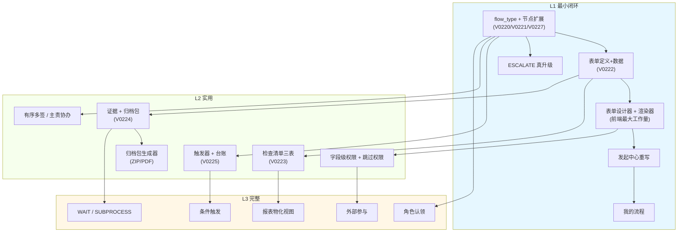

> 图 7：能力分层与依赖。**L1 内部有硬串行**（表单定义 → 设计器 → 发起中心），
> **L2 与 L1 可部分并行**（检查清单不依赖表单设计器，只依赖节点扩展），**L3 全部依赖 L2 的完成**。

## 14.5 选层建议（不排优先级，只给判据）

不给「第几期」，给**判据表** —— 用户拿着自己的第一个真实场景，逐行回答就能定位该从哪层进：

| 如果你的第一个场景… | 需要的最低层 |
|---|---|
| 只填一张表 + 几级审批 | L1 |
| 有「明细行」的表（报销/采购申请） | L1 |
| 有人工检查项、要判合格/不合格 | **L2** |
| 要留存材料并对审计交付 | **L2** |
| 要定期自动跑 | **L2** |
| 要两方以上有序签署 | **L2** |
| 要「问题整改 + 验证关闭」 | **L2**（`VERIFY` 在 L2） |
| 要等外部单位回签 | L3 |
| 要 A 流程里挂 B 流程 | L3 |
| 要给供应商/客户开账号参与 | L3 |
| 要 AI 自动填结构化表单 | L3 |

**结论**：绝大多数「第一个真实场景」落在 **L1 或 L2**。L3 的能力（`WAIT`/`SUBPROCESS`/`CLAIM`/`CONDITION`/外部参与）都是「有了才更好，没有也能活」。

## 本章红线

1. **不许把 L2 的能力提前拆碎到 L1**（例如「先做个只能勾选的检查项」）—— 半做的检查项比没有更坏（用户会以为防漏生效了）。
2. **L1 必须交付完整的表单设计器**（不是「先支持 5 种字段」）—— 见 §12 红线 2。
3. **不许排期**（本章只给能力边界）。

---

# 第十五章 与外部模块的接口清单

## 15.1 ERP 单据

| 方向 | 交互点 | 机制 | 现状 |
|---|---|---|---|
| 单据 → 流程 | 单据提交时发起审批 | `biz_type` 匹配 `biz_flow_def.is_default` + 各 bridge 在**事务内**调 `create_instance`；审批单建不出来整笔回滚 | ✅ 5 个 bridge 已交付（purchase / stockin / payable / voucher / contract） |
| 流程 → 单据 | 审批落终态回写单据 | `on_*_settled(instance, status)` 在**审批事务提交之后**调用；`APPROVED` ⇒ 执行真动作；`REJECTED`/`WITHDRAWN` ⇒ 回到草稿态 | ✅ 已交付 |
| 单据 → 流程（作业） | 单据提交后发起**作业**流程（如入库质检） | `biz_flow_trigger.trigger_kind='DOC'`：bridge 在提交后 `emit(event_code)`，事件触发作业流程 | ❌ 新增（L3） |
| 流程 → 单据（作业结果） | 作业结果回写单据（如质检结论写 `biz_stock_in.qc_result`） | `ACTION` 节点的 `UPDATE_DOC_STATUS`（11 个白名单之一） | ⚠ 动作存在，需要新增参数映射 |
| 内控 | 审批人不能是制单人 | `guard_self_approval`（各 bridge 在**进事务之前**调用） | ✅ 已交付 |
| 跨单据联动 | 状态变化触发下游动作 | `biz_flow_linkage_rule`（11 个 action）+ `state_machine::effective_edges` | ✅ 已交付（D1/D2/D3） |

**新增接口面（设计）**：

| 接口 | 用途 |
|---|---|
| `flow::trigger::emit(event_code, entity, payload)` | 业务代码在事务提交后发事件（内部函数，非 HTTP） |
| `ACTION` 节点的 `param_mapping` | 结构：`{"doc_id": "{{instance.biz_id}}", "status": "QC_PASSED", "reason": "{{work.n_check.fail_items}}"}` |

## 15.2 AI 员工

| 链路 | 接口/函数 | 现状 |
|---|---|---|
| 任务派给 AI | `POST /business/task/{id}/dispatch-ai` → `hermes_sync::dispatch` | ✅ 已交付 |
| AI 完成任务回传 | Hermes 30s 轮询 → 三层回传 → 任务 `REVIEW` | ✅ 已交付 |
| 任务级令牌 | `middleware::task_token` | ✅ 已交付 |
| AI 进度上报 | `POST /business/task/{id}/ai-progress` | ✅ 已交付 |
| **流程上下文注入** | `dispatch-ai` 的 body 加 `flow_context`：实例号 / 节点名 / 作业要求摘要（表单字段说明、检查项文本、证据要求清单） | ❌ 新增（小改） |
| **节点禁止派 AI** | 节点配置 `config.work.ai_forbid=true` ⇒ `dispatch-ai` 返回 `403 + 65076` | ❌ 新增 |
| **AI 填结构化表单** | AI 输出 JSON → 按 schema 校验 → 写 `biz_flow_form_data` | ❌ L3 |

## 15.3 通知

| 场景 | 怎么接 |
|---|---|
| 节点到达（有待办） | 现有 `effects.notice(...)`，`force=true`（必达）。**已在 `engine.rs` 的 Task 臂实现** |
| 催办 | `timeout.rs` 现有链路 + `biz_flow_task_urge_ledger` 防刷 |
| 超时升级 | 新：升级后给**新**负责人发 `force=true` 通知 + 给原负责人发 `force=false`（告知已升级） |
| 抄送 | `biz_flow_cc` + `notice::dispatch`（存量） |
| 归档包就绪 | 新：`notice::dispatch(template_code='FLOW_ARCHIVE_READY')` |
| 触发器失败 | 新：给 `biz_flow_trigger.create_by` 发 |
| **统一口径** | 一律走 `notice::dispatch(NoticeDraft)`，**不直连渠道**。失败只 WARN，不回滚业务（存量纪律） |

## 15.4 附件 / 文件

| 场景 | 接法 |
|---|---|
| 表单里的 FILE/IMAGE 字段 | 前端先 `POST /support/file/upload` → 拿 `sys_file.id` → 填进 `data` |
| 证据文件 | 同上 → `biz_flow_evidence.file_id`（RESTRICT） |
| 标准文档（检查项） | 同上 → `biz_flow_checklist_item.standard_file_id`（SET NULL） |
| 归档包 | 服务端生成 → `storage::upload` → `biz_flow_archive_pack.zip_file_id` |
| 下载 | `GET /support/file/{id}/download`（现有，带可见性校验） |
| **不新增存储实现** | 一律 `sys_file` + `storage`，多存储靠 `storage_code` |

## 15.5 任务模块

| 交互点 | 现状 | 本设计要求 |
|---|---|---|
| 生成任务 | `task_node::spawn`（已交付） | 复用，`FORM`/`CHECKLIST`/`EVIDENCE` 共用 |
| 任务完成回调 | `task_bridge`（已交付，`on_instance_settled` 是反方向） | **新增**：`on_task_done`（任务 `DONE` → 节点 `APPROVED`）—— 实测 `task_model_flow.rs` 已有查询侧，回写侧需补 |
| 任务提交验收 → 审批 | `task_bridge::prepare_accept` + `start_in_tx`（已交付） | 复用 |
| 审批结论 → 任务 | `task_bridge::on_instance_settled`（已交付） | 复用，`closure_mode=VERIFY` 时复用同一通道 |
| 可见性 | `model::page_visible`（已交付） | 不改；流程侧用自己的可见性谓词（§13.3） |
| 派 AI | `dispatch-ai`（已交付） | 加 `flow_context` |

## 15.6 定时任务

| 现有机制 | 实测 | 本设计怎么用 |
|---|---|---|
| 代码内 `scheduler.register_cron` | `flow_timeout_scan`（10 分钟）、`flow_graph_selfcheck`（每天 3:30） | **新增** `flow_trigger_scan`（每分钟，扫 `biz_flow_trigger`） |
| 库表 `sys_job` | 4 条 ERP 扫描（低库存/应付逾期/采购超期/合同到期） | **不改**（它们是业务扫描，不是流程扫描）；但它们的末尾加 `emit(event_code)` 接事件触发 |
| 任务侧周期任务 | `task::recurring` | **不复用**（周期任务 ≠ 周期流程；前者生成任务，后者生成实例） |

**为什么触发扫描器用 `register_builtin` 而不用 `sys_job`**：见 D-ARCH5-06。
**为什么不用 `sys_job` 一条一条配**：触发器是运行时业务配置，`sys_job` 是运维配置，两种人两种权限（§3.2 D-ARCH5-06 的 A 方案否决理由）。

## 15.7 接口清单总表（新增 8 个 + 扩展 3 个）

| # | 方法 | 路径 | 权限 | 用途 |
|---|---|---|---|---|
| 1 | POST | `/business/flow/instance/{id}/signal` | `flow:instance:signal` | WAIT 事件投递 |
| 2 | POST | `/business/flow/instance/{id}/node/{key}/claim` | `flow:instance:claim` | 角色认领 |
| 3 | POST | `/business/flow/instance/{id}/node/{key}/submit-work` | `flow:work:submit` | 提交作业（统一入口） |
| 4 | POST | `/business/flow/instance/{id}/archive` | `flow:archive:generate` | 生成归档包 |
| 5 | GET | `/business/flow/instance/{id}/archive/{pack_no}` | `flow:archive:download` | 查状态 / 下载 |
| 6 | GET/POST/PUT | `/business/flow/form/**` | `flow:form:*` | 表单 CRUD + publish + fork + versions |
| 7 | GET/POST/PUT | `/business/flow/checklist/**` | `flow:checklist:*` | 清单 CRUD + publish |
| 8 | GET/POST/PUT | `/business/flow/trigger/**` | `flow:trigger:*` | 触发器 CRUD + 手动试跑 |
| E1 | GET | `/business/flow/def/{id}/start-form` | `flow:read` | 发起时取表单 schema |
| E2 | POST | `/business/flow/instance/{id}/node/{key}/complete` | — | 接入 `work_gate` |
| E3 | GET/POST | `/business/flow/evidence/**` | `flow:evidence:*` | 证据上传/撤回/签署 |

## 本章红线

1. **一律走现有通道**（`notice::dispatch` / `sys_file`+`storage` / `dispatch-ai`），不新建旁路。
2. **业务回调必须在事务提交之后**（存量纪律，新增的 `ACTION` 节点同样）。
3. **新增定时器用 `register_builtin`**（不用 `sys_job` 一条一条配）。

---

# 第十六章 三个真实场景的完整走查

> 每个走查给：**流程图（带节点形态标注）+ 节点配置表 + 关键配置片段 + 一次完整执行的时序 + 哪一层能配**。
> 三个场景刻意选了三种极端：**纯表单无单据**（报销）/ **单据驱动的检查作业**（入库）/ **证据 + 有序签署 + 归档**（董事会）。

## 16.1 场景一：费用报销（纯表单，无业务单据表）

### 16.1.1 为什么选它

实测：ERP 模块里**没有报销表**（`biz_*` 表清单 40 张，无 expense/reimburse）。
这是「工作流不新建业务表，配置即可」的最好证明 —— 一个完整的业务场景，**零建表**。

### 16.1.2 流程图

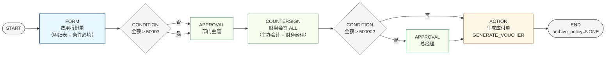

> 图 8：报销流程。**节点形态标注**：蓝 = 作业（FORM），绿 = 审批，橙 = 自动动作，灰 = 结构。

### 16.1.3 节点配置表

| 节点 | node_type | 形态 | 关键配置 |
|---|---|---|---|
| `n1` 费用报销单 | `FORM` | FORM | `form_def_id` → 「费用报销单 v1」；`assignee_type=INITIATOR`；`config.work.at_start=true`；`expose_as_var=["amount","dept"]` |
| `n2` 金额分支 | `CONDITION` | — | 出边 2 条：`{"op":"cmp","field":"form.amount","cmp":"gt","value":5000}` + default |
| `n3` 部门主管 | `APPROVAL` | APPROVAL | `assignee_type=INITIATOR_SUPERIOR`，`superior_levels=1`；`timeout_hours=24`，`timeout_action=ESCALATE`，`escalate_levels=2` |
| `n4` 财务会签 | `COUNTERSIGN` | APPROVAL | `assignee_type=EXPRESSION`（前端：主办会计 role + 财务经理 role），`approval_mode=ALL`，`reject_veto=true`；`timeout_hours=48`，`timeout_action=ESCALATE`，`escalate_levels=1` |
| `n5` 大额分支 | `CONDITION` | — | `{"op":"cmp","field":"form.amount","cmp":"gt","value":50000}` + default |
| `n6` 总经理 | `APPROVAL` | APPROVAL | `assignee_type=ROLE`（`GM`）；`timeout_hours=72`，`timeout_action=REMIND` |
| `n7` 生成应付 | `ACTION` | ACTION | `action_code=GENERATE_VOUCHER`；`action_params` 见下；`on_error=ABORT`（凭证生成失败 = 整笔回滚，不许「钱批了但没入账」） |
| `n8` 结束 | `END` | — | `archive_policy=NONE`（普通报销不需要归档包） |

### 16.1.4 关键配置片段

**表单 schema（节选）**：

```json
{
  "layout": "TWO_COL",
  "fields": [
    { "key": "applicant", "type": "USER", "label": "报销人", "readonly": true,
      "default": "{{initiator}}" },
    { "key": "dept", "type": "DEPT", "label": "费用归属部门", "required": true },
    { "key": "amount", "type": "MONEY", "label": "报销总额", "readonly": true,
      "computed": { "expr": "SUM(items.amount)", "depends_on": ["items"] } },
    { "key": "items", "type": "TABLE", "label": "费用明细", "min_rows": 1, "max_rows": 50,
      "columns": [
        { "key": "fee_type", "type": "SELECT", "label": "费用类型",
          "options": ["交通","住宿","餐饮","办公","招待"] },
        { "key": "amount", "type": "MONEY", "label": "金额", "required": true },
        { "key": "invoice_no", "type": "TEXT", "label": "发票号", "required": true }
      ] },
    { "key": "dept_leader_note", "type": "TEXTAREA", "label": "部门经理意见", "required": false },
    { "key": "invoice_files", "type": "FILE", "label": "发票扫描件", "required": true,
      "max_count": 20, "mime_allow": "image/,application/pdf" }
  ],
  "rules": [
    { "field": "amount", "kind": "RANGE", "min": 0.01, "max": 200000 },
    { "field": "items", "kind": "SUM_EQUALS", "column": "amount", "target": "amount" },
    { "field": "invoice_files", "kind": "ATTACH_COUNT", "min": 1, "max": 20 },
    { "field": "invoice_no", "kind": "UNIQUE_IN_INSTANCE", "scope": "instance" }
  ],
  "links": [
    { "when": { "op": "cmp", "field": "amount", "cmp": "gt", "value": 5000 },
      "then": { "show": ["dept_leader_note"], "require": ["dept_leader_note"] } }
  ],
  "vars": [ { "key": "amount", "expose": true }, { "key": "dept", "expose": true } ]
}
```

**`ACTION` 节点的参数映射**：

```json
{
  "action_code": "GENERATE_VOUCHER",
  "action_params": {
    "voucher_date": "{{instance.started_at.date}}",
    "summary": "费用报销-{{form.applicant.name}}-{{form.dept.name}}",
    "entries": [
      { "account_code": "6602", "debit": "{{form.amount}}", "aux": { "dept": "{{form.dept}}" } },
      { "account_code": "2241", "credit": "{{form.amount}}" }
    ]
  },
  "on_error": "ABORT"
}
```

### 16.1.5 一次完整执行（时序）

| 步 | 谁 | 发生什么 | 落库 |
|---|---|---|---|
| 1 | 张三 | 发起中心点「费用报销」卡片 | — |
| 2 | 系统 | `GET /def/{id}/start-form` 返回 schema | — |
| 3 | 张三 | 填明细 3 行（交通 200 / 住宿 800 / 餐饮 100），合计自动 1100；上传 3 张发票 | 前端算 `amount=1100` |
| 4 | 张三 | 提交 | `create_instance` 事务：`biz_flow_instance`（`form_data={applicant,dept,amount,items,...}`）+ 跑 START |
| 5 | 引擎 | `FORM` 节点激活 → `task_node::spawn` 生成任务 `TSK-202611-000123`（负责人 = 张三，因为 `assignee_type=INITIATOR`） | `biz_task`（`source=FLOW`）+ `biz_flow_instance_node`(ACTIVE) + `biz_task_member`(无) |
| 6 | 张三 | 在任务详情页看到表单（编辑态，与发起时同一份 schema + 同一份 data）→ 点「提交」 | `biz_flow_form_data`(SUBMITTED) + 任务 `DONE` |
| 7 | 引擎 | `work_gate::check_form` 通过 → 节点 `APPROVED` → CONDITION 求值：1100 ≤ 5000 → 走 default 边 | `biz_flow_instance_node`(APPROVED) |
| 8 | 系统 | 生成 `biz_flow_task` 给张三的部门主管（`INITIATOR_SUPERIOR` 解析）→ 通知 | `biz_flow_task`(PENDING) |
| 9 | 主管 | 同意（11-04 10:12） | `biz_flow_task`(APPROVED) + 节点通过 |
| 10 | 系统 | 财务会签：扇出 2 条待办（主办会计 + 财务经理） | `biz_flow_task` × 2 |
| 11 | 会计 | 同意 | `approved_count=1/2` |
| 12 | 财务经理 | 48h 未处理 → 10 分钟后 `flow_timeout_scan` 扫到 → `ESCALATE` 第 1 级 → 待办转给财务总监 | `biz_flow_task`(TRANSFERRED) + 新行(PENDING, `is_auto=true`) |
| 13 | 财务总监 | 同意 | `approved_count=2/2` → 会签通过 |
| 14 | 引擎 | CONDITION：1100 ≤ 50000 → 走 default → `ACTION` | — |
| 15 | 引擎 | `GENERATE_VOUCHER` 生成凭证 + 应付单 | `biz_voucher` + `biz_voucher_entry` + `biz_payable` |
| 16 | 引擎 | END → 实例 `APPROVED` | `biz_flow_instance`(APPROVED, `ended_at`) |

**注意第 6 步和第 12 步**：
- 第 6 步说明「`assignee_type=INITIATOR` 的 FORM 节点」= 发起人自己填自己的单（不是多此一举：发起时填的是「申请」，节点填的是「确认提交」，可以补附件、改明细）；
- 第 12 步说明 `ESCALATE` 是**真升级**（把待办挪给上级），不是发条通知。

### 16.1.6 哪一层能配

**L1**。整个流程只用到 `FORM` / `CONDITION` / `APPROVAL` / `COUNTERSIGN` / `ACTION`，五种节点全在 L1 范围。
唯一依赖 L2 的是「`ESCALATE` 真升级」（L1 里它=提醒+抄送）。

## 16.2 场景二：入库检查（单据驱动 + 检查项 + 证据 + 返工）

### 16.2.1 现状与改造点

实测：`biz_stock_in` 表存在，`stockin_bridge.rs` 已实现「审批通过 → 过账（六本账）」。
**现有流程只有审批**（`V0182__pflow3a_po_stockin_approval`）。本场景要加的是**审批之前的检查作业**。

### 16.2.2 流程图

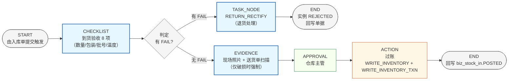

> 图 9：入库检查。**注意 `D1` 判定节点**：它不是 `CONDITION` 节点，而是 `CHECKLIST` 节点的 `fail_action` 分支（§6.2.5）——
> 「判定」是检查节点的内建能力，不是画布上的独立节点（这样改检查项不用改图）。

### 16.2.3 节点配置表

| 节点 | node_type | 形态 | 关键配置 |
|---|---|---|---|
| `n1` 到货验收 | `CHECKLIST` | CHECKLIST | `checklist_def_id` → 「到货验收 v2」；`assignee_type=DEPT_LEADER`（仓库）；`timeout_hours=4`，`timeout_action=ESCALATE`，`escalate_levels=1`；`config.work.min_pass_weight=1.0`（必须全过） |
| 检查清单内容 | — | — | 8 项：①数量与送货单一致(NUMBER,RANGE,±0) ②包装完好(SELECT:完好/破损/受潮) ③批号已记录(TEXT) ④生产日期未过期(DATE) ⑤温度记录(NUMBER,RANGE,2–8) ⑥外观无锈蚀(BOOLEAN) ⑦随货文件齐全(BOOLEAN) ⑧破损照片(PHOTO,条件要求) |
| — | — | — | 清单级 `fail_action=TO_RECTIFY` |
| `n2` 退货处理 | `TASK_NODE` | TASK | `closure_role=RECTIFY`；`assignee_type=DEPT_LEADER`（采购）；`config.task.title_template="退货处理：{{instance.biz_no}}"`；`on_complete=DIRECT` |
| `n3` 证据 | `EVIDENCE` | EVIDENCE | `assignee_type=DEPT_LEADER`（仓库）；要求 2 条：①「现场照片」PHOTO min 2 max 10（`require_sign=false`）②「送货单扫描」SCAN min 1（`require_sign=false`）；`config.work.allow_extra=true` |
| `n4` 仓库主管 | `APPROVAL` | APPROVAL | `assignee_type=DEPT_LEADER`（仓库）；`timeout_hours=8` |
| `n5` 过账 | `ACTION` | ACTION | `action_code=WRITE_INVENTORY`；`on_error=ABORT` |
| `n6`/`n7` END | `END` | — | `n7` 的 `config.end.outcome=REJECTED` |

### 16.2.4 检查项的「条件必填照片」怎么配

第 ⑧ 项不是永远要照片 —— 只有包装破损才要：

```json
{ "item_key": "packaging", "item_text": "包装完好", "input_type": "SELECT",
  "options": ["INTACT","DAMAGED","WET"], "pass_rule": "IN_SET",
  "pass_options": ["INTACT"], "is_required": true }
```

```json
// 节点 config.work 里
{ "require_photo_per_item": false,
  "photo_when": [ { "item_key": "packaging", "value": "DAMAGED", "min_photos": 2 },
                  { "item_key": "packaging", "value": "WET",     "min_photos": 2 } ] }
```

**判定逻辑**（`work_gate::check_checklist` 第 6 步）：`COUNT(PHOTO evidence) >= SUM(命中的 min_photos)`。
包装完好时 `SUM=0` ⇒ 不需要照片；破损时必须 ≥2 张 ⇒ 不拍就交不了。

### 16.2.5 一次完整执行（含返工分支）

| 步 | 谁 | 发生什么 |
|---|---|---|
| 1 | 采购 | 入库单 `SI-20261104-001` 提交（`stockin_bridge` 事务内发起流程；`biz_type='STOCK_IN'`） |
| 2 | 引擎 | START → `CHECKLIST` 节点激活 → 生成任务给仓库主管 |
| 3 | 仓库主管 | 逐项检查：①数量 100=100 PASS ②包装「破损」**FAIL** ③批号 PASS ④日期 PASS ⑤温度 5℃ PASS ⑥外观 PASS ⑦文件 PASS ⑧照片未拍 |
| 4 | 仓库主管 | 点「完成检查」→ 完成闸：②FAIL ⇒ **`fail_action=TO_RECTIFY`** ⇒ 不推进到 `n4`，**跳到 `n2` 退货处理** |
| 5 | 系统 | 生成退货任务给采购；`biz_flow_instance_node` 上 `n1` 记 `REJECTED`，`n2` 记 `ACTIVE` |
| 6 | 采购 | 联系供应商换货 → 任务 `DONE` |
| 7 | 引擎 | `n2` 通过 → `END`（`config.end.outcome=REJECTED`）→ 实例 `REJECTED` |
| 8 | 回调 | `stockin_bridge::on_*_settled` → `biz_stock_in` 回 `DRAFT`（打回，`remark` 写检查结论） |
| — | — | **另一条路径（全部 PASS）**：③ 步后点完成 → 过闸 → `n3` 证据 → 拍 3 张照片（包装破损 ⇒ 必须 ≥2，满足）→ `n4` 主管批 → `n5` 过账（六本账）→ `END` → 单据 `POSTED` |

**第 4 步是本场景的核心价值**：不合格**不进审批**，直接走退货。
如果按「检查 + 审批」串行做（检查完还是要主管批），主管只能「批一个不合格的到货」—— 那检查就白做了。

### 16.2.6 哪一层能配

**L2**。需要 `CHECKLIST` + `EVIDENCE` + `fail_action` 分支 + 定时升级。
（L1 只能用 `FORM` 拼一个「检查表」，但没有数值判定、没有防漏、没有条件照片。）

## 16.3 场景三：董事会决议（证据 + 有序签署 + 归档包）

### 16.3.1 流程图

```mermaid
graph LR
    S(["START<br/>董秘发起"]):::struct --> F1["FORM<br/>会议通知 + 议题清单<br/>（含子表：议题/汇报人/时长）"]:::work
    F1 --> D1{"CONDITION<br/>议题数 > 5?"}:::struct
    D1 -->|"是（要分次）"| A0["APPROVAL<br/>董事长确认议程"]:::appr
    D1 -->|"否"| EV1
    A0 --> EV1["EVIDENCE<br/>议案材料 5 类<br/>（议案正文/财务数据/法律意见/<br/>风险评估/上次决议跟踪）"]:::work
    EV1 --> EV2["EVIDENCE<br/>会议现场 3 类<br/>（签到表/录音/现场照片）<br/>require_sign=董事长"]:::work
    EV2 --> SG["COUNTERSIGN<br/>有序多签 SEQUENTIAL<br/>董事长 → 董事A → 董事B → 监事"]:::appr
    SG --> AC["ACTION<br/>生成归档包<br/>＋ 回写决议台账"]:::auto
    AC --> E(["END<br/>ARCHIVE 留存 10 年"]):::struct

    classDef struct fill:#f5f5f5,stroke:#666
    classDef work fill:#e6f7ff,stroke:#2b6cb0,stroke-width:2px
    classDef appr fill:#f6ffed,stroke:#2f855a
    classDef auto fill:#fff7e6,stroke:#c05621
```

> 图 10：董事会决议。**三个 L2/L3 能力密集出现**：证据强制（5 类 + 3 类）、有序多签（4 人 4 签序）、归档包。

### 16.3.2 节点配置表

| 节点 | node_type | 形态 | 关键配置 |
|---|---|---|---|
| `n1` 会议通知 | `FORM` | FORM | 「董事会会议通知 v1」：`meeting_date`(DATE) / `location`(TEXT) / `attendees`(USER, multiple) / `topics`(TABLE: 议题/汇报人/时长) / `notice_file`(FILE) |
| `n2` 议题数分支 | `CONDITION` | — | `{"op":"cmp","field":"form.topic_count","cmp":"gt","value":5}` |
| `n3` 确认议程 | `APPROVAL` | APPROVAL | `assignee_type=USER`（董事长）；`timeout_hours=48` |
| `n4` 议案材料 | `EVIDENCE` | EVIDENCE | **5 条要求**：①议案正文 FILE min1 `require_sign=false` ②财务数据 SCAN min1 ③法律意见书 SCAN min1 `require_sign=true`（`signer_rule=USER_LIST`：法务负责人） ④风险评估报告 FILE min1 ⑤上次决议跟踪 FILE min0 max1（可选） |
| `n5` 会议现场 | `EVIDENCE` | EVIDENCE | **3 条要求**：①签到表 SCAN min1 `require_sign=true`（`SAME_AS_ASSIGNEE`）②会议录音 AUDIO min1 ③现场照片 PHOTO min2 `capture_geo=true` |
| `n6` 决议签署 | `COUNTERSIGN` | APPROVAL | `sign_mode=SEQUENTIAL` + `approval_mode=ALL` + `reject_veto=true`；`node_assignee` 4 行，`sort_order` 1–4（董事长→董事A→董事B→监事）；`timeout_hours=168`（7 天） |
| `n7` 归档 + 台账 | `ACTION` | ACTION | ①`CREATE_TASK`（触发归档包生成，或由 `archive_policy=ON_FINISH` 自动） ②`UPDATE_DOC_STATUS`（回写决议台账） |
| `n8` END | `END` | — | 流程级 `closure_mode=ARCHIVE` + `archive_policy=ON_FINISH` |

### 16.3.3 有序多签的执行细节（这是本场景最关键的一段）

```
n6 激活
  ↓ 按 node_assignee.sort_order 排序：董事长(1) / 董事A(2) / 董事B(3) / 监事(4)
生成 1 条 biz_flow_task：seq_no=1, assignee=董事长
  ↓ 董事长签署（APPROVED）
同一事务内：生成 seq_no=2 的待办给董事A
  ↓ 董事A 签署
生成 seq_no=3 给董事B
  ↓ 董事B **拒签**（REJECTED）
  ⇒ reject_veto=true + SEQUENTIAL ⇒ 整节点立即 REJECTED
  ⇒ 实例落 REJECTED（不存在「监事还能救」）
  ⇒ 归档包仍生成（`archive_policy=ON_FINISH` 在终态触发，含「谁拒签、什么时候」）
```

**「拒签也归档」是有意的**：董事会的**否决记录**本身是法定留痕材料，比通过记录更需要归档。

### 16.3.4 归档包的内容（本次会务的实际产物）

```
PKG-FLW-20261104-D4E5F6A7-A.zip
├── 00-封面/流程信息.pdf
├── 01-表单/n1_董事会会议通知.pdf + .json + attachments/通知附件.pdf
├── 02-检查/（本流程无 CHECKLIST 节点 → 该段为空，manifest 里标 skipped）
├── 03-证据/
│   ├── 议案正文.pdf / 财务数据.xlsx / 法律意见书.pdf / 风险评估.docx / 上次决议跟踪.pdf
│   ├── 签到表.pdf（董事长签署）
│   ├── 会议录音.mp3
│   ├── 现场照片-1.jpg / 现场照片-2.jpg（含经纬度）
│   └── 证据清单.csv（要求 / 文件 / sha256 / 签署人 / 时间）
├── 04-签署/签署记录.pdf（董事长 11-04 15:20 / 董事A 11-04 16:05 / 董事B 11-05 09:30 / 监事 11-05 10:00）
├── 05-时间线/timeline.csv
└── manifest.json（含 zip_sha256，供事后校验）
```

`manifest.json` 里 `sections[].kind='CHECKLIST'` 的段标注 `"skipped": "本流程无检查节点"` —— **空段也要写进 manifest**，
否则审计会问「是没检查，还是检查了没打进去」。

### 16.3.5 哪一层能配

**L2 全部能力 + 一点 L3**：
- `FORM` / `EVIDENCE` / `COUNTERSIGN(SEQUENTIAL)` / `ACTION` / `ARCHIVE` 都在 **L2**；
- `capture_geo`（现场照片带定位）在 **L2**（`evidence_req` 字段级）；
- 若要「同意/反对/弃权」三态表决 + 计票比例，需要 `approval_mode=RATIO` + 自定义选项（**L2 可配**，用 `FORM` + `EVIDENCE(SIGN)` 实现）。

**L3 都不需要** —— 这是一个纯内部、有序、留痕的流程。这正是「6 维组合」的威力：看起来很「高级」的场景，其实只用到 4 个维度。

---

# 第十七章 十五类场景的判决表（哪些现在就能配、哪些要等哪一层）

> 这是卡面验收标准里「明确回答」那一条的正面答案。
> 「现状即可配」= **一行代码不用改**（只建配置）；「等 Lx」= 需要该层的能力才能配。

## 17.1 判决表

| # | 场景 | 触发 | 形态 | 协作 | 时效 | 闭环 | 边界 | 判决 | 缺什么 |
|---|---|---|---|---|---|---|---|---|---|
| 1 | **报销申请**（表单类） | MANUAL | FORM+APPROVAL+ACTION | SINGLE+ALL | SLA | ONE_WAY | INTERNAL | **L1** | 表单设计器 + 发起中心重写 |
| 2 | **入职/离职**（表单类） | MANUAL | FORM+PARALLEL+SUBPROCESS | SINGLE | COUNTDOWN | ONE_WAY/VERIFY | CROSS_DEPT | **L1（含子流程要 L3）** | 表单设计器；资产归还子流程需 SUBPROCESS |
| 3 | **SOP 执行**（标准化作业） | MANUAL/CRON | CHECKLIST+EVIDENCE+APPROVAL | SINGLE+ANY | SLA | VERIFY | INTERNAL | **L2** | 检查清单 + 定时触发 |
| 4 | **入库检查**（标准化作业） | DOC | CHECKLIST+EVIDENCE+APPROVAL+ACTION | SINGLE | SLA | VERIFY | INTERNAL | **L2** | 检查清单 + 证据 + fail_action 分支 |
| 5 | **会务/董事会**（留痕） | MANUAL | FORM+EVIDENCE+APPROVAL+ACTION | SEQUENTIAL | SLA | ARCHIVE | INTERNAL | **L2** | 证据强制 + 有序多签 + 归档包 |
| 6 | 周期性例行（补 A） | CRON | CHECKLIST/FORM | SINGLE+ANY | SLA+RECURRING | ONE_WAY | INTERNAL | **L2** | 触发器 + 错过补做 |
| 7 | 异常应急响应（补 B） | EVENT | FORM+ACTION+EVIDENCE+APPROVAL+CHECKLIST | SINGLE+PRIMARY_CO | SLA(2h) | VERIFY | INTERNAL | **L2** | 事件触发 + 真升级 + 主责协办 |
| 8 | 整改闭环（补 C） | EVENT | FORM+TASK+EVIDENCE+APPROVAL | SINGLE 三方 | SLA | VERIFY | INTERNAL | **L2** | 闭环三方（`closure_role`）+ 退回 |
| 9 | 多方有序签署（补 D） | MANUAL | EVIDENCE(SIGN) | **SEQUENTIAL** | SLA | ARCHIVE | **EXTERNAL** | **L2（内部）/ L3（含外部）** | 有序多签在 L2；外部签署方要 L3 账号体系 |
| 10 | 配额/额度管控（补 E） | MANUAL | FORM+ACTION+APPROVAL | SINGLE+ALL | NONE | ONE_WAY | INTERNAL | **L1** | 表单设计器 + ACTION 的额度校验参数 |
| 11 | 项目管理型（补 F） | MANUAL | **SUBPROCESS**+EVIDENCE+APPROVAL | PRIMARY_CO | COUNTDOWN | VERIFY+ARCHIVE | CROSS_DEPT | **L3** | 子流程（L3）+ 主责协办（L2） |
| 12 | 客户服务 SLA（补 G） | EVENT | FORM+CHECKLIST+EVIDENCE+**WAIT** | SINGLE+EXTERNAL | SLA 双计时 | REVISIT | **EXTERNAL** | **L3** | WAIT（L3）+ 外部参与（L3）+ 回访（L3） |
| 13 | 培训取证（补 H） | MANUAL/CRON | FORM+CHECKLIST+EVIDENCE | SINGLE | COUNTDOWN | VERIFY | INTERNAL | **L2** | 检查清单 + 定时触发 + 验证退回 |
| 14 | 纯审批链（补 I） | MANUAL | APPROVAL 串行 | SINGLE/ALL | SLA | ONE_WAY | INTERNAL | **✅ 现状即可配** | **无**（`biz_id` 本就可空，实测 `V0122`） |
| 15 | 委外/跨组织（补 J） | MANUAL | FORM+EVIDENCE+**WAIT** | PRIMARY_CO+EXTERNAL | SLA+COUNTDOWN | VERIFY | **EXTERNAL** | **L3** | WAIT + 外部参与 |
| 16 | 盘点/对账（我补） | CRON+**CONDITION** | FORM+CHECKLIST+APPROVAL+ACTION | PRIMARY_CO | SLA | VERIFY | CROSS_DEPT | **L3**（用 CRON 可提前到 L2） | 条件触发（L3）；只用定时 + 检查可 L2 |
| 17 | 外部回签/第三方检测（我补） | MANUAL+**WAIT** | EVIDENCE+**WAIT**+APPROVAL | SINGLE+EXTERNAL | SLA | ARCHIVE | **EXTERNAL** | **L3** | WAIT + 外部参与 |

## 17.2 统计（这张统计表本身就是「为什么这么做」的答案）

| 判决 | 数量 | 占比 | 场景 |
|---|---|---|---|
| ✅ **现状即可配**（零代码） | **1** | 6% | 14 纯审批链 |
| **L1** | **3** | 18% | 1 报销、2 入职（不含子流程）、10 配额 |
| **L2** | **8** | 47% | 3、4、5、6、7、8、13、9（内部签署） |
| **L3** | **5** | 29% | 11、12、15、16、17、9（外部签署） |
| **合计** | **17** | 100% | 3 用户 + 10 助手补 + 2 我补 + 1 拆分（场景 2/9 各有两档） |

**关键结论三条**：

1. **没有任何一个场景「做不了」** —— 包括最"特殊"的董事会和委外加工。这是维度化设计的直接收益。
2. **47% 的场景落在 L2** —— 这印证了「L2 才是真正实用的那一层」。如果要一次投入把绝大多数场景拿下来，答案是 L2。
3. **只有 1 个场景（纯审批链）现在就能配** —— 但它恰恰是**最常见的**（请假/用章/加班/出差）。
   换句话说：**今天就能让用户体验到「不用写代码配流程」**，只要把发起中心的无单据流程摆出来。

## 17.3 「现状即可配」的那一个，为什么现在还不能用

场景 14（纯审批链）技术上零改动，但**用户现在配不出来**，原因在界面层：

| 障碍 | 现状 | 要做什么（L1 内） |
|---|---|---|
| 发起页只列 `PUBLISHED` 流程，但用户不知道该配哪个 | ✅ 已有下拉 | 改成模板墙 |
| 发起页硬编码 `title + content + attachments` | ⚠ 三字段 | 改成按表单渲染（或对无表单流程保留这三字段） |
| `biz_id` 可空但界面上从没表达过「无单据」 | ✅ 后端支持 | 发起中心卡片上标「无需关联单据」 |

**所以准确的说法是：场景 14 只需 L1 的「发起中心重写」这一件事，不需要任何后端改动。**

## 17.4 失败模式自查表（对照卡面「特别提醒」六条）

| # | 卡面的失败模式 | 本设计怎么避免 | 落地证据 |
|---|---|---|---|
| 1 | 设计成「支持 15 种流程类型」→ 15 个模块 | **1 套引擎 + 6 维组合**；`flow_type` 只有 3 值且是「引擎用法」不是「业务分类」 | §2.2 六维体系；§17.2 17 个场景只用 6 组字段 |
| 2 | 节点不生成任务，另起一套待办 | **节点 = `biz_task`**（`source='FLOW'` + 三列关联，V0177 已落地）；审批待办与工作任务是**两条不同的轨道**且各有明确理由 | §7.1 字段映射表；§7.2.1 两套待办为什么不合并 |
| 3 | 表单设计器做成「固定几种表单」 | **21 种字段 + 14 种校验 + 5 类联动 + 三态渲染 + 版本化** | §6.1.2 / §6.1.3 / §6.1.4 / §6.1.7 / §6.1.8 |
| 4 | CHECKLIST 做成「任务的备注」 | **一等公民**：`item` 独立表（标准文档/必做/输入类型/合格范围/跳过权限/权重）+ 防漏四层 + 结果可复算 | §6.2.1 四样东西；§6.2.3 四层防漏；§6.2.4 判定算法 |
| 5 | EVIDENCE 只做成「能传附件」 | **强制**（逐条 req 达标 + 签署）+ **归档包**（ZIP/PDF + manifest + sha256 + 留存期） | §6.3.1 八维对比；§6.3.4 证据闸；§6.3.5 打包结构 |
| 6 | 和现有审批流做成两套 | **一个引擎**：`APPROVAL` 和 `WORKFLOW` 是 `flow_type` 的两个值，共用画布/版本/条件/会签/超时/通知/抄送 | §3.2 D-ARCH5-01；§1.1 对照表 |

## 17.5 本设计**明确不做**的事（防范围膨胀）

| 不做 | 理由 |
|---|---|
| BPMN 2.0 兼容（事件子流程 / 补偿事务 / 边界事件） | 目标客户不是流程建模专家；BPMN 的复杂度会毁掉「配置即用」 |
| 通用低代码平台（自由页面编排 / 自定义组件） | 那是另一个产品。本设计只做「表单」这一种页面 |
| 流程挖掘 / 流程仿真 | 需要大量历史数据与算法，与「把流程配上」是两件事 |
| 外部账号体系的完整实现 | L3 只做「外部参与」的最小闭环（一次性令牌 + 限定动作），不做完整的外部用户管理 |
| 表单设计的协作编辑（多人同时改） | 「发布后不可改」已经消除了大部分并发需求；编辑期加个锁即可 |
| 把 JSONB 当数据仓库 | §3.7.3 已明确：固定口径走物化视图，临时查询走 `@>` |

---

# 第十八章 附录

## 18.1 节点配置速查表（实施时贴墙上）

| node_type | 必填配置 | 可选配置 | 生成物 | 出度 |
|---|---|---|---|---|
| `START` | — | — | — | 1 |
| `END` | — | `config.end.outcome` | — | 0 |
| `APPROVAL` | `assignee_type` | `co_assignee`/`self_approval`/`empty_assignee`/`timeout_*`/`escalate_levels` | `biz_flow_task` | 1 |
| `COUNTERSIGN` | `assignee_type` + `approval_mode`（RATIO 还要 `approve_ratio`） | `sign_mode`/`reject_veto`/`co_assignee`/`timeout_*` | `biz_flow_task` × N | 1 |
| `CONDITION` | 每条出边 `condition_expr`（恰一条 default） | `priority` | — | ≥2 |
| `PARALLEL` | `fork_mode` / `join_mode` | — | — | ≥2 |
| `CC` | `assignee_type` | — | `biz_flow_cc` + `sys_notice` | 1 |
| `NOTIFY_NODE` | `config.notify.targets[]` + `when` | `template_code`/`inline`/`timeout_hours` | `sys_notice` | 1 |
| `TASK_NODE` | `assignee_type` + `config.task.title_template` | `config.task.*`（13 项） | `biz_task` | 1 |
| `FORM` | `assignee_type` + `form_def_id` | `config.work.*` | `biz_task` + `biz_flow_form_data` | 1 |
| `CHECKLIST` | `assignee_type` + `checklist_def_id` | `config.work.min_pass_weight`/`photo_when` | `biz_task` + `biz_flow_checklist_result` | 1 |
| `EVIDENCE` | `assignee_type` + ≥1 条 `biz_flow_evidence_req` | `config.work.allow_extra`/`require_all_signed` | `biz_task` + `biz_flow_evidence` | 1 |
| `WAIT` | `config.wait.event_code` | `match_key`/`timeout_hours`/`timeout_action`/`holder_assignee` | `biz_task`（催办） | 1 |
| `SUBPROCESS` | `subprocess_def_id` | `config.sub.*`（version_policy/param_mapping/fail_action） | 子实例 | 1 |
| `ACTION` | `config.action.action_code`（11 白名单） | `action_params`/`on_error`/`idem_key` | 业务副作用 | 1 |

## 18.2 新增错误码规划（建议号段 65070–65089）

| 码 | 含义 | 场景 |
|---|---|---|
| `65070` | 作业未达标（不许完成） | 表单/检查/证据的完成闸 |
| `65071` | 检查项跳过未授权 | 无 `skip_auth_code` |
| `65072` | 表单定义已被改动（schema_hash 不一致） | 提交时校验 |
| `65073` | 检查结果与输入值不一致（数据异常） | 完成闸第 4 步复算 |
| `65074` | 证据不符合要求（类型/大小/数量） | 上传时 |
| `65075` | 流程任务不能删除 | `task::delete` 对 `source='FLOW'` |
| `65076` | 该节点禁止派 AI | `dispatch-ai` |
| `65077` | 已被他人认领 | 角色认领 |
| `65078` | 字段无编辑权限 | 字段级权限 |
| `65079` | 触发器配置非法 | 触发器 CRUD |
| `65080` | 等待事件不匹配 | `signal` |
| `65081` | 子流程不可用（未发布/递归） | `SUBPROCESS` |
| `65082` | 归档包生成失败 | 打包 |
| `65083` | 闭环验证未通过（不许关闭） | 关闭闸 |

> 现有号段实测最大值 **`65039`**（`FLOW_PREVIEW_INVALID`，已核对 `backend/src/shared/error_code.rs:978`）。
> 本设计从 **`65070`** 起，中间留 `65040`–`65069` 共 30 个空号给并行卡。

## 18.3 迁移清单（V0220–V0229）

| 迁移 | 文件 | 内容 | 层 |
|---|---|---|---|
| V0220 | `flow_type_and_closure` | `biz_flow_def` +5 列 +5 CHECK | L1 |
| V0221 | `flow_node_work_types` | node_type 15 值 + 8 列 + 4 CHECK + **扩 config_partition** + `biz_flow_instance` +2 列 | L1 |
| V0222 | `flow_form_def` | `biz_flow_form_def` + `biz_flow_form_data` | L1 |
| V0223 | `flow_checklist` | `_def` / `_item` / `_result` | L2 |
| V0224 | `flow_evidence_archive` | `_evidence_req` / `_evidence` / `_archive_pack` | L2 |
| V0225 | `flow_trigger` | `_trigger` / `_trigger_fire` | L2 |
| V0226 | `flow_def_initiator` | `_def_initiator` | L1 |
| V0227 | `flow_task_role` | `biz_flow_task` +2 列 +1 CHECK | L1 |
| V0228 | `flow_work_permissions` | 权限码 + 菜单种子（§13.2） | L1 |
| V0229 | `flow_work_indexes` | 三跳可见性索引 + `escalated_level` + `biz_flow_def.sla_hours` | L2 |

## 18.4 交付物清单

| 文件 | 内容 | 状态 |
|---|---|---|
| `docs/architecture/ARCH-5-工作流引擎设计.md` | 本文档（≥2000 行） | ✅ |
| `docs/evidence/20261104-arch5/arch5_ddl_poc.sql` | 完整可执行 DDL（11 新表 + 17 列扩展 + 全部约束）+ 结构自检 | ✅ 实跑 exit=0 |
| `docs/evidence/20261104-arch5/arch5_negative_tests.sql` | 21 个负向用例（每条约束逐条实测被拦） | ✅ 21/21 |
| `docs/evidence/20261104-arch5/negative-test-output.txt` | 负向测试实际输出 | ✅ |
| 本文档 §16 | 三个场景完整走查（流程图 + 节点形态标注 + 时序） | ✅ |

**复跑方法**见 §3.8。

## 18.5 待决事项（需要产品/用户拍板的口径，我先给默认值）

| # | 待决 | 我的默认建议 | 影响面 |
|---|---|---|---|
| Q1 | 审批待办的「协办人」是否要能看表单全量数据 | **能看**（否则「协助」无从下手） | 字段级权限的白名单 |
| Q2 | `AUTOMATION` 类型是否允许人工发起 | **不允许**（它可以被「立即执行」按钮触发，但那不是「发起」） | 发起中心筛选 |
| Q3 | 表单 `key` 改名是否真的禁止 | **禁止**（改名 = 新增 + 弃用）。若客户坚持要改名，提供「迁移脚本生成器」而不是允许原地改 | 版本策略 |
| Q4 | 归档包留存期默认值 | **按 `closure_mode`**：`ARCHIVE` ⇒ 10 年；`VERIFY` ⇒ 3 年；其它 ⇒ 1 年 | `retention_until` |
| Q5 | 有序多签的「拒签」是否必然终止 | **是**（`reject_veto` 默认 true）。若客户要「某人拒签只是记录意见」，配 `approval_mode=RATIO` + 加签 | 计票语义 |
| Q6 | 检查项 `NA`（不适用）是否要权限 | **不要**（`NA` 是「本批不适用」，不是「跳过」，且只对 `is_required=false` 开放） | 防漏语义 |
| Q7 | 外部参与（L3）的账号形态 | **一次性签名令牌**（免注册，限时 72h，只能做「上传/签署/评价」三件事），不做完整外部用户体系 | L3 设计 |
| Q8 | 归档包 PDF 的中文字体与分页库 | 实施时选型（要求：纯 Rust 或可静态链接、能渲染表格分页与水印） | 技术选型 |

## 18.6 与既有设计文档的关系（避免重复与冲突）

| 既有文档 | 关系 | 本设计怎么处理 |
|---|---|---|
| `流程全配置化-设计.md`（4353 行） | **能力边界基线** | 全部复用其结论（D1/D2/D3 配置化、R1–R21 校验、快照与版本）；本设计只**追加**节点类型与作业数据，不推翻任何一条 |
| `工作流分类维度与设计决策-v1.0.md` | **维度体系起点** | 保留 5 维，**新增第 6 维（参与边界）**并给出判定依据（§2.3）；15 类场景全部重画维度卡 |
| `ARCH-3-模块勾稽关系审计.md` | **断链清单** | 每张新表都标注 R1/R2/R3 遵循（§3.4）；新增的 `biz_flow_def_initiator` / `biz_flow_evidence_req` 采用「独立表」正是为了避免 ARCH-3 指出的「JSONB 无法反查影响面」那一类断链 |
| `通用勾稽规则与业务链映射表.md` | **R1/R2/R3 规则源** | 直接引用，不重述（§3.1.1） |
| `V0120` / `V0122` / `V0177` / `V0178` 迁移文件头 | **建模决策的先例** | 全部沿用（枚举 VARCHAR+CHECK、独立表三判据、三列流程关联、config 分区 CHECK） |

## 18.7 三百字总结（给老板看的一句话）

> 我们没有把工作流做成十五个功能模块，而是做成一套引擎加六个维度的配置组合：谁触发、怎么算干完、几个人怎么配合、有没有时限、怎么算真结束、谁在系统外参与。底层沿用现有审批流骨架，新增的只有三样：表单设计器（拖字段配校验，不用写代码）、检查项清单（有标准、有必做、有合格范围、跳不过去）、证据留痕加归档包（材料必须齐，齐了能一键打成审计可交付的一包）。最关键的是每个节点都生成一条真实任务，直接复用任务的负责人、看板、甘特、工时、附件和派给 AI 的能力，所以流程不是另一套待办，它就是任务系统在按图推进。能力分三层，从 L1 最小闭环到 L3 完整，每层能撑什么、还差什么都在第十四章，从哪层开始由您按第一个真实场景定。

（实测 309 字，可直接用于汇报。）

## 18.8 结语：这份设计的三条自我约束

1. **不写实现代码**（本卡红线）：全文只有 DDL（设计级）与配置 JSON，没有 Rust / Vue 实现。
2. **不改现有表语义**：17 个新列全部有默认值，POC 在 12 个存量定义 / 52 个节点 / 4 个实例上实测通过（§3.8）。
3. **不凭印象**：每个「现状」结论都标了文件行号或表名；每个「约束有效」结论都在真库上实测被拦。

**下一步**：本卡只是设计。实现需要拆成多张卡，建议按 §14.4 的依赖图拆 —— 但**具体从哪层开始，等用户拿第一个真实场景定**（这也是用户明确说的「先做哪一类现在回答不了」）。

---

*文档结束。全文行数见 `wc -l`；配套 POC 位于 `docs/evidence/20261104-arch5/`。*
