# ARCH-6 · 财务管理扩展设计（预算管理 / 固定资产 / 费用报销）

> 版本：v1.0（设计定稿）
> 日期：2026-11-04
> 作者：系统架构师（architect）
> 状态：**设计已完成，未写一行实现代码**（本卡红线：「只设计」）
> 交付物：本文档（3311 行，≥1500 行的卡面要求）
> 图形校验：文档内 12 张 mermaid 全部用 `mermaid-cli`（`mmdc` + puppeteer `--no-sandbox`）实测渲染通过（2026-11-04，逐张 PASS）
> 上游输入：
> - `docs/ERP-批次1-产品需求PRD.md` §2.4 财务 29 项 / §3.3 凭证生成时机 / §3.4 科目映射 / 附录 A.3 科目种子
> - `docs/ERP-批次2-产品需求PRD.md`（收付款 / 期间 / 年结口径）
> - `docs/architecture/ARCH-3-模块勾稽关系审计.md` DC-11（辅助核算列全空）/ DC-12（摆设字段）
> - `docs/architecture/ARCH-5-工作流引擎设计.md`（审批流能力边界与 form_data 条件契约）
> - `docs/ERP-辅助核算口径.md` §4（多物料拆分录决议，P2-1b）
> 技术基线：Rust 1.94.1 / edition 2024 / 框架 crate `nik` 0.4.2（仓内 `vendor/nik`，与历史文档里的 `alun` 同源）/ PostgreSQL 18 / Vue 3.5 + TDesign

---

## 0. 结论前置（先看这 11 条，再看 3300 行）

### 0.1 十一条定稿决策

| # | 决策 | 一句话理由 | 本文落点 |
|---|---|---|---|
| **D1** | **费用报销独立建表**（`biz_expense_report` / `biz_expense_item` / `biz_expense_payment`），**不复用** `biz_payable` / `biz_payment` | `biz_payable.supplier_id` / `source_type` / `source_id` / `due_date` 全是 NOT NULL，塞员工就必然伪造「员工=供应商」，把供应商账龄、信用额度、对账三张报表一起污染 | §2.1 / §4.1–4.2 |
| **D2** | **预算科目直接引用 `biz_account`**（费用类末级科目），不新建「预算科目表」 | 预算执行必须能和总账对得上；两套科目必然漂移（`biz_supplier.payable_account_id` 已经给过一次这样的教训） | §2.2 / §3.2 |
| **D3** | **预算控制默认「标记 + 强制审批」（策略 B），不是 409 阻断**；`BLOCK` 只在部门×科目级显式开启时生效 | 与现有 `biz_supplier.credit_limit` 的口径**完全一致**（`purchase_credit.rs` 全部注释都在论证策略 B），同一系统里两种超限口径是最坏的选择 | §2.3 / §3.5.4 |
| **D4** | **本版本预算控制点只有 2 处**：费用报销提交、采购单提交。付款单**不校验** | 付款是「钱已花出去」的既成事实，在这里拦只会产生一堆付不出去的应付款；控制点必须在业务承诺发生的时点 | §2.4 / §3.5 |
| **D5** | **预算版本化：额度取「最新 ACTIVE 版本」，执行取「全槽 usage」**，usage 行永远不改写 | 「改预算不许影响已发生的执行记录」的唯一可验证实现：执行记录不绑版本，绑定槽（部门×科目×年度）+ 期间 | §2.5 / §3.2.4 |
| **D6** | **折旧方法只做平均年限法（直线法）**，DDL 的 `method` 列保留 CHECK 位但本期只允许 `STRAIGHT_LINE` | 与「成本法只做移动加权平均」同一收敛逻辑：多方法要有工作量法/双倍余额的产量与净值基数，做一半比不做更危险 | §2.6 / §5.4 |
| **D7** | **折旧按月批（batch）跑定时任务，每月 1 日 01:30 计提上一期间**；已结账期间一律拒提 | 期间边界（当月增加当月不提、当月减少当月照提）必须用完整期间数据判定；结账后补提会让已上报报表与总账打架 | §2.7 / §5.5 |
| **D8** | **固定资产 v1 = 手工建卡 + 采购单/收货单溯源（弱引用）**；「采购单直转、不入库存」放 v2 独立卡 | v1 不动采购链任何一张表就能让资产入账、计提、处置跑通；v2 要改 `biz_purchase_order_item` / `biz_stock_in_item`（非财务表）并改收货过账的六本账，不能顺手夹带 | §2.8 / §5.8 |
| **D9** | 审批词表：**复用 `EXPENSE`**（报销），**新增 2 个**：`BUDGET_APPROVE`、`ASSET_DISPOSAL` | `FlowBizType::Expense` 已存在（`doc_kind.rs:280`，注释「费用类（通用报销，无 ERP 桥接）」）但库里**一条流程都没有**——词表是空的，不是要新增 | §2.9 / §6.2 |
| **D10** | **不建员工表**：报销人 = `sys_user`，部门 = `sys_user.dept_id`（提交时快照） | 全系统没有「员工」主数据，只有用户；再建一张员工表会产生两套人员口径（离职、调岗、兼岗） | §2.10 / §4.2.1 |
| **D11** | **科目一律用 `5602 管理费用` 体系（小企业会计制度），不用卡面写的 `6602`** | 实测库里没有 66xx 任何科目；利润表 `ADMIN_EXPENSE` 映射到 5602（`income_statement.rs:1191`）。加 6602 会让同一笔费用落两个科目、利润表只认一个 | §1.2 / §8.1 |

### 0.2 实测发现的三个「卡面已经说错」的地方

| 卡面说法 | 实测 | 证据 | 本文处置 |
|---|---|---|---|
| 折旧分录「借 **6602** 管理费用-折旧」 | **6602 不存在**；管理费用是 **5602**，且是末级科目 | `select account_code from biz_account where account_code like '66%'` → 0 行；`V0183:119` 种子 `('5602','管理费用','PROFIT_LOSS','DEBIT')`；`income_statement.rs:1191` `item("ADMIN_EXPENSE", …, Some("5602"))` | 用 `5602.01 管理费用-折旧费`（需补种二级科目）；见 §8.1 |
| 「报销 vs 应付」可合并 | **不能合并**，硬约束挡死 | `biz_payable` 的 `supplier_id / source_type / source_id / source_no / due_date / period_code` 全 NOT NULL（information_schema 实测）；`biz_payment.payable_id` 直连 `REFERENCES biz_payable(id)` | 独立建表，只复用凭证/状态机/审批/附件（§2.1） |
| 预算「可以考虑 T+1 汇总表」 | **不做 T+1 汇总表**，全部现算 | 现有最高频的同类校验（供应商信用额度）就是现算，实测毫秒级（`purchase_credit.rs:23`）；T+1 汇总表在「当天超支」这件事上等于没有控制 | §2.5 / §3.6 |

### 0.3 给老板看的一句话（200 字，可直接复制进汇报）

> 这次补的三块是「钱花出去之前、之中、之后」三个断点：**预算**管「能不能花」（部门×科目的额度摆在那里，超了系统不拦死、但必须有人批），**报销**管「垫出去的钱怎么回来」（员工填单、按金额分级审批、自动做费用凭证、付款自动冲平，员工不再当供应商管），**固定资产**管「买回来的东西怎么慢慢变成成本」（建卡、每月自动计提折旧、处置时一次性结清）。三块都长在现有财务底座上：凭证引擎、审批引擎、期间结账、状态机、附件、巡检一个都不重写，只加表和接线。合计 13 张新表、18 张实施卡，建议先做报销（最快见效）、再做预算、最后做固定资产。

---

## 阅读指南

| 你想干什么 | 看哪几节 |
|---|---|
| 5 分钟判断这套设计靠不靠谱 | §0.1 十一条决策 → §8.1 口径冲突 → §7 分期 |
| 直接开工写后端 | §3.2 / §4.2 / §5.2（DDL）→ §6 接线清单（词表/状态机/权限/任务） |
| 直接开工写前端 | §3.9 / §4.10 / §5.9（页面与列） |
| 想知道和 ARCH-4 会不会撞车 | §1.7 边界表 |
| 想知道坑在哪 | 每章末尾「本章红线」+ §8.2 待拍板 5 条 |

**写法约定**（与 ARCH-3 / ARCH-5 一致）：
- 「**实测**」= 我读过代码或跑过 SQL，给了文件行号 / 表名 / 命令与输出；
- 「**设计**」= 我拍的板，附被否方案与否的理由；
- 「**假设**」= 需要产品/老板确认的口径，明确标出，不混进「设计」里冒充结论；
- 所有金额一律 `NUMERIC(18,4)`（与 `biz_voucher.total_debit / total_credit` 的 `NUMERIC(20,4)` 兼容，运算不丢精度），**禁止浮点**（PRD 附录 A.2 硬要求）。

**实测环境声明（可复跑）**：本机 `127.0.0.1:5432` 上**没有**名为 `cloudpivot` 的生产库（`FATAL: database "cloudpivot" does not exist`）。本卡所有 SQL 实测跑在一份**已应用到 V0219** 的开发库 `cloudpivot_audit` 上：

```bash
# 复跑方式（本机 postgres 走 peer 认证）
su -s /bin/sh postgres -c "psql -d cloudpivot_audit -tAF'|' -c \"select source from schema_migrations where source like '%V02%' order by source desc limit 1\""
# 输出：migrations/business/V0219__erp_p2_5_biz_type_vocabulary.up.sql
```

即：**迁移文件 + 代码 + 一份 V0219 库**三方交叉，任何一条结论都能被复跑。

---

# 第一章 实测基线：现有财务体系能撑什么、撑不住什么

## 1.1 现有 ERP 表清单（57 张，实测）

```bash
su -s /bin/sh postgres -c "psql -d cloudpivot_audit -tAc \"select count(*) from information_schema.tables where table_schema='public' and table_name like 'biz_%'\""
# 57
```

与本卡相关的 20 张（其余 37 张是仓储/合同/任务桥接）：

| 域 | 表 | 本卡关系 |
|---|---|---|
| 主数据 | `biz_account` / `biz_accounting_period` / `biz_seq` / `biz_supplier` | **只读复用**（科目、期间、取号、供应商） |
| 凭证 | `biz_voucher` / `biz_voucher_entry` / `biz_voucher_rule` | **复用**（生成 / 红冲 / 映射模板） |
| 应付付款 | `biz_payable` / `biz_payment` | **不复用**（D1），只在报表层关联读 |
| 库存 | `biz_inventory` / `biz_inventory_location` / `biz_inventory_txn` | 固定资产 v2 才可能碰（不入库存） |
| 采购 | `biz_purchase_order` / `biz_purchase_order_item` | **只读 + 一处守卫挂点**（预算控制点 ②） |
| 收货 | `biz_stock_in` / `biz_stock_in_item` | **只读**（资产溯源） |
| 出库 | `biz_stock_out` / `biz_stock_out_item` | **只读**（领用与费用的关系见 §4.9） |
| 期初/年结 | `biz_opening_balance` / `biz_year_end` | **只读**（新科目要进期初） |
| 状态/审批 | `biz_flow_*`（12 张） | **复用**（D9） |
| 附件/提醒 | `biz_doc_attachment` / `biz_reminder_log` | **复用 + 扩 CHECK**（§6.5） |

## 1.2 科目表现状（本卡最关键的实测）

```bash
su -s /bin/sh postgres -c "psql -d cloudpivot_audit -tAF'|' -c \"select account_code,account_name,level,is_leaf,account_category,balance_direction from biz_account order by account_code\""
```

全量 56 条，与本卡直接相关的 11 条：

| 编码 | 名称 | 级次 | 末级 | 类别 | 方向 | 本卡用途 | 现状 |
|---|---|---|---|---|---|---|---|
| 1002 | 银行存款 | 1 | **是** | ASSET | 借 | 报销付款贷方 / 资产现购贷方 | ✅ 可用 |
| 1601 | 固定资产 | 1 | **是** | ASSET | 借 | 资产原值 | ✅ 可用 |
| 1602 | 累计折旧 | 1 | **是** | ASSET | **贷** | 折旧贷方（备抵） | ✅ 可用，方向正确 |
| 1606 | 固定资产清理 | 1 | **是** | ASSET | 借 | 处置中转 | ✅ 可用 |
| 1901 | 待处理财产损溢 | 1 | **是** | ASSET | 借 | 盘亏中转 | ✅ 可用 |
| 2202 | 应付账款 | 1 | **是** | LIABILITY | 贷 | 资产赊购贷方 | ✅ 可用 |
| 2211 | 应付职工薪酬 | 1 | **是** | LIABILITY | 贷 | **不用**（不是薪酬口径，见 §4.1） | — |
| 2221.01 | 应交税费-进项税 | 2 | **是** | LIABILITY | 贷 | 资产/报销进项税 | ✅ 可用 |
| 2241 | 其他应付款 | 1 | **是** ⚠️ | LIABILITY | 贷 | 报销挂账 | ⚠️ **是末级**，要挂 `2241.01` 必须先把 2241 改成非末级 |
| 5301 | 营业外收入 | 1 | **是** | PROFIT_LOSS | 贷 | 处置净收益 | ✅ 可用 |
| 5602 | 管理费用 | 1 | **是** ⚠️ | PROFIT_LOSS | 借 | 折旧 / 报销 | ⚠️ **是末级**，要挂 `5602.0x` 必须先把 5602 改成非末级 |
| 5711 | 营业外支出 | 1 | **是** | PROFIT_LOSS | 借 | 处置净损失 / 盘亏 | ✅ 可用 |

三条硬结论：

1. **固定资产的凭证体系撑得住**（1601/1602/1606/1901/5711/5301 全在，且 `1602` 是 `ASSET + CREDIT` 的备抵口径，与 `V0183:25` 的注释一致）→ **不触发本卡「停下来问」第 1 条**。
2. **`5602` 与 `2241` 都是末级科目**，本设计要挂二级（`5602.01` 折旧、`5602.02` 差旅、`2241.01` 员工垫付），必须**先把父科目 `is_leaf` 从 1 改成 0**。这是一条对**数据**的改动（不是改表结构），但它有一个真实风险：**已经挂在 5602 / 2241 上的历史分录不会随之改写**——它们的 `account_code` 快照仍是 `5602`，报表按 `5602` 汇总时子科目会一并被 `LIKE '5602%'` 或 `account_pattern='5602'` 匹配到（`report.rs::match_pattern` 的「科目 + 其全部下级」规则），所以**历史数据不会错，只是以后再也不能直接记 5602 本级**。这条要在第 0 期卡里写进验收。
3. **没有 66xx 任何科目**（`6601/6602/6603` 全 0 行）。PRD 附录 A.3 的 18 条科目种子用的是企业会计准则编号（6602 管理费用），而 `V0183` 落库用的是小企业会计制度编号（5602）。两套编号不是「都对」，是**只有一个真在跑**——利润表只认 5602。见 §8.1。

## 1.3 凭证引擎能力矩阵（实测，逐条给行号）

| 能力 | 实现位置 | 本卡怎么用 |
|---|---|---|
| 按模板生成凭证（借贷科目 + 税科目） | `voucher::create_by_rule(ex, template_code, ctx, operator, now)`，`voucher.rs:1472` | 报销入账 / 资产购入 / 折旧 / 处置**全部走它**，各配一条 `biz_voucher_rule` |
| 借贷平衡 / 单边 / ≥2 条分录 库级兜底 | `V0149:ck_biz_voucher_balance` / `ck_biz_voucher_entry_side` / `ck_biz_voucher_entries` | 不新增校验，直接继承 |
| 红冲（借贷互换，金额恒正） | `voucher::reverse_posted`，`voucher.rs:2014` | 折旧批次红冲 / 报销作废 / 资产处置撤销**全部走它** |
| 期间归属（按 `biz_accounting_period` 的 `[start_date,end_date]`） | `voucher::period_of`，`voucher.rs:312` | 报销按「审批通过日」、折旧按「计提期间」、处置按「处置日」 |
| 期间结账闸 | `voucher::is_period_closed`，`voucher.rs:347`；`period::ensure_period_writable`，`period.rs:1341` | 折旧/报销/处置写库前必须过 |
| 辅助核算列 | `biz_voucher_entry` 的 `aux_supplier_id / aux_material_id / aux_warehouse_id / aux_dept_id / aux_qty / aux_extra` | **本卡是 DC-11 的收口点**：报销与折旧第一次真正写 `aux_dept_id` |
| 辅助账查询 | `ledger::aux_column`，`ledger.rs:703`，`AUX_DEPT → aux_dept_id` | 已能按部门查辅助账——**只差有人往里写**（实测 13 条分录 0 条有 `aux_dept_id`） |
| 科目解析（编码 → id，末级校验） | `voucher::account_by_code` / `account_required`，`voucher.rs:430/435` | 新科目种完即可被解析 |

实测分录写入情况：

```bash
su -s /bin/sh postgres -c "psql -d cloudpivot_audit -tAF'|' -c \"select (select count(*) from biz_voucher) v,(select count(*) from biz_voucher_entry) e,(select count(*) from biz_voucher_entry where aux_dept_id is not null) auxd,(select count(*) from biz_voucher_entry where aux_supplier_id is not null) auxs\""
# 5|13|0|5     ← 13 条分录：部门辅助 0 条、供应商辅助 5 条
```

⇒ **DC-11（辅助核算列全空）在本卡范围内可以闭环一半**：部门维度（报销、折旧）由本卡写入；物料/仓库维度是采购链的事（ARCH-3 R-P2-2），不在本卡。

## 1.4 应付 / 付款模型实测（D1 的证据）

```bash
su -s /bin/sh postgres -c "psql -d cloudpivot_audit -tAF'|' -c \"select column_name,is_nullable from information_schema.columns where table_name='biz_payable' order by ordinal_position\""
# id|NO  payable_no|NO  supplier_id|NO  source_type|NO  source_id|NO  source_no|NO
# invoice_no|YES  invoice_date|YES  currency_code|NO  amount|NO  paid_amount|NO
# unpaid_amount|NO  credit_days|NO  due_date|NO  period_code|NO  status|NO ...
su -s /bin/sh postgres -c "psql -d cloudpivot_audit -tAc \"select pg_get_constraintdef(oid) from pg_constraint where conrelid='public.biz_payment'::regclass and contype='f'\""
# FOREIGN KEY (payable_id) REFERENCES biz_payable(id)
```

四条业务约束（`V0148` 原文）同样挡死：

- `ck_biz_payable_status CHECK (status IN ('OPEN','PARTIAL_PAID','SETTLED','CANCELLED'))` — 报销要「待付款 / 已付款 / 已驳回 / 已作废」，四态**语义不同**；
- `ck_biz_payable_unpaid CHECK (unpaid_amount = amount - paid_amount)` — 报销没有「到期日 + 账龄」概念，却被迫算 `due_date`；
- `ck_biz_payable_settled CHECK (status <> 'SETTLED' OR unpaid_amount = 0)` — 与报销的「部分付款」语义冲突（一张报销单可以分两次报？不允许，但模型允许）；
- `biz_payment.payable_id NOT NULL REFERENCES biz_payable(id)` — 报销的付款记录**在库里无法挂到 biz_payment**，除非先造一张 payable。

**结论：D1 成立。** 详细对照与被否方案见 §2.1。

## 1.5 审批流引擎实测（本卡的审批全部靠它）

已发布流程 11 条（实测 `biz_flow_def where deleted_at is null`）：

```
contract_approve | CONTRACT_APPROVE | PUBLISHED | v1
flow_edge_config | FLOW_EDGE_CFG     | PUBLISHED | v1
payable_cancel   | PAYABLE_CANCEL   | PUBLISHED | v1
payable_pay      | PAYABLE_PAY      | PUBLISHED | v1
po_approve       | PO_APPROVE       | PUBLISHED | v2   ← 唯一升过版的（P2-2b 加了超信用复核节点）
stock_in_cancel  | STOCK_IN_CANCEL  | PUBLISHED | v1
stock_in_post    | STOCK_IN_POST    | PUBLISHED | v1
stock_take_post  | STOCK_TAKE_POST  | PUBLISHED | v1
stock_transfer   | STOCK_TRANSFER   | PUBLISHED | v1
task_accept      | TASK_ACCEPT      | PUBLISHED | v1
voucher_reverse  | VOUCHER_REVERSE  | PUBLISHED | v1
```

**没有 `expense` 流程**（`FlowBizType::Expense` 在代码里但在库里零定义）——D9 的依据。

节点类型实测（当前库，9 种）：

```bash
su -s /bin/sh postgres -c "psql -d cloudpivot_audit -tAc \"select pg_get_constraintdef(oid) from pg_constraint where conrelid='public.biz_flow_node'::regclass and contype='c' and pg_get_constraintdef(oid) like '%node_type%'\""
# CHECK (node_type IN ('START','APPROVAL','COUNTERSIGN','CONDITION','PARALLEL','CC','END','TASK_NODE','NOTIFY_NODE'))
```

> ⚠️ `V0120:145` 建表时只有 7 种，后续迁移加了 `TASK_NODE` / `NOTIFY_NODE`。**ARCH-5 设计的 15 种（FORM/CHECKLIST/EVIDENCE/…）尚未落地**，所以本设计**不得**假设它们存在——报销单的「表单」用现有 `biz_flow_instance.form_data` JSONB 承载，见 §4.4.3。

金额分级是**流程定义里的条件节点**，不是代码 if/else（`V0182` 文件头原文），条件表达式取 `form.amount`：

```json
{"from":"c_low","condition":{"cmp":"lt","field":"form.amount","op":"cmp","value":10000},"to":"n_dept"}
```

⇒ 报销的三档分级**照抄这个形态**（`form.amount` = 报销单含税总额），见 §4.4.2。

审批人来源已有 `ROLE`（运行时展开），角色实测存在：

```
AUDIT_MAKER / DEPT_LEADER / FINANCE_DIRECTOR / FINANCE_MANAGER / FLOW_CONFIG_APPROVER
GENERAL_MANAGER / PURCHASE_MANAGER / SUPER_ADMIN / WAREHOUSE_MANAGER
```

⇒ 本卡**不需要种新角色**（卡面要求的 `DEPT_LEADER → FINANCE_MANAGER → GENERAL_MANAGER` 三个全在）。

## 1.6 内控 / 附件 / 提醒 / 巡检的扩展位点（逐文件逐行）

| 位点 | 现状（实测） | 本卡要做的改动 |
|---|---|---|
| 职责分离 | `erp.separation_of_duties.{enabled,post,approve,pay}` 4 条 `sys_config`，`V0196` | **零改动**：报销走 `approve` 闸（制单≠审批）、付款走 `pay` 闸（制单≠付款） |
| 状态机 | `state_machine::Entity` 注册表 10 个实体（`state_machine.rs:703`），边表 `edges()` / `base_edges()` / `reason_edges()` 三件套逐条对齐 | 新增 4 个实体：`Budget` / `FixedAsset` / `ExpenseReport` / `Depreciation`（§6.3） |
| 业务对象词表 | `DocKind` 14 个（`doc_kind.rs:59`） | 新增 4 个：`BUDGET` / `EXPENSE_REPORT` / `FIXED_ASSET` / `DEPRECIATION`（§6.2） |
| 审批动作词表 | `FlowBizType` 13 个（`doc_kind.rs:256`） | 新增 2 个、复用 1 个（§6.2） |
| 凭证来源词表 | `VoucherSourceType` 10 个（`doc_kind.rs:643`） | 新增 5 个（§6.4） |
| 附件类型 | `ck_biz_doc_attachment_type` 实测 5 值 `CONTRACT/PURCHASE_ORDER/STOCK_IN/PAYABLE/PAYMENT`；`doc_kind.rs:232 ATTACHMENT_DOC_KINDS` | 扩 2 值：`EXPENSE_REPORT` / `FIXED_ASSET`（§6.5） |
| 提醒类型 | `ck_biz_reminder_log_doc_type` 实测 4 值 `PAYABLE/PURCHASE_ORDER/CONTRACT/INVENTORY`；`doc_kind.rs:241` | 扩 1 值：`EXPENSE_REPORT`（待付款提醒，§4.8） |
| 巡检 | `scripts/verify/erp_invariants.py` 993 行，A–I 共 9 组（会计/账账/账实/单据链/状态/期间/闭环/审批/盘点） | 新增 J（预算）/ K（资产）/ L（报销）三组，共 23 条不变量（附录 B） |
| 定时任务 | `sys_job` 实测 4 条：`erp_contract_expire_scan` / `erp_low_stock_scan` / `erp_payable_due_scan` / `erp_po_overdue_scan` | 新增 3 条（§6.8） |
| 权限码 | `sys_menu.auth_code` 实测 104 条 `business:erp:*` | 新增 34 条（§6.7） |
| 菜单 | 财务管理组 = `20000000-0000-0000-0000-000000000e02` | 新增 3 个目录 + 9 个页面 = 12 个菜单项（§6.7） |

## 1.7 与 ARCH-4 的边界（防止重复设计）

| 主题 | 归属 | 本卡态度 |
|---|---|---|
| 销售订单 / 发货 / 销售出库 | ARCH-4 | **完全不碰** |
| 应收 AR / 收款登记 / 账龄 | ARCH-4 | **完全不碰**（注意：报销付款是「付出去」，不是收款） |
| 发票与税务（开票、进项认证、税表） | ARCH-4 | **只消费 `2221.01/2221.02` 两个科目**，不做发票管理；报销明细只存发票号字符串（与 `biz_payable.invoice_no` 同粒度） |
| 生产（工单 / BOM / 报工） | ARCH-4 | **不碰**。折旧进 `5602.01`，不进 `4001/4101`（生产成本的折旧分摊属 ARCH-4 的成本核算） |
| 委外 | ARCH-4 | **不碰** |
| MES | ARCH-4 | **不碰** |
| 工作量计量 | ARCH-4 | **不碰** |
| 采购链（订单/收货/库存） | **已完成**（V0137–V0219） | 只在 `purchase_handler::submit_approval` 里**加一道预算守卫**（§3.5.4），不改表、不改流程 |
| 付款（应付付款） | **已完成**（P7/P17） | 报销付款**不接** `biz_payment`（D1），但付款动作的凭证口径与它一致（借负债 / 贷 1002） |
| 审批引擎 | **已完成**（V0120–V0126 + ARCH-5 设计） | 只用今天有的能力（9 种节点 + form_data 条件）；ARCH-5 的表单设计器落地后，报销单可以升级成「表单定义驱动」，但那不是本卡的前置条件 |

**一句话边界**：本卡 = 「钱的前置额度（预算） + 钱的另一种债权人（员工） + 钱变成资产的路径（固资）」；ARCH-4 = 「收入侧 + 生产侧」。两者唯一的交点是 `biz_voucher` / `biz_accounting_period` / `biz_flow_*`，而这三个都是**只读复用**。

## 本章红线

1. **不许新增会计科目编码体系**（不许加 6602、不许建 `biz_budget_account`），预算科目与费用科目一律引用 `biz_account`。
2. **不许改 `biz_payable` / `biz_payment` 的任何列或约束**（D1 的代价是「不复用」，收益是「不动存量财务表」）。
3. **不许把报销单建成 `biz_payable` 的一种 `source_type`**——`source_type` 是「应付从哪来」，不是「债权人是谁」；员工不是供应商。
4. **不许在付款环节做预算校验**（D4）——付款拦不住已经发生的承诺，只会制造付不出去的应付。
5. **不许假设 ARCH-5 的新节点类型已存在**——本设计的审批全部落在今天库里的 9 种节点上。

---
# 第二章 决策记录（D1–D11，含被否方案）

> 本章是全文的「拍板集」：每一条都写清 **选了什么 / 为什么不选别的 / 代价是什么 / 谁能推翻**。
> 后面三章（预算 / 报销 / 固资）的数据模型与流程都是本章的推论——**改本章的决策，必须重写对应章节**。

## 2.1 D1 · 报销独立建表，不复用应付

### 2.1.1 八个维度的对照（决定性的不是「像不像」，是「约束冲不冲突」）

| 维度 | 应付（`biz_payable`） | 报销（本设计 `biz_expense_report`） | 能否共用一列 |
|---|---|---|---|
| 债权人 | 供应商（`supplier_id NOT NULL`，挂供应商主数据） | 员工（`sys_user.id`，无「员工」主数据） | ❌ 两套主数据 |
| 来源单据 | 收货单 / 期初 / 手工（`source_type + source_id NOT NULL`） | 无上游单据（员工自述 + 明细 + 发票） | ❌ 报销没有 source |
| 账期 | `credit_days + due_date NOT NULL`，账龄分析的基础 | 无账期（审批通过即可付） | ❌ 强塞 due_date 会污染账龄 |
| 状态机 | OPEN / PARTIAL_PAID / SETTLED / CANCELLED（`V0148` CHECK） | DRAFT / SUBMITTED / APPROVED / PAID / CANCELLED（驳回回 DRAFT，见 §4.2.2） | ❌ 语义不同（报销有「审批中」应付没有） |
| 辅助核算 | `aux_supplier_id` | `aux_dept_id`（部门）+ 无员工维度 | ⚠️ 可共存但语义分裂 |
| 明细粒度 | 一张应付 = 一个来源金额（无明细行） | 一单多明细（日期/类型/金额/发票号/税率） | ❌ 要新建明细表 |
| 预算维度 | 无（采购预算走采购单） | 部门 × 费用科目（**核心用途**） | ❌ 应付无预算字段 |
| 付款 | `biz_payment.payable_id` 直连 | 需要自己的付款记录 | ❌ FK 挡死 |

**八个维度里 7 个 ❌、1 个 ⚠️**——不是「长得像不像」的问题，是**每一条 NOT NULL 约束都要被伪造值填满**。

### 2.1.2 被否方案（4 个，逐一给否的理由）

**方案 A：`biz_expense_report` 就是 `biz_payable` 的一个 `source_type`（`EXPENSE_REPORT`）**

- 做法：`biz_payable.supplier_id` 存员工 id，`source_type='EXPENSE_REPORT'`，`source_id` = 报销单 id。
- 否的理由：
  1. `biz_supplier.credit_limit` 的统计口径是 `SUM(total_with_tax) WHERE supplier_id=?`（`purchase_credit.rs` 注释），员工会被算进「供应商累计未结采购额」——**员工垫的钱会占用他自己作为供应商的信用额度**，语义荒诞；
  2. 应付账龄表 `G4 无逾期未付应付单`（`erp_invariants.py:692`）会把员工欠款算成逾期应付款，巡检天天报红；
  3. `payable_account_id` 解析链路会把员工账挂到 2202 应付账款（供应商科目），而报销必须挂 2241 其他应付款——**科目是错的**，而且改 `supplier_id` 的类型含义去骗科目解析，是把错误藏进数据里。

**方案 B：为每个员工建一条 `biz_supplier`（个人报销供应商）**

- 做法：员工入职时自动建供应商档案，编码 `EMP-0001`。
- 否的理由：
  1. 供应商主数据被 200 个员工撑爆，采购选供应商的下拉框里全是人名；
  2. `credit_limit` / `credit_days` / 开票信息 / 税号 这些列对员工全是垃圾值；
  3. 离职员工档案怎么处理？软删会让历史应付的供应商名查不到（快照能救但语义已脏）。
- **这是最像「省事」的方案，也是最难回滚的方案**——一旦有 200 条 EMP-xxx 供应商，清理要动历史单据。

**方案 C：报销单审批通过后**生成**一张 `biz_payable`（`source_type='EXPENSE_REPORT'`）**

- 做法：报销单只做审批，账务/付款全部转成应付。
- 否的理由：方案 A 的所有问题 + 多一层「两张单对一张账」的同步成本（报销单作废要级联作废应付，应付付款要回写报销单）。**P11 的孤儿审批教训**（`payable_bridge.rs` 文件头）已经证明「两张单靠回调同步」是最脆的耦合。

**方案 D：重构 `biz_payment` 为多态付款表（`doc_type + doc_id`），报销与应付共用一个付款表**

- 做法：`biz_payment` 加 `doc_type`，`payable_id` 改可空。
- 否的理由（**这是唯一「技术上更优雅」的被否方案，必须说清为什么不做**）：
  1. **本卡红线「不改现有财务表结构」**——`biz_payment.payable_id` 是 NOT NULL + FK，改成可空要迁移 1 张表 + 重写 `payable_payment.rs`（`settle_payment_in_tx` / `payment_info` / `payments_of` 等 6 个函数）+ 重跑 A/B/E 三组巡检；
  2. 收益只是「少一张 12 列的表」，代价是**把已经在跑的付款链路整体暴露在回归风险里**；
  3. 记入演进：**如果将来报销与应付的付款笔数都很大、需要统一的「资金出纳台」**，那时把两张付款表合并成 `biz_payment_doc` 多态表是一次独立的架构演进（本卡 §8.2 第 4 条列为待拍板项），而不是现在顺手做。

### 2.1.3 采纳方案 E（本设计）

```
biz_expense_report   ← 报销单主表（审批状态机 + 预算 + 挂账凭证）
biz_expense_item     ← 明细（费用类型 / 金额 / 税 / 发票号 / 预算科目）
biz_expense_payment  ← 付款记录（多次付款 / 凭证指针）
```

**复用什么**（一个都不重写）：

| 能力 | 复用方式 |
|---|---|
| 凭证生成 | `voucher::create_by_rule` + `biz_voucher_rule` 三条规则（计提 / 付款 / 红冲由 `reverse_posted` 做） |
| 状态机 | `state_machine::transition` + 新注册 `Entity::ExpenseReport` + `biz_status_log` 留痕 |
| 审批 | 现有流程引擎 + `EXPENSE` 词表 + 新发一条 `expense` 流程（D9） |
| 附件（发票影像） | `biz_doc_attachment`（扩 CHECK 一类） |
| 提醒（待付款） | `biz_reminder_log`（扩 CHECK 一类）+ 现有 `erp_*_scan` 任务形态 |
| 内控 | `separation_of_duties.approve / pay` 两个现成开关 |

**代价（诚实写出来）**：多两张表、多一个桥接文件（`expense_bridge.rs`）、巡检多 4 条不变量。换来的是**应付链路零改动**。

**谁能推翻**：如果老大要求「全公司只有一张付款台账」，则走方案 D，但必须单开一张架构卡（含 `biz_payment` 迁移 + 全量回归），不能在本卡里夹带。

## 2.2 D2 · 预算科目直接引用 `biz_account`

### 2.2.1 选它的三个理由

1. **能对账**：预算执行表的「实际发生」直接来自 `biz_voucher_entry`（按 `account_id + aux_dept_id` 汇总），与预算同源。若另建预算科目表，就要维护「预算科目 ↔ 会计科目」映射，映射漂移会让「预算说花了 8 万、账上说花了 9 万」。
2. **科目树已有级次与末级语义**（`biz_account.level / is_leaf`），预算按末级科目编、按父科目汇总，不用再造一套树。
3. **`aux_dimensions` 列已存在**（`V0137` `biz_account.aux_dimensions`，形如 `SUPPLIER,MATERIAL`），可以标注「这个科目按部门核算」——虽然当前全库为空（实测 `-`），但**列和语义都在**，本卡第 0 期顺手把费用类科目的 `aux_dimensions` 标成 `DEPT`。

### 2.2.2 约束（谁不能当预算科目）

```sql
-- 预算科目必须是：末级 + 启用 + 类别 ∈ (PROFIT_LOSS, COST)
-- 理由：预算管的是「花出去的钱」，资产类（1405/1601）与负债类是资金形态转换，不是费用。
-- 但采购预算要管 1405/1401（存货），所以本设计允许 ASSET 类但**仅限**显式登记在
-- biz_budget_subject_map 里的科目（见 §3.2.5）。默认白名单 = PROFIT_LOSS + COST。
```

### 2.2.3 被否方案

| 方案 | 否的理由 |
|---|---|
| 新建 `biz_budget_account`（独立预算科目表） | 必然要做映射，映射必然漂移；且客户会说「我预算按管理费用，账也按管理费用，你为什么要我填两遍」 |
| 用 `sys_dict` 存预算科目 | 字典没有级次、没有末级、没有类别，无法做「父科目汇总」与「只能记末级」两条硬校验 |
| 用 `biz_account.account_code` 前缀匹配（如 `5602*`） | 版本迁移（`V0183` 是 5602、PRD 是 6602）会让前缀规则静默失效——**本卡已经踩到一次**（§8.1） |

## 2.3 D3 · 预算控制 = 标记 + 强制审批（策略 B）

### 2.3.1 三档策略与默认值

| 策略 | 超预算时的行为 | 谁用 |
|---|---|---|
| `OFF` | 完全不校验（连标记都不写） | 还没编预算的部门；首次上线过渡期 |
| `WARN`（**默认**） | 允许提交；单据落 `over_budget=true` + 超支金额快照；**必须走审批**（没有已发布流程时 409，与信用额度同口径）；审批单 `form_data.over_budget` 供流程加节点 | 绝大多数客户 |
| `BLOCK` | 直接 409 `ERP_BUDGET_EXCEEDED`，报文给出「科目/期间/额度/已用/本次/超出」六个数 | 强管控客户（国企、集团） |

配置层级（后者覆盖前者）：

```
sys_config erp.budget.control_mode        全局默认（出厂 WARN）
  └─ biz_budget.control_mode              部门×科目×年度级（NULL = 继承）
       └─ 单据级 override                 **不提供**（不给业务人员关掉内控的后门）
```

### 2.3.2 为什么不是默认 409（三条依据，全部来自本仓已有实践）

1. **同类问题已有定论**：`purchase_credit.rs` 用整篇注释论证「超信用额度不 409、强制审批」（策略 B），理由是「紧急采购、客户加急都得能下进去，只是要人复核」。预算比信用额度**更日常**（信用额度只在大额采购触发，预算每月都在触发），如果预算 409、信用 409 走审批，会出现「同一张采购单两个超限口径、一个拦一个放」的荒谬体验。
2. **没编预算不能等于停业**：`BLOCK` 的默认值如果是开的，一个部门忘了编 Q3 预算，7 月 1 日起这个部门**所有报销和采购全停**。这是 ERP 上线最常见的翻车方式。
3. **策略 B 天然免疫并发**：不拒绝 ⇒ 不需要 `SELECT FOR UPDATE` 锁预算行；两个并发提交各算各的、各带自己的超额快照，最坏是两张单都标了超支（都进审批），**不会漏放**。这与 `purchase_credit.rs` 的并发论证逐字同构。

### 2.3.3 被否方案

| 方案 | 否的理由 |
|---|---|
| 一律 409 硬拦 | 见 2.3.2 三条；且与信用额度口径冲突 |
| 纯警告（只标记、不强制审批） | 「标记了但没人看」= 没有控制；DC-12 的教训一模一样（`credit_limit` 填了从不参与判定） |
| 实时锁定「可用余额」（提交即 `FOR UPDATE` 扣减额度，驳回再退回） | 需要一张「额度账户表」+ 锁 + 补偿事务，复杂度高一个数量级；且会让「两个人同时提交」变成串行（体验灾难）。**现算 + 占用记录**已经能回答「还剩多少」，锁只解决「并发双花」，而双花的后果只是「两张单都超支、都进审批」 |
| T+1 汇总表（卡面提出的备选） | 「今天超支」这件事上等于没有控制；且汇总表要配「重算任务 + 巡检 + 漂移告警」三件套，成本高于现算 |

## 2.4 D4 · 控制点只有 2 处

| 候选控制点 | 是否做 | 理由 |
|---|---|---|
| ① 费用报销提交 | ✅ **做** | 承诺发生的时点，且报销单本身就有部门 + 费用科目 + 金额（三个预算维度全齐） |
| ② 采购单提交 | ✅ **做** | 承诺发生的时点；预算科目由 `biz_budget_subject_map` 从物料映射（§3.2.5） |
| ③ 付款单 | ❌ **不做** | 付款是「钱已经花出去」的既成事实。拦在这里只有两个结果：付款单卡死（应付款永远付不出）或业务绕过系统线下付。**控制必须前移到承诺时点** |
| ④ 收货过账 | ❌ **不做** | 收货时采购单已经占用了预算（②已经算过），再算一次会双算 |
| ⑤ 预算调整本身 | ✅ **做**（不是控制点，是审批） | 调额度要走 `BUDGET_APPROVE` 审批（D5），不允许自己改自己的预算 |

**为什么不做的理由要写进实现卡**：将来有人提「付款时也校验一下预算」，第一反应必须是拒绝并指向本节——否则会在三个地方各算一次，超支金额变成三倍。

## 2.5 D5 · 预算版本化：额度取最新 ACTIVE，执行取全槽 usage

### 2.5.1 问题

「改预算不能影响已发生的执行记录」有两种实现：

| 方案 | 做法 | 问题 |
|---|---|---|
| ① 版本化执行记录 | `biz_budget_usage` 带 `budget_id`，改预算 = 新版本，旧 usage 留在旧版本下 | 可用余额要跨版本累加（v1 用了 8 万、v2 加了 2 万 → v2 可用 = 2 万 - 0 = 2 万，错在「v1 的 8 万去哪了」要特殊处理） |
| ② **版本化额度、平铺执行**（本设计） | `biz_budget` 每个版本一行；`biz_budget_usage` **不绑版本**，绑「槽」（`dept_id + account_id + fiscal_year`）+ `period_code`；可用 = **最新 ACTIVE 版本额度** − **该槽全部有效 usage** | 需要 `(dept_id, account_id, fiscal_year)` 上的 partial unique（同一槽只有一个 ACTIVE）——一条索引，代价极小 |

### 2.5.2 选 ② 的三条理由

1. **一个槽的「已用」是客观事实，不随版本变**：Q1 花了 8 万，Q2 把年度额度从 10 万调到 15 万，已用仍然是 8 万。把已用绑到版本上，等于给「已用」这个概念引入了版本歧义。
2. **可用余额的 SQL 只有一句**：

```sql
-- 可用额度（单一查询，无 JOIN 版本链、无递归）
SELECT b.total_amount
       - COALESCE(SUM(u.amount) FILTER (WHERE u.status IN ('OCCUPIED','CONSUMED')), 0)
  FROM biz_budget b
  LEFT JOIN biz_budget_usage u
         ON u.dept_id = b.dept_id AND u.account_id = b.account_id
        AND u.fiscal_year = b.fiscal_year
        AND u.status IN ('OCCUPIED','CONSUMED')
        AND u.deleted_at IS NULL
 WHERE b.dept_id = $1 AND b.account_id = $2 AND b.fiscal_year = $3
   AND b.status = 'ACTIVE' AND b.deleted_at IS NULL
 GROUP BY b.total_amount;
```

3. **审计友好**：财务问「这笔 3 万是占哪个版本的额度」，答案是「额度版本不重要，占用记录本身有单据、有期间、有金额」。版本只回答「当时的额度上限是多少」，而那件事由 `biz_budget.created_at / approved_at` + usage 的 `created_at` 时间先后关系唯一确定。

### 2.5.3 代价

- 调整预算必须产生**新行**（不能 UPDATE `total_amount`），所以 `biz_budget` 会有版本链（`supersedes_id` + `version_no`）。年终清理策略：`fiscal_year` 结账后整条链归档（不删）。
- 巡检要多一条 **J2「同一槽同时只有一个 ACTIVE 版本」**（partial unique 已经能保证，巡检是防止有人手工 UPDATE 绕过索引——索引挡不住 UPDATE 成两个 ACTIVE？其实能挡，巡检是双保险 + 历史脏数据兜底）。

## 2.6 D6 · 折旧方法只做平均年限法

### 2.6.1 取值域（明确回答卡面问题）

```sql
CONSTRAINT ck_biz_asset_depreciation_method
    CHECK (depreciation_method IN ('STRAIGHT_LINE'))   -- 本期唯一合法值
-- 预留位（不放开）：
--   'UNITS_OF_PRODUCTION'  工作量法：需要产量台账（生产模块，ARCH-4）
--   'DOUBLE_DECLINING'     双倍余额递减：需要「净值 × 2/年限」逐月递推 + 最后两年改直线，尾差规则与直线法完全不同
--   'SUM_OF_YEARS'         年数总和法：同上
```

### 2.6.2 为什么（三条）

1. **与实际业务匹配**：小企业 95% 的固定资产（电脑、办公家具、车辆、设备）用直线法；加速折旧是税务筹划选择，需要税务备案，不是「系统里点一下」。
2. **尾差规则不同**：直线法尾差压在最后一个月（§5.4.3）；双倍余额递减要「最后两年转直线」；工作量法要有产量。三种方法三套算法，只做一种时另一套永远是「写了没测」。
3. **与成本法收敛同构**：`biz_material.costing_method` 允诺 `MOVING_AVG / FIFO / STANDARD` 三种，实测只有 `MOVING_AVG` 真正实现（ARCH-3 DC-10 已判「承诺了没实现」）。**不能在这里重犯同一个错**：`CHECK` 只放一个值，将来加方法时是一次显式的迁移 + 一组新单测。

### 2.6.3 影响面

法务/审计问「为什么没有加速折旧」→ 答：「本期只支持直线法，加速折旧需要税务备案与年限调整，列在 v2 需求池」。写进产品说明，不留悬空承诺。

## 2.7 D7 · 折旧按月批 + 定时任务 + 期间闸

### 2.7.1 时序

```
每月 1 日 01:30（cron `0 30 1 1 * *`）→ 计提【上一个会计期间】的折旧
  ├─ 目标期间必须 OPEN（CLOSED → 整体跳过并告警；NOT_OPENED → 告警）
  ├─ 目标期间已有 batch → 跳过（幂等）
  ├─ 逐资产算本月应提额（§5.4）
  ├─ 汇总生成 1 张折旧凭证（多分录：按部门/费用科目拆行）
  └─ 落 biz_depreciation_batch（1 行）+ biz_depreciation（N 行）
```

### 2.7.2 为什么是「1 日跑上期」而不是「月末 23:59 跑本期」

1. **「当月减少当月照提」需要整月数据**：如果月末 23:59 跑，处置单在这一分钟之后才提交，当月折旧就少提了；1 日跑上期时，上期已经彻底封口（`end_date` 已过），数据集是完整的。
2. **与结账顺序解耦**：财务通常在月初 3–5 日结上月账；1 日 01:30 计提，赶在结账之前，折旧凭证能进上期。
3. **失败可重试**：1 日跑失败（比如科目被停用），当天 02:30 / 03:30 人工重跑仍是同一个目标期间，不会因为「已经 2 号了」就记到 2 月。

### 2.7.3 期间闸（硬约束）

- 目标期间 `CLOSED` → 定时任务记 `WARN` 跳过，**不自动反结账**（反结账是人工动作，`period.rs:1239 reopen_period` 要求原因 ≥10 字）；
- 补提（跨多期）→ **不支持**。要补，必须先反结账再逐月重跑。理由：补提会让「已上报的月度报表」与总账不一致，而报表已经发给老板/税务。

## 2.8 D8 · 固定资产 v1 手工建卡 + 溯源；v2 采购直转

### 2.8.1 分期理由（这是本卡唯一「卡面要求的功能分两期」的地方）

卡面要求「来源：可以手动录入，也可从采购单转（采购的固定资产不入库存，直接入固资）」。两条路径的**成本差 10 倍**：

| 路径 | 要动的表 | 要动的逻辑 | 风险 |
|---|---|---|---|
| v1 手工建卡 + 弱引用 `source_po_id` / `source_stock_in_id` | **0 张现有表** | 1 个建卡入口 + 1 个「从采购单带出」的查询 | 低：不动采购链 |
| v2 采购单直转（不入库存） | `biz_purchase_order_item`（+`is_asset`）`biz_stock_in_item`（+`is_asset`）`biz_material`（`material_type` 扩 `ASSET`） | 收货过账的六本账分支（不入 `biz_inventory` / 不写 `biz_inventory_txn` / 不放 `biz_purchase_order_item.received_qty` 的库存含义） | **高**：收货过账是全系统最密的函数（`stockin_handler_post.rs`），一次分支出错就是账实不符 |

⇒ v1 让「资产能入账、能折旧、能处置」三条主链路先跑通；v2 作为独立卡（§7.4 P3-7）单独做，单独回归。

### 2.8.2 v1 的两种购入口径（必须区分，否则科目错）

| 口径 | 何时用 | 分录 |
|---|---|---|
| `DIRECT_BUY` | 采购的资产**没走收货入库**（直接付款/挂账买回来） | 借 1601 原值 / 借 2221.01 进项税 / 贷 2202 或 1002 |
| `FROM_STOCK` | 资产**已经走过收货入库**（存货科目 1405 上已经有它） | 借 1601 原值 / 贷 1405 库存商品（把已入存货的资产转出） |

`FROM_STOCK` 是 v1 的**过渡口径**（现实里客户往往先按普通物料收货，事后才说要当资产）。它的代价是 1405 会短暂虚增，所以设计上要求：建卡时若 `source_stock_in_id` 非空，**自动判定 `FROM_STOCK`**，并在凭证摘要里写清「由收货单 SI-xxx 转入」。

## 2.9 D9 · 审批词表：复用 EXPENSE + 新增 2 个

### 2.9.1 现状证据

```bash
grep -rn "FlowBizType::Expense" backend/src | head
# doc_kind.rs:299 (ALL 列表)、333 (as_str)、352 (flow_code)、371 (label)、389 (doc_kind→None)
# 全仓**没有第二处使用**：没有流程定义、没有桥接、没有 handler 调用
```

```bash
su -s /bin/sh postgres -c "psql -d cloudpivot_audit -tAF'|' -c \"select flow_code from biz_flow_def where biz_type='EXPENSE'\""
# （0 行）
```

⇒ `EXPENSE` 是**预留但从未启用**的词表槽位。本卡把它启用，而不是新增 `EXPENSE_REPORT`——理由：新增会造成「两个词都表示报销」，而 `doc_kind.rs` 的整篇模块文档就是在治「七套词表」的病。

### 2.9.2 三个审批动作的最终形态

| 业务动作 | `biz_type` | 流程编码 | 说明 |
|---|---|---|---|
| 报销单审批 | `EXPENSE`（**复用**） | `expense`（**新发**） | 金额三档，§4.4.2 |
| 预算编制/调整审批 | `BUDGET_APPROVE`（**新增**） | `budget_approve`（新发） | 一个流程两种单据（编制/调整），用 `form.change_type` 条件分支区分，§3.4.3 |
| 资产处置审批 | `ASSET_DISPOSAL`（**新增**） | `asset_disposal`（新发） | 出售/报废/盘亏，**必须审批**（§5.6.3） |

### 2.9.3 代价与遗留

- `FlowBizType::Expense::doc_kind()` 目前返回 `None`（`doc_kind.rs:389`），要改成 `Some(DocKind::ExpenseReport)`——**这是一处代码改动**，会让单测 `doc_kind_tests` 与巡检 `biz_type_domain.py` 的期望值变化，第 1 期卡里明确列出。
- `HEALTH_CHECKED`（8 个 `biz_type` 的发布状态自检，`doc_kind.rs:308`）建议扩到 11 个（含 `EXPENSE` / `BUDGET_APPROVE` / `ASSET_DISPOSAL`），但要同步改 `V0202` 的自检块——第 1 期卡里做，不在本卡（本卡只设计）。

## 2.10 D10 · 不建员工表

### 2.10.1 依据

```bash
su -s /bin/sh postgres -c "psql -d cloudpivot_audit -tAF'|' -c \"select column_name from information_schema.columns where table_name='sys_user' and column_name like '%dept%'\""
# dept_id
```

全系统的人员口径只有 `sys_user`（`biz_task.dept_id` 也是「创建时取负责人当时的部门」的快照，`V0100:120` 注释）。**再建 `biz_employee` 会产生两套人员数据**：离职状态两份、调岗两份、兼岗无法表达。

### 2.10.2 报销单上存什么

| 列 | 取值 | 快照理由 |
|---|---|---|
| `reporter_id` | `sys_user.id` | 弱引用 |
| `reporter_name` | 提交时快照 | 员工改名/离职后历史单据仍可读（与 `biz_flow_instance.initiator_name` 同款） |
| `dept_id` | 提交时从 `sys_user.dept_id` 快照 | **预算维度**；员工调岗后历史报销仍归原部门（否则 Q1 预算会被 Q2 的调岗改掉） |
| `dept_name` | 提交时快照 | 同上 |

### 2.10.3 被否方案

「建 `biz_employee`（含工号、银行账号、入职日期、报销上限）」——否：银行账号是**付款主数据**，本版本付款走线下/出纳手工，不做代发；工号可以放 `sys_user` 的扩展字段；「个人报销上限」是预算的一部分（部门×科目），不是人的属性。

## 2.11 D11 · 科目口径：5602 而不是 6602

见 §8.1 详述。一句话：**PRD 附录 A.3 用企业会计准则编号（6602），`V0183` 落库用小企业会计制度编号（5602），利润表只认 5602。本设计一律用 5602.xx，并在第 0 期补一条 ADR 把 PRD 与实现的口径差记录在案。**

## 2.12 被否方案汇总（一页看全）

| # | 被否方案 | 一句话否决理由 | 会不会再回来 |
|---|---|---|---|
| R1 | 报销并入 `biz_payable`（`source_type='EXPENSE_REPORT'`） | 7 条 NOT NULL 要靠伪造值填满，供应商口径被污染 | 不会（除非重构应付模型） |
| R2 | 每员工建一条供应商档案 | 主数据被员工撑爆 + 离职档案无法清理 | 不会 |
| R3 | 报销单 → 应付单（两张单同步） | 方案 R1 全部问题 + 回调同步脆弱（P11 教训） | 不会 |
| R4 | `biz_payment` 改多态 | 红线禁止 + 全量回归成本 ≫ 省一张表 | **可能**（§8.2-4 待拍板） |
| R5 | 独立预算科目表 | 必须映射，映射必漂移 | 不会 |
| R6 | 预算默认 409 硬拦 | 与信用额度口径冲突 + 忘编预算即停业 | 不会 |
| R7 | 实时锁定额度（`FOR UPDATE`） | 复杂度高一个数量级，收益只是防「两张单都超支都进审批」 | 不会 |
| R8 | T+1 汇总表 | 当天超支无控制，成本高于现算 | 不会 |
| R9 | 付款时做预算校验 | 拦不住既成事实，只会卡死付款 | 不会 |
| R10 | 折旧支持多种方法 | 只做一种时其余是「写了没测」（DC-10 前车之鉴） | **可能**（v2，需税务场景） |
| R11 | 补提（跨期折旧） | 已上报报表与总账会不一致 | 不会 |
| R12 | 建 `biz_employee` 员工表 | 两套人员口径 | 不会 |
| R13 | 新增 `EXPENSE_REPORT` 审批词 | 与已存在的 `EXPENSE` 撞车，双词表 | 不会 |

---
# 第三章 预算管理设计

## 3.1 业务口径（先把公式钉死，后面所有表都为它服务）

### 3.1.1 五个数

| 概念 | 定义 | 数据来源 | 是否落库 |
|---|---|---|---|
| **年度额度** | 部门 × 预算科目 × 年度的批准总额 | `biz_budget.total_amount`（最新 ACTIVE 版本） | ✅ |
| **月度额度** | 该年度的逐月分解 | `biz_budget_period.amount`（12 行） | ✅ |
| **占用中** | 已提交未终结的单据金额（审批中 / 待付款） | `biz_budget_usage` where `status='OCCUPIED'` | ✅（事实记录） |
| **已执行** | 已入账的单据金额（凭证已生成） | `biz_budget_usage` where `status='CONSUMED'` | ✅（事实记录） |
| **可用余额** | 额度 − 占用中 − 已执行 | **现算**（§2.5.2 的一句 SQL） | ❌ **绝不缓存** |

### 3.1.2 两道闸（年度 + 月度，都要过）

```
本次提交金额 M，预算科目 A，部门 D，单据日期落在期间 P（yyyy-MM）
年可用 = 年度额度(A,D,年) − Σ有效 usage(A,D,年)
月可用 = 月度额度(A,D,P) − Σ有效 usage(A,D,P)
判定：
  超支额 = max(0, M − 年可用, M − 月可用)     ← 取两个缺口里更大的那个（更严重）
  over   = (M > 年可用) OR (M > 月可用)
```

**为什么要两道**：只有年度闸，1 月的预算可以被 12 月一次性花光（月度分解形同虚设）；只有月度闸，某月有结余也不能补前半月超支（年度总额被突破）。两道都过 = 「年度不超总盘子、月度不超节奏」。

**尾差**：`Σ biz_budget_period.amount` 必须等于 `total_amount`（差额记在 12 月）。用应用层校验 + 巡检 J5 兜底（不用触发器：DDL 触发器会挡住「先插主表后插 12 行」的正常流程）。

### 3.1.3 占用生命周期（两种单据共用一张 usage 表）

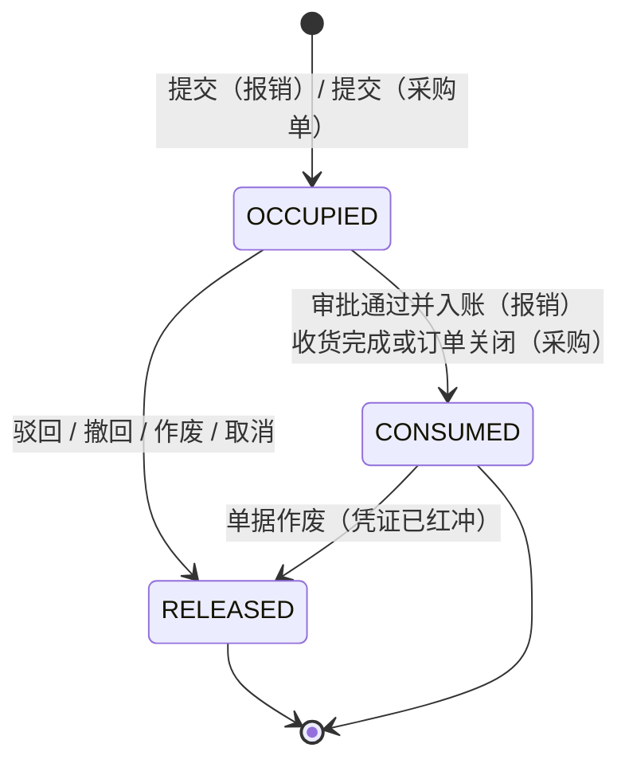

- **OCCUPIED**（占用中）：单据在跑，钱还没花，但已经「预定了额度」；
- **CONSUMED**（已执行）：钱真的花了（报销已入账 / 采购已收货）；
- **RELEASED**（已释放）：这张单不再占用额度（驳回、撤回、作废、取消）。

**为什么不用「删 usage 行」表示释放**：删了就查不到「这张单曾经占过多少」（审计问题：为什么 9 月 3 日那天可用余额突然变少？）。释放 = 改状态 + 留 `released_at / release_reason`。

## 3.2 数据模型（4 张表完整 DDL）

### 3.2.1 `biz_budget` — 预算（一条记录 = 一个版本）

```sql
CREATE TABLE IF NOT EXISTS biz_budget (
    id                     UUID PRIMARY KEY DEFAULT gen_random_uuid(),
    budget_no              VARCHAR(32)   NOT NULL,                 -- 预算单号 BDG-2026-000001（biz_seq）
    fiscal_year            SMALLINT      NOT NULL,                 -- 预算年度
    dept_id                UUID          NOT NULL,                 -- 部门（弱引用 sys_dept.id）
    dept_name              VARCHAR(120)  NOT NULL,                 -- 部门名快照（改名后历史预算仍可读）
    account_id             UUID          NOT NULL,                 -- 预算科目（弱引用 biz_account.id，末级）
    account_code           VARCHAR(30)   NOT NULL,                 -- 科目编码快照（与 biz_voucher_entry 同口径）
    account_name           VARCHAR(120)  NOT NULL,                 -- 科目名快照
    total_amount           NUMERIC(18,4) NOT NULL DEFAULT 0,       -- 年度额度
    control_mode           VARCHAR(8),                             -- 控制策略：NULL 继承全局 / OFF / WARN / BLOCK
    version_no             INT           NOT NULL DEFAULT 1,       -- 版本号（从 1 起）
    supersedes_id          UUID,                                   -- 被本版本取代的旧版本（弱引用本表）
    change_type            VARCHAR(16)   NOT NULL DEFAULT 'ORIGINAL', -- ORIGINAL 编制 / ADJUST 调整
    change_reason          VARCHAR(500),                           -- 调整原因（ADJUST 必填）
    status                 VARCHAR(16)   NOT NULL DEFAULT 'DRAFT', -- 状态机见 §3.3
    approval_instance_id   UUID,                                   -- 审批实例（PENDING 必有值，与 po 同款）
    effective_from         DATE,                                   -- 生效起始日（`budget_bridge::effective_from_of` = 审批通过日的次月 1 日；判定口径见 §3.5.5）
    submitted_at           TIMESTAMPTZ,
    submitted_by           UUID,
    approved_at            TIMESTAMPTZ,
    approved_by            UUID,
    retired_at             TIMESTAMPTZ,                            -- 被取代时间
    remark                 TEXT,
    created_at             TIMESTAMPTZ   NOT NULL DEFAULT CURRENT_TIMESTAMP,
    updated_at             TIMESTAMPTZ   NOT NULL DEFAULT CURRENT_TIMESTAMP,
    create_by              UUID,
    update_by              UUID,
    deleted_at             TIMESTAMPTZ,

    CONSTRAINT ck_biz_budget_year     CHECK (fiscal_year BETWEEN 2000 AND 2100),
    CONSTRAINT ck_biz_budget_amount   CHECK (total_amount >= 0),
    CONSTRAINT ck_biz_budget_version  CHECK (version_no >= 1),
    CONSTRAINT ck_biz_budget_mode     CHECK (control_mode IS NULL
                                             OR control_mode IN ('OFF','WARN','BLOCK')),
    CONSTRAINT ck_biz_budget_change   CHECK (change_type IN ('ORIGINAL','ADJUST')),
    -- 调整必须写原因（与「红冲必须写原因」「作废必须写原因」同一内控口径）
    CONSTRAINT ck_biz_budget_reason   CHECK (change_type <> 'ADJUST' OR change_reason IS NOT NULL),
    -- 版本链自洽：v1 没有前驱，v>1 必须有前驱
    CONSTRAINT ck_biz_budget_chain    CHECK ((version_no = 1 AND supersedes_id IS NULL)
                                          OR (version_no > 1 AND supersedes_id IS NOT NULL)),
    CONSTRAINT ck_biz_budget_self     CHECK (supersedes_id IS NULL OR supersedes_id <> id),
    -- 审批中等 ⟺ 挂实例（照抄 V0182 的两种审批态约束形态）
    CONSTRAINT ck_biz_budget_inst     CHECK (
        deleted_at IS NOT NULL
        OR (status IN ('SUBMITTED') AND approval_instance_id IS NOT NULL)
        OR (status NOT IN ('SUBMITTED') AND approval_instance_id IS NULL)
        OR (status IN ('ACTIVE','SUPERSEDED')))   -- 终态后保留实例作审计
);

COMMENT ON TABLE  biz_budget IS '预算（一条记录 = 一个版本；调整 = 新增版本行，不改旧行）';
COMMENT ON COLUMN biz_budget.total_amount IS '年度额度；月度分解在 biz_budget_period，Σ = 本列（应用层校验 + 巡检 J5）';
COMMENT ON COLUMN biz_budget.control_mode IS '控制策略：NULL 继承 sys_config erp.budget.control_mode；OFF/WARN/BLOCK';
COMMENT ON COLUMN biz_budget.account_code IS '科目编码快照：科目改名后历史预算的语义不漂移（与 biz_voucher_entry 同理由）';

-- 单号唯一（软删可复用，与 biz_payable_no 同口径）
CREATE UNIQUE INDEX IF NOT EXISTS uk_biz_budget_no
    ON biz_budget (budget_no) WHERE deleted_at IS NULL;

-- ★ 同一「槽」同时只能有一个 ACTIVE 版本（D5 的核心约束，一条 partial unique 顶住整个版本化设计）
CREATE UNIQUE INDEX IF NOT EXISTS uk_biz_budget_slot_active
    ON biz_budget (dept_id, account_id, fiscal_year)
    WHERE status = 'ACTIVE' AND deleted_at IS NULL;

-- 版本链唯一（同一槽不会出现两个 v2）
CREATE UNIQUE INDEX IF NOT EXISTS uk_biz_budget_slot_version
    ON biz_budget (dept_id, account_id, fiscal_year, version_no)
    WHERE deleted_at IS NULL;

-- 高频：按年度 + 部门列预算；按状态列待审
CREATE INDEX IF NOT EXISTS idx_biz_budget_year_dept
    ON biz_budget (fiscal_year, dept_id, account_id);
CREATE INDEX IF NOT EXISTS idx_biz_budget_status
    ON biz_budget (status);
CREATE INDEX IF NOT EXISTS idx_biz_budget_account
    ON biz_budget (account_id, fiscal_year);
CREATE INDEX IF NOT EXISTS idx_biz_budget_approval
    ON biz_budget (approval_instance_id)
    WHERE approval_instance_id IS NOT NULL;
```

**为什么 `dept_name / account_code / account_name` 三个快照**：与 `biz_voucher_entry.account_code/account_name` 快照同理（`V0149:91` 注释：「科目改名后历史凭证语义不漂移」）。部门改名、科目改名是必然发生的事，预算表是年度归档物。

### 3.2.2 `biz_budget_period` — 月度分解

```sql
CREATE TABLE IF NOT EXISTS biz_budget_period (
    id           UUID PRIMARY KEY DEFAULT gen_random_uuid(),
    budget_id    UUID          NOT NULL REFERENCES biz_budget(id) ON DELETE CASCADE,
    period_code  VARCHAR(7)    NOT NULL,                -- yyyy-MM（与 biz_voucher.period 同格式）
    period_month SMALLINT      NOT NULL,                -- 1..12 冗余，便于排序与 CHECK
    amount       NUMERIC(18,4) NOT NULL DEFAULT 0,      -- 本月额度
    remark       VARCHAR(255),
    created_at   TIMESTAMPTZ   NOT NULL DEFAULT CURRENT_TIMESTAMP,
    updated_at   TIMESTAMPTZ   NOT NULL DEFAULT CURRENT_TIMESTAMP,

    CONSTRAINT uk_biz_budget_period UNIQUE (budget_id, period_code),
    CONSTRAINT ck_biz_budget_period_month CHECK (period_month BETWEEN 1 AND 12),
    CONSTRAINT ck_biz_budget_period_code  CHECK (period_code ~ '^\d{4}-(0[1-9]|1[0-2])$'),
    CONSTRAINT ck_biz_budget_period_amt   CHECK (amount >= 0),
    -- 期间月份必须与 period_code 的月份一致（防手滑写 2026-03 配 month=4）
    CONSTRAINT ck_biz_budget_period_match
        CHECK (right(period_code, 2)::smallint = period_month)
);

CREATE INDEX IF NOT EXISTS idx_biz_budget_period_budget ON biz_budget_period (budget_id);
CREATE INDEX IF NOT EXISTS idx_biz_budget_period_code   ON biz_budget_period (period_code);
```

**为什么明细行用 `ON DELETE CASCADE`**：分解行脱离主表没有意义（与 `biz_purchase_order_item` 同款）。但主表本身是软删，物理删除只在「草稿被彻底清理」时发生（`#[model(hard_delete)]` 仅用于期间/分解这类从属表，与 `biz_accounting_period` 的处理一致）。

### 3.2.3 `biz_budget_usage` — 占用与执行记录（本设计最核心的一张表）

```sql
CREATE TABLE IF NOT EXISTS biz_budget_usage (
    id             UUID PRIMARY KEY DEFAULT gen_random_uuid(),
    -- 槽（D5：不绑版本，只绑槽）
    dept_id        UUID          NOT NULL,
    account_id     UUID          NOT NULL,
    fiscal_year    SMALLINT      NOT NULL,
    period_code    VARCHAR(7)    NOT NULL,                 -- 发生期间（yyyy-MM）
    -- 金额
    amount         NUMERIC(18,4) NOT NULL,                 -- 本次占用金额（含税，与单据口径一致）
    amount_net     NUMERIC(18,4) NOT NULL DEFAULT 0,       -- 不含税金额（报表用，供税额分析）
    -- 来源单据
    source_type    VARCHAR(24)   NOT NULL,                 -- EXPENSE_REPORT / PURCHASE_ORDER
    source_id      UUID          NOT NULL,
    source_no      VARCHAR(32)   NOT NULL,                 -- 单号快照（单据删了也能读）
    source_line_id UUID,                                   -- 明细行 id（报销按明细占用时可填）
    -- 生命周期
    status         VARCHAR(12)   NOT NULL DEFAULT 'OCCUPIED', -- OCCUPIED / CONSUMED / RELEASED
    consumed_at    TIMESTAMPTZ,                            -- 转已执行时间（入账时间）
    voucher_id     UUID,                                   -- 已执行时的凭证（弱引用 biz_voucher.id）
    released_at    TIMESTAMPTZ,
    release_reason VARCHAR(255),
    -- 冻结的判定结果（审计事实，与 purchase_credit 的三列快照同理）
    budget_id      UUID,                                   -- 占用时命中的预算版本（仅审计，不参与计算）
    over_budget    SMALLINT      NOT NULL DEFAULT 0,        -- 提交时是否已超预算：1 是 / 0 否
    over_amount    NUMERIC(18,4) NOT NULL DEFAULT 0,        -- 提交时超支额
    created_at     TIMESTAMPTZ   NOT NULL DEFAULT CURRENT_TIMESTAMP,
    updated_at     TIMESTAMPTZ   NOT NULL DEFAULT CURRENT_TIMESTAMP,
    create_by      UUID,
    deleted_at     TIMESTAMPTZ,

    CONSTRAINT ck_biz_budget_usage_status
        CHECK (status IN ('OCCUPIED','CONSUMED','RELEASED')),
    CONSTRAINT ck_biz_budget_usage_amount CHECK (amount > 0 AND amount_net >= 0),
    CONSTRAINT ck_biz_budget_usage_source
        CHECK (source_type IN ('EXPENSE_REPORT','PURCHASE_ORDER')),
    CONSTRAINT ck_biz_budget_usage_over   CHECK (over_budget IN (0,1)),
    CONSTRAINT ck_biz_budget_usage_period CHECK (period_code ~ '^\d{4}-(0[1-9]|1[0-2])$'),
    -- 状态与时间戳不许互相矛盾（照抄 V0122 ck_biz_flow_instance_end 的等值写法）
    CONSTRAINT ck_biz_budget_usage_done   CHECK (
        (status = 'RELEASED') = (released_at IS NOT NULL)
    ),
    CONSTRAINT ck_biz_budget_usage_consumed CHECK (
        status <> 'CONSUMED' OR (consumed_at IS NOT NULL)
    )
);

COMMENT ON TABLE biz_budget_usage IS
    '预算占用/执行记录（只增状态不改金额；不绑预算版本，绑 dept×account×year 槽）';
COMMENT ON COLUMN biz_budget_usage.budget_id IS
    '占用时命中的预算版本：仅供审计追溯「当时额度是多少」，可用余额计算不使用本列（D5）';
COMMENT ON COLUMN biz_budget_usage.over_amount IS
    '提交时点的超支额快照：额度后来被调高，不能让历史单据的「当时超没超」跟着变';

-- ★ 幂等：同一张单据对同一槽只有一条有效记录（重复提交 / 重试 / 双击）
CREATE UNIQUE INDEX IF NOT EXISTS uk_biz_budget_usage_source
    ON biz_budget_usage (source_type, source_id, dept_id, account_id, fiscal_year)
    WHERE deleted_at IS NULL;

-- 高频聚合：一个槽一年的占用（可用余额查询）
CREATE INDEX IF NOT EXISTS idx_biz_budget_usage_slot
    ON biz_budget_usage (dept_id, account_id, fiscal_year, status)
    WHERE deleted_at IS NULL;

-- 高频聚合：一个槽一个月的占用（月度闸）
CREATE INDEX IF NOT EXISTS idx_biz_budget_usage_slot_period
    ON biz_budget_usage (dept_id, account_id, period_code, status)
    WHERE deleted_at IS NULL;

-- 反向：某张单据占了多少（作废时释放）
CREATE INDEX IF NOT EXISTS idx_biz_budget_usage_source_id
    ON biz_budget_usage (source_type, source_id);
```

**四个设计点**：

1. **`amount` 是含税口径**，与 `biz_purchase_order.total_with_tax` / 报销单 `total_with_tax` 一致——预算管的是「要花出去多少钱」，不是「成本是多少」。
2. **`budget_id` 只是审计列**（见 COMMENT）：参与计算就会退回 D5 的方案 ①，跨版本可用余额算错。
3. **`over_budget / over_amount` 是提交时快照**：与 `purchase_credit` 的 `over_credit_limit / credit_exposure / credit_limit_snapshot` 三列同款理由（「这张单提交那一刻查到什么」是审计事实）。
4. **唯一键带 `dept_id, account_id, fiscal_year`**：一张报销单如果跨两个预算科目（明细多行），会产生多条 usage（按科目聚合），唯一键保证「同一单同一科目只占一次」。

### 3.2.4 关于 `fiscal_year` 与 `period_code` 的关系

`fiscal_year = left(period_code, 4)::smallint` —— 冗余存一年，是为了让「年度闸」的查询不用函数计算（`left(period_code,4)` 在 10 万行上会让索引失效）。这条冗余**必须有约束兜住**：

```sql
ALTER TABLE biz_budget_usage
    ADD CONSTRAINT ck_biz_budget_usage_year
    CHECK (fiscal_year = left(period_code, 4)::smallint);
```

同理 `biz_budget.fiscal_year` 与 `biz_budget_period.period_code` 的年份要一致——这条放应用层（跨表 CHECK 在 PG 里需要触发器，为一个年度一致性上触发器不值），巡检 J5 兜底。

### 3.2.5 `biz_budget_subject_map` — 业务口径 → 预算科目的映射

**为什么必须有这张表**：报销明细自带费用类型（能映射科目），但**采购单没有科目**（`biz_purchase_order` 实测 34 列里没有任何 `account_id`/`dept_id`，只有 `supplier_id / warehouse_id`）。采购单提交时要答「这笔采购占哪个预算科目」，答案只能来自映射。

```sql
CREATE TABLE IF NOT EXISTS biz_budget_subject_map (
    id           UUID PRIMARY KEY DEFAULT gen_random_uuid(),
    map_type     VARCHAR(16)   NOT NULL,         -- MATERIAL 按物料 / MATERIAL_TYPE 按物料类型 / WAREHOUSE 按仓库 / DEFAULT 兜底
    ref_id       UUID,                           -- 目标 id：MATERIAL=物料 / WAREHOUSE=仓库；MATERIAL_TYPE 与 DEFAULT 恒为空（物料类型是字符串枚举，无独立 id）
    ref_code     VARCHAR(40),                    -- 目标编码：MATERIAL_TYPE=物料类型编码（7 值枚举）；其余类型为展示/对账用，可空
    account_id   UUID          NOT NULL,         -- 映射到的预算科目（弱引用 biz_account.id）
    dept_id      UUID,                           -- 部门级覆盖（空 = 全公司通用）
    priority     INT           NOT NULL DEFAULT 0, -- 命中优先级（大者优先；同优先级按 map_type 精细度）
    status       SMALLINT      NOT NULL DEFAULT 1,
    remark       TEXT,
    created_at   TIMESTAMPTZ   NOT NULL DEFAULT CURRENT_TIMESTAMP,
    updated_at   TIMESTAMPTZ   NOT NULL DEFAULT CURRENT_TIMESTAMP,
    create_by    UUID,
    update_by    UUID,
    deleted_at   TIMESTAMPTZ,

    CONSTRAINT ck_biz_bsm_type CHECK (map_type IN ('MATERIAL','MATERIAL_TYPE','WAREHOUSE','DEFAULT')),
    -- 目标三档（V0240 起，t_ce73ae26）：有 id 的类型要 ref_id；MATERIAL_TYPE 要 ref_code、不许 ref_id；DEFAULT 两个都不要
    CONSTRAINT ck_biz_bsm_ref  CHECK ((map_type = 'DEFAULT' AND ref_id IS NULL)
                                   OR (map_type = 'MATERIAL_TYPE' AND ref_id IS NULL
                                       AND ref_code IS NOT NULL AND btrim(ref_code) <> '')
                                   OR (map_type IN ('MATERIAL','WAREHOUSE') AND ref_id IS NOT NULL)),
    CONSTRAINT ck_biz_bsm_status CHECK (status IN (0,1))
);

-- 目标唯一：有 id 用 id，没有 id 用归一化编码（MATERIAL_TYPE 的唯一性落在 ref_code 上）；
-- 第三参 '' 不能省：DEFAULT 两列都是 NULL，缺了它 Postgres 会把行当成互不相同（同部门可重复建兜底）
CREATE UNIQUE INDEX IF NOT EXISTS uk_biz_bsm_target
    ON biz_budget_subject_map (map_type,
                               COALESCE(ref_id::text, upper(btrim(ref_code)), ''),
                               COALESCE(dept_id, '00000000-0000-0000-0000-000000000000'::uuid))
    WHERE deleted_at IS NULL;
CREATE INDEX IF NOT EXISTS idx_biz_bsm_account ON biz_budget_subject_map (account_id);
CREATE INDEX IF NOT EXISTS idx_biz_bsm_dept    ON biz_budget_subject_map (dept_id) WHERE dept_id IS NOT NULL;

COMMENT ON TABLE biz_budget_subject_map IS
    '业务口径→预算科目映射（采购单没有科目列，只能靠它；报销单直接取明细的费用类型科目，不经此表）';
```

**解析顺序**（`budget_subject::resolve_for_po`，纯函数 + 一次查询）：

```
① dept_id 精确命中 → ② MATERIAL（按明细物料，多物料则按金额占比拆）→ ③ MATERIAL_TYPE
→ ④ WAREHOUSE → ⑤ DEFAULT（全公司兜底）
仍解析不到 → 按 control_mode 处理：
  OFF  → 不占用、不校验（记 INFO 日志）
  WARN → 409？不。**不占用 + 告警**（报文：「采购单未匹配到预算科目，本单不计入预算；请管理员配置映射」）
  BLOCK→ 409（配置缺失在强管控下是硬错误）
```

**为什么解析不到时 WARN 不拦**：映射表是运维配置，配不全就跑不起来会让「上线第一天连采购都提交不了」。与 D3 的「忘编预算不等于停业」同一逻辑。

### 3.2.6 表关系图

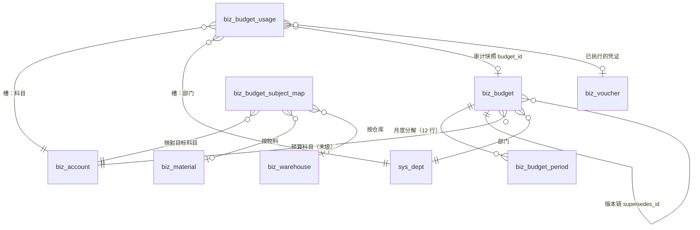

## 3.3 预算状态机

### 3.3.1 状态与边

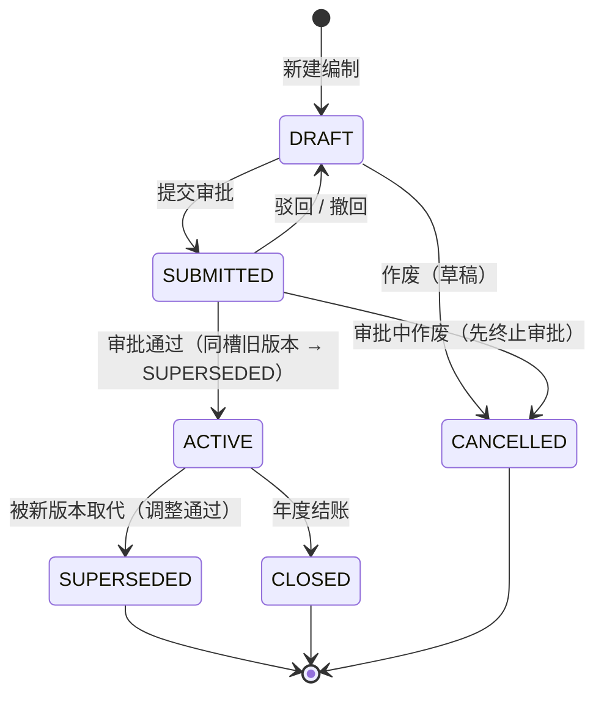

### 3.3.2 边表（`state_machine::Entity::Budget` 的注册内容）

```rust
// 与 state_machine.rs 现有 10 个实体的写法逐字同构
pub const BUDGET_EDGES: &[(&str, &str)] = &[
    ("DRAFT",     "SUBMITTED"),
    ("SUBMITTED", "DRAFT"),
    ("SUBMITTED", "ACTIVE"),
    ("ACTIVE",    "SUPERSEDED"),
    ("ACTIVE",    "CLOSED"),
    ("DRAFT",     "CANCELLED"),
    ("SUBMITTED", "CANCELLED"),
];
// 需要 reason 的边（与 CONTRACT 的 reason 边同思路）
pub const BUDGET_REASON_EDGES: &[(&str, &str)] = &[
    ("SUBMITTED", "DRAFT"),     // 驳回必须写意见
    ("SUBMITTED", "CANCELLED"), // 审批中作废必须写原因
    ("ACTIVE",    "SUPERSEDED"),// 被取代要写「哪一版取代了它」
];
```

**四条硬规则**：

1. **`SUBMITTED → ACTIVE` 必须同事务做「旧版本 ACTIVE → SUPERSEDED」**，否则 `uk_biz_budget_slot_active` 直接 23505（库级兜底，不是靠代码自觉）。
2. **`ACTIVE → CLOSED` 只在年结时发生**（`year_end` 模块的结转完成后批量关预算），日常不允许手工关。
3. **`version_no > 1` 的行只能由「调整」产生**，且 `supersedes_id` 必须指向同槽的最新版本（应用层校验 + 巡检 J2）。
4. **不允许 `ACTIVE → DRAFT`**（已生效的预算不能退回草稿改，只能再调一版）。

## 3.4 预算编制与审批

### 3.4.1 编制界面（一张表填 12 个月）

| 列 | 说明 |
|---|---|
| 部门 | 从 `sys_dept` 选（树选择器，可多选批量建） |
| 预算科目 | `biz_account` 末级 + 类别 ∈ (PROFIT_LOSS, COST)，或已登记在 `biz_budget_subject_map` 的 ASSET 科目 |
| 年度额度 | 手工填 或 12 个月相加自动算 |
| 月度分解 | 12 个输入框；提供「按年度平均分摊」「按上年实际比例分摊」「手工」三种填充（前端计算，后端只校验 Σ） |
| 控制策略 | 继承 / OFF / WARN / BLOCK |

**「按上年实际比例分摊」的数据来源**：`biz_voucher_entry` 按 `account_id + aux_dept_id + period` 汇总的上年 12 个月金额。**这要求历史凭证写了 `aux_dept_id`**——而实测 13 条分录 0 条有值（§1.3）。所以 v1 的这个按钮在「历史凭证无部门辅助」时退化成年平均分摊并提示原因。这是 DC-11 的又一个真实用户可见后果。

### 3.4.2 编制审批（`BUDGET_APPROVE` · `DEPT_LEADER → FINANCE_MANAGER → GENERAL_MANAGER`）

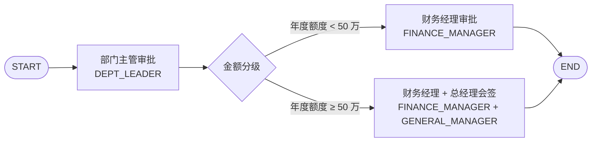

- **阈值 50 万**：可配（流程定义里的条件节点），不是代码常量。给的是「小企业一个部门一个科目的年度费用预算」的量级参考；
- **审批人来源 `ROLE` + `empty_assignee = FALLBACK_ADMIN`**：照抄 `V0182` 的取舍（角色 0 人时回退超管，**不用 `SKIP`**——`SKIP` 会把「没人可派」变成「预算自动通过」）；
- **`self_approval = ALLOW`**：不是 `FORBID`。理由与 `V0182` 逐字相同（FORBID 在发起时就 422，内控要的是「提交成功、制单人这一票点不动」，真正的否决在审批入口 403 + 65019）。

### 3.4.3 编制与调整共用一个流程（`form.change_type` 条件分支）

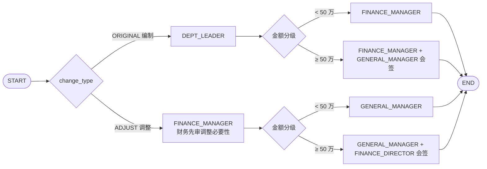

**为什么一个流程两种单据**：流程定义是运维资产，客户升级后要维护「编制流程」「调整流程」两套图；而两者的差别只是「调整要多一道更严的签」。用 `change_type` 条件分流，改一次阈值只改一个地方。

**为什么调整更严（A1b 直接进 FINANCE_MANAGER）**：调整预算 = 改自己部门的额度。内控要求「不能自己改自己的预算」——`DEPT_LEADER` 恰恰是被调整方的上级，让同一批人既编又调等于没控制。所以调整路径**第一站就是财务**，且终审一定到 `GENERAL_MANAGER` 以上。

### 3.4.4 `form_data` 契约（审批引擎读的就是它，字段名不许漂移）

```json
{
  "form.budget_no": "BDG-2026-000012",
  "form.fiscal_year": 2026,
  "form.dept_id": "…",
  "form.dept_name": "生产部",
  "form.account_code": "5602.02",
  "form.account_name": "管理费用-差旅费",
  "form.total_amount": 360000.00,
  "form.change_type": "ORIGINAL",
  "form.version_no": 1,
  "form.has_prior_version": false,
  "form.period_sum_equal": true
}
```

条件表达式写 `form.total_amount` / `form.change_type`（`V0182` 的条件节点语法：`{"cmp":"lt","field":"form.total_amount","op":"cmp","value":500000}`）。

**三个字段的用途不是装饰**：
- `form.period_sum_equal`：审批人第一眼看「12 个月加起来是不是等于年度额度」，不需要打开详情；
- `form.has_prior_version`：调整单为 true，审批人知道「这一版取代了谁」；
- `form.version_no`：v3 的调整单一定比 v2 更该被质疑。

## 3.5 预算控制点（本版本只做 2 处）

### 3.5.1 控制点 ①：费用报销提交

**落点**（第 1 期实现时的函数位置）：

```
expense_handler::submit(id)                       ← 新增
  ├─ 1. 校验报销单 DRAFT + 明细非空 + Σ明细 = 主表总额
  ├─ 2. budget_guard::check_for_expense(&report, &items)   ← 本设计的守卫
  │     ├─ 逐明细行：expense_type → account_id → resolve 槽（dept_id 取报销单快照）
  │     ├─ 按时点算 年可用 / 月可用（§3.1.2）
  │     ├─ 写 biz_budget_usage（OCCUPIED，带 over_budget/over_amount 快照）
  │     └─ 返回 BudgetVerdict { over, gaps[], mode }
  ├─ 3. over && mode=BLOCK  → 409 ERP_BUDGET_EXCEEDED（**回滚 usage**）
  ├─ 4. over && mode=WARN   → 继续（form_data.over_budget=true 传给审批）
  ├─ 5. 状态机 DRAFT → SUBMITTED（同事务）+ 发起 expense 审批实例
  └─ 6. 没有已发布 expense 流程时（降级路径）：
         over → 409（与 credit 同口径：超预算不许用 skip-approval 后门）
         不 over → 允许 skip-approval（写理由进 biz_status_log）
```

**事务边界**：预算守卫**在报销单状态流转的同一个事务里**（usage 与状态一起提交/一起回滚）。理由：usage 是「这张单占了额度」的事实，单据没提交成功却留下占用 = 额度泄漏。

### 3.5.2 控制点 ②：采购单提交

**落点**（这是对**现有代码**的唯一侵入，位置在 `purchase_handler.rs:1006 submit_approval`）：

```rust
pub async fn submit_approval(
    id: Uuid,
    operator: impl Into<state_machine::Operator>,
    gate: &approval_gate::ApprovalGate<'_>,
) -> Result<(), ApiError> {
    let row = purchase_model::find_order(id).await?…;
    if row.status == STATUS_SUBMITTED { …409… }

    // ★ 现有：P2-2 信用额度（策略 B）
    let credit = purchase_credit::verdict_of(db(), &row).await?;
    if credit.over { tracing::warn!(…) }

    // ★★ ARCH-6 新增：预算守卫（策略 B，与信用额度并列、互不影响）
    let budget = budget_guard::check_for_purchase(&row).await?;   // 只读判定，不写 usage
    if budget.over { tracing::warn!(order_no=%row.order_no, %budget, "采购单提交：超出部门预算") }

    match purchase_bridge::published_po_flow().await? {
        Some(flow) => {
            approval_gate::ensure_not_skipped(purchase_bridge::FLOW_CODE, gate)?;
            // usage 在 submit_po_tx 的事务里写（与状态机同事务）
            submit_po_approval(&row, &op, &flow, &credit, &budget).await
        }
        None => { …超预算单同样不许 skip-approval（对称于 credit.over 分支）… }
    }
}
```

**三条不越界的纪律**：

1. **不改 `purchase_handler` 里任何现有判定**（信用额度 / 合同额度 / 状态机），只在中间**插一段并列的守卫**；
2. **不新增采购单的列**：预算科目靠 `biz_budget_subject_map` 解析（§3.2.5），`dept_id` 取「提交人部门」快照写进 usage（`voucher::user_dept_of`，`voucher.rs:2137` 已有这个函数）；
3. **不改 `po_approve` 流程**：超预算只是 `form_data.over_budget=true`，客户想要「超预算加一道财务」自己加条件节点（这正是 `V0182` 设计的用法，P2-2b 的实例）。

### 3.5.3 控制点清单（再明确一次，防止有人加第三个）

| 时点 | 是否校验 | 原因 |
|---|---|---|
| 采购单提交 | ✅ | 承诺发生 |
| 报销单提交 | ✅ | 承诺发生 |
| 采购单审批通过 | ❌ | 提交时已占用，再校验 = 双算 |
| 收货过账 | ❌ | 同上 |
| 报销审批通过（入账） | ❌（只把 usage 从 OCCUPIED 改 CONSUMED） | 不重复判定 |
| 付款（应付/报销） | ❌ | 既成事实，拦了只会卡死付款（D4） |
| 预算调整审批 | ✅（审批，不是校验） | 调额度本身要批 |

### 3.5.4 判定函数是纯函数（必须先写单测再写 handler）

```rust
/// 预算判定（不碰库，全部入参都是「已经查好的数」）
pub struct BudgetVerdict {
    pub mode: ControlMode,          // OFF / WARN / BLOCK
    pub year_limit: Decimal,        // 年度额度（无预算 = 0）
    pub year_used: Decimal,         // 年度已用（OCCUPIED + CONSUMED）
    pub month_limit: Decimal,
    pub month_used: Decimal,
    pub this_amount: Decimal,
    pub year_gap: Decimal,          // max(0, this - 年可用)
    pub month_gap: Decimal,
    pub over: bool,                 // year_gap > 0 || month_gap > 0
    pub missing_budget: bool,       // 该槽根本没有 ACTIVE 预算
}

impl BudgetVerdict {
    pub fn evaluate(mode, year_limit, year_used, month_limit, month_used, this_amount) -> Self;
    pub fn describe(&self) -> String;   // 中文报错/日志文案（六个数全给）
}
```

**为什么强调纯函数**：`purchase_credit.rs` 就是这么做的（`CreditVerdict::evaluate` 三条口径用单测钉死），然后 handler 只负责查数与写库。预算的口径比信用额度复杂（两道闸 + 三种模式 + 缺预算），更需要单测钉住 6 种组合：

| 用例 | 年 | 月 | 期望 |
|---|---|---|---|
| 年超、月不超 | M > 年可用 | M ≤ 月可用 | `over=true, year_gap>0, month_gap=0` |
| 年不超、月超 | M ≤ 年可用 | M > 月可用 | `over=true, year_gap=0, month_gap>0` |
| 都超 | — | — | 两个 gap 都 > 0，`describe()` 报更严重的那个 |
| 都不超 | — | — | `over=false` |
| 无预算 | limit=0 | limit=0 | `missing_budget=true`，按 mode 处置 |
| 额度刚好用完 | M = 可用 | M = 可用 | `over=false`（**等于不算超**，边界用例必须有） |

### 3.5.5 `effective_from` 参与判定（FIX-2 定稿：选项 A）与「未生效」提示

> 本条是**口径变更**，2026-11 由 FIX-2 定稿。改之前：控制只看 `status='ACTIVE'`，
> `effective_from`（= 审批通过次月 1 日）形同虚设 —— 11 月审批通过的预算，11 月的单据
> 就按新额度占用和拦截，与「次月生效」的业务语义相反。

**判定条件**（`budget_guard::active_control_mode` / `slot_snapshot` / 报表同口径）：

```text
生效 ⟺ effective_from IS NULL OR effective_from <= 期间月末
```

| 场景 | 期间 | 月末 | effective_from | 是否生效 |
|---|---|---|---|---|
| 11 月审批通过，11 月的报销 | 2026-11 | 11-30 | 2026-12-01 | ❌ 不生效（额度按 0、槽级策略继承全局） |
| 同上，12 月的报销 | 2026-12 | 12-31 | 2026-12-01 | ✅ 生效 |
| 历史数据（ACTIVE 但没写生效日） | 任意 | — | NULL | ✅ 生效（兼容） |

* 为什么按**期间月末**而不是单据日期：月度闸是月粒度（月额度整月有效），月中生效会出现
  「半个月的额度按整月校验」；按月末判等于判「这整个月是否已生效」。
* 为什么选 A 不选 B（把 `effective_from_of` 改成当月 1 日）：B 会改掉「审批通过次月生效」
  这个已经写进业务流程与客户手册的语义，且当月生效会让「月中批预算」变成追溯生效。
* **三处必须一起改**（否则报表和控制两套逻辑）：`active_control_mode`、`slot_snapshot`、
  `budget_model::report`（报表行带 `effective_from` + `effective`，前端标「未生效」）。

**「预算没生效」只提示、不拦**（`budget_guard::pending_budgets` / `pending_warnings`）：

* 触发面：该 `(部门, 科目, 年度)` 存在 `DRAFT` / `SUBMITTED` / `ACTIVE 且未到生效日` 的预算；
* 出口：报销单详情 `budget_warnings[]`、采购单详情 `order.budget_warnings[]`（提交接口回的就是
  详情，所以「提交时」也拿得到）；`code = BUDGET_NOT_EFFECTIVE`，文案带科目 / 状态 / 预算单号 /
  额度 / 受影响期间；
* **不阻断**：控制口径不变（DRAFT 预算本来就不参与判定），提示只是让用户知道「钱没被预算管着」；
* 前端：`ExpenseDetailDrawer` 与采购详情抽屉各一条 `t-alert theme="warning"`。

**占用记录（`usages[]`）按槽查**（FIX-2 问题 3）：`biz_budget_usage.budget_id` 只是写入时命中的
版本快照（D5 不参与计算），用「预算单 id」当「源单据 id」查永远是 0 行；详情改为
`usages_of_slot(dept_id, account_id, fiscal_year)`，`source_type` 取行上的实际值
（`EXPENSE_REPORT` / `PURCHASE_ORDER`）并带出 `source_id`。

**单据上的 `budget_mode` 记槽级策略**（FIX-2 问题 4）：`ExpenseBudget::recorded_mode()` =
「实际参与判定的槽级策略里最严的那条」（`OFF < WARN < BLOCK`），不再记全局默认值 ——
槽级 BLOCK、全局 WARN 时，事后审计必须能看出「这单被 BLOCK 管过」。

## 3.6 并发与幂等（不锁，靠唯一键 + 快照）

### 3.6.1 三种并发场景

| 场景 | 结果（不锁） | 是否可接受 |
|---|---|---|
| 两张报销单同时提交，都超预算 | 两张都标 `over_budget=1`、都进审批 | ✅ 可接受：都进审批，人会发现 |
| 同一张单双击提交 | 第二次撞 `uk_biz_budget_usage_source` → 23505 | ✅ 应用层把 23505 当**幂等成功**（与 `flow::engine::is_pending_dup` 同一手法） |
| 提交与作废并发 | 作废先到：usage 已 RELEASED，提交写 OCCUPIED 撞唯一键 → 409「单据状态已变更，请刷新」 | ✅ 可接受（租约式一致） |

### 3.6.2 为什么不上锁

`SELECT … FOR UPDATE` 锁预算行能保证「并发双花被拦住」，但：

1. 拦住的收益是「两张单只进一张审批」，代价是「所有提交串行化」；
2. 预算判定要读 usage 聚合，锁预算行**锁不住** usage 的新增（幻读），要真正拦住需要「槽级串行化」（PG advisory lock 或 SERIALIZABLE），复杂度再上一档；
3. **策略 B 的天然好处**：不拒绝 ⇒ 双花无损失（两张单都进审批，审批人看到超额标记会挑一张驳回）。`purchase_credit.rs:45` 原文就是这么论证的。

**唯一要锁的地方**：`BLOCK` 模式下如果真的需要「严格不超一分钱」，那时才加 `pg_advisory_xact_lock(hashtext(dept||account||year))`。本设计**预留但不实现**，写进实现卡的注释里。

## 3.7 预算调整

### 3.7.1 语义（三条）

1. **调整 = 新增版本**（`version_no+1`，`supersedes_id` 指向当前 ACTIVE），旧版本 `ACTIVE → SUPERSEDED`，**旧行一个字段都不改**（只改 status 与 retired_at）；
2. **调整必须走审批**（§3.4.3 的 ADJUST 分支），且**发起人不能审批自己**（`separation_of_duties.approve=true` 默认开启已有闸）；
3. **调整不影响已发生的 usage**（D5）：usage 行不动，可用余额自然按「新额度 − 全部已用」重算。

### 3.7.2 调整的三个约束

| 约束 | 为什么 |
|---|---|
| 只能调「当年或未来年」 | 调历史年度 = 篡改已归档报表 |
| 调低到「已用 > 新额度」时**允许**，但必须写原因并在报文里给出差额 | 现实里就是要把预算砍下来（业务收缩），系统不该拦住；但审批人要看见「你已经超了 3 万」 |
| 同一槽只允许一条在审的调整单 | `uk_biz_budget_slot_active` 挡不住 PENDING 状态的重复调整单，需要应用层加「查在审」——与 `uk_biz_flow_instance_biz_active`（`biz_type + biz_id` 唯一）天然覆盖：同一个 `biz_id`（预算 id）同时只能有一个在跑实例。**但调整单是新 budget 行（新 id）**，所以这条不覆盖 → 必须显式查「同槽有没有 PENDING 的 ADJUST」 |

第 3 条是实现卡里必须写的一个坑：**`uk_biz_flow_instance_biz_active` 只能防「同一张单重复发起」，防不住「同一槽两个新单」**。

## 3.8 预算报表

### 3.8.1 预算执行表（核心报表）

| 列 | 取数 |
|---|---|
| 部门 / 科目 | `biz_budget.dept_name / account_code + account_name` |
| 年度额度 | 最新 ACTIVE 版本的 `total_amount` |
| 月度额度 | `biz_budget_period` 按月展开 |
| 占用中 | `SUM(usage.amount) WHERE status='OCCUPIED'` |
| 已执行 | `SUM(usage.amount) WHERE status='CONSUMED'` |
| 可用 | 额度 − 占用 − 执行 |
| 执行率 | (占用 + 执行) / 额度 |
| 超支标记 | 年度 `可用 < 0` → 年度超支；**本月**（本年度最紧张的那个月）`月度已用 > 月度额度` → 本月超支，主列月度优先显示（月度闸才是提交侧实际控制的闸门） |
| 生效标记 | `effective_from` + `effective`（**`effective_from <= 该行 fiscal_year 的期末`**，年度粒度）；未生效行仍列出但标「未生效」。**不吃「本月月末」/「今天」**：报表按 `fiscal_year` 查，用今天做时点会出现「2027 年的预算未生效、但 2027-02 的单据已被它控制」的自相矛盾（E2E06-FIX-2 修的口径 bug）。控制侧仍按单据期间月末逐月判（§3.5.5） |
| 月度口径（行级） | `month_period / month_limit / month_used / month_available / month_over / month_over_amount`，与提交侧月度闸**同一个函数**（`budget_guard::MonthGate`）；取值规则：有超支月取超得最多的，否则取可用最小的 |

### 3.8.2 预算 vs 实际（对账表）

| 口径 | 来源 | 差异容忍 |
|---|---|---|
| 预算已执行 | `biz_budget_usage` where CONSUMED（含税） | — |
| 账上发生 | `biz_voucher_entry` 按 `account_id + aux_dept_id` 汇总（不含税） | **含税 vs 不含税，必然不等** |

⚠️ **这两列不许直接相减**。要用「预算已执行 / 1.06」近似，或干脆**并列展示不比较**。本设计选择：**并列展示，标注口径差异（含税 / 不含税）**，不显示「差异额」——显示一个必然非零的差异列会让人觉得系统算错了。这是产品口径决策，写进实现卡。

## 3.9 前端页面（预算）

| 页面 | 路由 | 主要能力 | 权限码 |
|---|---|---|---|
| 预算编制 | `/business/erp/budget` | 列表（年度/部门/科目筛选）、新建（12 月分解弹窗）、提交、调整、作废、详情（版本链 + 审批轨迹） | `budget:list / create / update / delete / submit / adjust` |
| 预算执行 | `/business/erp/budget/report` | 部门×科目×月矩阵、可用余额热力、超支清单、导出 | `budget:report` |
| 预算科目映射 | `/business/erp/budget/mapping` | 映射 CRUD（物料/类型/仓库/DEFAULT） | `budget:mapping` |

**交互三细节**：
1. 编制页的 12 个月输入框必须显示「合计 / 年度额度」实时对比，不一致时提交按钮置灰（前端兜一半，后端仍校验）；
2. 执行页的「可用」为负时整行进红并显示超支额，**不弹窗打断**（老板滚动看报表时不该被弹窗打断）；
3. 调整入口在详情页（不在列表），且调整弹窗默认带出旧版本的 12 个月作为初值（「在旧版基础上改」是绝大多数场景）。

## 本章红线

1. **`biz_budget_usage` 的 `amount` 一旦写入，永不 UPDATE**（只有 `status / consumed_at / released_at` 可改）。金额改 = 删旧行 + 插新行 + 留痕。
2. **可用余额绝不落库缓存**（D5）。任何「加一个 `used_amount` 列提升性能」的提议，必须先证明「现算 > 200ms」——实测同一查询在 10 万行 usage 上是毫秒级（走 `idx_biz_budget_usage_slot`）。
3. **预算科目必须是末级科目**（`is_leaf=1`），否则 `5602` 本级与 `5602.01` 会各占一次额度，重复计算。
4. **`BLOCK` 模式必须显式开启**，出厂默认 `WARN`（D3）。
5. **控制点只有 2 处**（D4）。加第三个控制点必须先改本章。
6. **预算调整不许 `UPDATE total_amount`**（D5），只能新增版本行。

---
# 第四章 费用报销设计

## 4.1 概念模型与「为什么不是应付」

### 4.1.1 三句话讲清这笔钱的三段

```
① 员工垫钱办事   →  报销单（明细 + 发票）   →  审批   →  入账：借 费用 / 贷 2241.01 员工垫付
② 公司欠员工钱   →  挂账（2241.01 贷方余额）  →  付款队列
③ 公司还员工钱   →  付款记录                →  凭证：借 2241.01 / 贷 1002 银行存款
```

**关键**：第 ① 步的贷方是 **`2241.01 其他应付款-员工垫付`**，不是 `2211 应付职工薪酬`（工资口径），也不是 `2202 应付账款`（供应商口径）。

### 4.1.2 与应付的九维对照（D1 的完整依据）

| 维度 | 应付 | 报销 | 说明 |
|---|---|---|---|
| 债权人 | 供应商（主数据） | 员工（`sys_user`） | 无法共用 |
| 到期日 | `due_date NOT NULL`（采购账期推算） | 无（审批通过即可付） | 强塞会污染账龄 |
| 部分付款 | 支持（`paid_amount` 累计） | 支持（`paid_amount` 累计） | **这一条相同**，所以报销也做了 `biz_expense_payment` |
| 来源单据 | 收货单 | 无 | 报销没有上游 |
| 明细 | 无（一条应付一个金额） | 有（多行、多费用类型、多税率） | 报销必须明细 |
| 税额 | 入库时已拆（`total_tax`） | 逐行拆（可抵扣才拆） | 口径不同（见 4.5.3） |
| 科目 | 2202 应付账款 | 2241.01 其他应付款-员工 | 不同科目 |
| 预算 | 无（采购预算在采购单上） | 有（部门×费用科目） | 报销的核心用途 |
| 审批 | `payable_pay`（付款审批） | `expense`（报销审批）+ 付款无二次审批 | 报销审批即入账，付款不再批 |

### 4.1.3 「报销付款不再二次审批」的理由

应付的付款要审批（`payable_pay` 流程 + `separation_of_duties.pay`），因为：一笔 50 万的供应商付款是**现金流出决策**。
报销的付款**已经在报销审批里批过了**（金额、对象、事由全部批过），再批一次是「同一件事批两遍」——实际效果是财务嫌麻烦，把 `payable_pay` 流程改成自动通过，内控反而更差。

**若客户要求二次审批**：不新增流程，加一条 `sys_config`（`erp.expense.pay_approval=true`）→ 付款时复用 `payable_pay` 流程？**不行**（`payable_pay` 的桥接绑定 payable）。正确做法是 v2 加 `EXPENSE_PAY` 流程。本版本**明确不做**，写进 §8.2 待拍板。

## 4.2 数据模型（4 张表完整 DDL）

### 4.2.1 `biz_expense_type` — 费用类型（主数据）

```sql
CREATE TABLE IF NOT EXISTS biz_expense_type (
    id                UUID PRIMARY KEY DEFAULT gen_random_uuid(),
    type_code         VARCHAR(40)   NOT NULL,          -- 编码：TRAVEL / MEAL / OFFICE / …
    type_name         VARCHAR(120)  NOT NULL,          -- 名称：差旅费 / 业务招待费 / 办公费
    account_id        UUID          NOT NULL,          -- 借方费用科目（弱引用 biz_account.id，末级）
    account_code      VARCHAR(30)   NOT NULL,          -- 科目编码快照
    tax_deductible    SMALLINT      NOT NULL DEFAULT 1, -- 进项税是否可抵扣：1 可 / 0 不可（招待费、福利费不可）
    budget_controlled SMALLINT      NOT NULL DEFAULT 1, -- 是否受预算控制：1 是 / 0 否（罚款、税费等不编预算）
    need_invoice_no   SMALLINT      NOT NULL DEFAULT 1, -- 是否必填发票号：1 必填
    amount_limit      NUMERIC(18,4) NOT NULL DEFAULT 0, -- 单笔金额上限（0 = 不限）
    sort_order        INT           NOT NULL DEFAULT 0,
    status            SMALLINT      NOT NULL DEFAULT 1,
    remark            TEXT,
    created_at        TIMESTAMPTZ   NOT NULL DEFAULT CURRENT_TIMESTAMP,
    updated_at        TIMESTAMPTZ   NOT NULL DEFAULT CURRENT_TIMESTAMP,
    create_by         UUID,
    update_by         UUID,
    deleted_at        TIMESTAMPTZ,

    CONSTRAINT ck_biz_exp_type_deduct  CHECK (tax_deductible IN (0,1)),
    CONSTRAINT ck_biz_exp_type_budget  CHECK (budget_controlled IN (0,1)),
    CONSTRAINT ck_biz_exp_type_invoice CHECK (need_invoice_no IN (0,1)),
    CONSTRAINT ck_biz_exp_type_limit   CHECK (amount_limit >= 0),
    CONSTRAINT ck_biz_exp_type_status  CHECK (status IN (0,1))
);

CREATE UNIQUE INDEX IF NOT EXISTS uk_biz_exp_type_code
    ON biz_expense_type (type_code) WHERE deleted_at IS NULL;
CREATE INDEX IF NOT EXISTS idx_biz_exp_type_account ON biz_expense_type (account_id);
CREATE INDEX IF NOT EXISTS idx_biz_exp_type_status  ON biz_expense_type (status, sort_order);

COMMENT ON TABLE biz_expense_type IS
    '费用类型主数据：每个类型绑一个借方费用科目 + 进项税可抵扣标志 + 是否受预算控制';
COMMENT ON COLUMN biz_expense_type.account_code IS
    '科目编码快照：与 biz_budget.account_code 同理，科目改名后历史明细的语义不漂移';
```

**初始种子（8 条，第 1 期迁移）**：

| 编码 | 名称 | 借方科目 | 可抵扣 | 受预算 | 说明 |
|---|---|---|---|---|---|
| `TRAVEL` | 差旅费 | 5602.02 | ✅ | ✅ | 交通、住宿、差旅补贴 |
| `MEAL` | 业务招待费 | 5602.04 | ❌ | ✅ | 准则：招待费进项不得抵扣 |
| `OFFICE` | 办公费 | 5602.03 | ✅ | ✅ | 文具、耗材、打印 |
| `COMM` | 通讯费 | 5602.05 | ✅ | ✅ | 话费、宽带 |
| `TRAIN` | 培训费 | 5602.06 | ✅ | ✅ | 外训、资料 |
| `WELFARE` | 职工福利费 | 5602.07 | ❌ | ✅ | 团建、节日慰问（福利费进项不得抵扣） |
| `OTHER` | 其他管理费用 | 5602.09 | ✅ | ✅ | 兜底 |
| `PENALTY` | 罚款/滞纳金 | 5711 | ❌ | ❌ | 营业外支出，不编预算 |

> ⚠️ 这 8 条依赖第 0 期补种的 `5602.0x` 二级科目（§6.6）。

### 4.2.2 `biz_expense_report` — 报销单主表

```sql
CREATE TABLE IF NOT EXISTS biz_expense_report (
    id                    UUID PRIMARY KEY DEFAULT gen_random_uuid(),
    report_no             VARCHAR(32)   NOT NULL,          -- EXP-20261104-000001（biz_seq seq_type=EXP）
    reporter_id           UUID          NOT NULL,          -- 报销人（弱引用 sys_user.id）
    reporter_name         VARCHAR(50)   NOT NULL,          -- 报销人姓名快照
    dept_id               UUID          NOT NULL,          -- 归属部门（提交时取 sys_user.dept_id 快照）
    dept_name             VARCHAR(120)  NOT NULL,          -- 部门名快照（预算维度 + 报表维度）
    title                 VARCHAR(200)  NOT NULL,          -- 事由（列表页显示 + 凭证摘要）
    expense_date          DATE          NOT NULL,          -- 费用发生日（决定归属期间）
    period_code           VARCHAR(7)    NOT NULL,          -- 会计期间（入账时按审批通过日重算，见 4.5.4）
    -- 金额三件套（与 biz_purchase_order 同口径）
    total_amount          NUMERIC(18,4) NOT NULL DEFAULT 0, -- 不含税合计（= Σ明细 amount）
    total_tax             NUMERIC(18,4) NOT NULL DEFAULT 0, -- 税额合计（= Σ明细 tax_amount）
    total_with_tax        NUMERIC(18,4) NOT NULL DEFAULT 0, -- 价税合计（= Σ明细 with_tax_amount）
    item_count            INT           NOT NULL DEFAULT 0,
    -- 预算汇总快照（提交时冻结，审计事实）
    over_budget           SMALLINT      NOT NULL DEFAULT 0,
    over_amount           NUMERIC(18,4) NOT NULL DEFAULT 0,
    budget_mode           VARCHAR(8),                       -- 提交时的控制策略快照
    -- 审批 / 付款
    status                VARCHAR(16)   NOT NULL DEFAULT 'DRAFT',
    approval_instance_id  UUID,
    voucher_id            UUID,                             -- 计提凭证（入账时生成）
    paid_amount           NUMERIC(18,4) NOT NULL DEFAULT 0,
    unpaid_amount         NUMERIC(18,4) NOT NULL DEFAULT 0,
    pay_status            VARCHAR(12)   NOT NULL DEFAULT 'UNPAID', -- 派生：UNPAID / PARTIAL / PAID
    last_pay_date         DATE,
    submitted_at          TIMESTAMPTZ,
    submitted_by          UUID,
    approved_at           TIMESTAMPTZ,
    approved_by           UUID,
    -- 审计
    cancel_reason         VARCHAR(255),
    cancelled_at          TIMESTAMPTZ,
    cancelled_by          UUID,
    remark                TEXT,
    created_at            TIMESTAMPTZ   NOT NULL DEFAULT CURRENT_TIMESTAMP,
    updated_at            TIMESTAMPTZ   NOT NULL DEFAULT CURRENT_TIMESTAMP,
    create_by             UUID,
    update_by             UUID,
    deleted_at            TIMESTAMPTZ,

    CONSTRAINT ck_biz_exp_report_status CHECK (status IN
        ('DRAFT','SUBMITTED','APPROVED','PAID','CANCELLED')),
    CONSTRAINT ck_biz_exp_report_pay_status CHECK (pay_status IN
        ('UNPAID','PARTIAL','PAID')),
    CONSTRAINT ck_biz_exp_report_amount CHECK (
        total_amount >= 0 AND total_tax >= 0 AND total_with_tax >= 0),
    -- 价税合计恒等（照抄 ck_biz_po_tax_sum 的会计兜底）
    CONSTRAINT ck_biz_exp_report_tax_sum CHECK (total_with_tax = total_amount + total_tax),
    CONSTRAINT ck_biz_exp_report_items CHECK (item_count >= 1),
    CONSTRAINT ck_biz_exp_report_paid CHECK (
        paid_amount >= 0 AND paid_amount <= total_with_tax
        AND unpaid_amount = total_with_tax - paid_amount),
    -- 付款状态与金额必须自洽
    CONSTRAINT ck_biz_exp_report_pay_match CHECK (
        (pay_status = 'UNPAID'  AND paid_amount = 0)
     OR (pay_status = 'PARTIAL' AND paid_amount > 0 AND paid_amount < total_with_tax)
     OR (pay_status = 'PAID'    AND paid_amount = total_with_tax)),
    -- 已付清的单据状态必须是 PAID（不允许「钱付完了但状态还是 APPROVED」）
    CONSTRAINT ck_biz_exp_report_paid_state CHECK (pay_status <> 'PAID' OR status = 'PAID'),
    CONSTRAINT ck_biz_exp_report_over CHECK (over_budget IN (0,1)),
    -- 作废必须写原因（与 ck_biz_so_cancel / ck_biz_payable 同内控口径）
    CONSTRAINT ck_biz_exp_report_cancel CHECK (status <> 'CANCELLED' OR cancel_reason IS NOT NULL),
    -- 审批中 ⟺ 挂实例（照抄 V0182 的两种审批态约束）
    CONSTRAINT ck_biz_exp_report_inst CHECK (
        deleted_at IS NOT NULL
        OR (status = 'SUBMITTED' AND approval_instance_id IS NOT NULL)
        OR (status IN ('APPROVED','PAID') )     -- 终态保留实例作审计
        OR (status NOT IN ('SUBMITTED','APPROVED','PAID') AND approval_instance_id IS NULL)),
    CONSTRAINT ck_biz_exp_report_period CHECK (period_code ~ '^\d{4}-(0[1-9]|1[0-2])$')
);

COMMENT ON TABLE biz_expense_report IS
    '费用报销单（对员工，不挂供应商；审批通过即入账，付款分次冲平 2241.01）';
COMMENT ON COLUMN biz_expense_report.period_code IS
    '入账期间：按审批通过日所属期间重算（不是 expense_date 所属期间，理由见 §4.5.4）';
COMMENT ON COLUMN biz_expense_report.over_amount IS
    '提交时点的超预算额快照（与 purchase_credit 的三列快照同款，额度事后调整不改历史）';

CREATE UNIQUE INDEX IF NOT EXISTS uk_biz_exp_report_no
    ON biz_expense_report (report_no) WHERE deleted_at IS NULL;
CREATE INDEX IF NOT EXISTS idx_biz_exp_report_reporter
    ON biz_expense_report (reporter_id, expense_date DESC);
CREATE INDEX IF NOT EXISTS idx_biz_exp_report_dept
    ON biz_expense_report (dept_id, period_code, status);
CREATE INDEX IF NOT EXISTS idx_biz_exp_report_status
    ON biz_expense_report (status, submitted_at DESC);
CREATE INDEX IF NOT EXISTS idx_biz_exp_report_pay
    ON biz_expense_report (pay_status, approved_at)
    WHERE status IN ('APPROVED','PAID');
CREATE INDEX IF NOT EXISTS idx_biz_exp_report_voucher
    ON biz_expense_report (voucher_id) WHERE voucher_id IS NOT NULL;
CREATE INDEX IF NOT EXISTS idx_biz_exp_report_approval
    ON biz_expense_report (approval_instance_id) WHERE approval_instance_id IS NOT NULL;
-- 反查：从凭证找单据（红冲/作废时要按 voucher_id 反查）
CREATE INDEX IF NOT EXISTS idx_biz_exp_report_no_status ON biz_expense_report (report_no, status);
```

**四个决策点**：

1. **`status` 只有 5 个值**：`DRAFT / SUBMITTED / APPROVED / PAID / CANCELLED`。**没有 `REJECTED`**——驳回回 `DRAFT`（与 `po_approve` 的「打回草稿 + 意见写 remark」完全一致），理由：驳回不是终态，员工改完要能再提交。
2. **`pay_status` 是派生状态但不是生成列**：因为框架 `#[derive(Model)]` 的 insert 会写结构体全部字段（`V0148` 注释里已经踩过「不用生成列」这个坑），所以用 `CHECK` 保证 `pay_status` 与 `paid_amount` 三个值自洽。
3. **`period_code` 在入账时重算**（不是提交时定）：员工 10 月 31 日提交、11 月 2 日审批通过 → 记 11 月账（权责发生时点按「确认负债」的时点）。这条与「费用发生日 `expense_date`」分开存，报表可以两个维度看。
4. **`item_count >= 1`**：没有明细的报销单在会计上无意义（与 `ck_biz_voucher_entries CHECK (entry_count >= 2)` 同一思路：单据层就挡住）。

### 4.2.3 `biz_expense_item` — 明细

```sql
CREATE TABLE IF NOT EXISTS biz_expense_item (
    id              UUID PRIMARY KEY DEFAULT gen_random_uuid(),
    report_id       UUID          NOT NULL REFERENCES biz_expense_report(id) ON DELETE CASCADE,
    line_no         INT           NOT NULL,
    expense_date    DATE          NOT NULL,              -- 费用发生日期
    expense_type_id UUID          NOT NULL,              -- 费用类型（弱引用 biz_expense_type.id）
    type_code       VARCHAR(40)   NOT NULL,              -- 类型编码快照
    type_name       VARCHAR(120)  NOT NULL,              -- 类型名快照
    account_id      UUID          NOT NULL,              -- 借方科目（提交时从类型带出并快照）
    account_code    VARCHAR(30)   NOT NULL,
    account_name    VARCHAR(120)  NOT NULL,
    -- 金额（与采购明细同结构）
    amount          NUMERIC(18,4) NOT NULL DEFAULT 0,    -- 不含税金额
    tax_rate        NUMERIC(7,4)  NOT NULL DEFAULT 0,    -- 税率（0~1）
    tax_amount      NUMERIC(18,4) NOT NULL DEFAULT 0,    -- 税额
    with_tax_amount NUMERIC(18,4) NOT NULL DEFAULT 0,    -- 价税合计
    -- 发票
    invoice_no      VARCHAR(50),
    invoice_date    DATE,
    invoice_type    VARCHAR(16),                         -- VAT_SPECIAL / VAT_NORMAL / E_INVOICE / NONE
    -- 事由
    summary         VARCHAR(255)  NOT NULL,
    remark          VARCHAR(255),
    created_at      TIMESTAMPTZ   NOT NULL DEFAULT CURRENT_TIMESTAMP,
    updated_at      TIMESTAMPTZ   NOT NULL DEFAULT CURRENT_TIMESTAMP,

    CONSTRAINT uk_biz_exp_item_line UNIQUE (report_id, line_no),
    CONSTRAINT ck_biz_exp_item_amt  CHECK (amount >= 0 AND tax_amount >= 0 AND with_tax_amount >= 0),
    CONSTRAINT ck_biz_exp_item_tax  CHECK (with_tax_amount = amount + tax_amount),
    CONSTRAINT ck_biz_exp_item_rate CHECK (tax_rate >= 0 AND tax_rate <= 1),
    CONSTRAINT ck_biz_exp_item_pos  CHECK (with_tax_amount > 0),
    CONSTRAINT ck_biz_exp_item_inv  CHECK (invoice_type IS NULL OR invoice_type IN
        ('VAT_SPECIAL','VAT_NORMAL','E_INVOICE','NONE'))
);

CREATE INDEX IF NOT EXISTS idx_biz_exp_item_report ON biz_expense_item (report_id, line_no);
CREATE INDEX IF NOT EXISTS idx_biz_exp_item_type   ON biz_expense_item (expense_type_id);
CREATE INDEX IF NOT EXISTS idx_biz_exp_item_acct   ON biz_expense_item (account_id);
CREATE INDEX IF NOT EXISTS idx_biz_exp_item_date   ON biz_expense_item (expense_date);

COMMENT ON TABLE biz_expense_item IS
    '报销明细：每条一行费用（一类型一税率）；借方科目按类型带出并快照，凭证按 (科目,金额) 聚合出分录';
```

**明细无 `deleted_at`**：随主单编辑整体重建（先删后插、同事务），与 `biz_purchase_order_item` 同款（`V0137:§0.6` 注释）。

**为什么明细存 `account_id/account_code/account_name` 三列而不是每次 JOIN 类型表**：类型表的科目可以被改（财务把「差旅费」从 5602.02 改到 5602.08），历史报销单的科目不能跟着变——**改了就是篡改已入账凭证的依据**。

### 4.2.4 `biz_expense_payment` — 付款记录

```sql
CREATE TABLE IF NOT EXISTS biz_expense_payment (
    id           UUID PRIMARY KEY DEFAULT gen_random_uuid(),
    payment_no   VARCHAR(32)   NOT NULL,             -- PAY-EXP-20261105-000001（biz_seq seq_type=EXP_PAY）
    report_id    UUID          NOT NULL REFERENCES biz_expense_report(id),
    amount       NUMERIC(18,4) NOT NULL,
    pay_date     DATE          NOT NULL,
    pay_method   VARCHAR(32),                        -- BANK_TRANSFER / CASH / OFFSET
    pay_account_id UUID,                             -- 付款账户（弱引用 biz_account.id，默认 1002）
    voucher_id   UUID,                               -- 付款凭证
    period_code  VARCHAR(7)    NOT NULL,
    status       VARCHAR(12)   NOT NULL DEFAULT 'PAID',   -- PAID / CANCELLED
    remark       TEXT,
    created_at   TIMESTAMPTZ   NOT NULL DEFAULT CURRENT_TIMESTAMP,
    updated_at   TIMESTAMPTZ   NOT NULL DEFAULT CURRENT_TIMESTAMP,
    create_by    UUID,
    update_by    UUID,
    deleted_at   TIMESTAMPTZ,

    CONSTRAINT ck_biz_exp_pay_amount CHECK (amount > 0),
    CONSTRAINT ck_biz_exp_pay_status CHECK (status IN ('PAID','CANCELLED')),
    CONSTRAINT ck_biz_exp_pay_period CHECK (period_code ~ '^\d{4}-(0[1-9]|1[0-2])$')
);

CREATE UNIQUE INDEX IF NOT EXISTS uk_biz_exp_pay_no
    ON biz_expense_payment (payment_no) WHERE deleted_at IS NULL;
CREATE INDEX IF NOT EXISTS idx_biz_exp_pay_report
    ON biz_expense_payment (report_id, pay_date);
CREATE INDEX IF NOT EXISTS idx_biz_exp_pay_voucher
    ON biz_expense_payment (voucher_id) WHERE voucher_id IS NOT NULL;

COMMENT ON TABLE biz_expense_payment IS
    '报销付款记录（一张报销单可分次付款；每笔一张凭证 借 2241.01 / 贷 1002）';
```

**与 `biz_payment` 的关系**：结构刻意与它同构（`payment_no / amount / pay_date / pay_method / voucher_id`），但**不共用表**（D1）。将来若走方案 D（多态付款表），这两张表的字段是可直接合并的——这是有意留的演进空间。

### 4.2.5 表关系

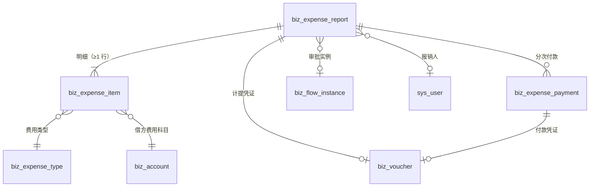

## 4.3 报销单状态机

### 4.3.1 状态图

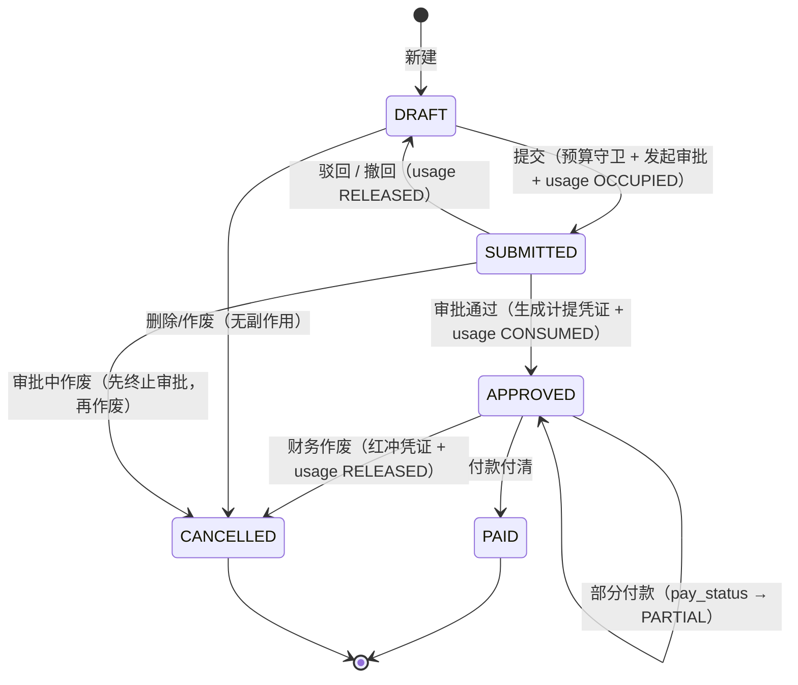

### 4.3.2 边表（`Entity::ExpenseReport`）

```rust
pub const EXPENSE_EDGES: &[(&str, &str)] = &[
    ("DRAFT",     "SUBMITTED"),
    ("SUBMITTED", "DRAFT"),
    ("SUBMITTED", "APPROVED"),
    ("APPROVED",  "PAID"),
    ("DRAFT",     "CANCELLED"),
    ("SUBMITTED", "CANCELLED"),
    ("APPROVED",  "CANCELLED"),
];
// 自环（APPROVED → APPROVED 的部分付款）用 transition_if_changed，
// 与 payable_payment 的第二期付款同款（state_machine.rs 文件头的反面教材 LNK-P08）
pub const EXPENSE_REASON_EDGES: &[(&str, &str)] = &[
    ("SUBMITTED", "DRAFT"),
    ("SUBMITTED", "CANCELLED"),
    ("APPROVED",  "CANCELLED"),
];
```

### 4.3.3 三条硬规则

1. **`APPROVED → PAID` 由付款驱动**，不是人工点「标记已付」。付款记录写入的事务里同时改 `paid_amount / pay_status / status`。
2. **`APPROVED → CANCELLED`（作废已入账报销）必须在同一事务里做三件事**：① 红冲计提凭证（`voucher::reverse_posted`）② usage → `RELEASED` ③ 状态机流转 + 日志。任一失败整笔回滚。
3. **`PAID` 之后不允许作废**：钱已经付给员工了，要退钱是「员工退款」业务（v2），不是作废。v1 明确不支持，报文直接指出来。

### 4.3.4 与「应付作废必须审批」的差异（诚实说明）

`payable_cancel` 有独立审批流程（`V0191`），因为作废应付会连带影响收货单与库存。报销作废只影响它自己的凭证与预算占用，所以 v1 采用「财务权限 + 原因 ≥10 字 + SOD 闸（制单人不能自己作废）」直接执行，不单独开流程。

**这是本设计里唯一「与现有内控标准不一致」的地方**，列入 §8.2 待拍板第 2 条。若要一致，v2 加 `EXPENSE_CANCEL` 流程（1 张卡）。

## 4.4 审批接法

### 4.4.1 三档金额分级（`expense` 流程）

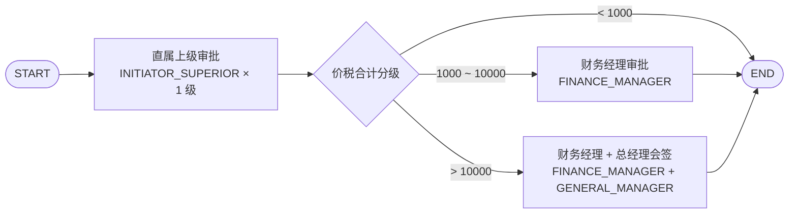

| 节点 | `node_type` | 审批人来源 | `empty_assignee` | `self_approval` | 超时 |
|---|---|---|---|---|---|
| 直属上级 | `APPROVAL` | `INITIATOR_SUPERIOR`（`superior_levels=1`） | `FALLBACK_ADMIN` | `ALLOW` | 24h REMIND |
| 财务经理 | `APPROVAL` | `ROLE = FINANCE_MANAGER` | `FALLBACK_ADMIN` | `ALLOW` | 24h REMIND |
| 会签 | `COUNTERSIGN` | `ROLE = FINANCE_MANAGER` + `ROLE = GENERAL_MANAGER`（`approval_mode=ALL`） | `FALLBACK_ADMIN` | `ALLOW` | 48h REMIND |

**为什么第一档用 `INITIATOR_SUPERIOR` 而不是 `ROLE=DEPT_LEADER`**（这是与 `po_approve` 的一处**有意不同**）：

- 采购员可能不属于「部门主管」这个角色的管辖（采购部 3 个人，谁是主管？），所以 `po_approve` 用 `DEPT_LEADER` 角色；
- 报销是**员工个人的**支出，最天然的审批人是「我的直接上级」（组织架构里唯一确定的关系）；
- 且 `dept_id` 是预算维度——如果审批人和预算责任人不一致，超支就没人真正负责。

**兜底**：`INITIATOR_SUPERIOR` 解析不到（顶头上司是空的/超管自己报销）→ `FALLBACK_ADMIN`（回退超管，**不用 SKIP**，与 `V0182` 的取舍一致）。

### 4.4.2 条件表达式（照抄 `V0182` 的语法）

```json
{"from":"c_mid","condition":{"cmp":"lt","field":"form.amount","op":"cmp","value":10000},
 "to":"n_fin","label":"1000 ≤ 金额 < 10000","priority":0}
```

`form.amount` = 报销单 `total_with_tax`。**取含税还是不含税必须钉死**：取含税（与预算占用、与 `po_approve` 的 `form.amount` 口径一致，`po_approve` 分档用的就是 `total_with_tax`）。

### 4.4.3 `form_data` 契约

```json
{
  "form.amount": 8600.00,
  "form.report_no": "EXP-20261104-000003",
  "form.reporter_name": "张三",
  "form.dept_name": "生产部",
  "form.title": "10 月上海客户拜访差旅",
  "form.item_count": 4,
  "form.expense_types": "差旅费,业务招待费",
  "form.over_budget": true,
  "form.over_amount": 1200.00,
  "form.voucher_summary": "报销-差旅费"
}
```

- `form.over_budget` / `form.over_amount`：供客户在流程里加「超预算多一道总经理」节点（P2-2b 的同款用法）；
- `form.expense_types`：审批人一眼看出「这单里有招待费」——招待费是税务敏感项，很多公司要求分管领导加签。

### 4.4.4 桥接（`expense_bridge.rs`，照 `payable_bridge.rs` 的四个入口）

| 入口 | 谁调 | 干什么 |
|---|---|---|
| `on_expense_settled` | `flow::handler::{approve_task, reject_task, withdraw_instance}`（**审批事务提交之后**） | `APPROVED` → 入账（计提凭证 + usage CONSUMED + 状态 `SUBMITTED → APPROVED`）；其余终态 → 回 `DRAFT` + usage RELEASED + 意见写 `remark` |
| `guard_self_approval` | `flow::handler::approve_task`（**事务之前**） | 制单人/发起人不能批自己那一票 → 403 + 65019（与 `purchase_bridge` 同款） |
| `cancel_approval_of` | 报销单作废 / 删除 | 终止在跑的审批（实例/节点/待办一起 `CANCELLED`），避免孤儿实例顶住 `uk_biz_flow_instance_biz_active` |
| `reconcile_orphan` | 定时任务 `erp_expense_reconcile`（每 30 分钟） | 扫「审批已终态、报销单却还停在 SUBMITTED」的孤儿，按审批结论补做入账/打回（幂等） |

**时序口径（沿用 P11 教训）**：回调跑在**审批事务提交之后**，业务侧失败**不许**回滚审批单，只记 `warn` 返回 `None`，由 `reconcile` 兜底。**但报销与采购不同**：采购单没账，卡在 `SUBMITTED` 只是显示问题；报销单卡在 `SUBMITTED` 是「审批过了但没入账」= 费用漏记。所以报警级别不同：**`erp_expense_reconcile` 发现孤儿 → 写 `biz_reminder_log` + ERROR 日志 + 巡检 L5 报 BLOCKER**。

## 4.5 凭证分录（什么时机、借什么贷什么）

### 4.5.1 三个时点三张凭证

| # | 时点 | 触发 | 分录 | 凭证来源 |
|---|---|---|---|---|
| ① | **审批通过（入账）** | `expense_bridge::on_expense_settled(APPROVED)` | 借 `5602.xx` 各费用科目（不含税）+ 借 `2221.01` 进项税（可抵扣部分） / 贷 `2241.01` 其他应付款-员工垫付（价税合计） | `EXPENSE_REPORT` |
| ② | **每笔付款** | 付款登记 | 借 `2241.01` / 贷 `1002` 银行存款 | `EXPENSE_PAYMENT` |
| ③ | **作废** | 财务作废 | ①的**红字**（借贷互换、金额恒正，`reverse_posted`） | `EXPENSE_REPORT`（红字） |

### 4.5.2 分录样例（一单 4 行明细，含「不可抵扣类型混在可抵扣单据里」）

报销单：差旅 3,180（含税，税率 6%）+ 住宿 2,120（含税 6%）+ 招待 1,060（含税 6%，**不可抵扣**）+ 办公 240（含税 13%）= 6,600（含税合计）

#### ❌ 错误口径（先看错的，才能理解为什么必须写单测）

把「税额 = 含税 / (1+税率) × 税率」**无差别套到每一行**：

| 行 | 科目 | 借 | 贷 |
|---|---|---|---|
| 1 | 5602.02 差旅费 | 3,000.00 | |
| 2 | 5602.04 业务招待费 | **1,000.00** | |
| 3 | 5602.03 办公费 | 212.39 | |
| 4 | 2221.01 进项税 | **387.61** | |
| 5 | 2241.01 员工垫付 | | 6,600.00 |

借贷是平的（6,600 = 6,600），**但账是错的**：招待费的 60 元进项税不允许抵扣，却被算进了 `2221.01`（等于向税局多申报 60 元留抵），同时费用少记 60 元。

#### ✅ 正确口径（本设计采用）

```
每条明细：with_tax_amount = amount + tax_amount           ← 库级 CHECK 保证
         tax_amount = tax_deductible ? round(with_tax/(1+rate) × rate, 4) : 0
         amount     = with_tax_amount − tax_amount
凭证借方：按 (account_id, aux_dept_id) 聚合 amount
凭证税行：按 tax_amount 汇总 → 2221.01
凭证贷方：按 total_with_tax
```

| 行 | 科目 | 借 | 贷 | 辅助核算 |
|---|---|---|---|---|
| 1 | 5602.02 管理费用-差旅费 | 3,000.00 | | `aux_dept_id = 生产部` |
| 2 | 5602.04 管理费用-业务招待费 | **1,060.00**（60 元税并入费用） | | `aux_dept_id = 生产部` |
| 3 | 5602.03 管理费用-办公费 | 212.39 | | `aux_dept_id = 生产部` |
| 4 | 2221.01 应交税费-进项税 | **327.61**（180 + 120 + 27.61） | | — |
| 5 | 2241.01 其他应付款-员工垫付 | | 6,600.00 | `aux_extra = {"employee_id":"…","reporter":"张三"}` |

**验算**：3,000 + 1,060 + 212.39 + 327.61 = 6,600.00 ✅；税额 = 180 + 120 + 27.61 = 327.61 ✅；招待费税额 0（并入费用）✅。

**这个算例必须进单测**（第 1 期卡 P1-4）：一条「不可抵扣类型混在可抵扣单据里」的用例，断言 ① 借贷平衡 ② 税行只含可抵扣部分 ③ 不可抵扣行的 `amount == with_tax_amount`。

### 4.5.3 「进项税不可抵扣」为什么用 `tax_deductible` 而不是靠人记

- 招待费、福利费、罚款的进项税不得抵扣（财税硬规定），**系统不处理就必然错**；
- 处理方式：`tax_deductible=0` 的类型 → 税额 0、金额 = 价税合计，**凭证上不出现税行**；
- 若客户需要「先认证后转出」（借 2221.01 再借 5602 贷 2221.01 进项转出），本版本不做（需要新增 `2221.03 进项税额转出` 科目 + 两步凭证），列入 v2。

### 4.5.4 入账期间：按「审批通过日」而不是「费用发生日」

| 口径 | 归属期间 | 问题 |
|---|---|---|
| 按 `expense_date` | 10 月 28 日的发票，11 月 3 日审批 → 记 10 月账 | 10 月可能已结账（财务 1 号就封账了）→ 直接 409，报销卡死 |
| **按审批通过日**（本设计） | 11 月 3 日审批 → 记 11 月账 | 符合「负债在确认时入账」；`expense_date` 仍保留在明细里供分析 |

**代价**：10 月的费用记进 11 月，月度费用会有轻微错配。这是**权责发生制与期间封账的必然取舍**，业界标准做法（费用报销按报销期间入账）。写进产品说明。

**判据**：`voucher::period_of(审批通过日)`，`voucher.rs:312`；若该期间 `CLOSED` → **409 并提示「请先让财务反结账或联系财务延后审批」**，不自动挑下一个期间（挑期间 = 篡改会计归属）。

### 4.5.5 与 `biz_voucher_rule` 的接法

需要三条规则（第 1 期迁移种入）：

```sql
INSERT INTO biz_voucher_rule (rule_code, biz_type, debit_account_id, credit_account_id, tax_account_id, is_active, remark)
VALUES
 ('EXPENSE_REPORT_DEFAULT', 'EXPENSE_REPORT',
  (SELECT id FROM biz_account WHERE account_code='5602.09'),   -- 兜底借方（实际按明细科目）
  (SELECT id FROM biz_account WHERE account_code='2241.01'),   -- 贷方：员工垫付
  (SELECT id FROM biz_account WHERE account_code='2221.01'),   -- 税行：进项税
  1, '报销入账：借 费用科目 / 借 进项税 / 贷 其他应付款-员工垫付'),
 ('EXPENSE_PAY_DEFAULT', 'EXPENSE_PAYMENT',
  (SELECT id FROM biz_account WHERE account_code='2241.01'),   -- 借：冲平员工垫付
  (SELECT id FROM biz_account WHERE account_code='1002'),      -- 贷：银行存款
  NULL, 1, '报销付款：借 其他应付款-员工垫付 / 贷 银行存款');
```

⚠️ **`create_by_rule` 的现有能力边界**：它按 `rule.debit` 一个借方科目生成一条借方行（多物料时按物料拆，`purchase_in_lines`）。报销的借方是**多个不同科目**（差旅/招待/办公），**一条 rule 表达不了**。

⇒ 第 1 期实现卡必须做一件小事：**给 `voucher` 模块加一个「多借方行」的生成入口**（`voucher::post_multi_debit(ex, ctx, lines)`），或复用 `replace_entries`（`voucher.rs:1801`，已能整体替换分录）。**推荐后者**：先用 rule 生成凭证壳（借贷平衡由 `post_voucher` 校验），再用 `replace_entries` 写入真实多行分录——但这样平衡校验的时机要对（`replace_entries` 后需要重算 `total_debit/total_credit`）。

这是本设计对**已有凭证引擎的唯一扩展**，工作量约 1 张卡（P1-4 的一半），必须在卡里写清「不改 `create_by_rule` 的现有行为，只加一个并行入口」。

## 4.6 预算占用的生命周期（与 §3.1.3 对齐）

| 时点 | usage.status | 说明 |
|---|---|---|
| 提交 | `OCCUPIED` | 按明细科目聚合写 N 行（同科目合并） |
| 驳回/撤回 | `RELEASED` | `release_reason = REJECTED / WITHDRAWN` |
| 审批通过 | `CONSUMED` + `voucher_id` | 与凭证同事务 |
| 作废 | `RELEASED` | `release_reason = CANCELLED`（凭证已红冲） |
| 付款 | **不动** | 付款不改变「钱花没花」，只改变「欠谁」 |

**不改 `budget_controlled=0` 的类型**（如罚款）：这类明细不产生 usage，也不参与超支判定。

## 4.7 附件 / 提醒 / 状态日志的接法

### 4.7.1 附件（发票影像）

- 用 `biz_doc_attachment`（`doc_type='EXPENSE_REPORT'`，`doc_id=报销单 id`），文件本体走 storage（不新建存储设施）；
- **必须扩 CHECK**：`ck_biz_doc_attachment_type` 加 `EXPENSE_REPORT`（§6.5）；
- **`doc_exists()` 必须加一类**（`attachment/model.rs` 的逐类校验：找不到 → 404，不写悬空附件）；
- 明细级附件（一张发票对应一行明细）v1 不做，发票号字符串 + 单据级影像足够；v2 若要做，加 `biz_doc_attachment.item_id`（v1 不加列，避免半成品）。

### 4.7.2 提醒（待付款）

```sql
INSERT INTO sys_job (job_name, job_group, cron_expr, invoke_target, params, status, remark)
VALUES ('erp_expense_pay_scan','ERP','0 20 7 * * *','erp_expense_pay_scan',NULL,0,
        '报销待付款扫描：审批通过超过 N 天未付款的报销单，写 biz_reminder_log 提醒报销人与财务');
```

- N = `sys_config erp.expense.pay_remind_days`（默认 7）；
- 与 `erp_payable_due_scan`（`0 10 7 * * *`）错开 10 分钟，避免同时打库；
- 提醒对象：`reporter_id` + `FINANCE_MANAGER` 角色（两拨人：一个是「我的钱还没到」，一个是「该付了」）。

### 4.7.3 状态日志

所有状态流转走 `state_machine::transition`，`entity_type='EXPENSE_REPORT'`（新注册 `DocKind::ExpenseReport`），`entity_no = report_no`。**审计价值**：员工问「我这单什么时候被驳回的、谁驳回的」，答案在 `biz_status_log`，不在报销单的某个时间戳列里。

## 4.8 与付款队列 / 银行账户的关系

### 4.8.1 付款不是「点一下就付」

v1 的付款是**登记式**（与 `payable_payment` 同款）：出纳在网银里真的付了钱，回到系统登记「已付 X 元、日期、方式」，系统生成凭证。**系统不对接银企直连**（v2 需求池）。

### 4.8.2 付款账户

`biz_expense_payment.pay_account_id` 弱引用 `biz_account.id`，默认 `1002 银行存款`。多个银行账户（1002 的二级科目）v1 不做——**要支持就先补 `1002.01 / 1002.02` 二级科目**（与 5602.0x 同一次迁移，第 0 期顺手做，但报销默认仍取 1002，取不到才报错）。

### 4.8.3 付款时的三件事（一个事务）

```
① 校验：报销单 APPROVED + 本次金额 ≤ unpaid_amount + 期间可写（ensure_period_writable）
② 写 biz_expense_payment（PAID）+ 生成付款凭证（借 2241.01 / 贷 1002）
③ 回写报销单：paid_amount += x；unpaid_amount -= x；pay_status 重算；付清则 status → PAID
```

**并发**：两张付款单同时付同一张报销单 → 第二张在 ② 之前用 `SELECT … FOR UPDATE` 锁报销单行（这里**必须锁**，与预算「不锁」相反——因为付款是**拒绝型**操作，不锁就会超额付款）。这是本设计里唯一需要行锁的地方，与 `purchase_credit` 注释里「会拒绝的守卫必须加锁」的说法一致。

## 4.9 巡检不变量（L 组）

| # | 不变量 | 级别 | 说明 |
|---|---|---|---|
| L1 | 报销单 `total_with_tax = Σ明细 with_tax_amount` 且 `item_count = count(明细)` | BLOCKER | 主子孙合计 |
| L2 | `APPROVED / PAID` 的报销单必有 `voucher_id`（且凭证未软删） | BLOCKER | 入账必有账 |
| L3 | 计提凭证借方合计 = 报销单 `total_with_tax`，且贷方科目全为 `2241.01` | BLOCKER | 账账 |
| L4 | 2241.01 贷方余额 = Σ(`total_with_tax` − `paid_amount`)，容差 0.0001 | BLOCKER | 报销挂账与科目余额对账 |
| L5 | 审批实例已终态（APPROVED）但报销单仍 `SUBMITTED` 超过 10 分钟 | BLOCKER | 孤儿回调（§4.4.4） |
| L6 | `pay_status` 与 `paid_amount` 自洽（三值完备） | WARN | 库 CHECK 已挡新增，巡检查历史 |
| L7 | 已作废（CANCELLED）且曾入账的报销单，其计提凭证必须已红冲 | BLOCKER | 与 `E1 作废单的有效凭证必须已红冲` 同款 |
| L8 | 报销 usage 的 `amount` 合计 = 报销单 `total_with_tax`（仅 `budget_controlled=1` 的明细） | WARN | 预算口径与单据口径一致 |

## 4.10 前端页面（报销）

| 页面 | 路由 | 主要能力 | 权限码 |
|---|---|---|---|
| 我的报销 | `/business/erp/expense` | 列表（默认只看自己，财务看全部）、新建/编辑（明细行内编辑 + 票据上传）、提交、撤回、作废、详情（审批轨迹 + 凭证 + 付款记录） | `expense:list/create/update/delete/submit/cancel/detail` |
| 待付款 | `/business/erp/expense/pay` | 已审批未付清的报销单列表、批量付款登记 | `expense:pay` |
| 费用类型 | `/business/erp/expense-type` | 类型 CRUD（科目、可抵扣、受预算、上限） | `expense-type:list/create/update/delete` |

**交互四细节**：

1. 明细行必须支持「含税录入 → 自动拆不含税/税额」（与采购明细同款两套口径，PRD §3.1.3）；
2. 选择「业务招待费」类型时，税额输入框**置灰并显示 0**（不可抵扣），旁边提示「招待费进项税不得抵扣」（防止用户以为系统坏了）；
3. 提交前前端预估「本单会不会超预算」（调 `/budget/check` 只读接口，**不写 usage**），超了给黄条提示「提交后需上级与财务审批」，**不阻止提交**（D3）；
4. 详情页必须显示「预算占用」区块（部门/科目/占多少/占的是哪个月），否则财务无法回答「额度什么时候被占的」。

## 本章红线

1. **不复用 `biz_payable` / `biz_payment`**（D1）。任何「顺手把报销写进应付」的实现直接打回。
2. **金额恒等式三道**：明细 `with_tax = amount + tax`；主表 `total_with_tax = total_amount + total_tax`；`unpaid = total_with_tax - paid`。三道都是库级 CHECK，不许只在代码里校验。
3. **入账与 usage CONSUMED 同事务**，付款与凭证同事务，作废（红冲 + usage 释放 + 状态）同事务。
4. **不可抵扣类型的税额一律为 0**（并入费用），不许出现「借 2221.01 再转出」的两步做法（v1）。
5. **付款时必须行锁报销单**（§4.8.3），这是本设计唯一需要锁的地方。
6. **`PAID` 不许作废**（§4.3.3-3）。

---
# 第五章 固定资产设计

## 5.1 范围与不做的部分

### 5.1.1 本版本范围

| 能力 | 做 | 说明 |
|---|---|---|
| 资产卡片（建卡、变更、查询） | ✅ | 手工建卡 + 采购单/收货单溯源 |
| 折旧（平均年限法，按月） | ✅ | 定时任务 + 批次 + 凭证 + 红冲 |
| 变动留痕（部门转移、使用人变更） | ✅ | append-only 变动表 + 主表当前值 |
| 处置（出售 / 报废 / 盘亏） | ✅ | 三种处置 + 审批 + 凭证 |
| 资产报表（清单 / 折旧明细 / 净值） | ✅ | 三张表 |
| 一物一码（序列号 ↔ 资产） | ❌ v2 | 现有 `biz_material_serial` 是存货口径，资产序列号语义不同（资产不进出库） |
| 在建工程 / 无形资产 / 长期待摊 | ❌ v2 | 科目已在（1604/1701/1801），但业务模型不同（在建工程要归集支出），不能顺手做 |
| 资产盘点 | ❌ v2 | 与存货盘点（`biz_stock_take`）不同源，需要独立的扫码/差异流程 |
| 减值准备 | ❌ 不做 | 需要 `1603 固定资产减值准备` 科目（库里没有），且涉及可收回金额评估（人工判断） |
| 资产保险 / 维保到期提醒 | ❌ v2 | |

### 5.1.2 一句话

**本版本要解决的是「买回来的设备怎么慢慢变成成本」**——建卡、每月折旧、卖掉/报废时结清。不解决「资产的全生命周期管理」（盘点、维保、保险、条码）。

## 5.2 数据模型（5 张表完整 DDL）

### 5.2.1 `biz_asset_category` — 资产分类（决定折旧参数）

```sql
CREATE TABLE IF NOT EXISTS biz_asset_category (
    id                    UUID PRIMARY KEY DEFAULT gen_random_uuid(),
    category_code         VARCHAR(40)   NOT NULL,        -- 编码：ELEC / VEHICLE / FURNITURE / MACHINE / BUILDING
    category_name         VARCHAR(120)  NOT NULL,        -- 名称：电子设备 / 运输工具 / 办公家具 / 机器设备 / 房屋建筑物
    depreciation_method   VARCHAR(24)   NOT NULL DEFAULT 'STRAIGHT_LINE',
    useful_life_months    INT           NOT NULL,        -- 使用年限（月）
    salvage_rate          NUMERIC(7,4)  NOT NULL DEFAULT 0.05, -- 净残值率（0~1）
    asset_account_id      UUID          NOT NULL,        -- 原值科目（1601）
    accum_account_id      UUID          NOT NULL,        -- 累计折旧科目（1602）
    expense_account_id    UUID          NOT NULL,        -- 折旧费用科目（默认 5602.01）
    status                SMALLINT      NOT NULL DEFAULT 1,
    sort_order            INT           NOT NULL DEFAULT 0,
    remark                TEXT,
    created_at            TIMESTAMPTZ   NOT NULL DEFAULT CURRENT_TIMESTAMP,
    updated_at            TIMESTAMPTZ   NOT NULL DEFAULT CURRENT_TIMESTAMP,
    create_by             UUID,
    update_by             UUID,
    deleted_at            TIMESTAMPTZ,

    -- D6：本期只有一种方法，CHECK 只放一个值；将来加方法 = 一次显式迁移 + 一组新单测
    CONSTRAINT ck_biz_asset_cat_method CHECK (depreciation_method IN ('STRAIGHT_LINE')),
    CONSTRAINT ck_biz_asset_cat_life   CHECK (useful_life_months BETWEEN 1 AND 600),  -- 1 月 ~ 50 年
    CONSTRAINT ck_biz_asset_cat_salv   CHECK (salvage_rate >= 0 AND salvage_rate < 1),
    CONSTRAINT ck_biz_asset_cat_status CHECK (status IN (0,1))
);

CREATE UNIQUE INDEX IF NOT EXISTS uk_biz_asset_cat_code
    ON biz_asset_category (category_code) WHERE deleted_at IS NULL;
CREATE INDEX IF NOT EXISTS idx_biz_asset_cat_status
    ON biz_asset_category (status, sort_order);

COMMENT ON TABLE biz_asset_category IS
    '资产分类：折旧方法/年限/残值率/三个科目都在这里配；本期折旧方法唯一合法值 STRAIGHT_LINE';
```

**种子（5 条，第 3 期迁移）**：

| 编码 | 名称 | 年限 | 残值率 | 费用科目 | 依据 |
|---|---|---|---|---|---|
| `ELEC` | 电子设备 | 36 月 | 5% | 5602.01 | 电脑/服务器/打印机，税法最低 3 年 |
| `FURNITURE` | 办公家具 | 60 月 | 5% | 5602.01 | 税法最低 5 年 |
| `VEHICLE` | 运输工具 | 48 月 | 5% | 5602.01 | 税法最低 4 年 |
| `MACHINE` | 机器设备 | 120 月 | 5% | 5602.01 | 税法最低 10 年 |
| `BUILDING` | 房屋建筑物 | 240 月 | 5% | 5602.01 | 税法最低 20 年 |

> 年限取「税法最低年限」，是多数小企业的实际选择；要按会计年限调，改分类即可（不用改代码）。

### 5.2.2 `biz_fixed_asset` — 资产卡片

```sql
CREATE TABLE IF NOT EXISTS biz_fixed_asset (
    id                       UUID PRIMARY KEY DEFAULT gen_random_uuid(),
    asset_no                 VARCHAR(32)   NOT NULL,       -- FA-2026-0001（biz_seq seq_type=FA）
    asset_name               VARCHAR(200)  NOT NULL,
    category_id              UUID          NOT NULL,       -- 弱引用 biz_asset_category.id
    category_code            VARCHAR(40)   NOT NULL,       -- 快照
    spec                     VARCHAR(200),                 -- 规格型号
    -- 归属
    use_dept_id              UUID          NOT NULL,       -- 使用部门（当前值）
    use_dept_name            VARCHAR(120)  NOT NULL,       -- 快照
    custodian_id             UUID,                         -- 使用人/保管人（当前值，弱引用 sys_user.id）
    custodian_name           VARCHAR(50),
    location                 VARCHAR(200),                 -- 存放地点（自由文本，v1 不建位置树）
    -- 金额
    original_value           NUMERIC(18,4) NOT NULL,       -- 原值（含税价，小企业常规做法；见 5.3.2）
    tax_amount               NUMERIC(18,4) NOT NULL DEFAULT 0, -- 其中可抵扣进项税（仅用于凭证拆分，不减少原值）
    residual_value           NUMERIC(18,4) NOT NULL DEFAULT 0, -- 预计净残值 = 原值 × 残值率（建卡时算死）
    depreciable_base         NUMERIC(18,4) NOT NULL DEFAULT 0, -- 可折旧总额 = 原值 − 残值
    -- 折旧参数快照（分类改了不影响已建卡的资产）
    depreciation_method      VARCHAR(24)   NOT NULL DEFAULT 'STRAIGHT_LINE',
    useful_life_months       INT           NOT NULL,
    salvage_rate             NUMERIC(7,4)  NOT NULL DEFAULT 0.05,
    monthly_depreciation     NUMERIC(18,4) NOT NULL DEFAULT 0, -- 月折旧额（建卡时算好，尾差在最后一个月调）
    -- 折旧状态（缓存列，唯一写入者是折旧过账；见 5.3.4）
    start_depreciation_date  DATE          NOT NULL,       -- 开始计提日（购入次月 1 日）
    accumulated_depreciation NUMERIC(18,4) NOT NULL DEFAULT 0, -- 累计折旧（缓存）
    net_value                NUMERIC(18,4) NOT NULL DEFAULT 0, -- 净值 = 原值 − 累计折旧（缓存）
    depreciation_months_done INT           NOT NULL DEFAULT 0, -- 已提月数
    last_depreciation_period VARCHAR(7),                   -- 最后计提期间（yyyy-MM）
    -- 来源
    purchase_date            DATE          NOT NULL,       -- 购入/入账日期
    source_type              VARCHAR(16)   NOT NULL DEFAULT 'MANUAL', -- MANUAL / PURCHASE_ORDER / STOCK_IN
    source_id                UUID,
    source_no                VARCHAR(32),
    buy_mode                 VARCHAR(16),                  -- DIRECT_BUY / FROM_STOCK（决定购入分录，见 5.3.3）
    supplier_id              UUID,                         -- 供应商（弱引用，仅溯源）
    supplier_name            VARCHAR(200),                 -- 快照
    -- 购入凭证
    voucher_id               UUID,                         -- 购入/转入凭证
    -- 状态
    status                   VARCHAR(16)   NOT NULL DEFAULT 'IN_USE',
    disposal_type            VARCHAR(16),                  -- SALE / SCRAP / LOSS / SOLD_OUT
    disposal_date            DATE,
    disposal_voucher_id      UUID,
    remark                   TEXT,
    created_at               TIMESTAMPTZ   NOT NULL DEFAULT CURRENT_TIMESTAMP,
    updated_at               TIMESTAMPTZ   NOT NULL DEFAULT CURRENT_TIMESTAMP,
    create_by                UUID,
    update_by                UUID,
    deleted_at               TIMESTAMPTZ,

    CONSTRAINT ck_biz_fa_status CHECK (status IN
        ('IN_USE','IDLE','DISPOSED','CANCELLED')),
    CONSTRAINT ck_biz_fa_method CHECK (depreciation_method IN ('STRAIGHT_LINE')),
    CONSTRAINT ck_biz_fa_source CHECK (source_type IN ('MANUAL','PURCHASE_ORDER','STOCK_IN')),
    CONSTRAINT ck_biz_fa_buy_mode CHECK (buy_mode IS NULL OR buy_mode IN ('DIRECT_BUY','FROM_STOCK')),
    CONSTRAINT ck_biz_fa_disposal CHECK (disposal_type IS NULL OR disposal_type IN
        ('SALE','SCRAP','LOSS')),
    CONSTRAINT ck_biz_fa_value  CHECK (original_value > 0 AND tax_amount >= 0
                                       AND residual_value >= 0
                                       AND depreciable_base = original_value - residual_value),
    CONSTRAINT ck_biz_fa_rate   CHECK (salvage_rate >= 0 AND salvage_rate < 1),
    CONSTRAINT ck_biz_fa_life   CHECK (useful_life_months BETWEEN 1 AND 600),
    -- 累计折旧不许超过可折旧总额（提足即停）
    CONSTRAINT ck_biz_fa_accum  CHECK (accumulated_depreciation >= 0
                                       AND accumulated_depreciation <= depreciable_base),
    -- 净值恒等（与 ck_biz_payable_unpaid 同款：程序算错会被库挡住）
    CONSTRAINT ck_biz_fa_net    CHECK (net_value = original_value - accumulated_depreciation),
    CONSTRAINT ck_biz_fa_months CHECK (depreciation_months_done >= 0
                                       AND depreciation_months_done <= useful_life_months + 1),
    -- 已处置必须有处置日与类型；未处置不许有
    CONSTRAINT ck_biz_fa_disposed CHECK (
        (status = 'DISPOSED') = (disposal_date IS NOT NULL AND disposal_type IS NOT NULL)),
    -- 来源非手工时必须给 source_id（避免「标记了从采购来，却查不到哪张单」）
    CONSTRAINT ck_biz_fa_source_ref CHECK (
        (source_type = 'MANUAL' AND source_id IS NULL)
     OR (source_type <> 'MANUAL' AND source_id IS NOT NULL))
);

COMMENT ON TABLE biz_fixed_asset IS
    '固定资产卡片（一台设备/一处房产一张卡；同型号多台请建多张卡，不做「卡片数量」字段）';
COMMENT ON COLUMN biz_fixed_asset.tax_amount IS
    '可抵扣进项税：只用于购入凭证拆分（借 2221.01），不减少原值（小企业按含税价入账）';
COMMENT ON COLUMN biz_fixed_asset.accumulated_depreciation IS
    '缓存列：唯一写入者是折旧过账（§5.5.4），巡检 K2 用 biz_depreciation 求和反查';
COMMENT ON COLUMN biz_fixed_asset.monthly_depreciation IS
    '月折旧额 = round(可折旧总额 / 使用月数, 4)；最后一个月用「差额补齐」而不是本位（§5.4.3）';

CREATE UNIQUE INDEX IF NOT EXISTS uk_biz_fa_no
    ON biz_fixed_asset (asset_no) WHERE deleted_at IS NULL;
-- 一张来源单只能建一张卡（防止同一收货单重复转固）
CREATE UNIQUE INDEX IF NOT EXISTS uk_biz_fa_source
    ON biz_fixed_asset (source_type, source_id)
    WHERE source_id IS NOT NULL AND deleted_at IS NULL;
CREATE INDEX IF NOT EXISTS idx_biz_fa_category  ON biz_fixed_asset (category_id);
CREATE INDEX IF NOT EXISTS idx_biz_fa_dept      ON biz_fixed_asset (use_dept_id, status);
CREATE INDEX IF NOT EXISTS idx_biz_fa_custodian ON biz_fixed_asset (custodian_id) WHERE custodian_id IS NOT NULL;
CREATE INDEX IF NOT EXISTS idx_biz_fa_status    ON biz_fixed_asset (status, purchase_date DESC);
-- 折旧批跑的核心扫描：在役 + 已到计提起始日 + 未提足
CREATE INDEX IF NOT EXISTS idx_biz_fa_dep_scan
    ON biz_fixed_asset (start_depreciation_date, last_depreciation_period)
    WHERE status IN ('IN_USE','IDLE') AND deleted_at IS NULL;
CREATE INDEX IF NOT EXISTS idx_biz_fa_voucher
    ON biz_fixed_asset (voucher_id) WHERE voucher_id IS NOT NULL;
```

### 5.2.3 `biz_fixed_asset_change` — 变动留痕（append-only）

```sql
CREATE TABLE IF NOT EXISTS biz_fixed_asset_change (
    id            UUID PRIMARY KEY DEFAULT gen_random_uuid(),
    asset_id      UUID          NOT NULL REFERENCES biz_fixed_asset(id),
    change_type   VARCHAR(16)   NOT NULL,     -- TRANSFER 部门转移 / CUSTODIAN 使用人变更 / DISPOSAL 处置 / ENABLE 启用 / IDLE 停用
    change_date   DATE          NOT NULL,
    from_dept_id  UUID,  from_dept_name  VARCHAR(120),
    to_dept_id    UUID,  to_dept_name    VARCHAR(120),
    from_user_id  UUID,  from_user_name  VARCHAR(50),
    to_user_id    UUID,  to_user_name    VARCHAR(50),
    from_status   VARCHAR(16),
    to_status     VARCHAR(16),
    reason        VARCHAR(255)  NOT NULL,     -- 变动原因（必填，内控）
    voucher_id    UUID,                       -- 处置凭证（仅 DISPOSAL）
    approval_instance_id UUID,                -- 处置审批实例（仅 DISPOSAL）
    operator_id   UUID,
    operator_name VARCHAR(50),
    remark        TEXT,
    created_at    TIMESTAMPTZ   NOT NULL DEFAULT CURRENT_TIMESTAMP,

    CONSTRAINT ck_biz_fa_chg_type CHECK (change_type IN
        ('TRANSFER','CUSTODIAN','DISPOSAL','ENABLE','IDLE')),
    -- 转移必须有前后部门；使用人变更必须有前后人
    CONSTRAINT ck_biz_fa_chg_transfer CHECK (
        change_type <> 'TRANSFER' OR (from_dept_id IS NOT NULL AND to_dept_id IS NOT NULL)),
    CONSTRAINT ck_biz_fa_chg_custodian CHECK (
        change_type <> 'CUSTODIAN' OR (to_user_id IS NOT NULL)),
    CONSTRAINT ck_biz_fa_chg_disposal CHECK (
        change_type <> 'DISPOSAL' OR (to_status = 'DISPOSED'))
);

CREATE INDEX IF NOT EXISTS idx_biz_fa_chg_asset ON biz_fixed_asset_change (asset_id, change_date DESC);
CREATE INDEX IF NOT EXISTS idx_biz_fa_chg_type  ON biz_fixed_asset_change (change_type, change_date DESC);

COMMENT ON TABLE biz_fixed_asset_change IS
    '资产变动留痕（append-only，无 updated_at / deleted_at）：主表存当前值，本表存每一次变化';
```

**「留痕不直接覆盖」的正确理解**（卡面原话是「要留痕，不直接覆盖」）：

- 主表 `use_dept_id / custodian_id` **必须**能被覆盖——否则「这台电脑现在谁在用」查不到；
- **覆盖动作必须与写变动行在同一事务**，且变动行不可改不可删；
- 因此本表**没有** `updated_at` / `deleted_at`（与 `biz_status_log` 同款「只增不改」设计，`V0159` + `state_machine.rs` 文件头）。

### 5.2.4 `biz_depreciation_batch` — 折旧批次（一次计提 = 一行）

```sql
CREATE TABLE IF NOT EXISTS biz_depreciation_batch (
    id           UUID PRIMARY KEY DEFAULT gen_random_uuid(),
    batch_no     VARCHAR(32)   NOT NULL,      -- DEP-2026-10（期间唯一即可）
    period_code  VARCHAR(7)    NOT NULL,      -- 计提期间（yyyy-MM）
    status       VARCHAR(16)   NOT NULL DEFAULT 'CALCULATED',
    asset_count  INT           NOT NULL DEFAULT 0,
    total_amount NUMERIC(18,4) NOT NULL DEFAULT 0,
    voucher_id   UUID,                        -- 计提凭证
    reverse_voucher_id UUID,                  -- 红冲凭证（红冲后填）
    skip_reason  VARCHAR(255),                -- 整批跳过原因（期间已结账 / 无在役资产）
    run_at       TIMESTAMPTZ   NOT NULL DEFAULT CURRENT_TIMESTAMP,
    run_by       UUID,                        -- 空 = 定时任务
    posted_at    TIMESTAMPTZ,
    reversed_at  TIMESTAMPTZ,
    remark       TEXT,
    created_at   TIMESTAMPTZ   NOT NULL DEFAULT CURRENT_TIMESTAMP,
    updated_at   TIMESTAMPTZ   NOT NULL DEFAULT CURRENT_TIMESTAMP,

    CONSTRAINT ck_biz_dep_batch_status CHECK (status IN
        ('CALCULATED','POSTED','REVERSED','SKIPPED')),
    CONSTRAINT ck_biz_dep_batch_amount CHECK (total_amount >= 0 AND asset_count >= 0),
    CONSTRAINT ck_biz_dep_batch_period CHECK (period_code ~ '^\d{4}-(0[1-9]|1[0-2])$'),
    -- 已过账必须有凭证；跳过必须写原因
    CONSTRAINT ck_biz_dep_batch_posted CHECK (status <> 'POSTED' OR voucher_id IS NOT NULL),
    CONSTRAINT ck_biz_dep_batch_skip   CHECK (status <> 'SKIPPED' OR skip_reason IS NOT NULL),
    -- 已红冲必须有两个凭证指针
    CONSTRAINT ck_biz_dep_batch_rev    CHECK (
        status <> 'REVERSED' OR (voucher_id IS NOT NULL AND reverse_voucher_id IS NOT NULL))
);

-- ★ 一个期间只能有一批（幂等的库级保证：定时任务重跑 / 人工重跑都撞这条）
CREATE UNIQUE INDEX IF NOT EXISTS uk_biz_dep_batch_period ON biz_depreciation_batch (period_code);
CREATE UNIQUE INDEX IF NOT EXISTS uk_biz_dep_batch_no     ON biz_depreciation_batch (batch_no);
CREATE INDEX IF NOT EXISTS idx_biz_dep_batch_status ON biz_depreciation_batch (status, period_code DESC);
CREATE INDEX IF NOT EXISTS idx_biz_dep_batch_voucher ON biz_depreciation_batch (voucher_id)
    WHERE voucher_id IS NOT NULL;

COMMENT ON TABLE biz_depreciation_batch IS
    '折旧批次（一个期间一批；period_code 全表唯一 = 定时任务天然幂等）';
```

**为什么要「批次」这一层**（而不是只落明细）：一次计提是**一个整体动作**——财务要能一眼回答「10 月的折旧提了吗？提了多少？凭证号多少？红冲过吗？」。批次表就是这四个问题的答案，同时它承担幂等键（`period_code` 唯一）。

### 5.2.5 `biz_depreciation` — 折旧明细（一台资产一行）

```sql
CREATE TABLE IF NOT EXISTS biz_depreciation (
    id                      UUID PRIMARY KEY DEFAULT gen_random_uuid(),
    batch_id                UUID          NOT NULL REFERENCES biz_depreciation_batch(id) ON DELETE CASCADE,
    asset_id                UUID          NOT NULL REFERENCES biz_fixed_asset(id),
    asset_no                VARCHAR(32)   NOT NULL,      -- 快照
    asset_name              VARCHAR(200)  NOT NULL,      -- 快照
    period_code             VARCHAR(7)    NOT NULL,
    -- 归属（计提时的快照：处置/转移后历史折旧仍归原部门）
    dept_id                 UUID          NOT NULL,
    dept_name               VARCHAR(120)  NOT NULL,
    expense_account_id      UUID          NOT NULL,      -- 折旧费用科目（按资产分类带出）
    expense_account_code    VARCHAR(30)   NOT NULL,
    -- 金额
    amount                  NUMERIC(18,4) NOT NULL,      -- 本月折旧额
    accumulated_before      NUMERIC(18,4) NOT NULL,      -- 计提前累计
    accumulated_after       NUMERIC(18,4) NOT NULL,      -- 计提后累计
    net_value_after         NUMERIC(18,4) NOT NULL,      -- 计提后净值
    is_last_month           SMALLINT      NOT NULL DEFAULT 0, -- 是否提足的最后一期（尾差补齐期）
    -- 状态
    status                  VARCHAR(12)   NOT NULL DEFAULT 'POSTED', -- POSTED / REVERSED
    reversed_at             TIMESTAMPTZ,
    remark                  VARCHAR(255),
    created_at              TIMESTAMPTZ   NOT NULL DEFAULT CURRENT_TIMESTAMP,

    CONSTRAINT uk_biz_dep_asset_period UNIQUE (asset_id, period_code),
    CONSTRAINT ck_biz_dep_amount   CHECK (amount >= 0),
    CONSTRAINT ck_biz_dep_accum    CHECK (accumulated_before >= 0
                                          AND accumulated_after = accumulated_before + amount),
    CONSTRAINT ck_biz_dep_net      CHECK (net_value_after >= 0),
    CONSTRAINT ck_biz_dep_last     CHECK (is_last_month IN (0,1)),
    CONSTRAINT ck_biz_dep_status   CHECK (status IN ('POSTED','REVERSED')),
    CONSTRAINT ck_biz_dep_period   CHECK (period_code ~ '^\d{4}-(0[1-9]|1[0-2])$')
);

CREATE INDEX IF NOT EXISTS idx_biz_dep_batch  ON biz_depreciation (batch_id);
CREATE INDEX IF NOT EXISTS idx_biz_dep_asset  ON biz_depreciation (asset_id, period_code DESC);
CREATE INDEX IF NOT EXISTS idx_biz_dep_period ON biz_depreciation (period_code, status);
CREATE INDEX IF NOT EXISTS idx_biz_dep_dept   ON biz_depreciation (dept_id, period_code);

COMMENT ON TABLE biz_depreciation IS
    '折旧明细（一台资产一个期间一行；uk(asset_id, period_code) 防止同一资产同月重复计提）';
```

### 5.2.6 表关系

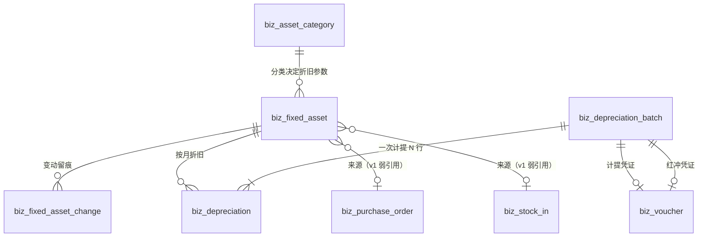

## 5.3 卡片字段口径（三个最容易错的地方）

### 5.3.1 原值：含税还是不含税

| 口径 | 原值 | 进项税 | 适用 |
|---|---|---|---|
| **含税入账**（本设计默认） | 价税合计 | 不单独记（或记入 `tax_amount` 仅供凭证拆分） | 小企业、非一般纳税人、进项不得抵扣的资产（房屋、食堂设备） |
| 不含税入账 | 不含税价 | 借 2221.01 抵扣 | 一般纳税人且取得专票 |

**本设计的选择**：`original_value` 存**含税价**（现实中小企业的账就是这么记的），`tax_amount` 单独存一列仅供**购入凭证拆分**用（借 1601 = 原值 − 税，借 2221.01 = 税）。这样：

- 若客户不要抵扣：`tax_amount = 0` → 借 1601 全额；
- 若要抵扣：`tax_amount = 税款` → 借 1601（原值−税）+ 借 2221.01（税）。

⚠️ 这里有个**口径冲突必须点明**：如果 `original_value` 存含税、凭证却按「原值 − 税」入 1601，那**资产卡片的原值与 1601 科目余额会差一个税额**（巡检 K6 会报）。所以本设计**二选一，且在卡上明确**：

```
buy_mode = DIRECT_BUY 且 tax_amount > 0  →  original_value 必须存【不含税】价
buy_mode = DIRECT_BUY 且 tax_amount = 0  →  original_value 存含税价（默认）
```

⇒ 即：**可抵扣时原值不含税、不可抵扣时原值含税**——这才是会计上正确的「原值」（固定资产按不含可抵扣进项税的成本入账）。`tax_amount` 只是记录「这台的税是多少」，`original_value` 与 1601 永远一致。

**实现卡必须加一条校验**：`若 tax_amount > 0 则 original_value 必须等于发票不含税金额`（前端录入时给两个输入框，勾选「进项可抵扣」后才出现「税额」框）。

### 5.3.2 残值率与可折旧总额

```
residual_value   = round(original_value × salvage_rate, 4)
depreciable_base = original_value − residual_value
monthly          = round(depreciable_base / useful_life_months, 4)
```

⚠️ **残值率从分类带出后存在卡片上（快照）**：分类的残值率改了，已建卡的资产不变（否则「改一个分类参数 = 改所有历史资产的折旧额」，会计上是灾难）。

### 5.3.3 购入模式（决定借贷）

| 模式 | 场景 | 分录 |
|---|---|---|
| `DIRECT_BUY` | 资产没走收货入库（直接买、直接挂账） | 借 1601（原值） / 借 2221.01（税，可抵扣时） / 贷 2202（赊购）或 1002（现付） |
| `FROM_STOCK` | 资产已经按普通物料收进仓（1405 上有它） | 借 1601（原值） / 贷 1405 库存商品 |

`FROM_STOCK` 的判定：建卡时选了 `source_stock_in_id` → 自动 `FROM_STOCK`（无论用户选什么）。理由：收货单已过账就意味着 1405 已增加，不冲回就重复计价。

**`FROM_STOCK` 的已知代价（写进产品说明）**：1405 会短暂虚增（从收货到转固之间），且这段期间的资产负债表的「存货」偏高。v2 的「采购单直转、不入库存」才是正解（D8）。

## 5.4 折旧算法（平均年限法，含尾差与算例）

### 5.4.1 计提规则（四条，全部来自中国会计实务）

| # | 规则 | 说明 |
|---|---|---|
| ① | **当月增加的资产当月不提，从下月起提** | `start_depreciation_date = purchase_date + 1 个月的 1 日` |
| ② | **当月减少的资产当月照提，从下月起停** | 处置期间仍计提（批次里包含它），次月起不再出现 |
| ③ | **提足即停** | 累计 = 可折旧总额 → 不再计提，净值 = 残值 |
| ④ | **最后一个月补齐尾差** | 不用「每月固定额 × N」而是「可折旧总额 − 已提」，保证累计恰好等于可折旧总额 |

### 5.4.2 公式

```
可折旧总额 base = original_value − residual_value
月折旧额 monthly = round(base / useful_life_months, 4)     -- NUMERIC 定点，ROUND_HALF_UP
第 n 个月应提额：
  n < useful_life_months   → monthly
  n = useful_life_months   → base − monthly × (useful_life_months − 1)   ← 尾差补齐
  提前提足（base 被整除后的浮点误差导致 n 月前就已满） → 不再计提（amount = 0 → 跳过该行）
```

### 5.4.3 算例（含四位小数尾差，可直接进单测）

**资产**：原值 100,000.00，残值率 5%，使用年限 60 月（5 年）。

```
residual_value   = 100,000 × 0.05 = 5,000.0000
depreciable_base = 100,000 − 5,000 = 95,000.0000
monthly          = 95,000 / 60 = 1,583.3333（4 位，ROUND_HALF_UP）
```

| 期间 | 本月折旧 | 累计折旧 | 净值 |
|---|---|---|---|
| 第 1 月 | 1,583.3333 | 1,583.3333 | 98,416.6667 |
| 第 2 月 | 1,583.3333 | 3,166.6666 | 96,833.3334 |
| … | … | … | … |
| 第 59 月 | 1,583.3333 | 93,416.6647 | 6,583.3353 |
| **第 60 月** | **1,583.3353**（尾差补齐） | **95,000.0000** | **5,000.0000**（= 残值） |

**验算（实跑 PG numeric，命令与输出见附录 D）**：

```sql
select round((100000*0.95)/60,4)                 -- 1583.3333
     , round((100000*0.95)/60,4)*59              -- 93416.6647
     , (100000*0.95) - round((100000*0.95)/60,4)*59;  -- 1583.3353
```

⇒ 累计 93,416.6647 + 1,583.3353 = **95,000.0000** ✅，净值 = 100,000 − 95,000 = **5,000.0000** = 残值 ✅。

**单测必须钉的三个用例**（第 3 期 P3-3 卡）：

| 用例 | 断言 |
|---|---|
| 尾差补齐 | 60 个月合计 = `depreciable_base`（一分不差） |
| 整除无尾差 | 90,000 / 60 = 1,500.0000 → 60 个月每月恰好 1,500，最后一个月**不加**尾差（差额为 0） |
| 中途处置 | 第 30 月处置 → 第 30 月仍计提（1,583.3333），第 31 月起无明细行；累计 = 47,500.0000，净值 = 52,500.0000 |

### 5.4.4 为什么 `monthly_depreciation` 存卡片上而不是每月现算

- 现算要求「算法 + 参数」永远不变，但参数是快照（§5.3.2），所以现算结果等价；
- 存下来的好处：**报表能直接显示「这台每月提多少」**（财务最常问的一句），且折旧批跑时不用重复解析分类；
- 风险：`monthly` 与 `base / months` 不一致 → **巡检 K1 校验** `round(base/months,4) = monthly`。

## 5.5 月度计提（批次 + 定时任务 + 凭证 + 红冲）

### 5.5.1 流程

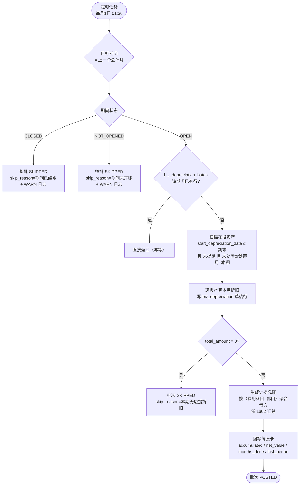

### 5.5.2 资产筛选 SQL（实现卡直接用）

```sql
-- 目标期间 (p_start, p_end) 的应提资产
SELECT a.*
  FROM biz_fixed_asset a
 WHERE a.deleted_at IS NULL
   AND a.status IN ('IN_USE','IDLE')                -- 在役 / 闲置都要提
   AND a.start_depreciation_date <= $p_end          -- 规则①：下月起提
   AND a.accumulated_depreciation < a.depreciable_base   -- 规则③：未提足
   -- 规则②：本期处置的仍要提（disposal_date 在本期内或未处置）
   AND (a.disposal_date IS NULL OR a.disposal_date >= $p_start)
   AND COALESCE(a.last_depreciation_period, '') < $period_code   -- 防重复
 ORDER BY a.asset_no;
```

### 5.5.3 折旧凭证（多借方行）

```
借 5602.01 管理费用-折旧费   ← 按 (expense_account_id, use_dept_id) 聚合，aux_dept_id 写入
   （若某资产分类配了别的费用科目，如生产设备配 4101 制造费用，则按科目分行）
贷 1602 累计折旧            ← 汇总一行
```

**辅助核算**：每一条借方分录写 `aux_dept_id = 计提时的 use_dept_id`（快照）。这是 DC-11 里「部门辅助核算列全空」的第二个收口点——**折旧是唯一能让「部门费用」在制造企业真正可用的一类凭证**（每个月都有、金额稳定、覆盖全部部门）。

**科目聚合口径**（与 P2-1b「按物料拆分录」对照）：

| 场景 | 拆不拆 | 理由 |
|---|---|---|
| 同一费用科目 + 同一部门的多台资产 | **合并一行**（金额相加） | 凭证语义单位是「科目 + 辅助维度」，不是资产 |
| 不同费用科目（5602.01 vs 4101） | 拆行 | 科目不同必须拆 |
| 不同部门 | 拆行 | 辅助维度不同必须拆 |

### 5.5.4 「缓存列」的唯一写入者（R1 单一数据源的正确落地）

`biz_fixed_asset` 的 `accumulated_depreciation / net_value / depreciation_months_done / last_depreciation_period` 是**缓存列**，本设计明确规定：

- **唯一写入者 = 折旧过账**（`depreciation::post_batch`）与**折旧红冲**（`reverse_batch`）；
- 任何其它代码路径（建卡、转移、处置）**不许**改这四列（处置也不清零，净值保留，靠 `status=DISPOSED` 表达）；
- 巡检 K2 每月校验 `accumulated = Σ(biz_depreciation where status=POSTED)`——漂移即 BLOCKER。

**为什么不像预算那样纯现算**：折旧明细是「按月批量写、一次写几千行」，列表页要显示净值时若现算需要 `SUM` 聚合（资产 2000 台时列表就慢了）。缓存在「单写入者 + 月度频率 + 巡检兜底」三个条件下是安全的；预算的 usage 是「高频并发写」才必须现算。**这两处口径不同是有理由的，不是不一致。**

### 5.5.5 红冲（正向必配反向）

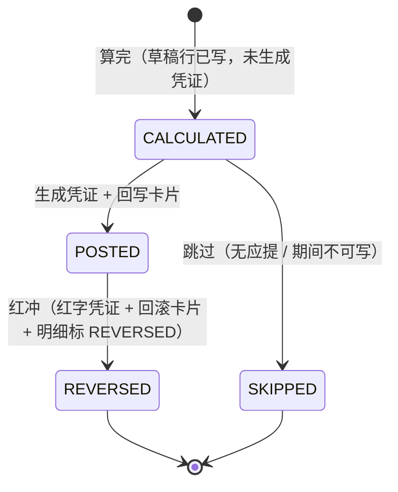

红冲的六步（同一事务）：

```
① 校验：批次 POSTED + 期间未结账（已结账 → 409，必须先反结账）
② voucher::reverse_posted(原凭证, 原因)  → 红字凭证（借贷互换、金额恒正）
③ 逐明细：status=POSTED → REVERSED, reversed_at=now
④ 逐资产：accumulated -= amount；net_value += amount；months_done -= 1；
          last_depreciation_period 回退到上一期（按该资产最大未红冲期间重算）
⑤ 批次：status=REVERSED, reverse_voucher_id=红字凭证, reversed_at=now
⑥ 状态日志：entity_type='DEPRECIATION', entity_no=period_code, 原因必填
```

**为什么红冲要回滚卡片**：不回滚 = 卡片累计折旧虚增 = 后续每月少提 = 净值永远偏低。这是「红冲不彻底」的典型后果。

**红冲后能否重跑同期间**：可以。`biz_depreciation_batch.period_code` 唯一索引会让重跑撞键——所以红冲后**不删批次**，而是允许「同期间新建第二个批次」？**不行**（唯一索引挡死）。

⇒ 正确处理：**红冲后重跑 = 复用同一批次行**（`REVERSED → CALCULATED → POSTED`），`voucher_id` 换成新凭证，`reverse_voucher_id` 保留上一次的（历史链通过 `biz_status_log` + 凭证的 `reverse_of / reversed_by` 追溯）。这条必须在实现卡里写清，否则第一次重跑就会 500。

## 5.6 变动（转移 / 变更 / 处置）

### 5.6.1 部门转移（不产生凭证）

```
① 校验：资产 IN_USE/IDLE + 目标部门存在且 ≠ 当前部门
② 写 biz_fixed_asset_change（TRANSFER，from/to 部门 + 原因）
③ 更新主表 use_dept_id / use_dept_name（同事务）
④ 状态日志（entity_type='FIXED_ASSET'，reason=转移原因）
```

**为什么无凭证**：资产在部门间移动不改变金额与科目（1601 不按部门核算）。但**下个月起折旧费用会归到新部门**——这通过「折旧明细的 dept 快照」实现，历史月份不受影响。

### 5.6.2 使用人变更（无凭证）

同上，`change_type='CUSTODIAN'`，`to_user_id` 必填。

### 5.6.3 处置（必须审批 + 必须凭证）

| 处置类型 | 审批 | 凭证数 | 说明 |
|---|---|---|---|
| `SALE` 出售 | ✅ `ASSET_DISPOSAL` 流程 | 3 张 | 处置 / 收款 / 结转清理 |
| `SCRAP` 报废 | ✅ 同上 | 2 张 | 处置 / 结转损失 |
| `LOSS` 盘亏 | ✅ 同上 | 2 张 | 转待处理 / 批准后转损失 |

**为什么必须审批**：处置资产 = 把公司资产变成现金或废品，是最容易发生舞弊的环节（低价卖给关联方、假装报废后私用）。审批用 `ASSET_DISPOSAL` 流程（新增 `biz_type`），第一站 `GENERAL_MANAGER`（金额不分档：处置无论大小都要总经理，因为频次低）。

### 5.6.4 处置的分录（三种，逐个给借贷）

**前提数据**：原值 100,000，累计折旧 40,000，净值 60,000，残值 5,000。

#### ① 出售（售价 50,000 不含税，销项税 6,500，实收 56,500）

凭证 1 · 处置（把资产从账上清掉）：

| 科目 | 借 | 贷 |
|---|---|---|
| 1602 累计折旧 | 40,000.00 | |
| 1606 固定资产清理 | 60,000.00 | |
| 1601 固定资产 | | 100,000.00 |

凭证 2 · 收款与销项税：

| 科目 | 借 | 贷 |
|---|---|---|
| 1002 银行存款 | 56,500.00 | |
| 1606 固定资产清理 | | 50,000.00 |
| 2221.02 应交税费-销项税 | | 6,500.00 |

凭证 3 · 结转清理净额（60,000 − 50,000 = 损失 10,000）：

| 科目 | 借 | 贷 |
|---|---|---|
| 5711 营业外支出 | 10,000.00 | |
| 1606 固定资产清理 | | 10,000.00 |

⇒ **1606 余额 = 60,000(借) − 50,000(贷) − 10,000(贷) = 0** ✅（巡检 K7：处置完成的资产，1606 必须归零）

#### ② 报废（无收入）

凭证 1 · 处置：借 1602 40,000 / 借 1606 60,000 / 贷 1601 100,000
凭证 2 · 结转：借 5711 60,000 / 贷 1606 60,000
⇒ 1606 归零 ✅

#### ③ 盘亏（先挂待处理，批准后转损失）

凭证 1 · 转待处理：

| 科目 | 借 | 贷 |
|---|---|---|
| 1602 累计折旧 | 40,000.00 | |
| 1901 待处理财产损溢 | 60,000.00 | |
| 1601 固定资产 | | 100,000.00 |

凭证 2 · 批准后转损失：借 5711 60,000 / 贷 1901 60,000
⇒ 1901 归零 ✅

**「盘亏 vs 报废」的区别**：报废是「东西还在、只是不能用了，主动报废」；盘亏是「盘点时发现东西不见了」。前者会计上直接进营业外支出，后者必须过 1901（因为要先查清责任）。这是两条不同路径，不能合并。

### 5.6.5 处置后卡片的状态

```sql
UPDATE biz_fixed_asset
   SET status = 'DISPOSED', disposal_type = $t, disposal_date = $d,
       disposal_voucher_id = $v1        -- 指向「处置凭证」（凭证 1）
 WHERE id = $id AND status IN ('IN_USE','IDLE');
-- 净值不清零（保留历史），靠 status 表达已处置；报表按 status 过滤
```

**为什么净值不清零**：清成 0 会丢「处置时的净值是多少」这个审计事实（它是计算处置损益的基数）。

## 5.7 与采购链的接法（v1 溯源 / v2 直转）

### 5.7.1 v1：手工建卡 + 弱引用溯源

```
建卡入口 → 选「来源」：
  ├─ MANUAL           手工录入（全部字段手填）
  ├─ PURCHASE_ORDER   选一张已 APPROVED 的采购单 → 带出供应商/金额/日期（**不自动改库存**）
  └─ STOCK_IN         选一张已 POSTED 的收货单 → 带出金额/供应商/日期，buy_mode 自动 = FROM_STOCK
```

**约束**：
- `uk_biz_fa_source (source_type, source_id)` — 一张来源单只能建一张卡（防重复转固）；
- 从收货单建卡时，`original_value` 默认取该收货单**该物料行的金额合计**（可能一单多台 → 用户可拆成多张卡，但**每张卡都要手填原值并合计对齐**；v1 不做自动拆分，写进提示文案）；
- 建卡即生成购入凭证（`DIRECT_BUY` / `FROM_STOCK` 两种，见 §5.3.3）。

**v1 的已知缺口（写进产品说明）**：
1. 一张收货单有 5 台同型号电脑 → 要建 5 张卡，手工填 5 次原值；
2. 采购的资产如果走了正常收货，**会先进 1405**（存货），转固时才冲回——这就是 `FROM_STOCK`；
3. 采购单本身不知道自己买的是资产（`biz_material.material_type` 只有 `RAW/SEMI/FINISHED/SERVICE`）。

### 5.7.2 v2：采购单直转（独立卡，不进库存）

```sql
-- v2 的迁移草案（**本卡不实施**，只为将来一张卡把口径写清）
ALTER TABLE biz_purchase_order_item ADD COLUMN IF NOT EXISTS is_asset boolean NOT NULL DEFAULT false;
ALTER TABLE biz_purchase_order_item ADD COLUMN IF NOT EXISTS asset_category_id uuid;
ALTER TABLE biz_stock_in_item      ADD COLUMN IF NOT EXISTS is_asset boolean NOT NULL DEFAULT false;
-- 收货过账：is_asset 的明细 → 不进 biz_inventory / 不写 biz_inventory_txn
--            → 生成资产卡片草稿（待财务确认后入账）
```

**为什么必须独立卡**：收货过账是全系统最密的函数（`stockin_handler_post.rs` 一次动六本账），加分支必须单独回归，不能夹在「财务扩展」的设计里悄悄做。

## 5.8 报表（三张）

### 5.8.1 资产清单

| 列 | 取数 |
|---|---|
| 资产编号 / 名称 / 分类 / 规格 | `biz_fixed_asset` |
| 使用部门 / 使用人 / 存放地点 | 同上（当前值） |
| 购入日期 / 开始计提日 | 同上 |
| 原值 / 累计折旧 / 净值 | 同上（缓存列） |
| 折旧进度 | `months_done / useful_life_months` |
| 状态 | IN_USE / IDLE / DISPOSED |

### 5.8.2 折旧明细表（按月）

| 列 | 取数 |
|---|---|
| 期间 | `biz_depreciation.period_code` |
| 批次号 / 凭证号 / 批次状态 | `biz_depreciation_batch` |
| 资产 / 部门 / 费用科目 | 明细快照 |
| 本月折旧 / 计提前累计 / 计提后累计 / 计提后净值 | 明细 |

### 5.8.3 净值对账表（财务用）

| 行 | 金额 | 来源 |
|---|---|---|
| 1601 固定资产 科目余额 | A | `biz_voucher_entry` |
| Σ 未处置资产原值 | B | `biz_fixed_asset` where status ≠ DISPOSED |
| 差异 | A − B | 必须 = 0（巡检 K6） |
| 1602 累计折旧 贷方余额 | C | `biz_voucher_entry` |
| Σ 资产累计折旧 | D | `biz_fixed_asset` |
| 差异 | C − D | 必须 = 0（巡检 K5） |

## 5.9 巡检不变量（K 组）

| # | 不变量 | 级别 |
|---|---|---|
| K1 | `monthly_depreciation = round((original − residual) / useful_life_months, 4)` | WARN |
| K2 | 每张卡的 `accumulated_depreciation = Σ(biz_depreciation.amount where status='POSTED')` | BLOCKER |
| K3 | `accumulated ≤ depreciable_base` 且 `net_value = original − accumulated` | BLOCKER（库 CHECK 也挡） |
| K4 | 批次 `total_amount = Σ明细 amount` 且 `asset_count = count(明细)` | BLOCKER |
| K5 | 1602 贷方余额 = Σ 卡片累计折旧（容差 0.0001） | BLOCKER |
| K6 | 1601 借方余额 = Σ 未处置卡片原值（容差 0.0001） | BLOCKER |
| K7 | 已处置资产对应的 1606 余额 = 0（无未结转的清理挂账） | WARN |
| K8 | 同一资产同一期间只有一条 POSTED 折旧（`uk` 保证，巡检查历史脏数据） | BLOCKER |
| K9 | 已 POSTED 批次的目标期间必须存在且状态 ∈ (OPEN, CLOSED 但批次在结账前) | WARN |
| K10 | 状态 DISPOSED 的资产必有 `biz_fixed_asset_change(DISPOSAL)` 行 | BLOCKER |

## 5.10 前端页面（固资）

| 页面 | 路由 | 主要能力 | 权限码 |
|---|---|---|---|
| 资产卡片 | `/business/erp/asset` | 列表（分类/部门/状态筛选）、建卡（含从采购单/收货单带出）、详情（变动时间线 + 折旧明细 + 凭证）、转移、变更使用人、处置、作废 | `asset:list/create/update/delete/transfer/dispose/detail` |
| 资产分类 | `/business/erp/asset-category` | 分类 CRUD（年限/残值率/科目） | `asset-category:list/create/update/delete` |
| 折旧计提 | `/business/erp/depreciation` | 批次列表、手动计提、批次详情（明细）、红冲 | `depreciation:list/run/reverse` |

**交互四细节**：
1. 建卡表单必须实时显示「月折旧额 / 预计提完日期」（用户最关心的两个数）；
2. 从收货单建卡时，表单预填金额并**只读**（改金额要回到收货单，避免卡与单不一致）；
3. 折旧计提页必须有「本月应提 / 已提 / 差异」三行汇总（财务核对用）；
4. 处置弹窗必须显示「净值 / 已提月数 / 剩余可提」，让人知道「现在卖亏多少」（这是处置决策的核心信息）。

## 本章红线

1. **折旧方法只有 `STRAIGHT_LINE`**（D6），`CHECK` 只放一个值。
2. **缓存列（累计折旧 / 净值 / 已提月数 / 最后期间）的唯一写入者是折旧过账与红冲**（§5.5.4）。
3. **一个期间只有一批折旧**（`uk_biz_dep_batch_period`），重跑复用同一批次行（§5.5.5）。
4. **已结账期间不许补提**（D7），红冲也要先反结账。
5. **处置必须走审批 + 必须有凭证**，且 1606 / 1901 必须归零。
6. **原值口径：可抵扣时不含税、不可抵扣时含税**，`original_value` 必须与 1601 一致（§5.3.1）。
7. **主表当前值可以被覆盖，但每次覆盖必须同事务写 `biz_fixed_asset_change`**（append-only）。

---
# 第六章 与现有财务体系的接法（复用 / 新建 / 扩改总表）

## 6.1 三张总表

### 6.1.1 复用（一个字段都不动）

| 能力 | 位置 | 本设计怎么用 |
|---|---|---|
| 凭证头/分录/映射规则 | `biz_voucher` / `biz_voucher_entry` / `biz_voucher_rule` | 报销、折旧、购入、处置全部走它 |
| 凭证生成 | `voucher::create_by_rule`（`voucher.rs:1472`） | 购入 / 折旧 / 付款三条 rule 直接用它 |
| 凭证红冲 | `voucher::reverse_posted`（`voucher.rs:2014`） | 报销作废、折旧批次红冲 |
| 期间归属与结账闸 | `voucher::period_of` / `is_period_closed`；`period::ensure_period_writable` | 所有记账前必过 |
| 科目解析 | `voucher::account_by_code` / `account_required` | 新科目种完即被解析 |
| 辅助核算写入 | `biz_voucher_entry.aux_dept_id / aux_extra` | 报销与折旧第一次真正写入部门辅助（DC-11 收口） |
| 辅助账查询 | `ledger::aux_column`（`ledger.rs:703`） | 已能按 DEPT 查，无需改动 |
| 状态机 | `state_machine::transition / transition_if_changed / log_created / ensure_writable` | 所有新单据的状态流转 |
| 状态日志 | `biz_status_log`（无 `deleted_at` / `updated_at`） | 预算/报销/资产/折旧四类实体的审计轨迹 |
| 审批引擎 | `biz_flow_def / version / node / edge / instance / instance_node / task / cc` | 三条新流程 + 一条启用 |
| 附件 | `biz_doc_attachment` + storage 模块 | 报销发票影像 |
| 提醒 | `biz_reminder_log` | 待付款提醒 |
| 内控开关 | `erp.separation_of_duties.{approve,pay}` | 报销审批与付款的制单≠审批/付款 |
| 取号 | `biz_seq` + `voucher::next_doc_no` | 4 个新单号（BDG/EXP/EXP_PAY/FA/DEP） |
| 期间/年结 | `biz_accounting_period` / `biz_year_end` / `biz_opening_balance` | 折旧受期间闸；新科目进期初 |

### 6.1.2 新建（13 张表，全部新增，不改任何存量表）

| # | 表 | 归属章 | 迁移 |
|---|---|---|---|
| 1 | `biz_budget` | §3.2.1 | V0223 |
| 2 | `biz_budget_period` | §3.2.2 | V0223 |
| 3 | `biz_budget_usage` | §3.2.3 | V0223 |
| 4 | `biz_budget_subject_map` | §3.2.5 | V0223 |
| 5 | `biz_expense_type` | §4.2.1 | V0221 |
| 6 | `biz_expense_report` | §4.2.2 | V0221 |
| 7 | `biz_expense_item` | §4.2.3 | V0221 |
| 8 | `biz_expense_payment` | §4.2.4 | V0221 |
| 9 | `biz_asset_category` | §5.2.1 | V0225 |
| 10 | `biz_fixed_asset` | §5.2.2 | V0225 |
| 11 | `biz_fixed_asset_change` | §5.2.3 | V0225 |
| 12 | `biz_depreciation_batch` | §5.2.4 | V0226 |
| 13 | `biz_depreciation` | §5.2.5 | V0226 |

### 6.1.3 扩改（只有 2 处，且都是「扩」不是「改」）

| 对象 | 改动 | 迁移 | 风险 |
|---|---|---|---|
| `biz_doc_attachment` 的 `ck_biz_doc_attachment_type` | 5 值 → 7 值（+`EXPENSE_REPORT` / `FIXED_ASSET`） | V0220 | 低（只放宽） |
| `biz_reminder_log` 的 `ck_biz_reminder_log_doc_type` | 4 值 → 5 值（+`EXPENSE_REPORT`） | V0220 | 低（只放宽） |
| `biz_account` 数据 | 补 10 条子科目 + 3 条 `is_leaf` 翻转 + 费用科目 `aux_dimensions='DEPT'` | V0220 | **中**（历史分录快照不受影响，但本级不可再直接记账） |
| `biz_purchase_order` 相关逻辑 | `submit_approval` 里**插**一段预算守卫（不新增列、不改约束、不改流程） | 代码（P2-4 卡） | 中（采购链最核心入口，必须全量回归） |

**没有任何一条是「改现有财务表的列或约束」**——这是本设计对卡面红线（「不改现有财务表结构」）的逐条兑现。

## 6.2 词表扩展（`doc_kind.rs` 逐条 diff）

### 6.2.1 `DocKind`：14 → 18

```rust
// ===== 新增 4 个 =====
/// 预算 `biz_budget`（一条记录 = 一个版本）。
Budget,
/// 费用报销单 `biz_expense_report`。
ExpenseReport,
/// 固定资产卡片 `biz_fixed_asset`。
FixedAsset,
/// 折旧批次 `biz_depreciation_batch`（一个期间一批，`entity_no` 存期间 yyyy-MM）。
Depreciation,
```

对应三处必改（`as_str` / `label` / `table`）+ 两处按需改（`is_document` / `route`）：

| 枚举 | `as_str` | `label` | `table` | `is_document` | `route` |
|---|---|---|---|---|---|
| `Budget` | `BUDGET` | 预算 | `biz_budget` | `true` | `budget` |
| `ExpenseReport` | `EXPENSE_REPORT` | 费用报销单 | `biz_expense_report` | `true` | `expense` |
| `FixedAsset` | `FIXED_ASSET` | 固定资产 | `biz_fixed_asset` | `true` | `fixed-asset` |
| `Depreciation` | `DEPRECIATION` | 折旧批次 | `biz_depreciation_batch` | `true` | `depreciation` |

⚠️ **`DocKind::ALL` 从 `[DocKind; 14]` 变成 `[DocKind; 18]`**——数组长度写死在类型里，编译器会逼你改（这是 `doc_kind.rs` 三处防护里的第 1 条「编译期」，正好生效）。

### 6.2.2 `FlowBizType`：13 → 15（+1 复用）

```rust
/// 预算编制/调整审批（`budget_approve`）。
BudgetApprove,
/// 资产处置审批（`asset_disposal`）。
AssetDisposal,
// Expense 已存在（doc_kind.rs:280），本期**启用**它，不新增枚举
```

| 枚举 | `as_str` | `flow_code` | `label` | `doc_kind()` |
|---|---|---|---|---|
| `BudgetApprove` | `BUDGET_APPROVE` | `budget_approve` | 预算审批 | `Some(DocKind::Budget)` |
| `AssetDisposal` | `ASSET_DISPOSAL` | `asset_disposal` | 资产处置审批 | `Some(DocKind::FixedAsset)` |
| `Expense`（既有） | `EXPENSE` | `expense` | 费用审批 | **`None` → `Some(DocKind::ExpenseReport)`** ⚠️ |

⚠️ 最后一行是一处**行为变更**：`FlowBizType::Expense::doc_kind()` 由 `None` 改成 `Some(...)`，会影响：
- `doc_kind_tests` 的单测期望（第 1 期卡必须一起改）；
- `HEALTH_CHECKED` 建议同步扩到 11 个（`doc_kind.rs:308`）并改 `V0202` 自检块（第 1 期卡）。

### 6.2.3 `VoucherSourceType`：10 → 15

| 枚举 | `as_str` | `label` | `doc_kind()` | 谁生成 |
|---|---|---|---|---|
| `ExpenseReport` | `EXPENSE_REPORT` | 费用报销入账 | `Some(DocKind::ExpenseReport)` | 报销审批通过 |
| `ExpensePayment` | `EXPENSE_PAYMENT` | 费用报销付款 | `Some(DocKind::ExpenseReport)` | 报销付款 |
| `Depreciation` | `DEPRECIATION` | 折旧计提 | `Some(DocKind::Depreciation)` | 折旧批次过账 |
| `FixedAssetAcq` | `FIXED_ASSET_ACQ` | 固定资产购入 | `Some(DocKind::FixedAsset)` | 建卡 |
| `FixedAssetDisposal` | `FIXED_ASSET_DISPOSAL` | 固定资产处置 | `Some(DocKind::FixedAsset)` | 处置 |

### 6.2.4 附件 / 提醒白名单

```rust
// doc_kind.rs:232
pub const ATTACHMENT_DOC_KINDS: [DocKind; 7] = [   // 5 → 7
    DocKind::Contract, DocKind::PurchaseOrder, DocKind::StockIn,
    DocKind::Payable, DocKind::Payment,
    DocKind::ExpenseReport,   // ★ 报销（发票影像）
    DocKind::FixedAsset,      // ★ 资产（发票、验收单、处置单）
];

// doc_kind.rs:241
pub const REMINDER_DOC_KINDS: [DocKind; 5] = [     // 4 → 5
    DocKind::Payable, DocKind::PurchaseOrder, DocKind::Contract, DocKind::Inventory,
    DocKind::ExpenseReport,   // ★ 待付款提醒
];
```

两处常量与库 CHECK 必须**逐字一致**（`V0212` / `V0210` 的 CHECK + `doc_kind.rs` 常量 + 巡检 `biz_type_domain.py` 三方），第 0 期卡的验收口径就在这里。

### 6.2.5 `COLUMN_DOMAINS`：14 → 18

```rust
// doc_kind.rs:1011，新增 4 条列域登记
ColumnDomain { table: "biz_budget",              column: "status",          domain: Domain::New("BUDGET_STATUS") },
ColumnDomain { table: "biz_expense_report",      column: "status",          domain: Domain::DocKind },
ColumnDomain { table: "biz_fixed_asset",         column: "status",          domain: Domain::New("ASSET_STATUS") },
ColumnDomain { table: "biz_depreciation_batch",  column: "status",          domain: Domain::New("DEPRECIATION_STATUS") },
ColumnDomain { table: "biz_budget_usage",        column: "source_type",     domain: Domain::New("BUDGET_USAGE_SOURCE") },
```

新增的三个「域」要在 `scripts/verify/biz_type_domain.py` 里加白名单（第 0 期 vs 各期卡分工见 §7）。

## 6.3 状态机注册（`state_machine::Entity`：10 → 14）

```rust
pub enum Entity {
    // … 现有 10 个 …
    /// 预算 `biz_budget`。
    Budget,
    /// 费用报销单 `biz_expense_report`。
    ExpenseReport,
    /// 固定资产 `biz_fixed_asset`。
    FixedAsset,
    /// 折旧批次 `biz_depreciation_batch`。
    Depreciation,
}
pub const ALL: [Entity; 14] = [ … ];
```

每个实体要补 4 处（`as_str` / `label` / `edges` / `base_edges` / `reason_edges`），边表见 §3.3.2 / §4.3.2 / §5.5.5 / §5.6。**单测 `base_edges_match_registry` 会强制两张表逐条对齐**——这是现成的护栏，白拿。

**常量与 `DocKind` 的取值必须同源**（`state_machine.rs` 文件头的做法）：

```rust
pub const ENTITY_BUDGET: &str = DocKind::Budget.as_str();
pub const ENTITY_EXPENSE: &str = DocKind::ExpenseReport.as_str();
pub const ENTITY_FIXED_ASSET: &str = DocKind::FixedAsset.as_str();
pub const ENTITY_DEPRECIATION: &str = DocKind::Depreciation.as_str();
```

## 6.4 凭证规则（`biz_voucher_rule` 5 条）

```sql
INSERT INTO biz_voucher_rule (rule_code, biz_type, debit_account_id, credit_account_id, tax_account_id, is_active, remark)
VALUES
 ('EXPENSE_REPORT_DEFAULT','EXPENSE_REPORT',  <5602.09>, <2241.01>, <2221.01>, 1,
  '报销入账：借 费用科目（按明细多行）/ 借 进项税 / 贷 其他应付款-员工垫付'),
 ('EXPENSE_PAY_DEFAULT','EXPENSE_PAYMENT',    <2241.01>, <1002>,    NULL,     1,
  '报销付款：借 其他应付款-员工垫付 / 贷 银行存款'),
 ('FIXED_ASSET_ACQ_DEFAULT','FIXED_ASSET_ACQ',<1601>,    <2202>,    <2221.01>,1,
  '资产购入（赊购）：借 固定资产 / 借 进项税 / 贷 应付账款'),
 ('FIXED_ASSET_ACQ_CASH','FIXED_ASSET_ACQ_CASH',<1601>,  <1002>,    <2221.01>,1,
  '资产购入（现付）：借 固定资产 / 借 进项税 / 贷 银行存款'),
 ('DEPRECIATION_DEFAULT','DEPRECIATION',      <5602.01>, <1602>,    NULL,     1,
  '折旧计提：借 管理费用-折旧费（按部门拆）/ 贷 累计折旧');
```

**四条规则的边界（实现卡必读）**：

1. `EXPENSE_REPORT_DEFAULT` 的借方「一条 rule 一个科目」不够用（报销借方是多科目），所以**报销走 `replace_entries` 或多借方入口**（§4.5.5），rule 只用来记录「默认映射 + 贷方 + 税行」；
2. `FIXED_ASSET_ACQ_CASH` 与 `FIXED_ASSET_ACQ_DEFAULT` 是**同一 `biz_type` 的两条规则** —— `create_by_rule` 用 `template_code` 显式指定（`voucher.rs:1472` 的 `Some(code)` 分支就是为这种场景留的）；
3. `DEPRECIATION_DEFAULT` 的借方同样会多行（按部门拆），同 ① 的处理；
4. **规则的 `biz_type` 必须与 `VoucherSourceType::as_str()` 逐字一致**（巡检 `biz_type_domain.py` 会查）。

## 6.5 CHECK 迁移（两条，只放宽）

```sql
-- V0220 ①：附件类型 5 → 7
ALTER TABLE biz_doc_attachment DROP CONSTRAINT IF EXISTS ck_biz_doc_attachment_type;
ALTER TABLE biz_doc_attachment
    ADD CONSTRAINT ck_biz_doc_attachment_type
    CHECK (doc_type IN ('CONTRACT','PURCHASE_ORDER','STOCK_IN','PAYABLE','PAYMENT',
                        'EXPENSE_REPORT','FIXED_ASSET'));

-- V0220 ②：提醒类型 4 → 5
ALTER TABLE biz_reminder_log DROP CONSTRAINT IF EXISTS ck_biz_reminder_log_doc_type;
ALTER TABLE biz_reminder_log
    ADD CONSTRAINT ck_biz_reminder_log_doc_type
    CHECK (doc_type IN ('PAYABLE','PURCHASE_ORDER','CONTRACT','INVENTORY','EXPENSE_REPORT'));
```

**必须同时改代码侧**：`attachment::model::doc_exists()` 的要校验清单（否则挂附件时 404）、`reminder` 的合法性校验。这两处不改，CHECK 放宽了也写不进去（代码先拦）。

## 6.6 科目种子（V0220，本卡最重要的一条「数据改动」）

### 6.6.1 要补的 10 条子科目

```sql
-- ① 其他应付款-员工垫付（报销的贷方）
--    注意：2241 当前 is_leaf=1，必须先翻转父科目（见 6.6.2），否则会违反「非末级才能有子」
INSERT INTO biz_account (account_code, account_name, parent_id, level, account_category,
                         balance_direction, is_leaf, status, aux_dimensions, remark)
SELECT '2241.01','其他应付款-员工垫付',
       (SELECT id FROM biz_account WHERE account_code='2241'),
       2,'LIABILITY','CREDIT',1,1,'DEPT',
       'ARCH-6：员工费用报销挂账（报销入账贷方 / 付款借方）'
 WHERE NOT EXISTS (SELECT 1 FROM biz_account WHERE account_code='2241.01');

-- ② 管理费用二级科目（8 条）+ 折旧费
INSERT INTO biz_account (account_code, account_name, parent_id, level, account_category,
                         balance_direction, is_leaf, status, aux_dimensions, remark)
SELECT v.code, v.name, (SELECT id FROM biz_account WHERE account_code='5602'),
       2,'PROFIT_LOSS','DEBIT',1,1,'DEPT', v.remark
  FROM (VALUES
        ('5602.01','管理费用-折旧费','ARCH-6：固定资产月度折旧'),
        ('5602.02','管理费用-差旅费','ARCH-6：费用报销-差旅'),
        ('5602.03','管理费用-办公费','ARCH-6：费用报销-办公'),
        ('5602.04','管理费用-业务招待费','ARCH-6：费用报销-招待（进项不可抵扣）'),
        ('5602.05','管理费用-通讯费','ARCH-6：费用报销-通讯'),
        ('5602.06','管理费用-培训费','ARCH-6：费用报销-培训'),
        ('5602.07','管理费用-职工福利费','ARCH-6：费用报销-福利（进项不可抵扣）'),
        ('5602.09','管理费用-其他','ARCH-6：费用报销兜底科目')
       ) AS v(code,name,remark)
 WHERE NOT EXISTS (SELECT 1 FROM biz_account b WHERE b.account_code = v.code);
```

### 6.6.2 三条 `is_leaf` 翻转（有真实风险，必须写进验收）

```sql
-- 2241 / 5602 从「末级」变成「非末级（仅汇总）」
UPDATE biz_account SET is_leaf = 0, updated_at = now()
 WHERE account_code IN ('2241','5602') AND is_leaf = 1;

-- 费用类科目的辅助核算标注（DC-11 的口径落地：这些科目按部门核算）
UPDATE biz_account SET aux_dimensions = 'DEPT', updated_at = now()
 WHERE account_code IN ('5601','5602','5603','5711') AND aux_dimensions IS NULL;
```

**风险与缓解**：

| 风险 | 影响 | 缓解 |
|---|---|---|
| 历史分录快照 `account_code='5602'` 直挂一级 | 不影响历史（快照不变） | 无需处理 |
| 报表 `account_pattern='5602'` 会匹配到子科目 | **这正是想要的**（父科目汇总 = 本级 + 下级） | 无需处理 |
| 有人继续往 5602 本级记账 | 凭证会违反「只能记末级」的会计规则 | `voucher::account_required` 已校验 `is_leaf`（§1.3），翻转后自动拦住 |
| 期初余额里 5602 本级的数 | 报表汇总仍正确（父级包含） | 巡检 J/K 不涉及；无需处理 |
| `biz_material.inventory_account_id` 指向 5602？ | 实测不会（物料用 1405） | 巡检加一条「存货科目类别必须是 ASSET」已在 PRD §3.4.3 |

**必须验证的一条 SQL（第 0 期卡验收）**：

```sql
-- 翻转后：5602 必须 is_leaf=0；5602.01..09 必须 is_leaf=1 且 parent 指向 5602
SELECT count(*) FILTER (WHERE is_leaf=0)                       AS parents,   -- 期望 1
       count(*) FILTER (WHERE is_leaf=1)                       AS leaves,    -- 期望 8
       count(*) FILTER (WHERE parent_id <> (SELECT id FROM biz_account WHERE account_code='5602')) AS bad_parent -- 期望 0
  FROM biz_account WHERE account_code LIKE '5602%';
```

## 6.7 权限码与菜单

### 6.7.1 34 个权限码（`{模块}:{资源}:{动作}`，逐条与 handler 一一对应）

| 资源 | 动作 | 数量 |
|---|---|---|
| `budget` | list / create / update / delete / submit / adjust / report / mapping | 8 |
| `expense` | list / create / update / delete / submit / cancel / pay / detail | 8 |
| `expense-type` | list / create / update / delete | 4 |
| `asset` | list / create / update / delete / transfer / dispose / detail | 7 |
| `asset-category` | list / create / update / delete | 4 |
| `depreciation` | list / run / reverse | 3 |
| **合计** | | **34** |

**审批不需要新权限码**：审批走流程引擎的 `business:flow:approve`（待办任务的 approve 入口，实测量到该码存在），与 `po_approve` 完全同款。

### 6.7.2 菜单（3 个目录 + 9 个页面）

| 菜单 | path | 父 | sort | auth_code |
|---|---|---|---|---|
| 预算管理（目录） | `/business/erp/budget` | `…e02` 财务管理 | 25 | — |
| ├ 预算编制 | `/business/erp/budget` | 预算管理 | 10 | `budget:list` |
| ├ 预算执行 | `/business/erp/budget/report` | 预算管理 | 20 | `budget:report` |
| └ 预算科目映射 | `/business/erp/budget/mapping` | 预算管理 | 30 | `budget:mapping` |
| 费用报销（目录） | `/business/erp/expense` | `…e02` | 27 | — |
| ├ 我的报销 | `/business/erp/expense` | 费用报销 | 10 | `expense:list` |
| ├ 待付款 | `/business/erp/expense/pay` | 费用报销 | 20 | `expense:pay` |
| └ 费用类型 | `/business/erp/expense-type` | 费用报销 | 30 | `expense-type:list` |
| 固定资产（目录） | `/business/erp/asset` | `…e02` | 29 | — |
| ├ 资产卡片 | `/business/erp/asset` | 固定资产 | 10 | `asset:list` |
| ├ 资产分类 | `/business/erp/asset-category` | 固定资产 | 20 | `asset-category:list` |
| └ 折旧计提 | `/business/erp/depreciation` | 固定资产 | 30 | `depreciation:list` |

**菜单 id 段**：开工前必须 `select right(id::text,4), count(*) from sys_menu group by 1 order by 1` 扫空段（`V0158` 的做法），**不许自己编 uuid**（历史上有过撞 id 的记录）。

**授权**：照 `V0158` 的形态，授给 `SUPER_ADMIN / ADMIN / FINANCE_MANAGER / FINANCE_DIRECTOR / DEPT_LEADER`（报销的 `DEPT_LEADER` 要能看本部门单据）；`sys_role` 为空时（空库首启）跳过并 NOTICE，bootstrap 后重放补齐。

## 6.8 定时任务（`sys_job` 3 条）

| 任务名 | cron | 干什么 | 期望窗口 |
|---|---|---|---|
| `erp_depreciation_run` | `0 30 1 1 * *` | 计提上一期间折旧（§5.5.1） | < 30s（2000 台资产） |
| `erp_expense_pay_scan` | `0 20 7 * * *` | 报销待付款提醒（§4.7.2） | < 5s |
| `erp_expense_reconcile` | `0 5,35 * * * *` | 报销孤儿审批对账（§4.4.4） | < 5s |

**与现有 4 条任务的错峰**（现有：`0 30 7` 合同 / `0 40 7` 低库存 / `0 10 7` 应付到期 / `0 20 7` 采购超期）：新增的 7 点档占 `:20`（与采购超期重叠 20 分？不，`0 20 7` 已被占用 → 报销改为 `0 25 7 * * *`）。

⚠️ **修正**：`erp_expense_pay_scan` 用 **`0 25 7 * * *`**（避开 `0 20 7` 的采购超期扫描）。

## 6.9 迁移号段规划

**实测当前最大号 = V0219**（`schema_migrations` 最后一条 = `V0219__erp_p2_5_biz_type_vocabulary.up.sql`）。本设计预留 **V0220–V0228**：

| 迁移 | 内容 | 对应卡 |
|---|---|---|
| V0220 | 科目种子（10 条子科目 + is_leaf 翻转 + aux_dimensions）+ 两条 CHECK 放宽 + 3 条 sys_config（`erp.budget.control_mode` / `erp.expense.pay_remind_days` / `erp.budget.enforce_on_po`） | P0-1 / P0-2 |
| V0221 | `biz_expense_type` + 报销三表 + 8 条费用类型种子 + 权限 + 菜单 | P1-1 / P1-2 |
| V0222 | `expense` 流程种子（金额三档） | P1-3 |
| V0223 | 预算四表 + 权限 + 菜单 | P2-1 |
| V0224 | `budget_approve` 流程种子（编制/调整双分支） | P2-2 |
| V0225 | `biz_asset_category` + `biz_fixed_asset` + `biz_fixed_asset_change` + 5 条分类种子 + 权限 + 菜单 | P3-1 |
| V0226 | `biz_depreciation_batch` + `biz_depreciation` + `sys_job 3 条` | P3-4 |
| V0227 | `asset_disposal` 流程种子 | P3-5 |
| V0228 | 5 条 `biz_voucher_rule` | P1-4 / P3-2 / P3-4 |

**纪律（本仓已吃过这些亏，逐条照旧）**：

1. 文件内**不写** `BEGIN; … COMMIT;`（迁移器自己在事务里执行，`V0136` 踩过）；
2. 状态联动约束一律用 `CASE … WHEN … THEN … ELSE FALSE END` 或显式布尔（PG 的三值逻辑会让 NULL 通过 `CHECK`）；
3. 弱引用不建外键（唯一例外：同迁移内的父子表，如 `biz_expense_item → biz_expense_report`）；
4. 所有 `CREATE TABLE` 用 `IF NOT EXISTS`、`ADD COLUMN` 用 `IF NOT EXISTS`、种子用 `NOT EXISTS` / `ON CONFLICT DO NOTHING`（可重放）；
5. 每条迁移末尾带 `DO $$ … $$` 自检（约束能拦、种子落地、条数对），任一不符 → 迁移失败 → 启动失败（宁可起不来，也不要种出半成品）。

---

# 第七章 实施分期（到卡级）

## 7.0 分期原则

1. **先做「闭环最短」的**：报销 4 张表就能从填单走到付款，2 周能演示；预算要等报销和采购两个控制点都在才有意义；固资独立性强、但折旧要跨月才能验证。
2. **每张卡都能独立验收**：不出现「三张卡做完才能跑一次」的卡（那种卡一定延期）。
3. **前置卡只做「不加业务逻辑」的数据与词表准备**：第 0 期做完系统行为**零变化**（除了科目多了 10 条、两个 CHECK 放宽），这样回归面最小。
4. **每期结束跑一次全量巡检 + 全量单测**（`scripts/check.sh` + `erp_invariants.py`）。

## 7.1 第 0 期：前置（2 张卡，1 天）

| 卡 | 内容 | 验收 |
|---|---|---|
| **P0-1** 科目与辅助核算口径补齐 | V0220 前半：10 条子科目 + 2241/5602 的 `is_leaf=0` + 四个费用科目 `aux_dimensions='DEPT'` | ① `select … where account_code like '5602%'` 得 1 父 8 子；② `voucher::account_required('5602')` 报「非末级」③ 全量单测绿（科目相关断言无回归） |
| **P0-2** 词表与 CHECK 扩类 | V0220 后半：两条 CHECK 放宽 + `doc_kind.rs` 的 `DocKind +4 / FlowBizType +2 / VoucherSourceType +5 / ATTACHMENT +2 / REMINDER +1 / COLUMN_DOMAINS +5` + `state_machine` 实体注册（先注册边表，业务逻辑后续卡接）+ 3 条 sys_config | ① `cargo test doc_kind` 绿；② `biz_type_domain.py` 绿；③ 新注册实体在 `base_edges_match_registry` 单测里通过；④ **系统行为零变化**（既有 11 条流程端到端冒烟） |

> 为什么把「词表与状态机注册」和「科目」拆成两张卡：前者是代码改动（编译 + 单测面大），后者是数据改动（跑 SQL + 验数），失败模式完全不同，混在一张卡里出问题分不清是谁的错。

## 7.2 第 1 期：费用报销（5 张卡，约 5 人日）

| 卡 | 内容 | 依赖 | 验收 |
|---|---|---|---|
| **P1-1** 费用类型主数据 | V0221 的 `biz_expense_type` + 8 条种子 + 权限 4 条 + 菜单 1 个 + 四件套 CRUD | P0-1 | 类型 CRUD 可用；选了类型能带出科目；删除被引用类型 → 409 |
| **P1-2** 报销单 + 明细 | V0221 的报销主表/明细 + 权限 6 条 + 菜单 1 个 + 四件套（建/改/删/查/详情）+ 三级校验（明细 ≥1、Σ 明细 = 主表、期间格式） | P1-1 | 能建单、能改草稿、明细合计错 → 422 带中文；`item_count` 与条数一致 |
| **P1-3** 审批接法 | V0222 的 `expense` 流程 + `expense_bridge.rs` 四个入口 + `FlowBizType::Expense::doc_kind()` 改造 + `HEALTH_CHECKED` 扩 + 自审闸 | P1-2 | 提交 → 待办出现在审批中心；<1000 只有上级节点；>10000 三个节点；驳回回 DRAFT；撤回正常；自审 403 |
| **P1-4** 记账与付款 | `voucher::post_multi_debit`（新入口，不改 `create_by_rule`）+ 2 条 rule + 入账/付款/作废三事务 + 付款行锁 | P1-3 | ① §4.5.2 的算例单测逐分对上；② 付款付清 → `PAID`；③ 部分付款 → `PARTIAL`；④ 作废 → 红字凭证 + 状态；⑤ 期间 CLOSED → 409 |
| **P1-5** 前端 + 提醒 + 巡检 | 3 个页面（我的报销 / 待付款 / 费用类型）+ `erp_expense_pay_scan` + `erp_expense_reconcile` + 巡检 L 组 8 条 | P1-4 | 8 条 L 不变量全 PASS；提醒任务在造 1 张超期单后能产出提醒；页面按 §4.10 的四细节 |

**本期结束的里程碑**：员工能自助报销、走审批、自动入账、财务登记付款、凭证与账全对。**这是三块里用户最能感知的一块**。

## 7.3 第 2 期：预算（5 张卡，约 6 人日）

| 卡 | 内容 | 依赖 | 验收 |
|---|---|---|---|
| **P2-1** 预算四表 + 编制 | V0223 + 权限 6 条 + 菜单 2 个 + 编制/编辑/删除/详情 + 12 月分解（Σ 校验）+ 版本号与链 | P0-1 | 能编一张 12 个月预算；Σ ≠ 年度额度 → 422；同一槽重复编制 → 409 |
| **P2-2** 预算审批与调整 | V0224 的 `budget_approve`（编制/调整双分支）+ `budget_bridge.rs` + 版本切换（旧 ACTIVE → SUPERSEDED，同事务）+ 同槽在审 ADJUST 判重 | P2-1 | 编制走三节点；调整走财务前置 + 总经理；通过后旧版 SUPERSEDED、新版 ACTIVE；`uk_biz_budget_slot_active` 不炸 |
| **P2-3** 控制点 ① 报销 | `budget_guard::check_for_expense` + usage 写/改/释放接进报销的三个事务（提交/入账/作废）+ 前端提交前预估 | P1-4 + P2-2 | 超预算单能提交且带 `over_budget`；`BLOCK` 时 409 且**不留 usage**；驳回后 usage RELEASED；可用余额查询与手算一致 |
| **P2-4** 控制点 ② 采购 | `biz_budget_subject_map` CRUD + `budget_guard::check_for_purchase` + 在 `purchase_handler.rs:1006` 插守卫 + usage 在 `submit_po_tx` 事务内写 + 取消/关闭时释放 | P2-2 | ① 采购提交带出预算占用；② 超预算仍能提交（WARN）且 `form_data.over_budget=true`；③ 取消 → RELEASED；④ **既有采购链全量测试绿**（这是本期最大回归面） |
| **P2-5** 预算报表 + 巡检 + 前端 | 预算执行表 / 预算 vs 实际 / 映射页 + 巡检 J 组 5 条 + 3 个页面 | P2-3 + P2-4 | 5 条 J 不变量 PASS；报表可用余额与 `budget_guard` 同口径；超支行标红不弹窗 |

**为什么控制点 ② 单独一张卡**：它是**唯一一处改现有采购链**的卡，回归面最大（采购提交是全系统最核心的写入口之一），必须单独评估、单独回归，不能和报销的守卫混在一张卡里。

## 7.4 第 3 期：固定资产（6 张卡，约 8 人日）

| 卡 | 内容 | 依赖 | 验收 |
|---|---|---|---|
| **P3-1** 分类 + 卡片 | V0225 + 5 条分类种子 + 权限 11 条 + 菜单 2 个 + 卡片 CRUD + 变动留痕（转移/变更使用人） | P0-1 | 建卡后自动算出残值/可折旧总额/月折旧额；转移后主表当前值变、变动表多一行、历史不变 |
| **P3-2** 购入凭证 | `DIRECT_BUY` / `FROM_STOCK` 两条路径 + 从采购单/收货单带出 + `V0228` 两条 ACQ rule | P3-1 | ① DIRECT_BUY 赊购：借 1601 + 借 2221.01 / 贷 2202；② 现付：贷 1002；③ FROM_STOCK：贷 1405；④ 同一来源单二次建卡 → 409 |
| **P3-3** 折旧算法（纯函数） | `depreciation::compute(asset, period) -> Option<Amount>` + 9 条单测（尾差/整除/中途处置/提足/未到起提日/残值边界…） | P3-1 | §5.4.3 的三个用例全绿；`monthly` 与 `base/months` 一致 |
| **P3-4** 折旧批次 + 定时任务 | V0226 + `depreciation::run_batch` / `post_batch` / `reverse_batch` + `erp_depreciation_run` + 凭证（多借方按部门拆）+ 回写卡片 | P3-2 + P3-3 | ① 跑一期 → 批次 POSTED + 凭证借贷平衡 + 卡片累计/净值更新；② 重复跑 → 幂等返回；③ 期间 CLOSED → SKIPPED；④ 红冲 → 卡片回滚 + 红字凭证 |
| **P3-5** 处置（3 种） | V0227 的 `asset_disposal` 流程 + 三种处置的凭证（§5.6.4）+ 变动留痕 + 状态机 | P3-4 | 出售/报废/盘亏三种各跑一遍：1606 / 1901 归零；处置审批驳回 → 资产仍 IN_USE；处置后折旧批不再包含它 |
| **P3-6** 前端 + 报表 + 巡检 | 3 个页面 + 三张报表（§5.8）+ 巡检 K 组 10 条 | P3-5 | 10 条 K 不变量 PASS；净值对账表差异 = 0；页面按 §5.10 的四细节 |

## 7.5 依赖图与排期

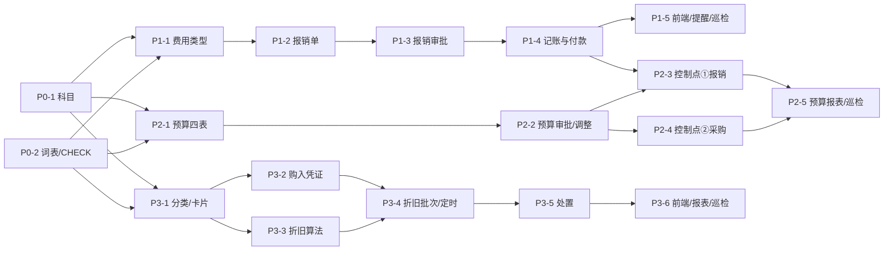

**排期建议（单人串行）**：第 0 期 1 天 → 第 1 期 5 天 → 第 2 期 6 天 → 第 3 期 8 天 = **20 人日**。

**可并行的部分**：P3-1 起（固定资产）与第 2 期（预算）**完全独立**，两个开发可以并线；唯一交点是 P0-2 的词表卡（必须先合）。

## 7.6 每张卡的通用验收口径（写进卡面）

1. `cargo check` 零警告、`cargo test` 全绿、`cargo clippy -- -D warnings` 干净；
2. 新增/修改的迁移能 **up → down → up** 三遍（`V0219` 之前的教训：down 写不好等于没有回滚）；
3. 每张卡必须新增至少 1 条负向单测（约束能拦 / 非法流转被拒）；
4. 涉及凭证的卡必须跑一次 `erp_invariants.py --group 会计`（A1–A5 全 PASS）；
5. 前端卡必须 `pnpm typecheck` 干净 + 至少一张真机截图（本仓惯例）。

---

# 第八章 风险、口径冲突、待拍板

## 8.1 实测发现的口径冲突（4 条冲突 + 1 条已核查不冲突）

### ① 管理费用科目：卡面写 6602，库里是 5602（**已处置：用 5602**）

| 事实 | 证据 |
|---|---|
| 库里有 `5602 管理费用`（末级、PROFIT_LOSS、借） | `select account_code from biz_account where account_code like '56%'` → 5601/5602/5603 |
| 库里**没有** 66xx 任何科目 | `select count(*) from biz_account where account_code like '66%'` → 0 |
| 利润表只认 5602 | `income_statement.rs:1191` `item("ADMIN_EXPENSE", "减：管理费用", 2, Some("5602"), …)` |
| PRD 附录 A.3 用的是企业会计准则编号（6602） | `docs/ERP-批次1-产品需求PRD.md:2128` 的科目种子表里写着 `6602 管理费用` |
| `V0183` 落库用的是小企业会计制度编号 | `V0183:119` `('5602','管理费用','PROFIT_LOSS','DEBIT')` |

**本设计的处置**：一律 `5602.xx`。**不新增 6602**，理由：加 6602 会让「管理费用」有两个一级科目，利润表的 `ADMIN_EXPENSE` 只映射 5602，6602 上的金额会**从利润表里消失**（比错更糟：报表少一行）。

**需要跟进的一件事**（不是本卡范围）：PRD 附录 A.3 与实现的口径差应写一条 ADR（`docs/adr-*.md`），否则下一个人还会照 PRD 写 6602。

### ② 2241 / 5602 是末级科目，但设计要求二级（**已处置：翻转 is_leaf**）

见 §6.6.2。风险已列，验收 SQL 已给。

### ③ `biz_voucher_rule` 只有一条（`PURCHASE_IN_DEFAULT`），且是「单借方」模型（**已处置：新增多借方入口**）

- 实测：`select rule_code,biz_type from biz_voucher_rule` → 只有 `PURCHASE_IN_DEFAULT`；
- 报销/折旧的借方天生多行（多费用科目 / 多部门），现有一张 rule 一个 `debit_account_id` 表达不了；
- **处置**：不改 `create_by_rule`（它是采购入库的既有路径，动了要回归六本账），新增一个并行的 `voucher::post_multi_debit`（§4.5.5），两条路共用 `post_voucher` 的平衡校验与库级 CHECK。

### ④ `erp_payable_due_scan` 等 4 条定时任务已占 7 点档（**已处置：错峰**）

见 §6.8 的修正（报销提醒改 `0 25 7 * * *`）。

### ⑤ 已核查：预算控制与「采购单金额分级审批」**不冲突**（本卡「停下来问」第 2 条的结论）

卡面要求「发现预算跟现有的采购单金额分级审批逻辑冲突 → 报告」。逐条比对后**结论是不冲突**，依据：

| 检查点 | 事实 | 是否冲突 |
|---|---|---|
| 金额分级在哪 | `po_approve` 流程定义里的 `CONDITION` 节点，条件取 `form.amount`（`V0182` 的 `c_low` / `c_mid`） | — |
| 预算守卫在哪 | `purchase_handler::submit_approval` 的**提交前**（状态机之前），与信用额度判定并列 | — |
| 两者是否改同一个字段 | 分级读 `form.amount`（含税金额），预算守卫只**追加** `form.over_budget` / `form.over_amount`，不碰 `form.amount` | ❌ 不冲突 |
| 是否互相覆盖结论 | 分级决定「走几个节点」，预算决定「能不能提交 / 是否强制审批」，**两个正交维度** | ❌ 不冲突 |
| 叠加后的行为是否合理 | 超预算的 8000 元采购：仍按分级走 `DEPT_LEADER`（一档），同时带 `over_budget=true`；客户若要「超预算再加一道财务」，在流程里加一个条件节点即可（P2-2b 的同款做法） | ✅ 合理 |

**唯一需要注意的一点**（写进 P2-4 卡）：预算守卫必须在 `published_po_flow()` 之前执行（与信用额度同位置），否则「没有已发布流程 + 超预算」这条组合路径会绕过预算判定。§3.5.2 的代码骨架已经把这个顺序写死了。

## 8.2 需要老板/产品拍板的 5 条（本卡不擅自决定）

| # | 待拍板 | 选项 | 我的建议 | 影响面 |
|---|---|---|---|---|
| 1 | 预算控制出厂默认 `WARN` 还是 `BLOCK` | A. `WARN`（标记 + 强制审批）B. `BLOCK`（409 硬拦） | **A**（与信用额度口径一致、忘编预算不停业） | 一条 `sys_config` + 守卫的一个分支；改成 B 不影响表结构 |
| 2 | 已入账报销的作废：直接作废 vs 走审批 | A. 财务权限 + 原因 + SOD 闸（v1 设计）B. 新增 `EXPENSE_CANCEL` 流程（与 `payable_cancel` 对齐） | **A**（v1），B 列 v2 | B 要加 1 个 `FlowBizType` + 1 条流程种子 + 1 张卡 |
| 3 | 报销第一审批人：直属上级 vs 部门主管角色 | A. `INITIATOR_SUPERIOR`（§4.4.1）B. `ROLE=DEPT_LEADER`（与 `po_approve` 一致） | **A**（避免自审、与预算责任人一致） | 只影响流程种子的一个节点配置；改 B 是改种子，不用改代码 |
| 4 | 两张付款表是否合并为多态 `biz_payment_doc` | A. 保持独立（`biz_payment` + `biz_expense_payment`）B. 重构成多态表 | **A**（v1），B 是一次独立演进 | B 要迁移 `biz_payment` + 改 `payable_payment.rs` 6 个函数 + 全量回归 A/B/E 组 |
| 5 | 折旧费用科目是否要进生产成本 | A. 全部进 5602.01（管理费用）B. 生产设备配 4101 制造费用 | **A 默认 + B 可配**（`biz_asset_category.expense_account_id` 已支持） | 零代码（改分类配置即可）；但 B 的正确性依赖 ARCH-4 的成本核算口径 |

## 8.3 与 ARCH-4 / ARCH-5 的耦合风险

| 风险 | 描述 | 缓解 |
|---|---|---|
| **ARCH-5 表单设计器** | ARCH-5 设计了 `biz_flow_form_def` / `biz_flow_form_data`（**尚未落地**），报销单将来可能被要求「用表单定义驱动」 | 本设计的 `form_data` 键名（`form.amount` 等）与 ARCH-5 的 `form.xxx` 命名一致；将来迁移时只需把表单定义映射到同样键名，**流程定义一行不用改** |
| **ARCH-5 节点类型扩展** | ARCH-5 把 `node_type` 扩到 15 种（FORM/CHECKLIST/EVIDENCE） | 本设计只用今天库里的 9 种；**审批不受影响**（扩节点类型是加法，不改语义） |
| **ARCH-4 成本核算** | 生产设备折旧应进 `4001/4101` 还是 `5602`？ | 分类级配置 `expense_account_id`，ARCH-4 落地后改配置即可（§8.2-5） |
| **ARCH-4 发票税务** | 报销的进项税抵扣与「发票认证」的关系 | 本设计只记「税额 + 是否可抵扣」，不碰认证；ARCH-4 落地后可在明细上加认证状态（加列，不改本设计） |
| **ARCH-4 销售链** | 报销与销售无交集 | 无 |

## 8.4 三条「不会做但要说清」的事

1. **不做预算的「控制点 ③ 付款」**（D4）——理由见 §2.4，将来有人提，直接指回去。
2. **不做折旧补提**（D7）——理由见 §2.7.3。
3. **不做「员工退款」**（报销多付退回）——v1 明确不支持，报文指向「财务手工做红字凭证 + 现金收款凭证」。

---

# 附录 A 索引（DDL 都在正文，不重复粘贴）

| 表 | 章 | 行数（约） | 索引 | CHECK | 备注 |
|---|---|---|---|---|---|
| `biz_budget` | §3.2.1 | 60 | 6 | 8 | 槽级 ACTIVE 唯一是核心 |
| `biz_budget_period` | §3.2.2 | 25 | 2 | 4 | 父子 CASCADE |
| `biz_budget_usage` | §3.2.3 | 55 | 4 | 7 | 幂等唯一键 |
| `biz_budget_subject_map` | §3.2.5 | 30 | 3 | 3 | 采购预算科目来源 |
| `biz_expense_type` | §4.2.1 | 30 | 3 | 5 | 8 条种子 |
| `biz_expense_report` | §4.2.2 | 75 | 8 | 11 | 价税恒等 + 付款自洽 |
| `biz_expense_item` | §4.2.3 | 35 | 4 | 6 | 无软删（随主单重建） |
| `biz_expense_payment` | §4.2.4 | 30 | 3 | 3 | 与 `biz_payment` 同构不共用 |
| `biz_asset_category` | §5.2.1 | 28 | 2 | 4 | 折旧方法单一值 |
| `biz_fixed_asset` | §5.2.2 | 75 | 7 | 11 | 净值恒等 + 来源唯一 |
| `biz_fixed_asset_change` | §5.2.3 | 30 | 2 | 3 | append-only |
| `biz_depreciation_batch` | §5.2.4 | 32 | 4 | 6 | 期间唯一 = 幂等 |
| `biz_depreciation` | §5.2.5 | 30 | 4 | 7 | 资产×期间唯一 |

# 附录 B 巡检不变量总表（`erp_invariants.py` 增量 23 条）

| 组 | # | 不变量 | 级别 | 章 |
|---|---|---|---|---|
| **J 预算** | J1 | 同一槽同时只有一个 ACTIVE 版本 | BLOCKER | §3.2.1 |
| | J2 | `Σ biz_budget_period.amount = biz_budget.total_amount` | WARN | §3.1.2 |
| | J3 | usage 的来源单据存在且状态可解释（非 DRAFT 的单据才有 usage） | BLOCKER | §3.1.3 |
| | J4 | CONSUMED 的 usage 金额合计 = 对应报销单 `total_with_tax` | BLOCKER | §4.6 |
| | J5 | `biz_budget_usage.fiscal_year = left(period_code,4)` | BLOCKER | §3.2.4 |
| **K 资产** | K1 | `monthly_depreciation = round(base/months,4)` | WARN | §5.4.2 |
| | K2 | 卡片累计折旧 = Σ POSTED 折旧明细 | BLOCKER | §5.5.4 |
| | K3 | `accumulated ≤ base` 且 `net = original − accumulated` | BLOCKER | §5.2.2 |
| | K4 | 批次 `total_amount` / `asset_count` 与明细一致 | BLOCKER | §5.2.4 |
| | K5 | 1602 贷方余额 = Σ 卡片累计折旧 | BLOCKER | §5.8.3 |
| | K6 | 1601 借方余额 = Σ 未处置卡片原值 | BLOCKER | §5.8.3 |
| | K7 | 已处置资产的 1606 余额 = 0 | WARN | §5.6.4 |
| | K8 | 同一资产同一期间只有一条 POSTED 折旧 | BLOCKER | §5.2.5 |
| | K9 | POSTED 批次的期间必须存在 | WARN | §5.5.1 |
| | K10 | DISPOSED 资产必有 DISPOSAL 变动行 | BLOCKER | §5.2.3 |
| **L 报销** | L1 | 主表 `total_with_tax = Σ明细` 且 `item_count = count` | BLOCKER | §4.2.2 |
| | L2 | APPROVED/PAID 必有凭证且凭证未软删 | BLOCKER | §4.5.1 |
| | L3 | 计提凭证借方合计 = `total_with_tax`，贷方全为 2241.01 | BLOCKER | §4.5.1 |
| | L4 | 2241.01 贷方余额 = Σ(`total_with_tax` − `paid_amount`) | BLOCKER | §4.8.3 |
| | L5 | 审批已 APPROVED 但单据仍 SUBMITTED 超 10 分钟 | BLOCKER | §4.4.4 |
| | L6 | `pay_status` 与 `paid_amount` 三值完备 | WARN | §4.2.2 |
| | L7 | CANCELLED 且曾入账的单据，计提凭证必须已红冲 | BLOCKER | §4.3.3 |
| | L8 | usage 合计（受预算控制的明细）= `total_with_tax` 对应部分 | WARN | §4.6 |

**加巡检的三条纪律**（沿用现有 993 行脚本的写法）：

1. 每条 FAIL 必须给出「差多少 + 差在哪几条」（`locator_sql` 参数）；
2. 新表还没上线的库要能跑完（用现成的 `table_exists()` 跳过，不整组炸）；
3. BLOCKER 才进 `scripts/check.sh` 的闸（WARN/INFO 只记录）。

# 附录 C 术语与口径表

| 术语 | 定义 | 出处 |
|---|---|---|
| 预算槽 | `dept_id + account_id + fiscal_year` 三元组 | §2.5 |
| 占用中 / 已执行 / 已释放 | usage 的三个状态 | §3.1.3 |
| 策略 B | 超限不拒绝、标记 + 强制审批 | §2.3（源自 `purchase_credit.rs`） |
| 可折旧总额 | 原值 − 预计净残值 | §5.3.2 |
| 起提日 | 购入次月 1 日（当月增加不提） | §5.4.1 |
| 尾差期 | 折旧的最后一个月（补齐差额） | §5.4.3 |
| 直购 / 存货转入 | `DIRECT_BUY` / `FROM_STOCK` | §5.3.3 |
| 应付 vs 报销 | 供应商 vs 员工，2202 vs 2241.01 | §2.1 / §4.1 |
| 单体辅助核算 | 凭证分录的 `aux_dept_id`（部门维度） | §1.3 |

# 附录 D 证据清单（可复跑）

## D.1 环境

```bash
# 本机生产库不存在（说明本卡实测不是对生产库）
psql -h 127.0.0.1 -U cloudpivot -d cloudpivot -tAc "select 1"
# psql: error: connection to server ... FATAL: database "cloudpivot" does not exist

# 本卡实测库（已应用到 V0219）
su -s /bin/sh postgres -c "psql -d cloudpivot_audit -tAc \"select source from schema_migrations where source like '%V02%' order by source desc limit 1\""
# migrations/business/V0219__erp_p2_5_biz_type_vocabulary.up.sql

# 表数量
su -s /bin/sh postgres -c "psql -d cloudpivot_audit -tAc \"select count(*) from information_schema.tables where table_schema='public' and table_name like 'biz_%'\""
# 57
```

## D.2 科目（§1.2 / §8.1 的依据）

```bash
su -s /bin/sh postgres -c "psql -d cloudpivot_audit -tAF'|' -c \"select account_code,account_name,level,is_leaf,account_category,balance_direction from biz_account where account_code in ('1002','1601','1602','1606','1901','2202','2211','2221.01','2241','5301','5602','5711') order by 1\""
# 1002|银行存款|1|1|ASSET|DEBIT
# 1601|固定资产|1|1|ASSET|DEBIT
# 1602|累计折旧|1|1|ASSET|CREDIT
# 1606|固定资产清理|1|1|ASSET|DEBIT
# 1901|待处理财产损溢|1|1|ASSET|DEBIT
# 2202|应付账款|1|1|LIABILITY|CREDIT
# 2211|应付职工薪酬|1|1|LIABILITY|CREDIT
# 2221.01|应交税费-进项税|2|1|LIABILITY|CREDIT
# 2241|其他应付款|1|1|LIABILITY|CREDIT      ← 末级，要翻
# 5301|营业外收入|1|1|PROFIT_LOSS|CREDIT
# 5602|管理费用|1|1|PROFIT_LOSS|DEBIT       ← 末级，要翻
# 5711|营业外支出|1|1|PROFIT_LOSS|DEBIT

su -s /bin/sh postgres -c "psql -d cloudpivot_audit -tAc \"select count(*) from biz_account where account_code like '66%'\""
# 0   ← 没有 6602
```

## D.3 凭证与规则（§1.3 / §6.4）

```bash
su -s /bin/sh postgres -c "psql -d cloudpivot_audit -tAF'|' -c \"select (select count(*) from biz_voucher), (select count(*) from biz_voucher_entry), (select count(*) from biz_voucher_entry where aux_dept_id is not null), (select count(*) from biz_voucher_entry where aux_supplier_id is not null)\""
# 5|13|0|5

su -s /bin/sh postgres -c "psql -d cloudpivot_audit -tAF'|' -c \"select rule_code,biz_type,is_active from biz_voucher_rule\""
# PURCHASE_IN_DEFAULT|PURCHASE_IN|1     ← 只有一条
```

## D.4 应付 / 付款（§1.4 / D1）

```bash
su -s /bin/sh postgres -c "psql -d cloudpivot_audit -tAF'|' -c \"select column_name,is_nullable from information_schema.columns where table_name='biz_payable' and is_nullable='NO' order by ordinal_position\""
# id|NO payable_no|NO supplier_id|NO source_type|NO source_id|NO source_no|NO
# currency_code|NO amount|NO paid_amount|NO unpaid_amount|NO credit_days|NO
# due_date|NO period_code|NO status|NO created_at|NO updated_at|NO

su -s /bin/sh postgres -c "psql -d cloudpivot_audit -tAc \"select pg_get_constraintdef(oid) from pg_constraint where conrelid='public.biz_payment'::regclass and contype='f'\""
# FOREIGN KEY (payable_id) REFERENCES biz_payable(id)
```

## D.5 审批流（§1.5 / D9）

```bash
su -s /bin/sh postgres -c "psql -d cloudpivot_audit -tAF'|' -c \"select flow_code,biz_type,status,current_version_no from biz_flow_def where deleted_at is null order by flow_code\""
# 11 条（见 §1.5 全文），无 EXPENSE / BUDGET_APPROVE / ASSET_DISPOSAL

su -s /bin/sh postgres -c "psql -d cloudpivot_audit -tAc \"select pg_get_constraintdef(oid) from pg_constraint where conrelid='public.biz_flow_node'::regclass and contype='c' and pg_get_constraintdef(oid) like '%node_type%'\""
# CHECK (node_type IN ('START','APPROVAL','COUNTERSIGN','CONDITION','PARALLEL','CC','END','TASK_NODE','NOTIFY_NODE'))

su -s /bin/sh postgres -c "psql -d cloudpivot_audit -tAF'|' -c \"select role_code from sys_role where deleted_at is null order by 1\""
# AUDIT_MAKER / DEPT_LEADER / FINANCE_DIRECTOR / FINANCE_MANAGER / FLOW_CONFIG_APPROVER
# GENERAL_MANAGER / PURCHASE_MANAGER / SUPER_ADMIN / WAREHOUSE_MANAGER
```

## D.6 扩展位点（§1.6 / §6.5）

```bash
su -s /bin/sh postgres -c "psql -d cloudpivot_audit -tAc \"select pg_get_constraintdef(oid) from pg_constraint where conname like '%doc_attachment_type%'\""
# CHECK (doc_type IN ('CONTRACT','PURCHASE_ORDER','STOCK_IN','PAYABLE','PAYMENT'))

su -s /bin/sh postgres -c "psql -d cloudpivot_audit -tAc \"select pg_get_constraintdef(oid) from pg_constraint where conname like '%reminder_log_doc_type%'\""
# CHECK (doc_type IN ('PAYABLE','PURCHASE_ORDER','CONTRACT','INVENTORY'))

su -s /bin/sh postgres -c "psql -d cloudpivot_audit -tAF'|' -c \"select job_name,cron_expr from sys_job where deleted_at is null order by 1\""
# erp_contract_expire_scan|0 30 7 * * *
# erp_low_stock_scan|0 40 7 * * *
# erp_payable_due_scan|0 10 7 * * *
# erp_po_overdue_scan|0 20 7 * * *
```

## D.7 算例（§4.5.2 / §5.4.3 的数字）

```bash
su -s /bin/sh postgres -c "psql -d cloudpivot_audit -tAF'|' -c \"
select '折旧: base', (100000*0.95)::numeric(18,4), 'monthly', round((100000*0.95)/60,4),
       's59', round((100000*0.95)/60,4)*59, 'last', (100000*0.95)-round((100000*0.95)/60,4)*59;
\""
# 折旧: base|95000.0000|monthly|1583.3333|s59|93416.6647|last|1583.3353

su -s /bin/sh postgres -c "psql -d cloudpivot_audit -tAF'|' -c \"
select 'travel', round(3180/1.06*0.06,2), 3180-round(3180/1.06*0.06,2)
union all select 'hotel', round(2120/1.06*0.06,2), 2120-round(2120/1.06*0.06,2)
union all select 'meal(no-deduct)', 0::numeric, 1060::numeric
union all select 'office', round(240/1.13*0.13,2), 240-round(240/1.13*0.13,2);
\""
# travel|180.00|3000.00
# hotel|120.00|2000.00
# meal(no-deduct)|0|1060
# office|27.61|212.39
```

## D.8 代码基线（每条都能 `grep` 到）

| 结论 | 命令 | 输出 |
|---|---|---|
| 报销无 ERP 审批桥接（`FlowBizType::Expense` 只有枚举） | `grep -rn "FlowBizType::Expense" backend/src` | 5 处全在 `doc_kind.rs` |
| 凭证生成唯一实现 | `grep -n "pub async fn create_by_rule" backend/src/business/erp/voucher.rs` | `1472` |
| 红冲唯一实现 | `grep -n "pub async fn reverse_posted" …` | `2014` |
| 部门辅助账已支持 | `grep -n "AUX_DEPT" backend/src/business/erp/ledger.rs` | `713` `("DEPT", "aux_dept_id")` |
| 供应商信用额度是策略 B | `sed -n '1,60p' backend/src/business/erp/purchase_credit.rs` | 整篇注释 |
| 采购提交是预算守卫的挂点 | `grep -n "pub async fn submit_approval" backend/src/business/erp/purchase_handler.rs` | `1006` |
| 状态机实体注册表 | `grep -n "pub enum Entity" backend/src/business/shared/state_machine.rs` | `703` |

---

## 收尾：三句话总结这份设计

1. **三块都长在现有底座上**：13 张新表、0 处存量表结构改动、2 处 CHECK 放宽、34 个权限码、3 条定时任务、3 条新流程 + 1 条启用——凭证/状态机/审批/附件/提醒/巡检全部复用。
2. **四个「被要求回答的问题」都有明确答案**：报销 vs 应付 → **独立建表**（§2.1，7 条 NOT NULL 挡死）；预算控制点 → **只有报销提交与采购提交两处**（§2.4）；折旧方法 → **只有平均年限法**（§2.6）；超预算 → **标记 + 强制审批，409 只在显式开启 BLOCK 时**（§2.3）。
3. **18 张卡、20 人日、四期**，报销先行（最快见效）、预算其次（两个控制点齐了才有意义）、固资最后（可并行）。

**给老板的一句话**（200 字）：

> 这次补的三块是「钱花出去之前、之中、之后」三个断点：**预算**管「能不能花」（部门×科目的额度摆在那里，超了系统不拦死、但必须有人批），**报销**管「垫出去的钱怎么回来」（员工填单、按金额分级审批、自动做费用凭证、付款自动冲平，员工不再当供应商管），**固定资产**管「买回来的东西怎么慢慢变成成本」（建卡、每月自动计提折旧、处置时一次性结清）。三块都长在现有财务底座上：凭证引擎、审批引擎、期间结账、状态机、附件、巡检一个都不重写，只加表和接线。合计 13 张新表、18 张实施卡，建议先做报销（最快见效）、再做预算、最后做固定资产。
