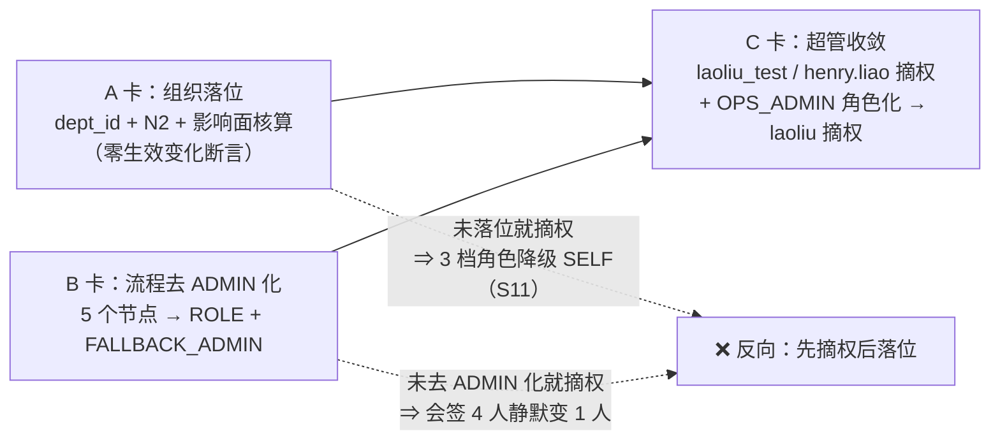

# P0-FIX-2B 决策：生产组织落位与超管收敛

> 卡片：`t_357756a7`（architect）｜上游：`t_577713e9`（P0-FIX-2 配置面收口，commit `a0363eb`）
> 日期：2026-11-05｜状态：**accepted（架构决策已定，执行受 `docs/待决策.md` 铁律门控）**
> 证据目录：`docs/evidence/20261105-p0fix2b/`（生产 144 只读实测，2026-11-05 13:2x CST）
> 本文件只回答「怎么定」，不代替执行；执行拆成 3 张卡（见 §9）。

---

## 0. 结论摘要（先看这张表）

| 编号 | 决策点 | 结论（一句话） | 硬依据 |
|:--:|---|---|---|
| **D-1** | 组织落位 | **不新增部门**。HQ（总部）承接「职能 / 平台 / 测试」人员，业务部门只放业务岗：`admin`/`laoliu`/`cl_43870` → HQ，`laoliu_test` → TECH，`henry.liao` **暂不落位**（身份未定），`verify-ai`（ROBOT）与 3 个锁定 QA 夹具**不落位** | 9 账号实测（§1.1）；4 部门树（§1.2） |
| **D-2** | 超管口径 | **目标 1 个真超管（`admin`，系统内置）**。`laoliu_test` 摘权（去 `SUPER_ADMIN` **和** `GENERAL_MANAGER`，保留 3 档业务角色）；`henry.liao` 待身份确认后再定；`laoliu` 先角色化（新增 `OPS_ADMIN`）再摘权 | `GENERAL_MANAGER` 只有 **12** 个权限码 vs `SUPER_ADMIN` **274**（§1.5） |
| **D-3** | 历史 846 行 `biz_task.dept_id` | **不回填**。只保证新单正确；`biz_project` 4 行同口径 | 846 行里 **766 行已软删**，存活 80 行的负责人全是平台/测试号（§1.3） |
| **D-4** | 顺序 | **先「流程去 ADMIN 化」，后「摘超管」，不可颠倒**（同窗口做也可以，但不能只做后一半） | 5 个 `assignee_type=ADMIN` 节点直接解析 `sys_user_role ⋈ SUPER_ADMIN`（§1.6） |
| **D-5** | 回归巡检 | 新增 **N2**（在用 HUMAN 账号必须 `dept_id NOT NULL`，WARN）；**N3**（有部门类审批节点 ⇒ 部门 `leader_id` 必填）**只登记、暂不开卡**（理由见 §5.2） | 4 个部门 `leader_id` **全 NULL**（§1.2） |
| **D-6** | 部门负责人 `leader_id` | 本卡**不设**（现有「人」里没有真实部门负责人；把测试号设成主管 = 重演 `TK-20261031-000007` 卡单事故），只写明触发条件 | `assignee.rs:943-985` |
| **D-7** | 部门快照兜底 | **不改代码**。新单 `dept_id` 仍取「负责人所在部门」；负责人无部门时落 NULL 是**预期**（ROBOT），靠 N2 把「HUMAN 负责人无部门」挡在门外 | `task/handler.rs:409` |

> 一句话总结：**这卡要修的不是「配置」，是「人和组织对不上」**。配置（`sys_role_dept`/`data_scope`）
> 已经在 `t_577713e9` 修好了；本卡定的是把人放进组织树、把超管收敛到 1 个，并明确「历史数据不回填」。

---

## 1. 事实基线（生产 144 只读实测，不是推断）

复跑方式见 `docs/evidence/20261105-p0fix2b/README.md`；以下每条都能用目录里的 SQL 打出来。

### 1.1 在用账号全景（9 个）

| 账号 | real_name | user_type | 锁定 | 部门（今天） | 持有角色 | 30 天成功登录 |
|---|---|---|:--:|---|---|--:|
| `admin` | 超级管理员 | HUMAN | 否 | **(无部门)** | `SUPER_ADMIN` | 678 |
| `laoliu` | 老六 | HUMAN | 否 | **(无部门)** | `SUPER_ADMIN` | 192 |
| `laoliu_test` | 老六测试号 | HUMAN | 否 | **(无部门)** | `SUPER_ADMIN` + `GENERAL_MANAGER` + `DEPT_LEADER` + `PURCHASE_MANAGER` + `WAREHOUSE_MANAGER` | 552 |
| `henry.liao` | Henry.Liao | HUMAN | 否 | **(无部门)** | `SUPER_ADMIN` + 上述 4 个业务角色 | 114 |
| `cl_43870` | 日志测试43870 | HUMAN | 否 | **(无部门)** | **无角色** | 0 |
| `verify-ai` | 验证AI | **ROBOT** | 否 | **(无部门)** | **无角色** | 0 |
| `qa.limited` | 受限管理员 | HUMAN | 是 | TECH 技术部 | `QA_LIMITED` | 2 |
| `qa.mutex` | 双持用户 | HUMAN | 是 | SALES 销售部 | `MUTEX_A`、`MUTEX_B` | 1 |
| `qa.viewer` | E2E改名 085535 | HUMAN | 是 | **(无部门)** | `QA_VIEWER` | 2 |

- 「7/9 无部门」成立：`admin`、`laoliu`、`laoliu_test`、`henry.liao`、`cl_43870`、`verify-ai`、`qa.viewer`。
- 其中 `qa.viewer` 是**锁定**的 E2E 夹具，`verify-ai` 是 **ROBOT**（`sys_ai_agent` 有 1 行，profile 自动创建）。
- 真正每天在用的人只有 4 个：`admin` / `laoliu` / `laoliu_test` / `henry.liao`（最后 30 天都有成功登录）。

### 1.2 组织树（4 个部门，扁平挂在 HQ 下，负责人全空）

```
HQ 云枢总部 (root, dept_path=/…ead5cd/)
├── FIN 财务部
├── SALES 销售部
└── TECH 技术部
```

`select dept_code, leader_id from sys_dept;` → **4 行 leader_id 全为 NULL**。
这不是「配置遗漏」的细节，它直接决定审批能不能解析出人（见 §1.6 与 D-6）。

### 1.3 业务数据规模：历史任务基本是测试残留

| 表 | 行数 | `dept_id` 非空 | 存活（`deleted_at IS NULL`） |
|---|--:|--:|--:|
| `biz_task` | **846** | **0** | **80**（766 行已软删 = 90.6%） |
| `biz_project` | 4 | 0 | 3 |
| `biz_budget` | 0 | 0 | 0 |
| `biz_expense_report` | 0 | 0 | 0 |
| `sys_user` | 9（在用）/ 26（含软删） | 2 | — |

存活 80 条任务的负责人分布（全部是平台/测试号）：

| 负责人 | 存活任务 | 今天有部门吗 |
|---|--:|---|
| `laoliu` | 67 | 否 |
| `laoliu_test` | 9 | 否 |
| `admin` | 2 | 否 |
| `verify-ai` | 1 | 否（ROBOT） |
| `henry.liao` | 1 | 否 |

`biz_project` 4 行全部 `owner_id = admin`、`create_by = admin`，`biz_project_member` **0 行**。

> **这条决定了 D-3**：把「846 行 100% NULL」当成「必须回填的数据债」是错的——它不是业务数据，
> 是过去 4 天的 E2E/自测产物，其中 90.6% 已经被软删。

### 1.4 为什么 `dept_id = NULL` 会让部门范围「裁不到行」

两处代码，缺一不可：

1. **建单落快照**：`backend/src/business/task/handler.rs:409` → `model::user_dept(owner_id)`；
   负责人没部门 ⇒ 快照写 NULL ⇒ `scope::filter_for` 生成 `t.dept_id = ANY(…)` 永远匹配不到。
   任务可见性退化成「范围 ∪ 参与关系」里的第二个分支（只看自己参与的）。
2. **解析不出部门就降级**：`principal.rs::merge_scope_rows`（:396-471）里，持有 2/3/5 档角色但
   `dept_ids` 解析为空 ⇒ 一律 `ScopeKind::SelfOnly`（S10/S11，注释写的是「绝不放行」）。
   也就是说：**给一个人配了部门级角色、却没给他部门，结果是「他只能看自己」**——比不配更糟，
   因为界面还显示「本部门及以下」。

所以 D-1 不是「让人填个字段」，而是「让 3 档/5 档授权从『恒不生效』变成『可生效』」的开关。

### 1.5 超管收敛的量化代价：`GENERAL_MANAGER` ≠ `SUPER_ADMIN`

| 角色 | data_scope | 权限码数（`sys_role_menu`） |
|---|:--:|--:|
| `SUPER_ADMIN` | 1 全部 | **274** |
| `FINANCE_MANAGER` | 5 {FIN} | 56 |
| `DEPT_LEADER` | 3 | 46 |
| `QA_LIMITED` | 1 | 30 |
| `WAREHOUSE_MANAGER` | 3 | 18 |
| `PURCHASE_MANAGER` | 3 | 12 |
| `GENERAL_MANAGER` | 1 全部 | **12** |
| `FLOW_CONFIG_APPROVER` | 1 | 8 |

**「`GENERAL_MANAGER` 已是 ALL，可承接老板看全部」这句话只对「行级数据可见性」成立，对「能不能进这个页面」不成立。**
把 `laoliu` 的超管摘掉、只留 `GENERAL_MANAGER`，他会立刻失去 **262 个权限码**（用户管理、角色配置、
字典/配置/文件/日志/定时任务…全部变成 403）——他现在的日常（部署、账号、配置）就做不了了。

> 这是 D-2 里「`laoliu` 先角色化再摘权」的原因，也是本卡要求**不要**把「超管收敛」做成一句
> `delete from sys_user_role where role_code='SUPER_ADMIN'` 的原因。

### 1.6 超管集不是「权限」，是**审批人来源**（本卡最大的隐藏耦合）

`biz_flow_node.assignee_type='ADMIN'` 的解析口径是「持有 `SUPER_ADMIN` 的所有人」
（`flow/assignee.rs:21` 的表格与 `:755` 的 `ADMIN 命中 N 行`）。生产 14 个已发布流程里有 5 个这样的节点：

| 流程 | 节点 | 名称 | 模式 | 实际解析成谁（今天 4 个超管） |
|---|---|---|:--:|---|
| `payable_pay` | `n_dept` | 部门主管审批 | ALL | 4 个超管 |
| `payable_pay` | `n_fin` | 财务经理审批 | ALL | 4 个超管 |
| `payable_pay` | `n_board` | **财务总监 + 总经理会签** | **ALL 会签** | **4 个超管**（跟「财务总监/总经理」没关系） |
| `stock_in_cancel` | `n_review` | 作废复核 | ALL | 4 个超管 |
| `stock_transfer` | `n_approve` | 超管审批 | ALL | 4 个超管 |

结论两条，都很硬：

1. **今天的「财务总监 + 总经理会签」其实是「4 个超管会签」**——节点名和实际授权对象不一致，
   这本身就是一处静默的规则失真（不修也不算本卡范围，但必须写下来，否则「收敛超管」会被误认为纯权限操作）。
2. **摘一个超管 = 同时改 5 个审批节点的审批人集合**。如果先把超管从 4 摘到 1，`payable_pay` 的
   「会签」会变成 **admin 单人审批**，这是**降低复核强度**，而且没人会注意到。
   所以 D-4 定死顺序：**先把这 5 个节点改成业务角色节点（`ROLE` + `FALLBACK_ADMIN` 兜底），再摘超管。**

补一条机制细节（B 卡施工时会踩）：多角色节点是**候选并集**——`assignee.rs::resolve` 把所有绑定 `ROLE` 的成员
并成一个候选集再走 `finalize`（停用剔除 → ROBOT 过滤 → 去重 → 自审 → 空审批人策略）。所以
`payable_pay.n_board` 改成 `ROLE{FINANCE_DIRECTOR, GENERAL_MANAGER}` 之后，因为 `FINANCE_DIRECTOR` **今天 0 成员**，
它**不会**落 `FALLBACK_ADMIN`，而是「只解析出总经理」——会签人数 1~2 人且其中没有财务总监。
这是「岗位空缺」而不是「配置错误」，B 卡只负责把来源改对，不负责把人补上（那是组织决策，见 D-6）。

### 1.7 存量待办：摘权不会让它们消失（D13 冻结）

```
PENDING 实例 2 张：
FLW-20261102-94417B93 (PO_APPROVE)      → henry.liao:APPROVED  laoliu_test:PENDING
FLW-20261105-5D6B0905 (STOCK_TAKE_POST) → henry.liao:PENDING   laoliu_test:PENDING
```

待办归属是 `biz_flow_task.assignee_id`（user_id），不是角色；**摘超管不会回收已经落下去的待办**。
所以：(a) 这两张单不会因为摘权变红；(b) 它们仍然只能由这两个人自己投——**摘权不是解卡手段**，
解卡要走 `docs/待决策.md` ③（撤销/继续）的既有口径。两条互不替代，别混。

---

## 2. D-1 组织落位（决定：不新增部门 + 目标态映射）

### 2.1 决策

**不新增部门。** 4 个部门够用，语义按「总部 = 职能/平台，业务部门 = 业务岗」切分：

```
HQ 云枢总部（职能总部：系统管理 / 平台实施 / 测试 / 客户走查）
├── FIN 财务部     ← 业务岗
├── SALES 销售部   ← 业务岗
└── TECH 技术部    ← 业务岗（本卡用来承接测试号：3 档范围在 TECH 上真的会收紧）
```

| 账号 | 目标 `dept_id` | 目标角色 | 生效范围变化 | 门控 |
|---|---|---|---|---|
| `admin` | **HQ** | `SUPER_ADMIN`（唯一保留） | 无（超管短路） | — |
| `laoliu` | **HQ** | `GENERAL_MANAGER` + `OPS_ADMIN`（新增，见 D-2） | 落位阶段无（仍超管） | 摘权在 C 卡 |
| `laoliu_test` | **TECH** | 去 `SUPER_ADMIN`、去 `GENERAL_MANAGER`；保留 `DEPT_LEADER`/`PURCHASE_MANAGER`/`WAREHOUSE_MANAGER` | 落位阶段无（仍超管）；摘权后 = TECH 子树 | 老大确认（`待决策.md` ②） |
| `cl_43870` | **HQ** | 不动（无角色 → SELF） | 无 | — |
| `henry.liao` | **暂不落位（NULL）** | 暂不动 | 无 | 老大确认身份（`待决策.md` ①） |
| `verify-ai` | **不落位**（ROBOT 不进组织树） | 不动 | 无 | — |
| `qa.limited` | **TECH（不动）** | 不动 | 无 | 夹具语义 |
| `qa.mutex` | **SALES（不动）** | 不动 | 无 | 夹具语义 |
| `qa.viewer` | **不落位**（锁定夹具，P0-FIX-3 收口） | 不动 | 无 | — |

### 2.2 为什么是这张表（逐条理由）

- **`laoliu_test` → TECH 而不是 HQ**：他还挂着 `DEPT_LEADER`(3)/`PURCHASE_MANAGER`(3)/`WAREHOUSE_MANAGER`(3)。
  3 档 = 本部门及以下（`DEPT_CHILD` 走 `dept_path` 子树）。若落在 **HQ（根）**，子树 = 全公司 ⇒
  **摘掉超管后他的范围仍然是「全部」**，等于白摘。落在 TECH，范围就真的收成 TECH 子树——
  这也让「测试号」在生产上变成一台可用的部门隔离验证机。
- **`admin` 落 HQ 而不是留 NULL**：它是**唯一**保留的超管，理论上部门无所谓（S9 短路）；但留 NULL 会让
  「无部门账号」这个告警源永远亮着，后续 N2 就必须为它开豁免口子——**巡检一旦有豁免名单，就没人再看它了**。
  落 HQ 成本 1 行 UPDATE、可逆、语义也对（系统管理归总部职能）。
- **`cl_43870` 落 HQ 而不是「反正要删」**：同上，它是 `HUMAN`、未锁定、`status=1`，按 N2 判据就是「在用账号」。
  它 0 次登录、4 条任务全软删，落位不影响任何人；留给 P0-FIX-3 连号一起处理。
- **`henry.liao` 不落位**：`docs/待决策.md` 铁律——「未获老大书面确认前 prod 数据与账号一律不动」，
  且他正是待决事项①的主角。**本决策不为他编造部门**；确认后按 §2.3 的两个预设分支走。
- **`verify-ai` 不落位**：`user_type=ROBOT`、`sys_ai_agent` 有对应行。AI 用户不该进组织树：
  一旦进树，`sys_user` 的部门列表就开始展示「机器人」，而它的任务快照语义也无法解释。它的可见性
  按 `sys_ai_agent` 归属 + 参与关系解决（今天它 1 条存活任务，靠参与关系可见即可）。
- **`qa.*` 不动**：`qa.limited`(TECH)/`qa.mutex`(SALES) 的部门是**夹具语义的一部分**（专门用来验跨部门隔离），
  动它会让既有 E2E 用例假红。`qa.viewer` 无部门且锁定，本卡不碰，P0-FIX-3 清场时一并收。

### 2.3 `henry.liao` 的预设分支（确认后照此执行，无需再决策）

| 老大回答 | 落位 | 角色 | 生效范围 |
|---|---|---|---|
| **内部业务同学** | 按其归属部门（财务 → FIN / 销售 → SALES / 技术 → TECH；说不出就 HQ） | 摘 `SUPER_ADMIN`；保留其岗位角色（`DEPT_LEADER` 或对应业务角色）+ `GENERAL_MANAGER` 视职责 | 部门子树（业务岗）或 ALL（若保留 GM） |
| **客户 / 业务侧演示号** | **HQ** | 摘 `SUPER_ADMIN`；改「对客演示」角色 = 只读权限码集、`data_scope=4`（仅本人） | 仅本人（演示看板/单据走「指定单据分享」或隔离实例） |

两种分支都**必须摘 `SUPER_ADMIN`**（这是 4 个超管里最没理由的一个：客户/访客持有系统最高权限，
且他还是 `TK-20261031-000007` 的会签人之一）。但摘权时点受 D-4 约束。

### 2.4 被否的方案

| 方案 | 否的理由 |
|---|---|
| **全部 9 个账号都落 HQ** | 落完 `HQ` 子树 = 全公司 ⇒ 任何 3 档角色等于 ALL，「部门范围」永久无法生效。落位变成走过场。 |
| **新增 `OPS` 平台运维部 + `QA` 质量部** | 9 个账号里 8 个是平台/测试/AI/残留（只有 `henry.liao` 可能是业务侧），为工具账号造两个部门，等于让组织树为工具服务；真实业务部门（FIN/SALES/TECH）反而继续空着。触发条件见 §2.5。 |
| **admin 留 NULL（系统号豁免）** | 会让 N2 必须维护豁免名单；而「无部门账号」正是本卡要消灭的告警源（见 §2.2）。 |
| **把 `laoliu_test` 落 HQ** | 摘超管后范围仍 = 全公司（HQ 子树），摘权无效（见 §2.2）。 |

### 2.5 翻案判据（什么时候该加部门）

任一条成立就重新评估「新增部门」，否则维持 4 部门：

- 运维/QA 的**人**（不是账号）≥ 3 人，或需要按部门核算成本；
- 出现第三个业务部门（采购/仓储/生产）需要独立可见性边界——注意这属于业务组织扩张，与本卡无关；
- 真实业务用户 ≥ 10 人且开始抱怨「总部的人能看到我们的任务」。

---

## 3. D-2 超管口径（决定：1 个真超管）

### 3.1 决策

| 账号 | 今天 | 目标 | 手法 | 时点 |
|---|---|---|---|---|
| `admin` | 超管 | **超管（唯一）** | 不动 | — |
| `laoliu` | 超管 | `GENERAL_MANAGER` + **新增 `OPS_ADMIN`** | 先建 `OPS_ADMIN`（复刻系统管理类权限码 + `data_scope=1`），授予并验证日常运维动作全通，**再**摘超管 | C 卡（且需先 A/B 完成） |
| `laoliu_test` | 超管 + 4 业务角色 | 去 `SUPER_ADMIN`、去 `GENERAL_MANAGER`，留 3 档业务角色 | 只删 `sys_user_role` 两行，不删号、不停用 | C 卡；需老大确认（`待决策.md` ②） |
| `henry.liao` | 超管 + 4 业务角色 | 按 §2.3 分支 | 同上 | C 卡；需老大确认（`待决策.md` ①） |

**判据**：超管 = 「能配系统、能兜底审批、且**没有业务岗位**」的那一个账号。任何同时持有业务角色的人
都不该是超管——`laoliu_test`/`henry.liao` 同时挂着 `DEPT_LEADER`/`PURCHASE_MANAGER`/`WAREHOUSE_MANAGER`，
他们持超管的时候，那 3 个角色的范围配置对他们**永远不生效**（S9 短路），配置等于没配。

### 3.2 为什么 `laoliu` 需要 `OPS_ADMIN` 而不是「凑合给 GM」

见 §1.5：`GENERAL_MANAGER` 12 个权限码，`SUPER_ADMIN` 274 个。`laoliu` 是「平台主助手（AI 总协调）」，
生产上做的是账号/配置/部署/排障，摘超管而不补码 = 直接把人锁在门外。

`OPS_ADMIN` 的口径（C 卡的验收标准）：

- **权限码**：`SUPER_ADMIN` 274 个里属于 `system/*` 与 `support/*` 的那部分（用户/角色/菜单/部门/字典/
  配置/文件/日志/在线用户/定时任务）+ **不含** 业务菜单（`business/*`、`erp/*`、`flow/*` 的配置类按键按需单独确认）；
- **`data_scope=1`（全部）**：这是刻意的——用户管理要看到全量 `sys_user`，而 `sys_user` 本身是
  **受行级范围控制的表**（`SCOPED_TABLES` 之一），给 4/3 档会让运维看不到自己要管的人。
  **业务数据的边界靠权限码收，不靠行级范围收**：没有 `task:*`/`erp:*` 码，即使 `kind=All` 也打不开业务页面。
  这条「两个正交开关」的口径要写进角色描述里，否则下一个人会把 `data_scope=1` 误读成「运维能看全部业务数据」。

### 3.3 被否的方案

| 方案 | 否的理由 |
|---|---|
| **保留 2 个超管（admin + laoliu）** | 「2 个」没有稳定语义：`ADMIN` 节点的会签数会随人数漂移（4→2→1），而节点名不变。超管集必须是一个**能被解释的常数**，1 是唯一可解释值。 |
| **立刻摘 `laoliu` 超管、不补 `OPS_ADMIN`** | 掉 262 个权限码，生产运维当天不可用（§1.5）。 |
| **给 `laoliu` 也发 `GENERAL_MANAGER` 就完事** | GM 只管「数据全部可见」，不管「能不能进页面」，二者不是一回事（§1.5）。 |
| **给 `laoliu` 新建独立账号做运维、业务号另开** | 增加一个人两套身份，退出登录/审计口径全乱；且 `laoliu` 的 67 条历史任务是同一个人的，拆号会丢归属。 |

---

## 4. D-3 历史 846 行：不回填

### 4.1 决策

**`biz_task` 846 行、`biz_project` 4 行的 `dept_id` 一律不回填**，保留 NULL 作为「无部门快照」的
诚实表达；**只保证新单正确**（新单快照逻辑本身没问题，见 §1.4）。

### 4.2 理由（四条，按硬度排序）

1. **它不是业务数据。** 846 行里 **766 行已软删**，存活 80 行的负责人是 `laoliu`(67)/`laoliu_test`(9)/
   `admin`(2)/`verify-ai`(1)/`henry.liao`(1)——全是平台与测试账号，没有一条真实业务单据。
   给它回填部门，等于给测试残留补业务元数据。
2. **「按负责人当时的部门」不可重建。** 这些账号今天就没有部门，系统也没有「用户部门变更史」
   （`sys_change_log`/`operation_logs` 里没有可用于重建「某天某人属于哪个部门」的 DML 记录）。
   任何回填只能按「今天的部门」，那就是**编造历史**。
3. **回填 = 权限扩张，必须有人签字。** `dept_id` 决定「谁能看到这一行」。把 80 条任务按今天的部门
   分给部门成员，等于在新部门成立的当天把历史单批量开放给陌生人；一旦部门划错，收都收不回来
   （快照语义下改 dept 又是一次新的可见性变更）。
4. **不回填不会丢数据、不会报错。** NULL 的任务走 `biz_task` 的「范围 ∪ 参与关系」第二分支
   （负责人/创建人/分派人/协作人/我参与），当事人一条都不会少看到；只是**别人**看不到。

### 4.3 代价（诚实写清）

- 部门范围对**历史**数据永远无效：`TECH` 主管上线后看不到 `laoliu_test` 那 9 条历史任务（他要在新单上才可见）。
- 生产今天**还没有真实业务单**，所以这个代价在「今天」是零；它只会在「第一个真实部门主管上线那天」变成一句抱怨。
  所以配了 N2/N3（§5）与翻案判据（§4.4）。

### 4.4 翻案判据（量化，写在文档里免得以后吵）

任一条成立 ⇒ 重新评估「一次性回填」，且必须先出**影响面报表**（每部门将新增可见行数、涉及哪些账号）：

- 出现「真实业务任务 ≥ 50 条，且负责人今日部门可确证」；**或者**
- 某部门主管上线后书面提出「看不到历史单」（这时回填范围应只限该部门 + 只限未软删行）；
- 触发后回填的**唯一允许口径**：按「负责人当前部门」+ 明确签字 + 只回填 `deleted_at IS NULL` 的行 +
  留 `datafix_*.snapshot` 快照（遵循 `docs/architecture/数据修复与清场SOP.md`）。

---

## 5. D-5 回归巡检（N2 / N3）

### 5.1 N2（本卡实现，WARN）

```
在用 HUMAN 账号（status=1 且 is_locked=false 且 user_type='HUMAN' 且 deleted_at IS NULL）
的 dept_id 必须 NOT NULL；违规账号逐个点名。
```

- 豁免：`user_type='ROBOT'`（AI 用户不进组织树）、`is_locked=true`（锁定夹具不做组织归属）。
- **落位前**：违规 5 个（`admin`/`laoliu`/`laoliu_test`/`henry.liao`/`cl_43870`）。
- **落位后**：违规 1 个（`henry.liao`）——正是「等老大确认」的那一个。**这就是 N2 的价值：
  把待决事项变成一个会自己亮灯的指标**，而不是一句写在文档里的 TODO。
- 为什么是 WARN 不是 BLOCKER：`henry.liao` 未确认期间它会长期亮；BLOCKER 会把每次回归都判红，
  逼人加豁免，反而失去意义。等 §2.3 确认落地后，N2 可以升级为 BLOCKER（记在 C 卡验收里）。

### 5.2 N3（只登记，**暂不开卡**，不在本卡）

```
若某已发布流程含 assignee_type ∈ {DEPT_LEADER, INITIATOR_SUPERIOR} 的节点，
则该流程可达的部门（按 dept_path 上溯）必须设置 leader_id；否则该节点在运行期
必然落到 empty_assignee 策略（今天全是 FALLBACK_ADMIN）⇒ 静默地把「部门主管审批」变成「超管审批」。
```

今天 4 个部门 `leader_id` 全 NULL，`expense` 流程的 `n_sup`（`INITIATOR_SUPERIOR`）就是这个状态。
**它和 §1.6 是同一种病**：节点名写着某个业务角色，实际执行的是超管。

**为什么只登记不开卡**：今天 4 个部门都没有负责人，N3 会**永远亮 WARN**——一个永远红的指标等于没有指标。
它的实现时点是「首次设置 `sys_dept.leader_id` 时」（届时它才第一次有判据意义），届时连同 D-6 的任命一起做。

---

## 6. D-6 部门负责人 `leader_id`：本卡不设

`flow/assignee.rs:943-985`：`INITIATOR_SUPERIOR` 沿 `dept_path` 上溯取 `leader_id`；`DEPT_LEADER` 取
指定部门的 `leader_id`；部门没负责人 ⇒ 落 `empty_assignee`（今天全部 `FALLBACK_ADMIN` ⇒ 超管）。

**本卡不设 `leader_id`**，理由：

- 现有 4 个可登录的人里，没有一个是「财务部主管」「销售部主管」——把测试号设成 TECH 主管，
  等于把审批落在一个不会投票的账号上，这正是 `TK-20261031-000007` 卡死的机制（`docs/待决策.md` ②）。
- `leader_id` 是**任命**，不是配置：它需要有真实的人承担审批责任。给不出人就不设，让 `FALLBACK_ADMIN`
  超管兜底（今天就是这样，且巡检 N3 会持续告警）。

**触发条件**：出现真实部门主管（≥ 1 名业务岗账号进 FIN/SALES/TECH）时，随该账号的落位一并设置
`sys_dept.leader_id`，并同步复查 N3。

---

## 7. 执行时序（不可颠倒的依赖）



- **A 与 B 可并行**，都只在本卡决策范围内、都可逆。
- **C 必须等 A 与 B 都 done**：等 A 是因为「摘权 + 无部门 = SELF」（§1.4）；等 B 是因为「摘权 =
  改审批人集合」（§1.6）。
- C 里 `laoliu` 的摘权还额外等 `OPS_ADMIN` 角色可用（§3.2），并且**必须先验证**他能完成日常运维动作。

> 上图已用 mermaid-cli 11.17.1 实测渲染：`docs/evidence/20261105-p0fix2b/05_mermaid_exec_order.png`
> （`05_mermaid_puppeteer.json` 是本机跑通的 chromium 配置，复跑见该目录 README §4）。

---

## 8. 验收判据（「这件事做完了」的可执行定义）

A 卡（组织落位）：

| # | 断言 | 判据 |
|:--:|---|---|
| A1 | 落位覆盖 | `admin`/`laoliu`/`laoliu_test`/`cl_43870` 的 `dept_id` 分别 = HQ/HQ/TECH/HQ；`henry.liao`、`verify-ai`、`qa.viewer` 仍 NULL |
| A2 | **零生效变化** | 逐账号核算 `(kind, dept_ids)` 与 5 张受控表的可见行数：落位前后**完全一致**（落位只补字段、不改任何人今天能看到什么） |
| A3 | 幂等 | 脚本连跑 2 次，第 2 次 0 行变更；`down` 能回到落位前（快照 = `datafix_*.snapshot`） |
| A4 | 巡检 | N1 仍 ✅；N2 从 5 个违规降到 1 个（`henry.liao`） |
| A5 | 隔离库真机 | 隔离实例上造「TECH / FIN 各 1 人 + 各 1 单」，验部门隔离（A 看不到 B），并用反向对照（把 `data_scope` 改回 1 → 立刻互相可见） |
| A6 | 服务 | `health=200`；`perm:user_scope_epoch` INCR（范围缓存失效） |

B 卡（流程去 ADMIN 化）：5 个节点全部 `assignee_type='ROLE'` + 明确角色 + `empty_assignee='FALLBACK_ADMIN'`；
发布新版本（旧版本退位归档、行与 hash 不就地改）；出「解析人集合 before/after」对照表；
存量 2 张 PENDING 单的待办**不受影响**（D13 冻结，逐条贴 evidence）。

C 卡（超管收敛）：`SUPER_ADMIN` 成员数 = 1（`admin`）；`laoliu_test` 范围 = TECH 子树（真机：看不到 FIN/SALES 的任务）；
`laoliu` 的运维动作清单逐条通过（用户/角色/配置/日志页可达 + 写操作成功）；N2 升 BLOCKER 后仍 ✅；
生产 `erp_invariants` 全量 BLOCKER 0 / WARN 0。

---

## 9. 交接：执行卡

| 卡 | 承做人 | 依赖 | 内容 |
|---|---|---|---|
| **A** `t_db82c38e` | `backend-developer` | 本卡 | 落位脚本（幂等 + 快照 + 回滚）+ 巡检 N2 + 影响面零变化核算 + 生产 apply（需 `待决策.md` 一句话） |
| **B** `t_1e6a8431` | `backend-developer` | 本卡 | 5 个 `ADMIN` 节点改业务角色，发新版本流程（旧版本退位归档） |
| **C** `t_db2506d2` | `backend-developer` | **A + B**（已用 parents 门控） | 超管收敛：`laoliu_test` 摘权、`henry.liao` 按确认分支、新建 `OPS_ADMIN` 后摘 `laoliu` |

> A、B 可并行开工；C 由 A、B 的完成事件自动放行。三张卡的卡面都写足了本卡的决策与禁止项，
> 不需要回头读本文才能施工（但 C 卡的「为什么不能先摘权」引用了 §1.4/§1.6）。

> 生产写库统一遵循 `docs/architecture/数据修复与清场SOP.md`（先只读复现 → 同一事务快照 → 幂等 DML →
> 对平 → 巡检 → 留档）。A、C 涉及 `docs/待决策.md` 铁律，**执行前必须在卡上留老大书面一句话**；
> 未留则 `kanban_block(kind='needs_input')`，不许「先斩后奏」。

---

## 10. 诚实缺口（本卡没解决、也不该在本卡解决的）

1. **超管收敛本卡不执行**，只给口径与时序；`laoliu_test`/`henry.liao` 今天仍然是超管。
2. **`henry.liao` 的身份未知**，本文只给两个预设分支，不替他落位、不改他的角色。
3. **5 个 `ADMIN` 流程节点今天是「名不副实」的**（`payable_pay.n_board` 写着财务总监+总经理，实际是 4 个超管会签）；
   本卡只登记，B 卡才修。
4. **`biz_task`/`biz_project` 的历史 `dept_id` 永远是 NULL**，部门范围对历史数据无效（§4.3）。
5. **ERP 单据表不受行级范围控制**（46 处 `unscoped` 锚点）——「采购只能看采购部单据」是另一个量级的改动，
   不在本卡；本卡只保证 5 张有 `dept_id` 的表里的 3 张（`sys_user`/`biz_task`/`biz_project`）能裁到。
6. **`qa.viewer`/`cl_43870` 的组织归属是「为了 N2 干净」而不是「因为他们该在 HQ」**；P0-FIX-3 清场时它们会连号一起处理。

---

## 11. 附录：本卡用到的生产查询与复跑

```bash
# 生产（144）只读，任选一条
ssh root@172.18.10.144 'set -a; . /etc/cloudpivot/cloudpivot.env; set +a; \
  PGPASSWORD="$NIK_DATABASE_PASSWORD" psql -h 127.0.0.1 -U cloudpivot -d cloudpivot -A -F"|" \
  -f -' < docs/evidence/20261105-p0fix2b/sql/01_accounts_roles_projects.sql
```

| 文件 | 打出什么 |
|---|---|
| `sql/01_accounts_roles_projects.sql` | 账号全景 / 账号角色 / 项目行 / 存活任务与参与人 / 角色总表与人数 / 30 天活跃 / `leader_id` |
| `sql/02_user_types_flow.sql` | `user_type`+`real_name`+建档人 / `biz_flow_*` 表清单 / `dept_path` |
| `sql/03_admin_nodes.sql` | 已发布流程节点 `assignee_type` 分布 + `ADMIN` 节点逐条（74 行） |
| `sql/04_pending_instances.sql` | 2 张 PENDING 实例的待办归属 + 全库实例状态分布 |

原始输出：`01_prod_accounts_tasks.txt`、`02_prod_pending_flow.txt`、`03_prod_flow_admin_nodes.txt`、
`04_prod_pending_instances.txt`（2026-11-05 13:2x CST 抓取，未加工）。
