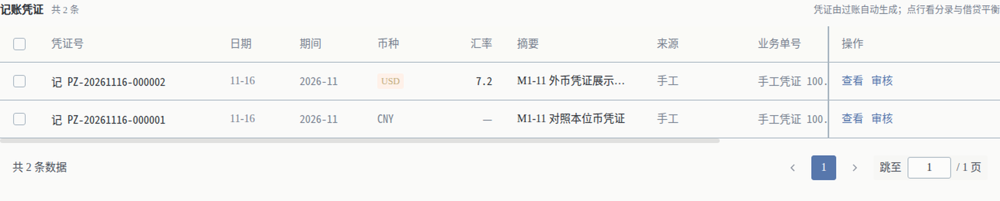
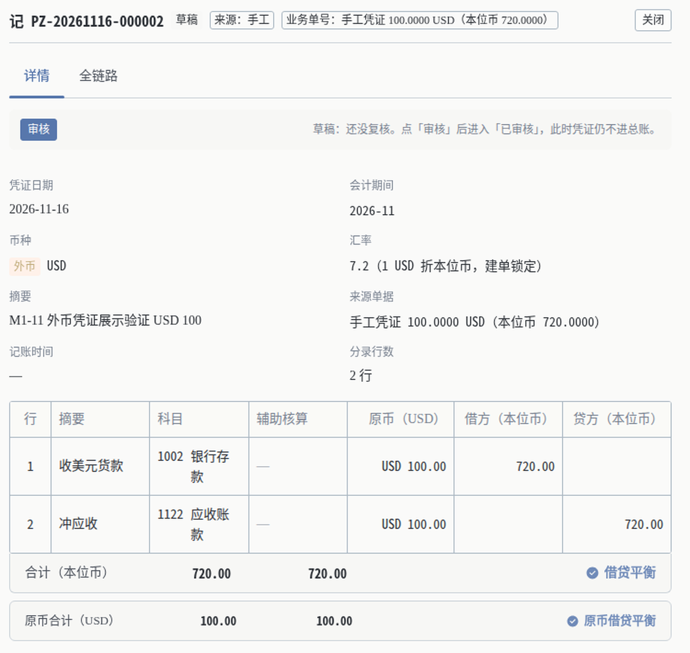
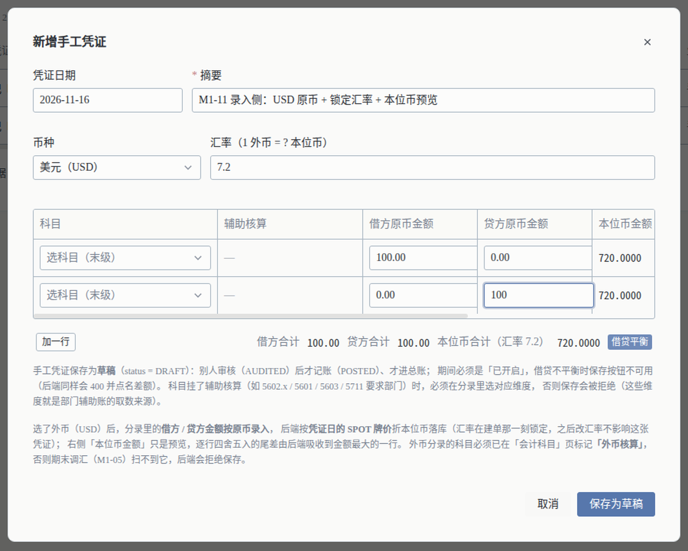

# M1-11 证据：凭证页「币种 / 汇率」列（录入与展示）

> 卡号：`t_1bd81cab` · 提交：`186387d8`（展示主体）+ `6f054f12`（外币分录列宽收窄）
> 日期：2026-11-16 · 范围：**前端展示**（录入侧 M1-04 已完成，本卡只补列表 / 详情两处，不动后端、无迁移）

## 一、这张卡要解决什么

M1-04 把「外币录入」做完了（币种下拉 + 锁定汇率 + 本位币预览 + 分录原币），但**录完之后看不见**：
列表里一行 `借方 7,200.00` 到底是 CNY 还是「USD 1,000 折出来的 7,200」，界面上没有任何线索；
详情抽屉里也没有币种 / 汇率，分录表只显示本位币金额。

本卡只补展示，口径逐条对齐后端（`voucher_query.rs::VoucherRes` / `VoucherEntryRes`，M1-04 起就已下发，**前端零新接口**）：

| 界面 | 读的字段 | 语义 |
|:--|:--|:--|
| 列表「币种」列 | `currency_code` | 本位币凭证 = 账套本位币码（如 CNY），外币行打 tag |
| 列表「汇率」列 | `exchange_rate` | 建单锁定的汇率（本位币凭证恒 1，界面给 `—`） |
| 详情「币种」「汇率」格 | 同上 | 外币标「外币」tag；汇率写成 `7.2（1 USD 折本位币，建单锁定）` |
| 分录「原币（USD）」列 | `fc_debit_amount` / `fc_credit_amount` | 原币金额（`NUMERIC(20,4)`，NULL = 本位币分录） |
| 分录「借方 / 贷方」列 | `debit_amount` / `credit_amount` | **本位币**金额（外币时标题改成「借方（本位币）」） |
| 「原币合计」行 | 前端逐行累加 `fc_*` | 原币借贷各自平一次，与本位币合计分开显示 |

**外币判据只有一个**：`isForeignVoucher()` = 建单锁定的汇率 ≠ 1。不用「币种 ≠ 本位币」比 ——
本位币码要额外拉 `fx-options` 才知道，而汇率随行下发；后端又保证「本位币单恒 1」「外币无牌价直接 400」，
所以这个判据自洽且零额外请求。

## 二、改动清单（3 个文件，+515 / −21）

| 文件 | 改动 |
|:--|:--|
| `frontend/src/views/business/erp/voucher/voucher-logic.ts` | 新增 M1-11 纯函数段：`isForeignVoucher` / `voucherRateText` / `voucherRateDetailText` / `voucherCurrencyTip` / `toTenThousandths` / `formatFxAmount` / `entryFxAmountText` / `sumEntryFx`（原币按**万分之一元**整数累加，与 `NUMERIC(20,4)` 同精度） |
| `frontend/src/views/business/erp/voucher/index.vue` | 列表加「币种」「汇率」两列（外币 tag + 锁定汇率，本位币行 `—`）；详情加币种 / 汇率两格；分录表外币时多一列「原币（USD）」且借方 / 贷方标题标「（本位币）」；多一行「原币合计」；外币时收窄四列宽度让 7 列同屏（`tableW === scrollWidth === 720`，无横向滚动） |
| `frontend/tests/unit/m111-voucher-fx-columns.test.ts` | 新增 13 条单测：外币判据矩阵、汇率文案、原币 4 位小数/尾差 0.0001、原币合计、源码契约（列表列 / 详情格 / 分录列 / 原币合计只在 `v-if="detailForeign"` 出现）、**录入侧 M1-04 回归**（`voucher-create-currency` / `-rate` / `-base-total` 仍在） |

**本位币凭证零变化**：分录列宽、列标题、合计行文案（仍是「合计」）与改动前逐字一致；`v-if="detailForeign"` 的两处（原币列、原币合计行）对本位币单不渲染。

## 三、验证

### 3.1 静态与单测（在 99 开发机跑）

```
cd frontend && pnpm typecheck       → 通过（vue-tsc --noEmit，0 error）
cd frontend && pnpm typecheck:unit  → 通过（tsconfig.unit.json）
cd frontend && pnpm test:unit       → 1919 passed / 0 failed（本卡新增 13 条，1919 = 1906 + 13）
cd frontend && pnpm build           → 成功（dist 产出，gzip 统计正常）
```

后端**零改动**：`git diff --stat HEAD -- backend/` 为空，因此没有 `cargo clippy` 增量（不产生后端行为变化）。

### 3.2 真机 UI 验证（145 测试环境 `cloudpivot-test`，http://172.18.10.145）

数据准备（全部可还原，见 §五）：把 `1002 银行存款` / `1122 应收账款` 标记「外币核算」，
通过 `POST /api/business/erp/voucher` 建一张 **USD 100 / 汇率 7.2** 的手工凭证（对照再建一张 CNY 100）。

**① 列表：币种 / 汇率两列**（外层 USD 打 tag、汇率 7.2；本位币行 CNY + `—`）



```
PZ-20261116-000002  11-16  2026-11  USD(标)  7.2  ...  2 行  720.00  720.00  草稿
PZ-20261116-000001  11-16  2026-11  CNY      —    ...  2 行  100.00  100.00  草稿
```

**② 详情抽屉：币种 / 汇率 / 原币列 / 原币合计**（7 列同屏，无横向滚动）



真机 DOM 读数（不是看图的猜测）：

```
币种格     : '外币  USD'
汇率格     : '7.2（1 USD 折本位币，建单锁定）'
分录表头   : ['行','摘要','科目','辅助核算','原币（USD）','借方（本位币）','贷方（本位币）']
原币单元格 : ['USD 100.00', 'USD 100.00']
借方单元格 : ['720.00', '']           贷方单元格 : ['', '720.00']
合计行     : '合计（本位币） 720.00 720.00 借贷平衡'
原币合计行 : '原币合计（USD） 100.00 100.00 原币借贷平衡'
分录表宽度 : tableW=720  scrollWidth=720   ← 7 列全部可见
```

**③ 录入侧（M1-04 回归，本卡未改动，一并留证）**：币种选 USD 后锁定汇率 7.2、分录列名变
「借方原币金额 / 贷方原币金额 / 本位币金额（CNY）」、逐行预览 720.0000、底部「本位币合计（汇率 7.2）720.0000 · 借贷平衡」



## 四、本卡发现的既有缺陷（**不在本卡修**，已另开卡）

**M1-04 外币凭证建单：`biz_voucher.source_no` 溢出 `varchar(32)` → 500 + 10004。**
录入 USD **1000** 时必现（前端只会显示「服务器内部错误」），USD 100 正常 —— 因为手工凭证的
`source_no` 是拼出来的：`手工凭证 {原币合计} {币种}（本位币 {本位币合计}）`。

```
# 2026-11-16 09:44:23 +08（cloudpivot_dev，PG 18 日志原文）
ERROR:  value too long for type character varying(32)
STATEMENT:  INSERT INTO biz_voucher (voucher_word, ... source_no, ...) VALUES (...)
```

字符数（`python3` 实算，不是估）：

| 原币合计 | `source_no` | 长度 | 结果 |
|:--|:--|:--:|:--|
| 1000.0000 USD | `手工凭证 1000.0000 USD（本位币 7200.0000）` | **33** | 500（> 32） |
| 100.0000 USD | `手工凭证 100.0000 USD（本位币 720.0000）` | 31 | 正常 |

影响：凡「原币合计 ≥ 1000」或「本位币合计 ≥ 1000000」的外币手工凭证都建不出来；M1-04 的单测
用的是小额夹具（`100` / `7.2` → 31 字符）所以没被覆盖。**根因是 `source_no` 列宽 32 与拼接文案的
长度没有对齐**（不是本卡的展示逻辑）。建议修法二选一：拼接改短（`手工凭证 1000.0000 USD`）、
或加迁移把列宽放到 64 —— 归 M1-04 的卡主判断，本卡只报不改。

## 五、环境清理（145 测试环境已还原）

| 动作 | 结果（SQL 自检） |
|:--|:--|
| 删两张演练凭证（含分录 + `biz_status_log`） | `leftover_voucher = 0`、`leftover_voucher_log = 0` |
| 还原 `1002` / `1122` 的「外币核算」标记 | `UPDATE 2` → `fx_accounts = 0` |
| 删探针超管账号 `m111_probe` + 角色绑定 | `leftover_user = 0` |

145 的 `frontend/dist` 已随 `main` 重新 `pnpm build`（`cloudpivot-test` 的静态目录），
后端未重启（本卡无后端改动）。

## 六、本卡范围外（明确不做）

* 凭证列表不加「按币种筛选」（卡面只要求加列；筛选面涉及后端 `VoucherFilter`，属另一件事）。
* 录入侧表格的列宽 / 文案不动（M1-04 已定稿；它自己的横向滚动与本卡无关）。
* 外币余额表页 = M1-12；报表按币种 = M1-09（已交付）。
