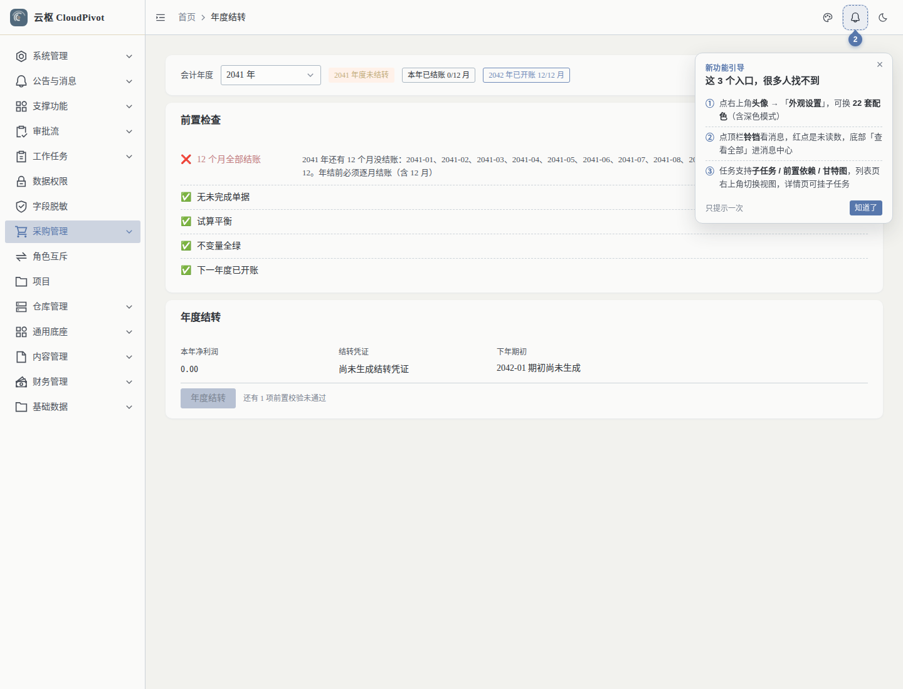
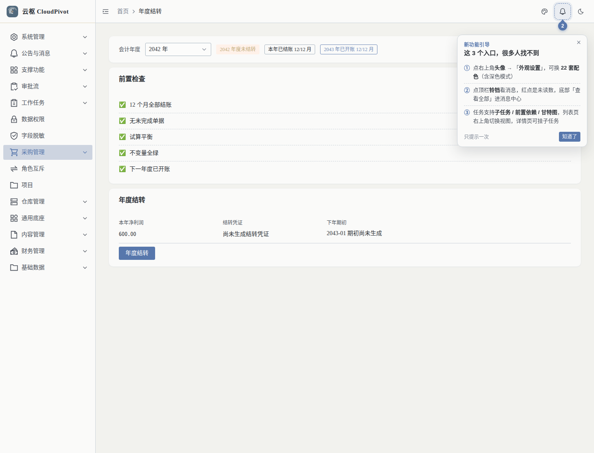
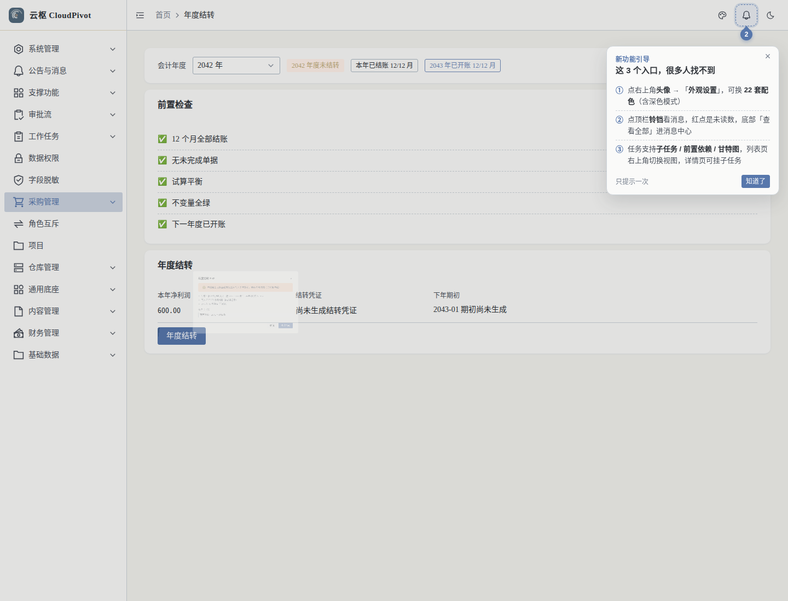
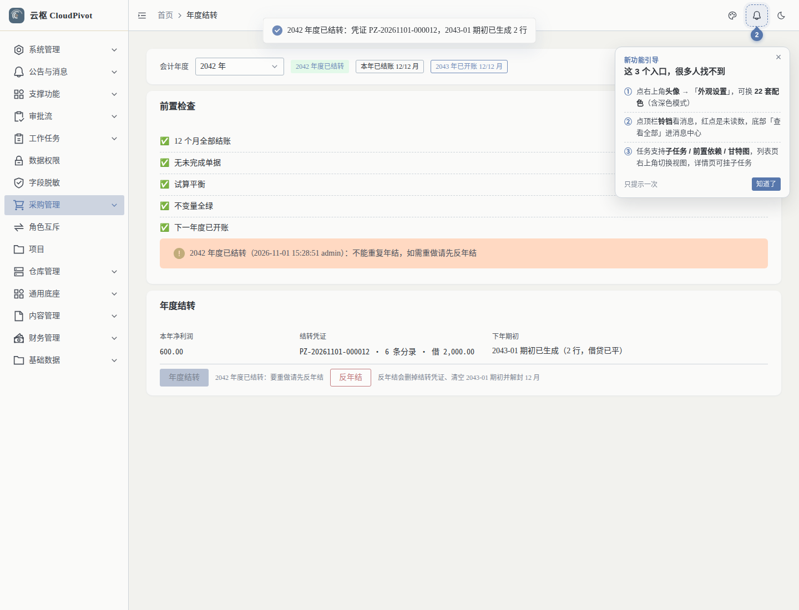
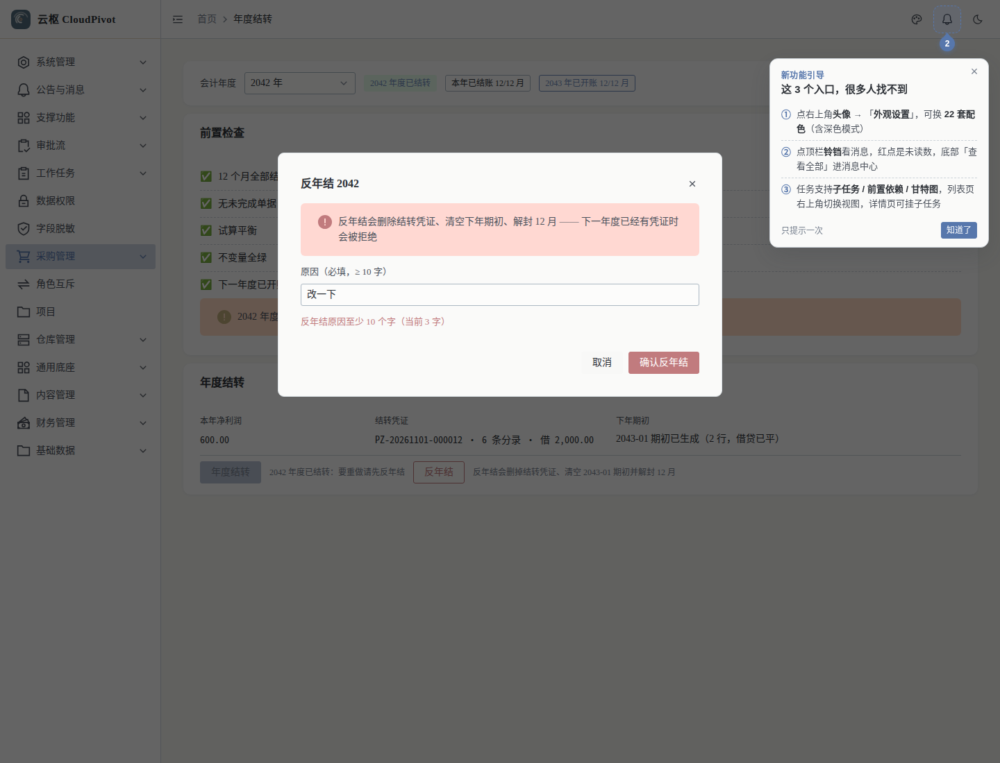
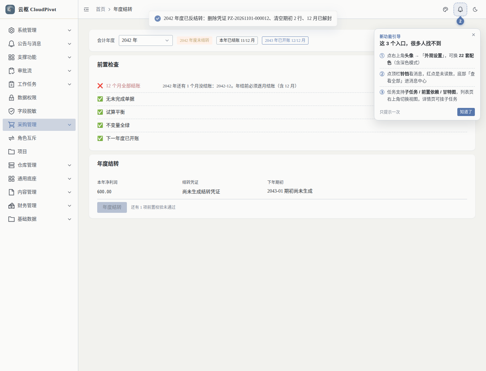

# ERP-R4 年结（损益结转 + 期初生成 + 反年结）—— 验收留痕

> 卡：`t_0daa0ca0`　分支：`main`　日期：2026-11-01
> 一句话：**把 2026 年的 5xxx / 6xxx 结平、本年利润搬进 3104、把期末余额写成年初**，
> 五项前置校验逐条点名，年结 ↔ 反年结成对，全部在**一个事务**里。

---

## 1. 交付物

| 类型 | 文件 |
|------|------|
| 迁移 | `backend/migrations/business/V0190__erp_year_end.{up,down}.sql`（期初来源列 + `YEAR_END` 白名单 + 结转凭证唯一索引 + 三码权限节点） |
| 后端 | `backend/src/business/erp/year_end.rs`（年结 / 反年结 / 前置检查 / 结转分录纯函数 + 15 条真库单测） |
| 后端（改） | `voucher.rs`（`YEAR_END` 常量 + **唯一**允许写已结账期间的出口）、`report.rs`（本期发生额排除 `YEAR_END`）、`opening.rs`（`source` 列 + 年结期初写入口 + 手工覆盖闸）、`state_machine.rs`（`ACCOUNTING_YEAR` 实体）、`mod.rs` |
| 前端 | `views/business/erp/year-end/{index.vue,year-end-logic.ts}`、`api/business/erp/index.ts`（3 个接口）、`router/index.ts`、`tests/unit/erp-year-end.test.ts`（14 条） |
| 验收脚本 | `scripts/verify/r4_instance.sh`、`r4_year_end_e2e.py`（43 项）、`r4_year_end_page_check.mjs`（25 项） |

## 2. 三处设计决议（与卡面字面不同，理由在代码注释里也有一份）

1. **结转凭证写进已结账的 12 月**（卡面 §四 ⚠️ 的第二个选项）。
   闸口在 `voucher::post_voucher` 的唯一收口，例外条件两个都满足才放行：
   `voucher_type='YEAR_END'` **且** `source_type='YEAR_END'`；白名单在库层
   （`ck_biz_voucher_type` = `AUTO|MANUAL|OPENING|YEAR_END`），一个年度一张
   （部分唯一索引 `uk_biz_voucher_year_end_period`）。
2. **下年期初只写台账、不生成 2027-01 的 OPENING 凭证**（与 R5 的期初凭证相反）。
   报表的「期初」= 期间开始日之前的**历史累计** + 本期间自己的 OPENING 凭证；
   2027 年的历史累计里已经有 2026 年的结转凭证 —— 再生成一张期初凭证就是**双计**
   （银行存款 / 存货全部翻倍）。所以年结写 `biz_opening_balance(2027-01, source='YEAR_END')`，
   报表的期初仍由历史累计给出，**两者必须相等**（单测 ⑨ 用同一个口径两边各算一次钉住）。
   反向保护：`source='YEAR_END'` 的行**不许手工覆盖**（`opening::save_opening` 409）。
3. **年结状态记在 `biz_status_log`，不靠「有没有结转凭证」推断**。
   空年度（整年无损益发生、3103 也为 0）不需要结转凭证，但它**已经年结过** ——
   `entity_type='ACCOUNTING_YEAR'`、`entity_no='2026'`、最新一行的 `to_status` 是唯一判据。

另有两项卡面没写、但不加会出坏账的附加闸：
`NEXT_YEAR_OPENING_EXISTS`（下年期初已被手工录入，年结会覆盖它）、
`ALREADY_CLOSED`（重复年结不是幂等操作）。

## 3. 五项前置校验 → 阻塞项 → 文案

| # | 校验 | `type` | 文案实测 |
|---|------|--------|----------|
| ① | 本年 12 个月全部结账 | `PERIOD_NOT_CLOSED`（带 `periods`） | `2026 年还有 2 个月没结账：2026-11、2026-12。年结前必须逐月结账（含 12 月）` |
| ② | 无未完成单据 | `DOC_UNFINISHED` | `2026 年还有 1 张单据未完成（采购单 1 张）：…` |
| ③ | 全年度试算平衡 | `UNBALANCED`（带 `diff`） | `2026 年借贷不平，差 10 元（借方合计 … / 贷方合计 …）` |
| ④ | 不变量全绿（A1/A2） | `INVARIANT` | `A1 有 1 张凭证分录取和不平（PZ-…）` |
| ⑤ | 下一年度 12 个期间已开账 | `NEXT_YEAR_NOT_OPENED`（带 `periods`） | `2027 年期间还没开账（缺 12 个月：…）：年结要往 2027-01 写期初` |

年结被拦是 **409 + 10003**，消息把每一项拼进去（`rejection_message`），
前端另外用 `GET /year-end/check` 拿到结构化 `blockers` 逐条渲染 ✅/❌。

## 4. 验收结果（全部真跑）

| 项 | 命令 | 结果 |
|----|------|------|
| 本卡单测 | `ERP_DB_URL=…cloudpivot_r4 cargo test --lib business::erp::year_end -- --test-threads=1` | **15 passed / 0 failed** |
| 后端全量 | `ERP_DB_URL=…cloudpivot_r4 cargo test --lib -- --test-threads=1` | **1801 passed / 0 failed**（1786 既有 + 15 本卡；510.76s，干净库 cloudpivot_r4 应用 134 个迁移） |
| 隔离实例 e2e | `python3 scripts/verify/r4_year_end_e2e.py` | **43/43 PASS**（含「年结态下 erp_invariants 32/32 · BLOCKER 0 · WARN 0」） |
| 页面 DOM | `node scripts/verify/r4_year_end_page_check.mjs` | **25/25 PASS**（置灰态 → 全绿态 → 年结 → 已结转 → 反年结回滚，无 console/500） |
| 不变量 | `python3 scripts/verify/erp_invariants.py`（隔离库） | **32/32 · BLOCKER 0 · WARN 0**（两次：e2e 收尾后 / 年结态中） |
| 前端 | `pnpm typecheck` / `pnpm test:unit` | 绿 / **395 passed**（381 既有 + 14 本卡） |
| 后端 Lint | `rustfmt +1.94.1 --edition 2024 --check`（本卡 6 个文件）/ `cargo clippy --lib -- -D warnings` | 全绿。<br>注：`cargo clippy --all-targets` 在 HEAD 就有 `tests/testd/impexp.rs` 等 20 条 `useless_vec`，**不在本卡 diff 里**，按约定不动别人的文件 |

### e2e 关键帧（`r4_year_end_e2e.py`，年度 2041 → 2042）

```
①b 未结账 → can_close=false + PERIOD_NOT_CLOSED 点名 12 个月
①c 未结账时年结 → 409「2041 年还有 12 个月没结账：2041-01、2041-02…」
③b 结完账但下一年度未开账 → NEXT_YEAR_NOT_OPENED
③c 年结 → 409「2042 年期间还没开账（缺 12 个月…）」
③e 五项全过 → can_close=true
④  年结成功：voucher=PZ-20261101-000003 rows=2 net=600.0000
④c 结转凭证：period=2041-12 / date=2041-12-31 / 借 2000 = 贷 2000 / 6 条分录
④d 2041-12 期间年结后仍是 CLOSED
④e④f 结转后损益类合计 0、3103 = 0
④g 3104 收到净利润 600
⑤  2042-01 期初：2 行、借贷平衡、来源全 YEAR_END、无损益类、无 3103
⑤e 2042-01 **没有** OPENING 凭证（避免双计）
⑤f 银行存款期初 = 600（= 收入 1000 − 费用 400）
⑥b 2042-01 资产负债表：资产 600 ≡ 负债 + 权益 600
⑦  重复年结 → 409「2041 年度已经结转过了」
⑧b 2042 年已有凭证 → 反年结 409（点名 PZ-20261101-000004）
⑧c 原因 3 字 → 400「至少 10 个字」
⑨  反年结成功：删凭证 + 删 2 行期初 + 12 月解封
⑨f 损益余额回到结转前（−600）
⑩⑩b 收尾：期间表回到运行前、零残留
```

### 页面（`r4_year_end_page_check.mjs`）








## 5. 与卡面的偏离（都有硬理由）

| 卡面 | 实际 | 为什么 |
|------|------|--------|
| §四 `voucher_date = '2026-12-31'`、凭证号 `PZ-20261231-xxxxxx` | 日期照做；凭证号沿用系统口径 `PZ-yyyyMM-NNNNNN`（按**签发时刻**的月份编号） | 全库 4 条凭证写路径共用 `voucher::next_voucher_no`，改编号规则会动 V0149 的 seq 语义 |
| §一 ④「关闭 12 月期间」 | 年结**不再**动期间状态（本来就要 12 个月全结账才能年结） | 卡面 §二 ① 与 §四 ③ 自相矛盾；按「12 月保持 CLOSED」实现，反年结才解封 |
| §二 五项校验 | 五项 + 两项附加（下年期初被手工占用 / 重复年结） | 不加会让年结**静默覆盖**财务手录的期初、或让重复年结变成非幂等操作 |
| 未提「结转凭证不进本期发生额」 | `report::load_accounts` 的本期子查询排除 `YEAR_END` | 否则年结之后 2026 的利润表本期/本年累计会被结转分录对冲成 0（见 `report.rs` 文档段） |

## 6. 生产部署（144）

| 项 | 值 |
|----|----|
| 迁移 | `V0190__erp_year_end`（`应用 1 个迁移`，`max(version) = 190`） |
| 二进制 | md5 见「部署日志」段（进程 == 磁盘 已核） |
| 前端 | 入口 chunk 变化 + `yearend-*` testid 命中 |
| 冒烟 | `/health` 200、`business:erp:yearend:*` 三码节点、`ck_biz_voucher_type` 含 `YEAR_END`、`uk_biz_voucher_year_end_period` 存在、生产不变量 32/32 |

（生产真机**不做年结动作**：2026 还没走完，年结会写结转凭证并关账 —— 只做只读核对。）
