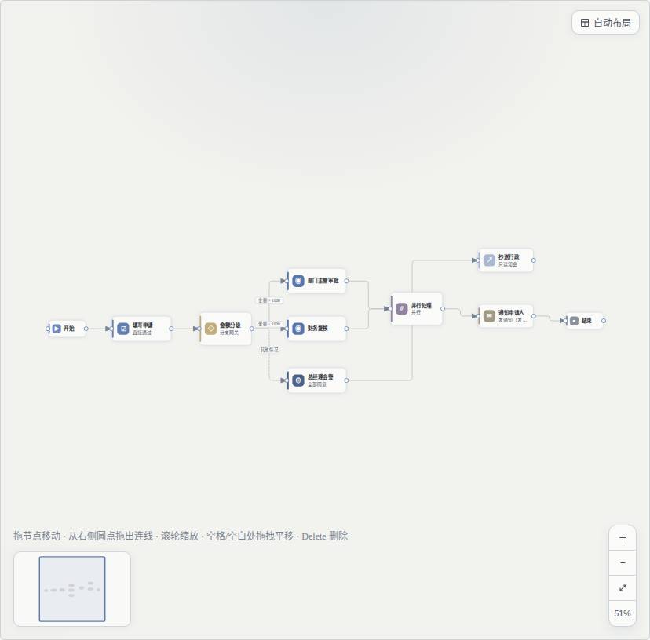
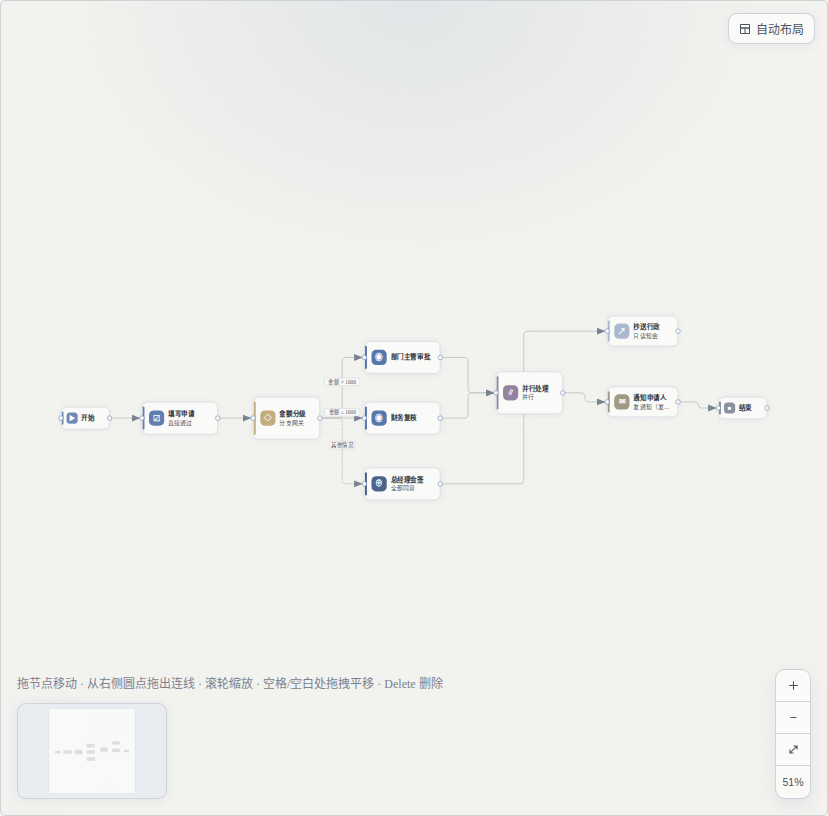

# VUE-FLOW-1：Vue Flow 画布基座（与现有 FlowCanvas 契约完全兼容）

* 卡片：`t_090c5611`
* 日期：2026-11-04
* 结论一句话：**Vue Flow 画布已经可用，且与老画布「同图同视口」逐像素一致**（Chromium 逐卡平均差
  0.29/255；WebKit 2.21/255，残差来自 0.5–1px 的视口取整差导致的字体抗锯齿，不是样式差异）。
  老画布 `FlowCanvas.vue` **一行未改**，通过 `FlowCanvasSwitch.vue` 按 feature flag 切换，默认仍是老画布。

---

## 1. 交付内容

| 文件 | 作用 |
|---|---|
| `frontend/src/views/business/flow/components/FlowCanvasVueFlow.vue` | 新画布（Vue Flow 基座），props / emits / 暴露方法 与老画布逐个对齐 |
| `frontend/src/views/business/flow/components/FlowCanvasSwitch.vue` | 画布切换器（flag 唯一接入点；新画布 `defineAsyncComponent` 懒加载） |
| `frontend/src/views/business/flow/components/flow-canvas-flag.ts` | flag 解析：`?canvas=` > `VITE_FLOW_CANVAS` > 默认 `native` |
| `frontend/src/views/business/flow/components/flow-node-view.ts` | 节点卡片视图模型（图标 / 主副标题 / 状态点 / class），纯函数、可单测 |
| `frontend/tests/unit/flow-canvas-vueflow-contract.test.ts` | **契约守卫**：两个 SFC 的 props / emits / expose / 默认值集合比对（12 条） |
| `frontend/tests/unit/flow-canvas-vueflow-flag.test.ts` | flag 优先级 + 9 种节点文案 / 尺寸 / class（10 条） |
| `scripts/verify/vueflow_canvas_verify.cjs` | 真机验证脚本（Chromium / WebKit 双引擎，36 条断言 + 截图 + 像素比对） |
| `scripts/verify/vueflow_fixture.py` | 夹具：9 种节点 / 10 条边的草稿流程 |
| `scripts/verify/vueflow_fixture_published.py` | 夹具：可发布的最小流程（验证 `readonly`） |

老画布 `FlowCanvas.vue`：**零改动**（可随时回退）。调用方只改了 **1 行 import**：

```diff
- import FlowCanvas from '@/views/business/flow/components/FlowCanvas.vue';
+ import FlowCanvas from '@/views/business/flow/components/FlowCanvasSwitch.vue';
```

模板标签、13 个 props、10 个 emits、`canvasRef.value?.fitView()` 等命令式调用**一处未动**
（`def/edit.vue`、`components/FlowPreview.vue` 各 1 行）。回退 = 把这行改回去。

---

## 2. 第一步产物：现有画布的契约（实测抄录）

### 2.1 props（13 个，卡面写 11 个——实际还有 `fitOnMount` / `canUndoLayout`）

| prop | 类型 | 默认 | 新画布 |
|---|---|---|---|
| `nodes` | `FlowNode[]` | 必填 | ✅ 同名同义 |
| `edges` | `FlowEdge[]` | 必填 | ✅ |
| `readonly` | `boolean` | `false` | ✅ 不画句柄、不可拖、不可连线 |
| `selectedKey` | `string \| null` | `null` | ✅ → `is-selected` |
| `selectedEdgeKey` | `string \| null` | `null` | ✅ → 边的 `is-selected`（**不依赖 Vue Flow 内部 selection**，因为 `elements-selectable=false`，选中态完全由 props 驱动） |
| `issueNodeKeys` | `string[]` | `[]` | ✅ 红虚框 + 右上角 `!` 角标 |
| `showToolbar` | `boolean` | `true` | ✅ 缩放控件 + 自动布局按钮 |
| `showMinimap` | `boolean` | `true` | ✅（且仍需 `showToolbar`，与老画布同一显示条件） |
| `showHint` | `boolean` | `true` | ✅ 底部提示文案逐字一致 |
| `nodeStatus` | `Record<string,string>` | `{}` | ✅ 状态点 + 副标题叠加 |
| `takenPairs` | `string[]` | `[]` | ✅ 走过的边加粗变品牌色 |
| `fitOnMount` | `boolean` | `true` | ✅ 挂载后 fitView（另接受 `autoFit` 作为兼容别名） |
| `canUndoLayout` | `boolean` | `false` | ✅ 显示「撤销布局」 |

> 卡面把最后一个 prop 叫 `autoFit`，实际实现与调用方用的是 `fitOnMount`；新画布两个都认
> （`fitOnMount === false` 或 `autoFit === false` 都表示不自动 fit），**老调用方行为不变**。

### 2.2 emits（10 个）

```
select-node(key: string | null)          select-edge(key: string | null)
move-node({ key, x, y })                 connect({ from, to })
delete-selected()                        undo() / redo()
nudge({ key, dx, dy })                   auto-layout() / undo-layout()
```

全部等价实现：点节点/边/空白、拖拽落点（吸附 10px 后发坐标）、拉线（父组件校验自环/重复）、
Delete、Ctrl+Z / Ctrl+Shift+Z / Ctrl+Y、方向键（Shift = 10px）、工具栏两个布局按钮。

### 2.3 暴露的命令式 API（7 个，`canvasRef.value?.xxx()`）

`screenToCanvas(clientX, clientY)` · `fitView()` · `centerOn(key)` · `resetView()` ·
`zoomBy(factor)` · `zoomTo(scale)` · `getScale()`

> `screenToCanvas` 由 Vue Flow 的 `screenToFlowCoordinate()` 提供（同样扣了容器偏移 + 视口变换），
> 左侧面板拖入节点的落点计算**不需要改一行**。

### 2.4 「Vue Flow 自带」vs「要自己实现」

| 能力 | 归属 | 说明 |
|---|---|---|
| 平移（拖空白） | 自带 | `panOnDrag`（左/中/右键都可） |
| 滚轮缩放、以鼠标为锚点 | 自带 | d3-zoom；**实测锚点漂移 < 2px** |
| 拖节点 | 自带 | `nodesDraggable`；落点吸附 10px 由我们接管（见下） |
| 拉线 / 建边 | 自带 | `Handle` + `connect` 事件 |
| 小地图渲染 | 自带 | `@vue-flow/minimap`（位置需显式 `bottom-left`） |
| 小地图**拖拽平移** | **自己实现** | 组件的 `pannable` 读 `MouseEvent.movementX/Y`，**Safari/WebKit 不支持** → 拖拽无反应；改为自己接管指针（点/拖 = 把该点挪到视野中心，与老画布一致） |
| 节点卡片视觉 | 自己实现 | 自定义节点 slot（11px 圆角 / 3.5px 色条 / 30×30 图标底块 / 主题色） |
| 连线路径 | 自己实现 | 复用 `graph.ts::edgePath` + `rounded-path.ts::roundedEdgePath`（正交圆角折线，与老画布同一份几何） |
| 箭头 marker | 自己实现 | 与老画布同一套 10×8 三角定义（放在 0×0 的 `<defs>` svg 里，`url(#id)` 文档级解析） |
| 边标签 | 自己实现 | 白底圆角小标签，位置用 `edgeLabelPoint`（同一函数） |
| 选中态 | 自己实现 | `elements-selectable=false`，全部由 props 驱动（`selectedKey` / `selectedEdgeKey`） |
| 键盘（Delete / Ctrl+Z / 方向键 / 空格平移） | 自己实现 | 与老画布同一张键位表；`deleteKeyCode=null` 防止 Vue Flow 二次删除 |
| 拖拽吸附 10px | 自己实现 | **吸附位移不是吸附坐标**：`x = max(0, props原坐标 + round(dx/10)*10)`，否则 dagre 排出的非整格坐标会在第一次拖拽时整体跳一下 |
| 连线落点高亮 | 自己实现 | 拉线时用 `graph.ts::hitTest` 命中节点 → `is-connect-target` |
| 工具栏 / 缩放百分比 | 自己实现 | 复用老画布同款 DOM/CSS（`@vue-flow/controls` 未使用，避免视觉分叉与死依赖） |
| fitView | 自带 + 自己算 padding | `fitView({ padding: '60px' })`（与老画布 60px 边距同口径） |

---

## 3. feature flag 怎么切（默认 native）

优先级：**`?canvas=vueflow|native`** > **`VITE_FLOW_CANVAS=vueflow|native`** > 默认 `native`。

* 参数优先：env 是「发布时定死」的运维灰度手段，参数是「当场验证」的调试手段 —— 灰度一开后
  仍需对单个页面做 A/B（回归对比、缺陷复现）。
* 默认 `native`：新画布要等 VUE-FLOW-3 真机全量验证后再改默认；在那之前用户随时能回退。
* 新画布用 `defineAsyncComponent` 懒加载：**开关关着时 `@vue-flow` 一个字节都不下载**。

```bash
# 开发/验证
http://127.0.0.1:5173/flow/def/<id>/edit?canvas=vueflow
# 环境灰度
VITE_FLOW_CANVAS=vueflow pnpm build
```

---

## 4. 真机验证（Chromium + WebKit 双引擎，36/36 PASS）

```bash
node scripts/verify/vueflow_canvas_verify.cjs \
  --base-url http://127.0.0.1:5188 \
  --def-id <9 节点草稿 id> --readonly-def-id <已发布流程 id> \
  --shot-dir docs/evidence/20261104-vueflow-canvas/shots
```

报告：`report.json`（Chromium 36/36）、`report-webkit.json`（WebKit 36/36）。

### 4.1 覆盖到的验收点

| 验收项 | 结果 |
|---|---|
| 9 种节点类型全部渲染（图标 / 类型色 / 主副标题） | ✅ `START/TASK_NODE/APPROVAL/COUNTERSIGN/CONDITION/PARALLEL/CC/NOTIFY_NODE/END` |
| 尺寸：审批 150×64 · 开始结束 96×44 · 条件并行 132×84 · 抄送通知 140×60 | ✅ 逐个量 `getBoundingClientRect` |
| 11px 圆角 / 3.5px 色条 / 30×30 图标底块（紧凑排版 22×22）/ 投影 | ✅ computed style |
| 拖节点能移动 | ✅ |
| 落点吸附 10px 网格（拖 23px → 落 20px 整格） | ✅ |
| 滚轮缩放**以鼠标为锚点**（锚点卡片漂移 < 4px） | ✅ 实测 |
| 拖空白处平移（视口位移 = 拖拽距离，节点同步） | ✅ |
| 右 Handle → 左 Handle 建成连线（10 → 11 条） | ✅ |
| 连线是正交圆角折线 + 箭头 marker + 兜底分支虚线 | ✅ `d` 里 L/Q、`marker-end=url(#vf-flow-arrow)` |
| 自动布局按钮存在并可点（`dagre` 由父组件算坐标，与老画布同一份 `auto-layout.ts`） | ✅ |
| 小地图显示 + 可拖（Chromium / WebKit 都验） | ✅ |
| 缩放工具栏 4 个按钮 + 百分比读数 + 「适应画布」可用 | ✅ |
| fitView 生效（挂载后 zoom = 0.506，与老画布一致） | ✅ |
| 只读（已发布版本）：无句柄 / 无自动布局按钮 / 缩放工具栏仍在 | ✅ |
| 控制台 **0 新增报错**（与老画布同集合） | ✅ |

### 4.2 视觉一致（关键）

同一份 9 节点图、同一视口，两套画布各截一张：

| 老画布 `native.png` | 新画布 `vueflow.png` |
|---|---|
|  |  |

像素差（`report.json` / `report-webkit.json`）：

| 指标 | Chromium | WebKit |
|---|---|---|
| 整图（fitView 视图）平均差 | **1.12/255** | 1.19/255 |
| 100% 缩放下逐卡片 1:1 平均差（可见 5 张） | **0.28–0.29/255**（>40 的像素 0%） | 2.2/255（>40 的像素 ~1.5%） |
| 100% 缩放下节点尺寸 / 相对位置 | 完全一致（扣除视口平移差后 0px） | 同 |

> 为什么 WebKit 有 2.2 的残差：两边 `zoomTo(1)` 各自以**视口中心**为锚点，落点差 0.5–1px
> → 12px 中文的字体抗锯齿整片不同（不是颜色/尺寸/圆角/字重差异 —— 这三类另有 computed style
> 与几何断言逐项钉住）。Chromium 恰好落在整数像素上，所以差 0.29。

---

## 5. 性能与体积

| 指标 | 改前（`dist` @14:09） | 改后 | 变化 |
|---|---|---|---|
| 首屏主 chunk `assets/index-*.js` | 117,144 B（gz 43,580） | 117,306 B（gz 43,652） | **+162 B（+0.14%）** |
| 编辑器路由 chunk `assets/edit-*.js` | 194,170 B（gz 65,963） | 194,171 B（gz 65,981） | +1 B |
| Vue Flow 画布 chunk `assets/FlowCanvasVueFlow-*.js` | — | 229,749 B（gz 76,105） | 新增，**懒加载** |
| `index.html` 是否引用 / 预载 vue-flow | — | 否（`modulepreload` 只有 index + tdesign） | ✅ 不进首屏 |

编辑器页打开耗时（`DOMContentLoaded → 卡片可见`，dev server，未压缩）：

| | 新画布 | 老画布 |
|---|---|---|
| Chromium | 714 ms | 606 ms |
| WebKit | 855 ms | 697 ms |

> dev 环境下多出来的 ~100–150ms 主要是异步 chunk 的模块解析；生产构建下该 chunk 已 gzip 到 76KB，
> 且与编辑器路由 chunk 并行下载。VUE-FLOW-3 上真机时用生产包复测。

---

## 6. 踩到并修掉的坑（都写进代码注释了）

1. **句柄必须显式给方向**：不给 `<Handle>` 时 Vue Flow 兜底成 `bottom → top`，连线会从卡片底部出、
   顶部进，与老画布「左进右出」完全不同。
2. **布尔 prop 的「缺省转 false」**：切换器如果直接遍历 `props` 往下传，`showToolbar` 未传会被 Vue
   转成 `false` 并显式传给内层 → 工具栏 / 小地图 / 提示全部消失（实测踩到）。切换器改为
   `withDefaults` 复刻同一套默认值，并用单测 ⑪ 钉住「两份默认值必须一致」。
3. **fitView 有时不生效**：Vue Flow 的 fitView 依赖**已测量的节点尺寸**，挂载那一帧往往是 0 →
   画布停在默认视口（100%）。改为监听 `nodesInitialized` 再 fit（单测/脚本里的「等 fit 落地」也一并加上）。
4. **小地图在 Safari 拖不动**：`@vue-flow/minimap` 的 `pannable` 读 `MouseEvent.movementX/Y`，
   WebKit 不支持 → 位移 NaN。改为自己实现「点/拖 = 把该点居中」。
5. **小地图默认在右下角**：老画布在左下，必须显式 `position="bottom-left"`；svg 内部尺寸也要
   `width/height=150/96`（组件默认 200×150，否则内容比框大、平移换算也对不上）。
6. **连线 path 必须 `fill="none"`**：SVG path 默认黑色填充，圆角折线的贝塞尔会围出黑块（老画布 P15 踩过，这里沿用防御）。
7. **拖拽吸附要吸位移**：吸绝对坐标会让 dagre 排出的非整格节点在第一次拖拽时整体跳一下。
8. **节点 hover 的 `translateY(-2px)` 会污染测量**：验证脚本量拖拽位移前必须先把鼠标挪开（踩过一次）。

---

## 7. 已知差异 / 未做（留给 VUE-FLOW-2 / -3）

| 项 | 现状 |
|---|---|
| `@vue-flow/controls` | **未使用**（自绘工具栏才能与老画布像素一致），依赖已从 package.json 移除，不留死依赖 |
| 条件标签位置 | 与老画布同一函数 `edgeLabelPoint`，实测同位置；Vue Flow 内置 label 未用 |
| CONDITION 菱形 | 老画布 P12 之后卡片本身就是**圆角矩形**（菱形只在左侧面板的小图标里），因此无「菱形节点做不出来」的限制 |
| `takenPairs` / `nodeStatus` | 本卡已实现（预览页 `FlowPreview` 依赖它们），VUE-FLOW-2 可在其上扩「进度图」细节 |
| 框选 / 分组 / 对齐线 | Vue Flow 自带能力，本卡未启用（`selectionKeyCode=null`），VUE-FLOW-2 再开 |
| 撤销/重做 | 仍由父组件命令栈负责（与老画布同一套 `graph.ts` 命令栈），未改用 Vue Flow 内部历史 |

---

## 8. 复现环境

```bash
# 后端（隔离库，profile=test）
su postgres -c "createdb -T cloudpivot_test -O alun cloudpivot_vf1"
cd backend && NIK_PROFILE=test NIK_SERVER_LISTEN=127.0.0.1:18098 \
  NIK_DATABASE_NAME=cloudpivot_vf1 NIK_DATABASE_USER=alun NIK_DATABASE_PASSWORD=alun \
  NIK_MIDDLEWARE_AUTH_JWT_SECRET=<64 hex> CLOUDPIVOT_STORAGE_MASTER_KEY=<64 hex> \
  ./target/release/cloudpivot

# 夹具
python3 scripts/verify/vueflow_fixture.py --base-url http://127.0.0.1:18098          # 9 节点草稿
python3 scripts/verify/vueflow_fixture_published.py --base-url http://127.0.0.1:18098 # 已发布（只读验证）

# 前端 dev（不碰生产 dist）
cd frontend && BACKEND_ORIGIN=http://127.0.0.1:18098 ./node_modules/.bin/vite --port 5188 --strictPort

# 双引擎验证
node scripts/verify/vueflow_canvas_verify.cjs --base-url http://127.0.0.1:5188 \
  --def-id <草稿id> --readonly-def-id <已发布id>
node scripts/verify/vueflow_canvas_verify.cjs --browser webkit ... --shot-dir ... --out report-webkit.json
```

## 9. 门禁

| 门禁 | 结果 |
|---|---|
| `pnpm typecheck`（vue-tsc） | 通过 |
| `pnpm test:unit` | **627/627 通过**（新增 22 条：契约 12 + flag/节点视图 10） |
| `pnpm check:palettes` | 330 条色阶断言 + 色板校验，全部通过 |
| `vite build` | 成功（首屏体积见 §5） |
| `vueflow_canvas_verify.cjs`（Chromium） | **36/36 PASS** |
| `vueflow_canvas_verify.cjs`（WebKit） | **36/36 PASS** |
| 老画布 / 调用方 / 既有 15 个测试 | 未改动（`git diff` 可见只有 import 路径 2 行） |
