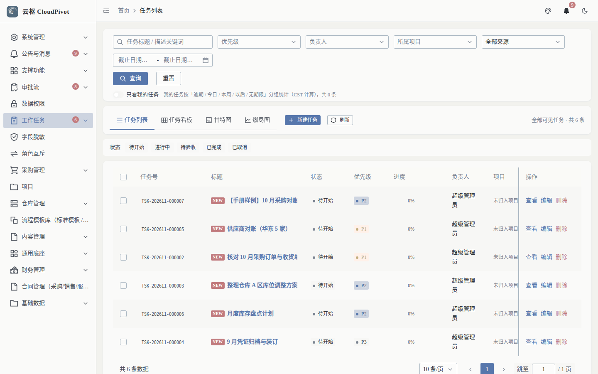
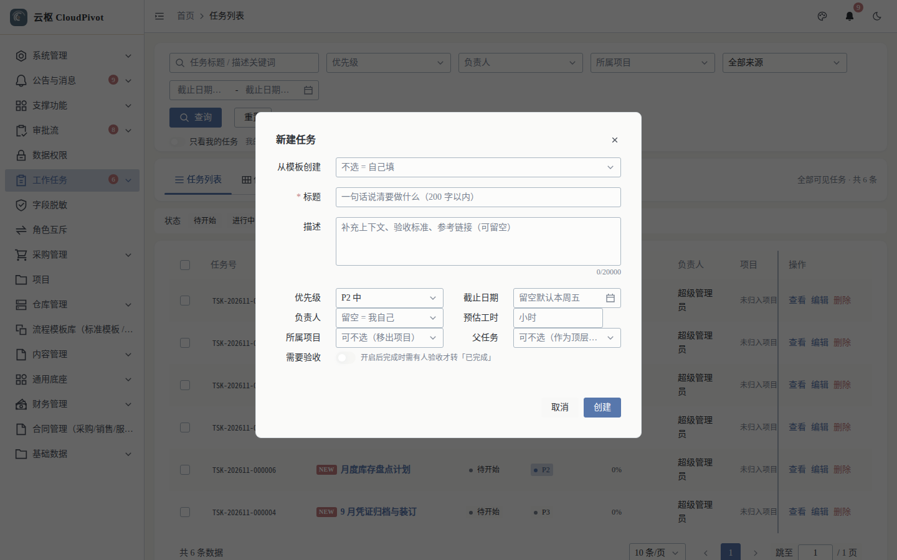
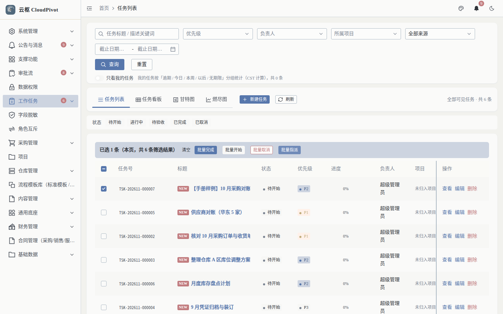
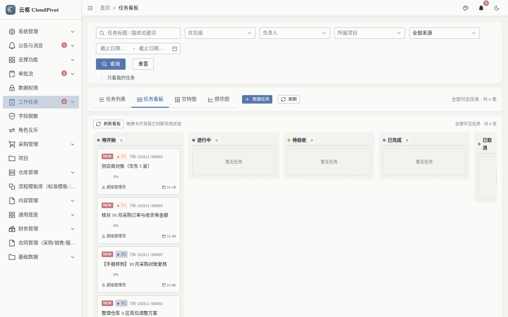
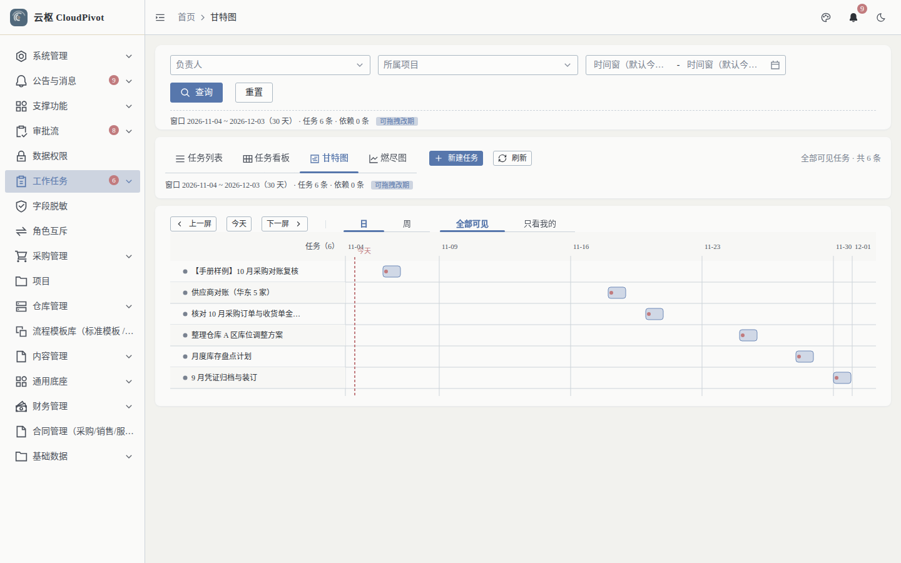
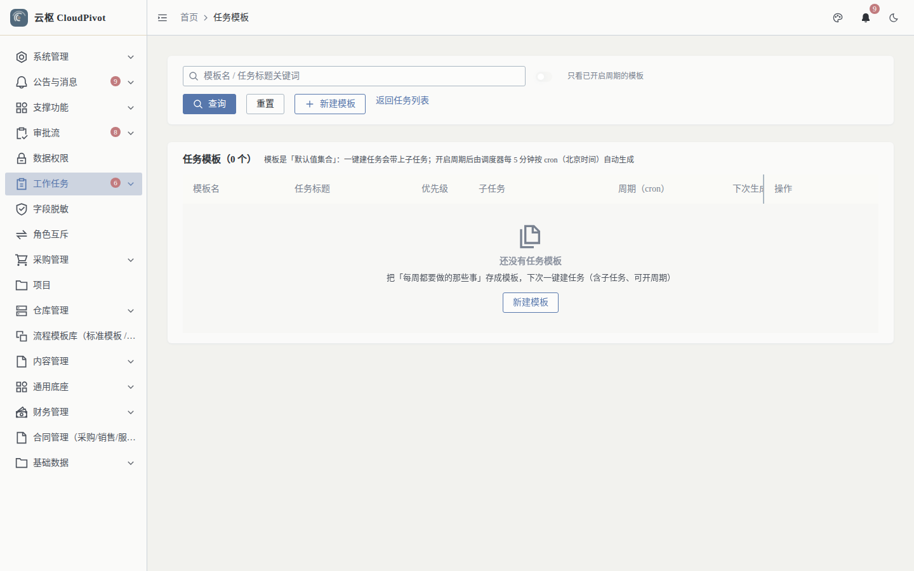

# 01 任务管理 · 使用手册

> **一句话**：把"要干的事"登记成任务，分派到人、盯住进度，并在看板 / 甘特图上统一调度。

- 适用版本：云枢 CloudPivot 基础版（ERP 批次 C+ 工作任务）
- 截图环境：`cloudpivot_manual2` 实例（前端 `127.0.0.1:5180` → 后端 `127.0.0.1:18097`），账号 `admin`
- 采集脚本：`scripts/manual/capture.mjs task`（真机 Playwright，非手绘）

---

## 一、这个功能干什么

登记工作任务（标题 / 描述 / 优先级 / 负责人 / 截止日 / 所属项目），用列表、看板、甘特图三种视图跟踪状态与进度，并支持子任务、协作人、验收、模板与周期生成。

---

## 二、谁能用（角色 + 权限）

| 事项 | 说明 |
| --- | --- |
| 菜单 | 工作任务（`/task`）→ 任务列表 / 任务看板 / 甘特图 / 任务模板 |
| 查看 | 权限码 `business:task:read` |
| 新建 / 编辑 | `business:task:create` / `business:task:update` |
| 删除 | `business:task:delete` |
| 分派 / 转派 | `business:task:assign` |
| 协作人 | `business:task:member` |
| 进度回填 | `business:task:progress` |
| 评论删除 | `business:task:comment:delete` |
| 附件 | `business:task:attachment:upload` / `:delete` |

**角色口径**

- `SUPER_ADMIN`（超级管理员）：跳过权限校验，可见全部任务。
- 普通用户：需要在「系统管理 → 角色管理」中勾选上表权限码，否则侧边栏不出现「工作任务」，直连 `/task/list` 也会被拦。
- 「只看我的任务」勾选后按负责人过滤，与角色无关。

---

## 三、完整操作步骤（真机截图）

### 步骤 1　打开任务列表

左侧菜单「工作任务 → 任务列表」，或直接访问 `/task/list`。

页面结构（实测）：

- 顶部筛选：任务标题/描述关键词、优先级、负责人、所属项目、来源、截止日期区间
- 视图页签：任务列表 / 任务看板 / 甘特图 / 燃尽图
- 状态页签：待开始 / 进行中 / 待验收 / 已完成 / 已取消
- 列表列：任务号、标题、状态、优先级、进度、负责人、项目、截止日期、来源、操作

### 步骤 2　新建任务

点右上角「+ 新建任务」。

按表填：

| 字段 | 填写要求 |
| --- | --- |
| 从模板创建 | 不选＝自己填；选了自动带出标题/优先级/子任务 |
| 标题（必填） | 一句话说清要做什么，≤ 200 字 |
| 描述 | 补充上下文、验收标准、参考链接，≤ 20000 字 |
| 优先级 | 默认 `P2 中`，紧急事项改 `P1 高` |
| 截止日期 | 留空＝默认本周五 |
| 负责人 | 留空＝自己 |
| 预估工时 | 单位小时，可空 |
| 所属项目 | 不选＝移出项目 |
| 父任务 | 不选＝作为顶层任务 |
| 需要验收 | 勾选后须有人验收才能转「已完成」 |

点「创建」。实测返回提示 `任务已创建：TSK-202611-000007`，列表由 5 条变 6 条（证据：`evidence/task-create-verify.log`）。

### 步骤 3　打开任务详情

在列表点行的「查看」（或标题），右侧滑出任务详情抽屉。

详情抽屉内容：

- 头部：任务号、状态、优先级、负责人、截止日期、进度
- 操作：`开始处理`（转进行中）、`编辑`、`删除`、`复制为新单`、`取消`
- 页签：`详情` / `子任务` / `协作`

> 只有负责人或具备 `business:task:assign` 的人才会看到「开始处理」后的流转按钮。

### 步骤 4　切到看板视图

页签「任务看板」（`/task/board`），按状态列拖动卡片改状态。

### 步骤 5　切到甘特图

页签「甘特图」（`/task/gantt`），可切「日 / 周」粒度与「全部可见 / 只看我的」，拖动条改期。

### 步骤 6　任务模板与周期任务

菜单「任务模板」（`/task/templates`）。

模板列：模板名、任务标题、优先级、子任务、周期（cron）、下次生成、上次生成。填 `周期（cron）` 后系统按计划自动生成任务；留空则只能手工「从模板创建」。

---

## 四、常见错误怎么办

| 现象 | 原因 | 处理 |
| --- | --- | --- |
| 侧边栏没有「工作任务」 | 角色缺 `business:task:read` | 系统管理 → 角色管理，给该角色勾上任务相关权限码，重新登录 |
| 新建任务点「创建」没反应 | 标题为空或超 200 字 | 补标题；超长标题拆成标题 + 描述 |
| 看不到别人的任务 | 「只看我的任务」被勾选，或没有 `business:task:read` | 取消勾选；或补权限 |
| 状态拖不动 / 没有「开始处理」 | 不是负责人，且无 `business:task:assign` | 让负责人操作，或请管理员分派给你 |
| 「需要验收」的任务转不了「已完成」 | 未走验收 | 由验收人验收后再流转，或取消该开关 |
| 复制为新单后没有子任务 | 设计如此：复制不带子任务/评论/协作人/附件 | 需要子任务请用「从模板创建」 |

---

## 五、与哪些功能联动

- **审批流**：任务可挂流程（详情页显示流程上下文），审批结果回写任务状态。
- **项目**：`所属项目` 关联项目管理，项目下汇总任务与进度。
- **公告与消息**：任务分派、到期提醒通过站内信推送（右上角铃铛可见未读数）。
- **审批中心 / 首页待办**：「你有 N 条待处理」弹窗统计工作任务待办数（实测 5 条）。
- **文件中心**：任务附件走 `business:attachment:*` 权限，与文件中心共用。
