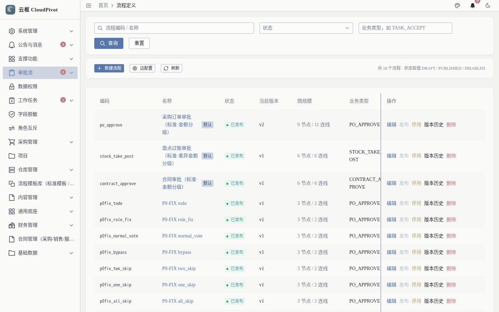
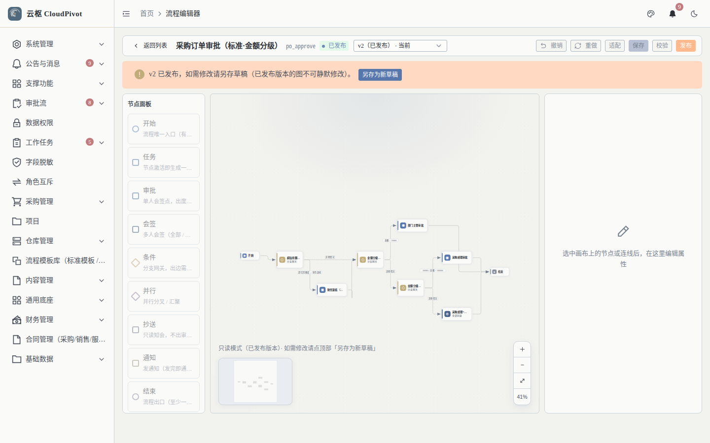
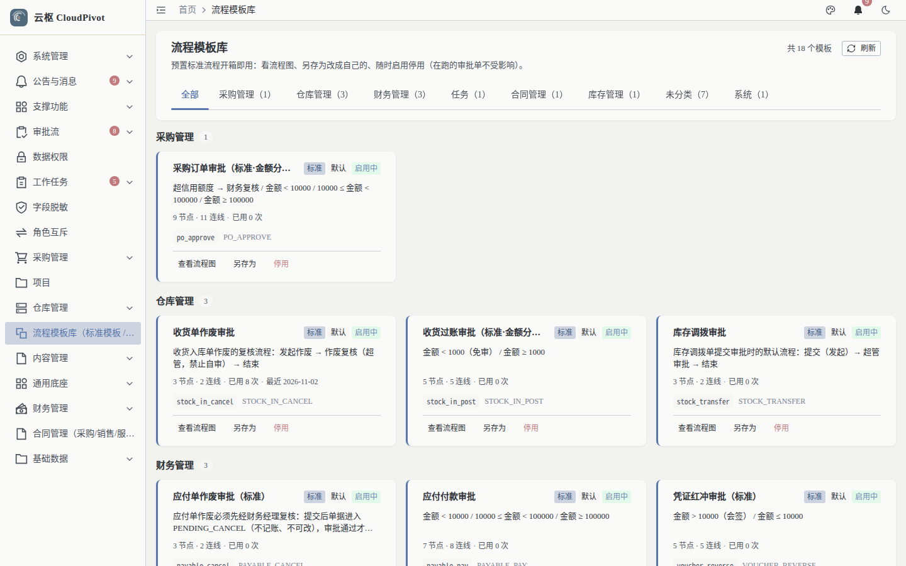
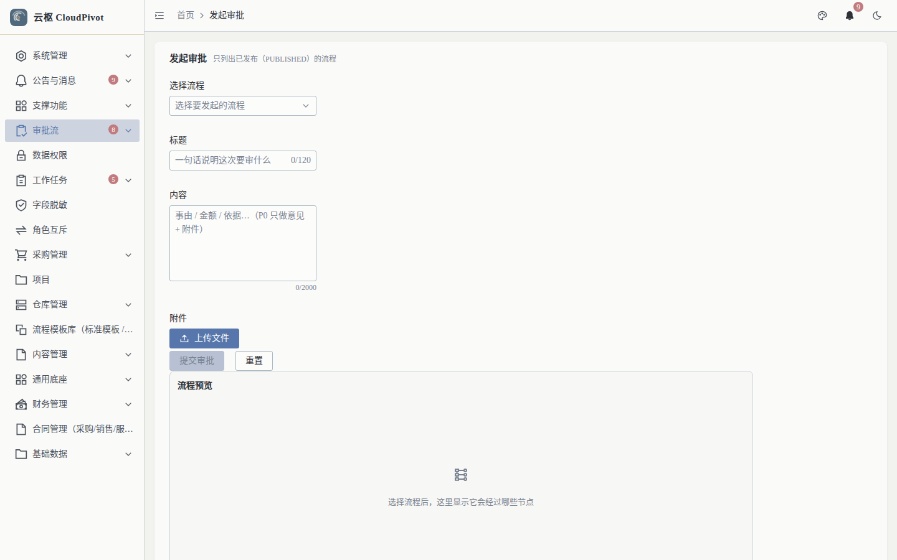
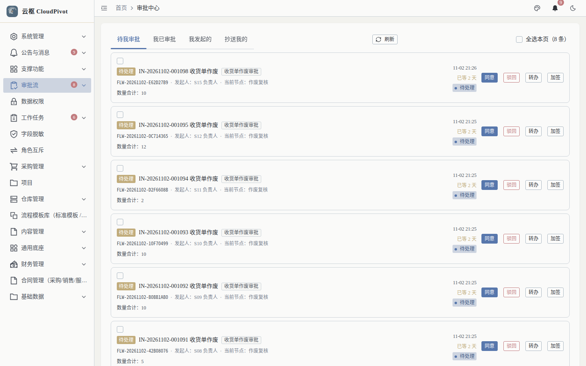
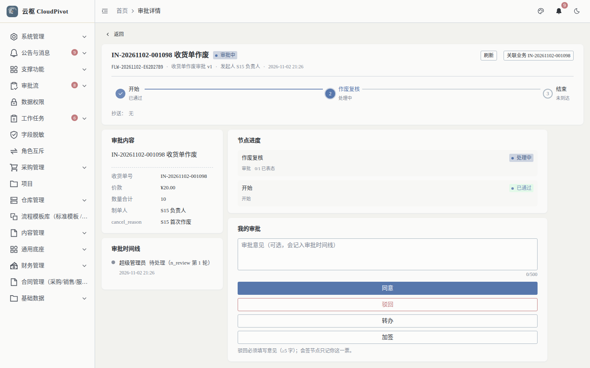
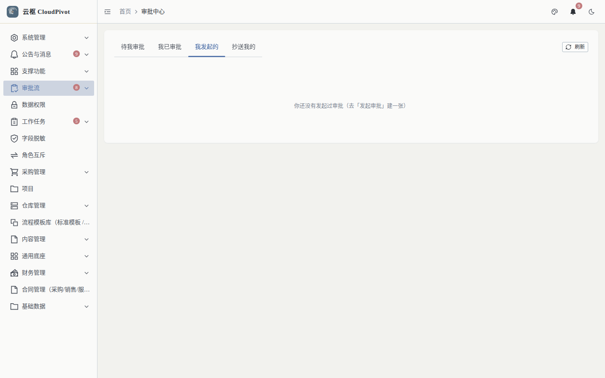

# 02 审批流 · 使用手册

> **一句话**：把单据的审核过程做成可配置的流程（节点 / 条件 / 审批人），并在审批中心集中处理待办。

- 适用版本：云枢 CloudPivot 基础版（批次 D 工作流审批）
- 截图环境：`cloudpivot_manual2`（`127.0.0.1:5180` → `:18097`），账号 `admin`
- 采集脚本：`scripts/manual/capture.mjs flow`

---

## 一、这个功能干什么

配置审批流程定义与版本（画布编辑器、发布、停用），从模板库一键复制流程，并按流程发起审批、处理待办（同意 / 驳回 / 转办 / 加签）、查看我已审批与我发起的单据。

---

## 二、谁能用（角色 + 权限）

| 事项 | 说明 |
| --- | --- |
| 菜单 | 审批流（`/flow`）→ 流程定义 / 发起审批 / 审批中心 / 流程模板库 |
| 查看流程定义、模板库 | `business:flow:read` |
| 新建 / 编辑 / 删除流程 | `business:flow:create` / `:update` / `:delete` |
| 发布 | `business:flow:publish` |
| 发起审批 | `business:flow:instance:create` |
| 审批中心（待办 / 已办） | `business:flow:instance:read` |
| 审批动作（同意/驳回/转办/加签） | `business:flow:approve` |
| 撤回 | `business:flow:instance:withdraw` |
| 状态机边配置 | `business:flow:state-edge:manage`（配合 `FLOW_CONFIG_APPROVER` 复核岗） |

**审批岗位角色（实测角色表）**

| 角色 | 职责 |
| --- | --- |
| `DEPT_LEADER` 部门主管 | 采购订单审批第一档（< 1 万），本部门采购复核人 |
| `PURCHASE_MANAGER` 采购经理 | 第二档（1–10 万）＋第三档会签（≥ 10 万） |
| `GENERAL_MANAGER` 总经理 | 第三档会签（≥ 10 万），与采购经理共同签字 |
| `WAREHOUSE_MANAGER` 仓管主管 | 收货过账审批（≥ 1000）＋小额免审知会 |
| `FINANCE_MANAGER` 财务经理 | 应付作废复核、凭证红冲复核（含 ≤ 1 万单人会签档） |
| `FINANCE_DIRECTOR` 财务总监 | 凭证红冲 > 1 万会签（与财务经理共同签字） |
| `FLOW_CONFIG_APPROVER` 流程配置复核员 | 状态机边配置变更的复核岗；0 人绑定时回落 `FALLBACK_ADMIN` |

> 审批人由**流程节点配置**决定，不是由这些角色自动决定；角色只决定"谁有资格被配成该档审批人"。

---

## 三、完整操作步骤（真机截图）

### 步骤 1　看流程定义清单

菜单「审批流 → 流程定义」（`/flow/def`）。

列表列：编码、名称、状态、当前版本、图规模、业务类型、更新时间、操作。实测 20 条。

操作列按状态出现：`发布` / `停用` / `删除` / `提交审批` / `边配置`。

### 步骤 2　打开画布编辑器

点某行的「设计 / 编辑」进入编辑器（新窗口或整页）。

工具栏：`返回列表`、`撤销`、`重做`、`适配`、`保存`、`校验`、`发布`、`另存为新草稿`。

要点：

- 画布左侧是**节点面板**：开始 / 任务 / 审批 / 会签 / 条件 / 并行 / 抄送 / 通知 / 结束；中间是图，右侧是选中节点的属性面板。
- **已发布的版本是只读的**，顶部横幅原文：`v2 已发布，如需修改请另存新草稿（已发布版本的图不可静默修改）`，点横幅里的「另存为新草稿」再改（后端文案：`版本已发布，不能直接编辑（请先「另存为新草稿」再改）`）。
- 发布前先点「校验」，图校验不通过不允许发布。

### 步骤 3　从模板库复制流程

菜单「流程模板库」（`/flow/templates`）。

按业务域分页签：全部 / 采购管理 / 仓库管理 / 财务管理 / 任务 / 合同管理 / 库存管理 / 未分类 / 系统。每张模板可「查看流程图」「复制并去编辑」「另存为」「停用」。

### 步骤 4　发起审批

菜单「发起审批」（`/flow/start`），选择业务类型与流程，填表并「提交审批」。

### 步骤 5　在审批中心处理待办

菜单「审批中心」（`/flow/task`），默认「待我审批」。

每张卡片显示：单号（如 `IN-20261102-001098`）、流程实例号（`FLW-...`）、发起人、当前节点、已等待天数、数量合计，右侧四个动作：

- **同意**：通过当前节点，流转下一节点（末节点则整单通过）
- **驳回**：回到上一节点或指定节点
- **转办**：把任务交给其他人处理
- **加签**：临时增加审批人

勾选卡片左侧复选框可「全选本页」，批量同意 / 驳回。

### 步骤 6　看单据审批详情

在审批中心点单号进入审批单详情。

详情含：流程节点进度、当前节点审批人、审批意见输入框、`同意` / `驳回` / `转办` / `加签` / `返回`，以及与业务单据的反向链接（如「关联业务 IN-20261102-001098」）。

### 步骤 7　查「我发起的」

切页签「我发起的」，查看自己提交的单据走到哪个节点。

页签共四个：待我审批 / 我已审批 / 我发起的 / 抄送我的。

---

## 四、常见错误怎么办

| 现象 | 原因 | 处理 |
| --- | --- | --- |
| 编辑已发布流程被拒 | 已发布版本只读 | 「另存为新草稿」→ 改 → 校验 → 发布 |
| 发布按钮提示校验失败 | 画布存在孤立节点、缺审批人、缺出边 | 点「校验」按提示补齐节点与连线 |
| 业务单据提交审批报「已有审批中实例」 | 同一单据同时只能有一个在跑审批 | 到审批中心处理完或撤回原实例后再提交 |
| 撤回后重新提交报 409 | 旧实例未终止 | 撤回会同时终止在跑审批单；若仍冲突，刷新单据状态再提交 |
| 审批中心「待我审批」为空 | 你不是当前节点审批人 | 检查流程节点配置的审批人 / 角色 |
| 状态机边配置改不了 | 缺 `business:flow:state-edge:manage` 或复核岗未签 | 补权限；`FLOW_CONFIG_APPROVER` 无人绑定时回落管理员 |

---

## 五、与哪些功能联动

- **采购订单 / 收货入库 / 库存调拨 / 应付单 / 凭证**：提交审批后生成流程实例，审批通过才允许后续动作（发货、过账、付款等）。
- **任务管理**：任务可挂流程，详情页显示流程上下文。
- **站内信**：审批待办、抄送、结果通知推送到「公告与消息」。
- **状态机**：单据状态流转与审批绑定，人工直推 `APPROVED` 会被门闸拦截（审批仍在跑时）。
- **角色与权限**：审批人来源为角色成员展开，角色变更即时影响派单。
