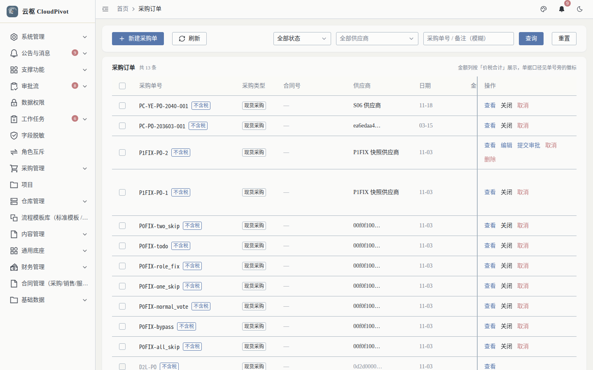
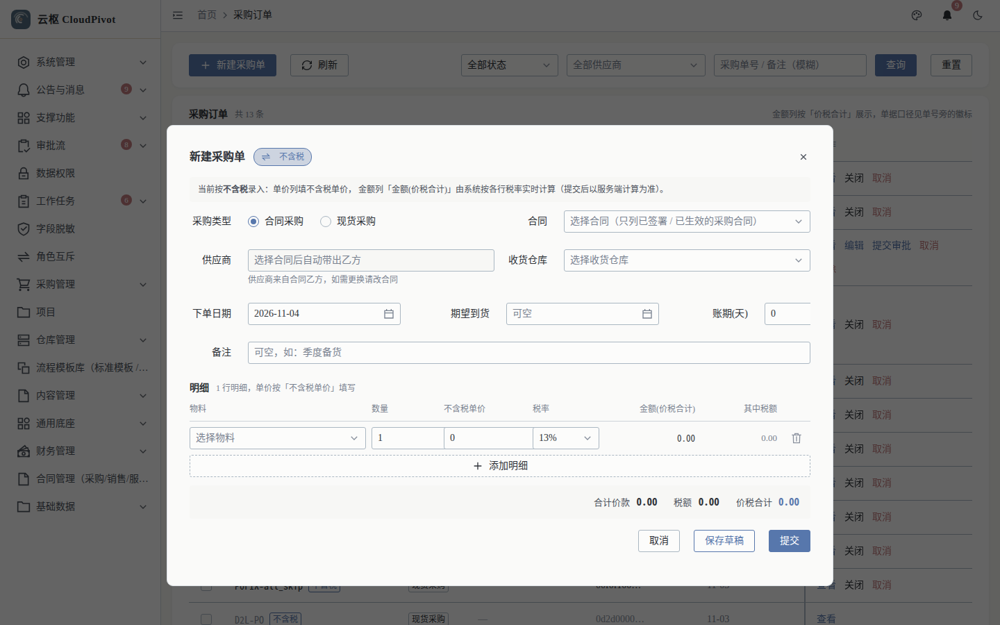
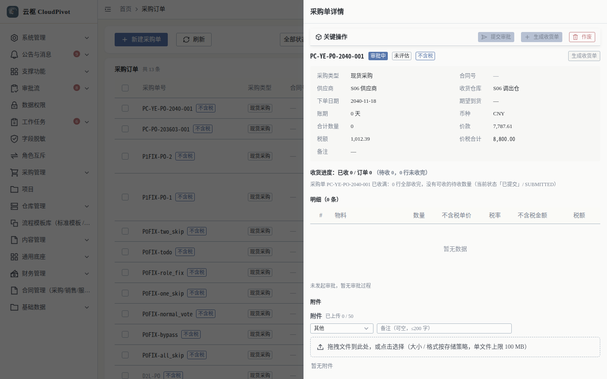
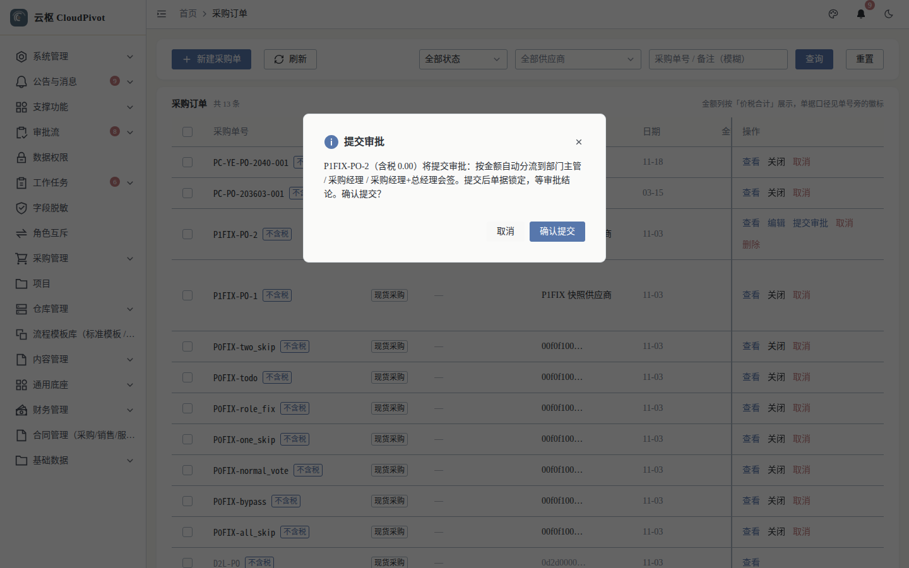
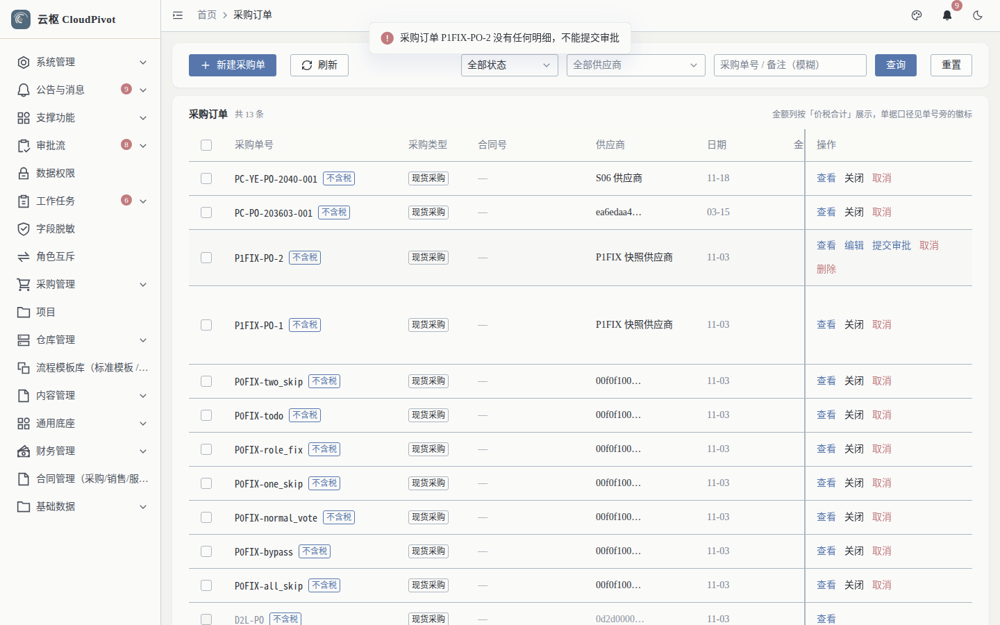

# 03 采购订单 · 使用手册

> **一句话**：向供应商下单——录入物料、数量、单价与税率，保存草稿后提交审批，审批通过才能生成收货单。

- 截图环境：`cloudpivot_manual2`（`127.0.0.1:5180` → `:18097`），账号 `admin`
- 采集脚本：`scripts/manual/capture.mjs purchase`

---

## 一、这个功能干什么

维护采购订单（现货采购 / 合同采购），含明细行（物料、数量、不含税单价、税率、金额、已收货、待收），并驱动审批 → 收货 → 应付的整条链路。

---

## 二、谁能用（角色 + 权限）

| 事项 | 权限码 |
| --- | --- |
| 查看列表 / 详情 | `business:erp:purchase-order:list`（明细 `business:erp:purchase-order-item:list`） |
| 新建 | `business:erp:purchase-order:create` |
| 编辑（仅草稿） | `business:erp:purchase-order:update` |
| 删除（仅草稿） | `business:erp:purchase-order:delete` |
| 状态流转 / 提交审批 | `business:erp:purchase-order:status` / `business:erp:purchase-order:submit-approval` |
| 免审直通 | `business:erp:skip-approval`（谨慎授予） |

**角色口径**

- `SUPER_ADMIN`：全部可用。
- 采购员 / 采购助理：`list + create + update + submit-approval`。
- 审批岗：`DEPT_LEADER`（< 1 万）、`PURCHASE_MANAGER`（1–10 万及 ≥ 10 万会签）、`GENERAL_MANAGER`（≥ 10 万会签）——审批动作本身走审批中心，不需要建单权限。

---

## 三、完整操作步骤（真机截图）

### 步骤 1　进入采购订单列表

左侧「采购管理 → 采购订单」（`/business/erp/purchase-order`）。

- 顶部：`+ 新建采购单`、`刷新`；筛选项「全部状态」「全部供应商」「采购单号/备注（模糊）」
- 表头提示：金额按「价税合计」展示，单据口径见单号旁的徽标（如 `不含税`）
- 列：采购单号、采购类型、合同号、供应商、日期、金额(价税合计)、状态、操作
- 行操作随状态变化：`查看` / `编辑` / `提交审批` / `关闭` / `取消` / `删除`

### 步骤 2　新建采购单

点 `+ 新建采购单`，右侧滑出建单表单。

填写顺序：

1. **采购类型**：`现货采购`（无需合同）或 `合同采购`（必须先有生效合同）
2. **供应商**（下拉搜索）
3. **收货仓库**（决定默认收货库位）
4. **明细行**：`添加明细` → 选物料 → 填数量 → 填不含税单价 → 选税率（金额自动算）
5. 点 `保存草稿`（可继续改）或 `提交`

> 明细行的「已收货 / 待收」在收货单过账后自动回写，不是手填字段。

### 步骤 3　查看采购单详情

列表点「查看」。

详情抽屉含：

- 单头：采购单号、采购类型、合同号、供应商、日期、金额
- 明细表：`#`、物料、数量、不含税单价、税率、不含税金额、税额、金额(价税合计)、**已收货**、**待收**
- 底部动作（按状态）：`提交审批`、`生成收货单`、`作废`、`保存草稿`

### 步骤 4　提交审批

列表点该行「提交审批」，弹出确认框。

确认框原文说明了分流规则：

> `P1FIX-PO-2（含税 0.00）将提交审批：按金额自动分流到部门主管 / 采购经理 / 采购经理+总经理会签。提交后单据锁定，等审批结论。`

点「确认提交」后系统做两项校验：

1. **明细必须非空**——空明细直接拦下，列表顶部红色提示：

   

   原文：`采购订单 P1FIX-PO-2 没有任何明细，不能提交审批`

2. 校验通过则返回成功提示并把单据置为审批中（同库实测：`P1FIX-PO-1 已提交审批`），审批中心生成待办。

> 截图取自演示库中一张空明细单据被拦截的真实结果；成功路径没有可重复消费的草稿单据，故未留图，成功文案以后端返回为准。

### 步骤 5　审批通过后生成收货

审批通过后，详情页出现「生成收货单」；也可以到「收货入库」页直接点「新建收货单」并选择来源采购单。

---

## 四、常见错误怎么办

| 现象（系统原话） | 原因 | 处理 |
| --- | --- | --- |
| `采购订单 P1FIX-PO-2 没有任何明细，不能提交审批` | 明细表为空（实测复现） | 先「添加明细」至少一行，再提交 |
| `items 不能为空：采购订单至少要有一行明细` | 接口层同样拦空明细 | 同上 |
| `采购订单 … 的状态在本次编辑期间已被改动（只有草稿能改），请刷新后重试` | 别人已提交/作废，页面数据过期 | 刷新列表，按新状态操作 |
| `采购订单 … 的状态在本次提交期间已被改动（期望 DRAFT），请刷新后重试` | 并发提交 | 刷新后重试；已提交成功的不要重复点 |
| 合同采购选不到合同 | 无生效合同 | 先到「合同管理」把合同审批生效 |
| 提交后没有生成待办 | 该业务类型未配默认流程 | 「审批流 → 流程定义」把对应 `biz_type` 的流程设为默认并发布 |
| 生成收货单按钮不出现 | 未到 `APPROVED` | 待审批通过后再操作 |

---

## 五、与哪些功能联动

- **审批流**：提交审批生成流程实例；金额档位决定审批人（8 千 → 部门主管，5 万 → 采购经理，≥ 10 万 → 采购经理 + 总经理会签）。
- **收货入库**：`生成收货单` 带出未收数量，过账后回写「已收货 / 待收」。
- **库存 / 库位库存**：收货过账增加库存与库位账。
- **应付单**：收货过账后生成应付，进入付款流程。
- **财务凭证**：采购入库生成存货相关凭证分录。
- **合同管理**：合同采购必须关联生效合同，订单受合同数量/金额约束。
