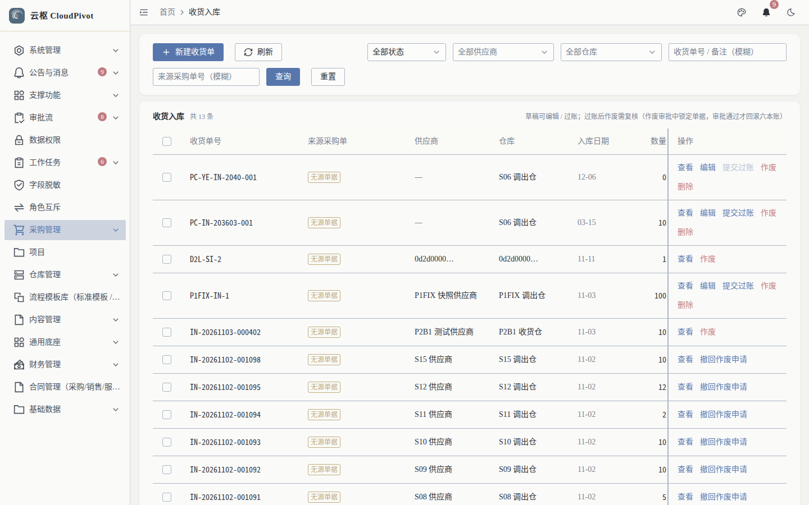
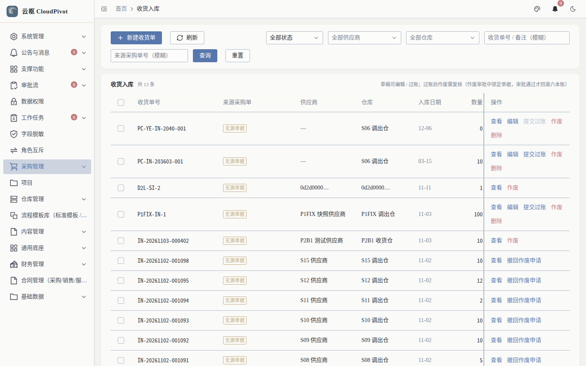
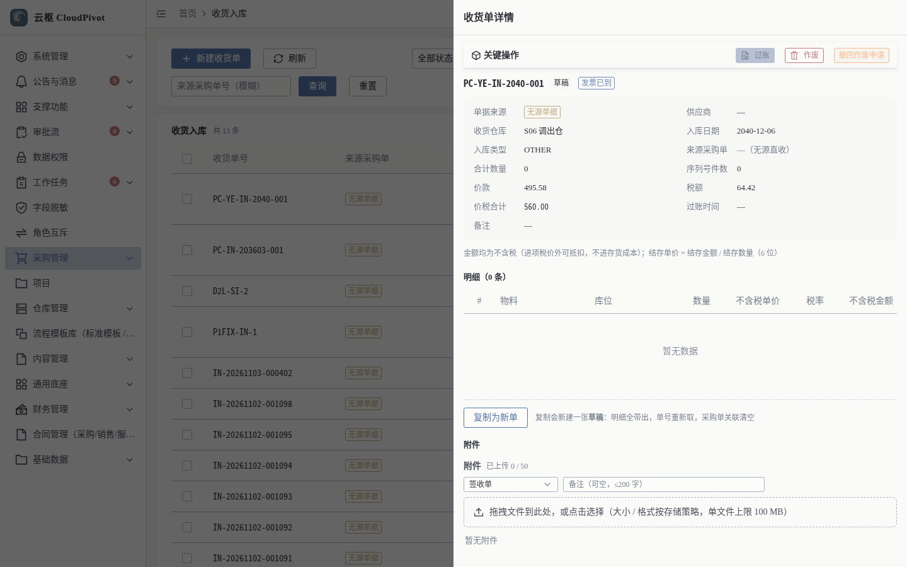

# 04 收货入库 · 使用手册

> **一句话**：货到了就收——按采购单生成收货单，确认过账后库存、库位账、应付与凭证一起记账。

- 截图环境：`cloudpivot_manual2`（`127.0.0.1:5180` → `:18097`），账号 `admin`
- 采集脚本：`scripts/manual/capture.mjs stockin`

---

## 一、这个功能干什么

登记到货（来源采购单 / 直接收货），填物料、库位、数量、单价与税率，保存草稿后确认过账；过账时同步写库存、库位账、库存流水与财务凭证。

---

## 二、谁能用（角色 + 权限）

| 事项 | 权限码 |
| --- | --- |
| 查看列表 / 详情 | `business:erp:stock-in:list` / `business:erp:stock-in:detail` |
| 新建 | `business:erp:stock-in:create` |
| 编辑（仅草稿） | `business:erp:stock-in:update` |
| 删除（仅草稿） | `business:erp:stock-in:delete` |
| 状态流转 / 过账 | `business:erp:stock-in:status` |
| 提交过账审批 | `business:erp:stock-in:submit-post-approval` |

**角色口径**

- 仓管员：`list + detail + create + update + status`。
- `WAREHOUSE_MANAGER` 仓管主管：额外承担**收货过账审批（≥ 1000）**，并接收小额免审知会。
- 金额未达免审阈值时可直接过账；达阈值需走 `submit-post-approval` → 审批中心。

---

## 三、完整操作步骤（真机截图）

### 步骤 1　进入收货入库列表

左侧「采购管理 → 收货入库」（`/business/erp/stock-in`）。

列：收货单号、来源采购单、供应商、仓库、入库日期、数量、金额(价税合计)、状态、操作。

行操作随状态出现：`查看`、`过账`、`作废`、`撤回作废申请`、`复制为新单`。

### 步骤 2　新建收货单

点 `+ 新建收货单`（详情页也可 `从采购单生成`）。

填写要点：

1. **来源采购单**：选择后自动带出供应商、物料与未收数量（也可手工建无来源收货单）
2. **仓库**：必须选；库位可在明细行选择
3. **明细行**：物料、库位、数量、不含税单价、税率（金额自动算）
4. 多行同税率可用 `应用到全部行`
5. `保存草稿` → 核对后再 `确认过账`

> 收货数量不能超过采购单「待收」；超收要被拒。

### 步骤 3　查看收货单详情

列表点「查看」打开详情抽屉。

明细列：`#`、物料、库位、数量、不含税单价、税率、不含税金额、税额、金额(价税合计)、**成本单价**（过账后回写）。

底部动作：`保存草稿`、`提交过账审批`、`过账`、`作废`、`撤回作废申请`、`复制为新单`。

### 步骤 4　确认过账

点 `过账` → 确认弹窗 → 确定。过账成功后：

- 即时库存、库位库存增加
- 生成 `IN` 类库存流水
- 采购单「已收货」累加、「待收」减少
- 生成应付单与入库凭证

---

## 四、常见错误怎么办

| 现象（系统原话） | 原因 | 处理 |
| --- | --- | --- |
| `收货入库单没有任何明细，无法过账` | 明细为空 | 添加明细后再过账 |
| `收货入库单 … 没有任何明细，不能提交过账审批` | 同上（走审批口径） | 同上 |
| `第 N 行缺 item_id` / `第 N 行数量（qty）必填` | 接口数据不完整（多为前端未提交） | 补齐明细行字段 |
| 过账报「账面库存…」/数量不合法 | 数量为 0 或负数 | 数量必须 > 0 |
| 过账后库存没变 | 选错仓库/库位，或凭证失败回滚 | 查库存流水对应单据号；事务失败时**一行都不会落库**，修正后重试 |
| 想改已过账的单 | 过账后锁定编辑 | 走「作废」流程（大额需审批），再复制为新单重录 |
| 作废需审批却没人审 | 缺 `WAREHOUSE_MANAGER` 绑人 | 绑定仓管主管角色，或走管理员兜底 |

---

## 五、与哪些功能联动

- **采购订单**：来源单据，回写已收货/待收；不允许无来源超量。
- **库存 / 库位库存 / 库存流水**：过账同时增加三本账（实测库位账与总账无差异）。
- **应付单**：过账生成应付，供应商对账依据。
- **财务凭证**：过账生成入库分录，可在「凭证查询」按来源单据号反查。
- **审批流**：达阈值时过账前需审批（收货过账审批）。
- **序列号 / 批次**：物料开启序列号管理时按序列生成入库记录。
