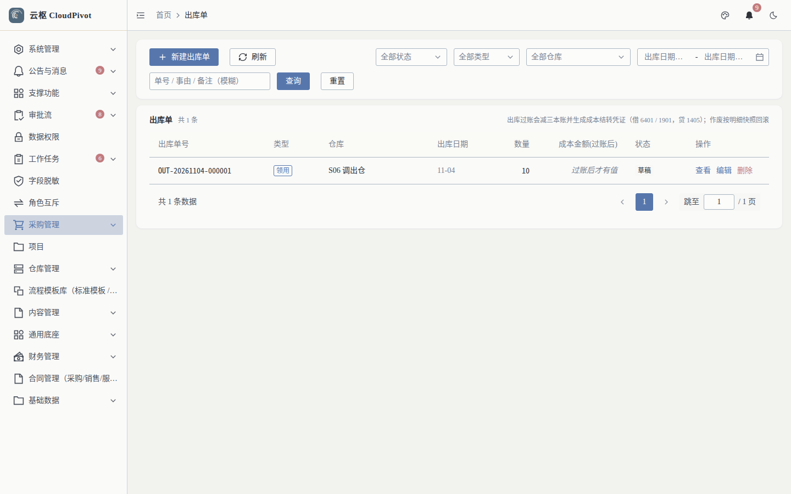
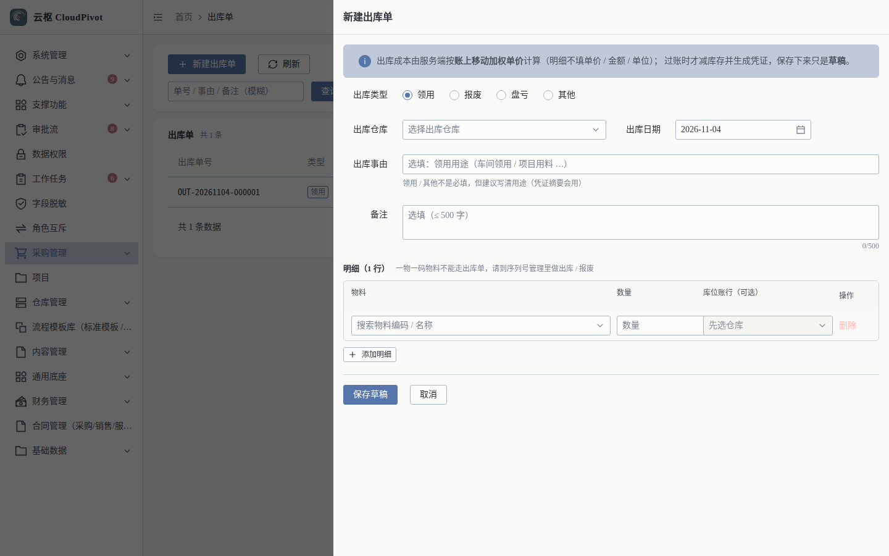
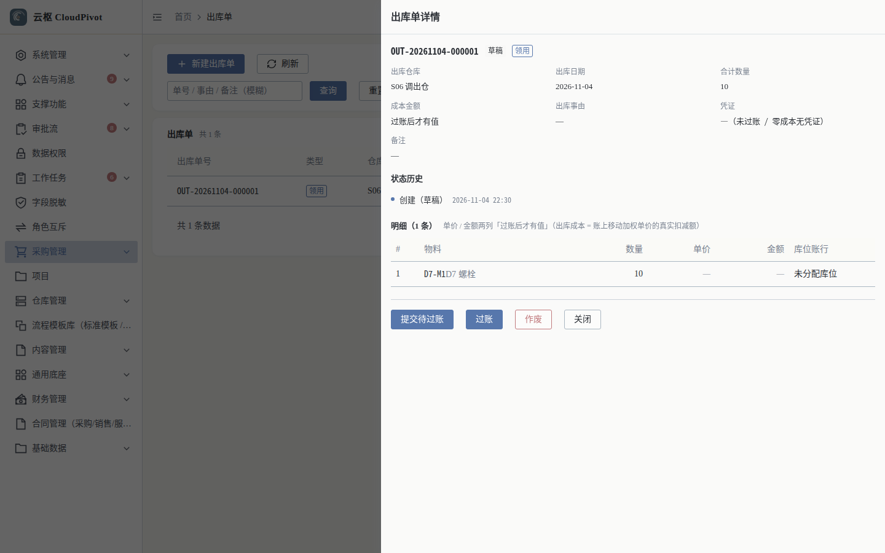

# 05 出库单 · 使用手册

> **一句话**：仓库往外发货（领用 / 报废 / 盘亏 / 其他），过账时才减库存并按移动加权单价生成成本凭证。

- 截图环境：`cloudpivot_manual2`（`127.0.0.1:5180` → `:18097`），账号 `admin`；本手册的示例单据 `OUT-20261104-000001` 由脚本真机录入
- 采集脚本：`scripts/manual/capture.mjs stockout`、`stockout_create`

---

## 一、这个功能干什么

登记出库单（四种类型），明细只填物料、数量、库位；**单价与成本由服务端按账上移动加权单价计算**，过账时才真正减库存并生成凭证。

---

## 二、谁能用（角色 + 权限）

| 事项 | 权限码 |
| --- | --- |
| 查看列表 / 详情 | `business:erp:stock-out:list` / `business:erp:stock-out:detail` |
| 新建 | `business:erp:stock-out:create` |
| 编辑（仅草稿） | `business:erp:stock-out:update` |
| 删除（仅草稿） | `business:erp:stock-out:delete` |
| 状态流转 / 提交待过账 / 过账 / 作废 | `business:erp:stock-out:status` |

**角色口径**

- 仓管员：`list + detail + create + update + status`。
- 领用人：一般不给建单权限，由仓管代录并走审批/知会。
- `SUPER_ADMIN`：全部可用。

---

## 三、完整操作步骤（真机截图）

### 步骤 1　进入出库单列表

左侧「采购管理 → 出库单」（`/business/erp/stock-out`）。

- 筛选：全部状态、全部类型、全部仓库、出库日期区间、单号/事由/备注（模糊）
- 列：出库单号、类型、仓库、出库日期、数量、成本金额(过账后)、状态、操作
- 页面提示（原文）：`出库过账会减三本账并生成成本结转凭证（借 6401 / 1901，贷 1405）；作废按明细分账逐条回滚`

### 步骤 2　新建出库单

点 `+ 新建出库单`，右侧滑出表单。

顶部蓝条提示（原文）：`出库成本由服务端按账上移动加权单价计算（明细不填单价/金额/单位）；过账时才减库存并生成凭证，保存下来只是草稿。`

填写：

1. **出库类型**：`领用` / `报废` / `盘亏` / `其他`（单选）
2. **出库仓库**（必填）
3. **出库事由**：领用/其他非必填，但建议写清用途（会进凭证摘要）
4. **备注**：≤ 500 字
5. **明细行**：物料 → 数量 → 库位账行（可选）
   - 一物一码物料**不能**走出库单，需到「序列号管理」做出库/报废
   - 不选库位时若该物料库位账为 0，会提示库存不足（可用 0）
6. `保存草稿`

实测保存返回：`已保存草稿 OUT-20261104-000001`。

### 步骤 3　提交待过账并过账

打开详情（点行首或「查看」）。

明细列：`#`、物料、数量、单价、金额、库位账行。

底部动作：`提交待过账` → `过账` → `作废`。过账成功后：减少即时库存与库位库存、写 `OUT` 流水、生成成本结转凭证（借 6401 营业成本 / 1901 / 贷 1405 库存商品）。

### 步骤 4　（可选）按类型区分用途

`出库类型` 四种取值对应不同业务口径：

| 类型 | 用途 | 典型摘要 |
| --- | --- | --- |
| 领用 | 车间/部门领料 | 车间领用 |
| 报废 | 损坏、过期报废 | 报废清理 |
| 盘亏 | 盘点差异转出 | 盘点盘亏 |
| 其他 | 其他出库 | 按事由填写 |

类型只影响单据归类与凭证摘要，**成本计算口径完全一致**（都按账上移动加权单价）。

---

## 四、常见错误怎么办

| 现象（系统原话） | 原因 | 处理 |
| --- | --- | --- |
| `items 不能为空：出库单至少要有一行明细` | 未加明细 | 先「添加明细」 |
| `本次要出库 X —— 请先入库，或改到有库存的库位` | 选定库位可用量为 0 | 换有货的库位，或先做收货入库 |
| 不选库位出库报「库存不足（可用 0）」但账上有货 | 货在具体库位，仓库级默认库位无货 | 明细里选具体库位账行 |
| `第 N 行数量（qty）必填` / 数量为 0 | 明细缺数量 | 填 > 0 的数量 |
| 一物一码物料选不到 | 序列号物料不允许走出库单 | 到「序列号管理」做出库/报废 |
| 已过账想改 | 过账后锁定 | 作废（按明细分账逐条回滚），再新建 |
| 过账报成本异常 | 该物料无入库单价（从未入库） | 先收货入库形成成本，或做期初 |

---

## 五、与哪些功能联动

- **库存 / 库位库存 / 库存流水**：过账减三本账，流水类型 `OUT`。
- **财务凭证**：过账生成成本结转凭证，借贷科目 6401 / 1901 / 1405。
- **序列号管理**：序列号物料出库/报废入口在序列号页，不在出库单。
- **审批流**：可按业务配置出库审批（大批量或高金额时）。
- **报表**：成本金额进入利润表「营业成本」与资产负债表存货。
