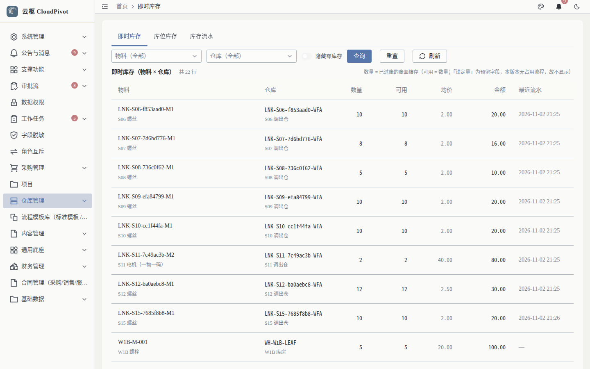
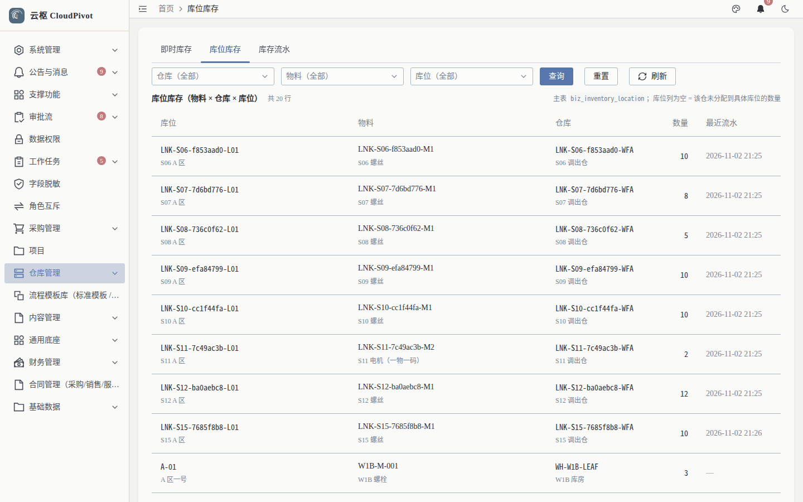
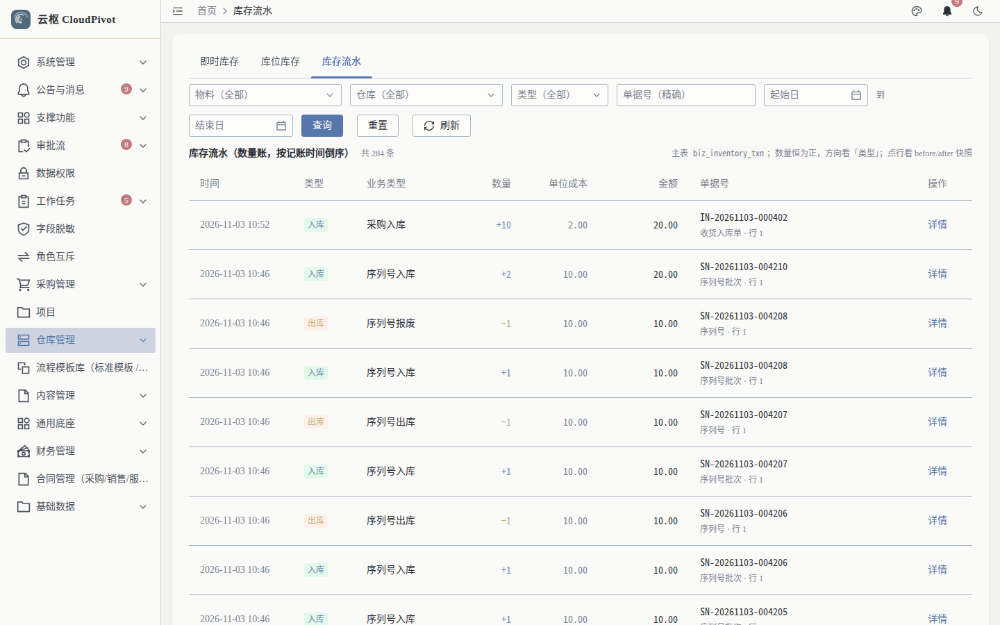

# 06 库存查询 · 使用手册

> **一句话**：查三本账——即时库存（有多少）、库位库存（货在哪）、库存流水（怎么变的）。

- 截图环境：`cloudpivot_manual2`（`127.0.0.1:5180` → `:18097`），账号 `admin`
- 采集脚本：`scripts/manual/capture.mjs inventory`

---

## 一、这个功能干什么

只读查询三类库存数据：按物料+仓库存量（含可用、均价、金额）、按库位的分布、以及每一笔出入库流水（时间、类型、业务类型、数量、单位成本、金额、单据号）。

---

## 二、谁能用（角色 + 权限）

| 页面 | 权限码 |
| --- | --- |
| 即时库存 | `business:erp:inventory:list` |
| 库位库存 | `business:erp:inventory-location:list` |
| 库存流水 | `business:erp:inventory-txn:list` |
| 盘点（同菜单组） | `business:erp:stock-take:*` |

**角色口径**

- 仓管员、采购员、财务：至少给三个 `:list` 权限码。
- `WAREHOUSE_MANAGER` / `FINANCE_MANAGER`：另含盘点建单与状态权限。
- 库存**不能在这里直接改**：任何增减都必须来自收货、出库、调拨、盘点过账。

---

## 三、完整操作步骤（真机截图）

### 步骤 1　即时库存

左侧「采购管理 → 即时库存」（`/business/erp/inventory`）。

列：物料、仓库、数量、**可用**、均价、金额、最近流水。

- `数量` = 账面数量；`可用` = 数量 − 已占用（如待发货在途占用）
- `均价` 为移动加权单价；`金额` = 数量 × 均价
- `最近流水` 可点开跳「库存流水」

页签可直接互跳：即时库存 / 库位库存 / 库存流水。

### 步骤 2　库位库存

点页签「库位库存」（`/business/erp/inventory-location`）。

列：库位、物料、仓库、数量、最近流水。用于确认"仓库有货但某库位没货"这类问题——出库时选错库位就会报可用 0。

### 步骤 3　库存流水

点页签「库存流水」（`/business/erp/inventory-txn`）。

列：时间、类型、业务类型、数量、单位成本、金额、单据号、操作。

- `类型`：IN / OUT / TRANSFER_IN / TRANSFER_OUT / ADJUST 等
- `业务类型`：来源单据种类；`单据号` 可反查对应单据
- 对账口径：任一时点库存 = 期初 + Σ流水；若不符，先从流水定位缺口

---

## 四、常见错误怎么办

| 现象 | 原因 | 处理 |
| --- | --- | --- |
| 库存查不到某个物料 | 该物料在此仓从未入库，或已被过滤 | 清空筛选；确认仓库选择 |
| 数量和出库可用对不上 | 数量含占用，可用已扣减 | 看库位库存确认货在哪一层 |
| 金额为 0 但数量不为 0 | 入库单价为 0（赠送/期初漏填） | 查该物料流水最后一笔入库单价，必要时做期初调整 |
| 仓库有货、库位无货 | 收货未选库位，货落在默认库位账行 | 出库时选具体库位，或先做库位调拨 |
| 流水找不到单据 | 单据被作废/联动作废 | 作废会生成反向流水，用单据号搜全部流水 |

---

## 五、与哪些功能联动

- **收货入库 / 出库单 / 库存调拨 / 库存盘点**：唯一的库存变动来源，过账即写流水。
- **序列号管理**：一物一码物料的明细在序列号页，按序列追踪。
- **财务**：均价与金额参与存货计价，影响资产负债表存货与利润表成本。
- **报表**：资产负债表存货取数于库存金额口径。
