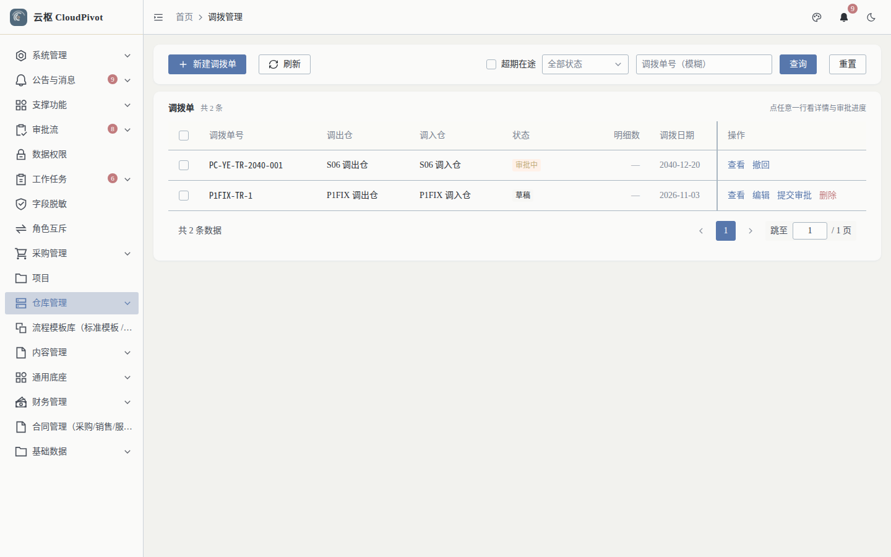
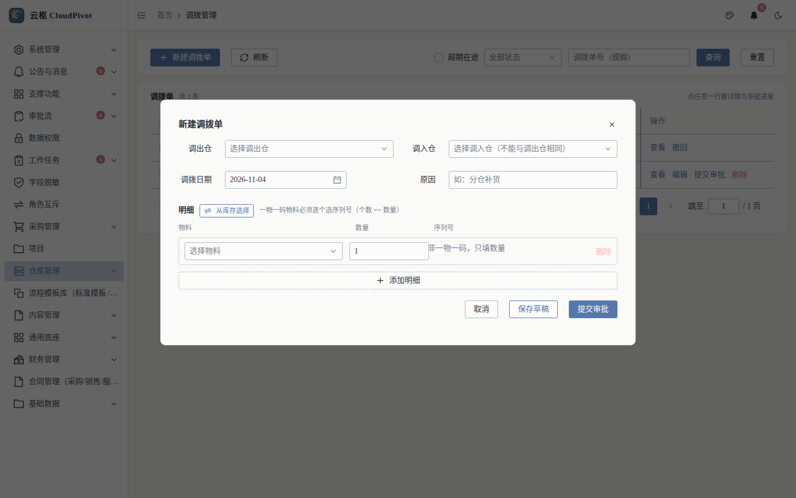
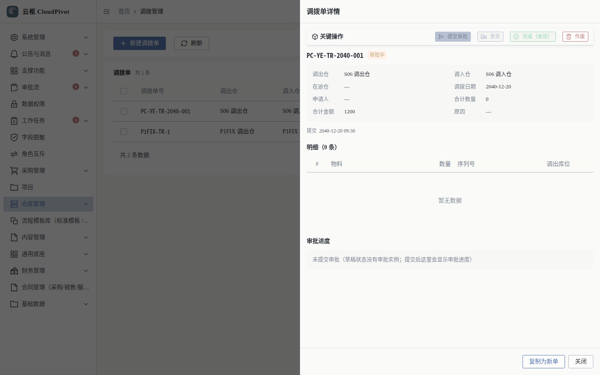

# 07 库存调拨 · 使用手册

> **一句话**：货从一个仓搬到另一个仓——建单、提交审批、发货（在途）、收货，全程扣加两本账。

- 截图环境：`cloudpivot_manual2`（`127.0.0.1:5180` → `:18097`），账号 `admin`
- 采集脚本：`scripts/manual/capture.mjs transfer`

---

## 一、这个功能干什么

按"调出仓 → 调入仓"搬库存：草稿 → 提交审批 → 发货（调出仓减、在途增加）→ 完成收货（在途转调入仓），并支持序列号与库位维度、超期告警。

---

## 二、谁能用（角色 + 权限）

| 事项 | 权限码 |
| --- | --- |
| 查看列表 / 详情 | `business:erp:transfer:list` / `business:erp:transfer:detail` |
| 新建 | `business:erp:transfer:create` |
| 编辑（仅草稿） | `business:erp:transfer:update` |
| 删除（仅草稿） | `business:erp:transfer:delete` |
| 提交审批 / 发货 / 完成 / 作废 | `business:erp:transfer:status` |

**角色口径**

- 仓管员：建单 + 发货（调出仓）；调入仓仓管：完成收货。
- 审批人：按流程节点配置（默认走通用调拨流程 `stock_transfer`）。
- `SUPER_ADMIN`：全部可用。

---

## 三、完整操作步骤（真机截图）

### 步骤 1　进入调拨单列表

左侧「采购管理 → 库存调拨」（`/business/erp/transfer`）。

列：调拨单号、调出仓、调入仓、状态、明细数、调拨日期、申请人、操作。

行操作随状态：`提交审批`、`发货`、`完成（收货）`、`作废`、`复制为新单`。

### 步骤 2　新建调拨单

点 `+ 新建调拨单`。

填写（截图实测字段）：调出仓、调入仓（不能相同）、调拨日期、原因、明细（物料 / 数量 / 序列号）。

1. **调出仓 / 调入仓**：不能是同一个仓
2. **调拨日期**、**原因**（如「分仓补货」，会进摘要）
3. 明细：`从库存选择`（按可用量挑货）或 `添加明细` 手工录；一物一码物料必须逐个选序列号（个数 = 数量）
4. `保存草稿` → 核对 → `提交审批`
5. 库位维度在**详情 / 发货**环节确认（新建表单只填物料、数量、序列号）

> `从库存选择` 支持 `按数量全选` / `清空`，避免手敲数量出错。

### 步骤 3　发货与收货

审批通过后：

1. 调出仓操作 `发货` → 调出仓库存减少，形成在途
2. 调入仓操作 `完成（收货）` → 在途转调入仓库存

### 步骤 4　查看调拨单详情

列表点「查看」。

明细列：`#`、物料、数量、序列号、调出库位。底部动作与列表一致，另含 `复制为新单`、`关闭`。

---

## 四、常见错误怎么办

| 现象（系统原话） | 原因 | 处理 |
| --- | --- | --- |
| `调拨单 … 没有任何明细，复制出来会是一张空单：请先给原单补明细` | 用空单调拨/复制 | 补明细后再操作 |
| `调拨单状态在本次编辑期间已被改动（只有草稿能改），请刷新后重试` | 已被提交/发货 | 刷新列表按新状态操作 |
| `调拨单状态在本次流转期间已被改动（期望 …），请刷新后重试` | 并发流转 | 刷新后重试 |
| 发货报库存不足 | 调出仓/库位可用量不够 | 改数量或换库位，先补货 |
| 调入仓收不到货 | 未点「完成（收货）」 | 在途需调入仓确认收货才落账 |
| 序列号物料卡住 | 序列号已出库/报废，或状态不匹配 | 到「序列号管理」核对序列状态 |
| 长期在途 | 超过告警阈值触发超期提醒 | 跟进调入仓收货或作废重开 |

---

## 五、与哪些功能联动

- **库存 / 库位库存 / 库存流水**：发货与收货各写一组 `TRANSFER_OUT` / `TRANSFER_IN` 流水。
- **审批流**：提交审批生成实例，通过后才能发货。
- **序列号管理**：一物一码物料按序列号流转，报废序列号不能再流转。
- **站内信**：在途超期告警、审批待办推送。
- **报表**：在途库存影响存货口径（发货后未收货期间）。
