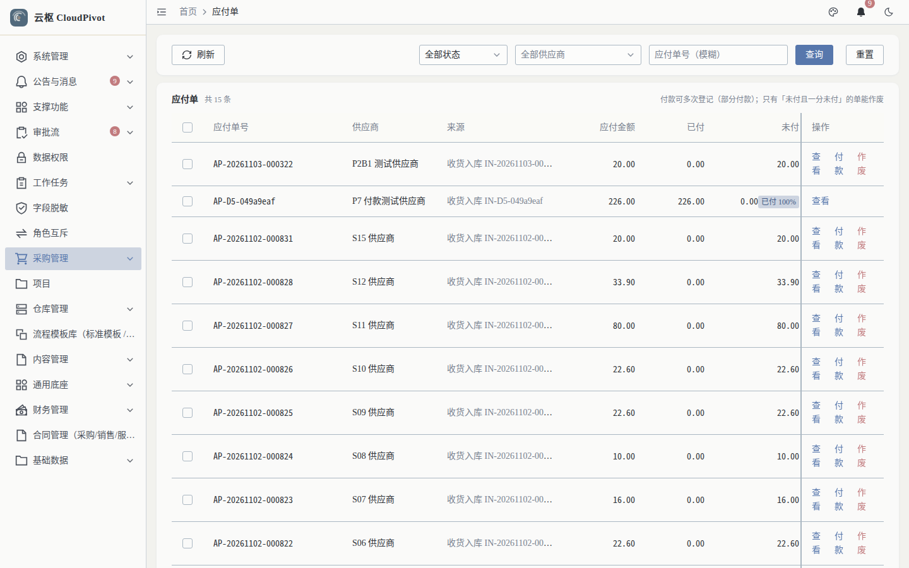
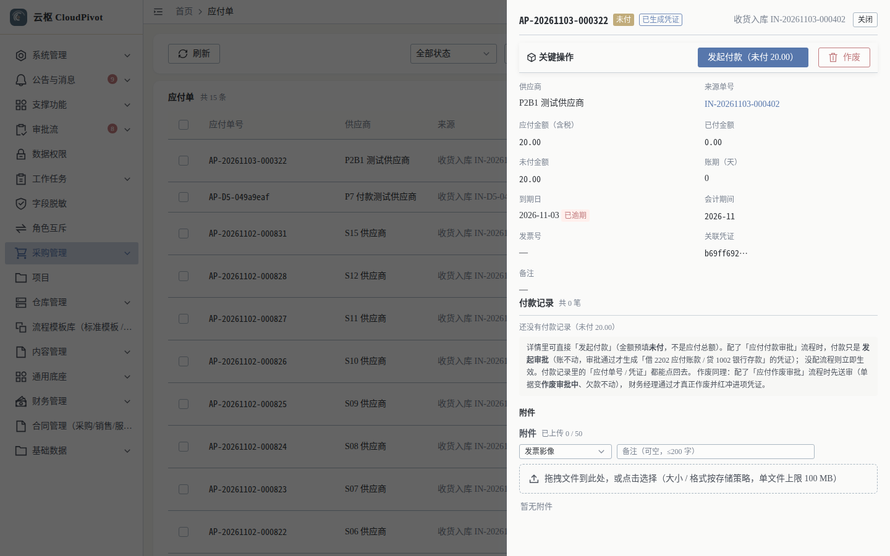
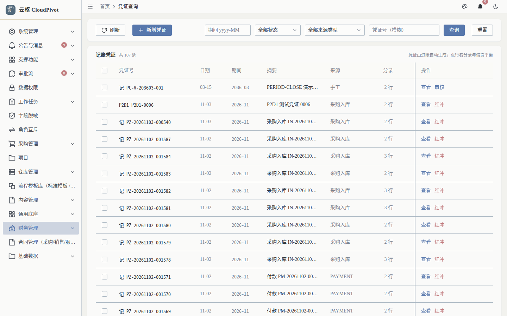
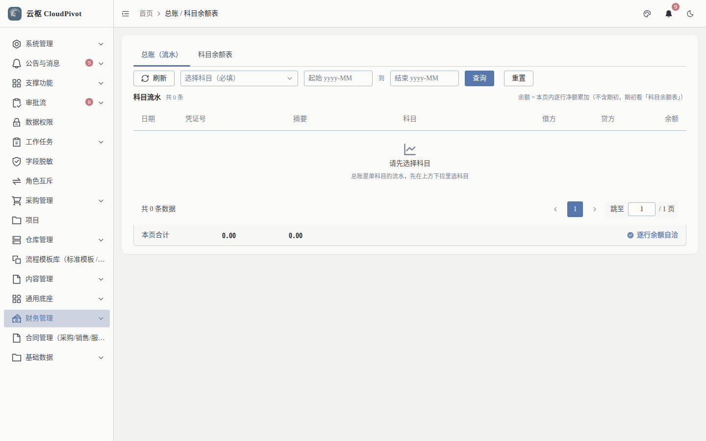
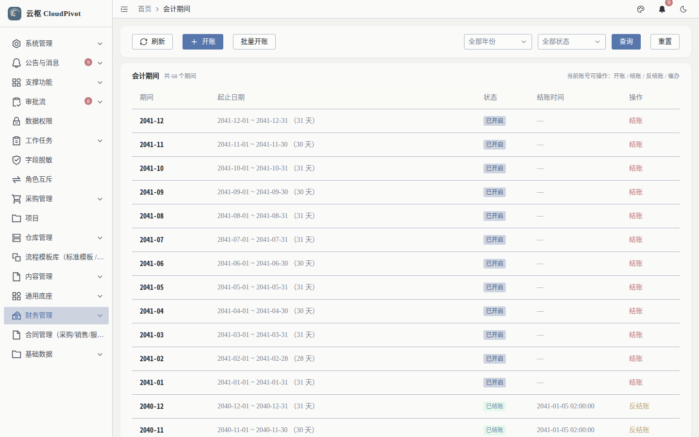

# 08 财务管理 · 使用手册

> **一句话**：管钱的三件事——应付（欠谁多少）、凭证（账怎么记）、期间与总账（账关没关、余额对不对）。

- 截图环境：`cloudpivot_manual2`（`127.0.0.1:5180` → `:18097`），账号 `admin`
- 采集脚本：`scripts/manual/capture.mjs finance`

---

## 一、这个功能干什么

- **应付单**：收货产生的应付款，登记付款、作废（大额需复核）
- **凭证**：查询自动凭证与手工凭证，审核/反审核、红冲、记账
- **总账 / 明细账**：按期间查流水与科目余额表
- **会计期间**：开账、结账、反结账

---

## 二、谁能用（角色 + 权限）

| 事项 | 权限码 |
| --- | --- |
| 应付单查询 / 详情 | `business:erp:payable:list` / `business:erp:payable:detail` |
| 付款 | `business:erp:payable:pay` |
| 应付作废（提交/撤回/作废） | `business:erp:payable:submit-cancel` / `:withdraw-cancel` / `:cancel` |
| 凭证查询 / 新增 | `business:erp:voucher:list` / `business:erp:voucher:create` |
| 总账 / 余额表 / 辅助核算 | `business:erp:ledger:list` / `:trial-balance` / `:aux-balance` |
| 期间开账 / 结账 / 反结账 | `business:erp:period:open` / `:close` / `:reopen` |
| 期间提醒 | `business:erp:period:remind` |

**角色口径（实测角色表）**

- `FINANCE_MANAGER` 财务经理：应付作废复核、凭证红冲复核（含 ≤ 1 万单人会签），另有凭证新增与盘点权限。
- `FINANCE_DIRECTOR` 财务总监：红冲 > 1 万会签（与财务经理共同签字）。
- 会计（无内置角色）：需在角色管理中授予 `payable:list/pay` + `voucher:list/create` + `ledger:*`。
- `SUPER_ADMIN`：全部可用。

---

## 三、完整操作步骤（真机截图）

### 步骤 1　应付单

左侧「财务管理 → 应付单」（`/business/erp/payable`）。

列：应付单号、供应商、来源、应付金额、已付、未付、到期日、状态、操作。实测 15 条。

点「查看」进入详情。

详情底部动作：`发起付款（未付 X）`、`作废`、`关闭`。

付款步骤：

1. 点 `发起付款（未付 …）`，填本次付款金额（> 0 且不超过未付余额）
2. 确认后状态更新，「已付 / 未付」同步变化并生成付款凭证

### 步骤 2　凭证查询与记账

左侧「财务管理 → 凭证查询」（`/business/erp/voucher`）。

列：凭证号、日期、期间、摘要、来源、分录、借方、贷方、状态、操作；展开行显示分录明细（科目、借方金额、贷方金额、分录摘要）。

操作：

- `新增凭证`：手工凭证，至少 2 条分录，**借贷合计不能为 0 且必须平衡**
- `保存并记账`：保存后直接记账
- `确认反审核`：把已审核凭证退回可改
- `提交红冲`：红冲（≤ 1 万财务经理单人；> 1 万财务经理 + 财务总监会签）

### 步骤 3　总账 / 明细账

左侧「财务管理 → 总账」（`/business/erp/ledger`）。

页签：`总账（流水）` / `科目余额表`。

列（流水）：日期、凭证号、摘要、科目、借方、贷方、余额。选科目与期间后查询；余额表用来看期末是否平衡。

### 步骤 4　会计期间

左侧「财务管理 → 会计期间」（`/business/erp/period`）。

列：期间、起止日期、状态、结账时间、操作。实测 20 个期间。

- `开账` / `批量开账`：新期间启用（未开账期间不能记账）
- `确认结账`：锁定本期，禁止再记账
- `确认反结账`：需权限，且要先处理后续已结账期间

---

## 四、常见错误怎么办

| 现象（系统原话） | 原因 | 处理 |
| --- | --- | --- |
| `entries 必填：手工凭证至少要有 2 条分录` | 手工凭证分录不足 | 补到 ≥ 2 条且平衡 |
| `借贷合计不能为 0` | 分录金额全 0 或未填 | 填真实金额并保持借贷相等 |
| `amount 必填：本次付款金额（> 0，且不超过未付余额）` | 付款金额为空/超未付 | 按未付余额以内填写 |
| 记账提示期间不可用 | 该期间未开账或已结账 | 期间页开账，或反结账后再记 |
| 红冲权限不足 | 缺 `FINANCE_MANAGER` 复核 | 由财务经理审批；> 1 万需财务总监会签 |
| 应付作废卡住 | 需走作废审批 | 提交作废 → 财务经理复核 |
| 报表不平衡 | 手工凭证借贷不平或期初未平 | 用余额表定位科目，逐笔核对流水 |

---

## 五、与哪些功能联动

- **收货入库**：过账生成应付与入库凭证。
- **出库单**：过账生成成本结转凭证（6401 / 1901 / 1405）。
- **库存调拨**：跨仓调拨按成本结转，不产生损益。
- **审批流**：应付作废、凭证红冲走会签审批。
- **报表**：凭证与期间是资产负债表 / 利润表 / 现金流量表的取数基础。
