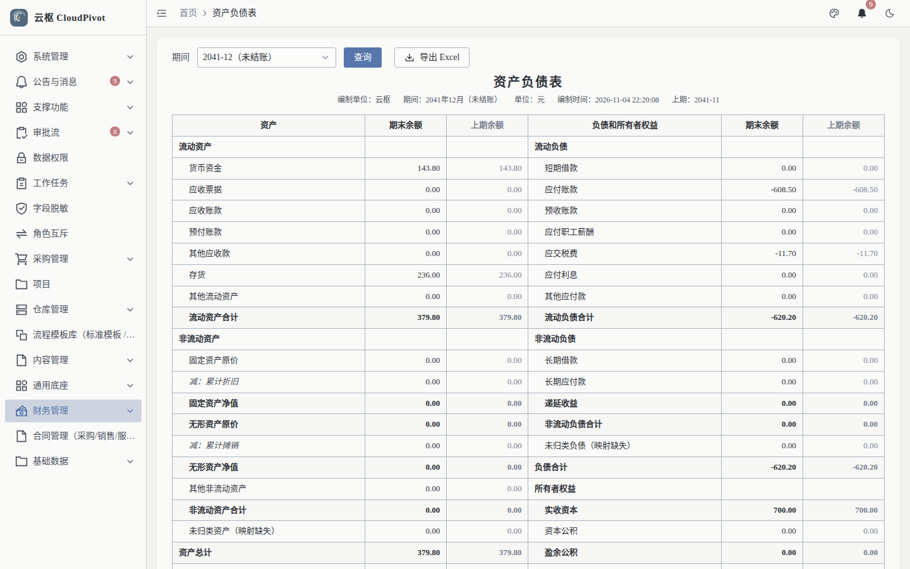
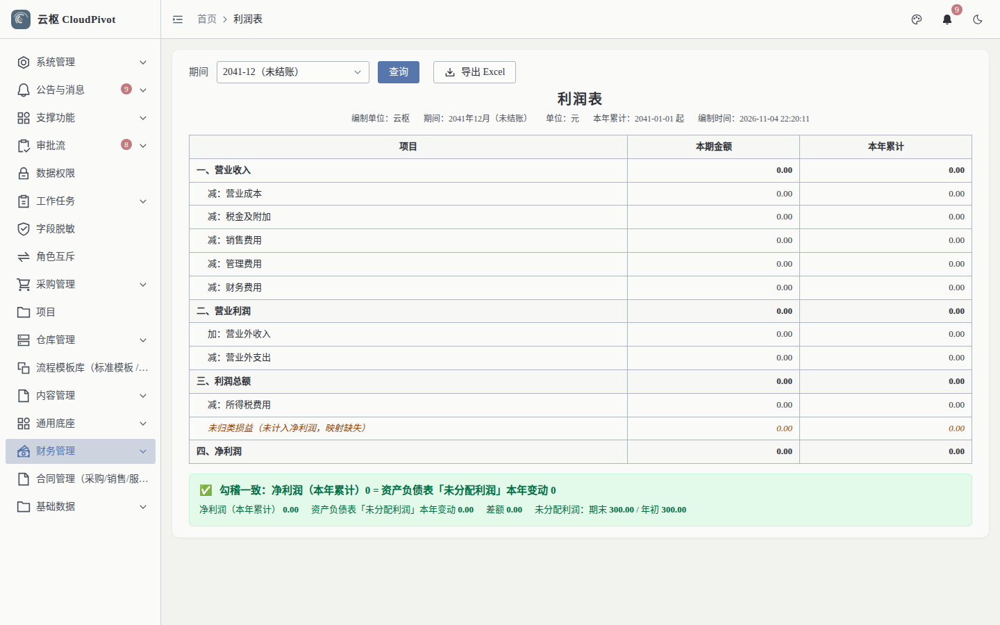
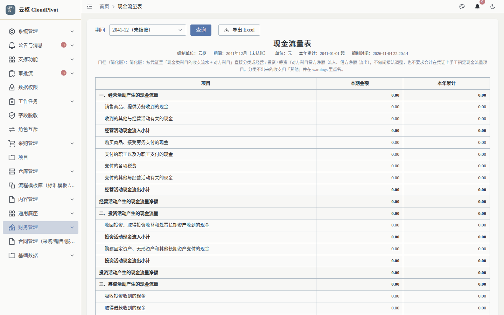

# 09 报表 · 使用手册

> **一句话**：三张法定报表——资产负债表、利润表、现金流量表，按期间出数并导出 Excel。

- 截图环境：`cloudpivot_manual2`（`127.0.0.1:5180` → `:18097`），账号 `admin`
- 采集脚本：`scripts/manual/capture.mjs report`

---

## 一、这个功能干什么

按会计期间汇总凭证数据，输出资产负债表（资产 = 负债 + 所有者权益）、利润表（本期 / 本年累计）、现金流量表（经营 / 投资 / 筹资），支持导出 Excel。

---

## 二、谁能用（角色 + 权限）

| 报表 | 权限码 |
| --- | --- |
| 资产负债表 | `business:erp:report:balance-sheet` |
| 利润表 | `business:erp:report:income-statement` |
| 现金流量表 | `business:erp:report:cash-flow` |
| 导出 Excel | `business:erp:report:export` |

**角色口径**

- 财务人员：四个权限码都给。
- 管理层（只读查看）：给三张报表的查询权限，不给导出可以限制外发。
- `SUPER_ADMIN`：全部可用。
- 注意：报表权限码与列表页不同，**只有 `business:erp:report:*` 才会显示「导出 Excel」按钮**。

---

## 三、完整操作步骤（真机截图）

### 步骤 1　资产负债表

左侧「财务管理 → 资产负债表」（`/business/erp/report/balance-sheet`）。

列：资产、期末余额、上期余额、负债和所有者权益、期末余额、上期余额。实测 24 行。

操作：

1. 选期间（默认当前期间）
2. 点 `查询`
3. 核对左右两侧期末余额合计是否相等
4. 需要留档点 `导出 Excel`

### 步骤 2　利润表

左侧「财务管理 → 利润表」（`/business/erp/report/income-statement`）。

列：项目、本期金额、本年累计。实测 13 行。

要点：`本期金额` 取所选期间，`本年累计` 取 1 月至该期间；两者差额可用于核对跨期调整。

### 步骤 3　现金流量表

左侧「财务管理 → 现金流量表」（`/business/erp/report/cash-flow`）。

列：项目、本期金额、本年累计。实测 27 行，按经营 / 投资 / 筹资活动分组。

### 步骤 4　导出 Excel

三张报表右上角均有 `导出 Excel`；导出任务可在「支撑功能 → 导出任务」查看进度与下载。

---

## 四、常见错误怎么办

| 现象 | 原因 | 处理 |
| --- | --- | --- |
| 报表全为 0 / 空 | 所选期间无凭证，或期间未开账 | 换期间；到会计期间页开账 |
| 资产负债表左右不平 | 手工凭证借贷不平、期初未平、或存在未记账凭证 | 「凭证查询」筛未记账 → 记账；再查「科目余额表」定位差额科目 |
| 利润表与总账对不上 | 损益类科目有直接手工分录走错科目 | 用总账流水按科目核对，红冲错误分录后重做 |
| 现金流量表数据缺 | 凭证未挂现金流量项目 | 在凭证分录上补现金流量项目，重算 |
| 看不到「导出 Excel」 | 缺 `business:erp:report:export` | 角色管理补权限 |
| 导出任务一直排队 | 导出服务异常或队列积压 | 「支撑功能 → 导出任务」查看失败原因，重试 |

---

## 五、与哪些功能联动

- **凭证 / 会计期间**：报表取数完全依赖凭证与期间状态；未结账期间数据仍可变动。
- **应付单**：应付余额进入资产负债表负债方。
- **库存 / 出库**：存货金额进入资产方，出库成本进入利润表营业成本。
- **导出任务**：报表导出走统一导出任务队列，可追溯。
- **数据权限**：按角色 + 数据范围过滤，财务经理与财务总监可见范围可不同。
