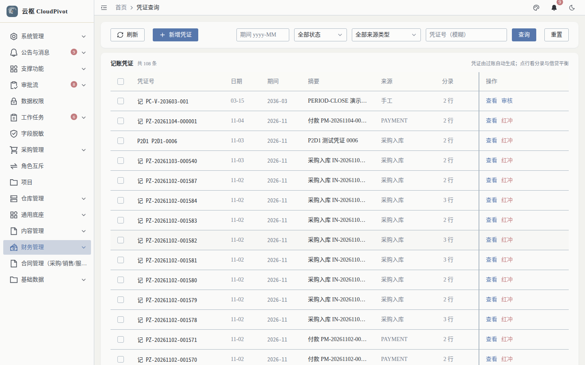
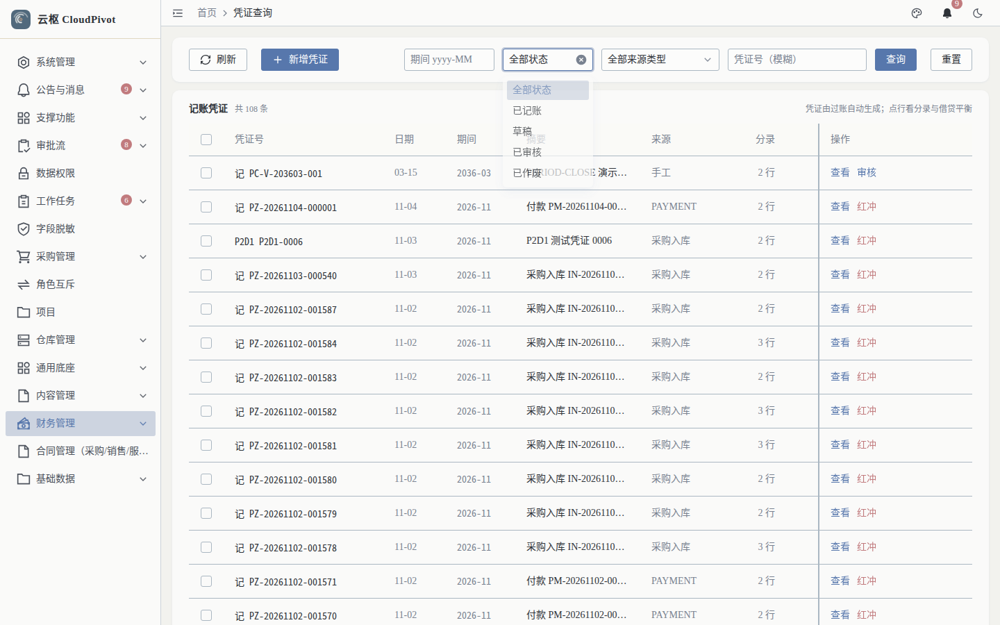
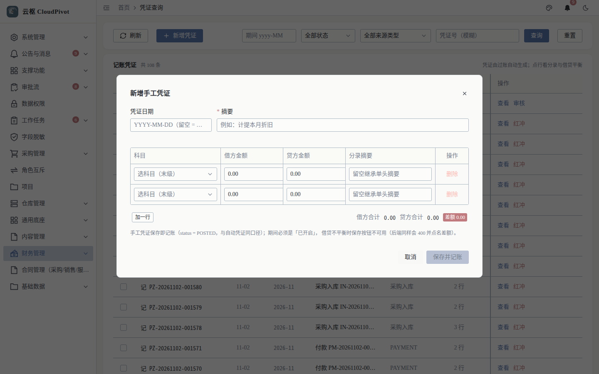
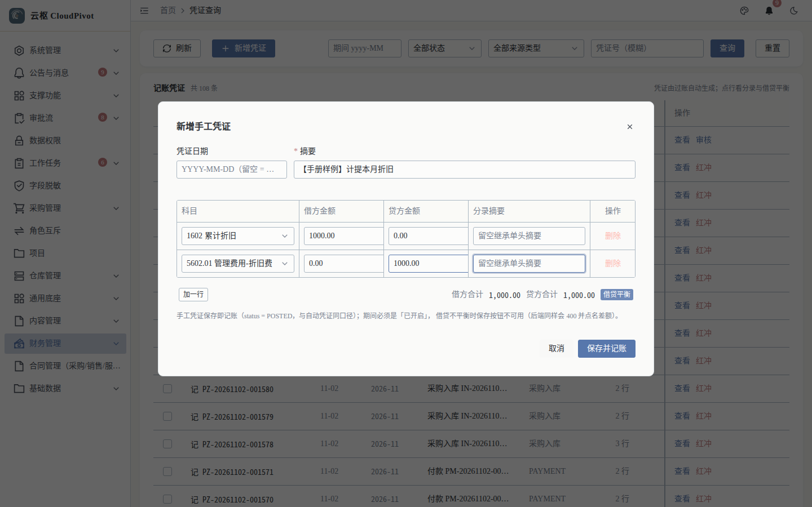
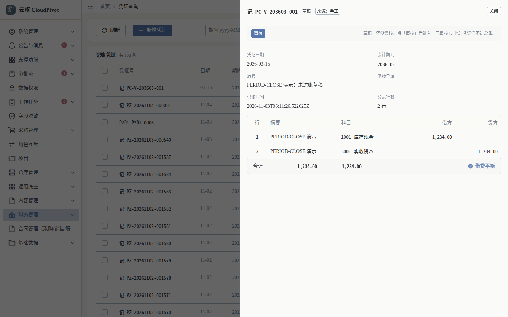

# 10 凭证 · 使用手册

> **一句话**：凭证是账的原子单位——系统按单据自动生成，也可以手工补一张；记账后只能用红冲更正，不能改。

- 适用版本：云枢 CloudPivot 基础版（ERP 财务）
- 截图环境：`cloudpivot_manual2` 实例（前端 `127.0.0.1:5180` → 后端 `127.0.0.1:18097`），账号 `admin`
- 采集脚本：`scripts/manual/capture2.mjs voucher`（真机 Playwright，非手绘）
- 采集证据：`docs/manual/evidence/p2b-capture-run1.log.txt` / `p2b-capture-run2.log.txt`（两轮 note / shot 行 0 差异）

---

## 一、这个功能干什么

管两件事：

1. **查**：采购入库、收货、出库、付款等业务过账自动生成的凭证，以及手工凭证；按期间 / 状态 / 来源 / 凭证号筛选，展开看分录，进详情看合计与借贷平衡。
2. **记**：手工录入凭证（至少 2 条分录、借贷必须相等）→ 保存为**草稿**（`DRAFT`）→ 由另一个人**审核**（`AUDITED`）→ **记账**（`POSTED`）后才进总账。
   制单人不能审核自己那张（内控），已记账凭证不能改、不能反审核，只能**红冲**出一张红字凭证。

---

## 二、谁能用（角色 + 权限）

| 事项 | 权限码 |
| --- | --- |
| 进入「财务管理 → 凭证查询」 | `business:erp:voucher:list` |
| 查看凭证明细 / 分录 | `business:erp:voucher:detail` |
| 新增手工凭证（落草稿，待审核） | `business:erp:voucher:create` |
| 审核（`DRAFT` → `AUDITED`，制单人不能审自己的） | `business:erp:voucher:audit` |
| 反审核（`AUDITED` → `DRAFT`，**必须填原因**） | `business:erp:voucher:un-audit` |
| 记账（`AUDITED` → `POSTED`，记账后只能红冲） | `business:erp:voucher:post` |
| 提交红冲 | `business:erp:voucher:submit-reverse` |
| 撤回红冲申请 | `business:erp:voucher:withdraw-reverse` |
| 红冲复核通过 | `business:erp:voucher:reverse` |

**角色口径（实测角色表）**

- `SUPER_ADMIN` 超级管理员：跳过权限校验，全部可用。
- `FINANCE_MANAGER` 财务经理：凭证新增、红冲复核（≤ 1 万单人；> 1 万与财务总监会签）。
- `FINANCE_DIRECTOR` 财务总监：红冲 > 1 万会签的第二签。
- 其他岗位（会计等）：无内置「会计」角色，需在「角色管理」里勾选上表权限码，否则侧边栏不出现「凭证查询」。

---

## 三、完整操作步骤（真机截图）

### 步骤 1　打开凭证列表

左侧「财务管理 → 凭证查询」，或直接访问 `/business/erp/voucher`。

实测页面结构：

- 筛选区：`期间 yyyy-MM`、`全部状态`、`全部来源类型`、`凭证号（模糊）` + `查询` / `重置` / `刷新`
- 表格列：凭证号、日期、期间、摘要、来源、分录、借方、贷方、状态、操作
- 右上角 `新增凭证`；标题行右侧说明：`凭证由过账自动生成；点行看分录与借贷平衡`
- 截图当时：`记账凭证 共 108 条`（当前页 22 行）

### 步骤 2　按状态筛选

点状态下拉，可选项为：

`全部状态` / `已记账` / `草稿` / `已审核` / `已作废`（实测下拉 5 项，截图已展开）。

### 步骤 3　新增手工凭证（分录编辑器 + 借贷平衡）

点 `新增凭证`，弹窗标题 `新增手工凭证`。

| 字段 | 说明 |
| --- | --- |
| 凭证日期 | `YYYY-MM-DD（留空 = …）`，留空按当天 |
| 摘要 | 必填（`*` 摘要），如「计提本月折旧」 |
| 科目 / 借方金额 / 贷方金额 / 分录摘要 | 每行一条分录；`加一行` 增加，`删除` 删除 |
| 借方合计 / 贷方合计 / 差额 | 实时汇总，差额归 **0.00** 时保存按钮才可用 |

弹窗底部原文：`手工凭证保存为草稿（status = DRAFT）：别人审核（AUDITED）后才记账（POSTED）、才进总账；期间必须是「已开启」，借贷不平衡时保存按钮不可用（后端同样会 400 并点名差额）。`

> 注：截图是 P0-FIX-4A 之前拍的，按钮当时写作 `保存并记账`；现在的按钮文案是 `保存为草稿`，
> 行为以本节文字为准（保存只落草稿，不进账）。

示例（截图里真实录入）：摘要「【手册样例】计提本月折旧」，分录 1 科目 `1602 累计折旧` 借 1000，分录 2 科目 `5602 管理费用` 贷 1000，校验结果显示 **借贷平衡**。

点 `保存为草稿` 即建单（落 `DRAFT`，列表里这张凭证显示「草稿」，要别人「审核」后才记账、才进总账）；点 `取消` 放弃。

### 步骤 4　查看凭证明细

列表行点 `查看`，右侧抽屉显示凭证头 + 分录表 + 合计。

实测：`记 PC-V-203603-001`，分录行 2；抽屉内表头为 行 / 摘要 / 科目 / 借方 / 贷方，末行 `合计` 并给出借贷平衡结论。分录示例：`1405 库存商品` 借 20.00、`2221.01 应交税费-进项税` 借 2.60、`2202 应付账款` 贷 22.60，合计 22.60 = 22.60，标记 **借贷平衡**。

动作按钮随状态变化（实测）：

- 草稿：可 `审核`
- 已审核：`取消` → `确认反审核` 退回可改
- 已记账：抽屉顶部直接提示 `没有可执行的审核动作`，原文：`已记账：已进总账/报表，审核与反审核都不可用。更正请用「红冲」开一张红字凭证。`
- 已记账且未红冲：`提交红冲`（复核由财务经理执行，> 1 万加财务总监会签）

---

## 四、常见错误怎么办

| 现象（系统原话） | 原因 | 处理 |
| --- | --- | --- |
| 借贷不平衡时 `保存为草稿` 灰色不可点 | 借方合计 ≠ 贷方合计，或差额不为 0 | 补齐金额，让「差额」归 0.00；后端同样会 400 并点名差额 |
| `红冲失败：凭证 {no} 当前状态是 {}，只有已记账（POSTED）的凭证能红冲` | 草稿 / 已审核 / 已作废凭证点了红冲 | 草稿直接改或用删除；已审核先反审核 |
| `红冲失败：该凭证 {} 已经红冲（红字凭证 {no}），不能重复红冲` | 一张凭证只允许红冲一次 | 找那张红字凭证，别再红冲原凭证 |
| `红冲失败：凭证 {} 本身是红字凭证，红字凭证不能再红冲（要更正请直接补一张蓝字凭证）` | 想「红冲红字凭证」 | 直接补一张蓝字正确凭证 |
| `红冲失败：凭证 {} 所属期间 {} 已结账，不能再红冲（请先反结账）` | 期间已封 | 先在「会计期间」反结账（需原因 ≥ 10 字），再红冲 |
| 保存凭证报期间不可用 | 该期间 `未开账` 或 `已结账` | 「会计期间」页开账 / 反结账后再录 |
| 侧边栏没有「凭证查询」 | 当前角色没勾 `business:erp:voucher:list` | 角色管理里授权，重登生效 |

---

## 五、与哪些功能联动

- **收货入库 / 出库单 / 库存调拨**：单据过账自动生成凭证（借 1405、税 2221.01、贷 2202 等），来源列显示单据号。
- **付款**：登记付款审核通过后生成付款凭证（借 2202 / 贷 1002 银行存款），凭证号回写到应付单详情。
- **总账 / 科目余额表**：凭证是总账流水的唯一来源；已记账才进总账。
- **会计期间 / 年度结转**：期间封账后不能再记账或红冲；年结前必须没有草稿凭证。
- **报表**：资产负债表 / 利润表 / 现金流量表全部从凭证取数。
