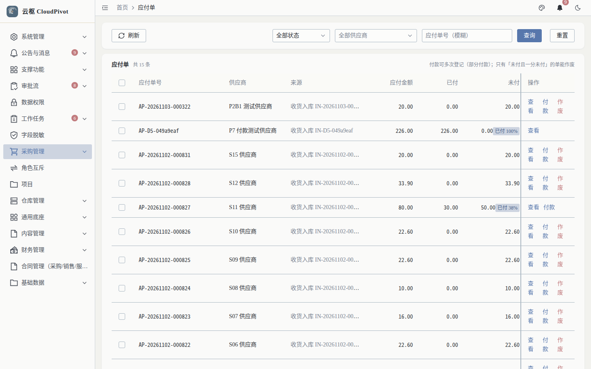
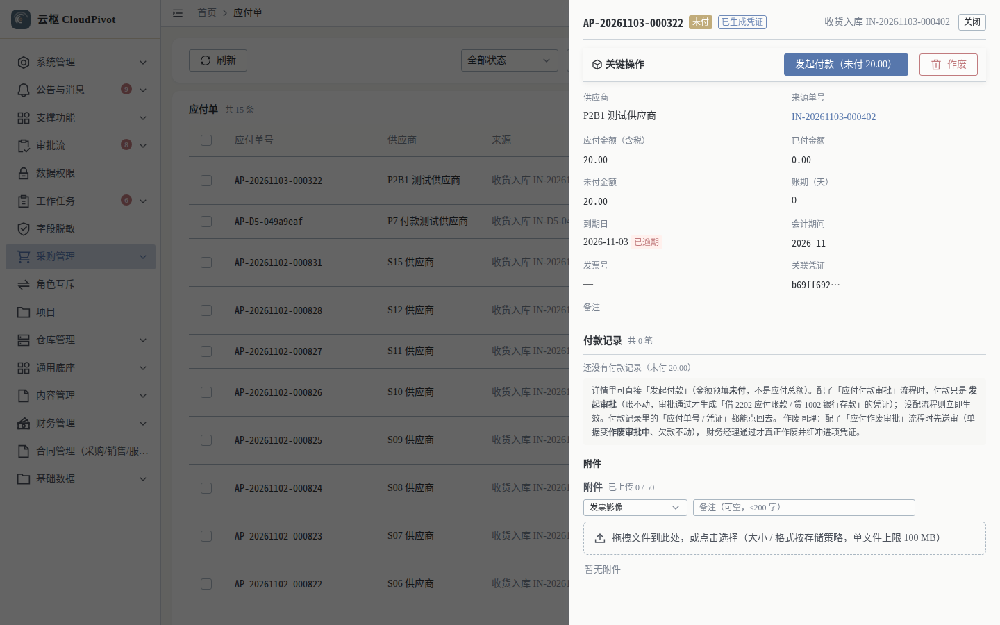
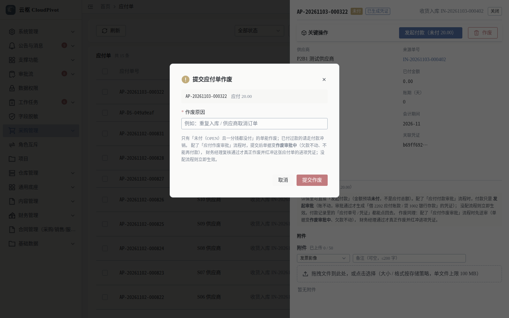

# 11 应付 · 使用手册

> **一句话**：应付单是「欠供应商多少钱」的账；它由收货自动生成，你只需要看余额、付款、以及在错的时候作废。

- 适用版本：云枢 CloudPivot 基础版（ERP 财务）
- 截图环境：`cloudpivot_manual2` 实例（`127.0.0.1:5180` → `:18097`），账号 `admin`
- 采集脚本：`scripts/manual/capture2.mjs payable`
- 采集证据：`docs/manual/evidence/p2b-capture-run1.log.txt` / `-run2.log.txt`

---

## 一、这个功能干什么

- 汇总每一张收货单对应的**应付金额 / 已付 / 未付 / 到期日**，一个供应商一单一条记录。
- 从详情页发起付款（见手册 12）或提交作废；作废要填原因，且只对「没付过钱」的单开放。
- 提供「来源单号 → 关联凭证」的追溯链：点得回收货单，也点得回进项凭证。

---

## 二、谁能用（角色 + 权限）

| 事项 | 权限码 |
| --- | --- |
| 进入「财务管理 → 应付单」并查询 | `business:erp:payable:list` |
| 看单据详情 + 付款记录 | `business:erp:payable:detail` |
| 发起付款（登记付款） | `business:erp:payable:pay` |
| 提交作废 | `business:erp:payable:submit-cancel` |
| 撤回作废申请 | `business:erp:payable:withdraw-cancel` |
| 作废复核通过 / 直接作废 | `business:erp:payable:cancel` |

**角色口径（实测角色表）**

- `SUPER_ADMIN` 超级管理员：全部可用。
- `FINANCE_MANAGER` 财务经理：应付作废复核（配了「应付作废审批」流程时，复核通过才真正作废并红冲进项凭证）。
- 采购 / 仓管岗：默认只能看（`payable:list` / `:detail`），付款与作废需财务授权。

---

## 三、完整操作步骤（真机截图）

### 步骤 1　看应付单列表

左侧「财务管理 → 应付单」（`/business/erp/payable`）。

实测：共 15 条；筛选区有状态下拉（`全部状态`）+ `刷新` / `查询` / `重置`。

列：应付单号、供应商、来源、应付金额、已付、未付、到期日、状态、操作。

### 步骤 2　进详情看余额与动作条

列表行点 `查看`，右侧抽屉弹出。

实测（`AP-20261103-000322`）：

- 标题行标签：`未付` + `已生成凭证`，右侧 `收货入库 IN-20261103-000402`、`关闭`
- 关键操作：`发起付款（未付 20.00）`、`作废`
- 字段（左列 / 右列）：供应商、来源单号、应付金额（含税）、已付金额、未付金额、到期日（逾期会标红「已逾期」）、发票号、账期（天）、会计期间（2026-11）、关联凭证、备注
- 下方「付款记录 共 N 笔」区块（无记录时显示 `还没有付款记录（未付 80.00）`）
- 再下方「附件」区：分类下拉（发票影像）+ 备注（可空，≤ 200 字）+ 拖拽上传区（单文件上限 100 MB）
- 页面说明原文：`付款只是发起审批（账不动，审批通过才生成「借 2202 应付账款 / 贷 1002 银行存款」的凭证）；没配流程则立即生效。付款记录里的「应付单号 / 凭证」都能点回去。作废同理：配了「应付作废审批」流程时先送审（单据变作废审批中、欠款不动），财务经理通过才真正作废并红冲这张应付单的进项凭证。`

### 步骤 3　提交作废（原因必填）

在详情动作条点 `作废`。

弹窗 `提交应付单作废`：

| 项 | 内容 |
| --- | --- |
| 单据条 | `AP-20261103-000322　应付 20.00` |
| 作废原因 | 必填（`*` 作废原因），占位提示 `例：重复入库 / 供应商取消订单` |
| 说明 | `只有「未付（OPEN）且一分钱都没付」的单能作废；已付过款的请走付款冲销。配了「应付作废审批」流程时，提交后单据变作废审批中（欠款不动、不能再付款），财务经理复核通过才真正作废并红冲这张应付单的进项凭证；没配流程则立即生效。` |
| 按钮 | `取消` / `提交作废` |

填原因 → `提交作废`；配了流程时会进审批（见手册 02 审批流），没配流程立即生效。

---

## 四、常见错误怎么办

| 现象（系统原话） | 原因 | 处理 |
| --- | --- | --- |
| `作废` 按钮点了没反应 / 报不能作废 | 单据已付过款或状态不是 `OPEN` | 已付款的走付款记录冲销，不要作废 |
| 提交作废提示必须给原因 | 作废原因留空 | 按模板写清原因（重复入库、供应商取消等），审计要能回答 |
| 提交作废后不能付款 | 单据已进入「作废审批中」 | 等财务经理复核；要撤回答复走撤回作废申请（`withdraw-cancel`） |
| 付款报 `本次付款 {金额} 超过未付余额 {}（应付单 {}）：审批期间未付余额已变` | 审批期间别人已付了一部分 | 刷新详情看最新未付余额，按余额内重新登记 |
| 详情看不到付款按钮 | 缺 `business:erp:payable:pay` | 角色管理授权 |
| 「应付单」菜单不出现 | 缺 `business:erp:payable:list` | 角色管理授权后重登 |

---

## 五、与哪些功能联动

- **收货入库**：收货单过账即生成应付单（一单一条），来源列写回收货单号。
- **付款（手册 12）**：详情内 `发起付款`，登记后走审批，通过才生成付款凭证。
- **凭证（手册 10）**：应付单的进项凭证与付款凭证都在凭证列表可查，凭证号回写到详情。
- **审批流（手册 02）**：应付作废与付款都按流程定义走；内控规则「发起人不可审批自己发起的」会自动跳签并留痕。
- **报表**：应付余额是资产负债表「应付账款」的取数来源之一。
