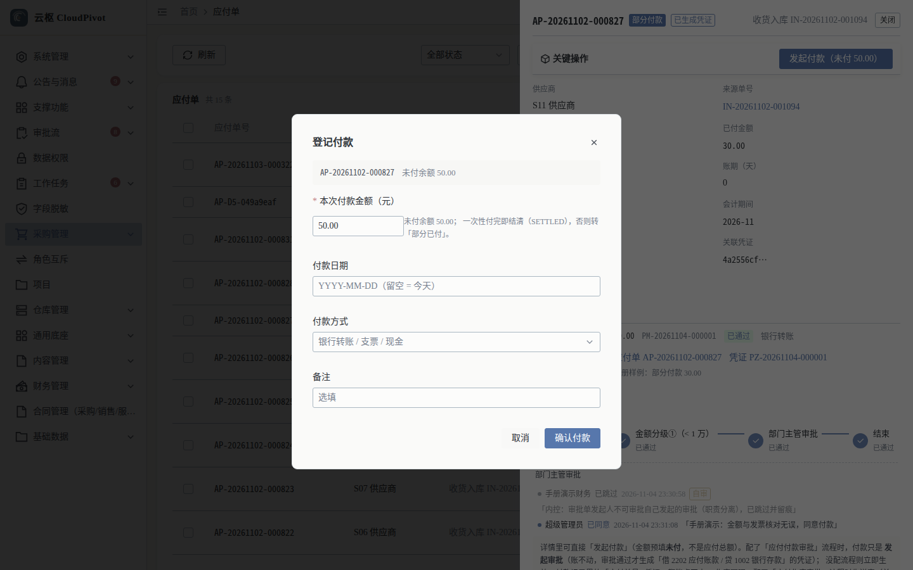
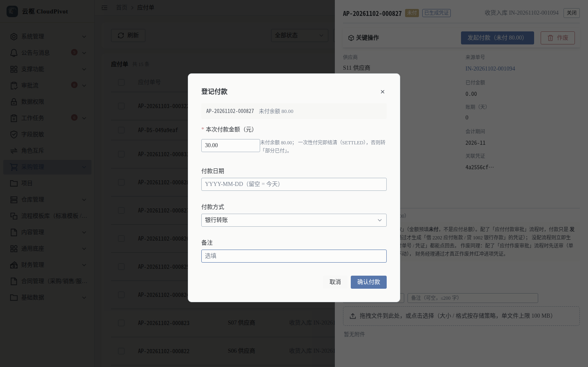
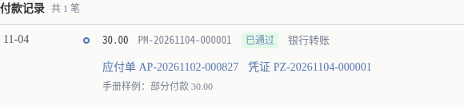
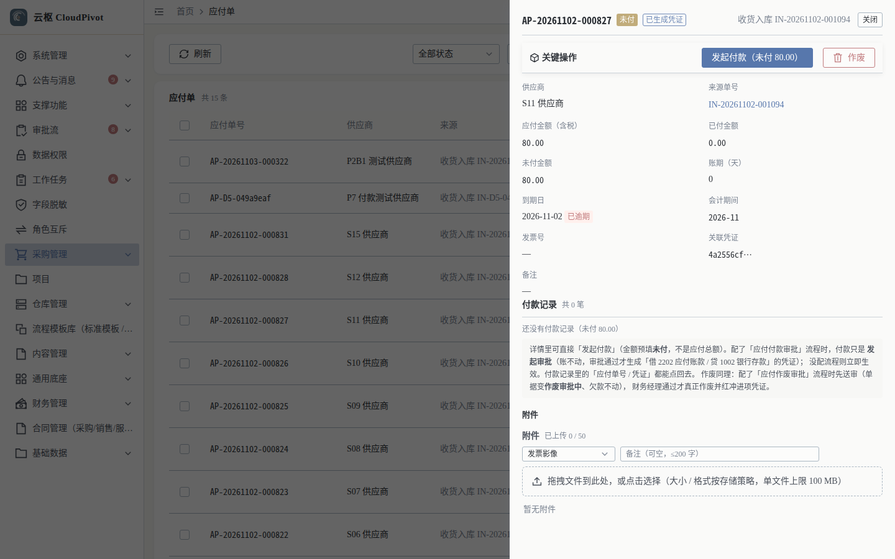
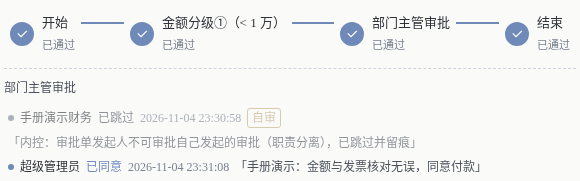

# 12 付款 · 使用手册

> **一句话**：付款不是「转账」，是**在应付单上登记一笔付款并走审批**；审批通过才动账（生成凭证），审批期间未付余额还可能被别人改动，所以金额以最新余额为界。

- 适用版本：云枢 CloudPivot 基础版（ERP 财务）
- 截图环境：`cloudpivot_manual2` 实例（`127.0.0.1:5180` → `:18097`），账号 `admin`
- 采集脚本：`scripts/manual/capture2.mjs payment`（只读截图：`payment/01~03`）
  以及 `seed_payment`（一次性写库取证：`seed-payment/01~02`，`MANUAL_WRITE=1` 才执行）
- 采集证据：`docs/manual/evidence/p2b-capture-run1.log.txt` / `-run2.log.txt`

---

## 一、这个功能干什么

1. **登记付款**：在应付单详情点 `发起付款（未付 X）`，填本次金额 / 付款日期 / 付款方式 / 备注。
2. **走审批**：金额分级审批（示例流程：`金额分级①（< 1 万）` → `部门主管审批` → `结束`）；内控规则会跳过发起人本人的审批节点并留痕。
3. **回写余额**：审批通过后更新「已付 / 未付」，一次性付完单据转 `已结清（SETTLED)`，否则转「部分已付」，并生成付款凭证。
4. **查付款记录**：详情页「付款记录 共 N 笔」列出单号、金额、状态、付款方式、关联应付单与凭证，可点回上游单据。

---

## 二、谁能用（角色 + 权限）

| 事项 | 权限码 |
| --- | --- |
| 登记付款（发起） | `business:erp:payable:pay` |
| 看付款记录 / 审批进度 | `business:erp:payable:detail`（与应付详情同一个码，不新种权限） |
| 审批（按流程节点） | 流程定义里各节点绑定的角色（如 `DEPT_LEADER` 部门主管、`FINANCE_MANAGER` 财务经理） |

**角色口径（实测角色表）**

- `SUPER_ADMIN`：全部可用；但**内控仍会拦**——发起人不能审批自己发起的审批，系统自动跳过该节点并留痕（见步骤 3 截图里的「自审」标记）。
- 财务岗（`FINANCE_MANAGER` / `FINANCE_DIRECTOR`）：按流程节点参与审批，不是「默认能付款」。
- 采购 / 仓管：默认只能看记录，不能发起付款。

---

## 三、完整操作步骤（真机截图）

### 步骤 1　打开登记付款弹窗

「财务管理 → 应付单」→ 选中单据 → `查看` → 详情动作条点 `发起付款（未付 X）`。

弹窗 `登记付款`，实测字段：

| 字段 | 说明 |
| --- | --- |
| 单据条 | `AP-20261102-000827　未付余额 50.00` |
| 本次付款金额（元） | 必填（`*`），**默认预填未付余额**；提示 `未付余额 50.00；一次性付完即结清（SETTLED），否则转「部分已付」。` |
| 付款日期 | `YYYY-MM-DD（留空 = 今天）` |
| 付款方式 | 下拉 `银行转账 / 支票 / 现金` |
| 备注 | 选填 |
| 按钮 | `取消` / `确认付款` |

注意：金额默认是**未付余额**而不是应付总额——只付一部分时要手工改小。

### 步骤 2　真机填写并提交（写库取证）

手册实例上实际执行过一次「部分付款」，表单值：

- 单据 `AP-20261102-000827`，未付余额 80.00
- 本次付款金额 `30.00`，付款方式 `银行转账`，付款日期留空（按当天）
- 点 `确认付款` 提交 → 进入审批

提交结果（只读复查，见下一步截图与采集日志）：生成付款单 `PM-20261104-000001`，金额 30.00，状态 `已通过`，凭证 `PZ-20261104-000001`；应付单已付 30.00、未付 50.00，状态转「部分已付」。

### 步骤 3　看付款记录与审批进度

重新打开该应付单详情（关闭抽屉再点 `查看`，让数据刷新）。

实测记录区原文：`付款记录 共 1 笔　11-04　30.00　PM-20261104-000001　已通过　银行转账　应付单 AP-20261102-000827　凭证 PZ-20261104-000001　手册样例：部分付款 30.00`。

提交后**如果抽屉还开着**，看到的是打开时的快照（实测截图：付款记录仍是 0 笔、未付仍是 80.00），需要关闭重开才更新——见下图：

这是真实行为，不是数据没写成：同一次操作后重新打开详情，就能看到上面那条「共 1 笔 30.00」。

审批进度实测原文：

- `金额分级①（< 1 万）` 已通过
- `部门主管审批` 已通过
- `结束` 已通过
- 节点明细：`部门主管审批　手册演示财务　已跳过　2026-11-04 23:30:58　自审　内控：审批单发起人不可审批自己发起的审批（职责分离），已跳过并留痕`
- 下一行：`超级管理员　已同意　2026-11-04 23:31:08　手册演示：金额与发票核对无误，同意付款`

---

## 四、常见错误怎么办

| 现象（系统原话） | 原因 | 处理 |
| --- | --- | --- |
| `本次付款金额必须大于 0，收到 {amount}` | 填了 0 或负数 | 填真实金额；只付一部分就把默认值改小 |
| `本次付款 {amount} 超过未付余额 {}（应付单 {}）：审批期间未付余额已变` | 审批期间别人已经付了一部分 | 关掉弹窗重新打开详情看最新未付余额，再按余额内登记 |
| 提交后详情里「仍显示 0 笔付款记录」 | 抽屉数据是打开时的快照，不自动刷新 | 关闭抽屉 → 重开 `查看`，或点列表 `刷新` |
| 单据状态是「已结清」还点付款 | 已结清不能继续付（后端 409） | 不要重复付款；核对供应商流水 |
| 提交后卡在审批不动 | 流程节点上的人未处理，或流程未配 | 到「审批流 → 待我审批」处理；未配流程则立即生效 |
| 审批节点显示「已跳过 / 自审」 | 内控职责分离：发起人不能审自己的单 | 属正常留痕，由下一节点或管理员处理 |

---

## 五、与哪些功能联动

- **应付（手册 11）**：付款入口与付款记录都在应付单详情；余额由付款回写。
- **凭证（手册 10）**：审批通过生成付款凭证（借 2202 应付账款 / 贷 1002 银行存款），凭证号回写应付单。
- **审批流（手册 02）**：「金额分级」节点按金额路由；内控跳过规则与留痕可在审批详情看到。
- **期间（手册 14）**：付款凭证落在「已开启」期间；已结账期间会拒绝写入。
- **报表**：付款影响应付余额与现金流量表「经营活动」口径。
