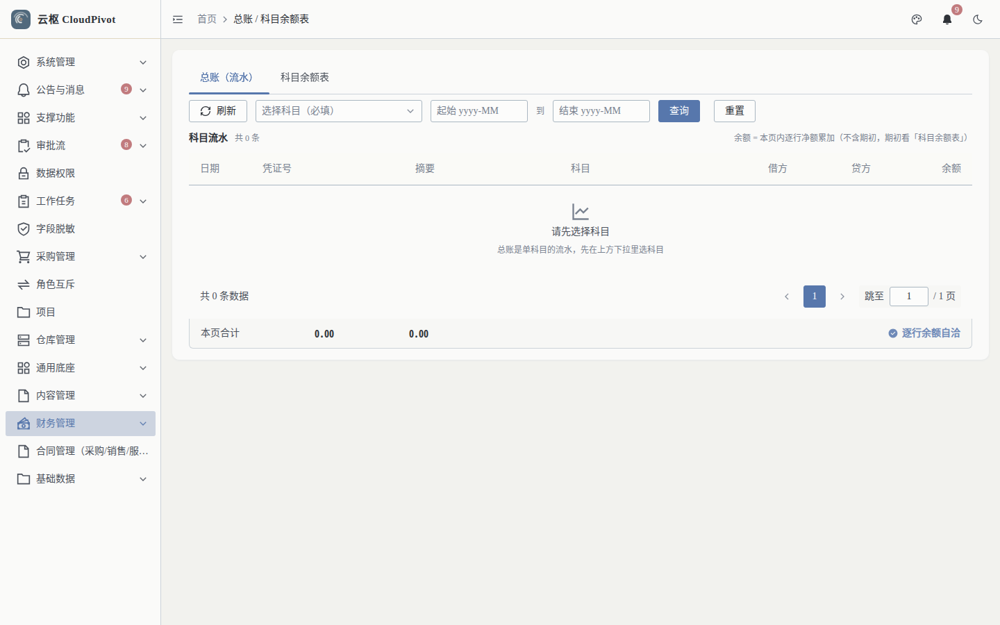
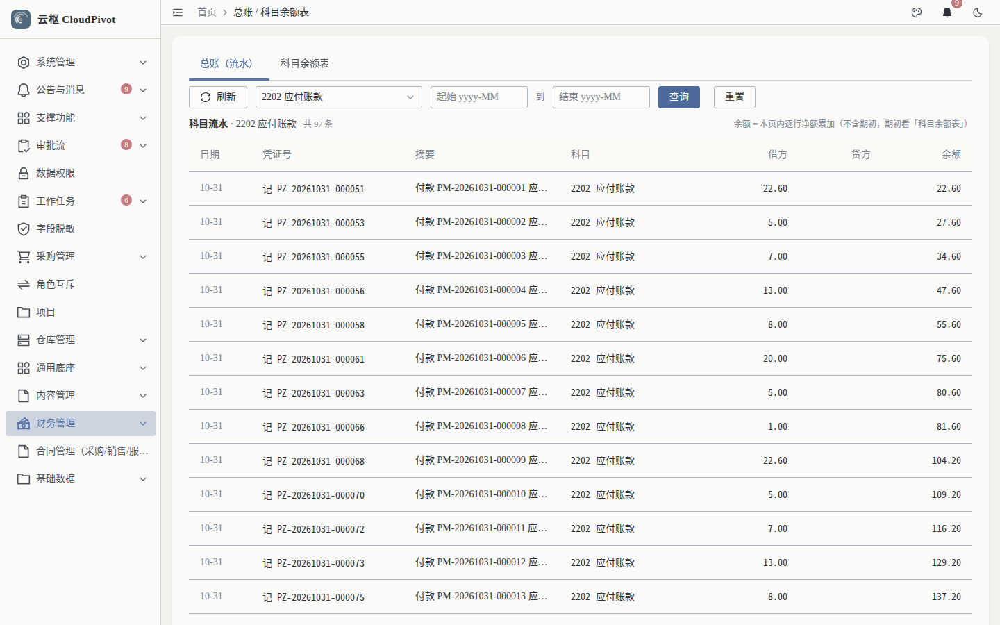
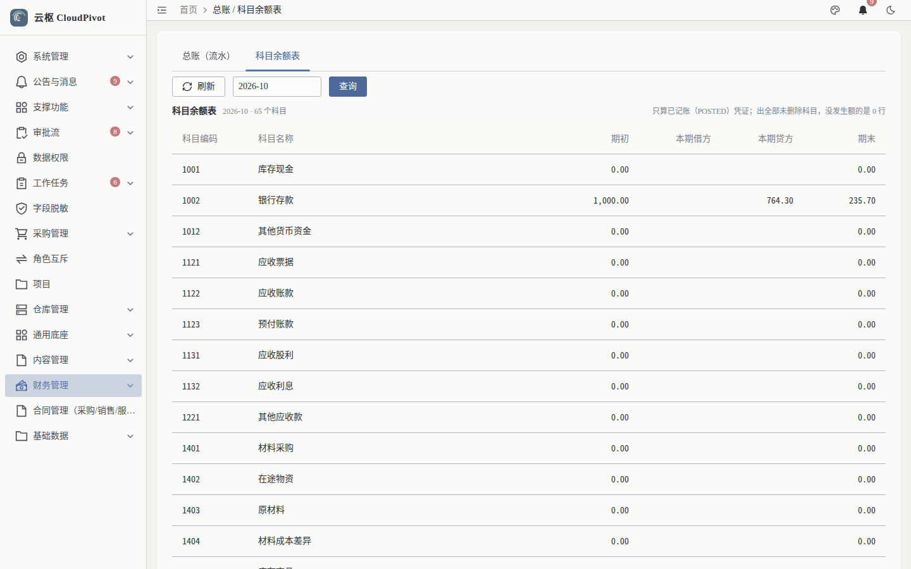

# 13 总账 · 使用手册

> **一句话**：总账回答两个问题——「这个科目这个月发生了什么」（流水）和「这个月末余额对不对」（科目余额表 / 试算平衡）。

- 适用版本：云枢 CloudPivot 基础版（ERP 财务）
- 截图环境：`cloudpivot_manual2` 实例（`127.0.0.1:5180` → `:18097`），账号 `admin`
- 采集脚本：`scripts/manual/capture2.mjs ledger`
- 采集证据：`docs/manual/evidence/p2b-capture-run1.log.txt` / `-run2.log.txt`

---

## 一、这个功能干什么

- **总账（流水）**：按科目 + 期间区间列出每一条发生额（日期、凭证号、摘要、借方、贷方、余额），页脚给出「逐行余额自洽」校验（余额是否为逐行累加、有无断点）。
- **科目余额表**：按期间给出每个科目的期初 / 本期借方 / 本期贷方 / 期末，并给试算平衡结论。
- 两者是同一套账的两种视角：流水看明细，余额表看汇总与平衡。

---

## 二、谁能用（角色 + 权限）

| 事项 | 权限码 |
| --- | --- |
| 进入「财务管理 → 总账 / 科目余额表」并查流水 | `business:erp:ledger:list` |
| 查科目余额表（试算平衡） | `business:erp:ledger:trial-balance` |
| 查辅助核算余额表（接口已备，前端未暴露，见手册 16） | `business:erp:ledger:aux-balance` |

**角色口径**：`SUPER_ADMIN` 全部可用；会计 / 财务岗需在「角色管理」勾选上表权限码；纯查询角色授 `ledger:list` + `ledger:trial-balance` 即可，不需要 `voucher:*`。

---

## 三、完整操作步骤（真机截图）

### 步骤 1　打开总账页（初始为空）

左侧「财务管理 → 总账 / 科目余额表」（`/business/erp/ledger`）。

实测：页签 `总账（流水）` / `科目余额表`；筛选为 `刷新` + 科目下拉 + `起始 yyyy-MM` + `到` + `结束 yyyy-MM` + `查询` / `重置`。未选科目时表格为空（空状态 `空=true`，行 0），这是设计如此——**先选科目再查**。

### 步骤 2　选科目查流水

科目下拉选 `2202 应付账款`，点 `查询`。

实测：

- 标题：`科目流水 · 2202 应付账款　共 97 条`
- 右上说明：`余额 = 本页内逐行净额累加（不含期初，期初看「科目余额表」）`
- 列：日期、凭证号、摘要、科目、借方、贷方、余额（当前页 20 行）
- 页脚结论：**逐行余额自洽**（余额断点处会显示 `余额断点 N 处`）

看号：余额 `22.60 → 27.60 → 34.60 → 47.60 …` 逐行递增，每行 = 上一行余额 ± 本行发生额（按科目余额方向，`2202 应付账款` 为贷方增，故 `+贷 −借`），可手算复核。

### 步骤 3　看科目余额表与试算平衡

切页签 `科目余额表`，期间填 `2026-10`，点 `查询`。

实测：

- 列：科目编码、科目名称、期初、本期借方、本期贷方、期末（56 行）
- 页脚结论：**平衡**（试算平衡：Σ借方 = Σ贷方，容差 0.0001）
- 期初/期末都不会凭空出现：期初来自上期结转或期初录入，期末 = 期初 + 本期借 − 本期贷

---

## 四、常见错误怎么办

| 现象（系统原话） | 原因 | 处理 |
| --- | --- | --- |
| 表格空、提示无数据 | 没选科目就查询（流水以科目为入口） | 先选科目；查全科目汇总请用「科目余额表」 |
| `period 必须是 yyyy-MM，收到「{period}」` | 期间格式写成 `2026/10`、`202610` | 统一写 `yyyy-MM` |
| `period_from（{from}）不能晚于 period_to（{to}）` | 起始晚于结束 | 对调起止期间 |
| `会计科目不存在或已删除` | 科目被删除 / 停用后仍在旧链接里查 | 刷新页面重选科目 |
| 页脚显示 `余额断点 N 处` | 流水行被人为改动或导入异常 | 记录科目 + 期间，报运维用不变量套件定位（手册 22） |
| 余额表不平 | 期初未平或存在借贷不平凭证 | 先修凭证；年结/结账会被这一步挡住 |

---

## 五、与哪些功能联动

- **凭证（手册 10）**：已记账凭证是流水的唯一来源；红冲会新增红字流水，不改历史行。
- **期间（手册 14）**：结账预检会跑试算平衡，不平不能封账；反结账后本期流水重新可写。
- **年度结转（手册 15）**：年结把本年利润结转到下年期初，余额表的期初来源就在这一步。
- **辅助核算（手册 16）**：科目挂了辅助核算维度时，余额还需按维度拆分核对（当前前端未暴露该视图，接口为 `ledger:aux-balance`）。
- **报表**：资产负债表 / 利润表以余额表为取数基础。
