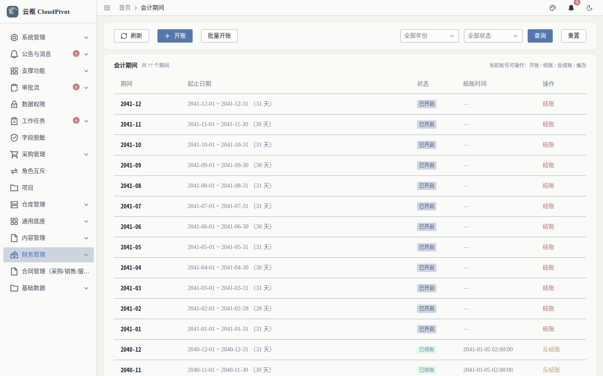
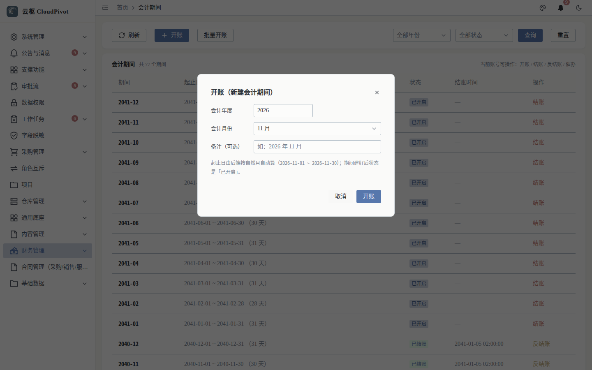
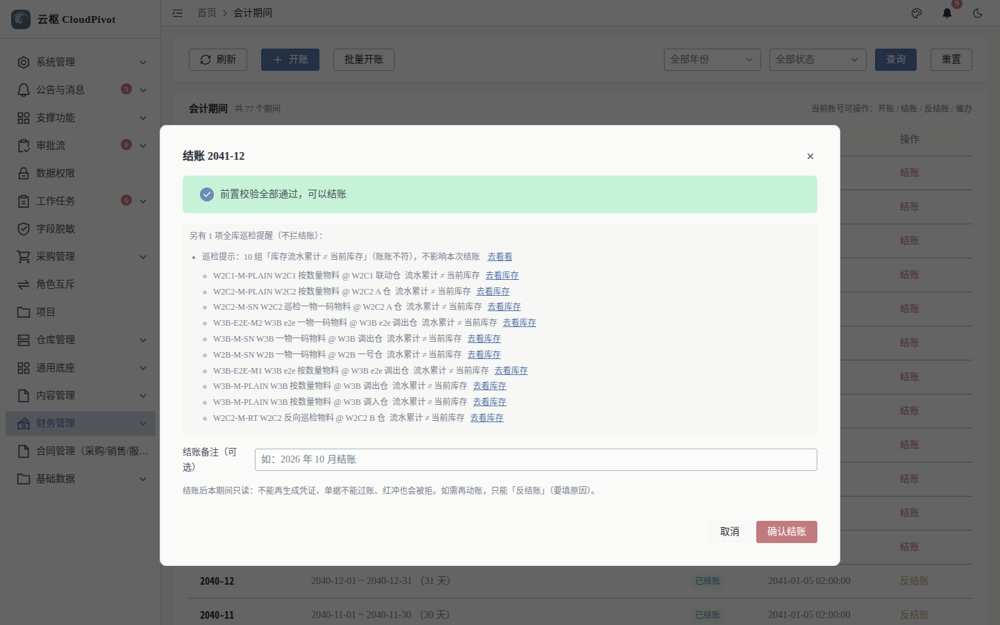
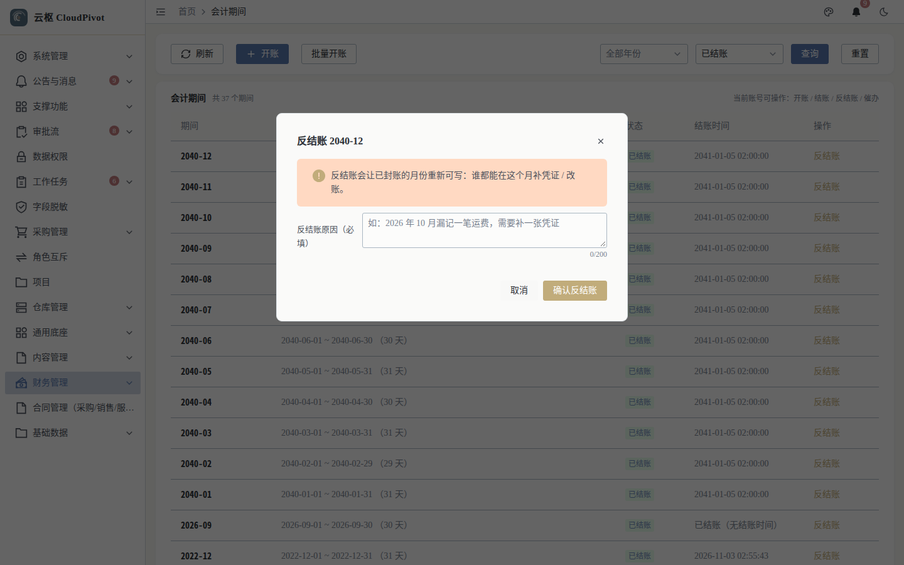

# 14 会计期间 · 使用手册

> **一句话**：会计期间是记账的「闸门」——**没开账不能记，已结账不能再动**；结账前系统会跑四项预检，任何一项不过就不许封账。

- 适用版本：云枢 CloudPivot 基础版（ERP 财务）
- 截图环境：`cloudpivot_manual2` 实例（`127.0.0.1:5180` → `:18097`），账号 `admin`
- 采集脚本：`scripts/manual/capture2.mjs period`
- 采集证据：`docs/manual/evidence/p2b-capture-run1.log.txt` / `-run2.log.txt`

---

## 一、这个功能干什么

- **开账**：为某年某月建期间（也可一次开一整年），期间状态从 `未开账` → `已开启`，此时才允许写入凭证。
- **结账**：封住本期。结账前做四项预检（草稿凭证 / 单据未终态 / 试算平衡 / 期间内不变量），全过才能封；另附「全库巡检提醒」（只提示，不拦结账）。
- **反结账**：把已封的期间退回「已开启」，**必须填原因（≥ 10 字）**，原因进状态日志。
- **催办**：把挡路单据的待办推给处理人（权限 `business:erp:period:remind`）。

---

## 二、谁能用（角色 + 权限）

| 事项 | 权限码 |
| --- | --- |
| 进入「财务管理 → 会计期间」并查询 | `business:erp:period:list` |
| 开账 / 批量开账 | `business:erp:period:open` |
| 结账（含结账预检） | `business:erp:period:close` |
| 反结账 | `business:erp:period:reopen` |
| 催办 | `business:erp:period:remind` |

三个动作码相互独立：只给 `close` 的人能结账但不能反结账，这是有意的（反结账会改动已对外出具的账）。

**角色口径**：`SUPER_ADMIN` 全部可用；财务经理建议 `open + close + remind`，`reopen` 只给财务负责人。页面右上角实测提示：`当前账号可操作：开账 / 结账 / 反结账 / 催办`，没权限的动作不会渲染。

---

## 三、完整操作步骤（真机截图）

### 步骤 1　看期间列表

左侧「财务管理 → 会计期间」（`/business/erp/period`）。

实测：

- 筛选：`全部年份` / `全部状态` + `查询` / `重置` / `刷新`；动作按钮 `开账` / `批量开账`
- 列：期间、起止日期（含天数）、状态、结账时间、操作
- 截图当时 `共 77 个期间`：`2041-12 … 2041-01` 为 `已开启`（操作列是 `结账`），`2040-12 / 2040-11` 为 `已结账`（操作列是 `反结账`）

### 步骤 2　开账

点 `开账`。

弹窗 `开账（新建会计期间）`：

| 字段 | 说明 |
| --- | --- |
| 会计年度 | 文本，如 `2026`（截图默认已填 2026） |
| 会计月份 | 下拉 `11 月` 等 12 项 |
| 备注（可选） | 如「2026 年 11 月」 |
| 说明 | `起止日由后端按自然月自动算（2026-11-01 ~ 2026-11-30）；期间建好后状态是「已开启」。` |
| 按钮 | `取消` / `开账` |

批量开账用于一次性把某年 12 个月全部打开（年结前必须先把下一年 12 个月开好，见手册 15）。

### 步骤 3　结账预检

在目标期间行点 `结账`，弹出结账预检（实测抓的是 `2041-12`）。

实测结论原文：`结账 2041-12 前置校验全部通过，可以结账`，随后另起一段 `另有 1 项全库巡检提醒（不拦结账）： 巡检提示：10 组「库存流水累计 ≠ 当前库存」（账账不符），不影响本次结账`，并列出明细（物料 / 仓库）与跳转链接。

预检的**拦人项**（任一不过则 `确认结账` 不可用，后端返回 409 并逐条点名）：

| 拦截码 | 含义 |
| --- | --- |
| `DRAFT_VOUCHER` | 本期还有草稿凭证没过账（列出前 N 张，其余去列表页批量处理） |
| `DOC_UNFINISHED` | 本期还有单据没到终态（采购 / 收货 / 出库 / 调拨要已过账 / 已作废 / 已完成） |
| `UNBALANCED` | 试算不平衡（给出差额） |
| `INVARIANT` | 期间内不变量不通过（如 A1/A2 凭证分录取和不平），账不平不能封 |
| `PERIOD_STATUS` | 期间状态不允许结账（未开账 / 已结账） |

预检通过后点 `确认结账`，期间状态转 `已结账` 并记录结账时间。

### 步骤 4　反结账（原因必填）

先按状态筛 `已结账`，行操作点 `反结账`。

实测：目标期间 `2040-12`；弹窗要求填原因（≥ 10 字，后端同样校验 `必须填写原因`）。提交后期间回到 `已开启`，成功提示 `会计期间 {code} 已反结账，回到「已开启」`。

反结账的限制：**后面的期间已结账时不能反结账**（要按从后往前的顺序反）。

---

## 四、常见错误怎么办

| 现象（系统原话） | 原因 | 处理 |
| --- | --- | --- |
| `还有 3 张草稿凭证未过账` | A 组不变量之外的草稿凭证挡路 | 凭证列表筛「草稿」逐张过账或删除 |
| `还有 1 张单据未完成` / `（共 {count} 张，仅显示前 {} 张…）` | 本期有单据停在中间态 | 到对应模块过账或作废；也可用「催办」推给处理人 |
| `不变量未通过（{count} 项）：{}。账不平不能封，请先修复后再结账` | 本期凭证分录取和不平 | 按点名凭证修复（红冲重开），再结账 |
| `不给原因必须 400` / `必须填写原因` | 反结账原因空或太短 | 写清为什么反结账（≥ 10 字），这是审计要件 |
| 反结账按钮不出现 | 缺 `business:erp:period:reopen` | 角色管理授权；或该期间后面还有已结账期间 |
| 记账提示期间不可用 | 该期间 `未开账` 或 `已结账` | 开账，或先反结账 |
| 结账时看到「巡检提示…不影响本次结账」 | 全库账实 / 账账巡检告警（B4 / C1 / C2） | 不拦结账，但必须当天处理（手册 22） |

---

## 五、与哪些功能联动

- **凭证（手册 10）**：期间是凭证的写入前置条件；草稿凭证会挡结账。
- **总账（手册 13）**：结账预检里的「试算平衡」就是余额表口径。
- **年度结转（手册 15）**：12 个月全结账 + 下一年度已开账是年结的硬条件。
- **采购 / 收货 / 出库 / 调拨**：单据终态是结账前置，未过账单据会导致 `DOC_UNFINISHED`。
- **巡检（手册 22）**：全库巡检告警在这里以「灰字提示」出现，决定权不交给结账人。
- **通知（手册 20）**：催办与期间提醒通过站内信 / 定时提醒触达处理人。
