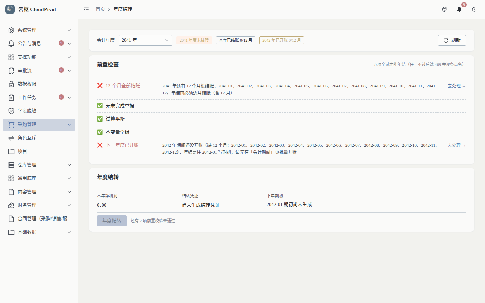
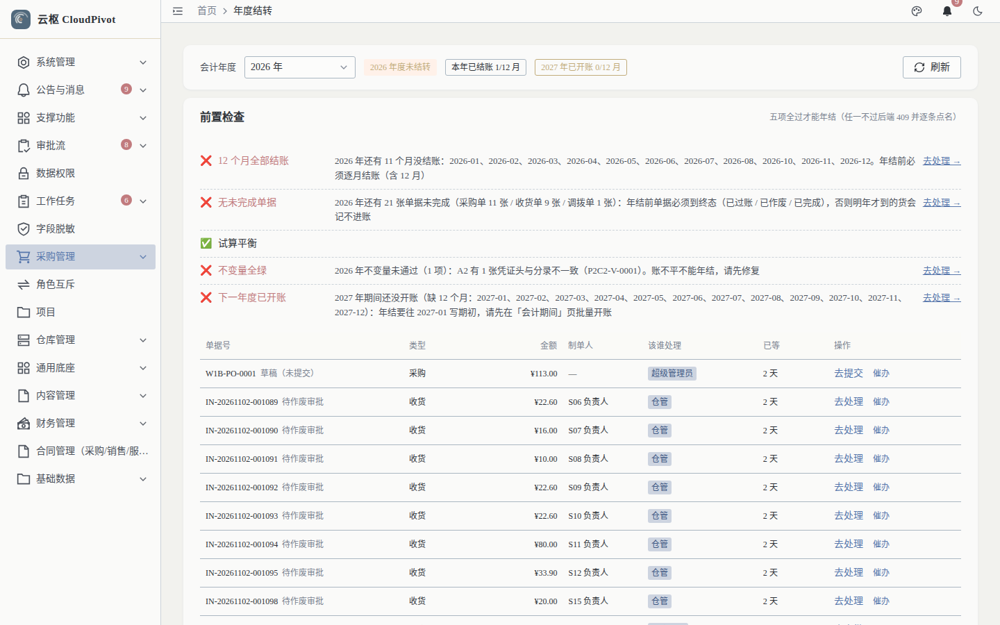

# 15 年度结转（年结） · 使用手册

> **一句话**：年结把本年利润结转到下年期初，并封住这一年；**五项前置校验全过才允许**，任一不过系统逐条点名「差哪个月 / 哪张单 / 找谁」。

- 适用版本：云枢 CloudPivot 基础版（ERP 财务）
- 截图环境：`cloudpivot_manual2` 实例（`127.0.0.1:5180` → `:18097`），账号 `admin`
- 采集脚本：`scripts/manual/capture2.mjs yearend`
- 采集证据：`docs/manual/evidence/p2b-capture-run1.log.txt` / `-run2.log.txt`

---

## 一、这个功能干什么

- **前置检查**：五项硬校验 + 两项附加闸，结果逐条列出，并给出「去处理 →」链接。
- **年度结转**：把本年损益类科目余额结转到本年利润，再结转到下一年期初；同时封住本年（状态记在状态日志，空年度也要留状态）。
- **反年结**：撤销年结（删结转凭证、删下年期初、解封 12 月），**原因必填 ≥ 10 字**。
- **催办**：把挡路单据的待办推给处理人（`POST /business/erp/year-end/remind`）。

---

## 二、谁能用（角色 + 权限）

| 事项 | 权限码 |
| --- | --- |
| 看年结页 / 跑前置检查 | `business:erp:yearend:read` |
| 年度结转 | `business:erp:yearend:close` |
| 反年结 | `business:erp:yearend:reopen` |
| 催办 | `business:erp:year-end:remind` |

**角色口径**：`SUPER_ADMIN` 全部可用；生产环境建议 `close` 只给财务负责人、`reopen` 只给财务总监，`read` 给会计。年结动作会写全局会计台账，**不受数据范围（SELF / DEPT）限制**，靠上面三个权限码控制。

---

## 三、完整操作步骤（真机截图）

### 步骤 1　打开年度结转页

左侧菜单路径实测为 **`财务管理 → 年度结转`**（路由 `/business/erp/year-end`；在财务管理组内排在「会计期间」「期初余额」之后）。

> **口径提醒（2026-11-05 已修复）**：P2-2B 采集手册时该节点错挂在「采购管理」组下——`sys_menu` 里 `path=/business/erp/year-end` 的父节点是 V0190 种下的 `…946`（`采购管理`），属于种子复制模板留下的过期 `parent_id`。迁移 `V0236__erp_finance_menu_reparent` 已把它（连同同根因的「期初余额」）移回 `path=/business/erp/finance-mgmt` 的「财务管理」组，路由与权限码 `business:erp:yearend:*` 未动。
> **未跑 V0236 的老实例**（例如升级前快照）菜单仍是「采购管理 → 年度结转」，培训时按目标环境的实际菜单说明即可。

实测页面：

- 顶部：`会计年度` 下拉 + 三个状态标签 `2026 年度未结转`、`本年已结账 1/12 月`、`2027 年已开账 0/12 月` + `刷新`
- 主体：`前置检查`，右上原文 `五项必过才能年结（任一下不通过后端 409 并逐条点名）`
- 动作：`年度结转`（被拦时按钮 `disabled=true`，下方给出 `还有 2 项前置校验未通过`）

### 步骤 2　切年度看前置检查

年度下拉选 `2026 年`，逐项核对。

实测五项原文（截图当时）：

| # | 检查 | 实测结果 |
| --- | --- | --- |
| ① 12 个月全部结账 | ❌ | `2026 年还有 11 个月没结账：2026-01、2026-02…2026-12。年结前必须逐月结账（含 12 月）` |
| ② 无未完成单据 | ❌ | `2026 年还有 21 张单据未完成（采购单 11 张 / 收货单 9 张 / 调拨单 1 张）：年结前单据必须到终态（已过账 / 已作废 / 已完成）` |
| ③ 试算平衡 | ✅ | `试算平衡` |
| ④ 不变量全绿 | ❌ | `2026 年不变量未通过（1 项）：A2 有 1 张凭证头与分录不一致（P2C2-V-0001）。账不平不能年结，请先修复` |
| ⑤ 下一年度已开账 | ❌ | `2027 年期间还没开账（缺 12 个月：2027-01…2027-12）：年结要往 2027-01 写期初，请先在「会计期间」页批量开账` |

每项右侧有 `去处理 →`；下方是明细表（`单据号 / 类型 / 金额 / 制单人 / 该谁处理 / 已等 / 操作`），操作列可 `去提交` 或 `催办`。

### 步骤 3　处理完后执行年结

五项变绿 → `年度结转` 按钮恢复可点 → 弹窗确认 → `确认结转`。

年结成功的效果：

1. 生成本年利润结转凭证（来源 `YEAR_END`；空年度没有损益发生时不生成凭证，但状态照样记录）
2. 往下一年度第一个期间写期初台账
3. 本年状态转「已结转」，页面标签变 `已结转`

### 步骤 4　反年结（异常路径）

点 `确认反年结`，必须填原因（≥ 10 字）。前置条件：下一年度除「期初（OPENING）」外**不能有任何凭证**，否则会被拦（倒序删除会数据错乱）。

反年结动作：删结转凭证（含状态日志）→ 删下年期初台账 → 12 月解封 → 留痕。

---

## 四、常见错误怎么办

| 现象（系统原话 / 拦截码） | 原因 | 处理 |
| --- | --- | --- |
| `还有 2 项前置校验未通过`，年结按钮灰色 | 五项里还有不过的 | 按前置检查逐项处理；按钮由后端结论驱动，不靠手工判断 |
| `PERIOD_NOT_CLOSED` 并列出月份 | 本年还有月份没结账 | 到「会计期间」按月结账（含 12 月） |
| `DOC_UNFINISHED`，`2026 年还有 21 张单据未完成…` | 采购 / 收货 / 调拨停在中间态 | 过账或作废；明细表可按「该谁处理」找人或直接「催办」 |
| `UNBALANCED`（带差额） | 全年试算不平 | 用总账余额表定位科目，修凭证 |
| `INVARIANT`：`A2 有 1 张凭证头与分录不一致（P2C2-V-0001）` | 凭证头与分录不平 | 红冲重开该凭证，再跑检查 |
| `NEXT_YEAR_NOT_OPENED` | 下一年度 12 个月没开账 | 「会计期间」批量开账，一次开满 12 个月 |
| `NEXT_YEAR_OPENING_EXISTS` | 下年第一个期间的期初被手工录过 | 先决定：清空期初再年结，或放弃年结走手工处理 |
| `ALREADY_CLOSED` | 本年度已经结转过（重复年结不幂等） | 不要重复点；确需重做先反年结 |
| `NOT_CLOSED` | 没年结就想反年结 | 先正常年结，再反 |
| `没有可催办的单据：该类挡路项已被处理（请重新点「刷新」）` | 别人已经处理完了 | 点刷新看最新检查结果 |

---

## 五、与哪些功能联动

- **会计期间（手册 14）**：本年第 12 个月与下一年 12 个期间都必须已开账 / 已结账，年结才过。
- **凭证（手册 10）**：年结生成 `YEAR_END` 来源的结转凭证；A2 不变量不平会挡年结。
- **总账（手册 13）**：下年期初金额由年结写入，余额表的期初来源在这里。
- **采购 / 收货 / 调拨**：未终态单据是 `DOC_UNFINISHED` 的唯一来源。
- **通知（手册 20）**：催办走站内信，处理人在「消息中心」收件。
- **巡检（手册 22）**：年结只拦「本年账对不对」，全库账实漂移由巡检套件（`scripts/verify/erp_invariants.py`）每天跑。
