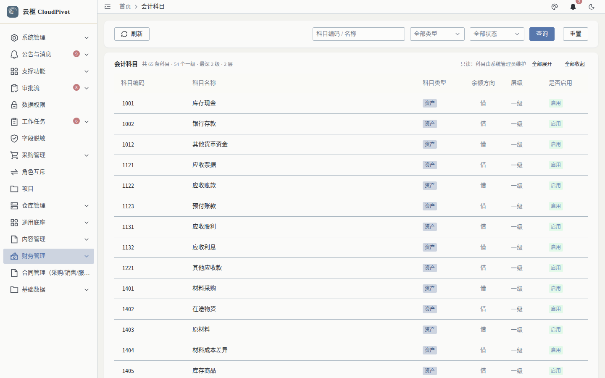
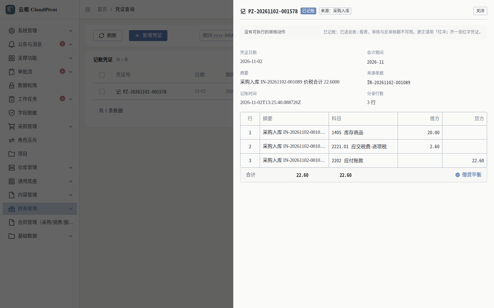

# 16 辅助核算 · 使用手册

> **一句话**：辅助核算回答「这笔钱花在哪个物料 / 仓库 / 部门 / 供应商上」；当前版本**科目维度与分录维度都已落库**，但界面只提供科目主数据维护，按维度看余额要用接口。

- 适用版本：云枢 CloudPivot 基础版（ERP 财务）
- 截图环境：`cloudpivot_manual2` 实例（`127.0.0.1:5180` → `:18097`），账号 `admin`
- 采集脚本：`scripts/manual/capture2.mjs aux`
- 采集证据：`docs/manual/evidence/p2b-capture-run1.log.txt` / `-run2.log.txt`

---

## 一、这个功能干什么

- **科目侧**：会计科目可配置 `辅助核算维度`（`aux_dimensions`，如「供应商」「物料」「仓库」「部门」），决定这个科目的发生额按哪个维度拆分。
- **分录侧**：系统自动生成的凭证分录会写入维度外键——`aux_supplier_id`、`aux_material_id`、`aux_warehouse_id`、`aux_dept_id`（源码：`backend/src/business/erp/voucher.rs` 的凭证分录列清单）。
- **余额侧**：后端提供辅助账（辅助核算余额）接口 `/api/business/erp/ledger/aux-balance`，按「维度 + 对象 + 日期区间」给期初 / 本期 / 期末。

---

## 二、谁能用（角色 + 权限）

| 事项 | 权限码 | 界面入口 |
| --- | --- | --- |
| 看会计科目（维度挂载点） | `business:erp:account:list` | 「财务管理 → 会计科目」`/business/erp/account` |
| 看凭证分录（维度写在分录里） | `business:erp:voucher:list` / `:detail` | 「财务管理 → 凭证查询」 |
| 辅助账余额（期初 / 本期 / 期末按维度） | `business:erp:ledger:aux-balance` | **接口已备，前端未提供入口**（见第四节） |

**角色口径**：`SUPER_ADMIN` 全部可用；会计岗需要 `account:list` + `voucher:list/detail`；只核对辅助账的人可只给 `ledger:aux-balance`（走接口）。

---

## 三、完整操作步骤（真机截图）

### 步骤 1　看会计科目树（维度的挂载点）

左侧「财务管理 → 会计科目」（`/business/erp/account`）。



实测：

- 列：科目编码、科目名称、科目类型、余额方向、层级、是否启用（56 个科目）
- 按钮：`刷新` / `查询` / `重置` / `全部展开` / `全部收起`
- 科目编辑里可填「辅助核算维度」（后端字段 `aux_dimensions`，最长 120 字符；限制见 `dto.rs` 的 `check_optional_text`）

### 步骤 2　看分录里的维度

「财务管理 → 凭证查询」，按凭证号查 `PZ-20261102-001578`，点 `查看`。



实测该凭证：`记 PZ-20261102-001578`、`已记账`、来源 `采购入库`、3 条分录

| 行 | 科目 | 借方 | 贷方 |
| --- | --- | --- | --- |
| 1 | 1405 库存商品 | 20.00 | — |
| 2 | 2221.01 应交税费-进项税 | 2.60 | — |
| 3 | 2202 应付账款 | — | 22.60 |
| 合计 | | 22.60 | 22.60（借贷平衡） |

这张凭证的维度信息**在库里**（第 1 行带物料 + 仓库，第 3 行带供应商），但界面目前只展示「行 / 摘要 / 科目 / 借方 / 贷方」——不显示维度列，这是当前版本的真实口径。

### 步骤 3　看总账页（无按维度筛选入口）

打开「财务管理 → 总账 / 科目余额表」（页面截图见手册 13 步骤 2，此处不重复放同一张图）。

实测筛选只有「科目 + 起始 + 结束」三个条件（采集 note 原文：`总账页筛选只有 科目 / 起始 / 结束，无辅助核算维度入口`），**没有辅助核算维度筛选**。也就是说：界面上能核对到科目级，维度级要么走接口，要么导出后自行透视。

---

## 四、常见错误怎么办

| 现象 | 原因 | 处理 |
| --- | --- | --- |
| 科目编辑看不到「辅助核算维度」 | 当前角色只有 `account:list`（只读） | 需要 `account:list` + 对应写权限的账号才能改科目 |
| 界面找不到「辅助核算余额表」 | 前端未提供该视图（本版本真实缺口） | 用接口 `/api/business/erp/ledger/aux-balance`，或按第五节口径导出核对 |
| 接口返回 `aux_id 不是合法的 UUID：{raw}` | `aux_id` 传了业务编码而不是主键 | 先查物料 / 仓库 / 部门列表拿 id（UUID） |
| 接口返回 `period_from（{from}）不能晚于 period_to（{to}）` | 起止写反 | 对调日期 |
| 接口返回 403 | 缺 `business:erp:ledger:aux-balance` | 角色管理授权 |

**辅助账接口口径（来自后端源码 `ledger.rs`，本手册未做真机调用取证）**

```text
GET /api/business/erp/ledger/aux-balance
  ?aux_type=MATERIAL|WAREHOUSE|DEPT|SUPPLIER   # 维度，必填
  &aux_id=<对象 UUID>                          # 传则只看该对象，不传按维度汇总
  &period_from=2026-11-01&period_to=2026-11-30  # 日期区间，决定期初 / 本期怎么切
权限：business:erp:ledger:aux-balance
返回：该维度下的 期初借/贷 + 本期借/贷 + 期末借/贷（不分页）
```

---

## 五、与哪些功能联动

- **凭证（手册 10）**：自动凭证在生成时写维度外键；红冲生成的红字凭证同样带维度。
- **收货入库 / 出库 / 调拨**：物料与仓库维度的来源；应付/付款带来供应商维度。
- **总账（手册 13）**：科目级余额在界面上看；维度级余额用辅助账接口。
- **报表**：资产负债表 / 利润表按科目取数，不按维度拆；需要维度报表时用辅助账接口二次加工。
- **权限（手册 19）**：`ledger:aux-balance` 属于菜单权限点，可单独授给对账岗。
