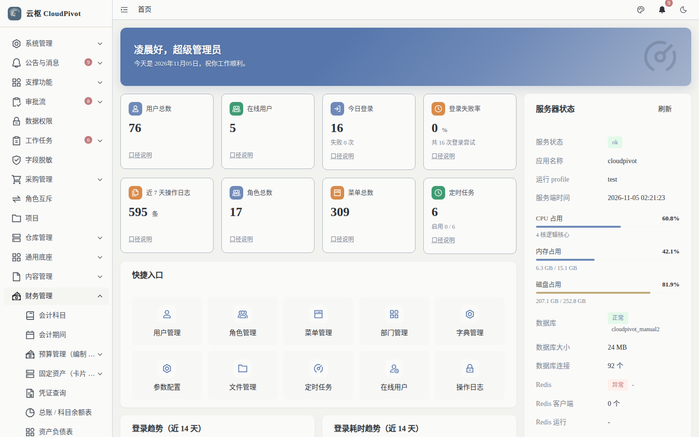

# 17 预算 · 使用手册（待上线）

> **一句话**：预算功能的**后端接口与权限码已就位，前端页面还没交付**——菜单点进去是 404。本手册只写「当前真实状态 + 上线前须知」，不编操作步骤。

- 适用版本：云枢 CloudPivot 基础版（ERP 财务）
- 截图环境：`cloudpivot_manual2` 实例（`127.0.0.1:5180` → `:18097`），账号 `admin`（SUPER_ADMIN，权限不是限制因素）
- 采集脚本：`scripts/manual/capture2.mjs budget`
- 采集证据：`docs/manual/evidence/p2b-capture-run1.log.txt` / `-run2.log.txt`

---

## 一、这个功能干什么（设计口径）

按「部门 × 科目 × 期间」编制预算，采购执行时占用额度，并给出「已用 / 可用 / 执行率」；配套把采购类别映射到预算科目（科目映射）。设计上包含：预算编制、预算执行（报表）、预算科目映射、提交审批、调整（新增版本 → 走审批）。

**当前版本状态：未上线。** 判断依据见第三节（三条实测证据），不是听谁说。

---

## 二、谁能用（角色 + 权限）

后端已预置 8 个权限码（`sys_menu` 实测，非臆造）：

| 事项 | 权限码 |
| --- | --- |
| 预算编制列表 | `business:erp:budget:list` |
| 新建预算 | `business:erp:budget:create` |
| 编辑草稿 | `business:erp:budget:update` |
| 删除草稿 | `business:erp:budget:delete` |
| 提交预算审批 | `business:erp:budget:submit` |
| 预算调整（新版本 → 走审批） | `business:erp:budget:adjust` |
| 预算执行报表 | `business:erp:budget:report` |
| 预算科目映射 | `business:erp:budget:mapping` |

**当前建议：先不要给任何业务角色授予上述权限码。** 页面未上线，授了也用不上，只会让「角色权限树」里多出点不亮的勾选项，且给后续上线的权限评审增加噪音。`SUPER_ADMIN` 本身短路校验，不受影响。

---

## 三、完整操作步骤（真机截图）

> 本节所有截图都是真机页面（Playwright 抓取）。预算页面当前未交付，步骤记录的是「实际会发生什么」与「怎么核实」，不是编造的操作流。

### 步骤 1　菜单入口存在

「财务管理」目录里确实有这一项（实测展开菜单）：



财务管理下属菜单实测为：会计科目、会计期间、**预算管理（编制 / …）**、固定资产（卡片 …）、凭证查询、总账 / 科目余额表、资产负债表、利润表、现金流量表、单号序列。

数据库口径（`sys_menu`）：

| 菜单 | 路径 | 权限码 |
| --- | --- | --- |
| 预算管理（编制 / 执行 / 科目映射） | `/business/erp/budget` | —（目录） |
| 预算编制（部门 × 科目 × 期间） | `/business/erp/budget` | `business:erp:budget:list` |
| 预算执行（已用 / 可用 / 执行率） | `/business/erp/budget/report` | `business:erp:budget:report` |
| 预算科目映射（采购 → 预算科目） | `/business/erp/budget/mapping` | `business:erp:budget:mapping` |

### 步骤 2　点进去是 404

访问 `/business/erp/budget`：


页面原文只有三行：`404` / `抱歉，您访问的页面不存在` / 按钮 `返回首页`。三个子路径（`/budget`、`/budget/report`、`/budget/mapping`）都是同一结果。

### 步骤 3　为什么会 404（根因，已定位）

| 层 | 状态 | 证据 |
| --- | --- | --- |
| 后端接口 | ✅ 已实现 | `backend/src/business/erp/budget_handler.rs` 注册了 `GET /business/erp/budget/page`、`GET/POST /business/erp/budget`、`PUT/DELETE /business/erp/budget/{id}`、`POST .../submit`、`POST .../adjust`、`GET /business/erp/budget/report`、`GET .../mapping/page` 等 |
| 前端 API 层 | ✅ 已实现 | `frontend/src/api/business/erp/budget.ts`（471 行，注释声明 `const BASE = '/api/business/erp/budget'`） |
| 前端页面 | ❌ 缺失 | `frontend/src/views/business/erp/budget/` 下只有 `budget-logic.ts`，**没有 `.vue` 页面**；`sys_menu.component` 指向 `business/erp/budget/index`，路由解析不到组件 → 落到 404 兜底页 |

**结论**：这不是权限问题、不是数据问题，是**页面组件未交付**。属于产品交付缺口，不属于本手册可修复范围（已在本卡汇报中作为独立缺口登记）。

---

## 四、常见错误怎么办（按当前状态）

| 现象 | 原因 | 处理 |
| --- | --- | --- |
| 点菜单进 404 | 前端页面未交付（见第三节根因） | 不要反复刷新或改权限；等版本更新，或按第五节自检确认是否已上线 |
| 角色权限树里勾了预算权限但没有任何变化 | 页面未上线 | 先把勾选撤回，避免误导后续评审 |
| 用接口调 `/api/business/erp/budget/page` 返回 200 但界面看不到 | 接口已实现、页面未实现 | 属预期；接口仅供联调 |
| 培训时学员问「预算怎么编」 | 功能未上线 | 明确回答「本版本未开放」，把需求转产品排期，不要现场教接口调用 |

**上线自检三步**（版本更新后用来确认是否可培训）：

```bash
# ① 页面文件是否到位（有 index.vue / report.vue / mapping.vue 才算交付）
ls frontend/src/views/business/erp/budget/
# ② 路由是否注册
grep -n "erp/budget" frontend/src/router/index.ts
# ③ 真机打开三个路径，确认不再是 404
#    /business/erp/budget、/business/erp/budget/report、/business/erp/budget/mapping
```

---

## 五、与哪些功能联动（上线后生效）

- **采购订单**：下单时占用预算额度（预算守卫 `budget_guard.rs`），超预算按配置拦截或告警。
- **审批流（手册 02）**：预算提交与调整都走审批节点。
- **凭证（手册 10）**：预算本身不生成凭证，只做额度控制。
- **报表（手册 09）**：预算执行率与「已用 / 可用」是管理报表口径。
- **权限（手册 19）**：8 个权限码已在菜单表里，上线后按岗位授予即可，无需改代码。

### 预算「什么时候开始管钱」（2026-11 起口径）

1. **只有审批通过（已生效）的预算才管钱**。草稿、审批中的预算不参与超支判定 ——
   这类单据照常提交，但单据上会有**黄色提示**「该科目预算尚未生效（当前状态：草稿），
   超支将不受控制」，提示不阻断提交。
2. **生效日 = 审批通过日的次月 1 日**（例如 11 月 7 日批下来的预算，12 月 1 日生效）。
   生效日**之前**的期间（含 11 月整月）不受这份额度约束，单据上同样会标黄提示。
3. 预算详情里的**「占用记录」按槽（部门 × 科目 × 年度）列出全部来源**：报销单与采购单都在，
   「来源类型」列区分是哪种单据；列表里的「已用」与这些记录合计一致。
4. 单据上的**「控制策略」快照**记的是这条单据实际被哪个策略管过（槽级策略优先于全局默认）：
   槽级是「阻断提交」时，单据上就记 BLOCK，事后审计能看出来。
5. 预算执行报表里，还没到生效日的行会标**「未生效」**（额度照列，但不参与本月控制）。

> 本手册在功能上线后需要重写第三节为「操作步骤」，并补真机截图；在此之前，正文的「未上线」表述就是当前正确口径。
