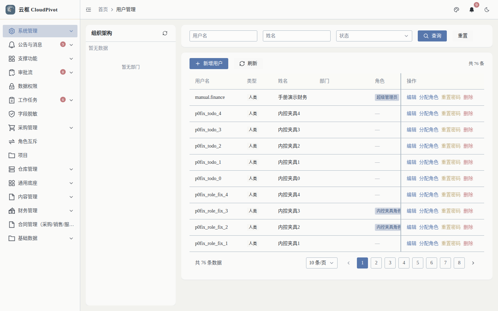
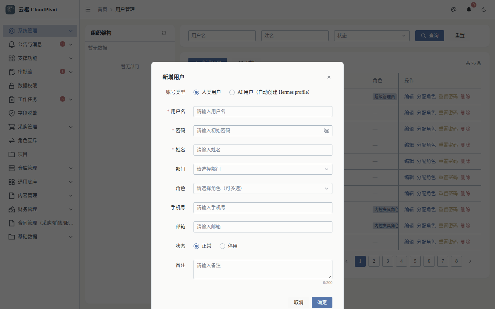
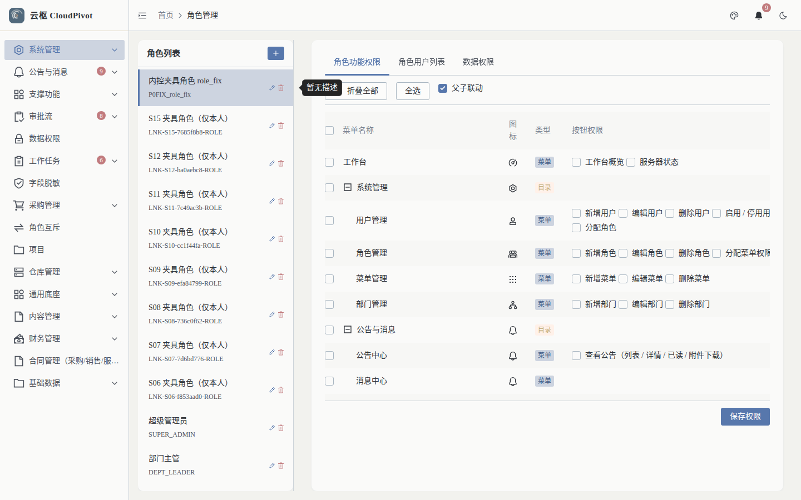
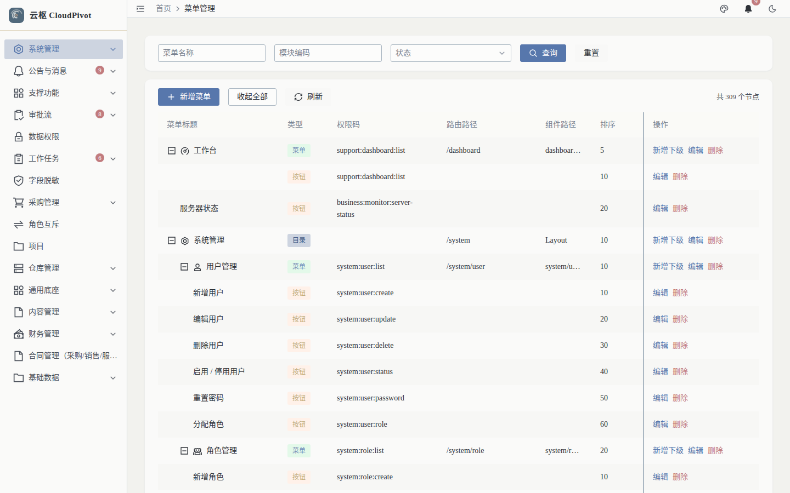
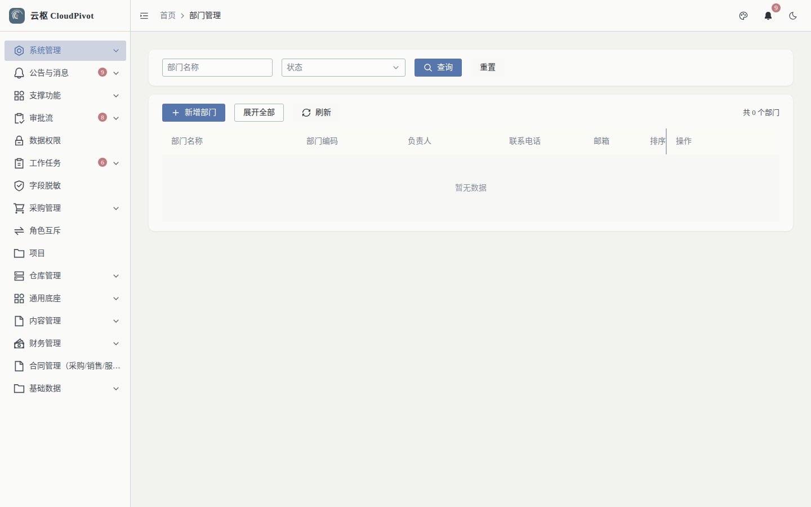
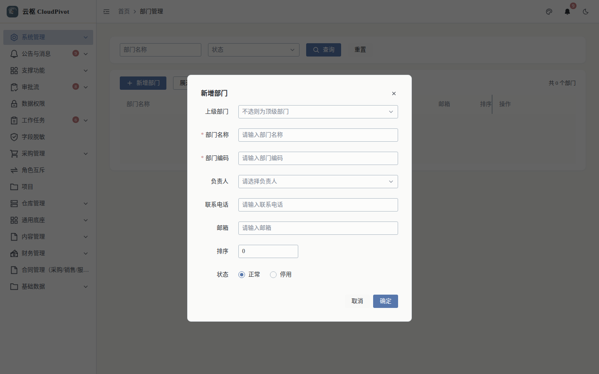

# 18 系统管理 · 使用手册

> **一句话**：系统管理是「谁能进系统、进来能看到什么」的地基——用户、角色、菜单、部门四张表配好，业务侧才有活人干活。

- 适用版本：云枢 CloudPivot 基础版（系统管理）
- 截图环境：`cloudpivot_manual2` 实例（`127.0.0.1:5180` → `:18097`），账号 `admin`（SUPER_ADMIN）
- 采集脚本：`scripts/manual/capture2.mjs sys`
- 采集证据：`docs/manual/evidence/p2b-capture-run1.log.txt` / `-run2.log.txt`

---

## 一、这个功能干什么

| 页面 | 干什么 |
| --- | --- |
| 用户管理 `/system/user` | 建账号、改资料、分配角色、重置密码、停用；支持「人类用户」与「AI 用户（自动创建 Hermes profile）」两类账号 |
| 角色管理 `/system/role` | 建角色 → 勾功能权限（菜单 + 按钮）→ 授权用户；数据权限与角色互斥在手册 19 详述 |
| 菜单管理 `/system/menu` | 维护菜单树、路由、组件路径、权限码；这是权限树的数据源 |
| 部门管理 `/system/dept` | 维护组织架构；部门是数据范围（本部门 / 本部门及以下）的判据 |

相邻但不在本篇截图范围的模块：支撑功能组（字典管理、参数配置、文件管理、操作日志、定时任务、在线用户）。

---

## 二、谁能用（角色 + 权限）

| 事项 | 权限码 |
| --- | --- |
| 用户列表 / 新建 / 编辑 / 删除 | `system:user:list` / `:create` / `:update` / `:delete` |
| 分配角色 / 重置密码 / 启停账号 | `system:user:role` / `system:user:password` / `system:user:status` |
| 角色列表 / 新建 / 编辑 / 删除 | `system:role:list` / `:create` / `:update` / `:delete` |
| 角色功能权限保存 | `system:role:menu` |
| 菜单列表 / 新建 / 编辑 / 删除 | `system:menu:list` / `:create` / `:update` / `:delete` |
| 部门列表 / 新建 / 编辑 / 删除 | `system:dept:list` / `:create` / `:update` / `:delete` |

**角色口径（实测角色表）**

- `SUPER_ADMIN`：跳过权限校验，全部可用；内置管理员账号「不可删除、不可停用、角色不可修改」。
- 管理员（自建）：建议只授 `system:user:*` + `system:role:list`，不要给 `system:menu:delete`。
- 关键限制：**不能授予自己未持有的权限点**（`不能授予自己未持有的权限点: {auth_code}`）——这意味着「角色管理员」的天花板就是自己的权限集。

---

## 三、完整操作步骤（真机截图）

### 步骤 1　用户管理：看列表、建账号

左侧「系统管理 → 用户管理」（`/system/user`）。

实测：

- 左侧「组织架构」树：当前实例 `暂无部门 / 暂无数据`（部门表为空，见步骤 4）
- 筛选：用户名、姓名、状态下拉 + `查询` / `重置`；`新增用户`；`共 76 条`（8 页，每页 10 条）
- 列：用户名、类型、姓名、部门、角色、手机号、邮箱、状态、最近登录、创建时间、操作
- 行操作：`编辑` / `分配角色` / `重置密码` / `删除`

点 `新增用户`：

| 字段 | 说明 |
| --- | --- |
| 账号类型 | `人类用户` / `AI 用户（自动创建 Hermes profile）` |
| 用户名 `*` | `请输入用户名`，1–64 字符 |
| 密码 `*` | `请输入初始密码`，6–64 字符（服务端哈希存储） |
| 姓名 `*` | `请输入姓名` |
| 部门 | `请选择部门`（部门表为空时选不了，先建部门） |
| 角色 | `请选择角色（可多选）` |
| 手机号 / 邮箱 | 选填；手机号受字段脱敏规则约束（手册 19） |
| 状态 | `正常` / `停用` |
| 备注 | 0/200 字 |
| 按钮 | `取消` / `确定` |

### 步骤 2　角色管理：分配功能权限

左侧「系统管理 → 角色管理」（`/system/role`），点左侧角色列表里的一个角色。

实测：

- 右侧页签：`角色功能权限` / `角色用户列表` / `数据权限`
- 权限树表头：菜单名称、图标、类型、按钮权限（当前角色 74 行）
- 按钮：`折叠全部` / `全选` / `保存权限`
- 勾选菜单 = 能看到入口；勾选「按钮权限」= 能执行动作（对应 `system:user:create` 这类权限码）

保存后，持有该角色的用户可能需要重新登录才拿到新权限（令牌里的权限快照会失效重建）。

### 步骤 3　菜单管理：查权限码与路由

左侧「系统管理 → 菜单管理」（`/system/menu`）。

实测：

- 列：菜单标题、类型、权限码、路由路径、组件路径、排序、状态、操作（286 行）
- 按钮：`查询` / `重置` / `新增菜单` / `收起全部` / `刷新`
- 这里是「权限码字典」的唯一真相源：手册里写的 `business:erp:voucher:create` 之类，都能在这张表里搜到

**改菜单前必须知道的两件事**：

1. 菜单的 `组件路径` 必须是前端真实存在的目录，写错 → 点进去 404（预算菜单就是这类问题，见手册 17）。
2. 目录型节点（类型=目录）不需要权限码；页面型节点必须有权限码，否则无法在角色里勾选。

### 步骤 4　部门管理：建组织架构

左侧「系统管理 → 部门管理」（`/system/dept`）。

实测 `共 0 个部门`，空状态。点 `新增部门`：

| 字段 | 说明 |
| --- | --- |
| 上级部门 | `不选则为顶级部门` |
| 部门名称 `*` | 同一父级下不能重名 |
| 部门编码 `*` | 全局唯一 |
| 负责人 | 选人（下拉） |
| 联系电话 / 邮箱 | 选填 |
| 排序 | 数字，默认 0 |
| 状态 | `正常` / `停用` |
| 按钮 | `取消` / `确定` |

建好部门后，回到用户管理即可给用户选部门；数据范围（手册 19）依赖这棵树。

---

## 四、常见错误怎么办

| 现象（系统原话） | 原因 | 处理 |
| --- | --- | --- |
| `内置管理员账号不可删除` / `不可停用` / `角色不可修改` | 动的是 SUPER_ADMIN 内置账号 | 换一个管理员账号；内置账号只用于兜底 |
| `不能停用当前登录账号` | 把自己停了 | 用另一个管理员操作 |
| `角色不存在或已删除` | 授权时角色被别人删了 | 刷新页面重新选角色 |
| `角色编码已存在` | 编码重复（编码全局唯一） | 换编码，如 `FINANCE_CLERK` |
| `不能授予自己未持有的权限点: {auth_code}` | 想给出自己没有的权限 | 由更高权限的管理员授权，或先给自己加该权限 |
| `部门编码已存在` / `同级部门下名称已存在` | 编码重复 / 同父级重名 | 换编码或换名称 |
| `存在子部门，无法删除` / `存在子部门，请先迁移或删除子部门` | 部门还有下级 | 先迁走子部门再删 |
| `部门下存在用户，无法删除` | 部门还有用户 | 先把用户调到别的部门（或迁移用户并删除部门） |
| `不能把部门挂到自身或其子部门下` | 选了会成环的上级 | 换上级部门 |
| `存在子菜单，无法删除` / `父菜单不存在` / `不能把菜单挂载到自身之下` | 菜单树结构错误 | 先删/移子节点，再删父节点；上级必须存在 |
| 密码设置报 `密码长度需为 6-64 个字符` | 密码太短或太长 | 按 6–64 位设置 |
| 新建用户后用户登录被要求改密 | 管理员代设的口令会被标记「首登改密」 | 属正常安全策略 |

---

## 五、与哪些功能联动

- **权限（手册 19）**：角色功能权限在这里勾选，数据权限 / 角色互斥 / 字段脱敏在手册 19。
- **审批流（手册 02）**：审批节点绑角色；角色没人 → 审批卡住。
- **通知（手册 20）**：发送对象可按角色 / 按部门（含下级）——依赖这里建好的角色与部门。
- **全部业务菜单**：菜单表决定侧边栏显示；权限码决定按钮是否可点。
- **字段脱敏 / 数据范围**：都以「用户 → 角色 → 部门」为判据，地基不正则后面全歪。
