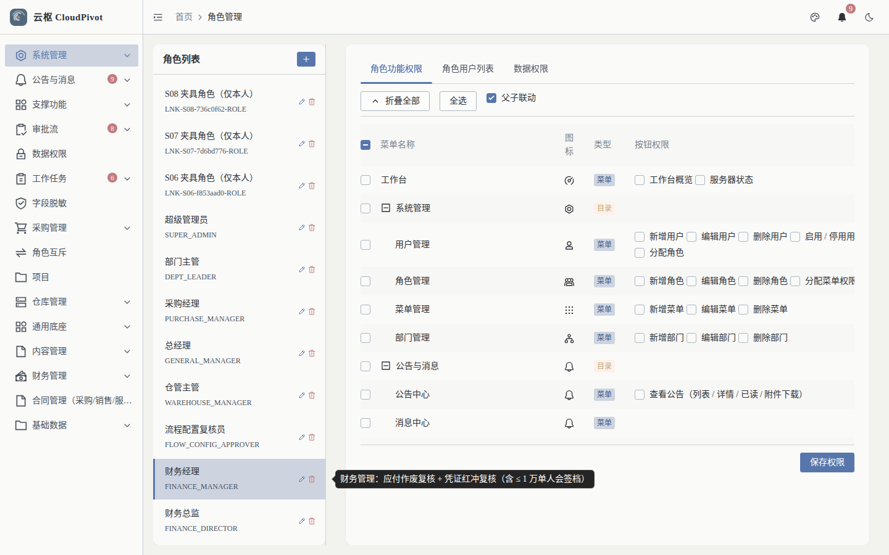
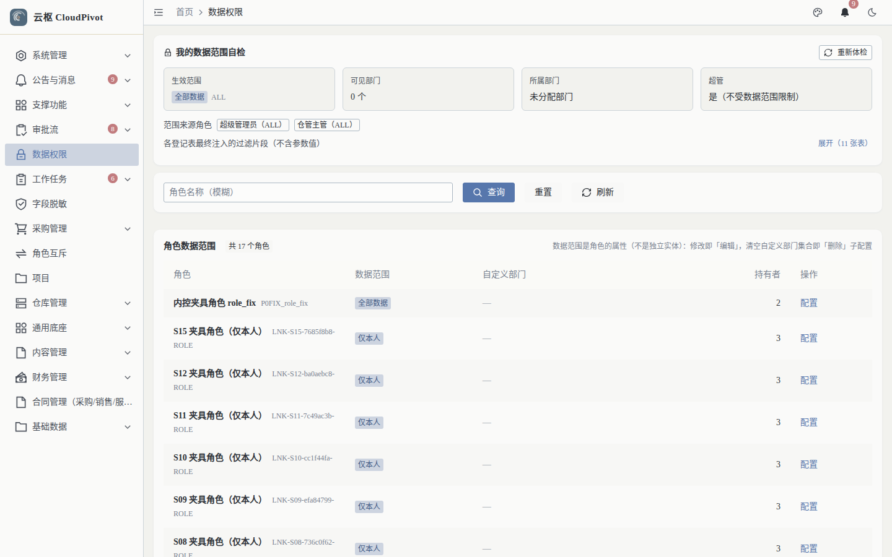
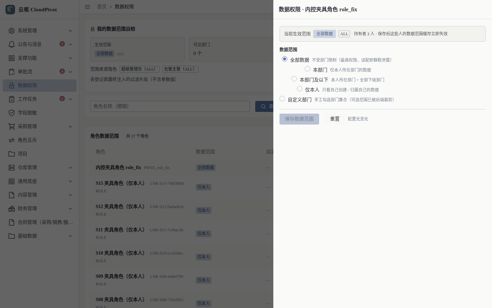
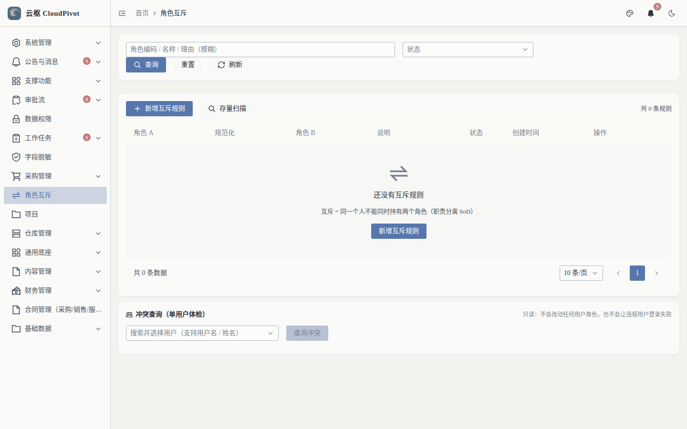
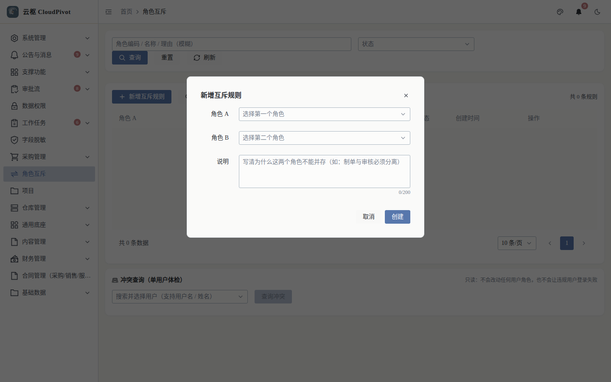
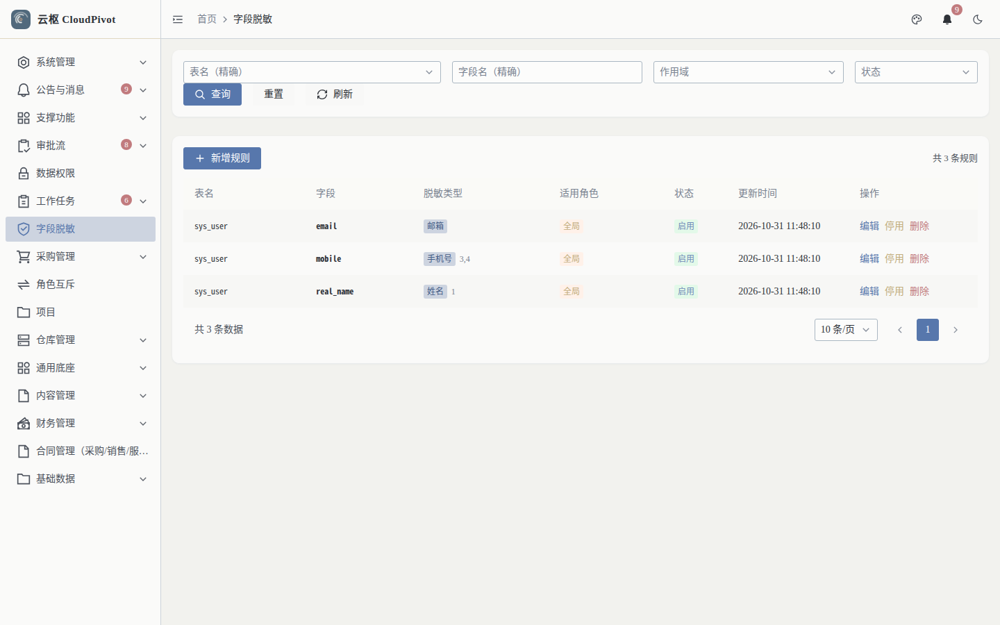
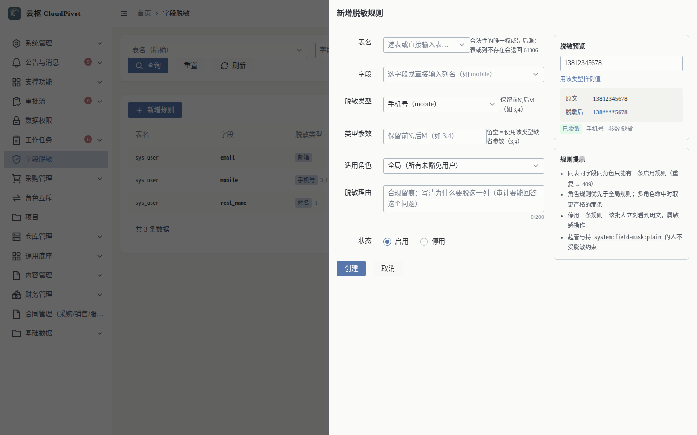

# 19 权限 · 使用手册

> **一句话**：功能权限决定「能不能点」，数据权限决定「能看到谁的数据」，角色互斥防「一人兼任互相制衡的两个岗」，字段脱敏决定「敏感字段露不露」。

- 适用版本：云枢 CloudPivot 基础版（通用底座 · 批次 B）
- 截图环境：`cloudpivot_manual2` 实例（`127.0.0.1:5180` → `:18097`），账号 `admin`（SUPER_ADMIN）
- 采集脚本：`scripts/manual/capture2.mjs perm`
- 采集证据：`docs/manual/evidence/p2b-capture-run1.log.txt` / `-run2.log.txt`

---

## 一、这个功能干什么

| 能力 | 页面 / 入口 | 作用 |
| --- | --- | --- |
| 功能权限 | 系统管理 → 角色管理 `/system/role` | 勾菜单 + 按钮（权限码），决定入口与动作是否可用 |
| 数据权限 | 数据权限 `/system/data-scope` | 每个角色一个范围：全部数据 / 本部门 / 本部门及以下 / 仅本人 / 自定义部门 |
| 角色互斥 | 角色互斥 `/system/role-mutex` | 声明「A 与 B 不能同一人持有」，并提供单用户冲突体检与存量扫描 |
| 字段脱敏 | 字段脱敏 `/system/field-mask` | 按表 + 字段 + 角色配置手机号 / 邮箱 / 姓名等脱敏，配了立即对已登录用户生效 |

四者的关系：**功能权限管入口 → 数据权限管行 → 字段脱敏管列 → 角色互斥管内控**。

---

## 二、谁能用（角色 + 权限）

| 事项 | 权限码 |
| --- | --- |
| 看角色功能权限树 / 保存 | `system:role:list` / `system:role:menu` |
| 看数据权限页 | `business:permission:scope:read` |
| 改角色数据范围（含自定义部门） | `system:role:update`（受「不得放宽超出自身范围」约束，见第四节） |
| 角色互斥列表 / 新建 / 删除 / 冲突体检 | `system:role-mutex:list` / `:create` / `:delete` / `:conflict` |
| 字段脱敏列表 / 新建 / 修改 / 删除 | `system:field-mask:list` / `:create` / `:update` / `:delete` |
| 免脱敏（明文查看） | `system:field-mask:plain` |

**角色口径**

- `SUPER_ADMIN`：全部可用，且**不受字段脱敏约束**（与持 `system:field-mask:plain` 的人一样）。
- 「角色管理员」：只给 `system:role:list` + `system:role:menu`；**`system:role:update` 要谨慎**，因为它能改数据范围。
- 数据范围的硬限制：非超管只能**收紧或保持不变**，放宽只能由超管做（`不能把数据范围从「{}」调整为「{}」：非超管只能收紧或保持不变（放宽由超管执行）`）。

---

## 三、完整操作步骤（真机截图）

### 步骤 1　角色功能权限（权限树）

系统管理 → 角色管理 → 选角色 → 页签 `角色功能权限`。

实测：权限树复选框 **288 个**（菜单 + 按钮全量）；表头 菜单名称 / 图标 / 类型 / 按钮权限；按钮 `折叠全部` / `全选` / `保存权限`。

操作要点：

1. 勾「菜单」= 侧边栏出现入口；
2. 勾「按钮权限」= 该动作的接口能过权限校验（如 `business:erp:payable:pay`）；
3. `保存权限` 后，持有该角色的用户**旧令牌里的权限快照作废**，需重新登录。

### 步骤 2　数据权限（每角色一个范围）

左侧「数据权限」（`/system/data-scope`）。

实测：

- 筛选：角色 + 数据范围 + `查询` / `重置` / `刷新` / `重新体检`
- 列：角色、数据范围、自定义部门、持有者、操作（10 行，含内控夹具角色）
- 「重新体检」会对所有角色做一次范围与持有者的健康检查

点某行的「配置 / 查看」打开抽屉：

实测抽屉原文（`数据权限 · 内控夹具角色 role_fix`）：

- `当前生效范围　全部数据 ALL`
- `持有者　2 人 · 保存后这些人的数据范围缓存立即失效`
- 五个选项及原文说明：
  - `全部数据`：不受部门限制（最高权限，误配即静默泄露）
  - `本部门`：仅本人所在部门的数据
  - `本部门及以下`：本人所在部门 + 全部下级部门
  - `仅本人`：只看自己创建 / 归属自己的数据
  - `自定义部门`：手工勾选部门集合（可选范围已被后端裁剪）
- 按钮：`保存数据范围` / `重置`；无改动时提示 `配置无变化`

### 步骤 3　角色互斥

左侧「角色互斥」（`/system/role-mutex`）。

实测：列 角色 A / 规范化 / 角色 B / 说明 / 状态 / 创建时间 / 操作；当前 `共 0 条规则`（`空=true`）；按钮 `查询` / `重置` / `刷新` / `新增互斥规则` / `存量扫描` / `查询冲突`。页面底部是 `冲突查询（单用户体检）`，右侧原文 `只读：不会改动任何用户角色，也不会让违规用户登录失败`。

点 `新增互斥规则`：

| 字段 | 说明 |
| --- | --- |
| 角色 A | `选择第一个角色` |
| 角色 B | `选择第二个角色` |
| 说明 | `写清为什么这两个角色不能并存（如：制单与审核必须分离）`，0/200 字，必填（合规留痕） |
| 按钮 | `取消` / `创建` |

互斥是**无方向**的：A 与 B 建过一条，再建 B 与 A 会被拒（`「{}」与「{}」的互斥关系已存在（互斥关系无方向，A 与 B 视为同一条）。`）。

### 步骤 4　字段脱敏

左侧「字段脱敏」（`/system/field-mask`）。

实测：列 表名 / 字段 / 脱敏类型 / 适用角色 / 状态 / 更新时间 / 操作；当前 3 条（`sys_user.email` 邮箱、`sys_user.mobile` 手机号、`sys_user.real_name` 姓名）；按钮 `查询` / `重置` / `刷新` / `新增规则`。

点 `新增规则`，右侧抽屉：

| 字段 | 说明 |
| --- | --- |
| 表名 | `选表或直接输入表…`；合法性唯一权威是后端：表或列不存在会返回 61006 |
| 字段 | `选字段或直接输入列名（如 mobile）` |
| 脱敏类型 | 下拉，如 `手机号（mobile）`，示例规则「保留前N,后M（如 3,4）」 |
| 类型参数 | `保留前N,后M（如 3,4）`；留空 = 使用该类型缺省参数（3,4） |
| 适用角色 | `全局（所有未豁免用户）` 或指定角色；角色规则优先于全局 |
| 脱敏理由 | 合规留痕：写清为什么要脱这一列（审计要能回答这个问题） |
| 状态 | `启用` / `停用` |
| 按钮 | `创建` / `取消` |

右侧两块实时反馈：

- `脱敏预览`：原文 `13812345678` → 脱敏后 `138****5678`，并标注 `已脱敏　手机号 · 参数 缺省`
- `规则提示`（原文四条）：
  1. 同表同字段同角色只能有一条启用规则（重复 → 409）
  2. 角色规则优先于全局规则；多角色命中时取更严格的那条
  3. 停用一条规则 = 该批人立刻看到明文，属敏感操作
  4. 超管与持 `system:field-mask:plain` 的人不受脱敏约束

---

## 四、常见错误怎么办

| 现象（系统原话） | 原因 | 处理 |
| --- | --- | --- |
| `不能把数据范围从「{}」调整为「{}」：非超管只能收紧或保持不变（放宽由超管执行）` | 非超管想放宽范围 | 找超管操作；这是防越权提权的硬闸 |
| `不能把数据范围设为「{}」：超出你自身的可见范围（当前为「{}」）` | 授出的范围大于自己持有 | 先扩自己的范围（超管），或改授更小的范围 |
| `{table_name}.{column_name} 已存在{scope}脱敏规则，请直接修改那一条` | 同表同字段同角色重复建规则 | 改成修改现有规则 |
| `表 {table_name} 上不存在列 {column_name}（规则会永不生效，已拒绝）` | 表名 / 列名写错（或拼写与库不一致） | 用下拉选，别手打；确需手打先与 DBA 核对列名 |
| `脱敏理由（reason）不能为空：这是合规留痕字段` | 没写理由 | 写清业务理由（谁要求、依据哪条合规要求） |
| `邮箱脱敏没有参数，mask_param 请留空` | 给邮箱类型填了参数 | 清空参数 |
| `「{}」与「{}」的互斥关系已存在（互斥关系无方向，A 与 B 视为同一条）。` | 重复建互斥（含反向） | 改现有规则 |
| `请填写互斥理由（用于合规留痕）。` | 说明留空 | 写清为什么要互斥 |
| `请提供 user_id 参数（要体检的用户 ID）` | 冲突查询没选人 | 先在下拉里选用户再查 |
| 保存权限后用户还是点不动 | 旧令牌权限快照未过期 | 让用户重新登录 |
| 授了权限但按钮仍灰 | 按钮权限码没勾（只勾了菜单） | 展开「按钮权限」逐个勾 |

---

## 五、与哪些功能联动

- **系统管理（手册 18）**：用户 → 角色 → 部门是这里所有规则的判据。
- **全部业务模块**：功能权限码来自 `sys_menu.auth_code`，与后端 `#[permission]` 注解一一对应。
- **审批流（手册 02）**：审批节点绑角色；角色互斥用于「制单与审核必须分离」这类内控要求。
- **通知（手册 20）**：发送对象「按角色 / 按部门」用的是同一套角色与部门数据。
- **巡检（手册 22）**：内控体检（互斥冲突、数据范围越权）与不变量巡检同属「账外审计」链路。
