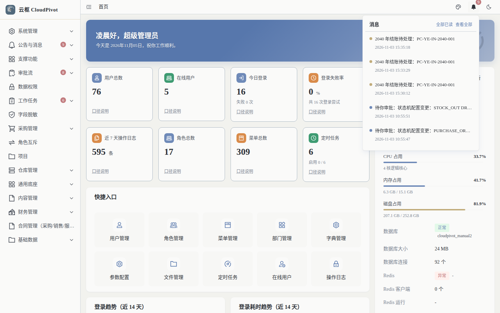
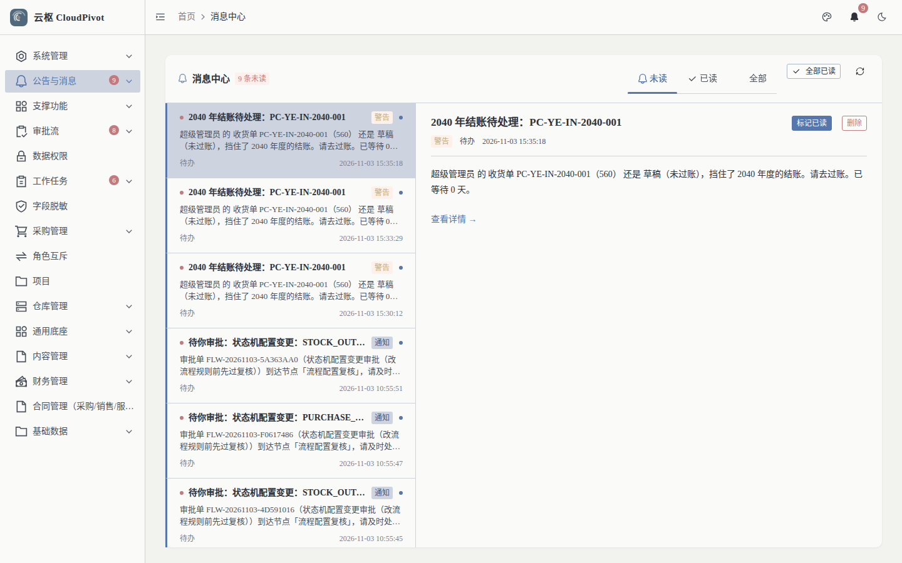
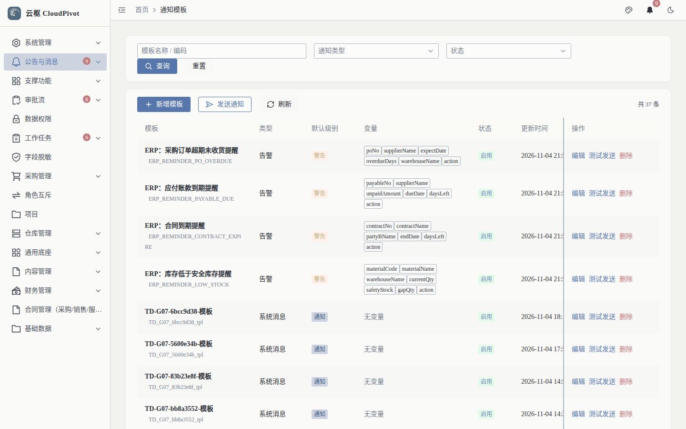
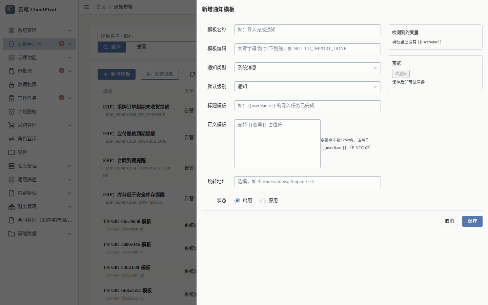
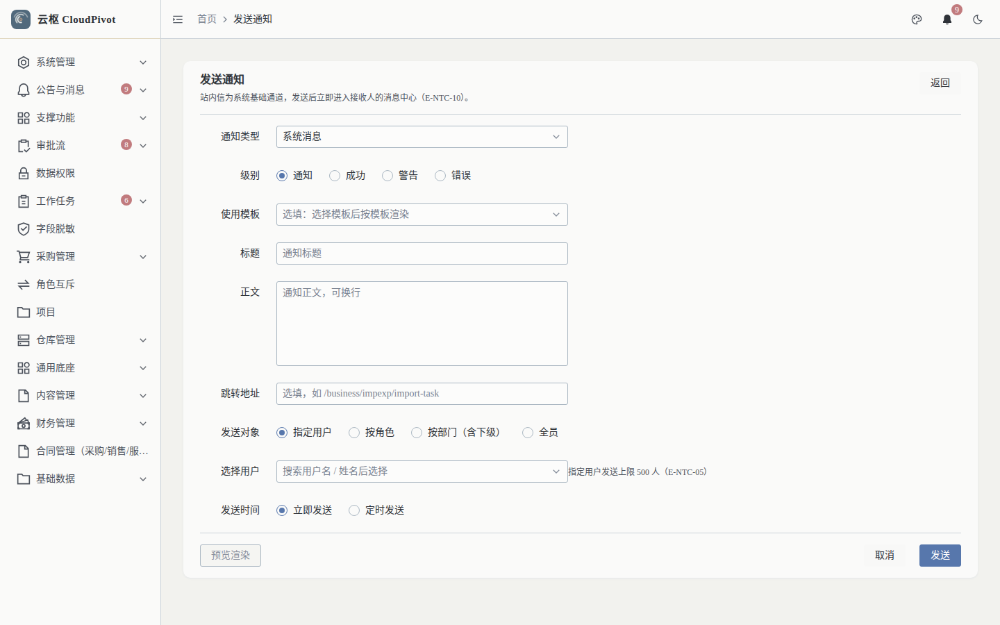

# 20 通知 · 使用手册

> **一句话**：站内信是系统的基础通道——审批待办、到期提醒、期间催办都从这里进到人的消息中心；模板管文案，发送页管投递。

- 适用版本：云枢 CloudPivot 基础版（公告与消息）
- 截图环境：`cloudpivot_manual2` 实例（`127.0.0.1:5180` → `:18097`），账号 `admin`
- 采集脚本：`scripts/manual/capture2.mjs notice`
- 采集证据：`docs/manual/evidence/p2b-capture-run1.log.txt` / `-run2.log.txt`

---

## 一、这个功能干什么

| 能力 | 说明 |
| --- | --- |
| 铃铛（顶栏） | 未读计数 + 最近消息面板，点进消息中心 |
| 消息中心 `/business/notice/message` | 我的消息：未读 / 已读 / 全部；批量已读、删除 |
| 通知模板 `/business/notice/template` | 模板化文案（标题/正文支持 `{{变量}}`），可试渲染、可停用 |
| 发送通知 `/business/notice/send` | 手工发一条：立即或定时，指定用户 / 按角色 / 按部门（含下级）/ 全员 |

另有「公告」是独立功能（`business:announcement:*`，页面 `/announcement` 公告中心与 `/business/announcement` 公告管理），广播性质、可下线，与站内信不是一套表；本篇不展开。

---

## 二、谁能用（角色 + 权限）

| 事项 | 权限码 |
| --- | --- |
| 看自己的消息（铃铛 / 消息中心） | `business:notice:mine` |
| 通知模板列表 / 新建 / 修改 / 删除 | `business:notice:template:list` / `:create` / `:update` / `:delete` |
| 发送通知（含定时） | `business:notice:send` |
| 消息管理列表（全部人） | `business:notice:list` |
| 删除消息 | `business:notice:delete` |
| 通道配置（邮件 / Webhook 等） | `business:notice:channel:config` |

**角色口径**：`SUPER_ADMIN` 全部可用；普通用户只需 `business:notice:mine`（否则铃铛与消息中心都看不到）；发通知建议只给行政 / 运维/ 财务共享岗，不要给业务操作岗。

---

## 三、完整操作步骤（真机截图）

### 步骤 1　顶栏铃铛

任意页面点右上角铃铛。

实测面板原文（节选）：`消息　全部已读　查看全部` + 消息列表（`2040 年结账待处理：PC-YE-IN-2040-001　2026-11-03 15:35:18` …）。点 `查看全部` 进消息中心。

### 步骤 2　消息中心

左侧「公告与消息 → 消息中心」（`/business/notice/message`）。

实测：

- 页签：`未读` / `已读` / `全部`
- 按钮：`全部已读` / `标记已读` / `删除`
- 当前实例该账号未读为空（空状态），列表按消息时间倒序

### 步骤 3　通知模板

左侧「公告与消息 → 消息通知」（`/business/notice/template`）。

实测：`共 10 条`；列 模板 / 类型 / 默认级别 / 变量 / 状态 / 更新时间 / 操作；按钮 `查询` / `重置` / `新增模板` / `发送通知` / `刷新`。内置模板包括 `ERP: 采购订单超期未收货提醒`、`ERP: 应付账款到期提醒`、`ERP: 合同到期提醒`、`ERP: 库存低于安全库存提醒` 等（编码如 `ERP_REMINDER_PO_DUE`）。

点 `新增模板`：

| 字段 | 说明 |
| --- | --- |
| 模板名称 | 如「导入完成通知」 |
| 模板编码 | `大写字母/数字/下划线，如 NOTICE_IMPORT_DONE`，全局唯一 |
| 通知类型 | 如 `系统消息` |
| 默认级别 | `通知` / 成功 / 警告 / 错误 |
| 标题模板 | 如 `{{userName}} 的导入任务已完成` |
| 正文模板 | 支持 `{{变量}}` 占位符；右侧提示 `变量名不能含空格，请写作 {{userName}}（E-NTC-02）` |
| 跳转地址 | 选填，如 `/business/impexp/import-task` |
| 状态 | `启用` / `停用` |
| 右侧反馈 | `检测到的变量`（未写变量时显示 `模板里还没有 {{userName}}`）、`预览`（`试渲染`，保存后可试渲染） |
| 按钮 | `取消` / `保存` |

### 步骤 4　发送通知

模板页右上 `发送通知`，或直接访问 `/business/notice/send`。

实测字段：

| 字段 | 说明 |
| --- | --- |
| 通知类型 | 下拉，如 `系统消息` |
| 级别 | `通知` / `成功` / `警告` / `错误` |
| 使用模板 | `选填：选择模板后按模板渲染` |
| 标题 | `通知标题`（不用模板时必填） |
| 正文 | `通知正文，可换行`（不用模板时必填） |
| 跳转地址 | `选填，如 /business/impexp/import-task` |
| 发送对象 | `指定用户` / `按角色` / `按部门（含下级）` / `全员` |
| 选择用户 | `搜索用户名 / 姓名后选择`；右侧限制 `指定用户发送上限 500 人（E-NTC-05）` |
| 发送时间 | `立即发送` / `定时发送`（定时到点由巡逻任务投递） |
| 按钮 | `预览渲染` / `取消` / `发送` |

页头说明原文：`站内信为系统基础通道，发送后立即进入接收人的消息中心（E-NTC-10）。`

---

## 四、常见错误怎么办

| 现象（系统原话） | 原因 | 处理 |
| --- | --- | --- |
| `模板编码已存在` | 编码重复 | 换编码（大写 + 下划线，如 `NOTICE_IMPORT_DONE_V2`） |
| `未使用模板时标题不能为空` / `未使用模板时正文不能为空` | 没选模板又没填标题/正文 | 二选一：选模板或手填 |
| `模板已被 {used} 条通知引用，不能删除` | 模板已被引用 | 改成「停用」，不要删 |
| `模板占位符未在 variables 中声明：{}` | 模板里写了 `{{x}}` 但发送时没传变量 | 发送前补齐变量；或用「预览渲染」先自检 |
| `接收人 {count} 人超过单条通知上限 {MAX_RECEIVERS} 人：请改用全员公告或分批发送` | 一次发给太多人 | 改用「全员」公告，或按部门 / 角色分批发 |
| `同一幂等键的通知已存在，请检查 idempotency_key` | 重复提交（同一次点击提交了两次） | 刷新看是否已发出，不要重复补发 |
| `通知不存在、已读或不属于当前用户` | 批量已读 / 删除的消息不归自己 | 只操作自己的消息 |
| 铃铛一直显示旧未读数 | SSE 实时通道断开（实测控制台会有 `401 /api/business/notice/stream`） | 刷新页面；这是探针鉴权的已知现象，站内信本身不受影响 |
| 定时通知到点没发 | 巡逻任务未运行 / 到点时间已过 | 查「支撑功能 → 定时任务」的状态；必要时改立即发送 |

---

## 五、与哪些功能联动

- **审批流（手册 02）**：待办 / 已办通过站内信推给审批人。
- **会计期间（手册 14）/ 年度结转（手册 15）**：催办走 `business:erp:period:remind` 与 `year-end:remind`，落到对方的待办与消息中心；实测见 `notice/01` 里的「2040 年结账待处理」。
- **应付到期 / 采购超期 / 合同到期 / 低库存**：内置提醒模板，由定时任务扫描触发。
- **权限（手册 19）**：「按角色 / 按部门（含下级）」依赖角色与部门数据。
- **文件与附件（手册 21）**：通知里的「跳转地址」常指向具体单据，审批人点开即到。
