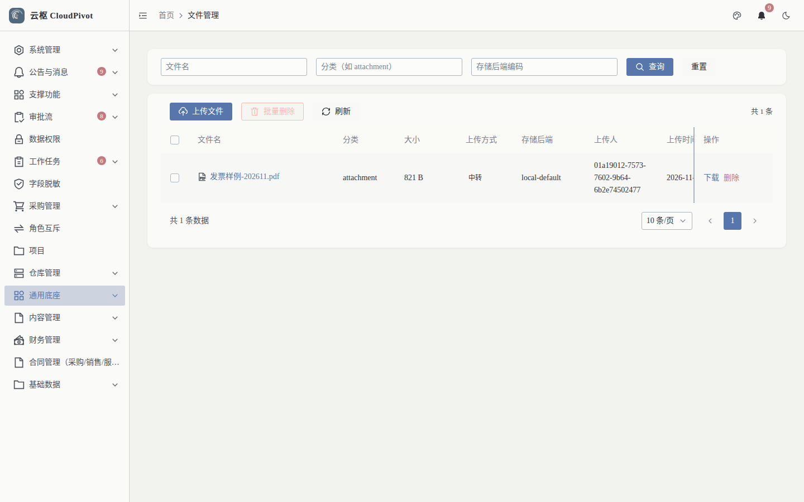
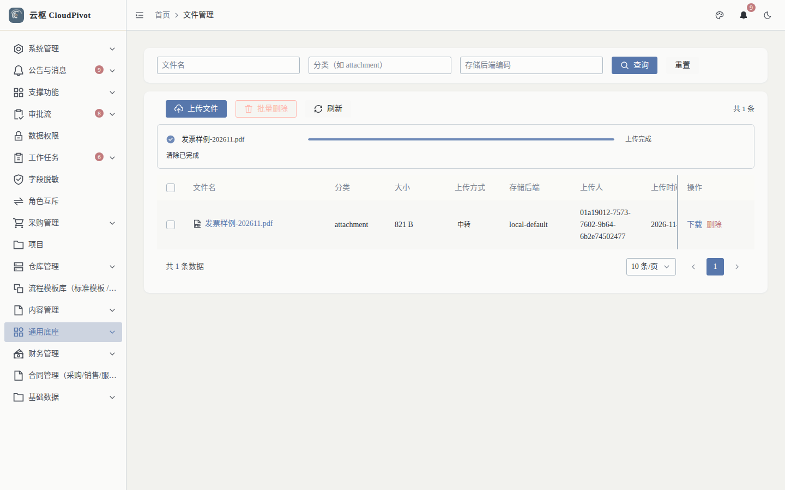
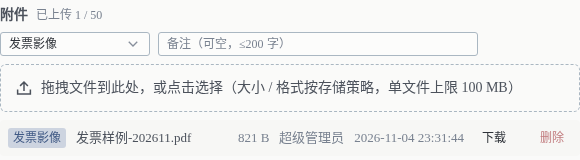
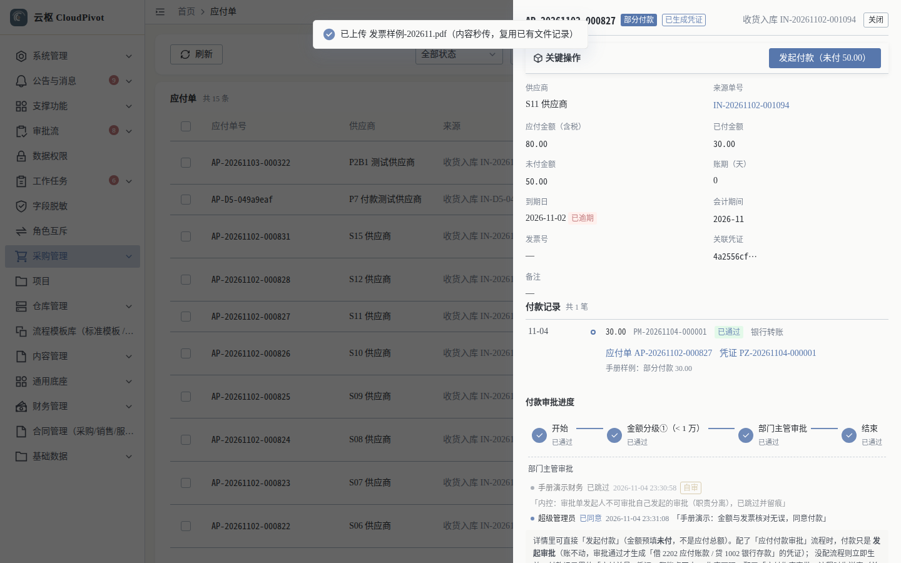
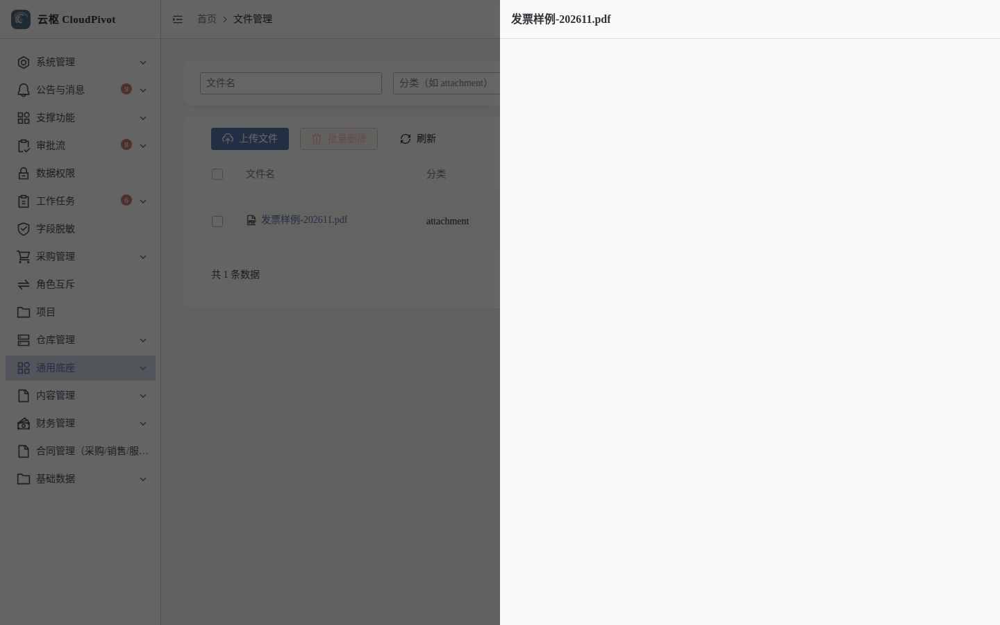

# 21 附件与文件 · 使用手册

> **一句话**：附件是把发票、合同、影像挂到单据上；文件管理是对象存储的「总仓」——按分类走不同存储策略，相同内容自动秒传。

- 适用版本：云枢 CloudPivot 基础版（通用底座 · 对象存储）
- 截图环境：`cloudpivot_manual2` 实例（`127.0.0.1:5180` → `:18097`），账号 `admin`
- 采集脚本：`scripts/manual/capture2.mjs attach`（只读截图：`attach/01~03`）
  与 `seed_attach`（一次性写库取证：`seed-attach/01~02`，`MANUAL_WRITE=1` 才执行）
- 采集证据：`docs/manual/evidence/p2b-capture-run1.log.txt` / `-run2.log.txt`

---

## 一、这个功能干什么

1. **单据附件**：应付单、采购单等详情的「附件」区，按分类（如「发票影像」）上传 / 下载 / 删除，并带备注。
2. **文件管理（对象存储）**：`通用底座 → 文件管理`（`/business/storage/file`）看全量文件：文件名、分类、大小、上传方式、存储后端、上传人、上传时间。
3. **存储策略**：按分类配置允许的 MIME / 扩展名、单文件大小上限、目标后端（本地磁盘或 S3 预签名直传）。
4. **秒传**：上传前按内容哈希比对，命中已有文件直接复用记录（不重复占空间）。
5. **回收**：软删文件的对象由后台任务每日 04:30 回收（与通知清理错峰）。

> 说明：`支撑功能 → 文件管理`（`/support/file`，权限 `support:file:list`）是早期本地文件库，走 `[upload].path` 目录与 `[upload].max_size_mb`；本篇讲的是**对象存储版**（`/business/storage/file`）。培训时统一用「通用底座 → 文件管理」，不要两个混用。

---

## 二、谁能用（角色 + 权限）

| 事项 | 权限码 |
| --- | --- |
| 看文件列表 | `business:storage:list` |
| 上传 / 下载 / 删除 | `business:storage:upload` / `:download` / `:delete` |
| 存储配置（后端 / AK / SK） | `business:storage:config:list` / `:create` / `:update` / `:delete` / `:test` |
| 存储策略（分类 / 大小 / 白名单） | `business:storage:policy:list` / `:update` |
| 单据附件面板 | 跟随单据权限（如应付详情 `business:erp:payable:detail`） |

**角色口径**：`SUPER_ADMIN` 全部可用；业务岗只需 `storage:upload` + `storage:download`（附件面板跟着单据详情权限走）；`storage:config:*` 与 `policy:update` 只给运维，AK/SK 只写不读（保存后界面上再也读不出来）。

---

## 三、完整操作步骤（真机截图）

### 步骤 1　看文件管理（总仓）

左侧「通用底座 → 文件管理」（`/business/storage/file`）。

实测：

- 筛选：`文件名`、`分类（如 attachment）`、`存储后端编码` + `查询` / `重置`
- 按钮：`上传文件` / `批量删除` / `刷新`；`共 1 条`
- 列：文件名、分类、大小、上传方式、存储后端、上传人、上传时间、操作
- 当前 1 条：`发票样例-202611.pdf`　`attachment`　`821 B`　上传方式 `中转`　存储后端 `local-default`　`下载` / `删除`

上传过程（真机，写库取证）：

点 `上传文件` 选文件后，列表上方出现进度条 `发票样例-202611.pdf　上传完成`。

> **已知显示缺陷（实测）**：`上传人` 列显示的是账号 UUID（如 `01a19012-7573-7602-9b64-6b2e74502477`），不是姓名 / 用户名。附件面板里显示的是「超级管理员」。属前端展示问题，已随本卡汇报登记。

### 步骤 2　在单据里传附件

「财务管理 → 应付单」→ `查看` → 详情下方「附件」区。

实测面板：

- 标题：`附件　已上传 1 / 50`（单条单据最多 50 个附件）
- 分类下拉：`发票影像`（还有其它分类，取决于存储策略）
- 备注：`备注（可空，≤200 字）`
- 拖拽区：`拖拽文件到此处，或点击选择（大小 / 格式按存储策略，单文件上限 100 MB）`
- 已上传行：`发票影像　发票样例-202611.pdf　821 B　超级管理员　2026-11-04 23:31:44　下载　删除`

操作：拖文件进去或点拖拽区选文件 → 选择分类 → 保存。上传成功提示（实测真机原文，截图顶部提示条）：

> 提示原文：`已上传 发票样例-202611.pdf（内容秒传，复用已有文件记录）` —— 同一份文件第二次上传走秒传，不重复存对象。

### 步骤 3　预览 / 下载

在文件管理列表点文件名（或附件行的 `下载`）。

实测：右侧抽屉标题为文件名 `发票样例-202611.pdf`，PDF 可直接预览；`下载` 走 `business:storage:download` 权限。

---

## 四、常见错误怎么办

| 现象（系统原话） | 原因 | 处理 |
| --- | --- | --- |
| `分类 {category} 的上传策略已停用，请联系管理员` | 该分类的策略被停用 | 换分类，或让管理员启用策略 |
| 超过 100 MB 被拒（`110 MB 超过 100 MB 上限必须被拒`） | 超过策略里的单文件上限 | 压缩或拆分；上限由分类策略决定，不是全局写死 |
| `本地后端不支持浏览器直传，请改用服务端上传接口` | 策略指向本地磁盘，却走了前端直传 | 用「上传文件」走服务端上传；或把策略切到 S3 后端 |
| `对象大小 {} 与声明 {} 不一致，请重新直传` / `对象内容哈希与声明不一致，请重新直传` | 直传中断或文件被替换 | 重新上传 |
| `对象不存在，直传可能未完成或已被清理` | 直传未完成，或对象已被回收任务清掉 | 重新上传；当天 04:30 后确认是否被回收 |
| 附件区显示 `已上传 0 / 50` 但列表有文件 | 该附件属于别处（未挂到本单） | 在附件区重新上传；或检查文件管理里的「分类」与单据对应关系 |
| 删除后文件还在总仓 | 删除是软删，对象由每日 04:30 回收任务清理 | 属正常；需要立即释放空间请运维执行回收 |
| AK/SK 保存后看不清原值 | 设计如此：AK/SK 加密存储、只写不读 | 忘记就重新填（不会回显） |

---

## 五、与哪些功能联动

- **应付 / 采购 / 收货**：单据附件（发票影像、合同扫描件）是审计取样点。
- **审批流（手册 02）**：审批详情里能看到附件，避免「口头说发票已到」。
- **通知（手册 20）**：通知的「跳转地址」常指向带附件的单据。
- **权限（手册 19）**：附件可见性跟单据权限走；脱敏规则不影响文件本身内容。
- **巡检 / 运维（手册 22）**：回收任务与清理任务错峰运行，运维可在「支撑功能 → 定时任务」看到执行记录。
