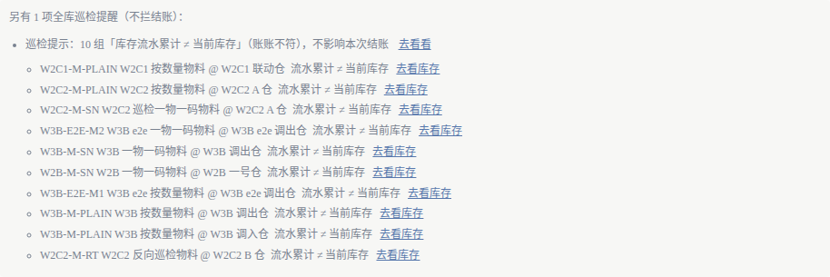
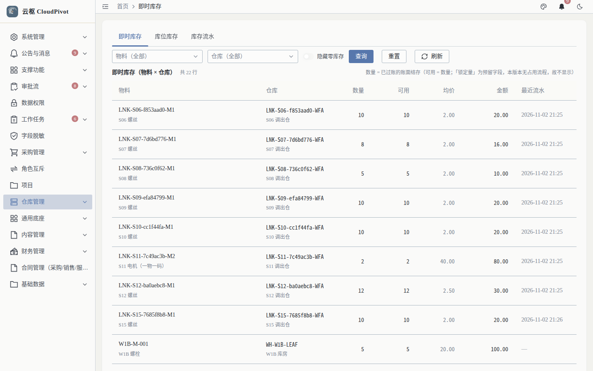
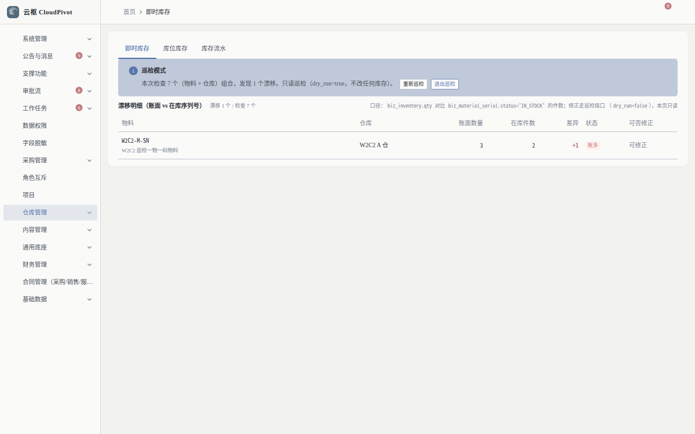
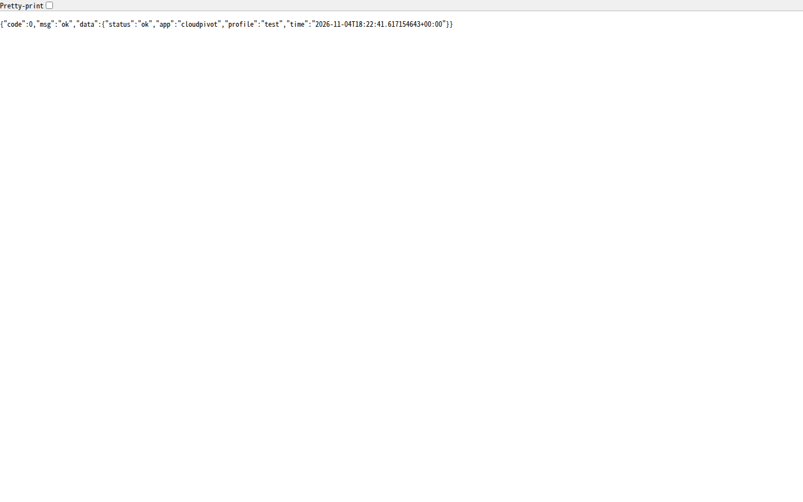

# 22 巡检 · 使用手册

> **一句话**：巡检分三层——「本月的账对不对」拦结账，「整本账对不对」只提示，「账上的数量与实物序列号对不对」单独出报告；三层的结论都在同一处能看见。

- 适用版本：云枢 CloudPivot 基础版（ERP 巡检 / 运维）
- 截图环境：`cloudpivot_manual2` 实例（`127.0.0.1:5180` → `:18097`），账号 `admin`
- 采集脚本：`scripts/manual/capture2.mjs inspect`
- 采集证据：`docs/manual/evidence/p2b-capture-run1.log.txt` / `-run2.log.txt`

---

## 一、这个功能干什么

| 层 | 检查什么 | 谁在跑 | 结论怎么用 |
| --- | --- | --- | --- |
| ① 期间内不变量（A1 / A2） | 本期凭证分录取和是否平、凭证头与分录是否一致 | 结账预检（同步） | **拦结账**：不过就 409，逐条点名 |
| ② 全库账实 / 账账（B4 / C1 / C2） | 库存流水累计 = 当前库存？有无负库存 / 负库位库存？ | 结账预检（同步，只读）＋ 每日套件 | **只提示不拦**：封账那一刻看得见，但不否决结账 |
| ③ 库存巡检（不变式③） | 账面数量 = 在库序列号件数（一物一码物料） | 接口 `GET /business/erp/inventory/audit` | 只报不修（`dry_run=true` 默认），可 `dry_run=false` 按序列号重算修正 |

为什么 ② 只提示不拦：B4 / C1 / C2 是**全库时点数**、不按期间切；任何一处漂移都能封死所有期间的结账（2027 年的一笔错调拨能让 2018 年的账永远结不了），而且单据过账事务进行中会短暂出现「流水已写、库存未写」的中间态。所以分工是：**结账闸管本月**，**巡检管整本账**（`scripts/verify/erp_invariants.py` 每天跑，那里 C1 / C2 是 BLOCKER 级）。这条设计判断来自 `backend/src/business/erp/period.rs` 的 `global_health_warnings` 注释。

---

## 二、谁能用（角色 + 权限）

| 事项 | 权限码 |
| --- | --- |
| 看结账预检里的巡检提示 | `business:erp:period:close` |
| 即时库存 / 库位库存 / 库存流水 | `business:erp:inventory:list` / `business:erp:inventory-location:list` / `business:erp:inventory-txn:list` |
| 库存巡检（数量 vs 序列号） | `business:erp:inventory:audit` |
| 健康检查 `/health`、`/health/deps` | 免认证（负载均衡 / 监控专用） |

**角色口径**：`SUPER_ADMIN` 全部可用；仓管建议 `inventory:list` + `inventory-txn:list`；`inventory:audit` 属**修正类**权限（`dry_run=false` 会改库），只给仓储负责人与运维。

---

## 三、完整操作步骤（真机截图）

### 步骤 1　在结账预检里看巡检提醒

「财务管理 → 会计期间」→ 目标期间行点 `结账`，预检弹窗下半部分。



实测原文：

```text
另有 1 项全库巡检提醒（不拦结账）：
  巡检提示：10 组「库存流水累计 ≠ 当前库存」（账账不符），不影响本次结账　去看看
  W2C1-M-PLAIN  W2C1 按数量物料 @ W2C1 联动仓  流水累计 ≠ 当前库存  去看库存
  W2C2-M-PLAIN  W2C2 按数量物料 @ W2C2 A 仓    流水累计 ≠ 当前库存  去看库存
  …
```

要点：

- 文案写的是「**不影响本次结账**」——它不进 `blockers`，只进 `warnings`，`确认结账` 仍然可用；
- 每条明细都带「物料 + 仓库 + 差值口径」，点 `去看看` 跳库存页；
- 同一天这批漂移在每日套件里会被判成 BLOCKER，必须当天修（见步骤 3）。

### 步骤 2　跳到库存页核对（落点口径）

点 `去看看` 落到 `/business/erp/inventory?audit=1`。



实测：页签 `即时库存` / `库位库存` / `库存流水`；列 物料、仓库、数量、可用、均价、金额、最近流水（当前页 20 行）；按钮 `查询` / `重置` / `刷新`。

> **修复记录（2026-11-05，卡 t_27ef744a）**：`?audit=1` 前端已消费 —— 从巡检提醒点进来直接是**巡检模式**：顶部提示条给出「检查 N 个组合 / 发现 M 个漂移」并注明只读（`dry_run=true`，不改任何库存），下方表格**只列**「账面数量 ≠ 在库序列号数」的（物料 × 仓库），`差异` 带符号（`+1 账多` / `-1 账少`），`可否修正` 一列说明缺仓库归属的行修不了。上面那张图是修复前的落点（当时与普通即时库存完全一致）。修复后实测：



实测原文：`本次检查 7 个（物料 × 仓库）组合，发现 1 个漂移。只读巡检（dry_run=true，不改任何库存）。`
表格一行：`W2C2-M-SN　W2C2 巡检一物一码物料　W2C2 A 仓　账面 3　在库 2　+1　账多　可修正`。
点 `退出巡检` 回到普通即时库存（实测 `共 22 行`），URL 上的 `?audit=1` 一并摘掉 —— 巡检模式是**过滤器**，不是把页面锁死。

### 步骤 3　健康检查（运维口径）

后端两个探针（实测返回）：

```text
GET /health        → {"code":0,"msg":"ok","data":{"status":"ok","app":"cloudpivot","profile":"test","time":"2026-11-04T18:04:55Z"}}
GET /health/deps   → {"status":"ok","db":{"ok":true,"latency_ms":0.587},
                      "cache":{"ok":true,"latency_ms":0.019},
                      "auth":{"revocation_source":"db","cache_degraded":false}}
```



区别（源码 `support/health.rs`）：

- `/health` 是 **liveness**：进程活着就 200，不鉴权、不查库、不看缓存——不要拿它当「依赖都健康」；
- `/health/deps` 是 **readiness**：PostgreSQL / 缓存任一不健康返回 **503**，可以直接挂给负载均衡；
- `auth.cache_degraded=true` 表示权限撤销缓存降级（此时以 DB 为准），属可观测信号，不是故障。

### 步骤 4　库存巡检接口（数量 vs 序列号）

```text
GET /api/business/erp/inventory/audit?dry_run=true      # 默认：只报不修
GET /api/business/erp/inventory/audit?dry_run=false     # 按序列号重算并修正（同事务）
权限：business:erp:inventory:audit
```

口径（源码 `inventory_audit.rs`）：对每个一物一码物料 × 仓库比对 `biz_inventory.qty` 与 `COUNT(serial WHERE status='IN_STOCK')`，三个方向都查（账多 / 账少 / 有序列号但没库存行），返回 `checked / mismatched / items / fixed / unfixable`；四类脏数据（`warehouse_id` 为空）只报不可修，计入 `unfixable`。

> 本手册未在演示库执行 `dry_run=false`（会改演示数据），修正动作请在演练库先跑一遍再上生产。

---

## 四、常见错误怎么办

| 现象 | 原因 | 处理 |
| --- | --- | --- |
| 结账预检里一堆「巡检提示」但能照常结账 | 设计如此：全库巡检只提示 | 结账可以继续，但当天必须把漂移修掉，否则下游报表与对账会持续偏差 |
| 结账被 `不变量未通过（{count} 项）` 拦住 | A1 / A2 属**拦人**项 | 按点名凭证红冲重开，再结账（手册 10） |
| 点「去看看」后只看到漂移表，找不到全部库存 | 巡检模式（`?audit=1`）只列漂移物料，属正常口径 | 点提示条右侧 `退出巡检`，或把 URL 上的 `?audit=1` 去掉，回到普通即时库存 |
| `库存巡检` 返回 `unfixable > 0` | 存在 `warehouse_id` 为空的在库序列号 | 属脏数据，不能自动修；按返回明细人工建档归仓 |
| `/health/deps` 返回 503 | PostgreSQL 或缓存不可用 | 看返回里哪个 `ok=false`；`/health` 仍是 200 属正常（不代表依赖健康） |
| `dry_run` 传了非法值 | 参数只接受 `true / false`（缺省 true） | 按布尔字面量传 |

**运维侧每日巡检**（不在界面，属于发布 / 值守流程）：

```bash
python3 scripts/verify/erp_invariants.py            # 全量跑，输出报告
python3 scripts/verify/erp_invariants.py --json     # 给监控用
# 退出码：有 BLOCKER → 1（scripts/check.sh 的闸③ 靠这个判红）；否则 0
# 容差：金额比较一律 numeric，TOL = 0.0001；FAIL 必须给出「差多少、差在哪几条」
```

---

## 五、与哪些功能联动

- **会计期间（手册 14）**：巡检提醒出现在结账预检；A1/A2 决定能不能封账。
- **年度结转（手册 15）**：年结的「不变量全绿」就是 A 组口径；B4/C1/C2 不参与年结判定。
- **库存查询（手册 06）**：漂移的核对落点是即时库存 / 库位库存 / 库存流水三个页签。
- **库存调拨 / 收货入库 / 出库单**：B4 漂移的常见来源是跨仓调拨与序列号重算。
- **运维 / 报表（手册 09）**：巡检结论进日报；账不平时报表数字不可对外。
